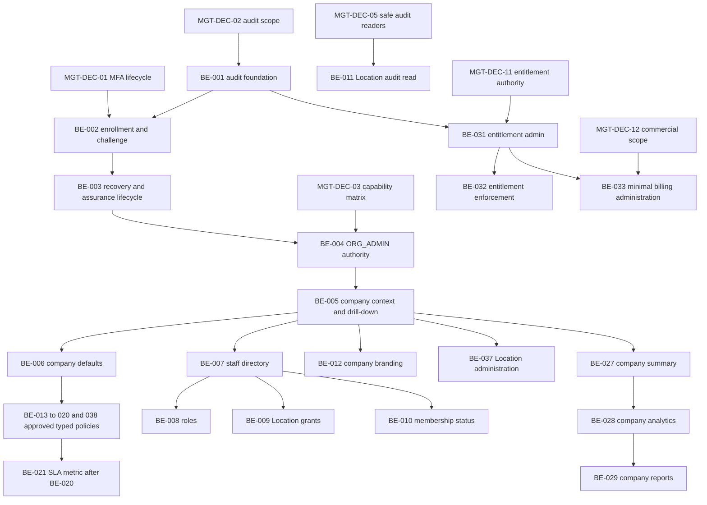

# Management Backend — Issue #216 audit and execution plan

Status: Planning proposal; not an Accepted decision or implementation authorization.

Audit date: 2026-09-12. Owner: invoking Project Owner. Task: Issue #216 decomposition.

Scope: repository audit, one planning artifact, feature-branch commit/push only.

## 1. Current baseline and method

| Item                      | Verified value                                                                   |
| ------------------------- | -------------------------------------------------------------------------------- |
| Initial working directory | `C:\Users\MCC\Desktop\Valet` (parent, not a Git root)                            |
| Initial repository        | `C:\Users\MCC\Desktop\Valet\valet-platform`                                      |
| Initial branch / HEAD     | `main` / `ca82d6ea2fbd2c2cf35287b7d62d0a46b0fc8261`                              |
| Initial status            | `## main...origin/main`; no changed or untracked files                           |
| Remote                    | `origin https://github.com/veletpro0-lgtm/valet-platform.git` for fetch and push |
| Fresh main inspected      | `ca82d6ea2fbd2c2cf35287b7d62d0a46b0fc8261`; fetched, HEAD...origin/main = `0 0`  |
| Planning worktree         | `C:\Users\MCC\Desktop\Valet\management-216-plan`                                 |
| Planning branch           | `docs/VAL-009-management-216-plan`                                               |
| Base SHA                  | `ca82d6ea2fbd2c2cf35287b7d62d0a46b0fc8261`                                       |
| Planning start status     | Clean; branch initially tracks origin/main, changed to its own remote on push    |
| Migrations at baseline    | 33 directories; latest `20260911003300_mob_020d_staff_push_cleanup`              |

The supplied request assumed an existing Management worktree. Git registered only the main checkout. A new isolated planning worktree was therefore necessary to satisfy the prohibition on working on main. No existing checkout was switched, rebased, or edited. No Employee worktree was inspected. Remote-ref discovery is not inspection of another worktree. Feature-branch history discovered with `--all` was not treated as implemented: conclusions below use files in the pinned main checkout and ancestry on `origin/main`.

Issue source: the complete local `C:\Users\MCC\Desktop\VAYLET_Issue_216_Management_Backend.md`, read in full. Its purpose, existing foundations, every P0/P1/P2 section, exclusions, security requirements and closure criterion are covered below. No Issues API, `gh issue view`, external issue retrieval, or GitHub issue-state assumptions were used. The issue is evidence of requested scope, not higher authority than Accepted DECs. The separate pasted request authorizes this audit and documentation delivery, not backend implementation.

Evidence is static source, SQL migrations, test assertions and reachable commit history. Existing tests were inspected, not executed as fresh runtime proof. No provider deployment, database, device, security effectiveness, current CI status or live issue closure is certified. No dependencies were installed. Memory was used only to locate prior repository topics; current claims were checked against this baseline.

## 2. Authority reviewed and conflicts

Only root `AGENTS.md` exists in the tracked tree; no nested AGENTS override was found. Authority order is owner request → Accepted DECs (focused full contract before log summary) → Blueprint bridge → product scope → state machine → schema → domain → stack → structure rules → engineering/security → collaboration → CONTRIBUTING → historical concept.

Reviewed authority and relevant sections:

- `AGENTS.md`, `docs/00_SOURCE_OF_TRUTH.md`, `docs/01_PRODUCT_SCOPE.md`, `docs/15_BLUEPRINT_V1_REBASELINE.md`: roles, Configuration First, company control plane, guest privacy, MVP/V2 boundaries. Founder Blueprint PDF is **not in this checkout**; `docs/reference/Valet_Project_Concept_Arabic.pdf` is the historical concept, not that Blueprint. This audit uses the explicitly approved bridge, without pretending to have read the absent PDF.
- `docs/02_DOMAIN_MODEL.md`, `docs/03_DATABASE_SCHEMA.md`, `docs/04_VALET_SESSION_STATE_MACHINE.md`: domain ownership, scoped references, history and legal transitions; checked against Prisma and owning commands.
- `docs/05_ENGINEERING_RULES.md`, `docs/06_SECURITY_AND_DATA_RULES.md`, `docs/09_TECH_STACK.md`, `docs/10_REPOSITORY_STRUCTURE.md`, `docs/17_AGENT_CODE_STRUCTURE_RULES.md`: module boundaries, typed contracts, privacy, database least privilege and the 300-line authored-code limit.
- `docs/13_COLLABORATION_WORKFLOW.md`, `CONTRIBUTING.md`, `docs/14_PROJECT_STATUS.md`: branch-only work and single migration owner. Status is historical convenience, not proof of current main.
- `docs/08_DECISIONS_LOG.md`: Accepted DEC-011 roles, DEC-017 configuration, DEC-018 Location currency/timezone, DEC-023 opaque password sessions and explicit MFA gate, DEC-024 anti-abuse, DEC-025 database boundary, DEC-026–030 ownership/provisioning/structure.
- Focused Accepted DEC-045–049: task-scoped tracking, persistence, map writes and live/history privacy; DEC-050–057: financial policy, validation/tips, cash, precise money, collection operations, provider reconciliation, refunds and projections.
- Focused Accepted DEC-058–062 and their canonical log summaries: typed Location mutation, incident reads, KPI formulas, report/export composition, branding/subscription. These close G2/G5/G6/G7/G8 of the earlier Phase 7 plan; they do not close MFA/G3/G4.
- Accepted DEC-069: returning recognition and explicit customer intent; DEC-072: native transport over the same password sessions; DEC-073–076 and `docs/21_STAFF_PUSH_WORKER_OPERATIONS.md`: current FCM push boundaries. DEC-074 and current OCR adapter distinguish assistive OCR from speculative integration work.
- `docs/22_PHASE7_DASHBOARD_EXECUTION_PLAN.md`: baseline, gates, policy catalog, role matrix and VAL-009A–F; `docs/20_EMPLOYEE_NATIVE_EXECUTION_PLAN.md`: shared modules and active-stream context, read only in this worktree.

Material reconciliation notes (no silent overrides):

1. **No accepted MFA lifecycle exists.** DEC-023, log lines 663–667, expressly requires a separate enrollment/challenge/recovery decision and session-bound assurance. DEC-072 §13 retains `{ userId }`; it is not MFA approval. Issue #216's wording “accepted MFA contract” describes a required future boundary, not an existing implementation contract.
2. **Company authority needs DEC amendments as well as MFA.** DEC-058/060/061/062 explicitly limit their surfaces to Location Manager; DEC-047/049/056/057 separately govern map/tracking/payment/refund capabilities. A new ORG_ADMIN predicate cannot silently supersede every matrix. Scope must be explicitly accepted per capability before extension.
3. **Audit scope is an additional prerequisite.** `AuditEvent` requires Organization and Location; user/session MFA events and company-wide changes do not always have either a tenant membership or a natural Location. DEC-029's explicit granted audit Location is a narrow create-only operator precedent, not authorization to select any Location for every future event. MGT-DEC-02 must choose the correct model; do not invent dummy Locations or use unaudited mutations.
4. **DEC-069 is newer than older intake prose.** `docs/05_ENGINEERING_RULES.md` and `docs/06_SECURITY_AND_DATA_RULES.md` retain older “phone equality never authorizes reuse / new Customer per intake” wording. DEC-069 §§10–11 explicitly accepts zero/one/many exact-phone resolution for explicit DIFFERENT_CUSTOMER intent, and current `intake-customer-resolution.ts` implements it. Preserve the newer bounded behavior; synchronize the older mirror in its owning documentation task before any material customer expansion. It still does not authorize a directory or phone-based authentication.
5. **Do not revive obsolete Phase 7 baseline assertions.** The old plan's “no analytics” and Category-C G8-pending paragraphs describe its earlier base and are superseded by implemented A–F and Accepted DEC-062. Its prototype migration count 28 is not today's 33. `docs/10_REPOSITORY_STRUCTURE.md`'s four-module composition is also historical: actual `app.module.ts` composes Dashboard, tracking, payments, staff-push and others.
6. Issue #216 correctly leaves billing/provider/advanced white-label decisions open. DEC-062 expressly forbids treating subscription visibility as billing execution or entitlement enforcement. This plan does not declare those exclusions bugs.

## 3. Current backend inventory and evidence directory

Paths below are relative to repository root. Symbols and test names are provided so evidence remains findable after line movement. `D` means `apps/api/src/modules/dashboard`, `C` means `packages/contracts/src`, `T` means `apps/api/test`, `DB` means `packages/database`. These abbreviations apply throughout task packets.

| Ref | Actual implementation and contracts                                                                                                                                                                                                                        | Proof / limits                                                                                                                                                                                                                                                                                                                                                       |
| --- | ---------------------------------------------------------------------------------------------------------------------------------------------------------------------------------------------------------------------------------------------------------- | -------------------------------------------------------------------------------------------------------------------------------------------------------------------------------------------------------------------------------------------------------------------------------------------------------------------------------------------------------------------- |
| E01 | `D/dashboard-location-authorization.ts:9` `authorizeDashboardLocation`; `D/dashboard-location-scope-query.ts:9` `listAuthorizedDashboardLocations`                                                                                                         | ACTIVE User/membership/Organization/Location, LM role, explicit same-tenant grant, no Shift. `T/dashboard-location-authorization.integration.test.ts` includes ORG_ADMIN denial and grant revocation. Enumeration is internal and unbounded; no current main HTTP bootstrap route uses it.                                                                           |
| E02 | `D/overview.controller.ts`; `overview-sessions-query.ts`, `overview-retrieval-tasks-query.ts`, `overview-shifts-keys-incidents-query.ts`, `overview-financial-query.ts`, `overview-cursor.ts`; `C/location-overview*.ts`, `location-financial-overview.ts` | Eight routes: sessions, session-state-counts, retrieval-queue, tasks, active-shifts, keys, incidents, financial. Domain-specific projections, cursor lists. `T/dashboard-overview-{api,authz,domains,financial}.integration.test.ts`.                                                                                                                                |
| E03 | `D/dashboard-configuration-{projection,command}.ts`, controller; `C/location-configuration.ts`                                                                                                                                                             | GET configuration, PUT override, POST override/clear. Ten typed pairs, false vs inherit, persisted fee currency validation, expectedUpdatedAt. Migration 29 defines narrow SECURITY DEFINER functions. `T/dashboard-configuration-{resolution,mutation,api}.integration.test.ts`; DB `location-configuration-{migration,runtime-role,currency}.integration.test.ts`. |
| E04 | `D/analytics.controller.ts`, `analytics-{operations,financial,incidents,queue}-query.ts`, `analytics-period.ts`; `C/location-analytics-*.ts`                                                                                                               | Four analytics GET routes. DEC-060 cohorts, 31 local-date range, local timezone, exact currencies, no unsupported metric fields. `T/dashboard-analytics*.integration.test.ts`, including financial cohort union.                                                                                                                                                     |
| E05 | `D/report.controller.ts`, `report-read-service.ts`, `report-period.ts`, `report-daily-activity-query.ts`, `report-export-service.ts`, `report-{csv,pdf}-renderer.ts`, `report-audit-writer.ts`; `C/location-report*.ts`                                    | DAILY/WEEKLY/MONTHLY GET, POST exports. Reuses analytics, Monday weeks, actual calendar months, final authorized audit transaction; `T/dashboard-reports*.integration.test.ts`. No scheduler or stored artifacts.                                                                                                                                                    |
| E06 | `D/branding-command.ts`, `branding.controller.ts`; `C/location-branding.ts`; `Organization.name`, `brandPrimaryColor`, Location display/color overrides                                                                                                    | Company defaults read; exact-Location SET/CLEAR only. Migrations 30/31. `T/dashboard-g8*.integration.test.ts`, DB `basic-branding*.integration.test.ts`. No company-default mutation, logo or guest branding composition.                                                                                                                                            |
| E07 | `D/subscription-read.ts`, `subscription.controller.ts`; `C/location-subscription.ts`; `OrganizationSubscription`                                                                                                                                           | Zero/one row, TRIAL/ACTIVE/SUSPENDED, planCode plus three booleans. No row returns subscription:null legitimately. Runtime SELECT only; no provisioning API, billing provider, or gating of A–E. DEC-062 and G8 tests.                                                                                                                                               |
| E08 | `tracking/live-map-authorization.ts`, live-map/route-history queries/controllers/cursors; `map-setup`; `TaskTrackingSession`, `RawGpsSample`, `GeofenceEvent`, map points/areas/vertices                                                                   | LM with explicit grant; supervisor also needs exact active Shift. ORG_ADMIN denied. `T/live-map-*.integration.test.ts`, route-history and GPS tests. Privacy/retention DEC-045–049; not whole-shift tracking.                                                                                                                                                        |
| E09 | `auth/staff-principal.ts`, `staff-session-context.ts`, `staff-auth.service.ts`, Web/native controllers; `C/staff-auth.ts`; `StaffAuthSession`, `StaffRefreshCredential`                                                                                    | Principal only userId. New session context exposes authoritative session ID/access hash/createdAt for session consumers, **no assurance**. Opaque access ≤15m, absolute session 30 days, rotation/replay/revocation. `T/staff-auth*.test.ts`, native integration tests.                                                                                              |
| E10 | `OrganizationMembership`, `MembershipLocationAccess`, `User`, `Shift`; `staff/staff-operational-context-query.ts`; `apps/api/tools/staff-provisioning/provisioning-persistence.ts`                                                                         | Four enum roles, membership status and updatedAt, explicit composite grants. Create-only deployment CLI per DEC-029, not account administration. Runtime role cannot directly change membership/grants. `T/provision-staff*.test.ts`, DB runtime-authority tests.                                                                                                    |
| E11 | `AuditEvent` at `DB/prisma/schema.prisma:1356`, audit migration 7; `audit/custody-audit-event-writer.ts`; per-feature writers; `DB/scripts/provision-append-only-tables.mjs`                                                                               | Non-null Location and Organization; optional session/actor; eventType/entityType strings, JSONB metadata; session/time index only beyond PK. SELECT+INSERT runtime; UPDATE/DELETE/TRUNCATE revoked. No management read controller.                                                                                                                                   |
| E12 | `Customer`, `Vehicle`, `ValetSession`; `vehicles/returning-vehicle-recognition.ts`; `valet-sessions/intake-customer-resolution.ts`; `check-in-api/returning-check-in.controller.ts`                                                                        | Contact/name and completed-visit relationships; explicit saved/different intent; ambiguity handled. `T/returning-check-in*.test.ts`. Customers module is README only; recognition is field-only, not Management authority.                                                                                                                                           |
| E13 | `check-in-api/plate-recognizer-snapshot.provider.ts`, `plate-ocr-config.ts`, service/controller/cost guard; `staff-push/fcm-http-v1-adapter.ts`, worker; `payments/digital-payment-provider.ts`, `payments.module.ts`                                      | OCR and FCM have concrete network adapters; cash/validation/tips/provider-neutral payment core exists. Payment registry is Unconfigured. `T/plate-ocr*.test.ts`, `T/fcm-*.test.ts`, push integration tests. Deployment not verified.                                                                                                                                 |

All Dashboard routes above are rooted at `/v1/staff/dashboard/locations/:locationId/`. `D/dashboard.module.ts` registers controllers and dependencies, and `apps/api/src/app.module.ts` imports it. `reporting`, `customers`, `organizations`, `locations` remain README placeholders; reporting implementation actually belongs to Dashboard, so do not build a duplicate because a placeholder exists. `apps/dashboard` on this main is still a Next.js scaffold. Remote Dashboard UI commits discovered in history are not merged-main implementation and must be reconciled before later shared-contract edits; no frontend work is proposed here.

## 4. Already implemented foundations and Issue #216 classification

Each row has exactly one required disposition. “Status” is an independent code assessment, not a second MVP classification. Counts apply to these **44 audit rows**, not to task packets: **15 ALREADY IMPLEMENTED; 7 MUST COMPLETE FOR MANAGEMENT MVP; 5 SHOULD COMPLETE AFTER CORE MVP; 14 DECISION REQUIRED; 3 DEFERRED / V2 / ENTERPRISE**. A MUST item can still have blocking decisions; product necessity does not authorize implementation.

| ID  | Issue area / status                                                                                                | Classification                   | Evidence / remaining boundary                                                                       |
| --- | ------------------------------------------------------------------------------------------------------------------ | -------------------------------- | --------------------------------------------------------------------------------------------------- |
| F01 | Exact-Location LM Dashboard authorization — confirmed implemented                                                  | ALREADY IMPLEMENTED              | E01; no Company Admin grant                                                                         |
| F02 | Operational overview, active sessions/states/tasks/retrieval/shifts/keys/incidents/finance — confirmed implemented | ALREADY IMPLEMENTED              | E02                                                                                                 |
| F03 | Supported typed Location configuration overrides — confirmed implemented                                           | ALREADY IMPLEMENTED              | E03; ten settings only                                                                              |
| F04 | Operational analytics — confirmed implemented                                                                      | ALREADY IMPLEMENTED              | E04; accepted durations/cars handled                                                                |
| F05 | Financial analytics — confirmed implemented                                                                        | ALREADY IMPLEMENTED              | E04; currencies never combined                                                                      |
| F06 | Incident analytics — confirmed implemented                                                                         | ALREADY IMPLEMENTED              | E04; not Key Exceptions                                                                             |
| F07 | Queue analytics — confirmed implemented                                                                            | ALREADY IMPLEMENTED              | E04; point-in-time                                                                                  |
| F08 | Daily reports — confirmed implemented                                                                              | ALREADY IMPLEMENTED              | E05                                                                                                 |
| F09 | Weekly reports — confirmed implemented                                                                             | ALREADY IMPLEMENTED              | E05                                                                                                 |
| F10 | Monthly reports — confirmed implemented                                                                            | ALREADY IMPLEMENTED              | E05                                                                                                 |
| F11 | Audited CSV/PDF exports — confirmed implemented                                                                    | ALREADY IMPLEMENTED              | E05; generation, not delivery audit                                                                 |
| F12 | Company basic branding default projection — confirmed implemented                                                  | ALREADY IMPLEMENTED              | E06; name/color                                                                                     |
| F13 | Location branding overrides — confirmed implemented                                                                | ALREADY IMPLEMENTED              | E06; SQL/CAS/audit                                                                                  |
| F14 | Subscription/entitlement read projection — confirmed implemented                                                   | ALREADY IMPLEMENTED              | E07; not enforcement                                                                                |
| F15 | Live map/tracking foundations — confirmed implemented                                                              | ALREADY IMPLEMENTED              | E08; reuse owning module                                                                            |
| G01 | MFA lifecycle/session assurance — missing                                                                          | MUST COMPLETE FOR MANAGEMENT MVP | E09; DEC-023 gate; BE-002/003                                                                       |
| G02 | ORG_ADMIN production Management authority — missing                                                                | MUST COMPLETE FOR MANAGEMENT MVP | E01/E09; MGT-DEC-01/03 then BE-004                                                                  |
| G03 | Company control plane, enumeration, safe drill-down, Location administration — partial persistence only            | MUST COMPLETE FOR MANAGEMENT MVP | E01/E10; BE-005/037                                                                                 |
| G04 | Company-default mutation — missing API/write authority                                                             | MUST COMPLETE FOR MANAGEMENT MVP | E03; BE-006                                                                                         |
| G05 | Complete policy catalog beyond existing ten — partial                                                              | DECISION REQUIRED                | E03, old G3/G4; BE-013–020/038/039                                                                  |
| G06 | Staff/Roles/Location grants/activation management — partial persistence only                                       | MUST COMPLETE FOR MANAGEMENT MVP | E10; BE-007–010                                                                                     |
| G07 | Management Audit Log query — missing reader                                                                        | MUST COMPLETE FOR MANAGEMENT MVP | E11; safe reader decision then BE-011                                                               |
| G08 | Implemented-integration visibility — missing management surface                                                    | SHOULD COMPLETE AFTER CORE MVP   | E13; BE-030; health must be evidence-based                                                          |
| G09 | Integration activation/configuration authority — missing                                                           | DECISION REQUIRED                | E13; MGT-DEC-10; no blanket tenant control over global deployment config                            |
| G10 | Tenant entitlement administration — missing authority                                                              | DECISION REQUIRED                | E07/E11; MGT-DEC-11 then BE-031                                                                     |
| G11 | Entitlement enforcement composition — intentionally deferred                                                       | DECISION REQUIRED                | DEC-062 explicitly excludes gating; BE-032                                                          |
| G12 | Company-default basic branding mutation — missing                                                                  | MUST COMPLETE FOR MANAGEMENT MVP | E06; BE-012                                                                                         |
| G13 | Basic logo/verified asset support — intentionally deferred                                                         | DECISION REQUIRED                | DEC-062 §A5; BE-034                                                                                 |
| G14 | Guest-facing basic branding consumption — missing composition                                                      | DECISION REQUIRED                | E06 and guest-access schemas omit brand; BE-035                                                     |
| G15 | Advanced white label, domains, theme builders, sender identities — intentionally deferred                          | DEFERRED / V2 / ENTERPRISE       | DEC-062, Blueprint; basic notification policy separately gated                                      |
| G16 | Billing/subscription control beyond projection — missing                                                           | DECISION REQUIRED                | E07/E13; MGT-DEC-12, BE-033; no Stripe assumption                                                   |
| G17 | SLA Compliance — absent by contract                                                                                | DECISION REQUIRED                | DEC-060; BE-020/021                                                                                 |
| G18 | Cars per Employee — absent by contract                                                                             | DECISION REQUIRED                | DEC-060; BE-022                                                                                     |
| G19 | Key Exceptions per 1000 — absent by contract                                                                       | DECISION REQUIRED                | DEC-060; BE-023                                                                                     |
| G20 | Guest Rating — no source/metric                                                                                    | DECISION REQUIRED                | DEC-060/E12; BE-025                                                                                 |
| G21 | Repeat Guest — partial source, no accepted metric                                                                  | DECISION REQUIRED                | DEC-060/069; BE-026                                                                                 |
| G22 | Cross-Location operational summaries — missing                                                                     | SHOULD COMPLETE AFTER CORE MVP   | E02; product selection + authority; BE-027                                                          |
| G23 | Multi-Location analytics/comparison — missing                                                                      | SHOULD COMPLETE AFTER CORE MVP   | E04; MGT-DEC-15 then BE-028                                                                         |
| G24 | Multi-Location report/export rollups — missing                                                                     | SHOULD COMPLETE AFTER CORE MVP   | E05; MGT-DEC-15 then BE-029                                                                         |
| G25 | Predictive/advanced BI — intentionally deferred                                                                    | DEFERRED / V2 / ENTERPRISE       | AGENTS scope exclusions; no implementation packet                                                   |
| G26 | Customer/Guest Management — operational source only                                                                | DECISION REQUIRED                | DEC-069 does not authorize Management directory; BE-024                                             |
| G27 | Automated report delivery — intentionally handed to Reliability                                                    | SHOULD COMPLETE AFTER CORE MVP   | DEC-061; BE-036, no second formula engine                                                           |
| G28 | Venue Client / platform Super Admin identity persistence — intentionally deferred                                  | DEFERRED / V2 / ENTERPRISE       | Blueprint/AGENTS; platform decision may choose an earlier narrow operator boundary, not tenant RBAC |
| G29 | Non-Location / pre-membership security audit boundary — missing general contract                                   | DECISION REQUIRED                | E11/DEC-029; MGT-DEC-02 then BE-001                                                                 |

## 5. Phase 7 trackers: local completion assessment

Issue number associations come from the checked-in Phase 7 plan and DEC task/issue headers. Commit ancestry and current files, not remote branch titles, establish material completion. No claim is made that GitHub currently marks any issue open or closed.

| Tracker                 | Local evidence reachable from main                                                    | Assessment                                                                                                                                                            |
| ----------------------- | ------------------------------------------------------------------------------------- | --------------------------------------------------------------------------------------------------------------------------------------------------------------------- |
| #179 / VAL-009 planning | `bf02fd4`, review corrections `915941c`, `docs/22_PHASE7_DASHBOARD_EXECUTION_PLAN.md` | Materially completed as execution-contract/planning tracker. Its original snapshots are administratively stale; it was not an implementation of all Management scope. |
| #180 / VAL-009A         | `6623126`, E01 role matrix/enumeration tests                                          | Materially completed narrow foundation. If still open, likely administrative closure/reconciliation work; Company Admin was intentionally excluded.                   |
| #181 / VAL-009B         | `f0d8ca4`, DEC-058, migration 29, E03                                                 | Materially completed narrow typed overrides, not company defaults.                                                                                                    |
| #182 / VAL-009C         | `0151f10`, DEC-059, E02                                                               | Materially completed operational overview.                                                                                                                            |
| #183 / VAL-009D         | `6757fef`, DEC-060, E04                                                               | Materially completed accepted formula catalog. Excluded metrics do not invalidate narrow completion.                                                                  |
| #184 / VAL-009E         | `d6c8f9c`, DEC-061, E05 and export regression tests                                   | Materially completed reports/export; automated delivery remains a distinct Reliability dependency.                                                                    |
| #185 / VAL-009F         | `d913f5a`, `19fd590`, DEC-062, migrations 30/31, E06/E07                              | Materially completed basic branding/subscription slice; advanced branding, provider billing and entitlement enforcement remain excluded.                              |

Integration evidence includes `2339f36` (Phase 7 / Employee reconciliation) and `5b08f45` (pre-dashboard reconciliation), both in main history. These findings are static material-completion judgments, not rerun acceptance gates. Do not close/edit those issues or rebuild A–F in this task.

## 6. Detailed gap audits

### 6.1 Company authority, scope and the correct dependency chain

ORG_ADMIN is an existing `MembershipRole` persisted on `OrganizationMembership`; the unique `(organizationId,userId)` membership key does not imply one membership globally. Company selection must therefore resolve an active membership in the selected company server-side; a client company selector is a target, never authority. Current LM authorization joins all ACTIVE facts plus `membership_location_access`. E09's session context is reusable plumbing but has no factor state, factor time, assurance expiry or recovery lifecycle. No MFA enrollment/challenge/recovery models, factor verification routes or assurance contract were found in current source/contracts/schema/Accepted DECs.

Required path: **Accepted MFA contract → security audit boundary → complete MFA lifecycle + session assurance → Accepted per-capability ORG_ADMIN matrix → ORG_ADMIN primitive → company context/enumeration and safe drill-down → dependent Management features.** The authority decision and audit decision can be prepared in parallel with MFA decision work. Company aggregation is not part of the first authority branch. Never change `membership.role = 'LOCATION_MANAGER'` into an unconditional `IN (...)` shortcut, and never bypass SQL authority checks by widening API guards alone.

A safe initial control plane can read current Organization/Location facts without new domain fields after those gates. Location creation/status/currency changes need their own lifecycle/default/operational-safety decision. Existing LM projections can be reused through accepted, scope-preserving application interfaces; ORG_ADMIN does not acquire Employee or supervisor command rights. Map writes, tracking routes, finance and refunds retain their separate DEC gates.

### 6.2 Configuration catalog

| Setting                   | Persisted Company → nullable Location override                | Current management / missing                                                                              |
| ------------------------- | ------------------------------------------------------------- | --------------------------------------------------------------------------------------------------------- |
| Photos                    | checkInPhotosRequired → checkInPhotosRequiredOverride         | SET/CLEAR/read complete; verified-photo upload still separate                                             |
| Handoff method            | handoffStandardMethodPolicy → corresponding Override          | PICKUP_CODE/DYNAMIC_QR/EITHER; complete                                                                   |
| Tracking                  | trackingEnabled → trackingEnabledOverride                     | Complete; task-scoped                                                                                     |
| Raw GPS retention         | rawGpsRetentionDays → rawGpsRetentionDaysOverride             | Positive integer; default 30 is GPS-specific, not global audit retention                                  |
| Valet fee                 | valetServiceFee → valetServiceFeeOverride                     | Exact numeric(14,3), currency minor-unit validation                                                       |
| Service payer             | paymentServicePayer → paymentServicePayerOverride             | CUSTOMER/VENUE; not Venue Client persistence                                                              |
| Payment methods           | paymentMethodsPolicy → paymentMethodsPolicyOverride           | CASH_ONLY/DIGITAL_ONLY/CASH_OR_DIGITAL; setting does not activate provider                                |
| Tips                      | tipsEnabled → tipsEnabledOverride                             | Complete enablement                                                                                       |
| Validation                | validationEnabled → validationEnabledOverride                 | Complete enablement; not arbitrary validation rules                                                       |
| Payment-required release  | releaseRequiresPayment → releaseRequiresPaymentOverride       | Complete; preserve historical Payment policy snapshots                                                    |
| Timezone/currency         | Location.timezone/currency, Organization.timezone             | Readable, Location-authoritative; not simply nullable override pairs or editable via current API          |
| Operating hours           | None                                                          | G3 decision, BE-013; overnight/calendar/closure effects not invented                                      |
| Language defaults         | No Company/Location typed policy                              | Employee locale preference is not tenant policy; BE-014                                                   |
| Plate scan policy         | Environment OCR endpoint/token/threshold/timeout + cost guard | Concrete adapter but no tenant typed override; BE-015; no secrets in settings                             |
| Key system                | Fixed QR/manual workflows                                     | No configurable key-system policy; BE-016; hardware stays deferred                                        |
| Parking spot requirement  | Spot/zone/custody data exists                                 | No accepted policy toggle; BE-017 must preserve legal completion guards                                   |
| Geofence alert policy     | GeofenceEvent/map area data and evaluation                    | No typed per-tenant alert enablement policy; BE-018                                                       |
| Notification templates    | Notification.templateKey plus fixed push payload              | No managed template catalog/sender authority; BE-019, provider-specific gate                              |
| SLA targets               | No typed targets / historical applied target                  | BE-020 then BE-021                                                                                        |
| Allowed roles             | Membership enum + grants exist                                | Not a Location policy table; MGT-DEC-04 must decide if separate policy is needed; BE-039 only if accepted |
| Extended validation rules | Payment/Validation and basic enablement                       | Amount/mode operations exist; no generic customer rule catalog; BE-038 only after focused decision        |

All current SET/CLEAR mutations use `locations.updated_at` as `expectedUpdatedAt`, monotonic advance, one transaction and one success audit. Company updates introduce races with inherited Location values and must define version/locking across both scopes. A Company fee can reach Locations of different currencies: DEC-053/018 require a decision on admissibility for all inheriting Locations, not silent rounding or FX conversion. Runtime has no generic Organization/Location UPDATE. New narrow database commands and privilege proofs may require a migration even when Prisma columns already exist.

### 6.3 Staff and permissions

Listing can join User (email/phone are PII), OrganizationMembership (role/status/updatedAt), explicit Location grants and authorized Location status. Active Shift overview is not a complete staff directory. Role/status data can represent changes but there is no Management mutation command; grants have a composite PK and createdAt, no revision/revocation history. DEC-029 CLI creates only new accounts/memberships/grants and fails existing email; it cannot be reused as a runtime admin service.

MGT-DEC-04 must lock assignable-role matrix, self-demotion/last-admin protection, existing-account association vs invitation, membership deactivation during active Shift/Task/custody, and grant revocation effects. Disabling a tenant membership must not globally disable User in another tenant. Authority must be rechecked per command; old sessions cannot retain removed permission. Grant retries need desired-state or idempotency semantics with meaningful audit, not deletion of historical operational rows. New auth session assurance does not decide any of these product rules automatically.

### 6.4 Audit Log and audit-writing boundary

Writers actually present include custody/intake/vehicle corrections/condition/guest credential issue-revoke; keys; dispatch; parking/retrieval; shifts; payment/validation/cash/refund/provider reconciliation; incident reporting; map SQL functions; configuration SQL functions; branding SQL functions; report exports; and create-only operator staff provisioning. `audit/custody-audit-event-writer.ts` has a prohibited-key regex as defense in depth; other feature writers use their own metadata and there is no universal safe-reader guarantee.

Safe read candidates: event ID/time, approved controlled display type, authorized entity reference, Location, actor reference, operation outcome, and individually allowlisted metadata. Configuration events include setting and old/new override/effective values; branding events can include display-name text; exports include report kind/format/date range/byte count/hash. Provider writers include payment/operation/refund IDs, provider label and safe result code. Provisioning has operatorRef, reason, role and multiple Location IDs. Even “safe to store” can disclose other Locations or operational correlation details: project per event and reader, do not return `metadataJson` wholesale.

Private/omit by default: raw guest/access/refresh credentials or hashes, password/factor material, phone/email/plate unless a separate purpose grants it, storage keys/private photos, GPS, payment credentials, provider references, idempotency keys, operator free text and multi-Location scope details outside viewer authority. Null actor is legitimate system/operator provenance and must not become an invented user. Unknown event types return only an approved envelope or are excluded according to MGT-DEC-05; never raw fallback payloads.

Existing index is `(valet_session_id, occurred_at)` plus PK, not a tenant/Location browsing index. Proposed read uses bounded `(occurred_at,id)` keyset order with tenant/Location/time predicates and optional actor/type/entity filters; opaque versioned cursor is not authorization and must be revalidated/bound to filter scope. Agree upper-bound/snapshot semantics for concurrent inserts and late event times. Add tenant/Location/time/id indexes only after EXPLAIN and through a forward migration. No audit retention duration is accepted. Do not delete audit history or reuse the raw-GPS 30-day default.

### 6.5 Integrations, subscriptions and billing

| Family                 | Actual main state                                                                                                                            | Management consequence                                                                                                                                                                   |
| ---------------------- | -------------------------------------------------------------------------------------------------------------------------------------------- | ---------------------------------------------------------------------------------------------------------------------------------------------------------------------------------------- |
| OCR                    | Concrete Plate Recognizer Snapshot-compatible adapter, server environment endpoint/token, score/timeout, guarded upload request and fallback | Can expose safe configured/unavailable capability after reader decision; do not expose URL/token/raw responses or assert real health without a check                                     |
| Native push            | Concrete FCM HTTP v1 adapter, Google ADC token source, registrations/intents/deliveries, bounded worker and retry/cleanup; DEC-073–076       | Adapter/persistence implemented; current deployment unknown. Global worker config is not tenant-owned configuration. Never return providerToken/tokenHash/session verifiers/ADC material |
| Digital valet payments | Provider-neutral collection/refund/events, UnconfiguredDigitalPaymentProviderRegistry composed in PaymentsModule                             | Not a live gateway; no subscription billing provider can be inferred from this core                                                                                                      |
| SMS/WhatsApp/email     | Notification model and README abstraction, no concrete deployed sender found on main                                                         | Channel/template/provider choice still needed; FCM does not satisfy guest SMS/WhatsApp                                                                                                   |
| Maps                   | Provider-neutral map geometry/tracking/backend                                                                                               | No tenant map-provider credential management; external map renderer is not a Management integration API                                                                                  |
| Object storage         | VehiclePhoto client-declared metadata, no server-verified upload boundary for logo                                                           | DEC-062 forbids treating metadata as verified logo evidence                                                                                                                              |
| POS/PMS/SSO            | Product future ideas                                                                                                                         | Deferred unless dedicated pilot/phase approval; do not activate                                                                                                                          |

`OrganizationSubscription` stores planCode, status and dashboardAccess/reportExports/basicBranding. planCode is marketing/internal classification, not permissions; null subscription is allowed. No price, billing interval, billing currency, invoice, payment-method identifier, renewal/cancellation date, metering or seat count exists. No external billing provider is composed. There is no safe runtime subscription writer and no platform-admin identity model. Customer ORG_ADMIN must not grant itself paid capabilities. MGT-DEC-11 must choose accountable internal operator versus dedicated platform identity, audit provenance, allowed transitions and commercial entitlement ownership; MGT-DEC-12 must separately decide billing product scope. Billing decisions should select the smallest explicit MVP, which may remain internal administration; they must not silently add invoices or a provider.

### 6.6 Branding

MVP basic name/color and Location overrides are complete. Company name is Organization.name, not a separate brand name; changing it requires a decision on business-name meaning. Company color has a default. Neither has company mutation authority yet. Guest schemas do not consume tenant name/color from Dashboard; extending them requires an approved guest-safe projection. Logo is explicitly gated on verified, server-controlled assets, with no VehiclePhoto reuse. Sender identity, custom domains/subdomains, fonts, full palettes/theme builders and advanced white label remain later product/provider decisions, not “finish two missing columns”. Notification branding must follow the owning approved messaging channel.

### 6.7 KPI source and semantic audit

| KPI                     | Available facts / attribution                                                                                   | Missing accepted semantics or persistence                                                                                                                                                                              | Disposition                                                                         |
| ----------------------- | --------------------------------------------------------------------------------------------------------------- | ---------------------------------------------------------------------------------------------------------------------------------------------------------------------------------------------------------------------- | ----------------------------------------------------------------------------------- |
| SLA Compliance          | Authoritative check-in/parking/request/ready/completed timestamps and Location timezone                         | Target(s), eligible cohort, breach/exclusion/pause rules, policy version/effective history. No historical applied SLA target. Likely persistence required; never evaluate old visits against today's target by default | DECISION REQUIRED; pilot-relevant, phase cannot silently be dropped; BE-020/021     |
| Cars per Employee       | Check-in/completion membership IDs, Task current assignee, DispatchEvent actor/old/new assignee and Shift facts | Which action earns credit, reassignment/team work, denominator and time cohort; current role/assignee is not immutable historical attribution. Persistence may be required if accepted event facts are insufficient    | DECISION REQUIRED; BE-022                                                           |
| Key Exceptions per 1000 | KeyCustodyEvent controlled movements, incidents with free-string type and times, completed visits               | Controlled exception definition, numerator event linkage/deduplication and denominator cohort. Normal checkout/return is not an exception. Likely new accepted classification/source or constrained existing source    | DECISION REQUIRED; BE-023                                                           |
| Guest Rating            | Optional Customer and completed visit, guest credential lifecycle                                               | Rating record, question/scale, eligibility/window, one-per-visit/idempotency, consent/privacy and aggregation. No rating persistence                                                                                   | DECISION REQUIRED; BE-025; no mandatory account                                     |
| Repeat Guest            | Completed Customer↔ValetSession↔Vehicle associations; DEC-069 explicit same-tenant reuse                        | Repeat identity/cohort/lookback, duplicates/shared phone, consent/purpose, whether known-guest denominator only. History exists but is incomplete; phone/plate are not proof of a person                               | DECISION REQUIRED; BE-026; optional accounts remain V2, not a presumed prerequisite |
| Multi-Location rollups  | Accepted exact-Location facts/formulas                                                                          | MFA authority, Location selection, local dates vs common instant window, weighted denominators, currency grouping, partial coverage and revocation semantics                                                           | SHOULD COMPLETE AFTER CORE MVP; MGT-DEC-15, BE-027–029                              |
| Predictive/advanced BI  | Operational records are not a model or validated forecast source                                                | Separate later product/data/model validation                                                                                                                                                                           | DEFERRED / V2 / ENTERPRISE                                                          |

DEC-060 remains binding: unsupported metrics are structurally absent, **never** guessed `0`/`null`. This differs from supported empty-cohort output such as averageSeconds:null or subscription:null, which is already explicitly accepted. New metrics require focused formula decisions, source quality and historical cutoff statements; seeded tests cannot prove historical data quality.

### 6.8 Customer/Guest screen boundary

Current Customer has Organization ID, normalized phone, optional displayName, createdAt/updatedAt. No customer type, account password, consent/preference/rating fields or unique phone constraint exists. Vehicle has plate country/raw/normalized, descriptor, make/model/color, with no ownership relation to Customer. Visits link the two through ValetSession; customerId is optional. Thus a bounded purpose-approved screen could project contacts and associated visits/vehicles from existing tables, but **is not currently authorized or implemented**. A LM must only see history within authorized Location predicates, even though Customer is tenant-scoped. A Company Admin needs MFA and explicit approved company visibility. This is not permission to infer vehicle ownership.

DEC-069 recognition is exact confirmed-plate only, field Employee/Supervisor only, returning suggestion from a single distinct Customer across completed same-tenant vehicle history, masked phone suffix. It discloses no other Location's operational history. DIFFERENT_CUSTOMER exact phone resolution handles zero/create, one/reuse, many/conflict; it does not merge old duplicate customers. Reusing its endpoint as a Management directory would violate its purpose and role contract.

Guest access is session-scoped bearer capability in the guest-access/ValetSession credential domain, not a Customer login and not a discoverable contact credential. A Management read must never return or reissue a guest token. No mandatory account is needed. MGT-DEC-07 must specify searchable fields/match modes, minimum contact visibility/masking, date and Location bounds, visit-detail limits, access/export auditing, legal-purpose/consent handling, and whether any edits are required. Contact correction, merge/deduplication, marketing segmentation, customer types and CRM features remain outside the initial read packet unless separately accepted. Raw operational source existence does not close that gate.

## 7. Decision gates and immediate executable work

Decision IDs below are **planning references**, not existing Accepted DECs. Each gate must become a focused Proposed DEC, then receive owner acceptance and canonical mirror reconciliation. No acceptance is fabricated here. Gates with multiple policy families resolve independently, never as a generic policy-engine decision.

| Gate       | Required decision and owner                                                                                                                                                                                                       | Unlocks                                                                                    |
| ---------- | --------------------------------------------------------------------------------------------------------------------------------------------------------------------------------------------------------------------------------- | ------------------------------------------------------------------------------------------ |
| MGT-DEC-01 | Security owner + Project Owner: factor choice, enrollment verification, challenge/replay/rate limits, recovery/reset/replacement, assurance expiry/step-up, session rotation/revocation linkage and Web/native compatibility      | BE-002/003; MFA implementation is **not ready now**                                        |
| MGT-DEC-02 | Security/data owner: user/security vs tenant/company vs Location audit scope, actor provenance before membership, retention responsibility and append-only migration boundary; consider DEC-029 precedent without generalizing it | BE-001, then safe MFA/company mutations                                                    |
| MGT-DEC-03 | Owner/security: company selector and authority matrix per existing Dashboard/map/tracking/finance capability; amend relevant DECs, preserve LM exact grants and field roles                                                       | BE-004/005 and company capabilities                                                        |
| MGT-DEC-04 | Owner/security/staff: assignable roles, self/last-admin protection, grant/status lifecycle, active task/shift/custody revocation, account invitation versus existing membership; allowed-roles policy separate if actually needed | BE-007–010/039                                                                             |
| MGT-DEC-05 | Owner/security: audit viewers, per-event safe projection, filters/cursor/snapshot semantics and private metadata handling                                                                                                         | BE-011 independently of company scope for LM-only first slice                              |
| MGT-DEC-06 | Owner/domain: company-default write/CAS/inheriting-Location money validation; separately decide each missing typed policy category                                                                                                | BE-006/013–020/038                                                                         |
| MGT-DEC-07 | Owner/privacy: bounded Guest Management purpose, fields/search/Location scope/consent; no CRM or mandatory account                                                                                                                | BE-024                                                                                     |
| MGT-DEC-08 | Owner/security: company name meaning and basic branding write; guest-safe name/color composition separately accepted                                                                                                              | BE-012/035                                                                                 |
| MGT-DEC-09 | Owner/storage/security: verified private asset upload, ownership/validation/access/deletion lifecycle; basic logo only, no automatic provider/domain selection                                                                    | BE-034                                                                                     |
| MGT-DEC-10 | Owner/each provider owner: safe integration status/health meaning, deployment vs tenant authority, and a separate activation decision per concrete adapter                                                                        | BE-030; activation task created only after target/provider-owned configuration is accepted |
| MGT-DEC-11 | Owner/platform/security: accountable entitlement writer and audit identity, transition/CAS model; separate enforcement/failure/grace behavior with operational safety                                                             | BE-031/032; no speculative Super Admin schema                                              |
| MGT-DEC-12 | Owner/commercial: MVP billing boundary, internal admin vs external provider, billing contact, invoice/payment method/renewal/metering scope and phases                                                                            | BE-033 only for accepted minimum internal slice; external billing needs new focused tasks  |
| MGT-DEC-13 | Owner/domain: independent SLA, employee attribution and key-exception formulas with source/history contracts                                                                                                                      | BE-020–023                                                                                 |
| MGT-DEC-14 | Owner/privacy/product: independently rating collection/metric and repeat-guest identity/consent/cohort                                                                                                                            | BE-025/026                                                                                 |
| MGT-DEC-15 | Owner/reporting: selected company summaries, multi-zone periods, denominators/currency grouping, partial results and export scope                                                                                                 | BE-027–029                                                                                 |
| MGT-DEC-16 | Reliability/messaging owner: scheduling/service actor, recipients, reauthorization, delivery audit/retry and approved channel                                                                                                     | BE-036; existing FCM worker is not blanket scheduler authority                             |
| MGT-DEC-17 | Owner/operations: Location creation/activation/deactivation, initial defaults, code uniqueness, currency/timezone changes during historical/live work                                                                             | BE-037                                                                                     |

**Recommended immediate task: MGT-DEC-01 — draft and obtain acceptance of Company Admin MFA/session-assurance contract.** Drafting can start immediately; implementation cannot. Pair it with MGT-DEC-02 design before schema is locked. Do not start with a combined “Company Admin + MFA + multi-Location” implementation branch. The first eventual implementation packet is BE-001 (audit foundation if the accepted audit decision requires it), followed by BE-002 and BE-003. If MGT-DEC-02 explicitly chooses sufficient existing audit storage for the accepted MFA events, BE-001 becomes a narrowly reviewed writer/privilege task or is retired as superseded with evidence; do not force a migration merely to match this plan.

### Immediate decision-task packet: MGT-DEC-01

- **Identity:** Company Admin MFA/session-assurance contract; P0; `DECISION REQUIRED`; documentation task, excluded from the 39 implementation-packet count.
- **Objective / gap / separation:** DEC-023 supplies a mandatory gate but no accepted factor, recovery or assurance lifecycle. Produce one reviewable security contract before any MFA code; Company Admin capability scope remains MGT-DEC-03 rather than being folded into authentication.
- **Dependencies / status:** Unblocked for drafting now. Read DEC-023/024/025/029/072 and current E09. Coordinate MGT-DEC-02 audit design before acceptance; Project Owner/security review must accept the result before implementation.
- **Current facts:** `StaffPrincipal` has userId only; `StaffSessionContext` has authoritative session identity but no assurance; sessions/refresh lineage and Web/native transports already exist. No factor/challenge/recovery models or APIs exist on main.
- **In scope:** Proposed factor choice and rationale, enrollment/challenge/recovery/replacement lifecycle, persistence/secret custody boundary, server assurance binding and freshness, refresh/replay/revocation behavior, transport compatibility, anti-abuse, recovery threat cases, minimal dependencies and exact acceptance tests. Record alternatives and unresolved owner choices candidly.
- **Out of scope:** Code, migrations, installing an MFA package, granting ORG_ADMIN routes, platform identity design, SSO, accepting a decision on the owner's behalf, or implementing the adjacent company control plane.
- **Architecture:** auth owns user/factor/session assurance; anti-abuse remains shared; capability authorization remains feature-owned. Accept any principal/interface extension explicitly and retain the native/Web transport firewall.
- **Persistence:** Decision required. Specify the minimum selected model and integrity/privilege contract only after factor/recovery choices; do not generate migrations. Resolve event scope with MGT-DEC-02 without a dummy tenant or Location.
- **Authorization:** Define own-user enrollment and recovery proof, server-bound assurance, non-disclosing failures and loss of assurance. Role, mobile device and client claims are never factors. No new production authority exists merely from drafting.
- **Audit:** Specify safe security event catalog and atomicity with MGT-DEC-02; no secrets or raw credential values in examples, log or review artifact.
- **Concurrency:** Specify single-use challenge/recovery behavior, replay, refresh/recovery/logout races and unknown response outcome; decisions must state the required invariant rather than prescribe speculative implementations.
- **API:** Conceptual own-factor/enrollment/challenge/recovery boundary and resolver contract only; exact accepted transport/schema belongs in the eventual decision.
- **Validation:** Source/decision consistency, threat-case checklist, no-code diff and documentation formatting; specify future unit/HTTP/DB/tenant/session regression proofs. No runtime test claim is appropriate for a Proposed DEC. Owner acceptance and canonical-log synchronization are completion evidence, not a passing formatter alone.
- **Parallel safety:** LOW contention for drafting a new focused Proposed file; MEDIUM for canonical log/security doc updates. Reserve `docs/08_DECISIONS_LOG.md` and shared authority files before acceptance synchronization. Employee code can continue; inspect no other local worktree.
- **Completion:** An owner-accepted, contradiction-free MFA/session contract with resolved recovery, audit and lifecycle gates and independently reviewable BE-002/003 boundaries. If choices remain open, record them as open and do not call implementation ready.
- **Next:** MGT-DEC-02 accepted audit foundation and BE-001 where needed, then BE-002/003; Company authority implementation remains behind MGT-DEC-03 and BE-004.

## 8. Dependency graph and execution waves

The diagram shows core dependencies; every packet's gate list is also mandatory. Independent decision work (audit viewer, Guest privacy, provider status, commercial, metric definitions) may run alongside MFA drafting. BE-011 can implement a **Location-only** reader after its own decision without waiting for ORG_ADMIN; no company audit visibility is smuggled into it. Existing main tests/source can support decisions immediately, but **no new public Management feature in this plan has complete Accepted authority to begin code today**.

Recommended order:

1. Accept MGT-DEC-01/02/03; specify shared auth/schema ownership with Employee contributor. Prepare MGT-DEC-04/05/06/08/17 independently.
2. BE-001 → BE-002 → BE-003 → BE-004 → BE-005, independent review per branch. Do not expose partial MFA as admin authority.
3. Core Management: BE-006, BE-007 then BE-008/009/010, BE-011, BE-012, BE-037. These may use independent feature branches, but serialize shared migrations and membership/auth edits.
4. Resolve policy MVP subset explicitly; execute each approved BE-013–020/038/039 after its gate and owner coordination. Unsupported categories must receive explicit phase disposition, not remain silently absent at tracker closure.
5. Resolve Guest/privacy and commercial gates; BE-024, BE-030/031/032/033/034/035 only as accepted. Basic subscription admin obligations cannot be mislabeled completed merely because the read projection exists.
6. Product-approved later core extensions: BE-027 → BE-028 → BE-029; separately BE-020 → BE-021, BE-022/023/025/026; Reliability-owned BE-036. Pilot-required metrics can move earlier only after their source/formula gates close.
7. Keep advanced BI, POS/PMS/SSO, advanced white label, optional persistent guest accounts and platform/Venue identity programs explicitly phased. Tracker closure requires implemented/reviewed results or focused issues/Accepted decisions with explicit disposition; this document alone does **not** close #216.

## 9. Task packet conventions

The following **39 proposed implementation packets** are independently reviewable feature-branch scopes. IDs are proposed `MGT-BE-001`–`039` as requested, not claims of allocated GitHub issues. They exclude the 17 decision-gate references. Each task is blocked until every listed decision is Accepted; no packet accepts its own product semantics. All use E01–E13 evidence above and the pinned baseline. Conceptual API descriptions are not route contracts.

Common required invariants apply to every packet: modular monolith; domain owner validates, application layer composes atomic operations, controllers only parse/authorize/serialize strict contracts; no client authority; no unrelated lifecycle changes; scoped SQL and composite integrity; non-disclosing foreign/missing/inactive outcomes; no generic settings/entitlements; no secrets in transport/audit. Read-only calls normally emit no success audit unless their focused reader contract explicitly requires access logging. All implementation tasks require unit, integration, role/tenant negative, API contract tests and repository lint/typecheck/test/build/architecture checks; detailed validation additions are listed per packet. Schema changes require forward-only migrations, schema docs, privilege/constraint/fresh-migration tests and one migration owner. If no migration is needed, verify an unchanged schema/migration diff instead. Existing operational history and old migrations remain immutable.

## 10. Focused implementation task packets

### MGT-BE-001 — Non-Location audit foundation

- **Identity:** Priority P0; classification `DECISION REQUIRED`.
- **Objective / separate gap:** Provide the accepted company/security audit scope without assigning fictional Locations; separate foundational integrity from its feature writers.
- **Dependencies / status:** MGT-DEC-02; none implemented yet. **BLOCKED pending listed Accepted decisions/prerequisites.**
- **Current repository facts:** E11 AuditEvent; audit/custody-audit-event-writer.ts; DEC-029 provisioning-persistence.ts; DB audit migration 7 and append-only privilege scripts.
- **In scope:** Implement only the accepted append-only event storage/writer/provenance and minimal privileges. Preserve existing Location events and their FKs.
- **Out of scope:** No audit viewer, no MFA factor logic, no retention deletion, no platform-admin identity invention.
- **Architecture / ownership:** audit owns event persistence; auth/organization owners supply strictly typed domain events; no public API in this foundation.
- **Persistence:** Decision required: forward schema/privilege migration likely, exact model selected by MGT-DEC-02 rather than this plan.
- **Authorization:** Internal feature writers and accepted accountable operator only; event ownership derived from current authoritative context. No tenant may emit arbitrary cross-tenant events. All inaccessible, inactive and foreign-resource cases preserve non-disclosing failures.
- **Audit:** This is the append-only sink; reject malformed scope/provenance and atomic failure must abort caller mutation.
- **Concurrency / idempotency:** Existing history immutable; decide event deduplication per owning command, never assume nullable idempotencyKey is unique.
- **Conceptual API / contract:** Internal typed append interface only.
- **Validation:** Section 9's unit/integration/authorization/tenant/API-contract, DB-or-unchanged-schema, lint/typecheck/test/build/architecture requirements apply. Additional proof: Prove old Location FK invariants, new accepted scope matrix, runtime INSERT/SELECT restrictions, unsafe payload rejection, transactional rollback and fresh migration compatibility.
- **Employee parallel-work safety / contention:** High; cannot edit schema/privilege files concurrently with Employee migrations. Can run beside native UI-only work after ownership reservation.
- **Independent completion criteria:** Accepted scope represented without fabricated entities; old writer and privilege regressions green. Scope diff and all applicable checks must pass independent review; no adjacent packet included.
- **Next unblocked work:** 002, company mutation prerequisites, 031.

### MGT-BE-002 — MFA enrollment and challenge foundation

- **Identity:** Priority P0; classification `MUST COMPLETE FOR MANAGEMENT MVP`.
- **Objective / separate gap:** Add the selected enrollment and challenge lifecycle; keep recovery/session lifecycle as the separately reviewed completion gate.
- **Dependencies / status:** 001 and MGT-DEC-01; not executable before acceptance. **BLOCKED pending listed Accepted decisions/prerequisites.**
- **Current repository facts:** E09 auth module, StaffAuthSession/StaffRefreshCredential, C/staff-auth.ts, T/staff-auth.integration.test.ts and staff-auth-native.integration.test.ts.
- **In scope:** Selected factor persistence, verified enrollment, server challenge validation, bounded retry/replay protection and an internal assurance result; no admin exposure until 003/004.
- **Out of scope:** No guessed TOTP/passkey/IdP choice; no SSO; no implicit MFA from role/device/password.
- **Architecture / ownership:** auth owns identity/factors, anti-abuse owns limiter; domain factor validator and application transaction compose; strict new auth contracts.
- **Persistence:** Schema change likely, only fields in accepted factor contract; new dependencies need owner/security and lockfile coordination.
- **Authorization:** Authenticated user manages own accepted enrollment; accepted challenge flow proves factor plus bound current session. Pre-enrollment recovery identities follow MGT-DEC-01, not client user IDs. All inaccessible, inactive and foreign-resource cases preserve non-disclosing failures.
- **Audit:** Enrollment/challenge success and security events use 001 safe provenance; never audit factor secrets, raw challenges or credential verifiers.
- **Concurrency / idempotency:** Challenge consumption and enrollment verification atomic; single-use/replay and competing verifications tested; no assurance on rollback.
- **Conceptual API / contract:** Conceptual own-factor enrollment and challenge start/verify routes, exact transport locked in MGT-DEC-01.
- **Validation:** Section 9's unit/integration/authorization/tenant/API-contract, DB-or-unchanged-schema, lint/typecheck/test/build/architecture requirements apply. Additional proof: Factor verification/expiry, replay, rate-limit failures, no usable assurance before commit, cross-user/session substitution and Web/native password-login regressions.
- **Employee parallel-work safety / contention:** High; coordinate auth/**, anti-abuse interfaces, schema, C/staff-auth.ts, auth test fixtures and lockfile. No simultaneous Employee auth edits.
- **Independent completion criteria:** Accepted challenge/enrollment behavior proven; ORG_ADMIN still denied pending full lifecycle. Scope diff and all applicable checks must pass independent review; no adjacent packet included.
- **Next unblocked work:** 003.

### MGT-BE-003 — MFA recovery and session-assurance lifecycle

- **Identity:** Priority P0; classification `MUST COMPLETE FOR MANAGEMENT MVP`.
- **Objective / separate gap:** Complete recovery/reset/replacement and server-validated assurance so challenge success cannot outlive accepted session/security boundaries.
- **Dependencies / status:** 002, 001, MGT-DEC-01. **BLOCKED pending listed Accepted decisions/prerequisites.**
- **Current repository facts:** E09 staff-session-context.ts, staff-principal.ts, staff-auth.service.ts, staff-session-revocation.ts; staff-push session linkage.
- **In scope:** Accepted recovery controls, factor replacement/revocation, assurance expiry/step-up, refresh/logout/replay and active-user checks; internal MFA-aware resolver.
- **Out of scope:** No company capability yet; no new native authority or weakening browser cookies/origin.
- **Architecture / ownership:** auth owns assurance and factor recovery; application transaction resolves current session; existing field principal contract remains compatible through accepted extension.
- **Persistence:** Schema change likely or completes 002 accepted persistence; no speculative device identity.
- **Authorization:** Server derives current session and assurance, never client mfa:true or role claim; recovery follows independently accepted identity proof. All inaccessible, inactive and foreign-resource cases preserve non-disclosing failures.
- **Audit:** Safe recovery/replacement/revocation events through 001; redact secret material and failed challenge values.
- **Concurrency / idempotency:** Recovery credentials single-use as accepted; serialize recovery vs refresh/logout and factor replacement; revoke/expire assurance consistently.
- **Conceptual API / contract:** Conceptual recovery/factor lifecycle routes plus internal require-management-assurance interface.
- **Validation:** Section 9's unit/integration/authorization/tenant/API-contract, DB-or-unchanged-schema, lint/typecheck/test/build/architecture requirements apply. Additional proof: Expiry and rotation matrix, concurrent replay/recovery/logout, disabled user/factor, lost response, rollback, native refresh and push-registration lifecycle regressions.
- **Employee parallel-work safety / contention:** High; cannot parallel-edit auth/session or shared schema with Employee. Native UI-only work can continue on stable contracts.
- **Independent completion criteria:** Complete accepted lifecycle, not only challenge happy path; password-only and stale assurance fail closed. Scope diff and all applicable checks must pass independent review; no adjacent packet included.
- **Next unblocked work:** 004.

### MGT-BE-004 — MFA-backed ORG_ADMIN Management authorization

- **Identity:** Priority P0; classification `MUST COMPLETE FOR MANAGEMENT MVP`.
- **Objective / separate gap:** Separate company authority from authentication and scope enumeration; avoid granting Company Admin implicit field-operation rights.
- **Dependencies / status:** 003 and MGT-DEC-03; amend each relevant Accepted role matrix. **BLOCKED pending listed Accepted decisions/prerequisites.**
- **Current repository facts:** E01 DashboardLocationScope and authorizeDashboardLocation; E09 resolvers; E08 tracking/map and DEC-057 financial boundaries.
- **In scope:** Company membership selection and server-derived Management scope primitive; accepted exact-Location read/drill authorization; only explicitly approved capability extensions.
- **Out of scope:** No aggregates, no staff mutation, no blanket map/refund authority, no changing all role checks by search/replace.
- **Architecture / ownership:** Dashboard management authorization composes auth assurance and persisted memberships/Organization/Location; domain owners retain command-specific guards.
- **Persistence:** No domain schema change expected; privilege functions that require new actor checks get separate explicit forward migration if included.
- **Authorization:** ACTIVE user + ACTIVE same-company ORG_ADMIN + ACTIVE company + current accepted session assurance; target Location ownership/status proven. LM explicit grants remain unchanged. All inaccessible, inactive and foreign-resource cases preserve non-disclosing failures.
- **Audit:** Pure authorization emits no business success event; downstream mutations require own atomic audits.
- **Concurrency / idempotency:** Recheck membership/status/assurance at use and final export/mutation boundary; cached company context is not authority.
- **Conceptual API / contract:** Internal Management company/Location scope interfaces and contract tests; no need for a broad new REST endpoint.
- **Validation:** Section 9's unit/integration/authorization/tenant/API-contract, DB-or-unchanged-schema, lint/typecheck/test/build/architecture requirements apply. Additional proof: Complete role × grant × status × assurance matrix, multi-membership selection, wrong-tenant and stale session failures, LM regressions and field-role denials.
- **Employee parallel-work safety / contention:** High; auth resolver, D/dashboard-location-authorization.ts and shared contract exports require coordinated edits. Isolated native UI can continue.
- **Independent completion criteria:** Accepted Company Admin capability matrix enforced without widening excluded operational capabilities. Scope diff and all applicable checks must pass independent review; no adjacent packet included.
- **Next unblocked work:** 005 and company features.

### MGT-BE-005 — Company context, Location enumeration and safe drill-down

- **Identity:** Priority P0; classification `MUST COMPLETE FOR MANAGEMENT MVP`.
- **Objective / separate gap:** Deliver the first company control-plane read entry without combining it with analytics or lifecycle mutations.
- **Dependencies / status:** 004 and MGT-DEC-03. **BLOCKED pending listed Accepted decisions/prerequisites.**
- **Current repository facts:** E01 internal listAuthorizedDashboardLocations has no HTTP caller on main; Organization/Location models; D/dashboard.module.ts.
- **In scope:** Bounded company context/Location enumeration and explicit Location selection, using accepted Company Admin authority; retain separately granted LM entry if approved.
- **Out of scope:** No Location create/deactivate, no cross-Location aggregate, no Employee operational-context rewrite.
- **Architecture / ownership:** organizations/locations domain facts projected through focused Dashboard controller/query; server chooses eligible membership for requested company; no direct UI database access.
- **Persistence:** No schema change expected; indexes conditional on measured query need.
- **Authorization:** MFA ORG_ADMIN for company enumeration; any LM enumeration remains explicit-grant-only. Cross-company/inactive selections fail non-disclosingly. All inaccessible, inactive and foreign-resource cases preserve non-disclosing failures.
- **Audit:** No mutation; no audit on ordinary read unless MGT-DEC-03 explicitly requires it.
- **Concurrency / idempotency:** Bounded keyset list with stable name/id order or accepted equivalent; revalidate selected Location per request.
- **Conceptual API / contract:** Conceptual company context/locations GET and exact-Location context GET; selectors are targets only.
- **Validation:** Section 9's unit/integration/authorization/tenant/API-contract, DB-or-unchanged-schema, lint/typecheck/test/build/architecture requirements apply. Additional proof: Many memberships, many Locations, paging/tampered cursor, LM grant removal, selection race and no other-tenant metadata.
- **Employee parallel-work safety / contention:** Medium; new D files and C focused contracts; coordinate dashboard.module.ts and contract exports. Can parallel native features with those files reserved.
- **Independent completion criteria:** Usable bounded company-to-Location flow, no stale context as authority and no implicit aggregation. Scope diff and all applicable checks must pass independent review; no adjacent packet included.
- **Next unblocked work:** 006,007,012,027,037.

### MGT-BE-006 — Company-default management for existing typed policies

- **Identity:** Priority P1; classification `MUST COMPLETE FOR MANAGEMENT MVP`.
- **Objective / separate gap:** Expose existing defaults centrally; separate already persisted policies from new category design.
- **Dependencies / status:** 005,001 and MGT-DEC-06 company-default contract. **BLOCKED pending listed Accepted decisions/prerequisites.**
- **Current repository facts:** E03; Organization ten typed defaults; Location override pairs; migration 29 SECURITY DEFINER pattern; common/financial/currency-minor-units.ts.
- **In scope:** Accepted typed company-default reads and one-setting mutations, effective projections, CAS and audit; validate fee against all affected inheriting currency contexts as accepted.
- **Out of scope:** No new policy categories, bulk JSON patch, FX conversion, rewriting Payments or blanket UPDATE grants.
- **Architecture / ownership:** organizations owns defaults; feature policy resolvers retain semantics; Dashboard application composes narrow database command and typed response.
- **Persistence:** No new policy columns expected; forward SQL authority/privilege migration likely, CAS/history fields only if decision requires.
- **Authorization:** Current MFA Company Admin in exact company; DB revalidates actor/session assurance through accepted safe boundary; Location managers cannot mutate defaults. All inaccessible, inactive and foreign-resource cases preserve non-disclosing failures.
- **Audit:** Exactly one accepted company-scope event per committed change with typed safe old/new values and affected scope summary.
- **Concurrency / idempotency:** CAS over Company version/updatedAt as accepted, consistent against concurrent Location inheritance edits; stale token produces no mutation/audit.
- **Conceptual API / contract:** Conceptual company configuration GET plus typed setting update; no client SQL column selectors.
- **Validation:** Section 9's unit/integration/authorization/tenant/API-contract, DB-or-unchanged-schema, lint/typecheck/test/build/architecture requirements apply. Additional proof: Inheritance true/false/clear, mixed-currency fee admissibility, stale writes, database-side bypass attempts and prospective policy effect without restart.
- **Employee parallel-work safety / contention:** High; Organization SQL, schema docs/migrations, privilege scripts and shared configuration contracts. Serialize migration ownership; native UI may continue.
- **Independent completion criteria:** Company defaults mutable safely, overrides preserved, historical facts unchanged and no provider capability falsely enabled. Scope diff and all applicable checks must pass independent review; no adjacent packet included.
- **Next unblocked work:** Approved policy packets 013–020/038.

### MGT-BE-007 — Company staff membership directory

- **Identity:** Priority P1; classification `MUST COMPLETE FOR MANAGEMENT MVP`.
- **Objective / separate gap:** Expose current supported membership/access facts without treating active shifts as the staff directory.
- **Dependencies / status:** 005 and MGT-DEC-04 read fields/scope. **BLOCKED pending listed Accepted decisions/prerequisites.**
- **Current repository facts:** E10 OrganizationMembership/User/MembershipLocationAccess; staff-operational-context-query.ts; E02 active-shift overview.
- **In scope:** Bounded membership listing and detail with accepted minimal identity, role/status and authorized Location grants.
- **Out of scope:** No role changes, invitations, password reset, User-wide deactivation or payroll/performance engine.
- **Architecture / ownership:** staff owns membership query; Dashboard is transport/composition only; strict staff-management read contracts.
- **Persistence:** No schema change expected; optional indexes only with EXPLAIN.
- **Authorization:** MFA company admin over same company; LM viewer only if separately accepted, with filtered grants and minimum PII. All inaccessible, inactive and foreign-resource cases preserve non-disclosing failures.
- **Audit:** Pure reads follow MGT-DEC-04 access-log decision; never emit identity PII in general audit metadata.
- **Concurrency / idempotency:** Keyset paging and current-state recheck; reads are snapshots, not mutation authorization.
- **Conceptual API / contract:** Conceptual company memberships GET and membership detail GET.
- **Validation:** Section 9's unit/integration/authorization/tenant/API-contract, DB-or-unchanged-schema, lint/typecheck/test/build/architecture requirements apply. Additional proof: Inactive members, multi-tenant User, bounded contact fields, grants in multiple Locations, paging and foreign ID non-disclosure.
- **Employee parallel-work safety / contention:** Medium; new staff query files/C exports; do not edit Employee operational-context interfaces. Parallel native permitted with reservations.
- **Independent completion criteria:** Complete current membership visibility without leaking unrelated company identity/grants. Scope diff and all applicable checks must pass independent review; no adjacent packet included.
- **Next unblocked work:** 008,009,010.

### MGT-BE-008 — Audited membership role changes

- **Identity:** Priority P1; classification `MUST COMPLETE FOR MANAGEMENT MVP`.
- **Objective / separate gap:** Implement one sensitive permission change independently from grant and activation lifecycle.
- **Dependencies / status:** 007,001,004 and MGT-DEC-04 role/self/last-admin matrix. **BLOCKED pending listed Accepted decisions/prerequisites.**
- **Current repository facts:** E10 role enum/status/updatedAt; DEC-029 create-only CLI; DB runtime authority restrictions.
- **In scope:** Accepted role transitions for existing same-company memberships with last-admin/self-escalation policy, CAS and atomic audit.
- **Out of scope:** No generic permission sets, no Venue/Super Admin enum additions, no public signup or field-command expansion.
- **Architecture / ownership:** staff domain validates transition; application authorizes and commits via narrow persistence command; Dashboard typed role-change transport.
- **Persistence:** No role columns needed; forward DB authority/privilege function migration likely.
- **Authorization:** Fresh MFA ORG_ADMIN scoped to target company; server verifies actor and target and any protected-admin rule, not submitted role authority. All inaccessible, inactive and foreign-resource cases preserve non-disclosing failures.
- **Audit:** Append-only old/new role, target/actor and accepted reason classification; no password/contact data.
- **Concurrency / idempotency:** Membership CAS; serialize last-admin count and concurrent demotions; no false success audit on conflict.
- **Conceptual API / contract:** Conceptual membership role-change command with expected version and supported enum.
- **Validation:** Section 9's unit/integration/authorization/tenant/API-contract, DB-or-unchanged-schema, lint/typecheck/test/build/architecture requirements apply. Additional proof: Concurrent last-admin/self changes, removed authority, active task/shift interaction per accepted policy, tenant and runtime bypass tests.
- **Employee parallel-work safety / contention:** High; staff authorization behavior, memberships/privileges/schema docs. No concurrent Employee eligibility edits; UI-only parallel okay.
- **Independent completion criteria:** All accepted role transitions and protected cases proven; current requests lose revoked authority immediately. Scope diff and all applicable checks must pass independent review; no adjacent packet included.
- **Next unblocked work:** Independent roles capability; 010 can reuse locking contract.

### MGT-BE-009 — Location access grant and revoke

- **Identity:** Priority P1; classification `MUST COMPLETE FOR MANAGEMENT MVP`.
- **Objective / separate gap:** Administer exact supported Location access, separate from role identity.
- **Dependencies / status:** 007,001,004 and MGT-DEC-04 grant lifecycle. **BLOCKED pending listed Accepted decisions/prerequisites.**
- **Current repository facts:** E10 MembershipLocationAccess composite PK/FKs; E01 current grant checks; Shift/Task/KeyCustodyEvent associations.
- **In scope:** Grant/revoke one accepted same-company membership/Location pair; current-state checks, defined retries and audit; enforce accepted live-work revocation policy.
- **Out of scope:** No operational-history deletion, automatic transfer of Tasks/keys, cross-company grant or permission engine.
- **Architecture / ownership:** staff owns grant lifecycle; locations proves target status; downstream domains preserve their own eligibility.
- **Persistence:** Existing relation sufficient for state; authority SQL migration likely; revision/tombstone only if accepted, never assumed.
- **Authorization:** MFA admin and current target membership/Location in same company; newly ungranted users fail current server authorization. All inaccessible, inactive and foreign-resource cases preserve non-disclosing failures.
- **Audit:** Grant/revoke events capture actor,target,Location and accepted reason; success audit semantics for no-op retry explicitly locked.
- **Concurrency / idempotency:** Composite uniqueness plus accepted membership/grant concurrency token; repeat desired-state requests cannot duplicate effects/audits arbitrarily.
- **Conceptual API / contract:** Conceptual grant/revoke command on membership Location access.
- **Validation:** Section 9's unit/integration/authorization/tenant/API-contract, DB-or-unchanged-schema, lint/typecheck/test/build/architecture requirements apply. Additional proof: Double grant, revoke/grant race, stale version, active Shift/custody policy, cross-tenant composite integrity and former-grantee denial.
- **Employee parallel-work safety / contention:** High; grant table/privileges, eligibility tests shared with Employee. One owner for those files; native UI elsewhere can proceed.
- **Independent completion criteria:** Accepted revocation behavior proven without silently stranding or moving work. Scope diff and all applicable checks must pass independent review; no adjacent packet included.
- **Next unblocked work:** Staff access lifecycle; safe scope changes for 005.

### MGT-BE-010 — Membership activation and deactivation

- **Identity:** Priority P1; classification `MUST COMPLETE FOR MANAGEMENT MVP`.
- **Objective / separate gap:** Manage tenant membership lifecycle without disabling a shared User globally.
- **Dependencies / status:** 007,001,004 and MGT-DEC-04 status/live-work semantics. **BLOCKED pending listed Accepted decisions/prerequisites.**
- **Current repository facts:** E10 OrganizationMembership.status/updatedAt, User.status, Shift/Task and current membership checks.
- **In scope:** Activate/deactivate existing membership under accepted active-work/last-admin rules, concurrency and audit.
- **Out of scope:** No global User disable, logout-all, deletion, account recovery or Task reassignment unless explicitly accepted elsewhere.
- **Architecture / ownership:** staff owns membership lifecycle; app coordinates necessary domain preconditions without taking operational mutation ownership.
- **Persistence:** Existing status field; narrow SQL authority migration likely; no speculative fields.
- **Authorization:** Fresh MFA same-company admin; target User's other organizations untouched; current authorization revalidated. All inaccessible, inactive and foreign-resource cases preserve non-disclosing failures.
- **Audit:** Old/new membership status and accepted reason/actor, atomic with mutation.
- **Concurrency / idempotency:** Membership CAS and serialized active-work/last-admin predicate; define idempotent no-op success separately.
- **Conceptual API / contract:** Conceptual membership status command with expected version.
- **Validation:** Section 9's unit/integration/authorization/tenant/API-contract, DB-or-unchanged-schema, lint/typecheck/test/build/architecture requirements apply. Additional proof: Other-tenant membership continues working, denied deactivated access, races with shift/task/grant/role changes, rollback and audit count.
- **Employee parallel-work safety / contention:** High; shared eligibility and membership privilege files. Cannot parallel-edit those with Employee; isolated frontend work safe.
- **Independent completion criteria:** Status administration honors accepted live-work and multi-tenant User rules. Scope diff and all applicable checks must pass independent review; no adjacent packet included.
- **Next unblocked work:** Core staff management complete when 007–010 pass.

### MGT-BE-011 — Safe exact-Location Management Audit Log

- **Identity:** Priority P1; classification `MUST COMPLETE FOR MANAGEMENT MVP`.
- **Objective / separate gap:** Make Black Box history visible through event-specific minimization, independently of future company mutation schema.
- **Dependencies / status:** MGT-DEC-05; existing E01 sufficient for LM-only; company reader is not included. **BLOCKED pending listed Accepted decisions/prerequisites.**
- **Current repository facts:** E11 AuditEvent/writers/index; E01 authority; D/overview-cursor.ts; DB append-only privilege tests.
- **In scope:** Bounded Location audit list/detail with accepted actor/type/time/entity filters, keyset cursor and per-event output allowlist.
- **Out of scope:** No raw JSON dump, audit edits/deletion, company-wide audit scope, GPS export or free-text provider internals.
- **Architecture / ownership:** audit owns query/projector, Dashboard owns authenticated transport; approved event DTO unions, no arbitrary metadata pass-through.
- **Persistence:** No domain schema change required; tenant/Location/time/id index migration likely after EXPLAIN evidence.
- **Authorization:** Existing authorized LM exact Location, no Shift; ORG_ADMIN only in a later accepted extension; unknown/foreign IDs same denial. All inaccessible, inactive and foreign-resource cases preserve non-disclosing failures.
- **Audit:** Read audit policy per MGT-DEC-05; no recursive noisy audit logging by default; existing append-only writes unchanged.
- **Concurrency / idempotency:** Cursor is bounded/filter-scoped and not authority; timestamp+id ties and concurrent append boundary accepted explicitly.
- **Conceptual API / contract:** Conceptual Location audit-events GET and safe event detail.
- **Validation:** Section 9's unit/integration/authorization/tenant/API-contract, DB-or-unchanged-schema, lint/typecheck/test/build/architecture requirements apply. Additional proof: Every writer family redaction, unknown event safe fallback, cross-Location metadata (provisioning locationIds), same timestamps, cursor tamper, query EXPLAIN and append-only regression.
- **Employee parallel-work safety / contention:** Low for isolated query/projector; Medium if index migration, reserved with DB owner. Can run alongside Employee outside shared migrations.
- **Independent completion criteria:** No prohibited fields in any event variant; bounded authorized traversal and documented historical coverage. Scope diff and all applicable checks must pass independent review; no adjacent packet included.
- **Next unblocked work:** Management audit visibility; later company reader may be separately scoped.

### MGT-BE-012 — Company default name and primary color management

- **Identity:** Priority P1; classification `MUST COMPLETE FOR MANAGEMENT MVP`.
- **Objective / separate gap:** Complete company-level basic branding without expanding its field catalog.
- **Dependencies / status:** 005,001 and MGT-DEC-08 company write contract. **BLOCKED pending listed Accepted decisions/prerequisites.**
- **Current repository facts:** E06 Organization.name/brandPrimaryColor, Location overrides, branding-command.ts, C/location-branding.ts, DB migrations 30/31.
- **In scope:** Accepted name/color company-default mutation with conflict token, validation and effective inheritance.
- **Out of scope:** No logo, arbitrary CSS/theme, custom domain, sender identity or guest schema changes.
- **Architecture / ownership:** organizations owns company name/color meaning; Dashboard application commands and branding projection reuse; Location overrides retain accepted behavior.
- **Persistence:** Existing columns; narrow SQL privilege migration likely, no duplicate brand name without a new explicit decision.
- **Authorization:** Fresh MFA same-company admin; database boundary proves authorized scope, LM cannot edit Company defaults. All inaccessible, inactive and foreign-resource cases preserve non-disclosing failures.
- **Audit:** Company-scope old/new supported fields per accepted safe event; names minimized for lower-scope readers.
- **Concurrency / idempotency:** Company CAS with concurrent Location override semantics; no lost update or implicit clearing overrides.
- **Conceptual API / contract:** Conceptual Company branding read/update of the two approved fields.
- **Validation:** Section 9's unit/integration/authorization/tenant/API-contract, DB-or-unchanged-schema, lint/typecheck/test/build/architecture requirements apply. Additional proof: Arabic/control-character/length/color constraints, inherited versus explicit override, stale write, SQL bypass denial and atomic audit.
- **Employee parallel-work safety / contention:** High if migrations/Organization write boundary; otherwise Medium D/C files. Reserve DB files; native UI parallel safe.
- **Independent completion criteria:** Both defaults safely editable under accepted business-name semantics; Location behavior remains correct. Scope diff and all applicable checks must pass independent review; no adjacent packet included.
- **Next unblocked work:** 035 after guest projection decision.

### MGT-BE-013 — Typed operating-hours policy

- **Identity:** Priority P1; classification `DECISION REQUIRED`.
- **Objective / separate gap:** Fill the absent hours category independently of locale/SLA rules.
- **Dependencies / status:** 006 and MGT-DEC-06 hours decision. **BLOCKED pending listed Accepted decisions/prerequisites.**
- **Current repository facts:** E03 typed configuration; Location model; docs/22 G3.
- **In scope:** Only accepted hours/calendar representation and Company/Location inheritance plus management commands and owning operational guard integration.
- **Out of scope:** No guessed holiday/overnight/closure behavior, scheduling engine or reservations.
- **Architecture / ownership:** locations owns calendar policy; operational domain reads effective policy; Dashboard exposes typed contracts.
- **Persistence:** Schema change likely; accept exact shape and history before migration.
- **Authorization:** MFA admin for defaults; LM override only if explicitly accepted; server-derived exact scope. All inaccessible, inactive and foreign-resource cases preserve non-disclosing failures.
- **Audit:** Atomic typed policy change event, no free-form arbitrary metadata.
- **Concurrency / idempotency:** Accepted optimistic token for defaults/overrides and consistent effective read.
- **Conceptual API / contract:** Conceptual typed operating-hours read/update/clear.
- **Validation:** Section 9's unit/integration/authorization/tenant/API-contract, DB-or-unchanged-schema, lint/typecheck/test/build/architecture requirements apply. Additional proof: Accepted overnight/timezone/DST cases, inherit/override, current-operation effect, conflict and tenant tests.
- **Employee parallel-work safety / contention:** High; schema/Location policy consumers and C contracts. Serialize DB/Employee guard edits; native UI parallel permitted.
- **Independent completion criteria:** Accepted operating calendar is manageable without redeploy and without unapproved workflow changes. Scope diff and all applicable checks must pass independent review; no adjacent packet included.
- **Next unblocked work:** Company policy catalog; no automatic scheduler.

### MGT-BE-014 — Typed Company/Location language defaults

- **Identity:** Priority P1; classification `DECISION REQUIRED`.
- **Objective / separate gap:** Separate business locale defaults from user language and time/currency authority.
- **Dependencies / status:** 006 and MGT-DEC-06 locale decision. **BLOCKED pending listed Accepted decisions/prerequisites.**
- **Current repository facts:** E03 configuration; Location timezone/currency; Employee locale is application preference.
- **In scope:** Accepted supported-language default/override fields and effective projection, with defined precedence against personal locale.
- **Out of scope:** No translation project, additional countries/languages or forced overwrite of Employee preference.
- **Architecture / ownership:** organizations/locations own locale defaults; consumers receive locale-neutral API plus accepted presentation preference.
- **Persistence:** Schema change likely; locale enum/fields only after acceptance.
- **Authorization:** MFA company admin; LM exact override only if approved. All inaccessible, inactive and foreign-resource cases preserve non-disclosing failures.
- **Audit:** Typed locale before/after and inheritance event.
- **Concurrency / idempotency:** CAS and effective precedence, no mutation during read.
- **Conceptual API / contract:** Conceptual locale policy read/default/update/clear.
- **Validation:** Section 9's unit/integration/authorization/tenant/API-contract, DB-or-unchanged-schema, lint/typecheck/test/build/architecture requirements apply. Additional proof: EN/AR inheritance, user-preference precedence, invalid values and unchanged currency/timezone behavior.
- **Employee parallel-work safety / contention:** High for schema; Medium consumer contracts. Coordinate Employee locale owner, no concurrent locale-contract edits.
- **Independent completion criteria:** No conflation of timezone, currency and language; accepted defaults available. Scope diff and all applicable checks must pass independent review; no adjacent packet included.
- **Next unblocked work:** Basic international policy catalog.

### MGT-BE-015 — Typed tenant OCR assistance policy

- **Identity:** Priority P1; classification `DECISION REQUIRED`.
- **Objective / separate gap:** Manage approved tenant OCR behavior separately from global provider credentials.
- **Dependencies / status:** 006 and MGT-DEC-06 OCR policy plus MGT-DEC-10 ownership. **BLOCKED pending listed Accepted decisions/prerequisites.**
- **Current repository facts:** E13 plate-ocr-config.ts/provider/service/cost guard; DEC-074.
- **In scope:** Accepted non-secret assistance enablement/threshold policy with explicit platform limits and manual fallback; no provider replacement.
- **Out of scope:** No tenant endpoint/token fields, autonomous recognition, removal of fallback or disabling global cost controls.
- **Architecture / ownership:** check-in-api owns assistive OCR and provider adapter; configuration exposes typed allowed policy only.
- **Persistence:** Schema change likely for approved tenant policy; environment credentials remain server/operator-controlled.
- **Authorization:** MFA company defaults; LM override only accepted; current field callers retain original authorization. All inaccessible, inactive and foreign-resource cases preserve non-disclosing failures.
- **Audit:** Policy mutation safe event without image/plate/endpoint/token.
- **Concurrency / idempotency:** CAS plus current effective policy per request; no automatic retry that doubles provider charge.
- **Conceptual API / contract:** Conceptual OCR policy GET/update/clear, not provider credential endpoint.
- **Validation:** Section 9's unit/integration/authorization/tenant/API-contract, DB-or-unchanged-schema, lint/typecheck/test/build/architecture requirements apply. Additional proof: Disabled/unavailable/manual path, inherited limits, global cap cannot be weakened, auth and redaction tests.
- **Employee parallel-work safety / contention:** High; active Employee OCR modules/contracts and schema. Schedule with OCR owner; no simultaneous edits.
- **Independent completion criteria:** Tenant policy cannot leak secrets or bypass global provider/cost boundaries. Scope diff and all applicable checks must pass independent review; no adjacent packet included.
- **Next unblocked work:** Safe OCR configuration; no speculative integration activation.

### MGT-BE-016 — Typed key-system operating policy

- **Identity:** Priority P1; classification `DECISION REQUIRED`.
- **Objective / separate gap:** Resolve which fixed MVP key behaviors actually need configuration without importing hardware scope.
- **Dependencies / status:** 006 and MGT-DEC-06 key-policy decision. **BLOCKED pending listed Accepted decisions/prerequisites.**
- **Current repository facts:** KeySlot/KeyCustodyEvent and keys module; DEC-033/065/068; E03.
- **In scope:** Only accepted QR/manual operating policy and effective guard use; if owner retains fixed policy, retire packet with explicit disposition.
- **Out of scope:** No NFC/BLE/vault hardware, arbitrary custody bypass or automatic key movement.
- **Architecture / ownership:** keys owns custody validation; typed Company/Location configuration supplies accepted policy.
- **Persistence:** Decision required; likely typed persistence only if variability is accepted.
- **Authorization:** Current key command role matrix unchanged; MFA default writer and explicitly approved LM override. All inaccessible, inactive and foreign-resource cases preserve non-disclosing failures.
- **Audit:** Atomic policy change; operational key movements keep existing audit.
- **Concurrency / idempotency:** Policy CAS; changing policy cannot invalidate custody history silently.
- **Conceptual API / contract:** Conceptual typed key policy only if accepted.
- **Validation:** Section 9's unit/integration/authorization/tenant/API-contract, DB-or-unchanged-schema, lint/typecheck/test/build/architecture requirements apply. Additional proof: QR/manual accepted variants, occupied slot and custody invariants, current-policy change boundary and tenant tests.
- **Employee parallel-work safety / contention:** High; key guard/schema/Employee contract contention, single coordinated owner.
- **Independent completion criteria:** Approved variable behavior safe, or fixed policy explicitly accepted and packet superseded. Scope diff and all applicable checks must pass independent review; no adjacent packet included.
- **Next unblocked work:** Policy catalog closure without hardware work.

### MGT-BE-017 — Typed parking-spot requirement policy

- **Identity:** Priority P1; classification `DECISION REQUIRED`.
- **Objective / separate gap:** Decide configurability of placement requirements without weakening physical custody completion.
- **Dependencies / status:** 006 and MGT-DEC-06 parking semantics. **BLOCKED pending listed Accepted decisions/prerequisites.**
- **Current repository facts:** ParkingSpot/ParkingZone, parking/confirm-parked commands, DEC-037/065; E03.
- **In scope:** Accepted spot/zone requirement policy and authoritative completion integration with defined in-flight behavior.
- **Out of scope:** No arbitrary bypass of confirm-parked/key-return rules, map redesign or state machine expansion.
- **Architecture / ownership:** parking owns legal parked transition; configuration supplies typed effective policy.
- **Persistence:** Schema change likely; accepted rule must precede fields/migration.
- **Authorization:** MFA admin/default and approved exact LM writer; employee command authority unchanged. All inaccessible, inactive and foreign-resource cases preserve non-disclosing failures.
- **Audit:** Policy mutations atomic; existing transition audit remains canonical.
- **Concurrency / idempotency:** CAS and command-time policy evaluation with accepted historical/in-flight semantics.
- **Conceptual API / contract:** Conceptual parking policy read/update/clear.
- **Validation:** Section 9's unit/integration/authorization/tenant/API-contract, DB-or-unchanged-schema, lint/typecheck/test/build/architecture requirements apply. Additional proof: Require/not-required approved variants, occupied spot/key invariants, transitions, concurrent policy change and tenant isolation.
- **Employee parallel-work safety / contention:** High; Employee parking/confirm-parked hot area plus schema. No simultaneous edits.
- **Independent completion criteria:** Policy variability explicitly accepted and all custody invariants retained. Scope diff and all applicable checks must pass independent review; no adjacent packet included.
- **Next unblocked work:** Parking policy catalog.

### MGT-BE-018 — Typed geofence-alert enablement

- **Identity:** Priority P1; classification `DECISION REQUIRED`.
- **Objective / separate gap:** Expose approved alert enablement separately from tracking collection permission.
- **Dependencies / status:** 006 and MGT-DEC-06 geofence policy. **BLOCKED pending listed Accepted decisions/prerequisites.**
- **Current repository facts:** E08 GeofenceEvent/map areas/tracking policy and DEC-045–049.
- **In scope:** Accepted company/location alert policy and consuming evaluation/notification behavior; preserve task-scoped tracking.
- **Out of scope:** No continuous surveillance, map-provider activation or assumed notification delivery.
- **Architecture / ownership:** tracking owns geofence event semantics; messaging only through accepted interface; Dashboard manages typed policy.
- **Persistence:** Schema change likely for policy; event history retained.
- **Authorization:** MFA company writer, approved LM override; live map viewer matrix unchanged. All inaccessible, inactive and foreign-resource cases preserve non-disclosing failures.
- **Audit:** Atomic policy events; no raw coordinates in management audit payload.
- **Concurrency / idempotency:** CAS; event deduplication and in-flight policy evaluation follow accepted contract.
- **Conceptual API / contract:** Conceptual geofence policy read/update/clear.
- **Validation:** Section 9's unit/integration/authorization/tenant/API-contract, DB-or-unchanged-schema, lint/typecheck/test/build/architecture requirements apply. Additional proof: Tracking OFF vs alert OFF distinction, accepted event behavior, privacy and no duplicate alerts.
- **Employee parallel-work safety / contention:** High; tracking/schema/C overlap. Coordinate GPS stream owner; native unrelated UI safe.
- **Independent completion criteria:** Accepted toggles have truthful behavior without changing tracking privacy. Scope diff and all applicable checks must pass independent review; no adjacent packet included.
- **Next unblocked work:** Policy catalog; delivery remains channel-gated.

### MGT-BE-019 — Approved notification-template policy

- **Identity:** Priority P1; classification `DECISION REQUIRED`.
- **Objective / separate gap:** Prevent an Integrations/Settings screen from inventing a general messaging platform.
- **Dependencies / status:** 006 and MGT-DEC-06 notification category plus MGT-DEC-10 approved channel. **BLOCKED pending listed Accepted decisions/prerequisites.**
- **Current repository facts:** Notification.templateKey, notifications/README.md; E13 fixed FCM payload and DEC-070/073/075.
- **In scope:** One accepted existing channel's bounded template policy with strict allowed placeholders, locale and scope; split further if multiple channels are approved.
- **Out of scope:** No speculative SMS/WhatsApp sender, arbitrary template execution, custom sender/domain or secret fields.
- **Architecture / ownership:** Owning notifications/provider domain controls rendering/delivery; Dashboard manages only accepted safe template policy.
- **Persistence:** Decision required; template content persistence does not currently exist.
- **Authorization:** MFA default writer and approved exact LM override; recipient authority remains server-owned. All inaccessible, inactive and foreign-resource cases preserve non-disclosing failures.
- **Audit:** Template version/operation audit, approved safe content handling; never recipient or credential dump.
- **Concurrency / idempotency:** CAS and immutable version/applied-template semantics only as accepted; no duplicate delivery from retries.
- **Conceptual API / contract:** Conceptual typed template read/update for selected channel.
- **Validation:** Section 9's unit/integration/authorization/tenant/API-contract, DB-or-unchanged-schema, lint/typecheck/test/build/architecture requirements apply. Additional proof: Placeholder injection, unsupported variables, EN/AR accepted rendering, redaction and provider-boundary regression.
- **Employee parallel-work safety / contention:** High if touches staff-push/Employee payload; schema single owner. Do not edit current push stream concurrently.
- **Independent completion criteria:** One approved channel's template administration verified; no implied new delivery channel. Scope diff and all applicable checks must pass independent review; no adjacent packet included.
- **Next unblocked work:** Configuration obligation disposition.

### MGT-BE-020 — Accepted SLA target policy and historical application

- **Identity:** Priority P2; classification `DECISION REQUIRED`.
- **Objective / separate gap:** Establish source truth before calculating compliance; separate policy persistence from reporting.
- **Dependencies / status:** 006 and MGT-DEC-06 SLA + MGT-DEC-13 SLA semantics. **BLOCKED pending listed Accepted decisions/prerequisites.**
- **Current repository facts:** E04 duration timestamps; E03; no SLA target in schema.
- **In scope:** Only accepted typed target policy, version/effective history or applied-target evidence required for later cohort interpretation.
- **Out of scope:** No KPI guessed formula, predictive ETA, retroactive application of today's target.
- **Architecture / ownership:** Owning operational policy domain records accepted target application; Dashboard manages typed values.
- **Persistence:** Schema change likely; exact target/history fields wait for decision.
- **Authorization:** MFA company defaults; accepted LM override, no client-defined effective target on session. All inaccessible, inactive and foreign-resource cases preserve non-disclosing failures.
- **Audit:** Target changes and accepted applied-history provenance append safely.
- **Concurrency / idempotency:** CAS and accepted command-time target snapshot/version; concurrent change must have deterministic attribution.
- **Conceptual API / contract:** Conceptual SLA policy GET/update/clear, internal target resolution.
- **Validation:** Section 9's unit/integration/authorization/tenant/API-contract, DB-or-unchanged-schema, lint/typecheck/test/build/architecture requirements apply. Additional proof: Version change around session boundary, missing historical coverage, timezone and threshold validation, rollback.
- **Employee parallel-work safety / contention:** High; schema and session policy application shared with Employee. Serialize ownership.
- **Independent completion criteria:** Historical target coverage is truthful and independently testable. Scope diff and all applicable checks must pass independent review; no adjacent packet included.
- **Next unblocked work:** 021.

### MGT-BE-021 — SLA Compliance metric

- **Identity:** Priority P2; classification `DECISION REQUIRED`.
- **Objective / separate gap:** Implement only the accepted compliance metric over recorded targets, not a synthetic placeholder.
- **Dependencies / status:** 020 and MGT-DEC-13 exact formula/amend DEC-060. **BLOCKED pending listed Accepted decisions/prerequisites.**
- **Current repository facts:** E04 analytics periods and duration query; new accepted SLA source from 020.
- **In scope:** Accepted numerator/denominator/exclusions/cohort and coverage projection for one Location.
- **Out of scope:** No target management, average-as-SLA shortcut, old-data backfill guess or company rollup.
- **Architecture / ownership:** Dashboard analytics query over authoritative SLA/operational sources; typed metric contract.
- **Persistence:** No new schema expected beyond 020; conditional index migration with EXPLAIN.
- **Authorization:** Current LM exact Location; ORG_ADMIN only through accepted 004 capability; no extra field access. All inaccessible, inactive and foreign-resource cases preserve non-disclosing failures.
- **Audit:** Read only; exported metric later uses report audit contract.
- **Concurrency / idempotency:** Bounded dates; deterministic historical policy joins; no metric for unsupported coverage except accepted explicit coverage contract.
- **Conceptual API / contract:** Conceptual exact-Location SLA analytics read.
- **Validation:** Section 9's unit/integration/authorization/tenant/API-contract, DB-or-unchanged-schema, lint/typecheck/test/build/architecture requirements apply. Additional proof: Boundary equality, missing source, denominator zero per accepted formula, exclusions/timezones, tenant and index tests.
- **Employee parallel-work safety / contention:** Low for new analytics/C files, Medium for export/index coordination. Can parallel Employee with reserved contracts.
- **Independent completion criteria:** Accepted examples reproduced exactly; no unsupported historical claims. Scope diff and all applicable checks must pass independent review; no adjacent packet included.
- **Next unblocked work:** Optional report extension independently reviewed.

### MGT-BE-022 — Cars per Employee attribution and metric

- **Identity:** Priority P2; classification `DECISION REQUIRED`.
- **Objective / separate gap:** Resolve accountable historical work attribution rather than count current assignees.
- **Dependencies / status:** MGT-DEC-13 employee formula/source; 004 if company reader requested. **BLOCKED pending listed Accepted decisions/prerequisites.**
- **Current repository facts:** E04; ValetSession checkedInBy/completedBy, Task current assignee, DispatchEvent history, Shift.
- **In scope:** One accepted immutable attribution basis with focused source additions if needed and Location metric; split source and metric branches if decision adds new lifecycle storage.
- **Out of scope:** No productivity scoring/payroll, guessed divide-by-headcount, current role retroactively rewriting history.
- **Architecture / ownership:** Operational domains own attribution evidence; Dashboard computes accepted read model, not new state machine.
- **Persistence:** Decision required; existing events may suffice for narrowly accepted action attribution, otherwise forward schema change.
- **Authorization:** Approved LM exact scope; employee visibility not implied; MFA for any accepted company scope. All inaccessible, inactive and foreign-resource cases preserve non-disclosing failures.
- **Audit:** Any new attribution write atomic with owning operation, safe membership refs; reads normally unaudited.
- **Concurrency / idempotency:** Attribution immutable per accepted event; idempotent retries do not double-count; reassignments explicitly tested.
- **Conceptual API / contract:** Conceptual Location employee-throughput analytics, after formula accepted.
- **Validation:** Section 9's unit/integration/authorization/tenant/API-contract, DB-or-unchanged-schema, lint/typecheck/test/build/architecture requirements apply. Additional proof: Reassignment/multiple handlers/cross-shift/inactive membership historical cases, denominator and missing coverage; tenant tests.
- **Employee parallel-work safety / contention:** High if lifecycle attribution changes; Low query-only. Cannot parallel-edit Task/session sources with Employee.
- **Independent completion criteria:** Controlled examples and source provenance match the accepted definition, no current-state history inference. Scope diff and all applicable checks must pass independent review; no adjacent packet included.
- **Next unblocked work:** Accepted KPI/report extension.

### MGT-BE-023 — Controlled Key Exceptions metric

- **Identity:** Priority P2; classification `DECISION REQUIRED`.
- **Objective / separate gap:** Separate exceptional events from ordinary key custody actions.
- **Dependencies / status:** MGT-DEC-13 key-exception definition and DEC-060 amendment. **BLOCKED pending listed Accepted decisions/prerequisites.**
- **Current repository facts:** KeyCustodyEvent, Incident.type (free text), E04 incident analytics.
- **In scope:** Accepted controlled exception capture/classification and rate per accepted visit cohort, preserving original events.
- **Out of scope:** No relabeling every custody movement/KEY text as exception, no retroactive guessed normalization.
- **Architecture / ownership:** keys/incidents own source event; Dashboard owns read formula; source implementation split if decision scope grows.
- **Persistence:** Decision required; likely new typed classification/source linkage; no invented fields now.
- **Authorization:** Source capture uses accepted operational role; management read exact authorized Location; company scope gated. All inaccessible, inactive and foreign-resource cases preserve non-disclosing failures.
- **Audit:** Exception source append-only and deduplicated with safe metadata; no history rewrite.
- **Concurrency / idempotency:** Accepted single-event/idempotency and denominator cohort; repeated reports do not mutate source.
- **Conceptual API / contract:** Conceptual exception capture only if accepted plus Location key-exception metric.
- **Validation:** Section 9's unit/integration/authorization/tenant/API-contract, DB-or-unchanged-schema, lint/typecheck/test/build/architecture requirements apply. Additional proof: Normal checkout/return excluded, duplicate incident/event association, zero denominator per accepted contract, historical cutoff and tenant tests.
- **Employee parallel-work safety / contention:** High if source/schema, otherwise Low analytics. Coordinate keys/incidents Employee owner.
- **Independent completion criteria:** Rate traceable to accepted exception sources and denominator, unsupported history omitted. Scope diff and all applicable checks must pass independent review; no adjacent packet included.
- **Next unblocked work:** Accepted KPI/report extension.

### MGT-BE-024 — Purpose-limited Customer/Guest Management reads

- **Identity:** Priority P2; classification `DECISION REQUIRED`.
- **Objective / separate gap:** Build only approved contact/visit visibility, independently of accounts, ratings and CRM.
- **Dependencies / status:** MGT-DEC-07 and reconciliation of DEC-069 old mirrors; 004/005 for company scope. **BLOCKED pending listed Accepted decisions/prerequisites.**
- **Current repository facts:** E12 Customer/Vehicle/ValetSession, returning-vehicle-recognition.ts, intake-customer-resolution.ts, C/check-in.ts.
- **In scope:** Bounded approved search and safe contact/visit/associated vehicle projection with exact Location filtering or accepted company scope.
- **Out of scope:** No required account, merge/deduplication, marketing, ownership inference, raw token issue/read or reusing field recognition as admin API.
- **Architecture / ownership:** customers owns minimal contact query; sessions/vehicles retain truth; Dashboard transport uses distinct strict reader contracts.
- **Persistence:** No schema change expected for basic read; search index conditional; consent persistence only if decision requires a separate prerequisite.
- **Authorization:** Accepted LM exact Location and/or MFA Company Admin, current scope each page; Customer tenant ownership alone does not grant all visits. All inaccessible, inactive and foreign-resource cases preserve non-disclosing failures.
- **Audit:** PII access/export auditing only as explicitly accepted; never copy contact/search input or guest secrets into general audit.
- **Concurrency / idempotency:** Bounded cursor and date/search inputs; current-grant revalidation per query; no read mutation.
- **Conceptual API / contract:** Conceptual authorized Guest search/detail/visits GET only.
- **Validation:** Section 9's unit/integration/authorization/tenant/API-contract, DB-or-unchanged-schema, lint/typecheck/test/build/architecture requirements apply. Additional proof: Duplicate/shared phones, unknown customerId visits, same-tenant ungranted Location history, masked contact, token/photo exclusion and query EXPLAIN.
- **Employee parallel-work safety / contention:** Medium new customers/D/C; High if schema/consent. Avoid Employee intake/recognition edits; parallel native safe with stable interfaces.
- **Independent completion criteria:** Accepted guest view works from real source without CRM behavior or cross-Location leakage. Scope diff and all applicable checks must pass independent review; no adjacent packet included.
- **Next unblocked work:** Guest screen backend; 025/026 remain independent gates.

### MGT-BE-025 — Guest rating source and accepted analytics

- **Identity:** Priority P2; classification `DECISION REQUIRED`.
- **Objective / separate gap:** Supply real rating source before any Dashboard rating value.
- **Dependencies / status:** MGT-DEC-14 rating contract, guest privacy authority and DEC-060 amendment. **BLOCKED pending listed Accepted decisions/prerequisites.**
- **Current repository facts:** E12 optional Customer/session; guest-access credentials and completion timestamps; no rating model.
- **In scope:** One accepted rating lifecycle (scale/window/eligibility/consent/idempotency) and bounded Location aggregate; separate storage/collection and analytics branches if scope exceeds one review.
- **Out of scope:** No mandatory account, review marketplace, employee score or fake empty rating.
- **Architecture / ownership:** guest-access/customer domain owns rating command; Dashboard owns aggregate over committed source.
- **Persistence:** Schema change required for accepted rating source; exact fields not designed here.
- **Authorization:** Session-scoped guest capability with anti-abuse, no staff forgery; management exact authorized Location/MFA company only if accepted. All inaccessible, inactive and foreign-resource cases preserve non-disclosing failures.
- **Audit:** Accepted rating write provenance without token/contact; privacy/retention rules from decision.
- **Concurrency / idempotency:** One accepted rating/revision policy per eligible visit; concurrency/idempotency bound to guest/session.
- **Conceptual API / contract:** Conceptual guest rating command and Location rating read; do not expose till both source/reader authorized.
- **Validation:** Section 9's unit/integration/authorization/tenant/API-contract, DB-or-unchanged-schema, lint/typecheck/test/build/architecture requirements apply. Additional proof: Expiry/replay, completed-session eligibility, duplicate requests, scale/consent/coverage and cross-tenant guest-token attacks.
- **Employee parallel-work safety / contention:** High; guest access/anti-abuse/schema shared with Employee. Reserve source owner; native UI elsewhere can continue.
- **Independent completion criteria:** Ratings reflect collected accepted source with truthful sample/coverage; no account prerequisite invented. Scope diff and all applicable checks must pass independent review; no adjacent packet included.
- **Next unblocked work:** Optional report rating integration.

### MGT-BE-026 — Repeat Guest metric from accepted identity semantics

- **Identity:** Priority P2; classification `DECISION REQUIRED`.
- **Objective / separate gap:** Distinguish a repeat visit association from verified repeat-person identity.
- **Dependencies / status:** MGT-DEC-14 repeat semantics and DEC-060 amendment. **BLOCKED pending listed Accepted decisions/prerequisites.**
- **Current repository facts:** E12 DEC-069 reuse and duplicate-safe phone handling; completed Customer/session/vehicle associations.
- **In scope:** Accepted repeat definition/lookback/eligible known-guest cohort and bounded metric; document historic ambiguity and coverage.
- **Out of scope:** No phone/plate-as-person assumption, mandatory account, new ownership table or automatic deduplication.
- **Architecture / ownership:** customers/session domain provides accepted identity facts; Dashboard read formula only.
- **Persistence:** Decision required; existing history may suffice for a narrow known-Customer metric; consent/identity additions need separate accepted schema.
- **Authorization:** Approved exact LM Location or accepted MFA company scope; no directory access implied by aggregate. All inaccessible, inactive and foreign-resource cases preserve non-disclosing failures.
- **Audit:** Read only; any new consent source has its own accepted audit, no raw identity in metrics.
- **Concurrency / idempotency:** Bounded time/history joins; identity remains stable according to accepted semantics, no backfill guesses.
- **Conceptual API / contract:** Conceptual Location repeat-visit metric with accepted coverage fields.
- **Validation:** Section 9's unit/integration/authorization/tenant/API-contract, DB-or-unchanged-schema, lint/typecheck/test/build/architecture requirements apply. Additional proof: Duplicate/shared phone, missing customer, same vehicle/different customer, cross-Location allowed/denied cohorts and identity history.
- **Employee parallel-work safety / contention:** Low if query only, High for identity/consent schema. Never parallel-edit Employee customer resolution.
- **Independent completion criteria:** Metric name/denominator accurately describes available identity and coverage. Scope diff and all applicable checks must pass independent review; no adjacent packet included.
- **Next unblocked work:** Accepted metric/report extension.

### MGT-BE-027 — Company operational summary

- **Identity:** Priority P2; classification `SHOULD COMPLETE AFTER CORE MVP`.
- **Objective / separate gap:** Provide selected company operational totals separately from period KPI/report semantics.
- **Dependencies / status:** 005 and MGT-DEC-15 approved summary fields. **BLOCKED pending listed Accepted decisions/prerequisites.**
- **Current repository facts:** E02 overview domain queries; E01 exact scope.
- **In scope:** Product-approved bounded company snapshot over authorized ACTIVE Locations with explicit scope/coverage.
- **Out of scope:** No guessed KPI, average across currencies, all-tenant query or duplicate state machine.
- **Architecture / ownership:** Dashboard read composition over owning domain facts; organization scope established by 004; per-Location eligibility retained.
- **Persistence:** No schema change expected; optional measured query indexes.
- **Authorization:** MFA ORG_ADMIN exact company, fresh current membership; LM remains per-grant and is not company reader. All inaccessible, inactive and foreign-resource cases preserve non-disclosing failures.
- **Audit:** Pure read no business success audit by default.
- **Concurrency / idempotency:** Accepted consistency/partial-failure semantics, bounded Location count; no unbounded N+1 client fanout.
- **Conceptual API / contract:** Conceptual company operational-summary GET.
- **Validation:** Section 9's unit/integration/authorization/tenant/API-contract, DB-or-unchanged-schema, lint/typecheck/test/build/architecture requirements apply. Additional proof: Two tenants/multiple Locations, inactive/revoked Locations, accepted snapshot consistency, query bounds and explicit coverage.
- **Employee parallel-work safety / contention:** Low new D query files, Medium C/module exports. Can parallel Employee if no shared file edits.
- **Independent completion criteria:** Approved totals are traceable to source, bounded and tenant-isolated. Scope diff and all applicable checks must pass independent review; no adjacent packet included.
- **Next unblocked work:** 028.

### MGT-BE-028 — Multi-Location analytics and comparison

- **Identity:** Priority P2; classification `SHOULD COMPLETE AFTER CORE MVP`.
- **Objective / separate gap:** Extend accepted facts to company comparisons without averaging averages or confusing local days.
- **Dependencies / status:** 027,004 and MGT-DEC-15 analytics formula/period contract. **BLOCKED pending listed Accepted decisions/prerequisites.**
- **Current repository facts:** E04 DEC-060 exact Location formulas and currency cohorts.
- **In scope:** Accepted per-Location comparison and weighted aggregates with denominator/coverage and separate currencies.
- **Out of scope:** No FX conversion, predictive metrics, unsupported KPI inclusion or warehouse.
- **Architecture / ownership:** Dashboard analytics owns queries; domain facts immutable; typed company analytics distinct from stable Location contract.
- **Persistence:** No schema change expected; forward indexes conditional on EXPLAIN.
- **Authorization:** MFA company admin, validate every requested Location belongs to approved company/scope; no silent foreign-ID omission unless accepted non-disclosing behavior. All inaccessible, inactive and foreign-resource cases preserve non-disclosing failures.
- **Audit:** Read-only; future exports audited separately.
- **Concurrency / idempotency:** Bounded time/Location set, accepted snapshot and current grant/revocation checks.
- **Conceptual API / contract:** Conceptual company analytics GET with accepted Location/date selectors.
- **Validation:** Section 9's unit/integration/authorization/tenant/API-contract, DB-or-unchanged-schema, lint/typecheck/test/build/architecture requirements apply. Additional proof: DST across zones, different currencies, refund/validation-only cohorts, weighted vs naïve average cases, missing coverage and hostile Location lists.
- **Employee parallel-work safety / contention:** Medium D/C and possible DB index reservation; can parallel Employee away from shared exports/schema.
- **Independent completion criteria:** Formula/catalog amendment and seeded cross-Location results agree exactly. Scope diff and all applicable checks must pass independent review; no adjacent packet included.
- **Next unblocked work:** 029.

### MGT-BE-029 — Company reports and audited multi-Location exports

- **Identity:** Priority P2; classification `SHOULD COMPLETE AFTER CORE MVP`.
- **Objective / separate gap:** Compose approved company reports and audited downloads as a distinct bounded export feature.
- **Dependencies / status:** 028,001 and MGT-DEC-15 report/export authority; amend DEC-061. **BLOCKED pending listed Accepted decisions/prerequisites.**
- **Current repository facts:** E05 report composer/period/renderers/finalizeAuditedExport.
- **In scope:** Accepted multi-Location daily/weekly/monthly composition, strict size/row bounds, approved PDF/CSV fields and final company authorization recheck.
- **Out of scope:** No persisted artifact storage, scheduling, unbounded export or silent truncation.
- **Architecture / ownership:** Dashboard reports own composition over 028; renderer and safe audit reused via explicit scope interface, not fake Location.
- **Persistence:** No report storage schema expected; 001 accepted company audit required; indexes only with evidence.
- **Authorization:** MFA company admin; final current membership/assurance and selected Location scope rechecked before audit/result. All inaccessible, inactive and foreign-resource cases preserve non-disclosing failures.
- **Audit:** One company-scope generation event per successful artifact; regeneration is a new event, delivery not guaranteed.
- **Concurrency / idempotency:** Revalidate after render, no success audit on revoked scope/size/render failure; bounded resource use.
- **Conceptual API / contract:** Conceptual company report GET and export command, strict report kind/period.
- **Validation:** Section 9's unit/integration/authorization/tenant/API-contract, DB-or-unchanged-schema, lint/typecheck/test/build/architecture requirements apply. Additional proof: Cross-zone periods, currencies, formula injection, large reports, revoke during render, atomic audit and correct artifact signature/content.
- **Employee parallel-work safety / contention:** Medium report/C/module files; High if audit migration not ready. Parallel native safe with file reservations.
- **Independent completion criteria:** Accepted safe artifact matches sources and generation audit, no inaccessible scope leakage. Scope diff and all applicable checks must pass independent review; no adjacent packet included.
- **Next unblocked work:** Company reporting complete; 036 optional.

### MGT-BE-030 — Safe visibility for implemented integrations

- **Identity:** Priority P1; classification `SHOULD COMPLETE AFTER CORE MVP`.
- **Objective / separate gap:** Expose only real implementation/configuration state and bounded evidence-based health.
- **Dependencies / status:** MGT-DEC-10 status reader contract; 005 for company-level reader. **BLOCKED pending listed Accepted decisions/prerequisites.**
- **Current repository facts:** E13 OCR/FCM adapters, payment Unconfigured registry, Notification placeholder.
- **In scope:** One typed capability/status projection for accepted implemented adapters; distinguish implemented, configured, observed health and unknown deployment.
- **Out of scope:** No activation/config changes, raw environment/credential dump, probe sending messages or payments, speculative POS/PMS/SSO.
- **Architecture / ownership:** Each provider owner supplies a minimal status port; Dashboard composes after authorization, no reading arbitrary process.env fields into DTO.
- **Persistence:** No schema change expected; health-history persistence only via later accepted need.
- **Authorization:** Accepted MFA company admin or narrow LM reader; global deployment detail must be filtered for tenant usefulness. All inaccessible, inactive and foreign-resource cases preserve non-disclosing failures.
- **Audit:** Read only; no provider side effect during health read unless separately accepted.
- **Concurrency / idempotency:** Bounded status queries, timestamps for observations; do not label stale/unknown as healthy.
- **Conceptual API / contract:** Conceptual Management integrations status GET.
- **Validation:** Section 9's unit/integration/authorization/tenant/API-contract, DB-or-unchanged-schema, lint/typecheck/test/build/architecture requirements apply. Additional proof: Configured/unconfigured/unavailable distinctions, redaction for OCR token/FCM token/ADC/provider refs, no provider-send side effects.
- **Employee parallel-work safety / contention:** Medium provider interface/C overlap; FCM/OCR are active Employee hot areas. Can parallel only with owner agreement, new adapter-safe ports.
- **Independent completion criteria:** Status reflects actual evidence without secrets or fabricated health; future activation requires per-provider packet. Scope diff and all applicable checks must pass independent review; no adjacent packet included.
- **Next unblocked work:** G09 decision, not blanket activation work.

### MGT-BE-031 — Accountable typed entitlement administration

- **Identity:** Priority P1; classification `DECISION REQUIRED`.
- **Objective / separate gap:** Add the selected internal administration path without making ORG_ADMIN its own paid-capability issuer.
- **Dependencies / status:** 001 and MGT-DEC-11 writer/provenance/transition decision. **BLOCKED pending listed Accepted decisions/prerequisites.**
- **Current repository facts:** E07 OrganizationSubscription, runtime SELECT-only privileges; DEC-062; E11 scope limitation.
- **In scope:** Accepted minimal operator command or platform boundary to provision/update exactly typed plan/status/three entitlements with reason/audit/CAS.
- **Out of scope:** No speculative Super Admin tenant role, customer self-grant, arbitrary feature JSON, invoices or billing provider.
- **Architecture / ownership:** Dedicated subscription/organization administration application boundary; operator tool outside runtime if that is accepted; no secret admin connection in public API.
- **Persistence:** Existing fields sufficient for state; privilege/audit/revision migration depends on decision. Platform identity persistence is not assumed.
- **Authorization:** Accepted accountable platform/deployment actor; MFA when privileged online Company/platform authority is chosen. Tenant customer role never sufficient. All inaccessible, inactive and foreign-resource cases preserve non-disclosing failures.
- **Audit:** Append-only company entitlement event with accepted operator provenance, before/after and reason code.
- **Concurrency / idempotency:** CAS for one-to-one subscription create/update; concurrent provision/update cannot lose changes or create duplicate row.
- **Conceptual API / contract:** Conceptual internal command; public HTTP only if explicitly accepted platform authority exists.
- **Validation:** Section 9's unit/integration/authorization/tenant/API-contract, DB-or-unchanged-schema, lint/typecheck/test/build/architecture requirements apply. Additional proof: Absent vs present row, canonical plan/status, all booleans, unauthorized customer writes, race/rollback and runtime privilege isolation.
- **Employee parallel-work safety / contention:** High; schema/privileges, platform contracts/docs. One migration owner; native UI may proceed, no auth overlap.
- **Independent completion criteria:** Typed state can be administered by accepted accountable authority without customer escalation. Scope diff and all applicable checks must pass independent review; no adjacent packet included.
- **Next unblocked work:** 032,033.

### MGT-BE-032 — Entitlement enforcement composition

- **Identity:** Priority P1; classification `DECISION REQUIRED`.
- **Objective / separate gap:** Define capability behavior without silently shutting down active operations.
- **Dependencies / status:** 031 and separate MGT-DEC-11 enforcement amendment to DEC-062. **BLOCKED pending listed Accepted decisions/prerequisites.**
- **Current repository facts:** E07 read-only booleans; E01/E05/E06 routes presently ungated.
- **In scope:** Only approved dashboard/report/basic-branding gates, missing-row/status precedence and operational/grace behavior from accepted contract.
- **Out of scope:** No planCode-derived permission, arbitrary flags, blanket field-operation denial or enforcement by UI only.
- **Architecture / ownership:** Subscription application policy supplies typed capability check; owning Dashboard endpoints compose it alongside role/scope, not instead of authorization.
- **Persistence:** No schema change expected unless accepted enforcement contract needs version/history.
- **Authorization:** Role + tenant/Location + assurance where applicable + current accepted entitlement; paying never creates role authority. All inaccessible, inactive and foreign-resource cases preserve non-disclosing failures.
- **Audit:** Entitlement writes already audited by 031; rejected/allowed reads per accepted observability policy.
- **Concurrency / idempotency:** Recheck capability at final export/mutation boundary; no indefinite cached entitlement grants.
- **Conceptual API / contract:** Existing route behavior changes only as explicitly amended; no generic flag endpoint.
- **Validation:** Section 9's unit/integration/authorization/tenant/API-contract, DB-or-unchanged-schema, lint/typecheck/test/build/architecture requirements apply. Additional proof: All status/boolean/absent-row combinations, revocation during export, active shift/guest safety and privilege regressions.
- **Employee parallel-work safety / contention:** Medium D/contract tests, High if shared auth middleware touched (avoid). Parallel native safe only with operational safety contract stable.
- **Independent completion criteria:** Accepted capability matrix enforced with no surprise loss of custody/guest safety paths. Scope diff and all applicable checks must pass independent review; no adjacent packet included.
- **Next unblocked work:** Commercial capability enforcement.

### MGT-BE-033 — Minimum accepted internal billing/subscription control

- **Identity:** Priority P1; classification `DECISION REQUIRED`.
- **Objective / separate gap:** Implement the smallest accepted commercial administration slice after decisions, separate from provider billing.
- **Dependencies / status:** 031,001 and MGT-DEC-12 exact commercial scope. **BLOCKED pending listed Accepted decisions/prerequisites.**
- **Current repository facts:** E07 subscription projection and absent billing fields; E13 valet payments are unrelated.
- **In scope:** Only owner-approved billing configuration/visibility/internal state transitions not already covered by 031; retire as superseded if 031 fully satisfies accepted MVP.
- **Out of scope:** No Stripe/other provider, invoice/payment-method/renewal/metering fields without separate Accepted scope; no reuse of valet Payment for SaaS invoices.
- **Architecture / ownership:** Focused billing/subscription owner separates SaaS commercial state from per-session payments; Dashboard read only as accepted.
- **Persistence:** Decision required; no speculative schema. External billing requires new separately reviewed provider/task decomposition.
- **Authorization:** Accepted internal actor for protected changes; MFA company admin may view/change only accepted company billing settings, never self-issue entitlements. All inaccessible, inactive and foreign-resource cases preserve non-disclosing failures.
- **Audit:** Company commercial mutation event with safe fields, no payment credentials/contact dump.
- **Concurrency / idempotency:** Accepted CAS and business transition rules; external effects/idempotency not invented.
- **Conceptual API / contract:** Conceptual company billing configuration read/internal command only for accepted scope.
- **Validation:** Section 9's unit/integration/authorization/tenant/API-contract, DB-or-unchanged-schema, lint/typecheck/test/build/architecture requirements apply. Additional proof: Actual accepted transitions, customer/platform separation, missing state, rollback, no provider side effects and tenant negatives.
- **Employee parallel-work safety / contention:** High for schema/authority, Medium isolated billing files; single migration owner, native unrelated work safe.
- **Independent completion criteria:** Accepted minimum commercial requirement met or explicit supersession by 031; no falsely claimed billing engine. Scope diff and all applicable checks must pass independent review; no adjacent packet included.
- **Next unblocked work:** Further billing provider/invoice decisions if actually required.

### MGT-BE-034 — Basic logo behind verified asset authority

- **Identity:** Priority P1; classification `DECISION REQUIRED`.
- **Objective / separate gap:** Complete basic logo only after verified asset foundation exists.
- **Dependencies / status:** MGT-DEC-09 verified asset boundary; 005/001 for company mutation. **BLOCKED pending listed Accepted decisions/prerequisites.**
- **Current repository facts:** E06 DEC-062 logo deferral; VehiclePhoto metadata not trusted evidence.
- **In scope:** Accepted server-controlled upload/verification/private access and branding association; if asset foundation is separate/shared, land it first and keep this branch association-only.
- **Out of scope:** No VehiclePhoto reuse, caller-provided arbitrary storage key, public bucket/domain or advanced themes.
- **Architecture / ownership:** Asset owner verifies bytes/ownership/lifecycle; branding references only verified approved asset through explicit interface.
- **Persistence:** Schema change likely; exact provider/asset fields require decision and coordinated foundation task.
- **Authorization:** MFA Company Admin or explicitly approved LM logo override; upload/read/delete scopes server-derived, no cross-tenant keys. All inaccessible, inactive and foreign-resource cases preserve non-disclosing failures.
- **Audit:** Safe verified asset association/change events, no storage secret or access URL in audit.
- **Concurrency / idempotency:** Upload/verification/association idempotency and branding CAS per accepted lifecycle; orphan handling owned by assets.
- **Conceptual API / contract:** Conceptual verified logo upload/associate and safe read path only when approved.
- **Validation:** Section 9's unit/integration/authorization/tenant/API-contract, DB-or-unchanged-schema, lint/typecheck/test/build/architecture requirements apply. Additional proof: Wrong MIME/size/content/tenant, unverified reference rejection, concurrent replace/delete, access expiry and storage adapter tests.
- **Employee parallel-work safety / contention:** High shared asset/schema and Employee photos. Cannot parallel independent asset foundations; reuse designated owner.
- **Independent completion criteria:** Only verified authorized logo renderable; no fabricated object evidence or advanced white-label scope. Scope diff and all applicable checks must pass independent review; no adjacent packet included.
- **Next unblocked work:** Basic logo completion.

### MGT-BE-035 — Guest-safe basic name/color projection

- **Identity:** Priority P1; classification `DECISION REQUIRED`.
- **Objective / separate gap:** Allow approved basic branding in guest experience without exposing Dashboard data.
- **Dependencies / status:** 012 and MGT-DEC-08 guest composition contract. **BLOCKED pending listed Accepted decisions/prerequisites.**
- **Current repository facts:** E06 effective branding; guest-access module and guest contracts currently omit branding.
- **In scope:** Guest-safe effective displayName/primaryColor projection over the guest's bearer-authorized exact session/Location; server validates values.
- **Out of scope:** No Dashboard endpoint access for guests, tokens in branding, logo/domain/sender expansion or guest accounts.
- **Architecture / ownership:** guest-access owns guest projection, branding offers safe read interface; backend remains authoritative, no duplicated default resolution.
- **Persistence:** No schema change expected.
- **Authorization:** Existing session-scoped guest credential remains sole guest authority; no organization selector supplied by guest; admin mutation already MFA-protected. All inaccessible, inactive and foreign-resource cases preserve non-disclosing failures.
- **Audit:** Read normally no audit; name/color writes use 012/E06.
- **Concurrency / idempotency:** Read current effective branding or accepted snapshot semantics; no guest mutation and no cross-session cache.
- **Conceptual API / contract:** Conceptual extension to accepted guest-safe session response, versioned compatibly.
- **Validation:** Section 9's unit/integration/authorization/tenant/API-contract, DB-or-unchanged-schema, lint/typecheck/test/build/architecture requirements apply. Additional proof: Token from another session, expired/revoked access, override inheritance, injection/control characters and strict absence of staff/private fields.
- **Employee parallel-work safety / contention:** Medium guest contract/client compatibility, active Employee guest-access work. Coordinate contracts; do not edit native UI.
- **Independent completion criteria:** Approved guest response carries only correct name/color with unchanged guest privacy. Scope diff and all applicable checks must pass independent review; no adjacent packet included.
- **Next unblocked work:** Basic guest branding composition.

### MGT-BE-036 — Reliability-owned automated report delivery

- **Identity:** Priority P2; classification `SHOULD COMPLETE AFTER CORE MVP`.
- **Objective / separate gap:** Preserve Founder daily delivery requirement without duplicating reporting formulas.
- **Dependencies / status:** MGT-DEC-16 scheduler/recipient/channel authority; E05 ready; 029 only for company reports. **BLOCKED pending listed Accepted decisions/prerequisites.**
- **Current repository facts:** DEC-061 report composer; notifications placeholder and current staff-push bounded worker.
- **In scope:** Accepted scheduling and one approved delivery channel using existing composer, authorized recipient resolution, bounded retry and delivery outcome evidence.
- **Out of scope:** No generic scheduler framework, unapproved email/SMS provider, stored artifact service or arbitrary report recipients.
- **Architecture / ownership:** Reliability owns jobs; reporting composes data; approved messaging adapter sends; Management config only through accepted typed boundary.
- **Persistence:** Decision required; schedule/outbox/recipient persistence likely, separate shared foundation if needed.
- **Authorization:** Accepted service actor, current tenant/Location/recipient authority at generation and delivery; stale manager grants cannot continue disclosure. All inaccessible, inactive and foreign-resource cases preserve non-disclosing failures.
- **Audit:** Generation remains generation audit; separate accepted delivery attempt/outcome, no false delivered claim or secret recipient payload.
- **Concurrency / idempotency:** Durable per-period/recipient job identity, bounded retries and revocation recheck; external delivery exactly-once never assumed.
- **Conceptual API / contract:** Conceptual approved schedule administration plus internal worker, not a cron endpoint exposed broadly.
- **Validation:** Section 9's unit/integration/authorization/tenant/API-contract, DB-or-unchanged-schema, lint/typecheck/test/build/architecture requirements apply. Additional proof: Duplicate worker/lease/retry, changed recipients, revoked scope, failures after generation, bounds and provider adapter fixtures.
- **Employee parallel-work safety / contention:** High shared worker/schema/channel contracts; coordinate push/Reliability owner, native UI may continue.
- **Independent completion criteria:** One approved report delivery flow with truthful generation/delivery evidence and no duplicated formulas. Scope diff and all applicable checks must pass independent review; no adjacent packet included.
- **Next unblocked work:** Reliability report obligation.

### MGT-BE-037 — Company Location lifecycle administration

- **Identity:** Priority P1; classification `MUST COMPLETE FOR MANAGEMENT MVP`.
- **Objective / separate gap:** Separate control-plane enumeration from sensitive create/status/context mutations.
- **Dependencies / status:** 005,001 and MGT-DEC-17. **BLOCKED pending listed Accepted decisions/prerequisites.**
- **Current repository facts:** Location/Organization models, unique organization/code; E03; Shift/Task/ValetSession operational dependencies.
- **In scope:** Accepted minimal Location create/update/activate/deactivate commands and safe defaults; exact fields/operational restrictions follow decision.
- **Out of scope:** No hard delete, automatic currency conversion, historical timezone rewriting, blind deactivate with live custody or mass location operations.
- **Architecture / ownership:** locations owns lifecycle; related operational domains provide precondition interfaces; Dashboard composes typed commands.
- **Persistence:** Existing columns may suffice; narrow write/privilege migration likely; accepted extra lifecycle history only if required.
- **Authorization:** Fresh MFA company admin; all target facts same company; LM cannot create company Locations by default. All inaccessible, inactive and foreign-resource cases preserve non-disclosing failures.
- **Audit:** Company/Location scoped lifecycle audit per 001, safe initial/default/status changes.
- **Concurrency / idempotency:** CAS and transactionally enforced live-work/code-uniqueness rules; retry-safe create only per accepted contract.
- **Conceptual API / contract:** Conceptual company Locations create and explicit context/status commands.
- **Validation:** Section 9's unit/integration/authorization/tenant/API-contract, DB-or-unchanged-schema, lint/typecheck/test/build/architecture requirements apply. Additional proof: Duplicate codes, partial creation rollback, active custody/shift/task deactivation, timezone/currency historical safeguards and cross-company targets.
- **Employee parallel-work safety / contention:** High locations/schema/operational guards; single owner, do not parallel-edit Employee transition files.
- **Independent completion criteria:** Accepted company Location management works without corrupting ongoing or historical operations. Scope diff and all applicable checks must pass independent review; no adjacent packet included.
- **Next unblocked work:** Complete core company control plane.

### MGT-BE-038 — Approved additional validation policy

- **Identity:** Priority P1; classification `DECISION REQUIRED`.
- **Objective / separate gap:** Determine what policy beyond supported enablement is required, without a generic rules engine.
- **Dependencies / status:** 006 and MGT-DEC-06 validation-policy decision. **BLOCKED pending listed Accepted decisions/prerequisites.**
- **Current repository facts:** E03 validationEnabled; payments validation/tip commands; DEC-050/051.
- **In scope:** Only a specific owner-approved typed validation rule not already represented by accepted Payment/Validation commands; retire if current model satisfies need.
- **Out of scope:** No Venue Client persistence, arbitrary formulas/JSON, settlement/billing or rewriting historical validations.
- **Architecture / ownership:** payments owns financial invariants and snapshots; typed configuration controls accepted prospective policy.
- **Persistence:** Decision required; new fields only if concrete missing behavior is accepted.
- **Authorization:** MFA company defaults, approved LM overrides; operational validation actor matrix unchanged. All inaccessible, inactive and foreign-resource cases preserve non-disclosing failures.
- **Audit:** Atomic safe policy event, no private payer/provider information.
- **Concurrency / idempotency:** CAS and prospective Payment snapshot semantics; no retroactive policy changes.
- **Conceptual API / contract:** Conceptual typed validation policy read/update/clear.
- **Validation:** Section 9's unit/integration/authorization/tenant/API-contract, DB-or-unchanged-schema, lint/typecheck/test/build/architecture requirements apply. Additional proof: Full/partial/current-validation invariants, precision/currency, inherited policy and historical immutability.
- **Employee parallel-work safety / contention:** High financial policy/schema shared boundaries; reserve with payment/domain owner; native UI elsewhere safe.
- **Independent completion criteria:** Specific accepted gap closed or explicitly superseded; no engine invented. Scope diff and all applicable checks must pass independent review; no adjacent packet included.
- **Next unblocked work:** Configuration catalog disposition.

### MGT-BE-039 — Location allowed-roles policy, only if separately required

- **Identity:** Priority P1; classification `DECISION REQUIRED`.
- **Objective / separate gap:** Avoid duplicating RBAC unless owner accepts an independent Location-level restriction.
- **Dependencies / status:** 008/009 and MGT-DEC-04 separate allowed-roles decision. **BLOCKED pending listed Accepted decisions/prerequisites.**
- **Current repository facts:** E10 fixed MembershipRole plus explicit grants; old G3 absent Location policy.
- **In scope:** Only accepted typed Location role restriction and effective-policy composition; otherwise record that role/grant administration is sufficient and retire packet.
- **Out of scope:** No generic permission engine, new Venue/Super Admin roles, or an override that grants more authority than membership/grants.
- **Architecture / ownership:** staff owns role eligibility; locations owns optional accepted restriction; authorization intersects restrictions and existing authority.
- **Persistence:** Decision required; no new role-policy persistence unless accepted necessity demonstrated.
- **Authorization:** MFA company writer and explicitly accepted LM restricted writer; policy can never mint membership or company authority. All inaccessible, inactive and foreign-resource cases preserve non-disclosing failures.
- **Audit:** Atomic accepted role-policy change with safe controlled enums.
- **Concurrency / idempotency:** CAS and current-policy check in affected commands; in-flight work policy explicitly decided.
- **Conceptual API / contract:** Conceptual typed allowed-role restriction only if accepted.
- **Validation:** Section 9's unit/integration/authorization/tenant/API-contract, DB-or-unchanged-schema, lint/typecheck/test/build/architecture requirements apply. Additional proof: Cannot elevate through policy, last-admin/self protection if applicable, revoked grants, current Shift/Task effects and tenant tests.
- **Employee parallel-work safety / contention:** High staff eligibility/schema, active Employee hot zone. One coordinated owner.
- **Independent completion criteria:** Accepted restriction safely composes or existing roles/grants explicitly satisfy requirement. Scope diff and all applicable checks must pass independent review; no adjacent packet included.
- **Next unblocked work:** Final policy catalog disposition.

## 11. Employee stream contention and ownership

**Safe to continue Employee Android in parallel: YES**, in its separate worktree. This audit changes one new document only. That does not mean every future Management implementation can overlap the same shared files. Actual unmerged Employee changes were not inspected, so file reservations must be confirmed with the contributor before implementation. The packet risk is inferred from current main ownership, not a claim about their private worktree.

| Hot area                                                                                                                                 | Likely packets                                                 | Required coordination                                                                                                                                                                                                        |
| ---------------------------------------------------------------------------------------------------------------------------------------- | -------------------------------------------------------------- | ---------------------------------------------------------------------------------------------------------------------------------------------------------------------------------------------------------------------------- |
| `packages/database/prisma/schema.prisma`, `prisma/migrations/**`, DB runtime privilege/provisioning scripts, generated Prisma client     | 001–003, 006, 008–010, typed policies, 025, 031, 034, 036, 037 | One active migration owner. Do not preassign “migration 34” because Employee may land another first. Forward migrations only; regenerate clients after the integrated schema. Generated code is not a merge strategy.        |
| `apps/api/src/modules/auth/**`, anti-abuse and session resolver interfaces, native/Web auth contracts and tests                          | 002–004                                                        | Lock Web/native compatibility before code. Reserve auth edits; no second session authority or weakening native transport/Web Origin boundary. Include push-registration/session revocation regressions.                      |
| `apps/api/src/modules/staff/**`, membership/Location grants, operational eligibility, shared auth fixtures                               | 007–010, 039                                                   | Staff mutations affect active Employee requests even if native code is untouched. Coordinate revocation/active-work semantics and same-file ownership; do not rewrite operational-context DTOs as Management directory DTOs. |
| `packages/contracts/src/index.ts`, `package.json` exports, shared contract files and `packages/testing/**`                               | Nearly every API packet                                        | Add focused Management contracts, reserve the small export/composition edits, preserve existing types. Avoid renaming shared contracts or broad fixture refactors.                                                           |
| `apps/api/src/app.module.ts`, feature module registration, common HTTP errors/observability                                              | New modules/readers                                            | Keep new behavior in owning feature module; one small coordinated composition patch. Common must not import feature modules.                                                                                                 |
| `package.json`, API package manifest, `pnpm-lock.yaml`, workspace/Turbo/TypeScript settings                                              | MFA dependencies, asset/provider/scheduler foundations         | Only accepted needed dependencies. One owner; no unrelated upgrades/install churn.                                                                                                                                           |
| `AGENTS.md`, `docs/08_DECISIONS_LOG.md`, `docs/03_DATABASE_SCHEMA.md`, `docs/15_BLUEPRINT_V1_REBASELINE.md`, architecture/authority docs | Decision acceptance and migrations                             | Reserve canonical mirrors and schema docs. This planning task deliberately does not synchronize shared documents or status snapshots.                                                                                        |
| `check-in-api`, `vehicles`, `valet-sessions`, `guest-access`, `keys`, `parking`, `tracking`, `staff-push`                                | OCR/Guest/policy/source work 015–026, 030, 034–036             | Domain source changes must be explicitly coordinated. Read-only Dashboard projections can progress separately after contracts are fixed.                                                                                     |

Each future branch starts from freshly fetched main. Before shared-hot-zone changes, inspect the current **remote** relevant stack as required by the Phase 7 plan and coordinate its owner; do not inspect the other local worktree. Land one independently reviewed feature before stacking changes that depend on its schema/interface. A task can be developed alongside isolated native screens; it cannot independently edit the same auth, migration, operational-policy or shared-contract file. Tests for stable interfaces and focused read-only Management queries have the lowest contention.

## 12. Persistence and migration expectations

No schema, migration, generated client, runtime privilege or production file changes occur in this audit.

- **Existing columns, missing authority:** company defaults/name/color; roles/status/grants; subscriptions. “No new Prisma fields” does not mean no migration: current runtime writes are denied, and narrow accepted database authority functions must prove current MFA/actor authority as well as scope. API-only authorization with generic runtime UPDATE is not an acceptable shortcut.
- **New source likely:** accepted MFA factor/assurance/recovery, non-Location audit scope, typed missing policies, rating, verified assets and scheduled delivery. Exact shape belongs to each Accepted decision, not this document.
- **Read-only initially:** context/enumeration, membership reads, Audit Log, Guest visit reads, integration status, analytics/rollups/report generation. Add indexes only after bounded query design and EXPLAIN; do not introduce caching or a warehouse to avoid basic query work.
- **Historical truth:** membership.updatedAt is not immutable role history; current Task assignee is not a universal attribution formula; today's policy is not historical SLA; customer phone equality is not a unique person. Preserve existing event/session/Payment facts and identify the actual source cutoff for new metrics.
- **Auditing:** company changes and security events need accepted scope and provenance. Existing nullable actor permits system events but does not by itself solve global User/security or company events with no Location. No deletion or arbitrary FK relaxation is assumed.

Every implementation migration must update schema docs and affected fixtures, prove fresh and existing-baseline upgrade paths, preserve old migration bytes, validate same-tenant composite references and runtime/PUBLIC privileges, and pass focused actual PostgreSQL tests. Migration numbers are assigned at execution time by the single owner. No blanket future migration permission is granted by this plan.

## 13. Validation strategy and evidence limits

For each implementation branch:

1. Unit-test the actual decision boundaries: role/assurance or policy validation, formula/period/cursor logic, safe projection, and failures rather than only echoing implementation structure.
2. Use real HTTP integration for strict contracts, error shape, non-disclosure, no-store where sensitive, and role/tenant/Location matrices. Test current revoked access, not only initial login authority. Use existing `T/dashboard-api-test-context.ts` and `dashboard-test-context.ts` through small reserved extensions; never widen fixtures into production trust paths.
3. For mutations, prove with PostgreSQL the write+audit atomicity, stale-token conflict, duplicate/concurrent retry behavior and genuine provisioned runtime privileges. Test direct SQL bypass attempts where a SECURITY DEFINER boundary exists. For MFA and staff lifecycle, test Web/native rotation/logout/replay and active Employee eligibility.
4. For queries, inspect EXPLAIN at representative volumes and bounded cardinality; timezone/DST and per-currency cases are mandatory for reports/KPIs. Test missing source separately from supported empty cohorts. Audit/Guest/integration tests must assert prohibited fields are absent from successful and failed responses.
5. For exports, render and inspect deterministic CSV and valid PDF content, injection hardening, bounds and final authorization before the generation event. Real delivery evidence is separate and only relevant to BE-036. For provider/asset work, adapter unit tests are not a live deployment check; execute its accepted end-to-end environment gate separately.
6. Run `pnpm lint`, `pnpm typecheck`, `pnpm test`, `pnpm build`, `pnpm architecture:check` and focused DB/migration gates where applicable. Confirm the 300-line rule before adding to existing large files. Native/UI runtime evidence is required only when that task's accepted contract changes those surfaces; it is not claimed by static backend tests.

For **this documentation-only task**, validation is limited to the document: classification counts, packet completeness/unique IDs, dependency references, source path/commit spot checks, Markdown formatting, repository architecture static gate and final staged diff/whitespace. Counts were mechanically verified: 44 audit rows in the five reported categories, and 39 unique implementation packets, each containing all 16 required field groups. `node scripts/architecture-check.mjs` passed (exit 0), reporting only the existing grandfathered authored-code line-count warnings; no code was changed to silence them. No application tests, DB migration runs, deployments, provider calls or CI runs are claimed. `CONTRIBUTING.md` requires implementation gates for implementation readiness and CI when the repository runs it; a documentation commit/push is not a passed implementation PR. Any automatically triggered CI remains separately observable and no PR is created here.

## 14. Tracker closure and handoff

The next executable action is **MGT-DEC-01 drafting**, with MGT-DEC-02 audit scope designed alongside it; implementation start is **NO** until acceptance. The security implementation chain then follows BE-001 → BE-002 → BE-003 → BE-004 → BE-005. Independent Location Audit Log design (MGT-DEC-05) and product decisions can proceed while security is being resolved.

After these 39 proposed packets are refined by their Accepted decisions, each actual implementation branch must have a human owner, exact allowed files, prerequisites and objective acceptance evidence. If a decision retains an existing fixed policy or existing administration satisfies the minimum requirement, explicitly mark its conditional packet superseded with evidence instead of implementing unnecessary flexibility. If a decision approves several provider channels or a new shared asset/source foundation, split that approved work further before branch creation; do not bundle multiple providers or unrelated lifecycle changes into one packet.

Closing #216 requires every audit row to have an independently reviewed implementation or a focused issue/Accepted decision with explicit phase disposition. This audit creates neither those GitHub issues nor an Accepted decision; it supplies the decomposition and evidence for them. The old Phase 7 trackers need administrative reconciliation only if their actual states still require it; no cleanup action was performed.

Delivery boundary: commit only this file, push only `docs/VAL-009-management-216-plan`, no PR/merge/main push, and stop. Final commit identity and remote push verification belong to the handoff response rather than a self-referential SHA inside this file.
