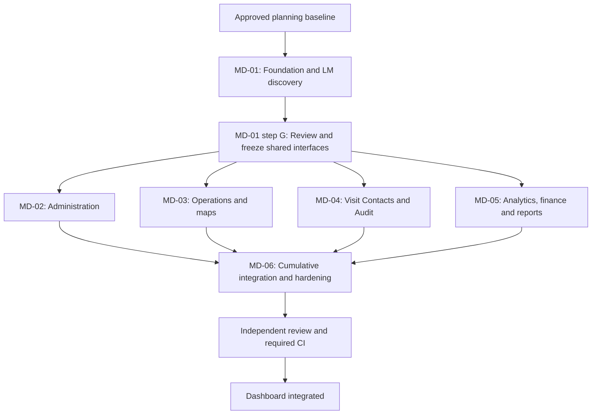

# VAYLET Management Dashboard Integration Plan

**Status:** Approved planning baseline for implementation

**Scope:** Production integration of the Management Dashboard into `apps/dashboard`

**Reference UI:** `reference/vaylet- man dashboard`

**Execution structure:** MD-01 -> MD-02/MD-03/MD-04/MD-05 in parallel -> MD-06

**Audited planning baseline HEAD:** `7de1b47f6df4bbc2ddfacec2347ec9a6ffe007d2`

**Important:** This document defines the implementation plan. Accepted Decisions and higher-authority repository sources continue to govern product/security behavior if a conflict is discovered. The SHA above identifies the local HEAD used for the planning audit; it is not a permanent requirement that future implementation HEADs remain equal to it. Revalidate current source state when implementation begins.

This complete repository plan preserves sections A through P and the six-task execution structure. It incorporates the owner's final clarifications: LM discovery is required but transport naming remains open within MD-01; MD-01 follows its explicit internal A-G order before shared interfaces freeze; validation information must remain truthful and need not retain a standalone page; Supervisor entry is narrow and capability-driven. Future implementation agents must use this document together with higher-authority repository sources without requiring access to the originating conversation.

The baseline facts and evidence claims below describe the planning audit, not a claim that implementation, runtime verification, or CI has subsequently completed.

---

Preserve the reference’s visual identity and page structure, but replace its mock data, security, scope handling, and most mutations. The current backend supports most of the required Dashboard. I found **one necessary backend addition: authenticated discovery of a Location Manager’s organizations and granted Locations**.

The fastest safe execution structure is **six tasks: one shared foundation, four parallel feature streams, and one integration/hardening task**. The discovery addition belongs inside the foundation.

## A. Verified local baseline

| Area | Verified local state |
|---|---|
| Repository | `D:\kndoom\valet-platform` |
| Branch | `main`; inspected read-only |
| HEAD | `7de1b47f6df4bbc2ddfacec2347ec9a6ffe007d2` |
| Working tree | Clean at inspection and final verification |
| Changes made | None |
| Database migrations | **45 forward-only migration directories** |
| Latest migration | `20260919004500_mgt_fix_02_pagination_snapshot_membership` |
| Production Dashboard | Next.js scaffold, not an integrated Management application |
| Reference Dashboard | React/Vite application with **21 page components**, hash navigation, mock services, and local mutations |
| Evidence level | Static source inspection. No application runtime, browser certification, test execution, deployment, or CI result is claimed |

The production [Dashboard package](../apps/dashboard/package.json) uses Next.js `16.2.11` and React `19.2.8`. Its source contains five files: application metadata and its test, root layout, root page, and global CSS. It has no implemented Management authentication, scope selection, API client, or feature pages.

The reference uses React `18.3`, Vite `6`, Tailwind `3`, Lucide icons, and hand-built SVG charts. Its [application router](<../reference/vaylet- man dashboard/src/app/App.tsx>) switches on URL hashes. Its 17 service files use mock/in-memory data; several pages bypass those services and maintain inline arrays.

The reference’s declared “authoritative” domain types are **not** authoritative. They mix canonical enums with display labels, unsupported states, speculative fields, and future functionality.

The current backend contains:

- Company Admin MFA and Management context.
- Staff membership, role, status, and Location-grant management.
- Typed Company settings and Location overrides.
- Basic branding.
- Location lifecycle and exceptional corrections.
- Visit Contact search, history, and limited corrections.
- Safe Management Audit projections.
- Exact-Location operational overview, analytics, and reports.
- Company analytics and reports.
- Read-only subscription and integration status.
- Feature-owned live map, map setup, retained route history, and safe financial projections.

Current implementation lives principally in [Management](../apps/api/src/modules/management), [Dashboard](../apps/api/src/modules/dashboard), and the feature-owned modules described below. The `organizations` and `locations` module directories themselves remain placeholders; their Management capabilities are implemented elsewhere.

#### Historical documentation reconciliation

| Historical statement | Current interpretation |
|---|---|
| Phase 7 began with 28 migrations and no analytics/report implementation | Historical baseline; current source has 45 migrations and implemented analytics/reports |
| Company Admin access remains unavailable pending MFA | Superseded for accepted Management capabilities by DEC-078/080 and current implementation |
| Phase 7 subscription state does not gate Dashboard features | Superseded by current Management entitlement enforcement |
| SLA/work-evidence KPI definitions are unresolved | DEC-095 and migration 43 now provide the implemented source contracts |
| Automatic reporting belongs to later delivery work | Still applicable; DEC-093 explicitly defers automatic delivery |
| Logo customization is pending | Explicitly deferred by DEC-086 |
| Management fixes/migration 45 are absent from the documented baseline | They are present in this inspected checkout |
| Older traceability/status documents identify features as future | Implementation-state claims must be checked against current source |

In particular, the baseline prose in [the Management execution plan](../docs/23_MANAGEMENT_BACKEND_216_EXECUTION_PLAN.md) and parts of [the schema document](../docs/03_DATABASE_SCHEMA.md) retain older migration/status statements. Those statements do not override the current files.

## B. Executive reconciliation

**The design can largely survive. The prototype behavior cannot.**

Keep the VAYLET logo, navy sidebar, blue accent, card/table hierarchy, spacing language, light/dark presentation, useful master/detail layouts, and drawer/modal patterns. Adapt these to the production stack, accessibility, Arabic, and RTL.

The largest changes are:

1. **Real authentication and MFA replace simulated security.**
2. **Server-derived scope replaces the client-local `all` Location.**
3. **Canonical contracts replace the reference domain model.**
4. **Operational pages become authorized visibility surfaces.** They do not perform check-in, parking, retrieval, handoff, arbitrary task transitions, or key movements.
5. **Policies become typed settings with inheritance and concurrency handling.**
6. **Customers become Visit Contacts**, with authorized history and tightly limited corrections.
7. **Billing and Integrations become read-only.**
8. **Reports become fixed DAILY/WEEKLY/MONTHLY reports and real manual exports.**
9. **Every displayed metric must have an actual source and truthful cohort.**

The existing backend is sufficient for the bulk of implementation. A full backend rebuild, generic aggregation layer, new state machine, CRM, permissions engine, or billing system is unjustified.

**Readiness:** this is the approved planning baseline. Implementation begins with MD-01; MD-02 through MD-05 must wait for reviewed and frozen foundation interfaces. Full Location Manager integration depends on the small discovery addition in MD-01. “Dashboard integrated” remains conditional on the runtime and failure evidence in Section O.

## C. Backend capability map

#### Reading this map

Route abbreviations:

- `A` = `/v1/staff/auth`
- `M` = `/v1/staff/management/organizations`
- `O` = `M/:organizationId`
- `D` = `/v1/staff/dashboard/locations/:locationId`
- `L` = `/v1/staff/locations/:locationId`

Authority abbreviations:

- **CA**: current active `ORG_ADMIN` in the selected active Organization.
- **LM**: current active `LOCATION_MANAGER`, with explicit persisted Location grants where required.
- **SUP**: current active `VALET_SUPERVISOR`, with the exact Location grant and active Shift for the narrow surfaces identified below.
- **Standard MFA**: server-validated assurance on the exact Staff session; eight-hour lifetime and 30-minute Management inactivity boundary.
- **Sensitive MFA**: additionally requires assurance within five minutes.
- **D-access**: `dashboardAccess`.
- **Export-access**: D-access plus `reportExports`.
- **Brand-access**: D-access plus `basicBranding`.

Client selection and capability snapshots never replace server authorization.

The commercial policy consumes the persisted entitlement booleans. The frontend must **not** derive access from plan names or reinterpret subscription status as an independent permission rule. Subscription reads remain available through their authorized paths without D-access.

### C1. Authentication and MFA

| Method and route | Request | Response/use | Authority and behavior |
|---|---|---|---|
| `POST A/login` | Strict email/password body | Access token and expiry information; browser refresh cookie | Real Staff authentication, Origin and transport rules |
| `POST A/refresh` | Browser refresh cookie | Rotated access credentials | Refresh does not extend MFA assurance |
| `POST A/logout` | Existing browser authentication transport | Logout result | Invalidate local protected state and server session through the real flow |
| `GET A/mfa/state` | No business scope | `ENROLLMENT_REQUIRED`, `ENROLLMENT_PENDING`, `STEP_UP_REQUIRED`, or `ASSURED` | Server MFA state |
| `POST A/mfa/enrollment/begin` | `{}` | Factor ID and one-time provisioning material | Enrollment ceremony |
| `POST A/mfa/enrollment/confirm` | Factor ID, six-digit code | Ten recovery codes | Server verification; recovery material must not be logged or persisted by the UI |
| `POST A/mfa/step-up` | Six-digit code | `ASSURED` | Server assurance; no client timer can grant it |
| `POST A/mfa/recovery/begin` | Recovery code | Replacement enrollment material | Recovery code is single-use |
| `POST A/mfa/recovery-codes/reissue` | TOTP code | Factor ID and replacement recovery codes | Explicit server-controlled ceremony |

Browser refresh uses the existing Secure, HttpOnly, SameSite cookie boundary. Access tokens belong in memory, not browser persistent storage.

Sources: [Staff authentication contracts](../packages/contracts/src/staff-auth.ts), [MFA contracts](../packages/contracts/src/staff-mfa.ts), [MFA implementation](../apps/api/src/modules/auth/mfa).

### C2. Organization, Location, and actor context

| Method and route | Request | Response | Role/MFA/entitlement | Pagination |
|---|---|---|---|---|
| `GET M` | `limit`, `cursor` | Eligible Company Admin organizations, `nextCursor` | CA enumeration; Standard MFA when eligible; no D-access prerequisite | Default 50, maximum 100 |
| `GET O/locations` | `limit`, `cursor` | Organization Locations: IDs, name/code, status, timezone, currency | CA, Standard MFA, D-access | Default 50, maximum 100 |
| `GET O/context` | `scopeKind=LOCATION` plus `locationId`, or `ALL_LOCATIONS` without it | Organization, explicit scope, selected Location or null, capability catalog | CA, Standard MFA, D-access | Not paginated |
| `GET /v1/staff/operational-context` | Existing Staff authentication | Operational memberships, eligible Locations, active Shift/current Location | Employee/Supervisor only; **not LM** | Existing operational contract |

Company Location enumeration includes active and inactive Locations. Downstream routes independently decide whether an active Location is required.

There is **no current general actor/profile response** in the login DTO. Do not recreate the reference’s fabricated name, avatar, role, or company.

Sources: [Management context service](../apps/api/src/modules/management/management-context.service.ts), [context contracts](../packages/contracts/src/management-control-plane.ts), [operational context query](../apps/api/src/modules/staff/staff-operational-context-query.ts).

### C3. Staff management

All routes below are under `O/staff`.

| Method and suffix | Request | Response/use | Authority |
|---|---|---|---|
| `GET /` | `limit`, `cursor` | Membership directory: email, role, status, version, Location-access count | CA, Standard MFA, D-access |
| `GET /:membershipId` | Target membership | Detail plus bounded Location-grant projection | Same |
| `POST /:membershipId/role` | `expectedVersion`, canonical role | Current membership result | CA, Sensitive MFA, D-access |
| `POST /:membershipId/activate` | `expectedVersion` | Current membership result | Same |
| `POST /:membershipId/deactivate` | `expectedVersion` | Current membership result | Same |
| `POST /:membershipId/location-access/grant` | `expectedVersion`, unique `locationIds` | Updated access/version | Same; 1–50 IDs |
| `POST /:membershipId/location-access/revoke` | Same | Updated access/version | Same |

Important limits:

- Directory pagination is bounded to 100; it has **no server search, role filter, or status filter**.
- Detail returns at most 100 grants with authoritative total/truncation information.
- There is no tenant-facing staff-create HTTP API.
- Membership deactivation is different from global User disable.
- Last-usable-admin and operational-handover protections are enforced.
- Role/status/grant commands share one membership version.
- Desired-state retries converge without duplicate changes/audit; stale differing requests conflict.

Sources: [Staff controller](../apps/api/src/modules/management/staff-management.controller.ts), [contracts](../packages/contracts/src/staff-management.ts), [mutation service](../apps/api/src/modules/management/staff-management-mutation.service.ts).

### C4. Settings and branding

| Method and route | Request/response | Authority |
|---|---|---|
| `GET O/settings` | Company defaults and concurrency token | CA, Standard MFA, D-access |
| `PUT O/settings/default` | Strict typed `setting`, `value`, `expectedUpdatedAt`; returns current settings | CA, Sensitive MFA, D-access |
| `POST O/settings/default/clear` | Clear Company `operatingHours` only | Same |
| `GET O/locations/:locationId/settings` | Default/override/effective projection, Location context and token | CA, Standard MFA, D-access |
| `PUT .../settings/override` | Typed setting/value/CAS | CA, Sensitive MFA, D-access |
| `POST .../settings/override/clear` | Explicit setting/CAS | Same |
| `GET D/configuration` | Original ten inherited settings | LM, exact active granted Location, D-access |
| `PUT D/configuration/override` | Typed setting/value/CAS | Same LM authority |
| `POST D/configuration/override/clear` | Explicit clear/CAS | Same |
| `GET O/branding` | Company display name/color/token | CA, Standard MFA, Brand-access |
| `PUT O/branding/default` | Typed branding setting/value/CAS | CA, Sensitive MFA, Brand-access |
| `GET O/locations/:locationId/branding` | Default/override/effective branding | CA, Standard MFA, Brand-access |
| `PUT .../branding/override` | Branding setting/value/CAS | CA, Sensitive MFA, Brand-access |
| `POST .../branding/override/clear` | Explicit clear/CAS | Same |
| `GET D/branding` | Location inheritance projection | LM, exact active granted Location, Brand-access |
| `PUT D/branding/override` | Branding setting/value/CAS | Same LM authority |
| `POST D/branding/override/clear` | Explicit clear/CAS | Same |

The inherited Management settings are exactly:

| Existing ten | Additional six |
|---|---|
| `checkInPhotosRequired` | `languageDefault` |
| `handoffStandardMethodPolicy` | `operatingHours` |
| `trackingEnabled` | `ocrAssistEnabled` |
| `rawGpsRetentionDays` | `parkingSpotRequired` |
| `valetServiceFee` | `employeeRetrievalRequestedNotificationEnabled` |
| `paymentServicePayer` | `guestVehicleReadyNotificationEnabled` |
| `paymentMethodsPolicy` | |
| `tipsEnabled` | |
| `validationEnabled` | |
| `releaseRequiresPayment` | |

**SLA is an exception to inheritance:** `slaTargetSeconds` is a nullable, Location-only target, 30–3600 seconds. It has no Company default or invented fallback. Company Admin manages it through the Management Location settings contract.

Other important distinctions:

- Operating hours are informational, not an automatic intake scheduler.
- The contract supports its defined seven-day, same-day intervals; do not invent overnight or multiple-interval behavior.
- An explicit `false` override is different from clearing an override.
- Company fee changes must respect the existing cross-Location currency representability rules.
- Branding is display name and primary color only. No logo URL/upload, fonts, domains, or arbitrary CSS.
- CA must use Management mutation routes; existing LM routes do not automatically become CA routes.
- Legacy Location configuration CAS behavior must not be replaced with assumed desired-state replay semantics.

Sources: [Management settings contracts](../packages/contracts/src/management-settings.ts), [Location configuration](../packages/contracts/src/location-configuration.ts), [branding contracts](../packages/contracts/src/management-branding.ts).

### C5. Location lifecycle

All routes are under `O/locations`.

| Method and suffix | Request | Response/effect |
|---|---|---|
| `POST /` | `operationId`, name, code, address, timezone, currency | Creates an inactive, intake-closed Location |
| `GET /:locationId/lifecycle` | Target Location | Lifecycle, readiness, drain blockers, concurrency token |
| `POST /:locationId/activate` | `expectedUpdatedAt` | Activates a ready inactive Location |
| `POST /:locationId/stop-intake` | `expectedUpdatedAt` | Stops new intake while preserving existing work |
| `POST /:locationId/deactivate` | `expectedUpdatedAt` | Deactivates only through the permitted drained boundary |
| `POST /:locationId/currency-correction` | Token and `newCurrency` | Prospective correction at the safe boundary |
| `POST /:locationId/timezone-correction` | Token, `newTimezone`, reason | Reasoned correction with explicit historical-impact response |

**All of these, including lifecycle GET, currently use CA Sensitive MFA and D-access.**

Readiness is exactly supported currency plus valid timezone. Drain checks active Shifts, non-completed sessions, and non-terminal Tasks. Do not add a fictional readiness checklist or clear blockers through local state.

Create uses durable operation identity and request fingerprinting. Lifecycle commands use the existing authoritative concurrency and desired-state behavior. Currency/timezone correction requires inactive, intake-closed, drained conditions.

There is no generic name/address/phone editing endpoint.

Sources: [Location service](../apps/api/src/modules/management/management-location.service.ts), [lifecycle contracts](../packages/contracts/src/management-location-lifecycle.ts).

### C6. Visit Contacts

| Method and route | Request | Response | Authority |
|---|---|---|---|
| `GET O/visit-contacts` | Exactly one search mode: name, phone, or plate plus country; cursor/limit | CUSTOMER/VEHICLE results, `NONE/UNIQUE/AMBIGUOUS`, next cursor | CA Standard MFA or LM; D-access |
| `GET O/visit-contacts/:customerId/visits` | Cursor/limit | Authorized visit history and Returning Contact facts | Same |
| `GET O/visit-vehicles/:vehicleId/visits` | Cursor/limit | Authorized Vehicle visit history, including customerless visits | Same |
| `POST O/visit-contacts/:customerId/name-correction` | Display name and `expectedUpdatedAt` | Authoritative corrected projection | CA Sensitive MFA, D-access |
| `POST O/visit-contacts/:customerId/phone-correction` | Phone and `expectedUpdatedAt` | Authoritative corrected projection | Same |

Limits and privacy:

- Default page size 25, maximum 50.
- Name search is a bounded prefix search; plate search is normalized exact matching.
- Current phone projection/normalization follows the implemented Jordan contract; do not silently generalize it.
- CA receives the permitted full phone projection; LM receives only the final four digits.
- LM results cover the **current authorized grant set**, including permitted historical inactive-Location visits.
- The search contract has **no selected-Location filter**. The UI must label this scope truthfully.
- Associated Vehicles are visit associations, never ownership.
- At most five associated Vehicles appear in a search result.
- No Customer creation, merging, tags, campaigns, loyalty, staff rating edits, or Management plate correction.
- Signed, scope-bound cursors use the implemented first-page membership snapshot behavior. Current authority is rechecked on later pages.

Sources: [Visit Contact contracts](../packages/contracts/src/management-visit-contacts.ts), [authorization](../apps/api/src/modules/management/management-visit-contact-authorization.ts).

### C7. Management Audit

| Method and route | Request | Role/scope | Response |
|---|---|---|---|
| `GET O/audit-events` | Cursor/limit, optional `eventType`, optional `locationId` | CA, Standard MFA, Organization scope, D-access | Safe typed event page |
| `GET O/locations/:locationId/audit-events` | Cursor/limit, optional `eventType` | CA Standard MFA; LM exact grant; SUP exact active grant plus active Shift; D-access | Viewer-appropriate safe event page |

Key behavior:

- Default 50, maximum 100.
- Organization events with null Location remain Organization events.
- LM may inspect granted historical inactive Locations.
- Supervisor visibility uses the narrow operational allowlist.
- Employee/Guest receive no general Audit explorer.
- Actor provenance is typed; it is not a fabricated employee name/email.
- Details are safe typed projections, not raw metadata JSON.
- Unknown events use the safe minimal representation.
- No arbitrary keyword, actor, severity, or date filtering.
- No Audit export API.
- No account-security explorer.
- Reading does not append tenant AuditEvents.
- Cursor snapshot/filter/scope behavior is server-owned.

Sources: [Audit authorization](../apps/api/src/modules/management/management-audit-authorization.ts), [Audit contracts](../packages/contracts/src/management-audit.ts), [event catalog](../packages/contracts/src/management-audit-events.ts).

### C8. Exact-Location operational overview

Every route below is `GET D/overview/<suffix>`, authorized for CA with Standard MFA or LM at the exact active granted Location, with D-access.

| Suffix | Actual data/cohort | Pagination and limits |
|---|---|---|
| `sessions` | **Non-completed** sessions; canonical state, timestamps, resource/member IDs, minimal Vehicle identity | Cursor; default 50/max 100 |
| `session-state-counts` | Nine canonical state counts across the Location’s persisted sessions | Aggregate; not a “today” query |
| `retrieval-queue` | OPEN/ACCEPTED retrieval requests and associated Task facts | Cursor; default 50/max 100 |
| `tasks` | Parking/Retrieval Task records and canonical Task status/assignee IDs | Cursor; default 50/max 100 |
| `active-shifts` | Active Shift IDs, membership IDs, start times | Cursor; default 50/max 100 |
| `keys` | Slot ID/code, ACTIVE/INACTIVE, current holding session | Cursor; default 50/max 100 |
| `incidents` | **OPEN/INVESTIGATING** incidents | Cursor; default 50/max 100 |
| `financial` | Financial summaries associated with **non-completed sessions**, grouped by currency | Aggregate |

These list contracts do not provide generic search/filter parameters or total result counts.

Consequences:

- Sessions are not a general completed-visit archive.
- Incidents are not an unrestricted historical claims register.
- Financial overview is not period revenue.
- Current page length is not a Location total.
- The minimal session DTO does not contain guest identity, Vehicle make/model, or a rich custody-detail projection.
- Overview cursors do not have the same signed snapshot contract as Audit/Visit Contact cursors.

Sources: [Overview controller](../apps/api/src/modules/dashboard/overview.controller.ts), [overview contracts](../packages/contracts/src/location-overview.ts), [financial query](../apps/api/src/modules/dashboard/overview-financial-query.ts).

### C9. Analytics

| Method and route | Request | Response/use | Authority |
|---|---|---|---|
| `GET D/analytics/operations` | `from`, `to` | Five duration metrics and completed cars per local day | CA Standard MFA or LM; exact active Location; D-access |
| `GET D/analytics/financial` | Same | Currency-separated collections, tips, refunds, validation, cash reconciliation | Same |
| `GET D/analytics/incidents` | Same | Incident counts and accepted rate | Same |
| `GET D/analytics/kpis` | Same | SLA, work-evidence productivity, handoff attribution, controlled Key Exceptions | Same |
| `GET D/analytics/queue` | No period | Current queue snapshot | Same |
| `GET O/analytics/all-locations` | `from`, `to` | Company operations/finance/incidents/KPIs and coverage | CA Standard MFA, D-access |

Periods are inclusive local dates, at most 31 days.

Formula fidelity:

- Official Retrieval Wait: request → READY.
- Retrieval start latency: separate auxiliary metric.
- Cars handled: completed visits.
- SLA: immutable retrieval target snapshot; equality meets target; zero denominator produces null.
- Cars per Active Employee: approved immutable work-evidence union, not Shift count or directory headcount.
- Cars Handed Off: persisted final completing membership.
- Key Exceptions: `KEY_MISSING`, `WRONG_KEY`, `KEY_DAMAGED`, `KEY_LOCKED_INSIDE`; ordinary key movement is excluded.
- Money retains exact decimal semantics and immutable Payment currency.
- Collections, refunds, validations, and cash reconciliation retain their distinct accepted cohorts.
- Company analytics includes active and inactive historical Locations and applies each Location’s timezone.
- Company ratios and averages are recomputed from source, not averaged from Location cards.
- Company distinct employees are not the sum of Location distinct employees.
- Company responses do not provide a `byEmployee` ranking.
- Guest Satisfaction and Returning Contact aggregate KPIs are not available through these current contracts.

Sources: [analytics controller](../apps/api/src/modules/dashboard/analytics.controller.ts), [Company analytics contracts](../packages/contracts/src/company-analytics.ts), [DEC-095](../docs/decisions/DEC-095_MANAGEMENT_KPI_SOURCE_CONTRACTS.md).

### C10. Reports and exports

Both `D/reports` and `O/reports` provide:

| Method and suffix | Request | Response |
|---|---|---|
| `GET /daily` | `date` | Daily report DTO |
| `GET /weekly` | `weekStart`, following the accepted Monday boundary | Weekly report DTO |
| `GET /monthly` | `month` | Monthly report DTO |
| `POST /exports` | Discriminated report kind, CSV/PDF format, appropriate period selector | Generated artifact bytes |

Authority:

- Exact Location: CA Standard MFA or LM with exact active grant.
- Company: CA Standard MFA.
- Reads require D-access.
- Exports require Export-access.
- Do not invent a five-minute MFA requirement for exports when the current route uses Standard assurance.

Export semantics:

- Current exact session, authority, and entitlements are rechecked at finalization.
- Successful generation appends the required export audit.
- Artifacts are not persisted as report-library records.
- No scheduler, delivery job, or emailed attachment.
- Rendered output is capped at 5 MiB; group limits are enforced.
- CSV is server-hardened against spreadsheet injection.
- Current PDF output is locale-neutral/English; it is not an implemented Arabic PDF renderer.
- Repeating a successful manual export intentionally creates another generation/audit.
- A lost response must not trigger an invisible automatic export retry.

Sources: [Location report controller](../apps/api/src/modules/dashboard/report.controller.ts), [Company report controller](../apps/api/src/modules/management/company-report.controller.ts), [report request contracts](../packages/contracts/src/location-report-common.ts).

### C11. Commercial and integrations

| Method and route | Response | Authority |
|---|---|---|
| `GET O/subscription` | Plan code, status, three entitlements, or null | CA Standard MFA; no D-access prerequisite |
| `GET D/subscription` | Organization subscription through exact active Location | LM exact grant; no D-access prerequisite |
| `GET O/integrations` | Fixed `PLATE_OCR`, `STAFF_PUSH`, `DIGITAL_PAYMENT` status tuple | CA Standard MFA, D-access |

Integration statuses are `DISABLED`, `UNAVAILABLE`, `MISCONFIGURED`, `DEGRADED`, `OPERATIONAL`, or `UNKNOWN`.

There is no provider configuration, secret editing, connection test, webhook editor, billing-card management, invoice engine, upgrade, or renewal mutation.

Sources: [commercial controller](../apps/api/src/modules/management/management-commercial.controller.ts), [commercial policy](../apps/api/src/modules/management/management-commercial-access-policy.ts), [integration contracts](../packages/contracts/src/management-integrations.ts).

### C12. Legitimate feature-owned surfaces

| Route | Contract | Authority and boundaries |
|---|---|---|
| `GET L/live-operations-map` | Cursor, default 100/max 500; Task/Vehicle positions, nullable position, LIVE/STALE, observed time | CA Standard MFA, LM, or on-shift SUP; D-access; exact active Location |
| `GET/POST L/map/points` | Point list/create | LM only, exact active grant; existing map-setup authorization |
| `PATCH L/map/points/:pointId` | Partial point update | Same |
| `GET/POST L/map/areas` | Area list/create, 3–500 vertices | Same |
| `PATCH L/map/areas/:areaId` | Partial metadata update | Same |
| `PUT L/map/areas/:areaId/vertices` | Complete bounded vertex replacement | Same |
| `GET /v1/staff/tracking-sessions/:trackingSessionId/route-history` | Cursor, default 100/max 500; retained samples | LM or on-shift SUP; ended tracker; CA excluded |
| `GET /v1/staff/valet-sessions/:sessionId/payment` | Safe session financial projection | LM or eligible on-shift operational staff; CA excluded |

Important qualifications:

- Map setup lists are existing non-cursor list contracts. Do not invent pagination parameters.
- Map setup and route-history authorization do not use the same commercial helper as live-map Management reads. Do not broaden backend entitlement gates onto safety/field functionality.
- Map mutations do not expose a browser-supplied CAS token. Their internal concurrency behavior must not be advertised as protection against every stale form.
- A map area is not ParkingZone/ParkingSpot assignment authority.
- Live-map freshness is server-defined; an empty response alone does not establish why tracking is absent.
- Route-history reads do not provide a general historical tracker-discovery API.
- Operational Staff directory/detail, dispatch, shift, key, payment, and incident command APIs are not interchangeable with Management authorization.

Sources: [live-map authorization](../apps/api/src/modules/tracking/live-map-read-authorization.ts), [map contracts](../packages/contracts/src/map-setup.ts), [route authorization](../apps/api/src/modules/tracking/route-history-authorization.ts), [financial projection authorization](../apps/api/src/modules/payments/payment-projection-authorization.ts).

## D. Reference Dashboard inventory

The page sources are under [the reference pages directory](<../reference/vaylet- man dashboard/src/pages>).

| Page | Verified reference data and meaningful interactions | Production disposition |
|---|---|---|
| **Overview** | Mock KPI cards/trends, hourly chart, live activity feed, named greeting; timeframe control does not provide real querying; navigation links | Preserve arrangement. Replace metrics, dates, greeting, feed, and chart data with supported cohorts |
| **Live Operations** | Inline vehicle rows; hard-coded counters/tab counts; local filters; create-check-in modal; drawer; local retrieval/park/handoff/issue actions | Read-only current operational visibility; remove field commands |
| **Vehicles** | Mock list; plate/make/model/guest/status/type/Location filtering; Add Vehicle; Edit opens detail; “Registered Owner”; no real server paging | Current session/Vehicle identity view plus authorized visit-history entry; remove creation/edit/ownership claims |
| **Tasks** | Inline records; local filters; generic task creation; drawer; local status changes; Move/Service/Keys/Inspection/Detailing/Delivery types | Canonical Parking/Retrieval read-only table |
| **Employees & Shifts** | Five invented staff identities/avatars; Employees/Shifts/Attendance tabs; local search/role/status filters; Add Employee fabricates identity and starts “On Shift”; drawer shift toggle; attendance alert | Real CA membership administration and authorized active-Shift visibility |
| **Locations** | Mock master/detail; invented photos/main-office flag/staff/zone/vehicle metrics; create silently supplies defaults; Edit save only closes | Real bounded selection, create, lifecycle, readiness/drain, exceptional corrections |
| **Maps & Zones** | Mock floor plan, spaces, zones, markers, occupancy/exceptions; local floor/layer controls; visual edit handles; local zone/capacity/geofence editing; fabricated spot/session details; inert/closing action buttons | Real live-map read and LM-only map-point/area setup; remove occupancy/reservation/assignment fiction |
| **Keys** | Inline physical/smart/card keys; local search/filter/add; local locker/attendant/in-use status changes; inert paging | Real slot accountability read |
| **Payments** | Inline dated USD transactions; fixed revenue/count/average/success cards; inert date control; local search/method filter; paging state without real slicing; fake export/print alerts | Currency-separated operational/period summaries and report export links |
| **Validations** | Mock pending validations; invented approved/rejected counts; filter alert; local create/approve; inert paging | Only authoritative validation-related financial/analytics information. MD-05 decides whether it merits a standalone read-only page or belongs within Payments/Analytics; no record/workflow table or approval engine |
| **Incidents & Claims** | Inline incidents; incomplete Location filtering; local type/status/severity filters; fixed date/total; fake paging; create/resolve locally; export alert | Open-incident visibility and real incident analytics; remove claims workflow |
| **Customers & Guests** | Mock contacts with full PII, email, VIP/corporate labels; fixed total; ineffective pagination; local create; “registered vehicles” | Visit Contact search, safe history, CA corrections |
| **Analytics** | Mock Vehicle/retrieval/revenue/satisfaction cards and trends; mock charts; selectors do not perform real scoped queries | Real Location/Company analytics, coverage, precision, timezone semantics |
| **Reports** | Mock standard/custom report catalog; arbitrary create; generate/download alerts; automated-report language | Fixed three report kinds, real preview and manual CSV/PDF |
| **Policies** | Generic named policy rows/categories/descriptions; create and enable/disable locally | Typed settings and inheritance editor |
| **Roles & Permissions** | Invented roles/counts/permissions; mock Users tab; edit alert; custom-role creation | Four canonical roles and real staff-management controls |
| **Integrations** | Mock PMS/POS/messaging/payment/hardware cards; fake status/last-sync; credentials/webhook fields; configure/save; connection test always succeeds | Fixed read-only implemented integration status |
| **Audit Log** | Mock entries; keyword/category/severity filters; actor email/IP/raw-looking differences; fake integrity seal/anomaly count; loaded-row CSV download | Safe server Audit explorer; supported filters and cursors only |
| **Billing / Subscription** | Mock tier, quotas, prices, renewal, card, invoices; local billing-cycle change; card form; fake invoice download | Read-only persisted subscription and entitlements |
| **Settings** | Fake profile save; simulated MFA; fake sessions/revocation; working theme; Arabic preview without real localization; unpersisted notification preferences | Real account security, local theme/locale, links to typed business settings |
| **Help & Support** | Mock tickets and ticket creation; diagnostic checkbox without real bundle; invented system/API health, region, latency, hotline; inaccurate operational FAQ rules | Reviewed static help; remove unsupported support/status claims |

#### Shared reference behavior

- **Shell/navigation:** visual foundation is reusable. The sidebar exposes the main 16 modules plus utilities, while Integrations/Audit/Billing exist in the router without equivalent complete navigation exposure. Branding has no dedicated page.
- **Organization selector:** displayed organizations are fabricated; selection does not establish authority.
- **Location context:** starts from mock `all`; it is not the backend `ALL_LOCATIONS` contract.
- **Global search:** searches mock Vehicles, Guests, Employees, Tasks, and Keys. It has no tenant-aware backend search.
- **Notifications:** mock list with client-local mark-read/mark-all-read.
- **Messages:** alert-only action.
- **Profile:** fabricated identity/company; sign-out is an alert.
- **MFA:** simulated success, not backend verification.
- **Theme:** genuinely local UI behavior, reusable after hydration-safe adaptation.
- **Charts:** contain fallback sample datasets; these defaults must never reach production.
- **Pagination:** assumes a total and numbered pages that most backend lists do not return.
- **Modals/drawers:** Escape/backdrop behavior exists, but the inspected components do not implement complete dialog semantics, focus containment/restoration, or RTL drawer placement.
- **Tables:** reusable visual shape; clickable rows need keyboard-equivalent actions and semantic improvements.
- **Responsive shell:** fixed sidebar/header dimensions and wide search control require actual narrow-screen verification. Source classes are not evidence of responsive success.

## E. Master gap matrix

Classification applies to individual behaviors, not blanket acceptance of a page.

| Behavior | Classification | Required treatment |
|---|---|---|
| VAYLET identity, palette, spacing, cards/tables | **KEEP** | Preserve through production components |
| Drawer/master-detail presentation | **KEEP + ADAPT** | Accessibility, RTL, truthful fields |
| Light/dark preference | **LOCAL UI ONLY** | Persist presentation preference only |
| Collapse, tabs, local chart visibility | **LOCAL UI ONLY** | Must not imply business mutation or complete-dataset filtering |
| Real navigation and supported deep links | **KEEP + ADAPT** | Next.js routes and guarded page entry |
| Organization/Location selector | **KEEP + ADAPT** | Server-discovered, scope-aware, paginated |
| LM organization/Location discovery | **BACKEND GAP** | Minimal addition inside MD-01 |
| Authentication/logout | **ADD** | Real Staff browser transport |
| MFA enrollment/step-up/recovery | **ADD** | Exact backend ceremonies |
| Live Operations | **READ-ONLY** | Current exact-Location projections |
| Vehicle directory presentation | **KEEP + ADAPT** | Current sessions and authorized visit history |
| Operational task/key/session actions | **REMOVE** | Wrong Dashboard authority/duplicated field flows |
| Staff membership management | **ADD** | CA role/status/grant commands |
| Staff creation/attendance/scheduling | **REMOVE** | No accepted Dashboard HTTP workflow |
| Location lifecycle | **ADD** | Create, readiness, stop-intake/drain/deactivate |
| Generic Location edit | **REMOVE** | No matching mutation contract |
| Live-map presentation | **KEEP + ADAPT** | Actual coordinates, nullable position, freshness |
| Map setup | **KEEP + ADAPT** | LM-only points/areas; no invented capacity |
| Raw route history for CA | **REMOVE** | Explicitly excluded |
| Payments/validation cards | **KEEP + ADAPT** | Correct currency/cohort summaries |
| Payment receipts/transaction export fiction | **REMOVE** | No supporting Dashboard contract |
| Incident visibility | **READ-ONLY** | Open incidents plus analytics |
| Full claims/evidence/insurance workflow | **DEFER** | Full ClaimShield is outside current scope |
| Visit Contacts | **KEEP + ADAPT** | Search-mode/privacy/history contract |
| Contact corrections | **ADD** | CA Sensitive MFA and CAS |
| Customer ownership/CRM | **REMOVE** | Contradicts accepted visit-contact model |
| Analytics layout | **KEEP + ADAPT** | Real metrics and coverage |
| Guest Satisfaction mock KPI | **REMOVE** | No current aggregate contract |
| Fixed reports/manual export | **KEEP + ADAPT** | Actual report and export endpoints |
| Custom reports | **REMOVE** | No accepted current contract |
| Scheduled/emailed reports | **DEFER** | DEC-093 |
| Generic policy engine | **REMOVE** | Replace with typed settings |
| Inheritance/effective-value display | **ADD** | Company default, override, effective |
| SLA target configuration | **ADD** | Location-only; no invented default |
| Custom role/permission builder | **REMOVE** | Canonical four-role model |
| Basic Branding surface | **ADD** | Display name/color, inheritance, entitlement |
| Logo/advanced white label | **DEFER** | DEC-086 and advanced-phase boundary |
| Integration cards | **READ-ONLY** | Actual three-entry status contract |
| Provider configuration/secrets/test buttons | **REMOVE** | No tenant authority |
| Subscription display | **READ-ONLY** | Persisted plan/status/entitlements |
| Billing execution | **REMOVE** | DEC-089 |
| Audit explorer | **KEEP + ADAPT** | Safe typed allowlist projection |
| Audit integrity certification/export | **REMOVE** | Fabricated or unsupported |
| Notification inbox/messages | **REMOVE** | No verified Management inbox contract |
| Global cross-domain search | **REMOVE** | Replace with local navigation search and Visit Contact search |
| Reviewed help content | **KEEP + ADAPT** | Accurate current workflows |
| Support ticketing/health claims | **REMOVE** | Mock backend and unverified claims |
| Broader Company Admin operational/raw-data authority | **DECISION REQUIRED if requested later** | Excluded from this plan; no decision needed to preserve current restrictions |

## F. Remove / disable list

These behaviors must not ship as functional production controls:

1. **Fake sign-out, profile identity, organization switching, MFA, and session revocation.** Security conflict and fabricated behavior.
2. **Mock notifications, unread counts, messages, and support tickets.** No verified corresponding Management service.
3. **Create Check-In, Request Retrieval, Mark Parked, Handoff, and arbitrary session-status changes.** Duplicate field workflows and exceed Company Admin authority.
4. **Generic Task creation and status changes.** Unsupported Task types and a second state machine.
5. **Key creation/movement and smart-locker implications.** No matching Management command or hardware authority.
6. **Add Employee, start/end another employee’s Shift, attendance verification, and scheduling.** Unsupported current Dashboard contracts.
7. **Generic Location name/address/phone Save.** No matching backend mutation.
8. **Map capacity, reservation, sensor, occupancy, and “disable zone stops assignment” behavior.** The map contract does not establish those facts.
9. **Fabricated guest, employee, Vehicle, payment, or incident fields in drawers.** Missing DTO fields must remain absent.
10. **Payment-card brands, Room Charge, fake receipts, transaction exports, and settlement success claims.** Unsupported financial projection.
11. **Prototype validation record/workflow table, creation, approval, rejection, arbitrary status mutation, and access-discount engine.** The current backend provides no such Dashboard list/workflow. Only validation-related financial/analytics information supplied by authoritative contracts may be displayed.
12. **Incident create/resolve controls copied from the prototype and full Claims workflow.** Outside this Management integration scope.
13. **Customer create, owner labels, VIP/corporate tags, email, loyalty, campaigns, and arbitrary notes.** Wrong domain and privacy model.
14. **Custom reports and automatic delivery controls.** Unsupported/deferred.
15. **Generic Policies and custom Roles/Permissions.** Replace with accepted typed settings and canonical roles.
16. **Integration credentials, provider configuration, webhook editing, and Test Connection.** Tenant users do not manage provider secrets.
17. **Billing cycle, prices, quotas, cards, invoices, renewal, upgrade, and coupons.** Read-only subscription scope.
18. **Audit IP/email/raw metadata, account-security events, fake hash seals/anomaly counts, and CSV export.** Privacy or unsupported assurance/export.
19. **Hard-coded totals, trends, chart defaults, and fake pagination.** Fabricated business truth.
20. **Unverified hotline, uptime, latency, region, support SLA, cash threshold, or override guidance.** Unsupported operational claims.

Unsupported actions should normally disappear. Disabled controls are appropriate only when a **real supported action** is temporarily unavailable because of current authority, entitlement, required selection, or a server-reported prerequisite.

## G. Add / replace list

The real Dashboard needs:

- Real login, refresh recovery, logout, and protected routing.
- Real CA enrollment, step-up, recovery, and recovery-code handling.
- Organization and Location discovery, selection, and invalidation.
- Explicit Company, exact-Location, and authorized-visit-scope labels.
- A “select a Location” state on exact-Location pages.
- Role-aware navigation, including the narrow Supervisor entry.
- Subscription-access explanation based on actual authorized subscription reads.
- Typed API parsing and stable error handling.
- Request cancellation plus stale-response fencing on every scope change.
- Actual cursor navigation without invented totals.
- Staff version conflicts, handover blockers, and last-admin explanations.
- Location create operation identity, lifecycle readiness, drain blockers, and correction forms.
- Typed inherited settings, explicit SET/CLEAR, and effective values.
- A dedicated basic Branding surface.
- Visit Contact search modes, ambiguity, masked/full phone rendering, history, and corrections.
- Safe Audit details and supported event/scope filters.
- Source-backed analytics, coverage, null states, separate currencies, and Location-local dates.
- Fixed report preview and real CSV/PDF download.
- Honest handling of uncertain mutation/export outcomes.
- English/Arabic translations, RTL layouts, accessible dialogs/tables, and responsive navigation.

## H. True backend gaps

### H1. Location Manager discovery/bootstrap

**This is the only backend addition justified by this reconciliation.**

#### Requirement source

The Blueprint and binding scope require Location Managers to manage their explicitly authorized Locations. The [Phase 7 plan](../docs/22_PHASE7_DASHBOARD_EXECUTION_PLAN.md) explicitly identifies authorized manager Location enumeration as the foundation for per-Location dashboards.

#### Missing capability

A freshly authenticated Location Manager cannot obtain the organization/Location identifiers and presentation context needed to enter the existing authorized Dashboard surfaces.

#### Source evidence

- [Login response](../packages/contracts/src/staff-auth.ts) contains access/session expiry information, not memberships or Locations.
- [Management context](../apps/api/src/modules/management/management-context.service.ts) enumerates active `ORG_ADMIN` memberships and authorizes its Location enumeration through Company Admin authority.
- [Operational context query](../apps/api/src/modules/staff/staff-operational-context-query.ts) explicitly selects only Employee/Supervisor roles.
- [Operational context tests](../apps/api/test/staff-operational-context.integration.test.ts) explicitly expect LM denial.
- Current Dashboard controllers require an already-known `locationId`.
- The Organization and Location placeholder modules do not provide an alternative discovery route.

#### Why frontend composition cannot solve it

The frontend cannot derive persisted grants from an opaque token, assume a Location, enumerate UUIDs, reuse another principal’s data, or obtain broader Company Admin access. A copied UUID/deep link is not a usable general bootstrap.

#### Minimum safe addition

Include one focused read-only discovery capability in MD-01:

- Enumerate the current actor’s eligible LM organizations.
- Enumerate only that LM’s currently granted Locations within a selected organization.
- Return minimal identifiers, display labels, status, timezone, and currency.
- Preserve historical inactive-Location discoverability for already-authorized Audit use without permitting inactive operational reads.
- Use bounded keyset pagination and current persisted authorization on every page.
- Keep CA context and Employee/Supervisor operational context behavior unchanged.
- Do not add staff directory, operational detail, new roles, permissions, or mutations.
- Preserve the ability to reach authorized subscription status when Dashboard access is unavailable.

The following are **possible transport examples only, not final API names**:

```text
GET /v1/staff/dashboard/organizations
GET /v1/staff/dashboard/organizations/:organizationId/locations
```

**The LM discovery requirement is locked; route naming is not.** MD-01 must first review current controller/module ownership and finalize the narrowest repository-consistent transport. The examples above are neither existing routes nor prescribed final API names. Reuse compatible public scalar/projection shapes and existing bounded-list conventions where appropriate. The implementation must not broaden Company Admin context authority, Employee/Supervisor operational context, LM permissions, tenant scope, or Location scope.

Existing membership/grant/Location persistence appears sufficient. **No migration appears necessary**, subject to the focused query/index check during implementation.

#### Not backend gaps for this plan

The following do not justify backend tasks:

- Prototype transaction grids, global search, notification inbox, or employee profile fields.
- Arbitrary filters absent from bounded list contracts.
- All-Location live operational lists.
- Company Admin raw routes or map-setup rights.
- Customer ownership/CRM.
- Custom roles/policies/reports.
- Guest Satisfaction formula invention.
- Billing execution or provider configuration.
- Automatic report delivery or logo assets.

## I. Target frontend architecture

Production remains inside [apps/dashboard](../apps/dashboard). It must not import from the reference folder at runtime.

Proposed organization:

```text
apps/dashboard/src/
  app/
    (auth)/
    (management)/
    layout.tsx
    globals.css

  components/
    shell/
    controls/
    data/
    overlays/

  lib/
    auth/
    api/
    scope/
    presentation/
    i18n/

  features/
    administration/
      staff/
      locations/
      settings/
      branding/
      commercial/
    operations/
      sessions/
      tasks/
      keys/
      incidents/
      maps/
    visit-contacts/
    audit/
    intelligence/
      overview/
      analytics/
      financial/
      reports/
    account/
    help/
```

These are responsibility boundaries, not permission to create empty scaffolding.

#### Production stack

- Retain repository Next.js/React versions.
- Port the reference’s design tokens and selected presentational components.
- Use the repository’s existing frontend styling/testing approach; adapt Tailwind syntax if used.
- Add `@valet/contracts` to the Dashboard.
- Add only the dependencies required for the chosen implementation, under one lockfile owner.
- Do not introduce a new state-management framework, chart platform, map provider, or universal permissions engine merely to reproduce the prototype.

#### Authentication and API boundary

- Follow the existing browser Staff authentication transport patterns.
- Keep access credentials in memory; let the browser manage the refresh cookie.
- Use single-flight refresh and a session-generation fence.
- Configure the production API origin explicitly and fail closed when it is absent/invalid.
- Preserve Origin/cookie/HTTPS behavior through the deployed proxy.
- Parse responses with shared contracts.
- Treat transport failure, authentication failure, MFA challenge, authorization denial, validation failure, and concurrency conflict separately.
- Never expose raw server errors, tokens, provisioning secrets, or contact search terms to telemetry.

#### Scope and stale-response protection

Every protected query key includes its complete effective scope:

```text
session generation
organization
scope kind
location where applicable
feature
query/filter/period
cursor
```

On logout, principal change, Organization switch, or Location switch:

1. Advance the relevant generation.
2. Cancel obsolete requests.
3. Clear incompatible rows, drawers, cursors, forms, and pending downloads.
4. Ignore late responses from prior generations.
5. Resolve current server authority before showing protected results.

Abort alone is insufficient: a completed response may still arrive.

A user may have different roles in different organizations. Do not calculate a single global “highest role.”

#### Supervisor entry

Supervisor entry is capability-driven and narrow. It is not a reduced copy of the general Management Dashboard navigation. Expose only surfaces explicitly authorized by current backend/product rules, such as eligible exact-Location operational reads and operational Audit where the exact grant and active Shift requirements hold.

Do not expose the full Management sidebar and rely on 403 responses. Do not infer broader Management authority from the Supervisor role. Do not expose Company administration, Company analytics/reports, Visit Contact management without explicit authority, or unsupported mutations. Resolve the eligible capability and scope before composing navigation, and revalidate through the backend at protected use.

#### Data and mutation ownership

- Keep feature data out of a giant application context.
- Shared context contains session/scope/presentation state, not all page datasets.
- Keep DTOs canonical; translate labels at the presentation boundary.
- Never optimistically claim a protected business mutation succeeded.
- Use server-returned state after writes.
- Disable duplicate submission while a request is pending.
- Preserve target scope and operation identity through uncertain outcomes.
- Do not automatically replay writes after generic refresh, network failure, or application restart.

#### Pagination and filtering

- Render Next/Previous using stored cursor history.
- Do not synthesize page numbers or total counts.
- Reset cursor history when scope/search/filter changes.
- Do not scan all pages to create an unsupported search or aggregate.
- If a useful local filter is retained, label it explicitly as applying to the loaded page.
- Prefer removing misleading filters over adding new backend APIs.

#### Performance

- Fetch independent visible cards concurrently.
- Deduplicate identical requests.
- Load map and export UI only when needed.
- Pause polling when hidden and back off after failures.
- Refresh current operational views through bounded requests.
- Never poll every Location or every row.
- Preserve the product’s common-action target of roughly under two seconds, measured in a representative runtime; do not confuse it with map freshness.
- Avoid persistent browser caches for protected business data.

#### Accessibility and internationalization

- Logical CSS properties and direction-aware drawers.
- Real English/Arabic dictionaries, not translated menu labels alone.
- Locale-aware display with authoritative Location timezone/currency.
- Safe bidirectional rendering for plate numbers, IDs, phones, and amounts.
- Focus containment/restoration, dialog labeling, Escape behavior, and keyboard actions.
- Tables with meaningful headers and accessible row-detail controls.
- Charts with textual summaries/data alternatives.
- No fake Arabic PDF claim; clearly present the current export language contract.

## J. Page → API / contract map

The authority/MFA/entitlement definitions in Section C apply unchanged.

| Retained surface | API/contracts | Role/scope | Mutations | Essential states |
|---|---|---|---|---|
| Overview | State counts/queue where exact Location; operations/KPIs; Company analytics for All Locations | CA or LM; Company mode CA only | None | No Location, no samples, null coverage, unavailable card |
| Live Operations | Sessions, retrieval queue, Tasks, state counts | CA/LM exact active Location | None | No active work, stale refresh, access loss |
| Vehicles | Non-completed sessions; Visit Contact Vehicle history where available | CA/LM; clearly separated current-Location and visit scopes | None | Unknown plate/descriptor, customerless history, no match |
| Tasks | `D/overview/tasks` | CA/LM exact active Location | None | Unassigned, canonical state, cursor end |
| Employees & Shifts | CA staff directory/detail; `D/overview/active-shifts` | CA administration; CA/LM active-Shift read | CA role/status/grants | Truncated grants, handover block, last-admin block, stale version |
| Locations | CA enumeration and lifecycle; LM discovery from MD-01 | CA lifecycle; LM granted selector/view | CA create/lifecycle/corrections | Inactive, draining, not ready, stale token, blocked drain |
| Maps & Zones | Live map; LM map points/areas | CA live read; LM setup/read; SUP narrow live read | LM point/area commands only | No position, stale position, no tracked Tasks, denied setup |
| Keys | `D/overview/keys` | CA/LM exact Location | None | Empty slot, inactive slot, holding session; no invented custody owner |
| Payments | Financial overview and financial analytics; report links | CA/LM; Company period summary CA | None | No Payment evidence, distinct currencies, no paid samples |
| Validations, if meaningful as a standalone surface | Financial analytics/overview validation fields only; no validation record/workflow list | Same as Payments | None; no create/approve/reject/status mutation | No qualifying cohort, null rate; MD-05 may integrate these metrics into Payments/Analytics instead of retaining a standalone page |
| Incidents | Open incident overview; incident analytics | CA/LM exact Location; Company aggregate CA | None | No open incidents versus no period incidents |
| Customers / Visit Contacts | Search and both history routes | CA Organization scope; LM current grant-set scope | CA name/phone corrections | NONE/UNIQUE/AMBIGUOUS, masked phone, stale cursor/CAS |
| Analytics | Location five endpoints or Company analytics | CA/LM Location; CA Company | None | Invalid period, no evidence, coverage/truncation, separate currencies |
| Reports | Fixed report reads and exports | CA Company/Location; LM Location | Audited manual export | Export entitlement absent, final denial, size limit, unknown outcome |
| Policies / Settings | Management settings or legacy LM configuration | CA Company/Location; LM accepted ten-setting subset | Typed SET/CLEAR | Inherited versus explicit false, conflict, invalid money |
| Roles & Permissions | Fixed role explanation and staff-management UI | CA | Existing staff commands only | No custom role, no unsupported permission editor |
| Integrations | `O/integrations` | CA Company | None | Every actual status including UNKNOWN |
| Audit Log | Organization or Location Audit | CA; LM exact grant; SUP narrow shifted Location | None | Unsupported filters absent, unknown event, expired/invalid cursor |
| Billing / Subscription | `O/subscription` or `D/subscription` | CA or LM authorized read | None | No subscription, actual entitlement booleans |
| Settings / Account | Auth/MFA; local display preferences | Current Staff session; privileged ceremonies server-controlled | Auth/MFA only | Enrollment, step-up, recovery, session expiry |
| Help | Reviewed local content | Appropriate public/authenticated presentation | None | No fake tickets/status |
| **New Branding** | Management or LM branding routes | CA/LM according to C4 | Accepted display-name/color SET/CLEAR | Entitlement denial, inheritance, conflict |
| **New sign-in/MFA/scope entry** | Auth, CA context, MD-01 discovery, narrow Supervisor context | Current server-derived role/scope | Authentication ceremonies | No eligible access, no granted Location, soft step-up |

A drawer must display only fields available through the authorized source. It must not call Employee custody-detail APIs to enrich a Company Admin view.

## K. Implementation task plan

### Shared task contract

The following requirements apply to **every task**, and are part of each task’s done criteria:

| Concern | Required invariant |
|---|---|
| Authentication | Current real Staff session; no mock principal or persistent access token |
| MFA | Preserve Standard/Sensitive distinctions; challenge does not grant authority or silently replay a write |
| Tenant | Current Organization is included in data ownership and response-generation checks |
| Location | Exact-Location pages require a real Location; Company and visit-grant scopes remain explicit |
| Role | No authority inferred from navigation, selected IDs, or broader role names |
| Entitlements | Apply the actual route contract; no changes to field-operation safety gates |
| Data | Shared DTOs; no fake fallback values, totals, success, or unsupported filters |
| Pagination | Server cursors; reset on query/scope change; no full-dataset browser scans |
| Concurrency | Double-submit control, stale-response fencing, authoritative reload after conflicts |
| Unknown outcome | Distinguish failed request from possibly committed mutation |
| Architecture | New authored code/test files ≤300 physical lines; no compressed workaround |
| Testing | Behavioral proof and relevant negative cases, not snapshots alone |
| Evidence | Separate static, local-command, runtime, failure, CI, and deployment evidence |
| Git | Task-owned feature branch/worktree; no concurrent edits in one working tree; review before integration |

#### Mutation/retry contract shared by owning tasks

| Family | First execution / identical concurrent requests | Conflicting or post-success request | UI handling |
|---|---|---|---|
| Staff lifecycle | Existing serialized/versioned command; desired-state convergence | Stale differing state conflicts; guards remain authoritative | Refresh detail and explain actual blocker |
| Management settings/branding/contact correction | Existing CAS and command-specific no-op behavior | Differing stale state conflicts | Keep unsaved input separately; show latest server value |
| Legacy LM configuration | Existing strict CAS behavior | Stale token may conflict even after an identical successful request | Do not impose a generic “retry succeeded” interpretation |
| Location create | Stable operation ID/fingerprint | Different payload with same operation identity conflicts | Keep identity for retry of the same intent |
| Location lifecycle/corrections | Existing locks/CAS and desired-state semantics | State/drain/readiness/concurrency failures | Re-read lifecycle; never clear blockers locally |
| Map setup | Existing command and database conflict behavior | No client-held form-version guarantee | Explicit save, minimal patch, reload/reconcile; no blind retry |
| MFA ceremonies | Server single-use/replay protections | Codes/material may already be consumed | Re-read state; never regenerate or replay invisibly |
| Export | Each successful manual generation is separately audited | Another POST is another generation | No automatic retry after uncertain download outcome |

#### Validation command sets

**F — Frontend checks**

```text
pnpm --filter @valet/dashboard lint
pnpm --filter @valet/dashboard typecheck
pnpm --filter @valet/dashboard test
pnpm architecture:check
```

**B — Backend/shared-contract checks when changed**

```text
pnpm --filter @valet/contracts lint
pnpm --filter @valet/contracts typecheck
pnpm --filter @valet/contracts test
pnpm --filter @valet/api lint
pnpm --filter @valet/api typecheck
```

Run the task’s focused PostgreSQL/API tests through the repository’s owned-test harness, preserving its resource lanes.

**G — Cumulative integration gates**

```text
pnpm lint
pnpm typecheck
pnpm architecture:check
pnpm test
pnpm build
```

Also verify `pnpm build:production` with the actual required production configuration.

MD-01 should add a Dashboard Playwright configuration and `test:e2e` script following the existing Employee Web pattern. That Dashboard command does **not** exist today; after introduction, feature and cumulative browser checks use:

```text
pnpm --filter @valet/dashboard test:e2e
```

### MD-01 — Production foundation and authorized entry

**Purpose:** establish the only shared authentication, API, scope, shell, presentation, and test foundation.

**Why this task exists/grouping:** every page depends on these boundaries. The LM discovery addition belongs here because it supplies the same scope-selection boundary. A separate backend task would add coordination overhead without a separate product responsibility.

- **Depends on:** this approved planning baseline; implementation remains a separate authorized task from documentation persistence.
- **Can run in parallel with:** no dependent production feature integration until its interfaces are reviewed; reference analysis can proceed independently.
- **Blocks:** MD-02 through MD-05; ultimately MD-06.
- **Owned surfaces:** sign-in, MFA, scope entry, shell/navigation, account settings, reviewed help, global navigation search.
- **Contracts consumed:** Staff auth/MFA, CA Management context, subscription recovery reads, existing Supervisor operational context.
- **Backend work:** H1 only.
- **Owned directories:** shared Dashboard `lib`, shell/components, account/help features, auth route group; focused discovery files in the existing backend boundary; its shared contracts/tests.
- **Hot files:** Dashboard package/config/layout/global CSS, root lockfile, contract exports, owning API module registration.
- **In scope:** real browser authentication; MFA ceremonies; minimal LM discovery; scoped API transport; generation fencing; component primitives; EN/AR foundations; theme; accessible responsive shell; browser-test harness.
- **Out of scope:** feature business mutations, new role semantics, domain lifecycle changes, broad auth refactoring, reference modifications.

**Required internal execution order — MD-01 remains ONE task:**

A. Implement and review the LM discovery backend contract, after reviewing current controller/module ownership and finalizing the narrowest repository-consistent transport.
B. Establish auth/MFA/API transport.
C. Establish the Organization/Location scope model and stale-response fencing.
D. Establish production shell/navigation/presentation primitives.
E. Establish the i18n/RTL foundation.
F. Establish the Dashboard browser/E2E harness.
G. Perform focused review and freeze the shared interfaces.

MD-02 through MD-05 must not begin implementation against unstable foundation interfaces. Only after step G may MD-02, MD-03, MD-04, and MD-05 run in parallel. These are internal steps, not additional implementation tasks.

**Reference treatment:** KEEP identity and layout; ADAPT navigation/controls; REMOVE fake profile, inbox/messages, security, cross-domain search; ADD real entry and scope handling.

**Security:** preserve exact session assurance; do not demand CA MFA for an unrelated LM membership; Employee/Guest receive no general Management entry. Supervisor navigation is capability-driven and exposes only explicitly eligible exact-Location surfaces with required grants and active Shift; never render the full Management sidebar and rely on denials. No Company administration, Company analytics/reports, unauthorized Visit Contacts, or unsupported mutations. Subscription recovery must not depend on entering an inaccessible Dashboard context.

**Data/concurrency:** bounded selectors; no preloading every Location; single-flight refresh; account/scope generation guards; forms cannot follow a changed scope.

**Automated proof:**

- Real login/refresh/logout transport and malformed-response handling.
- MFA enrollment/step-up/recovery routing and secret non-persistence.
- Two sessions for one User: assurance on one does not authorize the other.
- LM discovery excludes another tenant and ungranted same-tenant Locations.
- Grant/membership/User/Organization changes invalidate discovery.
- Mixed-role, multi-organization User.
- Rapid Organization/Location switches and late responses.
- Refresh/logout race; request deduplication.
- Direct-route denial for Employee/Guest; Supervisor navigation omits general Management capabilities, Company administration/analytics/reports, Visit Contact management without explicit authority, and unsupported mutations.
- No protected HTML/cache leakage.

**Manual UI proof:** actual browser auth with configured cookie/Origin boundary; reload, expiry, logout/back navigation, MFA recovery; narrow-screen navigation; keyboard/dialog focus; EN↔AR and theme without hydration defects.

**Validation:** F + B, focused discovery/auth/context regressions, production build configuration checks, new browser foundation suite.

**Done:** the reviewed foundation supports real CA, LM, and narrow Supervisor entry with stable feature interfaces.

**Risk:** HIGH.

**Parallelization:** deliberately serial shared ownership; low downstream conflict once frozen.

### MD-02 — Administration and Configuration First

**Purpose:** integrate Company administration and accepted LM configuration.

**Why grouped:** staff lifecycle, Location lifecycle, settings, branding, and commercial status share Management scope, guarded forms, sensitive MFA, and concurrency UX.

- **Depends on:** MD-01.
- **Parallel with:** MD-03, MD-04, MD-05 in separate worktrees.
- **Blocks:** MD-06.
- **Owned pages:** Employees & Shifts, Locations, Policies, Roles & Permissions, Branding, Integrations, Billing/Subscription.
- **Contracts:** C3–C5, C11; active-Shift overview.
- **Owned directories:** `features/administration/**` and corresponding thin routes.
- **Hot files:** none ordinarily; shared navigation changes go through the designated foundation/integration owner.
- **Backend work:** NONE.
- **In scope:** all existing accepted administration commands, read-only commercial pages, fixed-role explanations.
- **Out of scope:** staff provisioning UI, global disable, shift control/attendance/payroll, generic Location editing, custom roles/settings, provider secrets, billing execution, logo assets.

**Reference treatment:** KEEP master/detail, cards and forms; ADAPT fields and status labels; REMOVE unsupported admin controls; ADD inheritance, CAS, lifecycle/readiness/drain, sensitive step-up, staff guards, Branding.

**Security:** CA Standard reads/Sensitive mutations; lifecycle GET also Sensitive. LM receives only accepted Location settings/branding and Shift visibility. D-access/Brand-access follow the route map.

**Data/concurrency:** no fake staff search or count; honor grant truncation; explicit false versus inherit; shared Company/Location tokens; stable Location-create operation identity; never submit all settings as an invented atomic batch.

**Automated proof:**

- Correct role-specific endpoint selection.
- SET/CLEAR and Company/Location inheritance.
- Money precision and currency validation errors.
- SLA Location-only semantics.
- Staff version conflict, last-admin and handover failures.
- Location create exact retry, conflicting operation reuse, lifecycle/drain failures.
- MFA expiry between opening and submitting a form.
- Entitlement loss while editing.
- Successful response from an old scope cannot update the new page.
- No fake commercial mutation.

**Manual UI proof:** two-tab conflict; real CA step-up; blocked staff reduction; inactive create→activate→stop-intake→drain→deactivate; correction explanations; LM restricted settings; Branding in light/dark and RTL.

**Validation:** F, feature browser tests, relevant existing settings/staff/lifecycle/branding/commercial backend regression suites.

**Done:** each visible administration control maps to an existing authorized command and reports its actual result.

**Risk:** HIGH.

**Parallelization:** safe feature ownership; shared packages and lockfile remain untouched unless coordinated.

### MD-03 — Operational visibility and maps

**Purpose:** port operational screens without creating another operational terminal.

**Why grouped:** these pages consume exact-Location overview/read projections, share bounded refresh and detail presentation, and contain the highest concentration of prototype field-command leakage.

- **Depends on:** MD-01.
- **Parallel with:** MD-02, MD-04, MD-05.
- **Blocks:** MD-06.
- **Owned pages:** Live Operations, Vehicles current-session view, Tasks, Keys, Incidents, Maps & Zones.
- **Contracts:** C8, C12; authorized history navigation through MD-04’s agreed route interface.
- **Owned directories:** `features/operations/**` and its route files.
- **Hot files:** shared shell only through owner; no backend/contracts changes.
- **Backend work:** NONE.
- **In scope:** exact-Location lists, truthful row details, current live map, LM point/area setup.
- **Out of scope:** field commands, incident/claims workflow, rich Employee custody detail, occupancy/reservation engine, Company Admin raw routes/map setup.

**Reference treatment:** KEEP table/drawer/map composition; ADAPT canonical states and available fields; REMOVE all unsupported operational mutations and fabricated markers; ADD freshness, null positions, real cursors, and genuine LM setup.

**Security:** CA/LM read authority; narrow Supervisor live-map access only; no CA payment-detail/raw-route enrichment. Exact-Location selection is mandatory.

**Data/concurrency:** distinguish active sessions/open incidents from historical data; no current-page totals; no Task-assignee inference from denormalized session fields; map setup uses actual geographic data and existing command semantics. Retained route-history UI must not promise a tracker archive/discovery capability that does not exist.

**Automated proof:**

- Canonical state/type rendering.
- Empty versus unavailable data.
- No forbidden mutation requests/buttons.
- Scoped cursor handling and refresh cancellation.
- No PII enrichment through unauthorized routes.
- Live/stale/null map positions.
- CA/SUP denied setup.
- Map conflict and lost-response reconciliation.
- Incidents/history labels match actual cohorts.

**Manual UI proof:** real exact-Location operation data, switch during pending refresh, no tracked Tasks, stale GPS, LM setup save/error, keyboard map alternatives, narrow-screen tables and Arabic layout.

**Validation:** F, operational browser tests, overview/live-map/map-setup authorization regression suites.

**Done:** operational screens show only authorized server facts, and the only business edits are accepted LM map setup.

**Risk:** HIGH because of scope/privacy and reference mutation leakage.

**Parallelization:** safe; visit-history navigation is an agreed interface, not shared editing.

### MD-04 — Visit Contacts and safe Audit

**Purpose:** integrate privacy-sensitive search/history and the safe Audit explorer.

**Why grouped:** both require strict bounded search/cursor handling, safe detail projections, current authorization across pages, and careful removal of prototype PII.

- **Depends on:** MD-01.
- **Parallel with:** MD-02, MD-03, MD-05.
- **Blocks:** MD-06.
- **Owned pages:** Customers/Visit Contacts, Audit Log; reusable authorized Vehicle-history presentation.
- **Contracts:** C6, C7.
- **Owned directories:** `features/visit-contacts/**`, `features/audit/**`, corresponding routes.
- **Hot files:** none; exports/navigation registered through agreed interfaces.
- **Backend work:** NONE.
- **In scope:** search modes, ambiguity, history, Returning Contact, CA name/phone corrections, safe Audit filtering/details.
- **Out of scope:** CRM, ownership, merges, plate correction, account-security logs, Audit export, arbitrary metadata.

**Reference treatment:** KEEP search/table/drawer layout; ADAPT field meaning and filters; REMOVE ownership/CRM/raw Audit details/fake seal; ADD privacy projections, history, corrections, safe event renderer.

**Security:** CA Standard reads/Sensitive corrections; LM masked grant-set visits; exact-Location Audit for LM; active-shift allowlisted Audit for SUP. All require the applicable D-access.

**Data/concurrency:** signed cursors remain opaque; reset on query/scope change; current authority always wins over an older snapshot. Contact corrections never relink visits or merge identities.

**Automated proof:**

- Exactly one search mode and bounded input.
- Full versus masked phone rendering.
- Ambiguous and customerless results.
- Authorized history/Returning Contact fields.
- Grant revocation between pages.
- Search/scope/cursor mismatch handling.
- Correction conflict, exact retry, unknown outcome.
- Safe rendering of malicious text and malformed/unknown event details.
- No unauthorized actor/contact fields in DOM, logs, or exports.

**Manual UI proof:** two-principal privacy comparison; ambiguous name/phone/plate results; history paging; correction with step-up; Audit role differences; Arabic names and mixed-direction phone/plate display.

**Validation:** F, browser tests, Visit Contact/Audit privacy, pagination, snapshot-membership and correction regressions.

**Done:** contact and Audit pages expose exactly the server-approved facts, with truthful scope labels.

**Risk:** HIGH.

**Parallelization:** safe; it owns the history component contract consumed by links elsewhere.

### MD-05 — Overview, analytics, finance, and reports

**Purpose:** replace prototype business metrics and exports with authoritative projections.

**Why grouped:** these surfaces share periods, timezone/currency formatting, missing-data semantics, report composition, and export handling.

- **Depends on:** MD-01.
- **Parallel with:** MD-02, MD-03, MD-04.
- **Blocks:** MD-06.
- **Owned pages:** Overview, Payments, validation-related financial/analytics presentation, Analytics, Reports. A standalone read-only Validations page is conditional on the meaningfulness assessment below.
- **Contracts:** relevant C8 aggregates, C9, C10.
- **Owned directories:** `features/intelligence/**`, its chart adapters and routes.
- **Hot files:** none ordinarily.
- **Backend work:** NONE.
- **In scope:** Location/Company modes, real period selection, exact financial formatting, coverage, fixed report preview/download.
- **Out of scope:** new KPI formulas, Guest Satisfaction aggregate, transaction ledger, client rollups across Locations, FX, custom/scheduled reports, and any new validation record/workflow engine.

**Validations composition requirement:** the current backend does not provide a prototype-style validation record/workflow list supporting creation, approval, rejection, or arbitrary status mutation. Do not fabricate such a table. Display only truthful validation-related financial/analytics information actually provided by authoritative backend contracts. During MD-05, determine whether these facts form a meaningful standalone read-only Validations page. If they do not, integrate them into Payments/Analytics and remove the empty or misleading standalone destination. This is a UI composition choice, not justification for a new backend validation engine.

**Reference treatment:** KEEP card/chart/report layout; ADAPT metric labels and chart cohorts; REMOVE fake trends/default data/transactions/custom reports; ADD coverage, currency groups, real exports, final-denial/unknown-outcome UX.

**Security:** CA Company mode, CA/LM exact-Location mode; Standard CA assurance; Export-access separately gates generation.

**Data/concurrency:** no average-of-averages, floating-point money summation, all-Location request fan-out, or current-page aggregation. Scope/period changes invalidate preview and export intent. Export response belongs to the initiating scope generation.

**Automated proof:**

- Exact request period and endpoint selection.
- All Locations uses Company APIs.
- Decimal money and separate currency rendering.
- Null denominator/sample handling.
- Official versus auxiliary retrieval metrics.
- SLA/employee-attribution coverage.
- Invalid/overlong period handling.
- No sample chart fallback; no fabricated validation record table or creation/approval/rejection/status controls; validation metrics remain truthful whether standalone or integrated into Payments/Analytics.
- Export request/body/filename/content handling.
- Final authorization/entitlement loss.
- Lost response does not automatically generate another export.

**Manual UI proof:** mixed-currency/mixed-timezone Company, empty period, missing attribution, exact-Location comparison, save and open actual CSV/PDF files, Arabic UI around locale-neutral exports.

**Validation:** F, browser suites, Company/Location analytics/report/finalization regressions.

**Done:** every metric and downloaded artifact can be traced to the current contract and correct scope/cohort.

**Risk:** HIGH.

**Parallelization:** safe; shared formatters are frozen in MD-01, feature metric adapters remain owned here.

### MD-06 — Cumulative integration and production hardening

**Purpose:** establish that the complete application works across feature boundaries.

**Why this task exists:** independent page tests cannot prove shared session loss, cross-feature scope changes, cache isolation, export races, responsive navigation, or the final production build.

- **Depends on:** MD-02 through MD-05 and reviewed MD-01.
- **Parallel with:** evidence preparation/review, but final cumulative validation requires the integrated candidate.
- **Blocks:** the “Management Dashboard integrated” declaration.
- **Owned surfaces:** application-wide routing/navigation, final wiring, E2E fixtures, integration tests, scoped repairs.
- **Contracts:** all consumed contracts; no new capability.
- **Owned directories:** cumulative Dashboard E2E/integration infrastructure; only necessary feature fixes.
- **Hot files:** layout/navigation/config/lockfile under one owner; feature repairs coordinated with their owners.
- **Backend work:** NONE planned beyond correcting a demonstrated regression in the authorized scope.
- **In scope:** cumulative security, behavior, accessibility, localization, performance, production configuration, regression evidence.
- **Out of scope:** product expansion, broad refactors, provider activation, operational lifecycle changes.

**Reference treatment:** verify retained visual identity; remove remaining mocks, fallbacks, inert controls, and misleading copy.

**Security/data/concurrency:** exercise all shared invariants with real principals and API/database boundaries, not only mocked fetches.

**Automated proof:**

- Two tenants and multiple granted/ungranted Locations.
- CA, LM, SUP, Employee, Guest, disabled/revoked users.
- MFA expiry and session replacement during use.
- Membership/grant/entitlement loss while pages and forms are open.
- Rapid switching while reads, writes, and exports complete.
- Late-commit pagination scenarios through current backend tests.
- No runtime import from reference/mocks.
- No unsupported endpoint or field-command traffic.
- Production Origin/cookie/proxy behavior.
- Full relevant regression through the existing resource-controlled test harness.

**Manual UI proof:** complete EN/AR/RTL/LTR journeys; keyboard-only use; representative desktop/tablet/mobile widths; actual artifact save/open; two-tab conflicts; real network interruption and denied final export.

**Validation:** G, production build, cumulative browser suite, real configured runtime smoke, required CI before integration.

**Done:** Section O is satisfied with evidence attached to the reviewed integration candidate.

**Risk:** HIGH, because this is the cumulative release gate.

**Parallelization:** final candidate ownership is serial; review and evidence collection can be divided without concurrent edits.

## L. Execution graph



The foundation is serial because competing auth, API, scope, navigation, and styling implementations would create security drift and rework.

The four feature streams have no required implementation order after foundation review.

MD-06 is serial at the join because cumulative behavior must be tested against one concrete candidate.

## M. Parallelization plan

| Work | Owner boundary | Safe overlap | Conflict controls |
|---|---|---|---|
| MD-01 | Shared frontend plus narrow discovery backend | Preparatory inspection only | One owner for auth/scope/config/contracts/lockfile |
| MD-02 | Administration feature and routes | MD-03/04/05 | No root shell or generic client edits |
| MD-03 | Operations/maps feature and routes | MD-02/04/05 | History-link interface agreed; no shared feature-file edits |
| MD-04 | Contacts/Audit feature and routes | MD-02/03/05 | Own privacy/history renderers and dictionaries |
| MD-05 | Intelligence/finance/reports feature and routes | MD-02/03/04 | Own metric adapters/charts/export flow |
| MD-06 | Integration candidate and cumulative tests | Independent review/evidence collection | One integration owner; targeted repairs coordinated |

Practical rules:

- Separate worktree and branch per active implementation task.
- Feature-local translation files prevent one shared translation file becoming a conflict point.
- Thin route files are assigned before parallel work begins.
- Navigation entries and feature interfaces are agreed at the foundation boundary.
- Only the foundation owner changes dependencies initially.
- Later dependency requests are coordinated, not independently installed in four branches.
- Do not run four unconstrained PostgreSQL regression suites against one shared test resource pool.
- Use the repository’s existing test lanes; do not obtain speed by skipping race tests or inflating timeouts.
- With fewer contributors, keep the same task graph and execute available streams concurrently; do not create extra tasks to match headcount.

## N. Review / merge strategy

Use **six reviewable implementation units**, corresponding to the six tasks. Do not add page-level PRs or documentation-only process branches.

1. **Review MD-01 first.** Concentrate on auth, cookies, MFA, discovery authorization, cache isolation, scope semantics, and production configuration.
2. **Freeze its interfaces.** Feature work can then proceed without four competing foundation edits.
3. **Review each feature task independently as it finishes.** A feature need not wait for all peers to receive review.
4. **Integrate reviewed feature work into one candidate.** Preserve feature ownership and inspect cumulative changes.
5. **Run the full cumulative gates on that candidate.** Focused passes do not replace them.
6. **Independently review MD-06 and observe required CI before authorized main/production integration.**

This minimizes overhead because:

- The one backend gap shares the foundation review.
- Four feature streams reuse one security and UI foundation.
- There is one cumulative hardening task.
- Reviews happen while other streams continue.
- Full regression is concentrated at meaningful integration boundaries rather than repeated for tiny cosmetic tasks.

There is no automatic merge authorization in this report.

## O. Final definition of done

**VAYLET MANAGEMENT DASHBOARD = INTEGRATED** only when all of the following are true.

#### Product and data

- Production lives entirely under the repository application/package boundaries.
- No production dependency on the reference directory.
- No mock services, sample chart defaults, fabricated totals, fake identities, or local business-success mutations.
- Retained pages use the APIs in Section J.
- Unsupported controls are absent.
- Basic Branding is present.
- Billing and Integrations remain read-only.
- Dashboard contains no second operational state machine.

#### Authentication, authority, and privacy

- Real browser login/refresh/logout work in the configured runtime.
- CA MFA enrollment, step-up, recovery, and freshness work against the real backend.
- LM can discover and select only authorized scope.
- CA Company scope, LM grants, and Supervisor restrictions are proven.
- Employee/Guest general Management access is denied.
- Cross-tenant and wrong-Location negative tests use distinct real principals.
- Role/grant/session/entitlement loss is handled during active use.
- Old responses cannot repopulate a new scope.
- Contact privacy and safe Audit rendering are proven.
- Necessary field operations and Guest completion are unaffected by Management entitlements.

#### Contracts and mutation correctness

- Canonical states/types are used.
- Real pagination is implemented.
- Unsupported filters and totals are not simulated.
- Inheritance, explicit false, SET/CLEAR, CAS, and Location-only SLA behavior are correct.
- Staff protection and Location drain failures remain server-authoritative.
- Double submission and uncertain outcomes are handled per command family.
- No generic automatic write replay.
- No protected mutation is attempted as an authorization probe.

#### Analytics and reporting

- Location-local periods are correct.
- Company aggregation uses Company APIs.
- Money remains exact and separated by currency.
- Missing evidence remains missing/null.
- Report preview and manual CSV/PDF generation work.
- Final authorization-loss scenarios deny export correctly.
- Actual downloaded files are saved and opened.
- No claim of automatic delivery, stored report artifacts, or Arabic PDF support beyond the implemented contract.

#### User experience

- Visual identity is preserved through actual comparison.
- English and Arabic work across complete flows.
- RTL/LTR, mixed-direction identifiers, dialogs, drawers, tables, and navigation work.
- Keyboard-only use and focus restoration work.
- Responsive behavior is verified at representative widths.
- Loading, empty, unavailable, denied, conflict, stale, and unknown-outcome states are distinguishable.
- Common interactions meet the measured performance target without unbounded requests.

#### Engineering and evidence

- Focused behavioral tests pass.
- Required full regression passes through the repository harness.
- Lint, typecheck, architecture gate, and build pass.
- New authored files comply with the 300-line rule.
- Production configuration build and actual runtime are verified separately.
- Required CI is observed before integration.
- Any remaining limitations are explicitly recorded.

Passing this gate establishes **Dashboard integration**. It does not independently establish that every external provider, deployment control, or full-shift pilot requirement for the entire VAYLET product is complete.

## P. Open decisions / blockers

| Item | Classification | Required handling |
|---|---|---|
| LM discovery is absent | **Verified implementation blocker** | Implement the narrow read capability in MD-01 |
| Exact additive discovery transport/schema | **Route naming is not locked; discovery requirement is locked** | MD-01 reviews current controller/module ownership, selects the narrowest repository-consistent transport, and reviews/freezes the contract before dependent implementation; examples are not final API names |
| Production runtime/CI/browser evidence | **Not yet established** | Obtain during implementation and MD-06 |
| Automatic reports, logos, billing engine, provider configuration | **Accepted exclusions/deferrals** | Keep outside this integration |
| Broader CA field/raw-data authority, CRM, custom permissions | **Would require a new decision if requested** | Excluded; not blockers for this plan |

**No new material product decision is needed for the retained scope.** Existing accepted behavior resolves the prototype disagreements. The discovery addition must preserve that behavior rather than expanding it.

The answer to the final question is therefore:

- **Stays:** VAYLET identity, visual hierarchy, useful layouts, tables, cards, drawers, and most page destinations.
- **Changes:** authentication, scope, contracts, states, filters, pagination, metrics, privacy, forms, and error/retry behavior.
- **Disappears:** mock truth, fake security, unsupported commercial/CRM/admin controls, and Dashboard field-operation commands.
- **Gets added:** real MFA, authorized discovery, inheritance/CAS, staff and Location lifecycle, Branding, Visit Contact history/corrections, safe Audit, truthful analytics, and real exports.
- **Fastest safe structure:** **MD-01 foundation → four parallel feature streams → MD-06 cumulative hardening**, with the single necessary backend addition included in the foundation.

At completion of the planning audit, the working tree was clean at `7de1b47f6df4bbc2ddfacec2347ec9a6ffe007d2`; that audit changed no files, branches, dependencies, migrations, or repository documents. This document persists the approved plan and does not start implementation.
