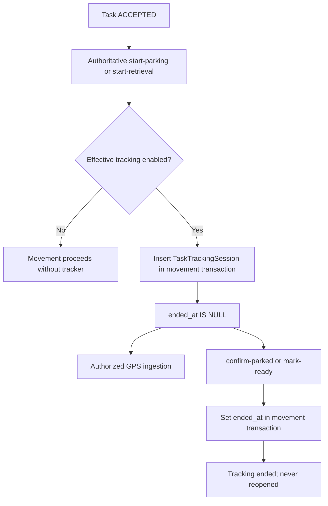

# Issue #270 — Approved Decisions and Complete Planning Report

> **Owner approval — 2026-10-07**
>
> The four decisions below are approved, and the complete planning report that follows is approved **verbatim in full detail**.
> The preserved planning report is not edited. Its historical `DECISION REQUIRED` / unresolved U-001–U-004 status statements are superseded only by this approval block; all other plan text, constraints, recommendations, evidence classifications, implementation slices, tests, risks, scope boundaries, and Definition of Done remain exactly as written.

## Approved decisions

### U-001 — Native task tracking runs foreground-only

For Issue #270, task-scoped GPS acquisition runs only while the Employee Native app is in the foreground and an authoritative eligible Parking/Retrieval movement is active.

When the app enters the background, acquisition stops. When it returns to the foreground, Native must revalidate authoritative server state before acquisition can restart.

Do not enable background location permissions, a background location service, or whole-Shift tracking as part of #270.

### U-002 — Native learns tracking eligibility from an authoritative backend projection

Extend an existing employee read using a backward-compatible **opt-in tracking projection** rather than making Native infer eligibility from Task state alone.

The projection should expose only the minimum authoritative tracking facts needed by Native, including whether task tracking is eligible and the active tracking-session identity/start information required to bind one transient publisher generation.

Existing clients that do not opt in must keep their existing strict response shape. Do not expose management history, raw GPS samples, or broader management permissions.

### U-003 — Bounded sampling, upload, retry, and Dashboard refresh profile

Adopt this starting production profile for #270:

- admit a GPS fix at most every **5 seconds**;
- upload a bounded batch every **10 seconds**;
- keep at most **50 samples total in resident memory**, including in-flight work;
- keep retry/local pending state for at most approximately **120 seconds**;
- keep retries bounded; never create an infinite retry loop or persistent route queue;
- poll the visible eligible Live Operations map every **10 seconds after the previous request settles**;
- on network loss, do not keep collecting GPS indefinitely: retain only the bounded transient pending buffer and resume only after appropriate authoritative recovery/revalidation.

The existing server request limit of 50 samples remains authoritative. Stable sample identity/idempotency, temporal validation, privacy rules, and all detailed buffering/retry constraints in the preserved plan remain in force.

### U-004 — Multiple eligible movement tasks fail closed

Native must never silently choose the first queue row and must never copy one physical GPS fix into multiple movement tasks.

- **0 eligible tracking movements:** no task GPS acquisition.
- **1 eligible tracking movement:** track that authoritative movement normally.
- **More than 1 eligible tracking movement:** fail closed, stop/withhold the publisher, and surface a controlled ambiguity state until authoritative state becomes unambiguous.

No in-progress reassignment feature is introduced by #270.

### Locked lifecycle clarification — Retrieval stops at READY

Retrieval task GPS acquisition must stop when the ValetSession reaches **READY**, even though the Retrieval Task may remain `IN_PROGRESS` through Handoff. It must not continue tracking until Task `COMPLETED`.

---

## 1. BASELINE

- **Actual `origin/main`:** `4b7253669d09bad3aadebe99b02f3fb75ed47f3c`
- **Latest commit:** `fix(presence): open strict shift rollout (#267)`
- **Main advanced beyond the supplied baseline:** No.
- **Issue [#270](https://github.com/veletpro0-lgtm/valet-platform/issues/270):** OPEN, rechecked after inspection.
- Local `HEAD` matches `origin/main`; working tree is clean.

`git fetch origin` succeeded after retrying with the permission needed to update Git metadata.

**Planning verdict: DECISION REQUIRED.** The missing Native publisher and Dashboard refresh are confirmed. A narrow employee-facing tracking-authority projection is also missing. Native background behavior remains explicitly unresolved in the repository.

This report is based on source, contracts, migrations, tests and GitHub issues. No production database inspection, test execution or physical-device validation was performed.

## 2. ISSUE CLAIM VERIFICATION

| Claim | Classification | Evidence |
|---|---|---|
| Google Maps integration exists | **CONFIRMED** | `OperationalGoogleMap`, SDK loader and `createOperationalGoogleMapRuntime` implement provider loading and marker/polygon rendering. |
| Google Maps was healthy in production | **PARTIAL** | Reported by #270; source supports the capability but cannot verify the deployed observation. |
| Live Operations API works | **CONFIRMED** as implemented capability | Controller, service, query and integration tests exist. Deployment health was not independently checked. |
| An eligible Parking task/tracker existed with tracking enabled | **PARTIAL** | Source supports the reported combination. The historical production row was not inspected here. |
| Production `raw_gps_samples=0` | **PARTIAL** | Issue evidence only; not independently remeasured. |
| An eligible tracker without samples yields `position:null` | **CONFIRMED** | `createLiveMapQuery` uses a lateral latest-sample lookup and explicitly projects null. |
| No coordinates produce world fallback | **CONFIRMED** | `decideOperationalMapCamera`: zero distinct coordinates → `(0,0)`, zoom `2`. |
| Native has no task GPS ingestion caller | **CONFIRMED** | Production searches of Native and employee-client found no publisher or ingestion-route caller. |
| Native location acquisition serves Shift Presence | **CONFIRMED** | `NativeShiftPresenceAdapter` performs bounded acquisition for explicit Shift actions. |
| Dashboard has no automatic live refresh | **CONFIRMED** | `useOperationsRead` responds to mount/key/revision changes; Maps has no polling/subscription. |
| Existing contracts alone provide everything Native needs | **PARTIAL** | Upload and management reads exist, but employee queue/context responses lack tracker and effective tracking eligibility. |
| Task completion is the universal tracking stop signal | **CHANGED / needs precision** | Retrieval tracking stops at `READY` while its Task remains `IN_PROGRESS`. |
| Active movement can normally be reassigned | **NO LONGER TRUE as a planning assumption** | Current reassignment accepts only `ASSIGNED` or `ACCEPTED`, not `IN_PROGRESS`. |

Related issue review: #153, #155 and #163 are closed. #235 remains open with an outdated “no provider integration” description; merged code takes precedence. #257 remains open and concerns separate Shift Presence semantics.

## 3. AUTHORITATIVE PRODUCT BOUNDARY

**LOCKED:** DEC-045/046/048/049 establish configurable, task-scoped movement tracking:

```text
Parking:   PARKING → PARKED
Retrieval: RETRIEVING → READY
```

An active Shift supplies operational eligibility; it does not authorize continuous acquisition.

Relevant additional authority:

- DEC-063: no generic durable offline command queue.
- DEC-071/072: Expo Native architecture, shared client separation and Native authentication.
- DEC-080: MFA-backed Company Admin management visibility.
- DEC-099/100: separate point-in-time Shift Presence.
- `docs/20_PHASE5_MAPS_TRACKING_EXECUTION_PLAN.md`.
- `docs/20_EMPLOYEE_NATIVE_EXECUTION_PLAN.md`, especially MOB-019A/B and U-003.

Affected existing entities are `Task`, `ValetSession`, `TaskTrackingSession`, `RawGpsSample`, `GeofenceEvent`, Organization/Location policy and operational membership/Shift authority. No new domain lifecycle is justified.

## 4. CURRENT PARKING TASK LIFECYCLE

Current command path:

```text
queue-parking-task-command
  → QUEUED
assign-task-command
  → ASSIGNED
accept-task-command
  → ACCEPTED
start-parking-command
  → Task IN_PROGRESS + ValetSession PARKING
confirm-parked-command
  → Task COMPLETED + ValetSession PARKED
```

Sources under `apps/api/src/modules/`:

- `dispatch/queue-parking-task-command.ts`
- `dispatch/assign-task-command.ts`
- `dispatch/accept-task-command.ts`
- `parking/start-parking-command.ts`
- `parking/start-parking-guards.ts`
- `parking/confirm-parked-command.ts`
- `parking/confirm-parked-mutations.ts`

Start Parking checks expected Task/session versions, accepted task state, current owner and operational eligibility. Tracking creation happens inside that movement transaction when effective policy is enabled.

Confirm Parked ends tracking atomically with the physical transition and associated custody/history effects.

Pre-custody cancellation is separate. `cancel-before-parking-command.ts` accepts only pre-movement task states, and its authorization rejects tracking history. It is not an active-tracking cancellation mechanism.

## 5. CURRENT RETRIEVAL TASK LIFECYCLE

```text
Guest retrieval request:
  ValetSession PARKED → REQUESTED
  RetrievalRequest OPEN
  Retrieval Task QUEUED

Assignment / acceptance:
  Task QUEUED → ASSIGNED → ACCEPTED

start-retrieval:
  ValetSession REQUESTED → RETRIEVING
  Task ACCEPTED → IN_PROGRESS
  RetrievalRequest OPEN → ACCEPTED
  tracking may start

mark-ready:
  ValetSession RETRIEVING → READY
  tracking stops
  Task remains IN_PROGRESS

handoff / release:
  existing explicit handoff commands
  complete-handoff → Task COMPLETED
```

Sources:

- `retrieval/guest-retrieval-request-command.ts`
- `retrieval/start-retrieval-command.ts`
- `retrieval/start-retrieval-guards.ts`
- `retrieval/mark-ready-command.ts`
- `retrieval/complete-handoff-command.ts`

**Critical consequence:** Native must stop at `READY`; waiting for Task `COMPLETED` would continue collection through handoff.

Guest cancellation is limited to pre-start retrieval states. Do not introduce a new movement cancellation or failure state.

## 6. TRACKING SESSION LIFECYCLE

[`task-tracking-lifecycle.ts`](C:/Users/LP/Desktop/valet-app/valet-platform/apps/api/src/modules/tracking/task-tracking-lifecycle.ts) owns the persistence composition.



- Ownership is **not stored on the tracker**. `Task.current_assignee_membership_id` remains authoritative.
- Existing active tracker during a new movement start is an integrity conflict.
- Tracker creation failure rolls back movement start.
- Tracker-ending failure rolls back movement completion.
- Ending occurs regardless of the current tracking policy.
- A tracker for the wrong Task causes an integrity conflict.
- There is no public tracking start/stop command.
- There is no current Task `FAILED` state.

Normal reassignment is pre-movement only. Do not invent tracker rollover for in-progress reassignment.

## 7. EXISTING GPS INGESTION CONTRACT

**Route**

```http
POST /v1/staff/valet-sessions/:sessionId/tracking/gps-samples
```

The controller prefix is literally `v1/staff/valet-sessions`. The Live Map controller prefix is `v1/staff/locations`; Dispatch uses `v1/staff`.

**Strict request**

```ts
{
  samples: Array<{
    accuracyMeters: number;
    capturedAt: string;
    clientSampleId: string;
    latitude: number;
    longitude: number;
  }>;
}
```

From [`gps-ingestion.ts`](C:/Users/LP/Desktop/valet-app/valet-platform/packages/contracts/src/gps-ingestion.ts):

- Batch size: **1–50**.
- Accuracy: finite, **greater than zero and at most 100 metres**.
- Latitude: `[-90,90]`.
- Longitude: `[-180,180]`.
- Sample identity: UUID.
- Capture time: ISO datetime with offset.
- Unknown fields rejected.

**Temporal validation**

`canonicalizeGpsSamples` requires:

- Nondecreasing capture timestamps within each request.
- Capture timestamp not before tracker start.
- No older than **five minutes** relative to database operation time.
- No more than **30 seconds in the future**.
- Coordinates canonicalized as `numeric(9,6)`.
- Timestamp canonicalized as `timestamptz(3)`.

Cross-request backfill is allowed inside those bounds.

**Response**

```ts
{
  samples: Array<{
    clientSampleId: string;
    status: "ACCEPTED" | "DUPLICATE";
  }>;
}
```

There is no partial-rejection result vocabulary.

**Authority and transaction order**

`createGpsIngestionCommandExecutor`:

1. Authenticate through the staff principal resolver.
2. Begin dispatch transaction.
3. Lock target ValetSession.
4. Acquire Organization settings shared guard.
5. Resolve membership in the session’s Organization.
6. Lock the exact in-progress movement Task.
7. Prove canonical ownership.
8. Lock current operational eligibility.
9. Check physical movement state.
10. Check effective policy and lock the active tracker.
11. Validate/canonicalize samples.
12. Persist samples and advancing geofence effects.
13. Commit.

Protected sample writes occur only after target-specific authorization.

**Errors**

| Code | HTTP mapping |
|---|---:|
| `REQUEST_INVALID` | 400 |
| `TASK_NOT_FOUND_OR_FORBIDDEN` | 404 |
| `TASK_INVALID_STATE` | 409 |
| `GPS_SAMPLE_IDEMPOTENCY_CONFLICT` | 409 |

Authentication errors remain separate.

## 8. DATABASE

Existing storage is sufficient for the missing publisher path.

`TaskTrackingSession` contains exact Organization, Location, ValetSession and Task relationships plus start/end timestamps.

`RawGpsSample` contains:

- Exact composite tracking scope.
- Client sample UUID.
- Canonical latitude/longitude.
- Client capture timestamp.
- Database-authored receipt timestamp.

Relevant protections:

- Composite foreign keys prevent cross-scope composition.
- One active tracker per Task.
- One active tracker per ValetSession.
- Unique `(tracking_session_id, client_sample_id)`.
- Latest-position index `(tracking_session_id, captured_at, id)`.
- Retention index on `received_at`.
- Coordinate and timestamp-order checks.
- Trigger prevents tracker reopening or end-time rewriting.
- Runtime cannot freely update/delete raw GPS.

Migration 25 provides `cleanup_expired_raw_gps_samples(batch_limit)`:

- Limit `1–1000`.
- Database time.
- Effective inherited retention.
- Receipt-time age.
- Ended trackers only.
- Narrow `SECURITY DEFINER` authority.

**No database migration is justified for the recommended scope.** This does not establish that cleanup scheduling is active in production.

## 9. LIVE OPERATIONS READ PATH

```http
GET /v1/staff/locations/:locationId/live-operations-map?limit=100
```

[`live-map-query.ts`](C:/Users/LP/Desktop/valet-app/valet-platform/apps/api/src/modules/tracking/live-map-query.ts) uses a `REPEATABLE READ` transaction.

Eligible rows require:

- Exact authorized Organization/Location.
- Effective tracking policy enabled.
- Tracker `ended_at IS NULL`.
- Matching Task/session/tracker scope.
- Task `IN_PROGRESS`.
- Non-null canonical assignee.
- Parking Task + session `PARKING`; or
- Retrieval Task + session `RETRIEVING`.

Latest position:

```sql
ORDER BY sample.captured_at DESC, sample.id DESC
LIMIT 1
```

Freshness uses database-authored `observedAt`:

- Exactly 60 seconds old: `LIVE`.
- More than 60 seconds: `STALE`.
- No sample: `position:null`.
- Accepted future timestamp: `LIVE`, without invented smoothing.

The response includes current area metadata, not polygon geometry or route history.

Default limit is 100; maximum is 500. Pagination uses tracker `(started_at,id)`. Policy OFF returns an authorized empty response.

## 10. LIVE MAP AUTHORIZATION

Current code extends the original Phase 5 matrix through later management decisions.

| Viewer | Current requirements |
|---|---|
| Company Admin | Current staff session, matching user, active `ORG_ADMIN` membership and Organization, valid MFA assurance, Organization-owned active target Location, `LIVE_MAP_READ`, Dashboard commercial entitlement. No field Shift required. |
| Location Manager | Active User/member/Organization/Location, exact persisted Location grant, Dashboard entitlement. No Shift required. |
| Supervisor | Same active/exact grant checks, **active Shift at that Location**, Dashboard entitlement. |
| Employee | No broad Live Map permission. |
| Guest/customer | No exact GPS permission. |
| Venue Client | No invented permission or representation. |

Sources:

- `tracking/live-map-authorization.ts`
- `tracking/live-map-read-authorization.ts`
- `management/management-authorization.ts`
- `management/management-commercial-access-policy.ts`

The commercial check applies to the operational authorization branch, including Supervisors—not only Location Managers.

Company Admin authorization also records admin activity after authority succeeds. Preserve that existing behavior; do not assume the endpoint is completely free of authorization bookkeeping writes.

## 11. CURRENT NATIVE ARCHITECTURE

The correct lifecycle integration is the runtime, not a Parking/ Retrieval screen mount.

Current ownership:

- `NativeEmployeeRuntime`: constructs auth, operational state and workflow sessions.
- `EmployeeOperationalSession`: operational context, resolved scope, queue and subscriptions.
- `EmployeeTaskQueueOwner`: foreground queue polling, default **five seconds**, one active queue request, abort and scope fencing.
- `NativeProductionLifecycleOwner`: foreground, auth-ready, connectivity recovery and workflow revalidation.
- `useNativeProductionLifecycle`: AppState/auth/connectivity bridge.
- `nativeIdentityState`: identity purge boundary.
- `retireNativeWorkflowScope`: workflow retirement.
- Parking/Retrieval session objects: explicit commands and authoritative recovery.

The task queue exposes ownership, Task status and physical session state. It does **not** expose effective tracking policy or an active tracker.

The UI’s priority card uses `snapshot.tasks[0]`. That is presentation order, not proof of which movement the device should track.

## 12. CURRENT LOCATION ARCHITECTURE

- Expo SDK: `~57.0.19`.
- `expo-location`: `~57.0.20`, already installed.
- React Native: `0.86.3`.
- App uses Expo CNG.
- Android minimum: API 29.
- Location configuration is in **`app.json`**; `app.config.ts` performs release preflight.
- iOS usage copy currently describes Start/End Shift only.
- iOS background location: disabled.
- Android background location: disabled.
- Android foreground location service: disabled.
- Custom `with-shift-presence-foreground-only.cjs` explicitly removes the location task service and background/service-location permissions.

`watchPositionAsync` provides foreground updates; background location requires a different configured lifecycle and task registration. This distinction is documented by [Expo SDK 57 Location](https://docs.expo.dev/versions/v57.0.0/sdk/location/).

**Repository policy does not currently choose foreground-only versus background task tracking.** MOB-019A explicitly leaves this unresolved.

## 13. SHIFT PRESENCE SEPARATION

`NativeShiftPresenceAdapter`:

- Runs for explicit Shift actions.
- Uses a 15-second acquisition bound.
- Collects at most three callbacks.
- Applies challenge-specific accuracy requirements.
- Rejects cached fixes predating the action.
- Removes the watcher on completion/abort.
- Keeps measurement transient.

Safe reuse is limited to small platform patterns:

- Permission inspection.
- Service availability checks.
- Abort-aware watcher disposal.
- Opening settings.
- Timestamp validation techniques.

Do **not** reuse:

- Presence challenges, operation IDs or evidence.
- Presence samples.
- Presence persistence/recovery stores.
- Three-sample/15-second attendance semantics.
- Shift start/end triggers.
- Presence-specific messages as task-tracking messages.

Keep the current feature copy in `native-shift-presence-copy.ts` unchanged. The **app-wide OS permission explanation must become truthful about both features** if task acquisition ships; that does not change Shift Presence behavior.

## 14. ROOT CAUSE

There are three implementation gaps:

1. **No Native task-location acquisition/publisher.**
2. **No employee-readable projection proving current tracking eligibility and tracker identity.**
3. **No bounded Dashboard automatic refresh.**

There is also a camera integration edge case: an empty successful result can consume camera initialization before the first GPS coordinate arrives.

The ingestion persistence and management latest-position path already exist. Google Maps provider replacement is unnecessary.

## 15. PROPOSED NATIVE PUBLISHER ARCHITECTURE

This is a **decision-dependent implementation envelope**, not an accepted Native sensor contract.

Recommended composition:

```text
NativeEmployeeRuntime
  ├─ existing auth / operations / workflow sessions
  └─ task-tracking runtime
       ├─ authoritative eligibility reconciliation
       ├─ Native location adapter
       ├─ bounded transient sample buffer
       └─ existing EmployeeClient → GPS ingestion route
```

Responsibilities:

- **Native:** Expo permissions, acquisition, AppState and settings UX.
- **Shared employee-client, only where useful:** typed ingestion transport and pure buffering/retry logic.
- **API:** current tracking eligibility projection and final ingestion authority.
- **Contracts:** strict projection schemas; existing GPS payload reused.

The runtime subscribes to auth and authoritative operational/workflow results. Navigation may change while tracking continues within the approved platform lifecycle.

No Google Maps SDK is needed in Native to publish GPS.

## 16. PUBLISHER START CONDITIONS

Collection requires all of the following:

1. Current authenticated Native generation.
2. Freshly server-resolved operational scope.
3. Exact current membership and Location/Shift eligibility.
4. Canonical ownership of the movement Task.
5. Task `IN_PROGRESS`.
6. Physical state matching Parking or Retrieval movement.
7. Existing active tracker.
8. Current effective tracking policy enabled.
9. Permission and OS location services available.
10. Foreground/background conditions approved under **U-001**.
11. Unambiguous target selection under **U-004**.

Local values only determine whether an attempt is appropriate. The API remains authoritative for acceptance.

Neither an active Shift nor successful Task acceptance is sufficient.

## 17. PUBLISHER STOP CONDITIONS

Stop and invalidate the publishing generation on:

- `PARKED` or `READY`.
- Tracker no longer eligible.
- Ownership loss.
- Task/session mismatch.
- Effective policy OFF.
- Logout, definitive auth loss or identity replacement.
- Organization/membership/Location/Shift scope replacement.
- Operational authority failure.
- Permission revocation or disabled services.
- Runtime disposal.
- Approved background/offline/freshness boundary.

Recommended stop ordering:

1. Increment generation synchronously.
2. Disable callback acceptance and further sends.
3. Remove watcher.
4. Abort pending transport.
5. Cancel timers.
6. Clear scoped raw samples as required.

A watcher returned asynchronously **after** stop must immediately remove itself.

For local Confirm Parked/Mark Ready submission, suspend acquisition before dispatch. An unknown command result must not leave collection running; resume only after authoritative reconciliation.

Remote changes cannot be detected instantaneously by an offline device. **U-003 must define the maximum permitted age of collection authority.** Server rejection is immediate according to transaction ordering; device shutdown is bounded by detection.

## 18. SAMPLE CONTRACT

Use exactly:

| Field | Native source |
|---|---|
| `clientSampleId` | UUID generated once for an admitted physical fix |
| `capturedAt` | Location fix timestamp, converted to ISO |
| `latitude` | `coords.latitude` |
| `longitude` | `coords.longitude` |
| `accuracyMeters` | `coords.accuracy`, only when valid |

Do not use upload time as capture time.

Do not send altitude, speed, heading, provider, mocked flag, sequence number, Organization, Location, membership, Task or tracker fields in this existing payload.

The server derives tracker identity. Native should nevertheless retain tracker identity **in its transient lifecycle context** to prevent buffer reuse across tracking episodes.

The existing Native presence runtime uses `globalThis.expo.uuidv4()`. A task publisher can inject the same platform capability without calling the Presence runtime. Its local `uuid()` helper is not exported.

## 19. BATCHING DESIGN

**Repository-fixed:** batch maximum 50; server temporal and accuracy limits described above.

**U-003 — proposed starting profile, not an approved product constant:**

| Control | Recommended candidate | Alternative |
|---|---:|---:|
| Admitted fix cadence | 5 seconds | 2–10 seconds |
| Upload cadence | 10 seconds | 5–15 seconds |
| Total resident sample cap, including in-flight | 50 | Smaller cap after measurement |
| Batch size | Up to 50 | Usually about 2 fixes per healthy upload |
| Local sample retention/retry horizon | 120 seconds | 60–240 seconds |
| Upload attempts per retained batch | Initial + at most 5 retries | Shorter retry budget |
| Retry delays | 2, 4, 8, 16, then 30 seconds, bounded jitter | Equivalent bounded backoff |

The OS callback rate is not a guaranteed sampling clock. Admission must be independently bounded.

Recommended rules if approved:

- Sort each batch by capture time.
- Keep one immutable in-flight batch.
- Never alter its IDs/payload during unknown-outcome retry.
- Evict expired samples first.
- When full, evict oldest unsent samples; do not silently rewrite an in-flight batch.
- Remove samples only after validated `ACCEPTED`/`DUPLICATE` results.
- Validate response identity/count correspondence.
- No per-sample rejection handling: the API does not support it.

For offline handling, prefer stopping new acquisition and retaining only the already bounded pending buffer. Resume after fresh authority confirmation. Continued offline acquisition would require a separately accepted authority-expiry policy.

## 20. RETRY / IDEMPOTENCY

Durable server identity is:

```text
(trackingSessionId, clientSampleId)
```

Canonical equality compares capture time and coordinates. Accuracy is validated but excluded from stored identity.

| Situation | Existing server behavior / proposed client response |
|---|---|
| First valid submission | `ACCEPTED`; remove after validated response. |
| Identical retry while still eligible and fresh | `DUPLICATE`; remove. |
| Concurrent identical submissions | Serialize/converge to one stored sample. |
| Same identity with different canonical data | Conflict; whole transaction rolls back. |
| Mixed new and duplicate samples | Per-input `ACCEPTED`/`DUPLICATE`. |
| Lost successful response | Retry the identical retained batch within approved bounds. |
| Retry after tracker ends | Current authority check rejects; no historical replay guarantee. |
| Retry after five-minute validity window | Validation can reject before duplicate recognition. |

`EmployeeClient` does not generically replay mutations. Preserve that rule. GPS-specific bounded replay belongs only in the approved publisher, using the existing sample identity contract.

Never regenerate IDs to “repair” an unknown result. Never reset timestamps to make stale samples fresh.

## 21. MEMORY / STORAGE PRIVACY

Recommended and consistent with the requested scope: **bounded transient memory only**.

No raw fixes in:

- AsyncStorage, SQLite or files.
- SecureStore merely because it is encrypted.
- Generic command/draft/recovery stores.
- Analytics or crash payloads.
- Audit metadata.
- Ordinary logs.
- Persisted state containers.

Authentication persistence remains separate.

Clear references on identity/scope/tracker retirement. Process death loses unsent samples; do not claim a complete route.

The Native telemetry wrapper already avoids reading request bodies, headers and parameters. Preserve and test that property with GPS requests.

## 22. PROCESS RESTART

Recommended recovery:

```text
new process
  → restore/refresh Native authentication
  → load operational context
  → resolve current scope
  → fetch current task + tracking eligibility
  → verify ownership, movement and policy
  → create new publisher generation
  → acquire new fixes
```

Do not resume from a saved task ID, route parameter, notification payload or old UI selection.

Existing auth-ready bootstrap tests cover the queue restoration regression. Extend those tests so no acquisition occurs before the new tracking projection succeeds.

Unsent pre-death fixes are lost. Previously committed samples remain on the server. No replay journal is introduced.

## 23. BACKGROUND / FOREGROUND

**U-001 requires owner/architect resolution.**

The Phase 5 contract defines **which movement** may be tracked, but does not accept a Native background execution mode. The Native execution plan explicitly reserves this for MOB-019A.

Alternatives:

- **Foreground-only:** remove watcher and stop sending on real background; foreground return revalidates before restarting. Existing dependencies/configuration are largely sufficient.
- **Task-scoped background:** requires an accepted background permission/service/task lifecycle, notification behavior, authority-expiry rules and physical Android/iOS evidence. The current manifest-removal plugin conflicts with enabling this.
- **Another explicitly bounded platform mode:** must define the same privacy and stop guarantees.

Do not reuse camera-specific permission-dialog suppression without verifying its suitability for location permission transitions.

Task collection must never be activated by Shift state alone under any option.

## 24. PERMISSION / SERVICES UX

Use existing `EmployeeStatus`, `EmployeeError`, buttons, locale and theme conventions.

| Condition | Required truthful behavior |
|---|---|
| Not requested | Explain task-scoped use; request only inside approved eligible lifecycle. |
| Denied, can ask again | No watcher; bounded explicit retry action. |
| Permanently denied | No prompt loop; settings action. |
| Services disabled | Stop; explain services requirement and allow retry. |
| Permission revoked | Stop, fence callbacks and revalidate before restart. |
| Temporary acquisition failure | Show unavailable/retrying state under bounded policy. |
| Null, nonpositive or >100 m accuracy | Do not submit; show searching/unavailable without fabricating precision. |

Tracking failure must not automatically mutate or complete the business Task.

Current translations include:

- `src/i18n/native-dictionary-en.ts`
- `src/i18n/native-dictionary-ar.ts`
- Feature copy modules such as `src/shift/native-shift-presence-copy.ts`.

Use a focused task-tracking EN/AR copy module; the central dictionaries are already near 300 lines.

Also correct the current unconditional pre-Parking statement, “Location tracking will activate for this parking task.” Policy OFF or unavailable permission makes that promise untrue.

## 25. TASK END / REASSIGNMENT RACES

| Race | Transactions/resources and existing protection | Required client proof |
|---|---|---|
| Ingestion vs Confirm Parked | A locks session, Task, eligibility and tracker, then inserts. B locks the same session and completes movement/ends tracker. Shared session lock serializes them. | Suspend before local completion dispatch; late callbacks and upload results cannot restart. |
| Ingestion vs Mark Ready | Same session serialization. B changes physical state to `READY` and ends tracker; Task remains `IN_PROGRESS`. | Stop based on physical movement/tracker eligibility, not Task terminality. |
| Duplicate ingestion | A/B use same session/tracker and sample identity. Session locking plus unique key prevents duplicate rows. | Same IDs and payload; one publisher upload at a time. |
| Policy OFF vs ingestion | Ingestion takes Organization settings shared guard before policy use. Management settings mutation uses the corresponding protected configuration boundary. | Revalidation/expiry stops acquisition; rejected upload does not loop. |
| Eligibility invalidation vs ingestion | `lockShiftOperationalEligibility` holds share locks on User/member/Organization/Location/access/Shift through the write. | Hard authority failure retires publisher and buffer. |
| Logout vs callback/upload | Client generation can invalidate callbacks immediately. Aborting HTTP cannot undo an already dispatched server transaction. | No post-logout acquisition or new sends; late responses ignored. |
| A→B owner change | Current reassignment command rejects `IN_PROGRESS`. Pre-start change is serialized by Task locking. | A never starts from stale ownership; B starts only after its own authoritative movement eligibility. |

For each database race:

- If the movement-end transaction commits first, later ingestion rejects.
- If it rolls back, unchanged eligible movement may still accept ingestion.
- If ingestion commits first, its sample legitimately precedes movement end.
- If its response is lost, retry uses the same identity; current eligibility still applies.

The linearization boundary is the protected transaction ordering/commit, not callback arrival.

**Missing client protection:** generation, stop fence and authority-age bound. These belong to #270.

**No new reassignment mechanism:** a test that manually updates an in-progress assignee demonstrates defense against inconsistent state; it does not establish an accepted production reassignment flow or guarantee owner-separated historical routes.

## 26. TRACKING ENABLED POLICY

Source of truth:

```text
Location.tracking_enabled_override
  ?? Organization.tracking_enabled
```

Company default is false.

Current behavior:

- OFF at movement start → no tracker.
- ON at movement start → atomic tracker creation.
- OFF during movement → ingestion rejects and Live Map hides the work.
- Movement completion still closes an existing tracker.
- ON after an OFF start does **not** create a tracker retroactively.
- OFF→ON with an existing unended tracker may make that tracker eligible again while movement remains valid.

Native currently has no employee projection of these facts. It must not read management settings through expanded employee permissions or infer ON from the Shift.

## 27. DASHBOARD CURRENT READ MODEL

```text
MapsPage
  → MapsContent keyed by operationsScopeKey
  → useOperationsRead
  → readLiveMap
  → DashboardApiClient
  → strict LiveOperationsMapResponse
  → projectOperationalMap
  → Google runtime.sync(model, refit)
```

Current behavior:

- Mount/scope/cursor change triggers a read.
- Manual Refresh increments revision.
- Same-key pending refresh retains prior data.
- Failed read clears data.
- Abort/disposed/generation checks reject late responses.
- The map updates existing marker positions in place.
- Live reads are not currently gated by LIVE-versus-SETUP mode.
- No automatic interval exists.

## 28. DASHBOARD LIVE REFRESH DESIGN

Add a **Maps-specific refresh owner**, not a global polling framework.

Recommended behavior:

- Active only in eligible **Live Operations** mode while the document is visible.
- Immediate read on activation.
- Schedule the next poll after the current read settles.
- One current request.
- Manual Refresh joins/requests that same operation rather than creating another.
- Abort and invalidate on scope/session/cursor/mode change, hide or unmount.
- Revalidate immediately on visibility restoration.
- Preserve ordinary same-scope data while a bounded request is pending.
- Clear markers on authorization, entitlement or definitive auth failure.
- Preserve existing error-clears-data behavior on failed refresh.
- Apply bounded timeout/backoff to transient failures.
- Keep polling enabled for an authorized empty result: policy or task eligibility can change later.

Use the current `DashboardApiClient` authentication recovery. Do not create a second token-refresh mechanism.

Pagination remains a bounded current-page view. Do not silently accumulate every page into a route/employee map.

## 29. REFRESH CADENCE

No accepted Live Map polling interval was found.

**DERIVED TECHNICAL RECOMMENDATION, not product truth:**

- Normal polling: **10 seconds after settlement**.
- Alternative range: **5–15 seconds**.
- Candidate request timeout: **10 seconds**.
- Candidate failure backoff: **20, 40, then 60 seconds**, capped.
- Resume immediately after visibility restoration, with one request.

At 10 seconds, a continuously visible dashboard produces approximately six reads per minute, excluding latency/backoff.

The 60-second `LIVE` threshold is an accepted freshness rule, **not** an instruction to poll every 60 seconds.

Freeze the technical values with U-003 and validate them against real request duration and pilot load.

## 30. REQUEST / GENERATION FENCING

Reuse the existing scope identity:

```text
identityGeneration
+ sessionGeneration
+ selectionRevision
+ selectedScopeAuthorityKey
```

Add per-request generation/abort identity inside the Maps-specific owner.

**A→B**

1. A starts under scope epoch A1.
2. Selection changes; A1 is invalidated and aborted.
3. B starts under B1.
4. B completes and renders.
5. A1 completes late; generation check rejects it.

**A→B→A**

The new A selection receives a new selection revision/request generation. Matching Location IDs do not make old A1 current.

Fence after all awaited work, including authentication reconciliation and response parsing.

Logout/session replacement must clear protected state and retire timers even when the underlying fetch ignores cancellation.

## 31. CAMERA PRESERVATION

Verified model rules:

- Zero distinct coordinates → world `(0,0)`, zoom `2`.
- One distinct coordinate → center there, zoom `17`.
- Multiple distinct coordinates → fit bounds.
- Bounds path clamps an observed zoom above `19`.

Camera inputs include permitted configured points and polygon vertices, not only live markers.

Existing key:

```text
scopeKey : maps : live/setup : cursor-or-first
```

Preserve that semantic boundary. Do not append poll count, position, response timestamp or sample ID.

Required adjustment:

- Track whether a **usable coordinate-based initial fit** has occurred for the camera epoch.
- Empty successful responses must not permanently consume that opportunity.
- First later coordinate can receive initial fitting.
- Subsequent marker movement preserves pan/zoom.
- Location, mode or page changes keep their existing refit semantics.
- Manual Refresh refreshes data; it need not refit.
- Theme rebuild retains the existing camera snapshot behavior.

No new recenter control is required by #270.

## 32. MAP ZERO-COORDINATE BEHAVIOR

Preserve truthful world fallback when there are neither operational coordinates nor authorized configured geometry.

Do not:

- Invent a Location center.
- Geocode the address.
- Substitute another tracker’s last position.
- Render `(0,0)` as an actual task marker.
- Treat Google Maps as business-state authority.

Keep existing setup points/areas, provider-neutral geometry and role-specific setup access unchanged.

## 33. API CHANGE DECISION

**YES — SMALL.**

The existing ingestion and Live Map contracts are sufficient for sample submission and management rendering.

The gap is **employee acquisition eligibility discovery**:

- `staffTaskQueueItemSchema` exposes Task/session state and assignee.
- `staff-context.ts` exposes operational membership/Shift context.
- Neither exposes active tracker identity/start or effective tracking eligibility.
- Employees cannot use the management Live Map as a substitute.

**U-002 recommendation:** extend an existing employee read through an explicit opt-in tracking projection, preserving the legacy response when not requested.

Why opt-in matters: current schemas are strict. Unconditionally adding a property can break already-installed Native clients and cached Web clients.

An alternative narrow employee read may be considered if opt-in integration proves less safe, but no new route is frozen here. No new ingestion endpoint is justified.

## 34. CONTRACT CHANGE DECISION

**YES — narrowly for employee eligibility discovery.**

Keep unchanged:

- GPS request/response.
- Live Operations response.
- Coordinate fields.
- Server freshness and idempotency rules.

U-002 must freeze:

- Which existing read carries tracking eligibility.
- Backward-compatible opt-in behavior.
- Minimal tracker identity/start and eligibility representation.
- Null/absent semantics.
- Exact-owner disclosure.
- Response consistency.
- Native parsing and old-client compatibility.

Do not expose management location history or raw samples to solve this read gap.

## 35. DATABASE MIGRATION DECISION

**Migration required: NO for the recommended scope.**

The missing information can be projected from existing Task, ValetSession, tracking-session and policy rows.

Existing tables already support:

- Tracker identity.
- Movement start/end.
- Sample identity and coordinates.
- Latest-position reads.
- Retention.

No server-side publisher lease, new tracking state or durable client queue is proposed.

If an unresolved decision expands into new persistence, it must be reviewed as additional scope; this plan does not preauthorize that migration.

## 36. DEPENDENCY CHANGE DECISION

**New dependency required: NO for foreground acquisition and existing HTTP transport.**

`expo-location`, Native auth transport and UUID capability already exist.

**Conditional on U-001:** background execution needs further dependency/configuration review. `expo-task-manager` is not a direct dependency in the inspected Native manifest, and the existing plugin removes the location task service.

Do not silently add it or claim a background solution needs no configuration changes.

No Dashboard dependency is needed for bounded polling.

## 37. PRODUCTION FILE PLAN

Paths below are concrete candidates. **Conditional** means the file selection depends on U-001/U-002/U-003/U-004; it is not a frozen implementation contract. New files start at zero and must remain ≤300 physical lines.

**Existing files likely to change**

| File | Lines | Responsibility and proposed change |
|---|---:|---|
| [native-auth-runtime.ts](C:/Users/LP/Desktop/valet-app/valet-platform/apps/valet-native/src/auth/native-auth-runtime.ts) | 293 | Construct/dispose tracking runtime and purge it at identity boundaries. **Extract runtime composition first**; no meaningful inline growth. |
| [native-production-lifecycle-owner.ts](C:/Users/LP/Desktop/valet-app/valet-platform/apps/valet-native/src/shell/native-production-lifecycle-owner.ts) | 243 | Delegate foreground/connectivity/revalidation events to tracking owner. Keep sensor/retry implementation elsewhere. |
| [use-native-production-lifecycle.ts](C:/Users/LP/Desktop/valet-app/valet-platform/apps/valet-native/src/shell/use-native-production-lifecycle.ts) | 82 | Connect lifecycle subscriptions where required. |
| [native-workflow-scope-retirement.ts](C:/Users/LP/Desktop/valet-app/valet-platform/apps/valet-native/src/shell/native-workflow-scope-retirement.ts) | 33 | Retire tracker context with operational scope. |
| [native-production-workspace.tsx](C:/Users/LP/Desktop/valet-app/valet-platform/apps/valet-native/src/shell/native-production-workspace.tsx) | 292 | Mount a small subscribed status component. Extract relevant frame feedback if necessary before growth. |
| [native-operational-http.ts](C:/Users/LP/Desktop/valet-app/valet-platform/apps/valet-native/src/tasks/native-operational-http.ts) | 248 | Conditional U-002 opt-in read integration; reuse existing authenticated client factory. |
| [app.json](C:/Users/LP/Desktop/valet-app/valet-platform/apps/valet-native/app.json) | 152 | Correct app-wide permission disclosure; background flags depend on U-001. JSON is outside authored-code ceiling. |
| [with-shift-presence-foreground-only.cjs](C:/Users/LP/Desktop/valet-app/valet-platform/apps/valet-native/plugins/with-shift-presence-foreground-only.cjs) | 27 | **Only if background is accepted:** reconcile its explicit service/permission removal. |
| [native-dictionary-en.ts](C:/Users/LP/Desktop/valet-app/valet-platform/apps/valet-native/src/i18n/native-dictionary-en.ts) | 298 | Replace unconditional pre-Parking tracking promise in place; put new copy elsewhere. |
| [native-dictionary-ar.ts](C:/Users/LP/Desktop/valet-app/valet-platform/apps/valet-native/src/i18n/native-dictionary-ar.ts) | 295 | Matching Arabic correction; no broad dictionary growth. |
| [maps-page.tsx](C:/Users/LP/Desktop/valet-app/valet-platform/apps/dashboard/src/features/operations/maps/maps-page.tsx) | 279 | Wire Maps-specific live-read owner and visibility/mode eligibility. Extract relevant read/presentation responsibility first if needed. |
| [operational-google-map.tsx](C:/Users/LP/Desktop/valet-app/valet-platform/apps/dashboard/src/features/operations/maps/operational-google-map.tsx) | 209 | Distinguish empty fallback from first usable camera fit. |
| [dispatch.ts](C:/Users/LP/Desktop/valet-app/valet-platform/packages/contracts/src/dispatch.ts) | 113 | Conditional U-002 opt-in queue schema integration. |
| [contracts index.ts](C:/Users/LP/Desktop/valet-app/valet-platform/packages/contracts/src/index.ts) | 82 | Export focused new projection contract if selected. |
| [task-queue-query.ts](C:/Users/LP/Desktop/valet-app/valet-platform/apps/api/src/modules/dispatch/task-queue-query.ts) | 92 | Conditional exact-owner tracking projection from persisted rows. |
| [dispatch-types.ts](C:/Users/LP/Desktop/valet-app/valet-platform/apps/api/src/modules/dispatch/dispatch-types.ts) | 136 | Conditional row/projection typing. |
| [dispatch.controller.ts](C:/Users/LP/Desktop/valet-app/valet-platform/apps/api/src/modules/dispatch/dispatch.controller.ts) | 214 | Conditional opt-in validation/response parsing. |
| [dispatch.service.ts](C:/Users/LP/Desktop/valet-app/valet-platform/apps/api/src/modules/dispatch/dispatch.service.ts) | 53 | Conditional typed forwarding; no SQL moved into service. |
| [employee-operational-types.ts](C:/Users/LP/Desktop/valet-app/valet-platform/packages/employee-client/src/employee-operational-types.ts) | 112 | Conditional portable projection typing. |
| [employee-client index.ts](C:/Users/LP/Desktop/valet-app/valet-platform/packages/employee-client/src/index.ts) | 131 | Export focused portable transport/buffer capability if added. |

**Recommended new modules, conditional on accepted design**

- `C:/Users/LP/Desktop/valet-app/valet-platform/apps/valet-native/src/tracking/native-task-tracking-runtime.ts` — runtime subscriptions/composition.
- `C:/Users/LP/Desktop/valet-app/valet-platform/apps/valet-native/src/tracking/native-task-tracking-owner.ts` — target/generation/start-stop reconciliation.
- `C:/Users/LP/Desktop/valet-app/valet-platform/apps/valet-native/src/tracking/native-task-location-adapter.ts` — Expo acquisition and disposal.
- `C:/Users/LP/Desktop/valet-app/valet-platform/apps/valet-native/src/tracking/native-task-tracking-status.tsx` — truthful subscribed feedback.
- `C:/Users/LP/Desktop/valet-app/valet-platform/apps/valet-native/src/tracking/native-task-tracking-copy.ts` — EN/AR feature copy.
- `C:/Users/LP/Desktop/valet-app/valet-platform/packages/employee-client/src/employee-gps-ingestion-transport.ts` — strict existing-route transport.
- `C:/Users/LP/Desktop/valet-app/valet-platform/packages/employee-client/src/employee-gps-sample-buffer.ts` — pure bounded sample/retry bookkeeping.
- `C:/Users/LP/Desktop/valet-app/valet-platform/packages/contracts/src/employee-task-tracking.ts` — U-002 projection if a focused file is selected.
- `C:/Users/LP/Desktop/valet-app/valet-platform/apps/api/src/modules/tracking/employee-tracking-projection.ts` — U-002 provider-neutral eligibility projection helper.
- `C:/Users/LP/Desktop/valet-app/valet-platform/apps/dashboard/src/features/operations/maps/use-live-map-read.ts` — local request/poll owner.
- `C:/Users/LP/Desktop/valet-app/valet-platform/apps/dashboard/src/features/operations/maps/live-map-refresh-policy.ts` — isolated approved timing/backoff configuration.

**Inspected and intentionally retained**

- `use-operations-read.ts` — 66 lines; retain general one-shot behavior.
- `operational-map-model.ts` — 183 lines; existing geometry/camera model is sufficient.
- `operational-google-map-runtime.ts` — 223 lines; existing in-place sync is sufficient.
- `operations-api.ts` — 154 lines; existing Live Map transport is sufficient.
- `EmployeeOperationalSession` — 229 lines; reuse its subscribed authority/queue ownership.
- `EmployeeTaskQueueOwner` — 231 lines; reuse existing five-second foreground revalidation.
- `app.config.ts` — 36 lines; no location policy currently lives here.
- Existing ingestion, movement commands, Prisma schema and historical migrations.
- Shift Presence adapter/runtime/store.
- Every production file under `apps/valet/**`.

## 38. TEST FILE PLAN

**Modify narrowly where integration expectations change**

- `C:/Users/LP/Desktop/valet-app/valet-platform/apps/valet-native/test/native-production-lifecycle-owner.test.ts`
- `C:/Users/LP/Desktop/valet-app/valet-platform/apps/valet-native/test/native-production-lifecycle-authority.test.ts`
- `C:/Users/LP/Desktop/valet-app/valet-platform/apps/valet-native/test/native-production-lifecycle-auth-ready.test.ts`
- `C:/Users/LP/Desktop/valet-app/valet-platform/apps/valet-native/test/native-check-in-parking-task-step.test.tsx`
- `C:/Users/LP/Desktop/valet-app/valet-platform/packages/contracts/src/dispatch.test.ts` — conditional U-002.
- `C:/Users/LP/Desktop/valet-app/valet-platform/packages/employee-client/src/employee-task-queue-lifecycle.test.ts` — conditional projection propagation.
- `C:/Users/LP/Desktop/valet-app/valet-platform/apps/dashboard/e2e/operations-google-map.spec.ts`
- `C:/Users/LP/Desktop/valet-app/valet-platform/apps/dashboard/e2e/md-r07-map-races.spec.ts`
- `C:/Users/LP/Desktop/valet-app/valet-platform/apps/dashboard/e2e/md-r07-map-session.spec.ts`

**Add focused tests**

- `C:/Users/LP/Desktop/valet-app/valet-platform/apps/valet-native/test/native-task-tracking-owner.test.ts`
- `C:/Users/LP/Desktop/valet-app/valet-platform/apps/valet-native/test/native-task-tracking-races.test.ts`
- `C:/Users/LP/Desktop/valet-app/valet-platform/apps/valet-native/test/native-task-location-adapter.test.ts`
- `C:/Users/LP/Desktop/valet-app/valet-platform/apps/valet-native/test/native-task-tracking-restart.test.ts`
- `C:/Users/LP/Desktop/valet-app/valet-platform/apps/valet-native/test/native-task-tracking-status.test.tsx`
- `C:/Users/LP/Desktop/valet-app/valet-platform/packages/employee-client/src/employee-gps-ingestion-transport.test.ts`
- `C:/Users/LP/Desktop/valet-app/valet-platform/packages/employee-client/src/employee-gps-sample-buffer.test.ts`
- `C:/Users/LP/Desktop/valet-app/valet-platform/apps/api/test/employee-tracking-projection.integration.test.ts` — conditional U-002.- `C:/Users/LP/Desktop/valet-app/valet-platform/apps/api/test/gps-publisher-recovery.integration.test.ts`
- `C:/Users/LP/Desktop/valet-app/valet-platform/apps/dashboard/src/features/operations/maps/use-live-map-read.test.ts`
- `C:/Users/LP/Desktop/valet-app/valet-platform/apps/dashboard/e2e/operations-live-map-refresh.spec.ts`

Reuse existing GPS authorization/validation/idempotency/concurrency tests, lifecycle tests, Phase 5 Parking/Retrieval gates, Live Map tests and map visual suites. Split new tests by responsibility; do not grow existing near-limit files indiscriminately.

## 39. NATIVE AUTOMATED TEST MATRIX

| Scenario | Required result |
|---|---|
| Active Shift, no movement | Zero watchers/uploads. |
| Assigned/accepted Task | Zero watchers. |
| Eligible Parking movement | Starts only after authoritative tracking projection. |
| Eligible Retrieval movement | Same; correct session binding. |
| Retrieval becomes READY | Stops despite Task remaining `IN_PROGRESS`. |
| Parking becomes PARKED | Stops and clears retired buffer. |
| Ownership/scope loss | Immediate local retirement once observed. |
| Logout/account replacement | Watcher removed, buffer cleared, late work ignored. |
| Permission resolves after stop | Returned watcher removed; no accepted callback. |
| Permission denied/permanent denial | Truthful status, no retry prompt loop. |
| Services disabled/revoked permission | Stops; explicit recovery path. |
| Invalid/low-accuracy fix | Not admitted. |
| Network loss | U-003 bounded behavior; no unbounded collection/replay. |
| Unknown upload outcome | Same UUID/payload on bounded retry. |
| Process restart | No watcher before fresh auth/task/tracker proof. |
| Background/foreground | Conditional expected behavior from U-001. |
| Multiple eligible movements | Conditional U-004 behavior; no arbitrary first-row selection. |
| Shift Presence action | Existing acquisition count, lifetime, payload and recovery unchanged. |

Use deferred promises and fake clocks to test stop-before-watch-resolution, timeout, overflow, expiry and generation replacement.

## 40. API AUTOMATED TEST MATRIX

Reuse current tests proving:

- Parking/Retrieval owner accepted.
- Wrong employee, wrong Location and foreign tenant concealed.
- Supervisor cannot submit for another employee.
- Operational Supervisor owner can submit.
- Missing/ended tracker rejected.
- Policy OFF rejected.
- Missing Shift/revoked access/inactive membership rejected.
- Physical state/task mismatch rejected.
- Duplicate and conflicting identity behavior.
- Five-minute/30-second/tracker-start validation.
- Nondecreasing batch order.
- Cross-request backfill.
- Latest sample selection.
- Exactly 60 seconds LIVE; 60,001 ms STALE.
- No-sample null position.
- Retention/privacy and geofence effects.

Add or strengthen:

1. U-002 projection through real authenticated HTTP, including old-client response compatibility.
2. Two distinct employee principals against the same target.
3. Policy OFF→ON without a tracker remains ineligible.
4. Retrieval READY with Task IN_PROGRESS projects ineligible.
5. Deterministically blocked concurrent completion/ingestion, including rollback.
6. Dropped HTTP response after real commit followed by identical replay.
7. Replay after eligibility/freshness expiry.
8. Current user/Organization/Location disablement.
9. Production command rejection of in-progress reassignment.

Do not infer API correctness solely from fixtures that directly rewrite rows.

## 41. DASHBOARD AUTOMATED TEST MATRIX

- Polling begins only in visible eligible LIVE mode.
- SETUP mode produces no background live polling.
- One current request; manual Refresh does not duplicate it.
- Timer starts after settlement.
- Timeout/backoff remains bounded.
- Unmount/hide/logout retires timer and request.
- Visibility return performs one fresh read.
- Session replacement resets generation.
- Auth refresh uses existing client reconciliation.
- Scope/entitlement failure clears protected markers.
- A→B rejects late A.
- A→B→A rejects original A.
- Cursor from one Location cannot cross to another.
- Position updates without manual refresh.
- Server LIVE→STALE result updates styling.
- Ended work disappears.
- Empty first result followed by first coordinate fits correctly.
- Subsequent movement preserves pan/zoom.
- Multiple initial coordinates use bounds.
- Empty geometry remains world fallback.
- Theme rebuild preserves camera.

Retain existing EN/AR, RTL/LTR, light/dark and narrow visual fixtures. No visual redesign is required.

## 42. SECURITY / PRIVACY TEST MATRIX

| Boundary | Proof |
|---|---|
| Authentication | Current Native session used; old generations cannot submit new work. |
| Tenant | Authenticated foreign principal denied through real HTTP. |
| Location | Same-tenant but unauthorized Location denied. |
| Task | Exact current owner and movement required. |
| Tracker | Exact active tracker derived server-side. |
| Mutation ordering | No raw sample/geofence write before operation authorization. |
| Retry | Duplicate recognition never bypasses current authorization. |
| Client isolation | A’s callbacks/buffer cannot enter B’s identity/scope. |
| Guest | Guest session/retrieval responses contain no GPS/tracker/route data. |
| Audit | No coordinates or sample bodies copied into metadata. |
| Logging/telemetry | Request bodies and coordinates absent from ordinary diagnostics. |
| Storage | Inspect client stores/files after tracking, logout and process kill. |
| Resource bounds | Queue, in-flight batch, timers and retry lifetime bounded. |
| Business state | GPS never triggers Parking, Ready, Handoff or release commands. |

Use synthetic coordinates for automated fixtures. Physical evidence should report counts/status/timing rather than dumping real routes into logs.

## 43. PHYSICAL ANDROID ACCEPTANCE PLAN

After implementation and approval of U-001–U-004:

1. Build the actual Android release binary using the repository’s release path.
2. Record commit, device, OS and approved tracking profile.
3. Authenticate an operational employee and start a Shift.
4. Start an eligible Parking Task at a tracking-enabled Location.
5. Verify active tracker and Native acquisition.
6. Physically move the device.
7. Confirm ingestion success and increasing sample count without logging coordinates.
8. Confirm non-null Live Operations position.
9. Observe marker appearance and automatic movement.
10. Change pan/zoom; verify ordinary refresh preserves it.
11. Confirm Parked.
12. Verify tracker closure, watcher disposal, no new sends and map removal.
13. Repeat Retrieval through **Mark Ready**, proving stop before handoff.

Failure cases:

- Denied and revoked permission.
- Disabled services.
- Network loss/recovery.
- Background/foreground under accepted policy.
- Logout during acquisition and during upload.
- Pre-start reassignment and stale-owner attempts.
- In-progress reassignment correctly rejected.
- Completion with pending upload.
- Stale latest sample.
- Actual process kill/restart, separately from graceful disposal.
- Idle active Shift produces no task GPS.
- Start/End Shift Presence remains point-in-time.

Automated tests alone cannot close #270.

## 44. PERFORMANCE / LOAD IMPACT

Let:

- `N` = concurrently tracked tasks.
- `s` = admitted sample interval, seconds.
- `u` = upload interval.
- `D` = visible map panels.
- `p` = map poll interval.
- `P` = rows returned per panel.

Approximate healthy rates:

```text
GPS inserts/sec     = N / s
GPS requests/sec    = N / u
Map reads/sec       = D / p
Latest lookups/sec  ≈ D × P / p
```

For the proposed, unapproved `s=5`, `u=10`, `p=10`:

- 100 tracked tasks → about 20 inserts/sec.
- About 10 ingestion requests/sec.
- 20 visible map panels → about 2 reads/sec.
- At 100 rows/panel → roughly 200 indexed latest-position lookups/sec.

Existing Native queue polling also contributes approximately one read per five seconds per active client. Prefer attaching eligibility to that read over introducing a second periodic read stream.

Risks to measure:

- Geofence evaluation cost.
- Company Admin authorization locking/activity bookkeeping.
- More than 100 active rows: current Dashboard shows one page, not the whole Location.
- API latency approaching poll interval.
- Multiple devices publishing for the same employee.
- Retention growth once samples actually arrive.

These are estimates, not capacity certification.

## 45. IMPLEMENTATION SLICES

1. **Resolve Native contract and document it.**  
   Close U-001–U-004; preserve existing Phase 5 policy. No implementation should select these silently.

2. **Employee eligibility projection and transport.**  
   Implement U-002, compatibility tests and existing GPS ingestion transport. No sensor acquisition yet.

3. **Native bounded publisher.**  
   Runtime ownership, generation fences, adapter, buffer, permission UX and restart behavior. Depends on slices 1–2.

4. **Dashboard live refresh and first-coordinate camera correction.**  
   Reuse current authorization/generations and provider runtime. Can proceed independently once refresh constants are agreed.

5. **Composed security/race/privacy gate.**  
   Real API/PostgreSQL tests, production movement commands and dropped-response recovery.

6. **Physical release-build acceptance.**  
   Parking and Retrieval, failure induction, battery/network measurement and retained evidence.

Do not combine a new background architecture, database redesign and Maps redesign into this issue.

## 46. RISKS

| Risk | Severity / likelihood | Mitigation and proof |
|---|---|---|
| Whole-Shift collection | Critical / medium | Start predicate requires exact movement/tracker; idle-Shift negative tests. |
| Publisher survives end/logout | Critical / high | Synchronous generation fence, watcher cleanup, pending-watch tests and physical logout/end. |
| Stale remote authority during disconnection | High / high | U-003 collection-authority expiry; offline/revocation tests. |
| Cross-task/Location buffer reuse | Critical / medium | Immutable scope/tracker binding and retirement. |
| Multiple simultaneous movements | High / plausible | U-004; never assume one active movement per membership. |
| Unbounded offline storage | High / medium | Memory/sample/time caps; storage inspection and overflow tests. |
| Duplicate samples after lost response | High / high | Stable sample UUID and canonical replay tests. |
| Old installed clients reject new projection | High / high | Explicit opt-in/backward-compatible response contract. |
| Restart resumes stale task | High / medium | Fresh auth/context/tracker read before acquisition. |
| Android background restrictions | High / high if selected | U-001, real release/OEM tests, no configuration-only readiness claim. |
| Battery drain | Medium / medium | Throttle admitted fixes; physical measurement of approved profile. |
| Polling stale repaint | Critical / medium | Identity/session/selection/request generations; A→B→A tests. |
| Camera resets every poll | Medium / high if naïve | Stable camera key and in-place marker sync. |
| First marker remains at world view | Medium / confirmed edge case | Separate empty result from first usable initialization. |
| API/read amplification | Medium / medium | Single-flight bounded polling; request-budget tests and pilot measurements. |
| Raw GPS leakage | Critical / medium | No body logging/storage; two-principal and privacy tests. |
| Fixtures hide unsupported reassignment | High / medium | Production command-based end-to-end tests. |

## 47. OPEN DECISIONS

**A. Repository-resolved; no owner re-vote needed**

| ID | Proposition | Classification |
|---|---|---|
| L-01 | Tracking is confined to Parking/Retrieval movement | LOCKED |
| L-02 | Company tracking default OFF with Location override | LOCKED |
| L-03 | Tracker lifecycle composes atomically with movement | LOCKED |
| L-04 | Task is canonical owner; tracker adds no owner lifecycle | LOCKED |
| L-05 | Guest receives no exact GPS | LOCKED |
| L-06 | Retention defaults to 30 days; live threshold is 60 seconds | LOCKED |
| D-01 | Native needs an authoritative eligibility projection | DERIVED |
| D-02 | Existing GPS payload/persistence can be reused | DERIVED |
| D-03 | Retrieval stop cannot depend on Task completion | DERIVED |
| D-04 | Runtime ownership is stronger than screen mount ownership | DERIVED |
| D-05 | Existing map reconciliation supports moving markers | DERIVED |
| D-06 | First usable camera result needs distinct initialization handling | DERIVED |

Falsification coverage for these **12 classified conclusions: 12/12 checked** against focused decisions, task/context schemas, command implementations, migrations, Native lifecycle owners and map model/runtime. This is source-review coverage, not executed test evidence.

**B. Truly unresolved**

| ID | Decision required | Recommendation |
|---|---|---|
| **U-001** | Native foreground/background acquisition and permission/service lifecycle | Explicitly select a platform mode; current documents do not authorize choosing one implicitly. |
| **U-002** | Employee tracking-authority projection, exact schema and compatibility mechanism | Prefer opt-in extension of an existing employee read; preserve legacy strict responses. |
| **U-003** | Sampling/upload/polling values, retry/retention bounds and maximum age of collection authority | Evaluate the bounded candidate profile in sections 19/29; prefer stopping acquisition offline. |
| **U-004** | Behavior when one membership owns multiple eligible movement Tasks | Prefer fail-closed ambiguity pending explicit resolution; never copy the same fix into every task or select the first queue row silently. |

U-004 is real: the inspected Task indexes enforce active work per session/type, not one in-progress movement globally per employee.

**Ready-to-implement verdict: DECISION REQUIRED.** The Dashboard work is technically narrow; the complete Native path is not yet a frozen execution contract.

## 48. NON-GOALS / SCOPE AUDIT

This plan introduces:

- No whole-Shift tracking.
- No Shift Presence redesign.
- No Guest exact GPS.
- No Employee Web production changes.
- No route optimization.
- No ETA.
- No traffic.
- No geocoding.
- No Street View.
- No automatic business mutation.
- No Maps redesign.
- No second tracking state machine.
- No in-progress reassignment feature.
- No generic offline outbox.
- No speculative migration or infrastructure.

## 49. DEFINITION OF DONE

Before #270 can close:

1. Required Native decisions are accepted and recorded.
2. Employee acquisition eligibility is server-derived and compatible with existing clients.
3. Parking and Retrieval publish through the existing ingestion route.
4. Acquisition stops at the correct movement, auth and scope boundaries.
5. Bounded replay preserves sample identity.
6. No persistent raw client GPS or privacy leakage.
7. Dashboard refreshes automatically only while eligible/visible.
8. Scope/session generations prevent stale repaint.
9. First-coordinate camera behavior works; ordinary refresh preserves camera.
10. Focused Native/shared/contracts/API/Dashboard tests pass.
11. Repository architecture/line checks pass.
12. Required lint, typecheck, test and build gates pass.
13. Actual remote CI is observed passing.
14. Physical Android release evidence demonstrates both movement types and failure cases.
15. Human review and normal merge workflow complete.

Keep evidence levels separate: code present, static checks, local tests, real runtime, induced failure, remote CI and production readiness are different claims.

## 50. RECOMMENDED IMPLEMENTATION PROMPT INPUTS

The future coding prompt should include:

- A freshly fetched baseline and current #270 state.
- Accepted resolutions of U-001–U-004.
- DEC-045/046/048/049, DEC-063, DEC-071/072/080 and Shift Presence separation.
- Native execution-plan MOB-019A/B contract update.
- Exact employee projection/compatibility design.
- Existing GPS payload, 50-sample cap and timestamp/accuracy bounds.
- Server-derived tracker binding and stable UUID replay.
- Retrieval `READY` stop despite Task `IN_PROGRESS`.
- Current prohibition on in-progress reassignment.
- Dynamic tracking policy behavior.
- Runtime ownership and identity/scope purge points.
- Approved sampling/retry/authority-age/polling constants.
- Required extraction of near-limit runtime/workspace/Maps files.
- Stable camera key and first-usable-coordinate correction.
- No `apps/valet/**` production edits.
- No migration/dependency change unless separately justified by the accepted decisions.
- Exact automated and physical acceptance gates.
- No issue closure before physical proof and normal review/merge completion.

## 51. GIT

Confirmed at the end of inspection:

- No branch created.
- No working-tree files changed.
- No commit.
- No push.
- No PR.
- No merge.
- No issue updated.
- #270 remains **OPEN**.
- Only the requested Git fetch updated Git metadata.

The plan is provided here; no report file was created.