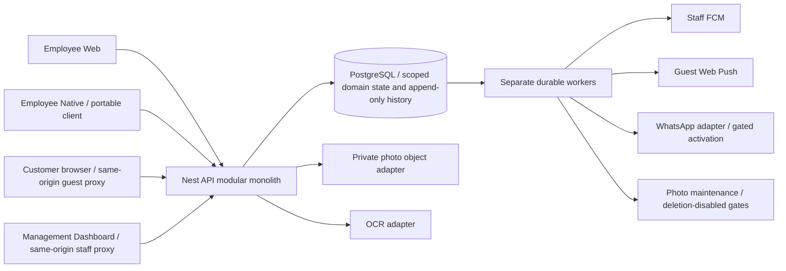

> **Publication note (2026-10-27):** This is the original complete Reports A–L and evidence appendices, published for independent review of baseline `66968655b8bd90c6681daf53fb9d8da9b9ab9f79`. Host-specific paths are replaced by symbolic aliases; no finding, priority, confidence, coverage count, failed/skipped result or limitation is strengthened. The exact original report SHA-256 and every archive member's original/published digest are recorded in [evidence-manifest.md](evidence-manifest.md). This publication did not rerun tests, validate fixes or complete the audit. See [README.md](README.md) and [sanitized evidence](evidence/README.md).

# VAYLET repository engineering audit

**Assessment: suitable for continued development and isolated internal qualification; a real customer pilot is not ready for sign-off.** The principal newly established operational problem is the missing safe takeover of an already-started task when its owner cannot continue. Existing release gates also leave real Android/guest/provider/restore behavior unqualified. Passing pure tests does not close those gates.

**This is a substantial, explicitly partial audit. It is not the exhaustive line-by-line/security certification requested.** The exact inventory, review status and remaining files are delivered with this report. No overall “100% reviewed,” “no vulnerabilities,” clean production build or physical-device claim is justified.

## REPORT A — Executive summary and immutable baseline

| Item | Evidence |
|---|---|
| Repository | `yamanradwan1-rgb/valet-platform` |
| Authoritative baseline | `66968655b8bd90c6681daf53fb9d8da9b9ab9f79` |
| Baseline subject | Merge #351: Customer primary branding coverage (#338) |
| Remote verification | `git fetch origin`; freshly fetched `origin/main` resolved to the exact SHA above; remote main rechecked unchanged at audit end |
| Isolated assessment tree | Detached worktree `<AUDIT_WORKTREE>`; original checkout preserved |
| Audit start | 27 October 2026, 01:48:47 Asia/Amman (26 October 22:48:47 UTC) |
| Audit report finalized | 2026-10-27T02:48:55+03:00 (Asia/Amman) |
| Review organization | Coordinator plus six independent subsystem workers; coordinator challenged the principal candidates |
| Tracked inventory |7,502 files, including documentation, validation artifacts, tests, configuration and binaries |
| Semantic source coverage | 491 of 4,705 authored-code candidates fully read (10.4% by file); 51,676 of 610,400 candidate lines (8.5%) |
| API declaration inventory |228 HTTP method declarations across 81 controllers; not 228 runtime-verified endpoints |
| Database inventory |84 Prisma models, 73 enums, 103 migration SQL files /17,855 lines |
| Finding totals |10 reportable items:1 P1, 6 P2, 3 P3;6 CONFIRMED and 4 HIGH source-level findings/risks;0 confirmed P0 |
| Unresolved analytical hypotheses |2: handoff expiry time semantics; entitlement-change transaction fencing. Neither counted as a confirmed vulnerability |
| Tracking context |17 open issues and 30 recently closed issues inspected; no open PR returned by the dedicated PR search |
| Coverage limits | Full native/device/browser/provider/security qualification not completed; exact not-fully-reviewed files accompany report |

| Deployment stage | Assessment |
|---|---|
| Local development | Supported with existing toolchain/dependencies; two deterministic validation failures need repair. Clean install/build proof unavailable |
| Internal testing | Reasonable in isolated synthetic environments with known red gates reported; production data must not be used |
| Controlled real-customer pilot | **NO-GO for sign-off today**: owner-takeover recovery, accepted real-device/guest qualification and operational release gates unresolved |
| Limited production | Not supported by this evidence; requires real deployment/provider/monitoring/restore and security dispositions |
| General production | Not supported; extensive source and runtime scope remains unreviewed |

No application source, tests or migrations were repaired. No commit, push, PR, issue modification, merge or deployment occurred. Two existing test wrappers unexpectedly invoked dependency setup; that audit mistake and exact restoration are disclosed in the coordinator appendix. Both source trees' final tracked states are clean. Temporary database changes occurred only in a new, labeled, tmpfs-backed audit PostgreSQL container, removed after validation.

## Coverage ledger and exclusions

| Inventory scope | Discovered | Fully reviewed | Partial | Tool-only | Not reviewed |
|---|---:|---:|---:|---:|---:|
|All tracked files|7502|510|61|4145|2786|
|First-party authored-code candidates (incl. tests/migrations/prototypes)|4705|491|55|4145|14|
|Apps/packages code subset|4487|490|51|3943|3|
|Migration SQL files|103|18|5|80|0|
| Declared HTTP endpoints |228|0 certified end to end|Not separately quantified|228 AST declarations|Runtime qualification incomplete|
| Background worker families |4|0 certified end to end|Selected implementation|4 source families inventoried|Deployment/provider behavior unverified|
| Large feature groups |See Report B|0 certified end to end|All groups mapped; selected paths reviewed|Full inventory|Detailed implementation remainder listed per file|

“Fully reviewed” means full file text was read and local control flow considered. It does not imply every caller, interleaving, deployment or physical workflow was proved. “Partial” includes truncated reads and selected sections. “Tool-only” means architecture/discovery/test/SQL-execution evidence without full semantic review. “Not reviewed” is explicit. The large tool-only count must not be mistaken for manual review. The broad authored-code-candidate inventory includes first-party tests, scripts, migrations and prototype/evidence code; its classification is deliberately reproducible rather than an assertion that all files execute in production.

`coverage-ledger.csv` and `.json` contain every tracked path exactly once after deduplicating overlapping reviewers. `not-fully-reviewed.txt` lists every file lacking full review. `api-endpoints.csv` records exact controller paths/lines/verbs/declared routes/guard decorators and marks runtime reachability unverified. `migration-inventory.json` records all 103 migration files. Native generated Android/iOS projects, dependency directories and binaries are excluded from manual source review; tracked binary assets remain inventoried. Documentation, design prototypes and historical validation output are not silently counted as reviewed application logic. No major large subsystem is certified fully reviewed end to end.

The audit performed discovery, focused line review, workflow tracing, database/concurrency inspection, UI/native source review, integration/operations assessment, test effectiveness review and independent candidate disproof. Security's formal deep-scan phase was blocked: the required Codex Security coordinator tool was unavailable. Worker interruption at a usage limit was handled by resuming saved work, not fabricating completed review.

## REPORT B — Discovered architecture and feature map

The actual system is a TypeScript modular monolith with PostgreSQL domain state, 5 applications and 7 shared packages. `apps/api/src/app.module.ts` wires Nest modules. `apps/valet`, `apps/customer` and `apps/dashboard` are Next applications; `apps/valet-native` is the Expo employee client. `packages/employee-client` owns portable employee state machines and transports; contracts are shared schemas, database owns Prisma/migrations/provisioning, and config/testing/UI provide small shared boundaries.



Each row below maps implementation visible in source, not field-tested completeness. The six detailed subsystem appendices give exact files/tests and finer limits.

| Feature | UI → client → API/authority → business/DB → external/result | Implementation/concerns |
|---|---|---|
| Staff login/logout/refresh/MFA/activation | Employee/Dashboard auth → staff clients → auth/native-auth/activation/MFA controllers → users, sessions, enrollment and MFA storage → credential/context | Implemented; core auth remains insufficiently reviewed for security assurance. Activation delivery/OS storage unverified |
| Organization/commercial context | Dashboard selection/subscription → management context → company-admin/MFA/typed-entitlement boundaries → organizations, memberships, subscriptions | Implemented read-only subscription view; no invented upgrade/billing product. Entitlement-change race unverified |
| Locations and intake | Dashboard Locations → versioned management lifecycle commands → current company/location authority and lifecycle lock → active/intake/drain/presence SQL and audit | Create/activate/stop/resume/deactivate implemented; #346 source present. Two stale inventory tests introduced around Resume Intake |
| Staff/grants/onboarding | Dashboard Employees → staff-management/onboarding clients → scoped actor/target grant authority → membership/access/invite SQL and audit | Implemented; last-location LM restriction is intentional. Full negative/race coverage incomplete |
| Shift/presence/cash close | Native/Web shift screens → portable shift/presence sessions → shift endpoints → active shift, attendance challenge, policy/readiness, immutable cash snapshot | Implemented. Force-end remains guarded by open work; real GPS/presence/shift-transition proof absent |
| Vehicle identity/check-in | Employee form/OCR confirm/manual fallback → check-in client → check-in API → identity/draft/session/idempotency/payment initialization/audit | Implemented. Concurrency protections visible but not all retry branches certified; full field speed not measured |
| Condition photos | Native camera/private capture owner → portable photo operation → authenticated multipart/status/discovery → SQL reservation/verification + write-once/readback S3 → qualifying evidence | Implemented complex protocol, independently gated. Optional zero-photo is distinct from production-qualified required-photo; #288/#290/#291 remain gates |
| Key/parking resources | Native/Web field commands + Dashboard resource management → scoped clients → keys/parking/map setup → current bindings, history and unique indexes | Implemented; DB enforces current-slot uniqueness. Physical QR/key workflows and all release/cancellation cleanup paths not fully reviewed |
| Dispatch and parking | Queue → portable/Web tasks → dispatch/start/confirm/cancel endpoints → assignee/shift/state/version plus session/task/audit/tracking | Normal pre-start assignment present. **OPS-001:** safe handover after IN_PROGRESS absent |
| Guest access | Employee issue/reissue/revoke/QR → guest-access clients → staff scope → scoped hashed token/browser context and transient credential → Customer entry | Implemented lifecycle. Handoff-context recovery is known #219; real deployed HTTPS/physical link acceptance #224 unproved |
| Customer restoration/navigation | fragment URL → bootstrap and memory/browser-bound session → guest-context/session authorizer → safe session projection → status UI | Source integrated;481 pure/mounted tests pass, not real browser/HA proof. Legacy browser/restore claims checked conservatively |
| Retrieval request/cancel | Customer controls → guest API → authorization/anti-abuse → locked session/request/task/outbox/audit → employee queue | Implemented current-lifecycle contract. Delayed empty cancel is an accepted DEC044 design limitation, not counted as new bug |
| Secure handoff/release | Employee/Customer handoff screens → issue/verify/override/complete → ownership, proof, policy, cash and custody guards → atomic terminal state/history | Implemented fail-closed normal path. Owner recovery missing; BEGIN-time expiry semantics need clarification, not a confirmed exploit |
| Incidents/recovery | Employee report + Dashboard details/resolve → incident/recovery clients → scope/version → report-intent/status/audit | Implemented; incident recovery does not transfer physical task ownership. Actual process-death/device cycle not executed |
| Cash/validation/tips/refunds | Field financial clients and Dashboard projections → payment endpoints → actor/shift/payment policy → canonical payment, cash entries, validation/refund audit | Backend implemented; integer mills avoid floating money math. External POS tender is known #281; do not record POS as cash |
| Digital collection | Typed provider boundary → payment collection command → fenced operation/result reconciliation → payment/provider events | Default `UnconfiguredDigitalPaymentProviderRegistry` returns null; DIGITAL_ONLY initialization fails closed. A real digital provider is not available merely because interfaces exist |
| Staff attention | Retrieval intent transaction → staff delivery worker → fresh eligibility and lease → FCM HTTPv1 → generic attention | Implemented bounded best effort; **INT-001** avoidable late-lease sends; account-switch/physical proof #273 still open |
| Guest ready push | Ready transition → durable worker + VAPID → browser subscription/service worker → generic ready attention | Implemented; remaining-lease check exists. Actual background/closed-app delivery and accepted guest release gate unqualified |
| WhatsApp initial access | Intake intent/sealed credential → restricted worker/provider/webhook boundaries → Meta | Main adapter/source exists, but #310 sandbox integration remains unmerged and production OFF. No automatic SMS/WhatsApp promise from QR-only main flows |
| Maps/GPS/geofences/history | Task-bound native tracker → bounded sample buffer → GPS ingestion → owner/shift/policy + scoped tracking/sample/event SQL → live or ended history API/maps | Implemented source; raw history has narrower authority than general Dashboard. Historical Task UI #343 is design-gated. **TEST-001** omits three unit suites from official ownership |
| Dashboard operational views | Live/Vehicles/Tasks/Keys/Incidents → typed clients → Dashboard projections → scoped paginated SQL → tables/drawers | Integrated read surfaces; **DASH-01** stale KPIs. Loaded-page filters are labeled and intentionally not global search |
| Policies/privacy/contact/branding | Dashboard drafts/overrides → typed revisions and save/publish → management boundaries → defaults/location override/audit → guest presentation | Integrated; **DASH-02** loses preview error. Save vs publication is intentional; no UI redesign recommended |
| Analytics/reports/visit contacts/audit | Dashboard periods/search/export → management/Dashboard readers → entitlement/scope/export checks → bounded SQL/CSV/PDF/history | Implemented with explicit unavailable values. Investigation has local-proof/release gates, not blanket production clearance. Many producer/query paths remain unreviewed |
| Platform operations | package build/test scripts/CI → Node/Nest/Next/worker processes → PostgreSQL/provisioning/object store → readiness/drain/metrics/runbooks | Source safety/observability exists. Ingress/systemd/containers are incomplete deployment scaffolding; alert policy explicitly not deployed. No operational HA/restore proof |

Worker processes comprise staff push, guest push, outbound-message sender and condition-photo maintenance. Five top-level worker-named source files include the outbound composition helper as well as its executable. Raw-GPS cleanup and shift-presence maintenance are separate operational scripts, not evidence of deployed scheduling. Next has 27 discovered page entry files (25 Dashboard, 1 Customer, 1 Employee Web); Expo has index/layout entry files. A route file existing does not prove device/browser behavior.

Unmerged evidence was checked separately: `feat/automatic-whatsapp-guest-access` has 0 commits ahead of audited main and 414 behind, so its old implementation is already in main's ancestry. `feat/issue-310-isolated-whatsapp-e2e` at `d8f4d1bdd39526c568784263bfc3271739f682d3` is2 commits ahead/28 behind and is **not** part of this baseline. Sandbox send/receipt evidence from that branch must not be counted as mainline production or webhook/browser proof. Branch inventory was sampled/read-only, not an exhaustive review of every remote branch.

## REPORT C — Findings register

Detailed evidence for all 23 requested finding fields appears in the corresponding appended subsystem/coordinator finding. Source-relative paths and lines refer to the immutable baseline. No invented runtime reproduction is implied by source-level confirmation.

| ID | Priority | Category / feature | Finding | Confidence | Key evidence | Existing tracking |
|---|---|---|---|---|---|---|
| OPS-001 | P1 | Recovery / retrieval-handoff | Started task cannot be handed to a new owner when original owner is unavailable | CONFIRMED source | `dispatch/reassign-task-command.ts:39–40`; `retrieval/complete-handoff-locks.ts:72–86`; DEC043:65–69 | No matching issue found; #219 is different guest-access recovery |
| DB-01 | P2 | Validation / migrations | Expected migration history stops at102; actual main has 103 | CONFIRMED existing test | `packages/database/src/issue304-migration-source-appendix.test.ts:14–31`; appendix; migration103 | Adjacent to closed #346; no matching open tracker |
| VAL-002 | P2 | Validation / audit contracts | Exact audit-event test expects102; runtime catalog correctly has 103 | CONFIRMED existing test | `packages/contracts/src/management-audit.test.ts:14–17`; `management-audit-events.ts:91–92` | Same introduction area as #346, separate expectation |
| DASH-01 | P2 | Freshness / Live Operations | KPI counters remain initial while table interactions reload current rows | HIGH source | `apps/dashboard/src/features/operations/live-operations/live-operations-page.tsx:69–84,140–152`; read hook79–108 | No matching inspected issue |
| CUST-001 | P2 | Preferences / restricted browser storage | Locale/theme snapshot stays old while document direction/theme changes | CONFIRMED mounted harness | `apps/customer/src/i18n/locale.ts:19–47,54–62`; provider54–75; theme equivalents | No matching inspected issue |
| INT-001 | P2 | Reliability / Staff Push | Expired worker can start avoidable FCM send after successor finalized | HIGH; actual-source fake-DB model | `staff-push-delivery-worker.ts:46–94`; eligibility/claim/finalize; DEC075110–120 | No matching inspected issue; not an exactly-once promise |
| NATIVE-WEB-01 | P2 | Context / Employee Web | Same-login operational scope changes retain old session/task targets | HIGH source + pure probe | `apps/valet/src/components/employee-app.tsx:104–113,251–285`; shell workspace57–68, 93–107 | No matching inspected issue; browser transition unverified |
| DASH-02 | P3 | Error recovery / guest preview | Failed preview appears as endless Loading with no direct retry | HIGH source | guest-information page85–93,254–266; contact-section51–59 | No matching inspected issue |
| CUST-002 | P3 | Accessibility / shared buttons | Loading replaces label with an unnamed spinner-only disabled button | CONFIRMED SSR markup | `apps/customer/src/components/primitives/btn.tsx:64–86` | No matching inspected issue |
| TEST-001 | P3 | Test effectiveness / GPS | Three source-adjacent tracking suites are invisible to official API projects | CONFIRMED discovery | `apps/api/vitest.config.mjs:8–25,47–60`; classifier41–42 | No matching inspected issue; distinct from #343 |

There is no confirmed critical cross-tenant disclosure, arbitrary code execution or data-corruption finding in this report. This statement describes findings established here; it is **not evidence those classes are absent**. The review lacks enough coverage to make such a guarantee.

## REPORT D — Security assessment

**Formal deep security scan: BLOCKED.** The `codex-security:deep-security-scan` skill requires `start_codex_security_deep_scan`; it was unavailable in this session. No replacement scan, canonical security report, attack-path campaign or security clearance is claimed. Security-related source evidence encountered during correctness review is bounded and incomplete.

Relevant boundaries are: public Guest fragment/browser credentials to exact-session projections; staff session to active membership/location/shift; Company Admin/MFA to management data; field Task owner to physical custody; API runtime to restricted SQL functions and append-only tables; upload actor/operation to private object evidence; durable worker identity/lease to provider transport; and same-origin web proxy to private API. The source uses important controls—typed validators, scoped parent relations, current eligibility locks, task versions, hashed guest credentials, explicit proof consumption, immutable history and least-privilege provisioning. Presence of controls is not proof every consumer enforces them correctly.

No new confirmed exploit is reported. Do not reinterpret OPS-001's failure-closed custody checks or INT-001's generic duplicate attention as authorization bypasses. Likewise, narrower raw-GPS history authority intentionally excludes ordinary employees/password-only Org Admin.

Existing security gates remain visible in [#324](https://github.com/yamanradwan1-rgb/valet-platform/issues/324): dependency advisory dispositions, secrets/Firebase owner checks, deployed ingress/TLS/WAF/headers/CORS proof and the outstanding Semgrep outcome. Historical high tooling dependency candidates are not newly verified runtime-reachable vulnerabilities in this audit. [#333](https://github.com/yamanradwan1-rgb/valet-platform/issues/333) explicitly identifies remaining authorization/revocation race coverage; its inventoried routes are not each race-tested. Previously closed #319/#325–332 evidence was treated as supporting context, not a substitute for current code review or permission to reopen fixed findings without proof.

Two unresolved hypotheses are kept outside confirmed counts: (1) `transaction_timestamp()` means expiry is sampled at BEGIN even after lock waits, but DEC043 defines one database-authoritative operation time without clearly requiring post-lock wall time; clarify contract and run a real expiry-crossing test. (2) Commercial entitlement reads lack a demonstrated common update fence; an actual authorized platform-update protocol and two-transaction proof are needed. No attack or live privileged update was executed.

## REPORT E — Database and concurrency

**Observed:**103 existing migration SQL files applied in order to a brand-new PostgreSQL17.11 database, yielding84 public tables. No SQL error occurred. This is direct SQL validation; Prisma's `_prisma_migrations` bookkeeping, drift detection, migration-user/runtime-user ownership, production TLS and runtime-role provisioning were not qualified. No existing application database was altered.

The detailed12-scenario constraint/transaction/lock/residual matrix is in the appended database report. Its central conclusions are:

| Required scenario | Source protection observed | Remaining uncertainty |
|---|---|---|
| Same parking spot | Unique current non-null spot binding + scoped FK; session/task transaction | Conflict handling/complete schedule not run |
| Same key slot | Unique current non-null key binding + scoped relation/locking | All cancellation/release cleanup paths not certified |
| Duplicate check-in | Org/idempotency and active known-vehicle/location unique constraints | Distinct operation keys/temp identity semantics and all client retries unqualified |
| Concurrent retrieval | One active request/session and active task/session/type; serialized domain operation | HTTP response/revocation race proof incomplete |
| Concurrent reassignment | Row lock + expected version/CAS + audit in transaction | Runtime winner/loser schedules not run; started-task recovery absent |
| Session revocation | Current-session/security locks and revalidation helpers exist | Every protected caller/async path not reviewed |
| Role/access removal | Shared eligibility locks on persisted authority | All writer/caller lock protocols not proved |
| MFA removal | Current assurance/factor/session checks in transaction | Full retirement/reset lock graph incomplete |
| Location deactivation | Lifecycle advisory serialization + drain/readiness guards | All consumers and forced interleavings untested |
| Entitlement changes | Typed subscription data; management read policy | Update synchronization is unresolved, not a confirmed exploit |
| Concurrent image verification | Scoped op/attempt uniqueness, session lock, SQL finalization/audit | Latest replacements/callers and real S3 two-writer schedules unqualified |
| Duplicate outbound | Durable uniqueness/lease/result fences and uncertain-outcome semantics | SQL cannot promise provider exactly-once; staff late-lease risk separately found |

No inconsistent committed state was demonstrated. Indexes and locks provide concrete protection, but no full concurrency proof follows from the direct migration pass or green unit tests. Backup, paired database/object restore, retention/holds and real-runtime least privilege remain pilot/release gates. DB-01 affects expected test history; it is not proof migration103 itself fails.

## REPORT F — Functional workflow assessment

| Disposition | Workflows / evidence |
|---|---|
| Source-integrated, focused tests passed | Guest bootstrap/restoration/status/retrieval/handoff UI; portable photo/auth/GPS lifecycle subsets; staff/guest worker pure boundaries; management API clients; money precision; many typed contracts |
| Broken or inconsistent under demonstrated conditions | Restricted-storage preferences; operational KPI/row freshness; guest preview failure; same-login Web scope retention; loading-button name; two deterministic inventory gates; tracking test ownership |
| Missing exceptional recovery | Unavailable canonical owner after task starts; independent from missing guest-link recovery |
| Partial or gated | Required-photo provider qualification, photo maintenance/retention/restore, WhatsApp sandbox integration, external POS tender, real digital provider, historical-route Dashboard UI |
| Accepted restrictions, not defects | No generic state mutation; pre-start-only ordinary reassign; proof override separate from ownership; empty guest cancellation acting on current lifecycle; fixed role reference; read-only subscription; loaded-page filters; separate privacy save/publish |
| Untested full shift | Check-in→parking/key→guest request→retrieval→proof/payment→release→cash shift close across multiple operators/locations/actual Android/network interruptions |

No operational speed, throughput, supported-customer count or capacity figure was invented. No physical vehicle/phone workflow was exercised.

## REPORT G — UI and Native assessment

UI Freeze was preserved; no design or production UI change was made. DASH-01/02, CUST-001/002 and NATIVE-WEB-01 are behavior/state/accessibility findings, not redesign requests. State scoping, truthful error/retry, in-memory preference fallback and preserving an accessible busy-button name can be repaired within existing geometry. A new visible refresh affordance or custody-handover UI would need the appropriate accepted owner design/product contract.

Native source shows explicit auth generations, private capture ownership, status-based photo qualification, transient guest-credential clearing, task-scoped foreground tracking and account-reconciliation barriers. These are positive design observations, not Android runtime proof. iOS shared source does not imply an iOS-qualified release; Android-specific push unavailable behavior on other platforms was not misreported as a regression.

Known [#273](https://github.com/yamanradwan1-rgb/valet-platform/issues/273) remains offline A→B push-transition/physical QA work: B's409 can be the correct fail-closed result, and the unaccepted release-proof proposal must not be silently implemented. [#219](https://github.com/yamanradwan1-rgb/valet-platform/issues/219) is active-handoff Guest Access recovery. [#336](https://github.com/yamanradwan1-rgb/valet-platform/issues/336), [#343](https://github.com/yamanradwan1-rgb/valet-platform/issues/343) and [#321](https://github.com/yamanradwan1-rgb/valet-platform/issues/321) carry explicit design/planning gates, not accidental missing implementation bugs.

Actual mobile/tablet/desktop responsive rendering, 200% browser zoom, TalkBack/VoiceOver, keyboard focus, RTL/LTR light/dark device matrices, camera rotation/permission denial, suspension/restart and real QR/push behavior remain unverified. Node-render trees are not screenshots or physical accessibility acceptance. Additional native-suite failures are reported honestly in ReportI without equating environment/baseline assertions with confirmed visual defects.

## REPORT H — External integration assessment

No deployed credential values, real customers, provider transport or production data were inspected. UNKNOWN means no deployment evidence, not absent implementation.

| Integration | Implemented | Configured / production enabled | Mock/source tests in this audit | Actual provider in this audit | Main limits |
|---|---|---|---|---|---|
| PostgreSQL | YES | UNKNOWN deployed | SQL chain103 applied to disposable17.11; pure DB tests64pass/1fail | Disposable local DB only | Production migration/provisioning/restore/concurrency not proved |
| Private S3 photos | YES | UNKNOWN; qualification gates | Selected storage/status/qualification suites pass | NO | Retention/holds/IAM/restore/two-writer/crash/real bytes gates #288/#290/#291 |
| Staff FCM | YES | UNKNOWN | Policy/payload/retry/ownership tests, late-lease fake-DB probe | NO | INT-001; real ADC permission/device delivery/account switch unverified |
| Guest VAPID Web Push | YES | UNKNOWN | Worker/eligibility/customer state tests | NO | Background/closed-app delivery, service worker and required release qualification unproved |
| Meta WhatsApp | Adapter/protocol source YES | #310 says production OFF; actual deployment UNKNOWN | Source review; no new live send | NO | Isolated sandbox branch2 commits unmerged; webhook/browser acceptance not established by historical receipt |
| OCR | YES adapter/manual fallback | UNKNOWN; no production qualification | Existing provider/cost/diagnostic tests pass | NO | Real accuracy, image rotation/provider permission/latency unmeasured |
| Maps/GPS | YES geometry/ingestion/provider adapter | UNKNOWN | Buffer/cursor/geometry tests; scoped source | NO | Actual provider/GPS accuracy/navigation/device permissions unverified; route-history UI gated |
| Digital payment provider | Abstract port, default unconfigured registry | Unavailable by default; actual provider UNKNOWN | Financial contracts/policy source; precision tests | NO | No real provider should be promised; DIGITAL_ONLY fails closed |
| External physical POS | Known approved-product-plan gap #281 | Not implemented as a real tender path in main | No POS proof | NO | Never fake a CashEntry for a card-terminal receipt |
| Public HTTPS/reverse proxy | Some server-origin/preflight scaffolding | UNKNOWN deployed | Source/contract checks only; production build blocked | NO | #224/#227 real origin/build proof; no live ingress audit |

## REPORT I — Tests executed and effectiveness

| Check | Actual outcome |
|---|---|
|Architecture check|PASS;17 grandfathered warnings|
|Targeted lint|PASS; excludes native/scripts/infra full lint|
|API TypeScript|PASS; API only|
|Harness safety|39 passed; separate successful rerun, not doubled|
|Initial build contract + harness|46 passed including 39 harness;1 actual-build case failed during unintended dependency setup; no build proof|
|Customer|67 files /481 tests passed|
|Dashboard focused|7 files /78 tests passed|
|API operations focused|11 files /81 tests passed|
|API integration boundaries focused|9 files /67 tests passed|
|Database pure full project|8 files;64 passed /1 failed (DB-01)|
|Contracts full source|71 files;506 passed /1 failed (VAL-002)|
|Portable employee full source|103 files /897 tests passed; includes earlier30 focused cases|
|Employee Web full src|117 files /655 tests passed; includes earlier13 focused cases|
|Native Node test scope|225 files;1575 passed /5 failed initially;4 .mjs script suites excluded; no device proof|
|Native timeout disambiguation|3 files /10 tests passed; resolves3 initial5000ms timeouts, not a clean default-timeout full-suite pass|
|Native font path diagnosis|0/9 in audit conventional node_modules vs9/9 in original;2 font-path failures are environment limitations, not established production defects|
|Currency precision|1 file /4 tests passed|
|Tracking official discovery|No files discovered; confirms TEST-001|
|Tracking explicit external config|3 files /10 tests passed; not part of official API projects|
|Disposable operational PostgreSQL suites|3 files failed fixture setup /23 cases skipped;0 operational cases passed|
|Direct clean PostgreSQL SQL chain|103 SQL files PASS;PostgreSQL17.11, 84 public tables;container removed|
|Source probes|Mounted/SSR/pure/fake-DB evidence; not physical/provider/real concurrency tests|

Exact commands and complete retained outputs are in `validation-commands.md` and the evidence archive. Do not sum repeated focused/full runs as unique test cases. The Customer JSON's145 nested suite count is not 145 files; it contains 67 executed test files. Existing dependency reuse and Node24.19 differ from CI's Node22/frozen pnpm10.34.5 setup; this is not clean-install/CI equivalence. The ancestor resolver selected existing React/TypeScript versions where versions differed; deployment/physical behavior cannot be inferred from those runs.

Two new deterministic failures are product-repository validation defects: DB-01 and VAL-002. The three native 5000ms timeout failures passed the serial 30000ms rerun (10/10 cases in those files). The two font assertions depend on conventional app-relative node_modules paths absent from this audit layout; all nine configured assets exist in the original installed dependencies. These are environment/qualification limitations, not newly established product defects. No clean default-layout/full-native-suite pass or physical-font proof is claimed. Source-level finding confidence is independent of unrelated green suites.

The architecture check passed with 17 grandfathered size warnings. Targeted ESLint and API TypeScript no-emit checks passed. They are the stated scopes, not full-root `pnpm lint/typecheck/build` proof. The initial39 harness safety cases passed (also rerun39/39 independently). Seven build-contract cases passed before the actual-build negative case failed during unintended package-manager setup; no production build pass is claimed. The three selected PostgreSQL integration files failed setup and skipped23 cases; zero operational integration assertions passed from that invocation. Direct SQL application does not retroactively turn those skips into passes.

Coverage gaps include real authorization/revocation schedules, disposable full API/client E2E, multi-device guest and staff transitions, genuine object-store/provider failures, native process-death/retry/rotation, realistic query plans, operational restore/rollback and actual guest HA/SLO/capacity acceptance. Existing mocked tests often exercise parsers/state machines rather than deployed behavior. Test inventory and unreviewed source paths are delivered explicitly.

## REPORT J — Production readiness and release blockers

| Dimension | Current evidence and disposition |
|---|---|
| Reliability | Normal flows have substantial state/lease/recovery design; exceptional task-owner handover missing; provider/device failure qualification incomplete |
| Security | No new exploit established; formal security scan unavailable and #324/#333 still open. No Security GO |
| Data integrity | DB constraints and 103 clean SQL applications are positive; full caller/race/role/retention/restore proof absent |
| Availability | Readiness/drain/bounded DB/metrics source exists; actual topology, traffic withdrawal, failover and SLO load gates not proved |
| Recovery | OPS-001, #219 and photo restore/reconciliation gates remain; no production restore or release rollback rehearsal |
| Monitoring | Guest alert policy explicitly says not deployed and destinations unassigned; log emission does not establish paging/delivery |
| External dependencies | S3/FCM/Web Push/HTTPS/OCR/Maps real configuration and qualification UNKNOWN; WhatsApp/POS/digital availability must be stated truthfully |
| Deployment | Compose is PostgreSQL-only, Docker/Nginx/ops folders mostly scaffolding; one Customer systemd service is not a complete platform deployment |
| User stability | Limited state/a11y/freshness findings plus substantial unreviewed UI/device scope; build/physical proof incomplete |

**Blocks real-pilot approval:** an accepted safe started-task takeover/recovery procedure; green repaired validation gates; actual Android and Customer/API/DB full-shift qualification including required background Guest notification behavior; real canonical origins and production-mode build; signed distribution/rollback readiness; accountable security dispositions; and tested DB backup/restore/monitoring. If verified photos are in pilot scope, provider qualification, private retrieval/integrity/hold/off-host paired restore and #288/#290/#291 are additional hard gates. These existing owner gates are not permission to perform deployment in this audit.

Known release work includes #224/#227 origins/build, #279 final Guest qualification (explicitly deferred until separately scheduled), #221 signed internal distribution/rollback, #288/#290/#291 photo release operations, #273 physical push transition, #324/#333 security. Intentional deferral permits continued development; it does not establish a customer-release GO. No deferred gate was activated or executed merely by this audit.

## REPORT K — Ordered remediation roadmap

Effort ranges below are engineering planning estimates after accepted decisions, not promises; packages overlap and should not be mechanically summed. This task authorizes recommendations only, not source implementation.

| Batch | Concrete items / dependency order | Estimate / regression risk | Verification / approval |
|---|---|---|---|
|0 Critical | No confirmed P0 emergency patch proposed | None | No unsupported emergency action |
|1 High-risk recovery | OPS-001: reconcile DEC035 vs DEC043; define exceptional physical handover; then add narrowly authorized/versioned/audited takeover preserving key/tracking/session/task history |3–7 engineer days after contract, high regression risk | Owner product/custody decision required. Two-actor PG races, revoked actors, READY/HANDOFF_PENDING/abort/override and physical handover QA |
|2 Core business/release integrity | DB-01 + VAL-002 expectation repairs first; then qualify cash/shift/retrieval/handoff full shift; separately resolve #219 guest recovery and #281 POS decision before any promised POS pilot | Inventories0.5day combined; workflows2–5days for evidence, implementation varies. Low expectation risk; high custody/payment risk | Preserve immutable migrations/strict schemas. Existing failing suites, role provisioning, clean supported-toolchain CI. POS authority/custody changes need accepted owner decisions |
|3 Integration/recovery | INT-001 remaining-lease budget/recheck; then #273 proof decision, real FCM/WebPush/S3/origin/monitoring/restore gates. Keep WhatsApp production disabled until #310 accepted | INT1–2days; operational gates several days depending access; medium–high integration risk | Deterministic two-worker test + real disposable PG; provider timeout/pauses; no exactly-once promise. Provider/retention/security owner approvals required for activation/policy |
|4 UI/native correctness | DASH-01 bounded consistent freshness; CUST-001 memory fallback; NATIVE-WEB-01 operational stamps; DASH-02 error/retry; CUST-002 busy accessible name | Roughly3–6 engineer days total, medium state-recovery risk | Mounted/browser state and scope changes; same-user refresh preservation; blocked-storage EN/AR and light/dark; screen-reader busy name; UI Freeze comparison. No general redesign approval needed for nonvisual repairs |
|5 Test/release qualification | TEST-001 ownership fix; resolve unclassified native test/environment failures; qualify official Node22/pnpm10 CI, physical devices, Guest T6, full source/security remainder, backup/restore and rollback | Wiring0.5–1day; qualification1–2weeks depending access/scope; medium test-lane/operational risk | Owner must schedule deferred release gates; no installation/deployment as an audit side effect. Every test belongs to a safe lane, negative/race assertions and actual provider/device evidence |

Do not fix OPS-001 by sharing accounts, removing owner checks, pretending a proof override transfers custody, or manually editing production rows. Do not fix cash/POS by fabricating cash receipts. Do not green validation by deleting migration103 or removing the approved audit event.

## REPORT L — Unverified areas and exact remaining work

The accompanying per-file ledger is the authoritative list of everything not fully reviewed. Major unresolved areas are:

1. The great majority of first-party source/test lines (tool-only is not semantic coverage); all large subsystems remain partially reviewed.
2. Every API endpoint's runtime registration, full middleware/auth/contract/consumer chain;228 declarations are inventoried only.
3. Formal full-repository security scan; complete tenant/location/role/session/MFA/entitlement boundary inventory and two-transaction proof.
4. Full semantic103-migration evolution, runtime-role/owner/grant/provisioning compatibility, Prisma deploy/drift and upgrade behavior. Only direct clean SQL application succeeded.
5. The12 required real concurrency schedules; no claim of an inconsistent committed state or proof of its impossibility.
6. Production credentials/configuration and all real Meta/FCM/VAPID/S3/Maps/OCR/payment provider behavior.
7. Android physical camera bytes/rotation/retakes/cache deletion/process death, background/foreground/GPS/permissions/SecureStore/account switching and iOS support.
8. Real Customer first-open/fragment/session restoration across browsers/devices, background notification, guest recovery and production HTTPS behavior.
9. Actual responsive,zoom,RTL/LTR,dark/light,keyboard/screen-reader matrix. Node/SSR renders are insufficient.
10. Production topology,TLS/WAF/CORS/edge headers, worker restart/scheduling/resource limits/failover/rolling deployment and monitoring delivery.
11. Backup/paired object+DB restore, retention/legal holds, off-host copies, incident recovery and rollback rehearsal.
12. Full supported-toolchain clean build and exact-SHA CI. Unexpected setup prevented actual-build/PG fixture proof.
13. Complete historical issue/PR/branch deduplication.17 open/30 recently closed and relevant WhatsApp branches were inspected; “no match found” is not global untracked proof.
14. Representative workload/query plans/capacity, real shift KPIs/customer data/history; no arbitrary capacity figures or real data used.

## The most important evidence-backed problems and risks

Fewer than 20 independent risks are listed rather than padding the report. Items11–16 are pre-existing qualification/deferred risks, not newly confirmed defects. Every numbered item answers what/where/how/who/seriousness/fix/pilot disposition.

| Rank | Problem / where / failure path | Who / severity | Fix and first-pilot disposition |
|---:|---|---|---|
|1|OPS-001: owner disappears after Retrieval starts; Dispatch refuses IN_PROGRESS and release refuses non-owner|Operator/customer;P1 recovery dead end|Accepted audited physical takeover before real pilot sign-off|
|2|Guest/Android full-shift and background-ready behavior unqualified; #279/#291/#273|Real customers/field staff;release gap|Actual device/browser/provider qualification; blocks sign-off|
|3|Backup/restore/holds/monitoring not operationally proved; #288/#290 and infra|Operator/customer history/evidence;release gap|Accountable off-host restore/paging proof; core DB gate, photos gate if used|
|4|Security dispositions and remaining auth races open; #324/#333; formal scan blocked|All tenants;unverified security risk|Close evidence/acceptance gates and perform remaining review; no security GO|
|5|Real origins/build/distribution/rollback proof missing; #224/#227/#221|Guest entry/mobile rollout;release gap|Truthful HTTPS/configuration/build/signed rollback proof before pilot|
|6|DB-01: missing migration103 in expected history keeps database test red|Release team;P2 validation|Append expected migration; preserve SQL history; fix before release gates|
|7|VAL-002:102-vs103 audit catalog assertion keeps Contracts red|Release team;P2 validation|Synchronize expected catalog; do not remove new event; fix before gates|
|8|DASH-01: successful counters never reconcile with refreshed rows|Managers;P2 stale operational view|Bounded co-refresh; explicit full reload interim control only|
|9|CUST-001: storage-denied browser toggles DOM but not translated/theme state|Guests;P2|In-memory preference authority with best-effort persistence; fix for restricted-browser pilot|
|10|NATIVE-WEB-01: same login/new operational scope combines new header with old target|Multi-location Web staff;P2 HIGH, browser scenario pending|Operational target stamp; fresh reload between scopes interim workaround|
|11|#219: lost Guest access during active handoff lacks contextual recovery|Guests/staff;known product gap|Approved reissue/rotate flow preserving proof; operator recovery qualification before sole-path pilot|
|12|#273: offline A→B push ownership/physical QA unresolved|Shared-device staff;known fail-closed constraint|Accepted ownership-release design and actual Android evidence; avoid unsupported shared-account/device assumptions|
|13|#281: physical POS tender/reconciliation not present; real digital provider unconfigured|Cash office/staff/customer;known missing feature|Cash-only pilot scope or approved POS integration; never classify POS as cash|
|14|INT-001: worker resumes after lease loss and starts avoidable generic FCM duplicate|Staff;P2 bounded reliability|Lease-budget fence and two-worker regression; attention dedupe/manual queue workaround acceptable|
|15|DASH-02/CUST-002/TEST-001: misleading preview load, unnamed busy controls, omitted unit suites|Managers/accessibility users/developers;P3|Small recovery/a11y/test-wiring fixes; controlled workaround, can follow core gates|
|16|Semantic review covers a minority of source; many runtime contracts remain unchallenged|Owner/all users;audit uncertainty|Continue exact remaining ledger and independent security/runtime review; never sell this report as exhaustive certification|

## Realistic Jordan pilot decision

For one organization with multiple locations, managers/supervisors, real vehicles, intermittent connectivity and actual Android/customer browsers: **do not approve tomorrow's real customer pilot from current evidence.** A dry run with synthetic vehicles is reasonable; a staffed customer shift carries unqualified operational/recovery dependencies.

| Disposition | Concrete conditions |
|---|---|
|Blocks first-pilot approval|OPS-001 safe owner-loss recovery; real Android/Guest full-shift/notification qualification; real origins/build/release distribution; green inventory gates; required security/DB recovery/monitoring dispositions; photo qualification/restore if photos used|
|Controlled workaround|Full page reload for stale KPI cards; reload Web when scope changes; reload failed preview; Cash-only operation if contractually accepted; same-user replacement device for simple device loss; QR/link sharing instead of unenabled WhatsApp|
|Can wait|Historical-route UI #343/design decision, Policies redesign #321, B1 photo-card redesign #336, small preview/a11y/test-wiring improvements subject to explicit accessibility/release criteria; no approved UI geometry change needed by this audit|
|Requires real-world validation|Two staff contending for resources, requests/reassignments, account/shift/location changes, restricted guest browsers, background READY notification, camera/upload/retake/restart, provider outage/recovery and daily cash close|

A replacement device logged in as the same still-authorized employee can mitigate a broken phone; it does not solve an unavailable person or revoked identity. Manual attention to an authoritative queue can mitigate generic duplicate alerts; it does not establish accepted closed-browser Guest delivery. Optional-photo configuration is legitimate only if the pilot's evidence obligations allow it; it cannot be represented as qualified required-photo behavior. These are bounded operational distinctions, not permission to weaken safety controls.

## Detailed evidence appendices

The following preserved reports contain detailed finding evidence, credible execution paths, preconditions, affected roles/environments, test limits, fixes, complexity, regression risk and tracking context. Coordinator additions/errata above override an earlier worker's narrower runtime statement: direct SQL migration application occurred later; operational PG integration tests remained blocked; parent wrapper side effects were restored; no worker's “no install” statement describes the parent's disclosed wrapper incident.


---

## Appendix — backend operations

# Backend operations audit checkpoint

Baseline: `66968655b8bd90c6681daf53fb9d8da9b9ab9f79`, detached read-only worktree `<AUDIT_WORKTREE>`. Review performed 27 October 2026 Asia/Amman. No source, test, migration, configuration or external data changed. This is a partial engineering review, not a completed Codex Security scan or an exhaustive source audit.

## Coverage and execution evidence

Inventory: 328 files / 30,262 lines within initially assigned source directories. This worker fully read 97 source files, partially read 1, and did not manually review 230. Payments and tracking account for 90 files now assigned to the parent; five cash files were already fully read before that reassignment. Excluding parent-owned source: 238 files, 92 fully reviewed, 1 partial, 145 not reviewed. This ledger deliberately does not treat search matches, loading files into scripts, or green tests as a full source review.

Corresponding test inventory uses an explicit filename pattern recorded in the ledger-generation command: 266 tests/fixtures, 1 fully reviewed, 5 partial, 11 tool-assisted only and 249 not reviewed. This includes broad relevant condition-photo and staff task/shift tests, some overlapping another worker's domain. Every exact path and review status is in `coverage.json`. `routes.json` inventories 70 decorator-declared routes in initial owned directories, including payments/tracking, with file, line and source-review status; route existence is not end-to-end verification.

Executed once, using pre-existing dependencies and the isolated source:

```
<DEPENDENCY_CHECKOUT>/node_modules/.bin/vitest run --project api-non-postgres --maxWorkers=2 test/handoff-secret.test.ts test/plate-ocr-provider.test.ts test/plate-ocr-provider-diagnostics.test.ts test/plate-ocr-cost-guard.test.ts test/check-in-photo-preflight.test.ts test/condition-photo-qualified-receipt.test.ts test/cancelled-guest-resolution.test.ts test/shift-presence-mocked-evaluator.test.ts test/shift-presence-mocked-fingerprint.test.ts test/shift-presence-retention.test.ts test/staff-directory-cursor.test.ts
```

Result: **11 files passed, 81 tests passed**, 16.41 seconds. Full output is `tests.log`. No PostgreSQL integration tests or real providers were used. The initial process handle could not later be resumed, but its retained log contains the terminal successful summary. No dependency was installed.

Executed `node <AUDIT_WORKDIR>/backend_operations/handoff-time-harness.cjs` using transpiled unchanged guard/helper source with synthetic controlled database adapters: PASS. The synthetic adapter supplies PostgreSQL BEGIN-time semantics; it does not instantiate PostgreSQL or prove scheduler behavior. Output is `handoff-time-harness.log`.

## Findings register

| ID | Priority | Category | Feature | Finding | Confidence | Existing issue |
|---|---|---|---|---|---|---|
| OPS-001 | P1 | Missing recovery / contradictory accepted contracts / owner decision required | Retrieval, handoff, dispatch, shifts | Unavailable owner strands started work; the documented reassignment recovery cannot run on IN_PROGRESS | CONFIRMED source-level behavior; no PostgreSQL reproduction executed | No direct duplicate identified among all 17 open issues; closed-issue dedup not independently completed |

No P0 or confirmed exploit finding is asserted by this worker. The one reportable item is a recovery/product gap. It must not be presented as an authorization vulnerability or a defect in the local reassignment guard, which intentionally enforces its accepted contract.

### OPS-001 — Started work has no safe owner-takeover path

1. **Unique ID:** OPS-001.
2. **Title:** The documented unavailable-owner recovery is impossible after Retrieval starts.
3. **Severity:** P1 for pilot recovery: a single unavailable employee can strand an active vehicle workflow. Severity is operational, not a claim that normal-path release is broken.
4. **Confidence:** CONFIRMED at source level. All relevant commands retain the guard; parent independently inspected the same path. PostgreSQL/runtime reproduction not executed.
5. **Category:** Missing recovery, cross-feature inconsistency, accepted design restriction requiring owner-approved extension.
6. **Affected feature:** Hybrid Dispatch, physical Parking/Retrieval, READY/HANDOFF_PENDING release, shift close.
7. **Paths:** `apps/api/src/modules/dispatch/reassign-task-command.ts`; `apps/api/src/modules/retrieval/complete-handoff-locks.ts`; `apps/api/src/modules/retrieval/override-handoff-command.ts`; `apps/api/src/modules/retrieval/abort-handoff-command.ts`; `apps/api/src/modules/shifts/end-shift-command.ts`; `packages/database/prisma/migrations/20261002005400_mgt_240f_force_end_shift/migration.sql`; accepted DEC-035/042/043.
8. **Lines:** Reassignment 39–40 permits only ASSIGNED/ACCEPTED. Release ownership 72–86 requires the acting membership to equal current assignee. Override 94–103 returns IN_PROGRESS and proof verification without changing owner. Abort 54–60 moves only session to READY, and 79 onward returns task IN_PROGRESS. Self-end open-task guard 82–101 blocks nonterminal assigned work. Force-end SQL 177–182 rejects ASSIGNED/ACCEPTED/IN_PROGRESS. DEC-035 209–216 explicitly defers in-progress handover; DEC-043 65–69 says an unavailable owner is to be resolved through existing reassignment.
9. **Expected behavior:** A responsible authorized supervisor can follow an approved audited physical handover/recovery procedure when the assigned employee cannot continue. DEC-043 specifically assumes reassignment can establish a new owner before release.
10. **Actual behavior:** Start Retrieval changes the canonical task to IN_PROGRESS, retained through mark-ready and handoff. At that point supervisor reassign returns TASK_INVALID_STATE. A supervisor's proof override does not grant ownership. A different employee's final release fails TASK_NOT_FOUND_OR_FORBIDDEN. Abort only returns READY; it leaves task IN_PROGRESS and the same owner. Shift force-end also blocks. No supported takeover command was located.
11. **Root cause:** Individually sound constraints compose into a recovery dead end: DEC-035 intentionally excludes in-progress physical handover, while DEC-042/043 rely on that nonexistent ability. Proof authority and physical custody authority are correctly distinct but no transfer workflow joins them.
12. **Credible execution path:** A accepts a retrieval task and starts Retrieval. A becomes unable to continue (illness, departure, unusable authentication/device without replacement). B, an on-shift supervisor, tries reassign to B: rejected because task IN_PROGRESS. If already HANDOFF_PENDING, B can create a reasoned proof override but cannot complete release because A remains owner. Aborting leaves READY and the same task owner. Reporting an incident records the problem but does not transfer custody. Normal and force shift end cannot clear the task.
13. **Preconditions:** A started task whose owner cannot perform further authenticated actions; no access to that actor on another device. Mere transient device loss is recoverable if the same authorized user can sign in elsewhere, so that case alone does not demonstrate indefinite blocking.
14. **Business impact:** The operator cannot faithfully finish the vehicle's release or park-confirm workflow through normal audited roles while that actor is unavailable. It may pressure staff toward credential sharing, manual data intervention or an unaudited physical release. Those unsafe workarounds are not recommended or authorized.
15. **Security/data impact:** The system fails closed; no unauthorized release or corruption was demonstrated. Operational history can remain nonterminal despite the real-world vehicle having moved if staff act outside the software.
16. **Affected roles:** Assigned valet employee, supervisor, location manager/company admin responsible for operations, customer awaiting vehicle.
17. **Environments:** All deployments using the current commands; especially multi-employee pilot shifts with personnel transitions.
18. **Existing coverage:** Dispatch tests enforce the deliberate pre-start-only reassignment restriction, and handoff/shift tests enforce ownership and open-work guards. These are individually correct. Reviewed source is not runtime proof that an end-to-end emergency handover exists.
19. **Missing validation:** Disposable-PostgreSQL end-to-end test with A owning IN_PROGRESS and B attempting reassign/override/abort/release/force-end; physical custody transfer behavior and approved owner decision. A repository-wide search for UPDATE tasks and current_assignee assignments found only Dispatch's task-mutation replacement primitive; incident recovery was inspected and only reserves/reads/retires report intents. No alternative takeover was found. Parent should retain the limitation that unreviewed files exist.
20. **Suggested fix:** Obtain one focused accepted decision for exceptional in-progress physical handover. Then implement a separate authorized, reasoned, transactionally audited command that preserves session/task/tracking/key custody invariants and changes the owner safely. Reconcile DEC-035 with DEC-042/043. Do not broadly remove owner checks or extend ordinary reassign blindly.
21. **Complexity:** Medium–high; estimate 3–7 engineering days plus agreed physical QA after product contract, depending on allowed states and tracking/custody handover semantics. This is a planning estimate, not measured work.
22. **Regression risk:** High: concurrent start/complete, session version, key custody, active shift and tracking ownership interact. Verify winner/loser races, revoked actors, no duplicate movement/history, READY/HANDOFF_PENDING abort and override, and shift closure.
23. **Related issue:** No direct match in the 17 retrieved open issues. #219 concerns guest-access recovery during handoff, which does not change Task ownership and is a different gap. #248 is a general deferred native backlog tracker. Recently closed issue dedup remains unverified in this worker.

**Pilot handling:** Resolve the recovery contract before relying on the product as the sole custody record in an uncontrolled shift. A tightly supervised test can retain the assigned user throughout each active task and keep a replacement device for the same user; that controlled workaround does not cover owner incapacitation or disappearance. Owner approval is required for the new custody semantics, not for this read-only finding.

## Investigated candidates deliberately excluded from confirmed bugs

### OPS-R01 — Handoff expiry uses BEGIN time rather than time sampled after waits

`dispatch/dispatch-transaction.ts:28–38` queries `transaction_timestamp()`. `verify-handoff-command.ts:159–177` loads policy/verification after session/task/authority locks, then compares expiry against that BEGIN timestamp. Final release samples the same helper at `complete-handoff-command.ts:78`, passes it into `handoff-release-guard.ts:14–44`, which compares expiry at line 39.

Credible timing: transaction begins 100ms before proof expiry; row/policy/payment waiting lasts 300ms; the comparison still sees time before expiry. The controlled-source harness demonstrates that actual source accepts the stale sample and rejects the current sample. Runtime database budgets bound waiting but do not eliminate a sub-second expiry crossing. This is **not** a demonstrated real-service exploit; it still needs an authorized current owner, correct unconsumed proof and valid policy, and expires soon after BEGIN by assumption.

**Disproof/qualification:** DEC-043 explicitly says "unexpired at the one database-authoritative operation time"; it does not explicitly define operation time as post-lock wall time. Therefore the source behavior alone does not conclusively violate the accepted contract. Report as MEDIUM-confidence hardening/contract-clarification/test-gap risk, not a confirmed vulnerability or P1. Clarify whether expiry is admission-time or evaluation-time; if current-time semantics are intended, sample `clock_timestamp()` after relevant waits and add a bounded real-PostgreSQL expiry-crossing test. Existing expired-proof test in `complete-handoff-guards.integration.test.ts:80–89` puts the proof in the past before the command and does not test crossing during waiting.

### Guest retrieval cancellation across repeated cycles

The empty cancellation endpoint cannot bind an old action to a specific request cycle. A sufficiently delayed action in one browser could act on a newer REQUESTED cycle produced in another browser. However, DEC-044:25–38 **explicitly requires strict empty body and forbids expected version/request authority**; §§5–7 define evaluation against current authoritative lifecycle. The implementation follows that accepted current-state contract. Client `use-retrieval.ts` serializes mutations within the active context and performs reconciliation; it does not promise global operation identity across devices. This is an accepted design limitation, not a new confirmed bug. Stronger generation-aware replay semantics would need an owner-approved API contract; do not silently classify the guard as defective.

### Reassigning an ACCEPTED task without making it ASSIGNED

Reassignment preserves ACCEPTED. DEC-035:222–225 explicitly requires that behavior. It is not an inferred acceptance bypass bug.

### Check-in allowed without a started shift

`authorizeCheckInLocation` and condition/vehicle/completion commands do not require an active Shift. Tests explicitly assert this (`intake-session-command.integration.test.ts:109`, `check-in-api.integration.test.ts:1270`, `complete-check-in-command.integration.test.ts:536`, `check-in-condition-command.integration.test.ts:458`). It is an intentional currently accepted check-in boundary; do not treat it as a missing guard without a superseding product decision. Physical Dispatch/start/confirm/retrieve/release do compose active-shift eligibility.

## Architecture / feature map for reviewed business flows

| Feature | Producer and consumer chain | Completeness and tests / limits |
|---|---|---|
| Check-in intake | Employee client → check-in controller/schema → persisted exact location authorization → serializable intake command → vehicle/customer/session/idempotency/audit → optional initial guest issuance | Implemented; request normalization and DB atomicity reviewed. Known-plate identity uses scoped uniqueness, active-session conflict translation and operation advisory lock. Existing integration tests discovered, not run. Intake response retry returns original CHECKING_IN version1 semantics, with current vehicle descriptor read; not promoted to finding without client reconciliation proof. |
| Returning vehicle/customer | Employee recognition route → organization vehicle identity lookup → unambiguous completed customer history → intake saved/different customer intent | Implemented; customer selection rechecked under serializable transaction and history locks. Recognition implementation not fully reviewed. |
| Condition notes/photo gate | Employee note/correction/photo route → condition authorizer → append-only note/photo metadata and audit; completion checks trusted evidence receipt → CHECKING_IN to AWAITING_PARKING | Notes retain direct correction history, and DB uniqueness handles correction conflict. Photo metadata registration alone does not satisfy required-photo guard. Complete condition and check-in compose trusted preflight/credential revalidation when configured. Storage/photo pipeline owned by another worker. |
| OCR | Transient multipart JPEG → staff/location/shift and tenant OCR policy → process-local cost guard → PlateRecognizer HTTP adapter → bounded typed candidate → manual confirmation | Implemented **controlled non-production only**. `PlateOcrCostGuard` intentionally returns unavailable outside development/test, even if tenant flag and provider credentials exist. Not a production OCR claim; manual plate entry remains needed. Adapter has abort timer, 64KiB response bound, no redirects, typed candidate threshold, safe diagnostics. Provider tests passed against mocks only. |
| Parking task queue / dispatch | Employee queue → persisted location/active-shift eligibility → session row lock and active-task lookup → task insert/dispatch history; assign/accept/decline/reassign → task row lock + eligible actor/target → versioned task + audit/dispatch | Implemented; queue idempotency and expected-version checks reviewed. Automatic assignment locks memberships and ranks scoped load. No claim of throughput or load-test success. IN_PROGRESS takeover gap OPS-001. |
| Start Parking | Accepted owner's client → versioned controller → session/task locks + management policy + active-shift eligibility → atomic PARKING/task IN_PROGRESS + optional key checkout + tracking start/audit | Implemented source path; no disposable-PostgreSQL run. Optional no-key start is intentional post-binding design, not missing custody validation. |
| Confirm Parked | Owner scan codes → task/session version guard → policy-required spot or zone → locked key/spot/zone → PARKED/task COMPLETED + binding/return history + tracking stop/audit | Implemented. Conditional/current binding checked; unique spot/key errors translated. Spot and key concurrent allocation rely on row locks plus schema uniqueness; actual race suite unexecuted. |
| Guest retrieval request/cancel | Current guest credential → anti-abuse authorizer/service → locked session → coherent request/task states → atomic REQUESTED/QUEUED or PARKED/CANCELLED + audit/push attention | Implemented; repeated operations are semantic current-state retries, not globally stable per-cycle operations. Source guards prevent reset after physical start. No guest browser/provider runtime validation by this worker. |
| Start Retrieval / Ready | Current accepted owner → session/task/active-shift/version guard → request OPEN to ACCEPTED, key checkout, parking spot cleared, tracking start → mark READY, stop tracking, ready push persistence | Implemented source path; no actual provider delivery or physical movement proof. Notification persistence is not delivery. |
| Secure handoff | Owner initiates READY to HANDOFF_PENDING → guest issue/rotate → opaque hash-backed proof → owner verify or reasoned supervisor proof override → owner release guard with finances/current policy/unconsumed proof → task/request COMPLETED, key RELEASED, session COMPLETED/audit | Implemented normal path with separate proof and physical authority. Existing tests extensive but database suites unrun. Abort consumes proof and returns READY. Source recovery gap OPS-001; BEGIN-time risk OPS-R01 not confirmed bug. |
| Keys | Session-scoped assignment/clear plus physical checkout/return/release writers → typed key custody history/audit | Movement writers fully inspected; assignment/clear commands not manually reviewed. No full evidence-history chronology assurance. |
| Shifts / presence | Self start/end → user/membership/location authority → unique active membership shift → presence challenge/operation/typed policy path → mutation/audit; tasks use transaction-held eligibility | Core start/end/eligibility inspected. End derives expected cash using attributable receipt history; parent owns financial audit. Most new presence algorithms/retention/exception/management paths unreviewed. Mocked evaluator/fingerprint/retention tests passed. |
| Incident reporting/recovery | Employee/supervisor → exact-session authority and active-shift creation → stable incident ID/advisory serialization → append-only incident/audit; recovery reserves/reads/retires intent with report provenance | Additive report workflow only; recovery refers to ambiguous report submission, not physical task recovery. Important commands inspected, DB suites unrun. |
| Staff session/directory | Staff identity → persisted scope/task ownership classification → safe session/vehicle/parking/key/handoff facts | Core classifier and query loaders inspected. Reads fail closed on inconsistent state and use locks. Directory query/projection/draft/continuation implementations largely unreviewed. |
| Payments, GPS/live map/history/reporting | Parent-reviewed separately | Five cash files reviewed before transfer; do not double count. Tracking/report rendering source not manually reviewed by this worker. |

## Concurrency observations (source only)

- Same key/parking allocation: confirm code locks selected physical rows and resolves occupant predicates; uniqueness is translated to safe availability errors. Schema/migration validation and live race proof belong to database worker.
- Duplicate Check-in: per-operation advisory serialization, request fingerprint and serializable retry; active location/vehicle DB conflict translated. Tests exist but not run.
- Concurrent Retrieval: locked guest session with active Request/Task coherence plus DB uniqueness; cancellation and start serialize through session locks.
- Reassignment: task lock, version guard and target eligibility locks protect pre-start changes. No evidence supports an in-progress takeover.
- Role/access/location/shift changes: physical eligibility acquires locks on current actor/membership/organization/location/access/shift. The module code does not prove exact authentication-session revocation fencing globally; parent owns that cross-cutting review.
- Concurrent image verification and duplicate outbound message handling: not reviewed here. Do not infer correctness from this worker's green photo/preflight unit tests.
- Deadlocks/performance: several modules take locks in different orders; this worker did not build a complete lock graph or reproduce a cycle. No speculative deadlock finding is asserted.

## Unverified / pilot boundaries

The ledger lists every assigned unreviewed path. This worker did not inspect all 30,262 lines, did not run a real database, did not test real Meta/Firebase/S3/OCR, did not operate a browser or physical Android/iOS device, did not demonstrate production deployment, and did not independently deduplicate recently closed GitHub issues. Postgres isolation and runtime credentials must not be guessed from environment values. Repository safety restrictions were honored.

Normal business paths show substantial invariants, transaction-aware eligibility and audit composition. A green small non-DB subset cannot establish a reliable complete shift. For a Jordan pilot, OPS-001 needs an explicit emergency owner-handover plan; manual fallback plate entry remains necessary because OCR dispatch is deliberately non-production; provider/deployment/guest-access and physical photo/push gates must be assessed by other workers against their exact evidence.

Audit-integrity note: final status check observed a concurrent modification to `pnpm-workspace.yaml` adding allowBuilds placeholders. This worker did not make that change and alerted the coordinator for restoration; its source reads targeted baseline files and this YAML was not used to establish a finding.


---

## Appendix — database

# Database and concurrency engineering audit

Baseline: `66968655b8bd90c6681daf53fb9d8da9b9ab9f79`; isolated worktree `<AUDIT_WORKTREE>`; source and validation dates 2026-10-27 Asia/Amman (2026-10-26 UTC). Read-only: no schema changes, no new dependencies, no real database connections, no data mutation, no GitHub writes.

## Coverage and conclusions

Discovered 328 tracked files in `packages/database` and `packages/testing`. Actual review: **36 fully reviewed; 8 partial; 80 tool-assisted only; 204 not reviewed**. All 103 migrations (17,855 SQL lines) received a mechanical declaration/transaction inventory; that is not a line-level audit. Prisma declares 84 models and 73 enums in 2,694 lines; schema manual review is partial because large reads were truncated and a complete line ledger cannot be certified. `coverage.json` lists every owned path and its status. `unreviewed-files.txt` explicitly lists every path lacking complete manual review. `migration-inventory.json` records each migration's SHA-256, length, object and uniqueness declarations, and explicit transaction marker.

This is **partial database coverage**, with strong source evidence for several important integrity protections and one reproduced test regression. No P0/P1 data-corruption or tenant-crossing defect is established by this worker. That is not a clean security assessment or proof against races. The formal security coordinator was unavailable; this report does not replace it. No PostgreSQL-backed test or concurrent schedule was executed by this worker, so clean migration deployment, actual privilege enforcement, upgrade behavior, deadlock behavior, plans and restore behavior remain unverified.

## Architecture and feature inventory

The database package exports only a package-name constant from its public index; operational application modules use SQL through `apps/api/src/common/database/postgres.ts` abstractions and explicit transaction helpers. Prisma supplies the canonical declarative model and ordered forward migrations; SQL migrations additionally own partial uniqueness, CHECK constraints, triggers, scoped command functions, append-only fences and privilege boundaries that Prisma syntax does not fully express.

| Feature family | Main persisted objects / result | Source evidence / dependencies | Status assessed |
|---|---|---|---|
| Tenant / identity / staff | Organization, Location, User, OrganizationMembership, MembershipLocationAccess, StaffAuthSession, refresh credentials, MFA factors/codes, onboarding invitations | Composite tenant FKs; restrictive operational deletes; separate migration/runtime roles; current role/session checks in application transactions | Implemented; scoped schema and helper review; broad auth workflow not certified |
| Physical custody | Vehicle, Customer, ValetSession, IntakeOperation, ParkingZone/Spot, KeySlot, KeyCustodyEvent | Explicit lifecycle enum; current-assignment unique indexes; scoped parent FKs; idempotency records; cancellation excludes retained terminal rows from active-vehicle uniqueness | Implemented; key constraints manually reviewed; full end-to-end intake not owned here |
| Dispatch / retrieval / handoff | Task, DispatchEvent, RetrievalRequest, HandoffVerification | Partial active-task/request uniqueness; row locks, expected versions, atomic event recording; separate physical/session and task states | Implemented; selected SQL and actual command/helper paths reviewed |
| Photos / evidence | UploadOperation/Attempt, VehiclePhoto, immutable Verification, Availability, CleanupClaim | Scoped composite verification relations; operation/attempt uniqueness; exact evidence function and cleanup owner; session-serialized verification | Implemented, production qualification determined elsewhere; partial migration review |
| Financial | Payment, Validation, CashEntry, CollectionOperation, ProviderEvent, Refund; Shift reconciliation fields | Decimal(14,3); scoped parent relations; creation/submission/provider idempotency; financial update column ACL | Implemented schema; business commands and full financial constraint evolution unreviewed here |
| Incidents / history | Incident, IncidentRecoveryIntent, AuditEvent, AccountSecurityAuditEvent | Restrictive delete FKs, append-only grants, immutable source relations, birth-XID pagination provenance | Implemented; provenance migrations fully read; full reader/consumer behavior requires other worker |
| Tracking / retention | MapPoint/Area/Vertex, TaskTrackingSession, RawGpsSample, GeofenceEvent | Task-scoped composite relations, client-sample uniqueness, controlled ended-tracker cleanup | Implemented schema and cleanup source; no GPS provider/device proof |
| Notifications | Staff/Guest Push Registration/Intent/Delivery; outbound binding/policy/permission/intent/delivery/attempt/envelope/event/budget | Scoped intent identities and deliveries, lease fields, callback correlation, UNKNOWN non-replay fences | Implemented; selected SQL fences reviewed; real provider behavior UNKNOWN |
| Commercial / configuration | Subscription, typed company/default and location/override policy fields; GuestContact/Privacy publications | Three typed entitlements; command-function authority; immutable publications | Implemented; policy read source reviewed; no production configuration inspection |
| Shift presence | Zone, Operation, Challenge, Decision, Exception, ManagementResult | Scoped identity FKs, one challenge/operation, terminal result provenance, privileged bounded maintenance | Implemented; schema partial and maintenance source reviewed; actual strict rollout/device prerequisites not verified |
| Test utilities | `packages/testing/src/index.ts` | `createFixtureName` only; a label utility, not an integrated reusable DB test harness | Fully reviewed; no claim that this trivial package provides E2E coverage |

UI → client → API ownership is elsewhere. In the audited transaction paths: a client command supplies operation/version inputs; the API resolves current staff authority; explicit SQL commands lock persisted facts; mutation and append events execute before COMMIT; provider I/O is represented separately by attempts/results. The existence of this architecture does not establish every caller uses every required fence.

## Findings register

| ID | Priority | Category | Feature | Finding | Confidence | Evidence | Existing issue |
|---|---|---|---|---|---|---|---|
| DB-01 | P2 | Test / release regression | Migration history validation | Migration 103 was added without updating the current migration expectation, so an existing non-PostgreSQL test and dependent integration assertions cannot pass on main | CONFIRMED | Existing Vitest failure; appendix.ts:12–24 and appendix.test.ts:14–31 | No matching open issue title found in supplied open-issues snapshot; implementation related to #346; closed issue/PR dedup not independently fetched |

### DB-01 — Existing migration history gate rejects the actual main baseline

1. **ID:** DB-01.
2. **Title:** Migration 103 absent from current migration manifest expectation.
3. **Severity:** P2. Blocks a trustworthy green validation baseline; no demonstrated production data loss.
4. **Confidence:** CONFIRMED by execution of the existing repository test and an independent Node assertion.
5. **Category:** Test/release regression, not a confirmed runtime data-integrity vulnerability.
6. **Affected feature:** Database migration history and migration/runtime-role release validation.
7. **Exact paths:** `packages/database/src/issue304-migration-source-appendix.ts`; `packages/database/src/issue304-migration-source-appendix.test.ts`; `packages/database/prisma/migrations/20261026010300_issue346_resume_location_intake/migration.sql`.
8. **Lines:** appendix.ts **12–24** excludes migration103; test **14–31** requires exactly102 entries and equality with all actual migration directories; new migration **1–61** creates the resumed-intake command/audit fence. Related consumers include `packages/database/src/schema.integration.test.ts:3235`, `packages/database/src/runtime-role.integration.test.ts:284`, `packages/database/src/location-configuration-migration.integration.test.ts:111`, `packages/database/src/basic-branding-migration.integration.test.ts:101`, and `packages/database/src/payment-collection-migration.integration.test.ts:14`.
9. **Expected:** Current migration history expectations include every approved additive migration; existing main validation passes when the actual history matches.
10. **Actual:** Expected inventory102; actual directories103; extra actual `20261026010300_issue346_resume_location_intake`. Test fails at test.ts:31.
11. **Root cause:** New append-only migration103 was added while the current source appendix and exact-count assertion still stop at102.
12. **Reproduction:** From isolated `source/packages/database`, run `<DEPENDENCY_CHECKOUT>/node_modules/.bin/vitest run --config vitest.config.mjs --project database-non-postgres src/issue304-migration-source-appendix.test.ts`. Exit1; one test fails. Independent `node <AUDIT_WORKDIR>/database/check-migration-manifest.mjs` compares extracted actual expected arrays and throws ERR_ASSERTION with counts102/103. The shell command that printed that independent log ended through `cat`; the underlying Node assertion is the failure, not a whole-shell exit claim.
13. **Preconditions:** Baseline commit, installed existing workspace tooling. The primary reproduction requires no PostgreSQL, credentials, provider access, or production data.
14. **Business impact:** Release/CI evidence is red, and many DB suites cannot establish a clean baseline even when database behavior is sound. Teams may be tempted to dismiss known failures, reducing confidence in later regressions.
15. **Security/data impact:** No direct exploit or data corruption demonstrated; expected-history mismatch affects quality gates.
16. **Roles:** Developers/release operators; indirectly all pilot users relying on validated releases.
17. **Environments:** Clean main local/CI test execution; runtime production behavior is not shown broken by this finding.
18. **Existing tests:** Existing non-PostgreSQL appendix test detects it directly. Full database-non-postgres run: 8 files, 65 tests; 64 passed, 1 failed, exit1. Integration suites import the same expected history; their failures are source-predicted, **not claimed executed**.
19. **Missing validation:** After a future authorized fix, run that non-PostgreSQL project and isolated DB suites that assert migration history; no edit/fix performed in this audit.
20. **Suggested fix:** Append migration103 to the current appendix and update only current expected counts/text; preserve historical migration files and earlier frozen inventories. Prefer one authoritative current count to avoid future stale exact-count duplication while keeping explicit ordered history checks meaningful.
21. **Complexity:** Small; approximately one developer hour plus relevant validation, contingent on normal CI availability.
22. **Regression risk:** Low if confined to expected test inventory; high if mistakenly resolved by deleting/rewriting migration history or weakening equality checks.
23. **Related issue:** #346 introduced resumed-intake behavior; no matching open issue found in snapshot. Final dedup against closed issues/PRs belongs to coordinator.

**Pilot decision:** Fix before treating CI/database validation as a release gate. This alone is not evidence the valet runtime cannot operate; it prevents an honest all-green sign-off.

## Mandatory concurrency matrix

All rows are **source-level assessment**, not newly executed PostgreSQL schedules. A lock helper's existence does not certify every API caller. “No inconsistent commit demonstrated” does not mean proven impossible repository-wide.

| Scenario | Constraints / atomicity | Lock / version evidence | Application-only dependency / residual uncertainty | Committed-state conclusion |
|---|---|---|---|---|
| Two employees choose one parking spot | Migration019:64–66 unique current non-null `parking_spot_id`; scoped Zone/Spot FK; session+audit transaction | `parking/confirm-parked-locks.ts:6–23` locks session; same file reads/locks task and eligible owner | Correct conflict translation/retry and exact client action require operational review; constraint alone can return a failed transaction | Two committed current assignments to one spot are prevented by reviewed unique index; UX race not executed |
| Two employees choose one key slot | Migration019:68–70 unique current non-null `key_slot_id` (includes retained sessions); no reliance solely on occupancy count | `parking/confirm-parked-locks.ts` resolves active slot FOR UPDATE then checks existing assignment | Occupancy lookup is application logic but backed by uniqueness; cleanup must clear current binding through domain command | Two committed current bindings prevented; all cancellation/release paths not certified |
| Duplicate Check-In | Migration016:10–20 unique org/operation key and session identity; migration056:2–5 one active session/location/vehicle; migration003 known-plate partial uniqueness | Intake command lock/reuse protocol not fully reviewed by this worker | New operation keys and unidentifiable temporary vehicles require intended product semantics; dedupe not magic across distinct physical inputs | DB prevents repeated same op key / same known vehicle active at same location; all retry responses and temporary identity duplicates unverified |
| Concurrent retrieval requests | Migration008:46–48 one OPEN/ACCEPTED request/session; migration020:84–86 one active task/session/type | `retrieval/guest-retrieval-request-command.ts:118` lifecycle SHARED; parent transaction/session fencing must be traced by operation owner | HTTP response replay semantics and guest revocation not fully owned here | Duplicate active rows prevented; no claim about every response or malicious bypass |
| Simultaneous task reassignment | Task row and scoped parent FKs; same transaction records mutation/events | `dispatch/task-authorization.ts:11–25` FOR UPDATE; `task-mutation.ts:5–12,28–52` expected-version check/CAS; `reassign-task-command.ts:29–62` authority+eligibility+version | No automatic guarantee against all deadlocks; rejection/retry contract client-owned | Two updates using one version cannot both be accepted by reviewed path; concurrency runtime unexecuted |
| Session revocation during operation | Revocation fields alone not a constraint-based authorization fence | `auth/staff-session-revalidation.ts:11–37` user-security advisory boundary + session FOR UPDATE + exact hash/createdAt/clock expiry recheck; helpers hold locks through transaction | Each caller must invoke recheck in protected transaction; complete caller inventory not reviewed here | Correct fence exists; repository-wide post-revocation mutation exclusion not certified |
| Role/location-access removal during operation | Tenant FKs prevent structural cross-org references, but not stale authority | `shifts/shift-operational-eligibility.ts:19–46` SHARED lifecycle and FOR SHARE membership/user/org/location/access/shift; task authority rereads role after acquiring lock | All mutation writers and direct privileged operations must share locking protocol | Reviewed operational helper serializes protected authority facts; all call sites unverified |
| MFA revocation during operation | MFA relation/FKs do not enforce freshness themselves | `auth/mfa/mfa-session-repository.ts:17–41` locks exact session+user; `mfa-assurance-policy.ts` checks active factor and records activity before commit | Complete retirement/reset paths and lock ordering not reviewed here; no claim of full MFA race proof | Correct transactional current-assurance mechanism exists; cross-path proof incomplete |
| Location deactivation during operation | Migration040 inactive → intake closed CHECK; deactivation checks active sessions/shifts/tasks; migration056 retains cancellation as terminal | `management-location.service.ts:277–294` locks lifecycle before authorization/rows; operational helper uses matching SHARED namespace; SQL040 command uses EXCLUSIVE | Need all operational consumers plus running-shift blocker behavior in disposable DB | Reviewed ordering blocks deactivation against protected operations and live drain blockers; all consumers/runtime unverified |
| Organization entitlement changes | Subscription has typed booleans/PK/FK; ordinary runtime SELECT-only by intended provisioner | `management-commercial-access-policy.ts:31–44` SELECT has **no explicit lock**; management authorization reads it inside transaction | Privileged operational updates' synchronization contract was not supplied; old-true read followed by update-to-false may race. No live mutation API is claimed. This is an unverified revocation boundary, not a reported confirmed exploit | Not enough evidence to certify immediate revocation through commit; requires focused two-transaction test and accepted platform update contract |
| Concurrent image verification | Migration080:53–65 actor/client and one PENDING actor/session uniqueness; verification operation/attempt unique; scoped relations, coherent finalization records+audit | Migration080 finalize:890–984 locks session→operation→attempt, checks lease/bytes/version and counts <=10 under session lock, persists photo+verification+availability+op+audit in one function | Source evidence must be combined with latest function replacement in083 and caller authority; full replacement audit not completed | Independent verification identities and serialized cap are designed in; full end-to-end finalization race not certified |
| Duplicate outbound messages | Migration086:102–105 one org/session/purpose intent; delivery/ordinal/provider-correlation unique identities | Migration093:122+ locks delivery→attempt, validates matching lease/state, persists result; migration091 cleanup treats uncertain sends as terminal UNKNOWN unless durable correlated positive callback | Provider/network exactly-once delivery cannot follow from SQL uniqueness; ambiguous outcomes must stay non-replayable; full claim/confirm protocol and real provider not reviewed here | Persistent replay fences exist; no guarantee of exactly-once delivery at external provider; no duplicate send schedule executed |

## Independently rejected hypotheses

- **Missing Resume SQL privilege grant:** disproved. `location-lifecycle-runtime-privileges.mjs:5` includes `management_location_resume_intake`; function grants iterate the allowlist. Do not report resumed-intake as inaccessible merely because PUBLIC EXECUTE is revoked.
- **Lifecycle reversed lock order:** initial reading of authorization alone appeared to lock Location before lifecycle. Disproved by actual `management-location.service.ts:277–294`, which takes lifecycle lock first. Do not report a deadlock from the isolated helper alone.
- **Duplicate parking/key slot commit from application occupancy race:** reviewed UNIQUE indexes back these lookups. A source finding must demonstrate another invariant or actual error path, not merely two application reads.
- **Suspended subscription status automatically means a broken gate:** not established. Accepted DEC-062 describes explicit typed entitlement booleans and no derived plan behavior; DEC-089 is read-only billing. The unlocked commercial update boundary remains uncertain, but status display alone is not a confirmed defect.
- **Negative presence-maintenance LIMIT from multiple exceptions:** challenge has a unique operation relation and exception unique user/challenge; no supported >1 exception-per-expired-operation path established. No finding.

## Validation evidence

1. Existing focused test command above: **1 failed / 1**, exit1; `vitest-manifest.log`.
2. Existing full non-PostgreSQL database project command: `<DEPENDENCY_CHECKOUT>/node_modules/.bin/vitest run --config vitest.config.mjs --project database-non-postgres` from `source/packages/database`: **64 passed, 1 failed; 7 files passed, 1 failed; exit1; 5.67 seconds**. `vitest-non-postgres.log`.
3. Independent Node source-inventory assertion: expected102/actual103, ERR_ASSERTION; `check-migration-manifest.mjs`, `manifest-comparison.log`.
4. File/migration/object inventory: completed via Git tracked inventory and Python text inspection; no database execution.

No PostgreSQL suite, privilege provisioning script, raw-GPS cleanup, shift-maintenance command, seed, migrate, provider smoke, physical device or production command was executed. Existing dependencies were reused from external ancestor linkage arranged by coordinator; no package installs performed by this worker. Passing64 pure tests does not prove SQL migration correctness or race safety.

## Release / pilot / remediation

DB-01 should be fixed as a small validation batch before release gates are trusted. Preserve historical migrations. Follow with disposable PostgreSQL17 migration+runtime-role checks, negative constraint tests, and two-connection forced interleaving tests for the mandatory scenarios above. Operator approval is not required to perform ordinary isolated read-only validation within this audit, but implementation remains outside this read-only task's authorization.

A real pilot additionally needs proven backup/restore and rollback runbooks, exact production role/provisioning compatibility, a successfully applied current103 migration chain, real provider configuration, and physical Android/guest operations evidence from the other audit scopes. Those are readiness dependencies, not invented confirmed defects.

## Unverified scope

The exact per-file exclusions are in `unreviewed-files.txt` and `coverage.json`. Specific major gaps: complete 103-migration manual review; full3233-line `docs/03_DATABASE_SCHEMA.md`; full561-line state-machine doc; full Prisma line coverage; the giant schema integration suite and most runtime/integration test implementations; financial CHECK evolution; every privileged function's caller/ACL/owner; guest browser-context SQL transitions; latest083 photo finalization replacement; full outbound permit/claim protocol; every retention/scheduler deployment path; index/query plans and realistic dataset behavior; server/runtime role settings; PostgreSQL upgrade compatibility; deadlock and connection-reset runtime schedules; live tenant/entitlement update protocol; backups/restores. No claim of exhaustive database/security certification is justified by this partial review.


---

## Appendix — backend integrations

# Backend integrations and management audit

Baseline: `66968655b8bd90c6681daf53fb9d8da9b9ab9f79`, isolated `<AUDIT_WORKTREE>`. Read-only review. This worker did not fetch, install, deploy, mutate application data, edit repository files, or contact real providers. Formal Codex Security deep-scan coordination was unavailable; no formal security scan or security clearance is claimed.

## Scope and coverage

Owned backend modules: notifications, guest-access, guest-push, guest-push-registration, staff-push, vehicle-photos, locations, organizations, management, map-setup and dashboard. The locations and organizations directories contain only README placeholders; current implementation lives in management/dashboard and related SQL. Employee-client ownership transferred to native reviewer. Source inventory contains 369 tracked files / 38,476 lines. `coverage.json` records each source file, selected corresponding tests/contracts/docs, and conservative actual review status. Reading a complete file counts only as source review, not integration validation. Large parts of management audit investigation, dashboard history/projection/paging and all unlisted tests remain unreviewed; no exhaustive line-level coverage claim.

## Findings register

| ID | Priority | Category | Feature | Finding | Confidence | Evidence | Existing issue |
|---|---|---|---|---|---|---|---|
| INT-001 | P2 | Reliability / concurrency | Staff FCM attention | Expired worker can initiate a new FCM call after a successor already finalized delivery | HIGH; actual worker reproduced in fake DB model | worker 78-94; eligibility 64-69,121-122; claim 32-49 | No matched issue identified in supplied open-issues snapshot; parent must finalize dedup |

### INT-001 — Staff Push does not fence late pre-transport work against lease expiry

1. **ID:** INT-001.
2. **Title:** Expired Staff Push worker can initiate transport after its successor finished.
3. **Severity:** P2, bounded generic attention duplication/avoidable provider traffic, not a vehicle custody or authorization defect.
4. **Confidence:** HIGH source-level; deterministic model uses the actual unmodified worker. Real concurrent PostgreSQL/FCM reproduction NOT RUN.
5. **Category:** Reliability/concurrency; accepted lease-policy contract mismatch.
6. **Affected feature:** Employee retrieval-request FCM notifications.
7. **Paths:** `apps/api/src/modules/staff-push/staff-push-delivery-worker.ts`; `staff-push-eligibility-repository.ts`; `staff-push-claim-repository.ts`; `staff-push-finalization-repository.ts` in the same directory; `docs/decisions/DEC-075_STAFF_PUSH_OPERATIONAL_POLICY.md`.
8. **Relevant lines:** worker 46-61 claims and resolves, 78-94 initiates transport using only intent lifetime; eligibility 64-69 returns only intent lifetime and 121-122 checks state/token without lease expiry; claim 32-49 reclaims expired leases; finalization 34-35 checks token/state after transport. DEC-075 110-120 requires fenced ownership, provider I/O shorter than lease and recognizes ambiguous duplicate outcomes.
9. **Expected:** A worker delayed before any provider I/O should abandon a lease whose remaining time cannot cover bounded provider transport. It should not initiate transport after the row was reclaimed/finalized by another worker.
10. **Actual:** Captured `eligible` material remains usable for the intent's five-minute lifetime, even when the 30-second lease has expired and another worker has sent/finalized the row. Finalization fencing stops a stale DB update but cannot undo the extra FCM POST.
11. **Root cause:** Neither delivery types/eligibility SQL nor transport callback carries/rechecks lease lifetime. The only elapsed-time calculation covers intent lifetime. Guest Push already contains a remaining-lease versus provider-timeout check (`guest-push-delivery-worker.ts` 91-108), demonstrating a local consistency model.
12. **Reproduction/execution path:** Worker A claims at t=0 and completes eligibility; pause A before provider invocation; at t=31s B reclaims the row with a new token, sends and commits `PROVIDER_ACCEPTED`; resume A, which sends the captured message while row is already `PROVIDER_ACCEPTED`; A's finalization affects zero rows. External `late-lease-probe.cjs` transpiles/loads actual source and exercises exactly this sequence against a deterministic fake pool, with no DB/provider I/O. `late-lease-probe.log` records two sends at t=31s, B while LEASED, A while PROVIDER_ACCEPTED, both TTL 269s.
13. **Preconditions:** Sending enabled, recipient otherwise eligible, intent remains live, worker delay beyond lease before transport, and another replica/cycle reclaims. A long process suspension is sufficient; this is not claimed as a normal steady-state path.
14. **Business impact:** Duplicate native attention, extra provider requests, misleading operational retry counts and unnecessary work during recovery. Current canonical queue/domain state is unaffected.
15. **Security/data impact:** Generic payload contains no protected domain data; no cross-account exposure or domain mutation established. Do not label a confirmed security vulnerability.
16. **Affected roles:** Valet employee/supervisor with active registration and shift.
17. **Affected environments:** FCM sending enabled with recoverable leases; multi-replica or overlapping recovering workers.
18. **Existing tests:** `staff-push-worker-ttl.integration.test.ts` covers intent TTL and monotonic delay; crash/recovery tests model ambiguous outcomes; focused policy/payload/retry/ownership tests passed in this audit. The reviewed TTL tests do not assert an expired lease forbids a new provider call.
19. **Missing validation:** Real disposable PG two-worker barrier test and mocked FCM transport boundary; physical Android display duplication not tested. Fake pool reproduces worker behavior, not PostgreSQL execution semantics.
20. **Suggested fix:** Return DB-derived remaining lease budget alongside intent budget and refuse transport when it cannot cover provider timeout; carry the check to the provider's last pre-transport callback. Keep exact token/state finalization and accepted at-least-once semantics. Consider a fresh permit fence if stronger ownership is required; do not promise exactly-once delivery.
21. **Complexity:** Small/medium, roughly 1-2 engineer days including a disposable-PG race regression (estimate only).
22. **Regression risk:** Medium: avoid falsely terminalizing still-live work as EXPIRED when only lease expired; leave reclaim semantics intact.
23. **Related issue:** No matching issue established by this worker; parent owns complete GitHub dedup. This is not a reclassification of the accepted generic duplicate-after-crash residual.

**Disproof and calibration:** DEC-073/075 explicitly permit duplicate generic notification after provider acceptance/crash/unknown results and deny exactly-once guarantees. The issue is narrower: no uncertainty or crashed provider call is required; the stale worker deliberately starts a *new* call after losing its lease. PostgreSQL fencing correctly prevents stale state mutation. Native presentation may deduplicate by intent ID, limiting user impact. These constraints keep this P2 and exclude it from security findings. If owner interprets DEC-075's outliving-lease rule as advisory under arbitrary process suspension, retain as a bounded reliability risk rather than a pilot release blocker.

## Architecture and feature map

| Feature group | Source / chain | Status and concerns | Validation |
|---|---|---|---|
| Guest bearer/browser enrollment/context | Customer entry -> guest/browser-session controllers -> origin/credential admission -> GuestAccessService and GuestBrowserSession/Context services -> `guest_browser_*` SQL -> scoped visit/status | Implemented with separate active/post-visit scope, explicit prepare/switch/reconcile and feature gate. Actual browser navigation/restore and database functions delegated to other reviewers; not proven E2E here. | Source services reviewed; no live cookie/browser/DB test |
| Guest rating | Guest completion UI -> guest-rating controller/service -> locked guest credential -> completed visit check -> guest/browser rating SQL -> immutable rating response | Implemented source path; conflict and invalid-state handling explicit. | Source only |
| Initial WhatsApp guest access | Check-in hook -> server eligibility -> issue token and sealed envelope in intake transaction -> durable intents/deliveries -> restricted sender lease/permit -> Meta template POST -> verified webhook -> provider event SQL | Implemented but operationally gated, not production-cleared by this audit. Unknown transport results are intentionally nonreplayed; only conclusive rate limit rejection retries. | Source adapters/settings/worker reviewed, real Meta NOT RUN |
| Staff retrieval attention | Guest retrieval -> transactional intent/delivery expansion -> fenced claim -> current session/user/member/location/access/shift/task join -> FCM HTTP v1 -> conditional finalize | Implemented bounded best effort with INT-001 delayed-lease gap. Recipient eligibility checks are substantial but post-check generic notification TOCTOU is explicitly accepted. | Pure tests passed; PG/FCM/Android NOT RUN |
| Guest ready web push | Mark-ready -> guest push intent -> restricted SQL eligibility -> endpoint allowlist -> VAPID web-push -> retry/finalize | Implemented; FCM/Apple endpoint set and generic route-intent payload. Guest worker checks remaining lease. Browser permission/service-worker/device behavior owned by customer reviewer. | 2 focused worker/eligibility suites passed |
| Verified condition evidence | Native capture -> upload operation -> decode/normalize -> reserve SQL -> write-once S3 PUT -> exact readback compare -> mark stored/finalize SQL -> verification status -> Dashboard exact session photo viewer | Implemented across independent states; required-photo qualification and provider operational gates remain separate from upload success. `trustedQualificationStore` is test-only (lines 61-65), so production-qualified required-photo check-in cannot be assumed. | Storage/status/qualification suites passed; real S3 NOT RUN |
| Company and Location management | Management UI -> Company Admin context/MFA/commercial authorization -> typed settings/default+override services and lifecycle commands -> SQL authorities/CAS/audit | Implemented; defaults, active/inactive location handling and separate intake control visible. Location creation under strict presence default intentionally blocks (`shift-presence-strict-rollout.integration.test.ts` 204ff); do not file as accidental bug. | Selected source review; SQL implementation owned DB reviewer |
| Staff lifecycle/onboarding | Directory/actions -> scoped Company Admin or LM authority -> complete target grant coverage -> mutation SQL/version -> organization audit; invite token -> fragment activation URL | Implemented with one-time link semantics and link-unavailable replay outcome. Removing a target's last location as LM intentionally forbidden (DEC-081); not a bug. | Source review; onboarding delivery/activation not run |
| Admin force shift end | Staff shift UI -> force-end service -> current staff-management authority -> SQL closure -> pending cash reconciliation response | Implemented separate closure kind; pending state intentionally preserved. | Source review, not live DB |
| Presence configuration | Settings UI -> strict typed policy -> configuration readiness and full company location fanout -> `shift_presence_set_policy`; lifecycle create/activate readiness gate | Implemented source policy; GPS proof and device accuracy outside this worker. | Source review only |
| Dashboard analytics/reports | Report UI -> read capability -> tenant/location SQL -> separate payment/refund/validation/cash cohorts and local-date windows -> bounded CSV/PDF -> fresh export authorization/audit -> artifact | Implemented. CSV cell hardening, visible Unicode codepoint escapes and final export audit present. No finding asserted from subjective PDF style/unsupported historical arbitrary strings. Snapshot details partly reviewed only. | Source review; no export integration test |
| Map setup | Manager UI -> typed point/area commands -> LOCATION_MANAGER + current location grant -> SQL validation/CAS/audit -> projected geometry | Implemented manager-only path with optimistic timestamp checks. Native navigation/maps provider and spatial constraints not fully traced here. | All command/service authorization source read; no map UI/provider |
| Audit investigation | Management/Live UI -> investigation gate -> source identity/snapshot proof -> timeline/search/selector | Main contains explicit local-proof-only gates; ordinary/default HTTP 503 is deliberate pending accepted proof and release gates. Do not mark all displayed audit discovery capability production-ready. | Gate source reviewed; investigation internals mostly unreviewed |

## External integration matrix

All “configured” and “production-enabled” values below refer to actual deployed configuration and are UNKNOWN: no real credential content or production runtime was inspected.

| Integration | Implemented | Configured | Mock/source validation in this audit | Real provider in this audit | Production-enabled | Gaps |
|---|---|---|---|---|---|---|
| Meta WhatsApp Cloud API | YES | UNKNOWN | Source review of pinned graph/version, bounded POST, template resolver, callback signature/status correlation and settings | NO | UNKNOWN; feature/durable kill gates and `activationReady:false` visible | #310 / DEC-105 onboarding, consent, fragments, provider/WABA/templates, isolated identities and restore evidence; no automatic SMS fallback |
| Staff FCM HTTP v1 / Google ADC | YES | UNKNOWN | Policy/payload/retry/ownership passed; adapter source reviewed | NO | UNKNOWN | Actual project/ADC permission, token lifecycle, Android permission/channel and real delivery unknown; INT-001 |
| Guest VAPID Web Push | YES | UNKNOWN | Guest worker/eligibility suites passed, endpoint allowlist/adapter source reviewed | NO | UNKNOWN | Real browser subscription, FCM/Apple delivery, service-worker/tap flow unknown |
| S3-compatible private photo store | YES | UNKNOWN | Storage/status/qualification tests passed; write-once/readback/admission source partially reviewed | NO | UNKNOWN; provider approval required and qualification test-only | #288/#290 and #282-285 operational proof: selected bucket, IAM, retention/hold, restore/integrity; no real provider qualification |
| OCR | Provider config/status projection exists | UNKNOWN | Only management integration status source reviewed here | NO | UNKNOWN; status intentionally unavailable outside development/test | Domain/provider implementation belongs backend operations reviewer; no OCR production proof |
| Digital payments | Boundary registry exists | UNKNOWN | Management status reports UNAVAILABLE for unconfigured registry | NO | UNKNOWN | Do not invent a payment provider; backend operations reviewer owns concrete payment implementation |
| Maps/GPS | Setup geometry persists; task GPS elsewhere | UNKNOWN | Setup service/commands read | NO | UNKNOWN | No real map rendering, navigation, location accuracy or physical-device validation |

## Safe validation actually executed

Working directory: `<AUDIT_WORKTREE>/apps/api`.

```
<DEPENDENCY_CHECKOUT>/node_modules/.bin/vitest run --project api-non-postgres --maxWorkers=2 test/staff-push-operational-policy.test.ts test/staff-push-payload.test.ts test/staff-push-registration-ownership.test.ts test/staff-push-retry.test.ts test/guest-push-delivery-worker.test.ts test/guest-push-eligibility.test.ts test/condition-photo-private-storage.test.ts test/condition-photo-status-query.test.ts test/condition-photo-qualification-gate.test.ts
```

Result: **9 test files / 67 tests passed**, 4.33s. Log `focused-tests.log`. Existing dependencies reused via ancestor resolution; no install. An earlier invocation returned a session whose handle later was unavailable, so its outcome is not counted separately. The logged invocation is the sole counted run.

```
node <AUDIT_WORKDIR>/backend_integrations/late-lease-probe.cjs
```

Result: deterministic fake-database two-worker model produced two actual worker `provider.send` calls, including a stale call after the model's current row was `PROVIDER_ACCEPTED`. Log `late-lease-probe.log`. This is a model reproduction, not a PostgreSQL/provider experiment.

`git status --short` was empty during review. Source/tests/config untouched.

## Important rejected candidates and gaps

- Different-user takeover of an active native push installation is deliberately rejected even if old owner session is noncurrent (DEC-073 and ownership test). No account-switch bug asserted from `owner_current` being unused.
- Last-location removal by LM would make target out-of-scope and is deliberately forbidden (DEC-081). No mutation rollback defect asserted.
- Strict presence company default blocking creation of an unconfigured location is explicitly tested/accepted. Treat as operational setup constraint, not a surprise defect.
- Missing S3 object read does not authorize blind resend on an unqualified compatible store. Its WAIT response is deliberate conservative integrity behavior.
- Unknown WhatsApp send outcome is not retried as if delivery failed; this prevents duplicate credential messages. Missing automatic retry here is not a bug.
- Test-only photo qualification, audit investigation 503 and WhatsApp activationReady false are existing deferred/gated work, not new regressions. Pilot plan must say which optional features remain disabled and retain safe workflows/workarounds.
- No new confirmed security exploit found or validated in this worker. This does not establish tenant isolation or security completeness; auth core, SQL policies, edge ingress and many controller paths were not fully reviewed here.
- No real database, provider, browser, production origin, Android/iOS device, object-store backups/restore, or deployed operational configuration tested. Exact unreviewed file inventory is preserved in coverage.json.

## Pilot disposition

INT-001 does not by itself block a controlled pilot with canonical queue polling and generic deduplicated attention; fix before scaling independent workers. Required-photo production policy must remain OFF until the repository's explicit qualification/release gates are resolved. Do not promise automatic WhatsApp guest delivery until #310/DEC-105 proof/approval is complete; a pilot needs an approved manual guest-link issuance/delivery path. Core handoff, shift, payment and custody pilot readiness depends on other audit workers and end-to-end/device tests. No general production recommendation follows from this subsystem review.


---

## Appendix — dashboard

# Dashboard and shared UI audit checkpoint

Baseline: `66968655b8bd90c6681daf53fb9d8da9b9ab9f79`, isolated worktree `<AUDIT_WORKTREE>`. Scope: `apps/dashboard`, `packages/ui`. Read-only engineering assessment; no source/test/configuration changes, installs, commits or remote writes. Git status was clean at final checkpoint. This is **partial coverage**, not an exhaustive dashboard audit or completed Codex Security scan.

## Coverage

The tracked inventory contains **1,079 files / 128,714 newline-delimited lines**, including tests, styles and binary data (binary line counts are inventory byte-newline counts, not source LOC). At final checkpoint: **81 files fully read (7,025 lines), 2 partially read, 7 tool-assisted by execution, 981 not reviewed, 8 excluded binary/placeholder files**. See `coverage.json` for exact paths/status/evidence and `inventory.json` for grouping. “Fully reviewed” here means full source text inspected and local logic considered, not complete runtime or end-to-end proof. No whole large feature module was reviewed completely. Do not aggregate the file count into 100% feature/route/authorization coverage.

All 25 `src/app/**/page.tsx` route entry files were inspected. Registered product destinations and their access requirements were read. Foundation/session behavior, API JSON/binary transport, shared read hooks, operational list pages, branding mutation flow, guest privacy/contact editors, date-period selection, navigation and focus-dialog behavior received focused source review. The two partial files are Investigation workspace/live-support, where output truncation prevented complete review. Most dashboard tests, styles, management settings/staff details, maps, report export, and Investigation controllers remain unreviewed; the ledger explicitly lists them. Physical responsive rendering, screen reader use, actual browser zoom, EN/AR dark/light combinations and provider/API runtime were **not tested**.

## Architecture and feature map

The Dashboard is a Next 16 / React 19 application, port 3003. `next.config.ts` rewrites Staff API traffic to the configured API origin. Memory-resident Staff auth is accessed through `StaffAuthClient` and provider; API requests include credentials, access bearer, schema validation, identity/session fences and safe GET refresh/retry. Mutations rejected by 401 are surfaced for explicit retry instead of generic POST replay. `SelectedManagementShell` revalidates route and navigation authority, keys protected feature context by session/scope selection, and clears incompatible generations. These are inspected design properties, not proof that all server enforcement paths are correct.

| Feature group / routes | Actual UI → client → API / result path | Status and limits |
|---|---|---|
| Foundation `/`, `/security`, `/help`, `/staff/activate` | protected route → ManagementFoundationApp/selected shell → auth/scope/MFA clients → Staff API; activation has separate public ceremony | Implemented; entry and selected-shell logic read, most ceremony/scope controllers not fully reviewed |
| Live Operations `/live-operations` | LiveOperationsPage → readLiveSessions/readStateCounts/readRetrievalQueue → `/v1/staff/dashboard/locations/:id/overview/{live-sessions,session-state-counts,retrieval-queue}` → exact-location projection → rows/drawers | Implemented read-only CA/LM view; stale-KPI candidate below; no field mutations expected here |
| Vehicles `/vehicles` | VehiclesPage → readSessions → `/.../overview/sessions` → session/vehicle/resource projection → rows and photo drawer | Implemented; search/state filter explicitly loaded-page-only, not an invented global search defect |
| Tasks `/tasks` | TasksPage → readTasks → `/.../overview/tasks` → task/assignee projection → drawer | Implemented; status/type filters explicitly loaded-page-only. Historical GPS route map is known missing presentation, tracked #343/design gate, not a new bug |
| Keys & Spots `/keys` | KeysPage/resource inspector → operations/physical-resource clients → exact-location keys/spots management reads and mutations | Implemented entry; detailed inspector/mutation files not manually reviewed |
| Incidents `/incidents` | incident read → overview projection → drawer → ResolveIncidentControl → versioned operation ID/expected status → POST incident resolve → authoritative response | Implemented; resolve control read, full producer and evidence views not reviewed |
| Maps `/maps-zones` | maps UI → map setup/live-map clients → authorized API → map adapter / configured Google Maps with coordinate fallback | Implemented, CA/LM plus narrowly authorized Supervisor; detailed map/refresh modules unreviewed in this worker |
| Employees & Shifts `/employees` | StaffPage directory/shift tabs → staff APIs → management authorization → staff, grant and shift records → drawer and sensitive mutations | Implemented; directory query and tab/recovery logic read; detailed mutation/shift flows not fully reviewed |
| Locations `/locations` | location list/detail → management locations lifecycle commands → CAS version, readiness/drain guards → result/reload | Implemented; lifecycle/resume/currency/timezone client read; server integrity belongs to other worker |
| Policies `/policies`, `/integrations` | settings tabs → company/location policy clients → management API; integrations redirects to `/policies?tab=services` | Implemented; two-level secondary navigation is #321 owner design-gated work, not an authorized redesign or new defect |
| Privacy & Contact `/guest-information` | GuestInformationPage → privacy/contact/preview clients → organization + selected location APIs → revisioned drafts / separately published policy → guest-visible preview | Implemented; preview failure candidate below. Separate save/publish semantics and location inheritance are represented |
| Roles `/roles-permissions` | RolesPage → fixed bilingual reference definitions; no editable permission backend implied | Intentional read-only fixed role reference, CA only; not a missing role editor |
| Branding `/branding` | BrandingPage → company/management-location/LM branding clients → versioned set/clear command → typed response/reload | Implemented; per-field save and inherited overrides; detailed server behavior not assessed here |
| Subscription `/billing-subscription` | SubscriptionPage → company/location subscription API → current subscription/entitlements → read-only status | Intentional read-only view; not a payment/upgrade interface |
| Overview / Analytics / Payments | Intelligence pages → bounded period keys and company/location readers → management intelligence API → measured aggregates / explicit unavailable values | Implemented; date calendar/validation and Analytics/Payments source read, detailed metrics producer not verified |
| Reports `/reports` | report page/export intent → authorized preview/binary export API → generated CSV/PDF/download | Implemented entry; detailed report recovery/export flow remains unreviewed |
| Visit Contacts `/customers` | VisitContactsPage → purpose-limited search/detail clients → authorized management contact data → bounded results/drawer | Implemented entry; detailed feature remains unreviewed |
| Audit `/audit-log` | AuditPage → event list OR owner-approved live Investigation → authorized search/timeline sources → event/session history | Implemented, not just demo UI; current labels are disclosed as current, histories can be bounded. Detailed search/timeline controllers not fully reviewed |
| `packages/ui` | AppShell renders title + children in main | Tiny shared primitive fully read; no defect found |

## Findings register

| ID | Priority | Category | Feature | Finding | Confidence | Existing issue |
|---|---|---|---|---|---|---|
| DASH-01 | P2 | Functional correctness / freshness | Live Operations | Successful KPI read is never refreshed when the operational rows are refreshed | HIGH (source-level; no mounted browser reproduction) | No matching open issue found in supplied open-issues snapshot; recently closed issues not exhaustively checked |
| DASH-02 | P3 | Functional recovery / error state | Privacy & Contact | Guest preview read failures render a permanent “Loading…” state | HIGH (source-level; no mounted browser reproduction) | No matching open issue found in supplied open-issues snapshot; recently closed issues not exhaustively checked |

### DASH-01 — Live Operations KPIs remain at their initial snapshot

1. **ID/title:** DASH-01, Successful Live Operations KPI read is never refreshed with operational rows.
2. **Severity:** P2. Operational management misinformation with page reload workaround; not P0/P1 and no data corruption demonstrated.
3. **Confidence:** HIGH. Conclusive static request-key/dataflow evidence; not counted as browser-reproduced.
4. **Category:** Functional freshness defect and test gap.
5. **Affected feature:** Live Operations active/requested/in-transit/handoff counters and their relationship with the session/retrieval table.
6. **Exact paths:** `apps/dashboard/src/features/operations/live-operations/live-operations-page.tsx`; `apps/dashboard/src/features/administration/use-authoritative-read.ts`; `apps/dashboard/src/features/operations/live-operations/live-operations-controls.tsx`; `docs/24_MANAGEMENT_DASHBOARD_INTEGRATION_PLAN.md`.
7. **Lines:** live page 69–84, 109–133, 140–152 and 165–195; read hook 64–66, 79–108; controls 53–68; integration plan 797–799.
8. **Expected:** Current operational projections use bounded refresh; explicitly refreshing the operational list should reconcile the related Location KPI snapshot, and active use should not silently leave counters indefinitely stale.
9. **Actual:** Counts use constant `${scopeKey}:live:counts` and stable load callback. Changing filters, switching retrieval view and pagination increments `listRevision` for rows only. `counts.refresh` is reachable only when `counts.error` is truthy; after a successful first count read its retry control disappears. The read hook has no timer, subscription, visibility/focus event, invalidation bus, or source change listener.
10. **Root cause:** Data freshness ownership is omitted for the successful count read; row refresh generations and count generation are disconnected.
11. **Credible execution:** Manager opens Live Operations while two cars are active. Other employees check in additional vehicles or complete handoff. Manager clicks a filter (even the selected filter); session endpoint reads again and returns current rows. Count key/revision does not change, so cards still show the original counters. Remaining on the page without interactions also performs no bounded refresh of these reads.
12. **Preconditions:** Authorized CA/LM, exact active Location, successful initial KPI load, stable scope/auth generation, subsequent server-side operational changes.
13. **Business impact:** Staffing/queue decisions can use obsolete workloads and cards can contradict the currently loaded rows.
14. **Security/data impact:** None demonstrated; no unauthorized read/write, no persisted state corruption.
15. **Affected roles:** Company Admin and Location Manager.
16. **Affected environments:** Any browser environment using this source, including pilot; API/backend may be healthy.
17. **Existing test coverage:** Focused API transport and presentation tests pass; these prove parsing/KPI projection, not continued mounted freshness. No browser freshness test run. Maps has a separate refresh owner and is not evidence that this page refreshes.
18. **Missing validation:** A mounted two-actor sequence with controlled counts/session responses, bounded request counts, visible/hidden/offline transitions, scope/session changes, and cleanup. Inspect all global invalidation behavior before implementation; no such invalidation is imported by the shown hook/page.
19. **Suggested fix:** Add explicit bounded page-level freshness ownership consistent with accepted load budget, co-refresh counts and relevant rows on explicit refresh/view changes, expose truthful stale state. Keep UI geometry frozen; get owner decision only for any additional visible control or cadence policy not already approved.
20. **Complexity:** Small to medium; shared refresh ownership and race-safe cleanup/testing matter more than request syntax.
21. **Regression risk:** Medium; auth/scope fencing, request amplification and hidden/offline behavior must remain correct.
22. **Existing issue:** No matching open issue in `<AUDIT_WORKDIR>/open-issues.json`. Do not claim globally untracked without closed-issue search.
23. **Attempted disproof:** Read entire count/list hook, control and page. Counts can refresh on error, remount, scope/session transition, or browser reload, so claim is deliberately limited to stable successful mounts and row interactions. The active filter is clickable and does refresh its list, proving a concrete card/list inconsistency rather than merely objecting to an arbitrary lack of polling. Requirements call for bounded current operational refresh, not unbounded polling. Pilot: fix or require deliberate full-page refresh with clear operator training; do not treat unchanging counters as live truth.

### DASH-02 — Guest preview API failure becomes indefinite loading

1. **ID/title:** DASH-02, Privacy & Contact guest preview drops its error state.
2. **Severity:** P3 (limited admin-preview recovery defect; no guest-facing outage established).
3. **Confidence:** HIGH, source-level dataflow; no browser/API fault injection run.
4. **Category:** Functional recovery/error-state bug.
5. **Affected feature:** Dashboard Privacy & Contact → Contact → Guest preview.
6. **Exact paths:** `apps/dashboard/src/features/guest-information/guest-information-page.tsx`; `apps/dashboard/src/features/guest-information/contact-section.tsx`; `apps/dashboard/src/features/administration/use-authoritative-read.ts`.
7. **Lines:** page 85–93, 104–107, 254–266; contact section 51–59; read hook 91–99, 121–126.
8. **Expected:** Failed preview read shows a truthful recoverable error with a retry action; it must distinguish failure from an in-flight request.
9. **Actual:** The page creates `preview` state, but global `error` includes privacy/contact/company defaults only. It passes `preview.data` without preview.error/loading/retry. ContactSection renders “Loading…” whenever preview is null, including after a completed failure. Normal loaded UI does not expose the page `retry` callback for this failure.
10. **Root cause:** Preview state is reduced to nullable data at the child boundary, losing terminal error and recovery information.
11. **Credible execution:** Load otherwise successful Privacy & Contact page; make only `readPreview` fail (transient API 5xx/network failure or invalid preview response). Open Contact and expand Guest preview. Shared read settles with data=null/error populated/loading=false, while child continues “Loading…”.
12. **Preconditions:** Authorized manager, selected Location, successful privacy/contact reads and (for CA) company defaults, independent preview failure.
13. **Business impact:** Managers cannot distinguish failed guest-visible preview from loading or directly retry; troubleshooting and policy/contact verification are hindered.
14. **Security/data impact:** None demonstrated. Saved settings and guest API behavior are not proven broken by this UI failure.
15. **Affected roles:** Company Admin, Location Manager.
16. **Affected environments:** All dashboard browser environments on this baseline.
17. **Existing test coverage:** Guest feature tests were not executed or fully inspected by this worker. Passing general read-hook/transport tests cannot establish child recovery correctness.
18. **Missing validation:** Mounted fault injection only on preview endpoint, retry success, locale change and scope-loss cleanup. Actual browser behavior unverified.
19. **Suggested fix:** Pass preview error/loading/retry to the child and render an existing error/retry treatment; preserve approved UI layout. Include a failed-preview regression case.
20. **Complexity:** Small.
21. **Regression risk:** Low to medium; preserve local drafts during preview retries and locale changes.
22. **Existing issue:** No matching open issue in supplied snapshot; full closed-issue dedup not performed.
23. **Attempted disproof:** Read complete page, child and hook. Parent global error excludes preview explicitly; no child retry exists. Changing locale/location or page reload may recover, so indefinite loading is limited to an unchanged mounted preview after failure. Other successful save actions call `retry` and can incidentally recover; that does not supply error disclosure or direct recovery. Pilot: can defer with reload workaround; not a release blocker by itself.

## Other observations / discarded candidates

- Do not report local Vehicles/Tasks filters as accidentally global: both show loaded-page scope notes by design.
- Do not report fixed Roles or read-only Subscription as missing management commands: current source deliberately says read-only.
- Do not count synthetic pre-approval historical-staff diagnostic tests as present production projection failure: live page now calls separate live-sessions schema/transport.
- Guest policy publish is intentionally separate from draft save, and dirty drafts disable publish. This is not incomplete persistence.
- Branding uses independent field saves and refreshes remount the editor. Potential loss of another unsaved field deserves a future UX review, but was not independently reproduced and is **not counted as a finding** here.
- Some Investigation current-state labels remain raw English in Arabic source, but no exhaustive localization/render proof was performed; **not counted**.
- #343 Task GPS route-history display, #321 Policies secondary navigation and #333 remaining authorization concurrency coverage are known open work; do not convert them into new confirmed defects or claim they were completed here.

## Validation actually executed

From isolated audit worktree:

```sh
<DEPENDENCY_CHECKOUT>/node_modules/.bin/vitest run --config apps/dashboard/vitest.config.mjs apps/dashboard/src/lib/api/dashboard-api-client.test.ts apps/dashboard/src/lib/api/dashboard-api-client-binary.test.ts apps/dashboard/src/features/operations/operations-api.test.ts apps/dashboard/src/features/operations/live-operations/live-operations-presentation.test.ts apps/dashboard/src/features/intelligence/dashboard-period-calendar.test.ts apps/dashboard/src/features/intelligence/dashboard-period-selection.test.ts apps/dashboard/src/features/administration/use-sensitive-mutation.test.ts
```

**PASS: 7 test files, 78 tests, duration 12.02s** (Vitest 4.1.10). Existing dependencies reused from primary checkout through parent-created external ancestor dependency directory; no install and no application source edits. Tests were executed, not all manually reviewed. They do not reproduce the two candidates above.

```sh
<DEPENDENCY_CHECKOUT>/node_modules/.bin/tsc --project apps/dashboard/tsconfig.json --noEmit --incremental false
```

Started but no terminal result retained: after task/session continuation, polling returned `Unknown process id 79264`. **Outcome UNKNOWN; do not count as pass or source failure.** No build scripts executed by this worker. Browser, full dashboard suite, real PostgreSQL/API, Google Maps, device tests, production provider and accessibility matrix were not run.

## Pilot assessment for this scope

Source shows a substantially integrated management interface, not just decorative mock pages. Scope/session generation fences, typed schemas, explicit unavailable metrics, CAS-style management commands and narrowed role navigation are positive observed controls. This does not establish production readiness. DASH-01 affects operational trust and should be corrected or controlled with deliberate reload procedure before relying on live management metrics. DASH-02 is acceptable with a reload workaround while scheduled for correction. General dashboard release approval remains unsubstantiated until unreviewed files and real browser/API revocation/concurrency, i18n/accessibility and operator workflows are qualified. No redesign is recommended or authorized; fixes should preserve the UI Freeze.


---

## Appendix — customer

# Customer application audit — partial source review

Baseline: `66968655b8bd90c6681daf53fb9d8da9b9ab9f79`, fetched `origin/main` and detached worktree supplied by coordinator. Audit date: 2026-10-27 Asia/Amman. Scope: `apps/customer`; no source, tests, configuration or provider data changed by this worker. No formal Codex Security scan was run; its coordinator is unavailable. This report is an engineering source review, not complete security assurance.

## Coverage and test result

Inventory: **235 tracked files**, including **7 binary assets excluded from manual line review**. **95 files / 8,650 lines fully inspected**, **3 files partially inspected**, **63 files executed by tools without full assertion review**, **67 reviewable files not reviewed**, plus 7 excluded binary assets. Exact per-file statuses, exclusions, and executed tests are in `coverage.json`. Partial files are the context-conflict gate, More menu, and test DOM host because returned output was truncated or only selected ranges were read. No claim of exhaustive manual coverage.

Executed from isolated worktree:

```sh
<DEPENDENCY_CHECKOUT>/node_modules/.bin/vitest run --config apps/customer/vitest.config.mjs apps/customer/src --reporter=json --outputFile=<AUDIT_WORKDIR>/customer-tests.json
```

Retained JSON reports **67 test files, 481 tests passed, zero failed/skipped/pending/todo tests**, `success: true`. Vitest's `numTotalTestSuites:145` includes nested suites and is not the file count. Existing original-checkout dependencies were reused through coordinator-created ancestor symlinks; no dependencies were installed by this worker. These are unit/mounted synthetic-DOM/mocked-transport tests, not production-browser/provider proof. The QA-only `apps/customer/qa/issue-338/render.test.tsx` was outside the `src` invocation and not executed. The tool session later became unavailable after completion; JSON is the retained result evidence.

Additional scratch-only reproduction:

```sh
node <AUDIT_WORKDIR>/customer/reproduce-preferences.cjs
```

Final run exited 0. Initial scratch attempts failed because the root package does not resolve React and the reused synthetic test DOM lacks two document methods; scratch harness was corrected to resolve customer dependencies and provide null-returning meta lookups. These harness errors are not product defects. Final retained output in `preferences-reproduction.log` shows preferences remain `en/light` while DOM becomes `rtl/dark`, and a loading button renders with no accessible text.

## Architecture and feature map

The customer application is a Next.js 16 / React 19 client-rendered single product route `/`, with a server readiness route `/readyz`, a same-origin `/api/v1/guest/:path*` rewrite, a public-static-only service worker, and an installable manifest. `page.tsx` composes auth → session provider → application root → context-conflict gate. No generic customer login/account interface is present in this path.

| Feature | UI → client logic → API/contract | Completeness and evidence |
|---|---|---|
| Guest entry/continuity | `GuestAuthProvider` → fragment adapter + bootstrap stages → browser `prepare/exchange/switch/switch/reconcile` | Implemented, staged retries, memory-only fragment token, cookie context markers. Legacy bearer path conditional on enrollment flag. Full provider behavior needs backend/staging qualification. |
| Live status | `GuestLiveView` → `GuestSessionProvider` / `GuestRequestCoordinator` → GET `/session` with `guestSessionReadResponseSchema` | Implemented across CHECKING_IN, AWAITING_PARKING, PARKING, PARKED, REQUESTED, RETRIEVING, READY, HANDOFF_PENDING, COMPLETED. CANCELLED maps unavailable. Reads coalesce, deadlines/backoff/cooldown exist, hidden/offline mutation gate exists. |
| Retrieval/cancellation | Parked confirmation / requested cancel → `useRetrieval` mutation ticket → POST `session/request-retrieval`, `session/cancel-retrieval` | Integrated client path. Shared coordinator serializes actions and performs canonical GET after outcomes, including ambiguous network responses. Server transition/transaction proof belongs to backend worker. |
| Handoff proof | PIN/QR screens → `useHandoff` issue/rotate → POST `session/handoff-verification/{issue,rotate}` | Integrated. Material fenced by client+visit+pending+freshness, revokes on background/offline, explicit rotate recovery. QR uses qrcode encoder + four-module quiet zone. Requires real scanner/device qualification. |
| Ready alerts | Accepted session snapshot → ready-identity tracker → overlay + optional local audio | Implemented; suppresses initial ready baseline and completed alerts, deduplicates by visit+readyAt. Audio is supplementary and browser autoplay failure is swallowed intentionally. |
| Web Push consent | Permission card → bounded browser stages + transport → GET push config / POST push registration → SW push/notificationclick | Implemented, actual permission gesture preserved, deadlines and unknown outcome handling. Browser support, real VAPID/provider delivery, installed iOS continuity unknown. |
| Post-visit rating | Completed contextual action / automatic selection → post-visit authorization GET → scoped rating submit → POST `session/rating` | Implemented, exact-client/visit outcome fencing and presentation-only sessionStorage memory. No automatic POST retry. Server uniqueness and revoked-cookie cases are backend scope. |
| Receipt/payment summary | Completed contextual action → authorization GET → `GuestPaymentSummary` → GET `/valet-sessions/:id/payment` | Read-only integrated projection: service/tip/due/paid/method/date/status/refunds. Customer online checkout, payment method selection, and tip payment screens under `features/deferred` are dev-preview material, not proof of online payment support. |
| Guest privacy/contact | More menu → information sheet → GET `/information?locale=…` → validated guest information | Implemented typed localized fields, separate load/error/retry. More-menu source review partial; actual published operator data unknown. |
| Arabic/English and themes | Menu → locale/theme external stores → document dir/lang/theme, translation dictionaries | Implemented normal path; confirmed restricted-storage failure CUST-001. Dictionaries checked by executed parity tests; full linguistic review not performed. |
| Branding | AppShell uses guest branding style; parked label uses guest brand display name | Composition inspected; palette algorithms and most branding source/tests tool-assisted only. No visual/design conclusions. |
| Development preview | `NODE_ENV !== production` guards preview renderer and controls | Production guard inspected, safety tests passed; deferred screens not manually reviewed in full. |
| Deployment/readiness/PWA | Build-time API origin validation → immutable rewrite → startup artifact-origin match → readiness upstream probe | Implemented fail-closed configuration and bounded/coalesced probe. Actual HTTPS ingress/build artifact/production services not available to this worker. Service worker caches only approved static GET paths and not guest API responses/navigation. |

The client uses `@valet/contracts` parsers for API producer/consumer validation; producer-side database/auth/external-service implementations were not manually traced in this worker. Those cells must be combined with backend/database worker evidence before claiming the complete UI → database → external result chain.

## Findings register

| ID | Priority | Category | Feature | Finding | Confidence | Existing issue |
|---|---|---|---|---|---|---|
| CUST-001 | P2 | Functional / localization recovery | Locale/theme | Blocked preference storage prevents reactive preference changes while direct DOM updates still occur | CONFIRMED in mounted synthetic DOM | No matching open issue among supplied 18 open issues; closed-issue duplicate check not done |
| CUST-002 | P3 | Accessibility | Shared buttons | Loading buttons replace their accessible names with an unnamed spinner | CONFIRMED rendered markup / conclusive source | No matching open issue among supplied open issues; closed-issue duplicate check not done |

### CUST-001 — Blocked storage prevents locale/theme updates and desynchronizes the DOM

1. **ID:** CUST-001.
2. **Title:** Locale/theme changes depend on successful localStorage persistence.
3. **Severity:** P2; bounded environment-specific functional defect, no data corruption.
4. **Confidence:** CONFIRMED by mounted React reproduction; physical browser coverage not claimed.
5. **Category:** Functional correctness, localization, recovery.
6. **Affected feature:** Guest Arabic/English selector and dark/light switch.
7. **Paths:** `apps/customer/src/i18n/locale.ts`; `apps/customer/src/i18n/locale-provider.tsx`; `apps/customer/src/theme/theme.ts`; `apps/customer/src/theme/theme-provider.tsx`; menu caller `apps/customer/src/features/deferred/overlay-more-menu.tsx`.
8. **Lines:** locale.ts 19–33,36–47,54–62; locale-provider.tsx 54–60,69–75,97–104; theme.ts 18–32,35–46,65–72; theme-provider.tsx 43–48,58–65,79–86. Menu locale action 54–56 and theme button 80–85.
9. **Expected:** Current mounted preference selection should change UI copy, direction and theme consistently even if optional persistence is unavailable.
10. **Actual:** On storage get/set rejection, `getPersistedLocale()` remains `en` and `getPersistedTheme()` remains `light`. Events fire, but useSyncExternalStore reads the unchanged defaults and React state does not update. The same commit directly sets `dir=rtl`, `lang=ar`, `data-theme=dark`; text remains English and theme switch remains unchecked. Further toggles compute from unchanged `en/light` and cannot toggle back.
11. **Root cause:** Persistent storage is the only reactive state source; catch-and-ignore write failures have no in-memory fallback. Direct document mutation bypasses that source.
12. **Reproduction:** Mount production LocaleProvider+ThemeProvider with a consumer under the repository's synthetic DOM; set localStorage getItem/setItem to throw; invoke exposed toggleLocale/toggleTheme inside React.act. Retained output: `before en light en:light`, then `after en light en:light DOM dir rtl DOM theme dark`. Scratch harness imports the unchanged worktree sources; no copied implementation logic.
13. **Preconditions:** Guest browser allows app JS but rejects preference storage reads/writes (restricted storage policy/webview, or writes blocked); not all private modes meet this condition. Reproduction forces the precise failure rather than assuming every private browser fails.
14. **Business impact:** Arabic-preferring guest cannot obtain Arabic instructions through the visible language control in that environment; English copy may be rendered RTL, and dark mode control misrepresents the active DOM theme.
15. **Security/data impact:** No credential or operational data exposure found in this path. Preference consistency only.
16. **Affected roles:** Guest/customer.
17. **Environments:** Production and development customer browser under stated storage restriction; ordinary writable localStorage is unaffected.
18. **Existing coverage:** locale.test.ts 19–35 and 146–170, theme.test.ts 20–35 and 132–155 use always-successful storage mocks. Locale integration verifies dictionary/interpolation/routing; theme matrix injects initial values. All 481 current customer tests passed.
19. **Missing validation:** Real restricted Android/iOS in-app browser, browser storage policies and screen-reader language behavior not exercised. New regression should mount providers with throwing storage and check rendered text/control state/DOM on both toggles.
20. **Suggested fix:** Keep current mounted preference in an in-memory external store or React state and make persistence best effort; derive DOM updates and snapshots from that same state. Preserve cross-tab storage synchronization and hydration semantics. No layout or visual redesign required.
21. **Complexity:** Small-to-medium; estimate 0.5–1 engineering day plus focused regression coverage, subject to owner planning.
22. **Regression risk:** Medium around SSR hydration, pre-hydration Arabic visibility guard and cross-tab synchronization; test normal persistence, rejected persistence, both directions, remount and storage events.
23. **Related issues:** No open match in `<AUDIT_WORKDIR>/open-issues.json` (18 entries); closed history was not available to this worker. Pilot: fix before onboarding Arabic-only users in affected browsers, or constrain pilot to verified writable-storage browsers with an explicit workaround.

**Attempted disproof:** Verified commitLocaleChange dispatches an event and writes DOM, so this is not merely lack of notification. The subscribed snapshot still reads persisted storage and returns the same default. InitialLocale/initialTheme override props appear only in tests; the production layout passes neither. Catching storage errors prevents crashes but does not preserve the selected value.

### CUST-002 — Loading buttons lose their accessible names

1. **ID:** CUST-002.
2. **Title:** Shared loading button has no accessible label or busy status.
3. **Severity:** P3.
4. **Confidence:** CONFIRMED by rendered markup and source; no real assistive-technology run.
5. **Category:** Accessibility / functional feedback.
6. **Feature:** Customer action/refresh/rating/push loading states.
7. **Paths:** `apps/customer/src/components/primitives/btn.tsx`; examples `src/features/session/screen-received.tsx`, `src/features/rating/guest-live-rating.tsx` under same app.
8. **Lines:** btn.tsx 64–86; screen-received.tsx 73–76; guest-live-rating.tsx 85–87.
9. **Expected:** While busy, retain the action's accessible name and expose operation status, even if its visual label becomes a spinner.
10. **Actual:** Loading substitutes children with an empty spinner span; the button has neither aria-label nor aria-labelledby nor retained text. The rating caller supplies translated 'Submitting' text, but the component discards it.
11. **Root cause:** Conditional loading render removes the name source and adds no accessible replacement.
12. **Reproduction:** Render `<Btn loading variant="secondary">Refresh</Btn>` with production component via renderToStaticMarkup; retained output is a disabled button containing only an empty styled span, no Refresh or ARIA name/status. Source-level accessible-name calculation is empty.
13. **Preconditions:** Any caller sets loading true; transient but ordinary live operation.
14. **Business impact:** A guest using assistive technology loses the action label/operation feedback during a request; harder to understand pending actions and recovery.
15. **Security/data impact:** None demonstrated.
16. **Roles:** Guest/customer using assistive technology.
17. **Environments:** All customer app environments when loading prop true.
18. **Existing coverage:** Current 481 tests pass; static theme matrix tests render the secondary button with loading false. No dedicated Btn test in tracked source inventory.
19. **Missing validation:** Physical screen-reader announcement behavior, live busy status and focus retention; assert accessible names in loading and idle states.
20. **Suggested fix:** Keep an accessible action label (e.g. retained visually hidden text or an explicit label), hide decorative spinner from assistive technology, and expose busy state. Fit within existing geometry/UI freeze.
21. **Complexity:** Small; a few hours with regression checks.
22. **Regression risk:** Low if layout is preserved; verify visual freeze, name preservation, disabled/busy semantics and translations.
23. **Related issue:** No matching supplied open issue; closed history not checked. Pilot: can be deferred for a constrained pilot if accessibility qualification is tracked; fix before broader accessibility acceptance.

**Attempted disproof:** Callers do supply meaningful children during loading; these are conditionally discarded inside Btn itself. A disabled button can still have and needs an accessible name. No role=status/aria-label exists on its spinner or button in rendered result.

## Disproved / unreported candidates

- Completed polling stops and freshness ages out, but explicit receipt/rating `open()` uses `canRemain`, not `canEnter`, and the post-visit screen performs an independent session reauthorization GET. Therefore post-visit actions were not reported as permanently blocked after 35 seconds.
- Initial handoff material is not automatically reissued on every poll; the issue claim prevents automatic repeated POSTs, and explicit rotate recovery is exposed. Cached material is intentionally withheld after trust loss. No blanket handoff failure was inferred from that policy.
- Customer online payment/deferred screens are not live product support: production root exposes a read-only completed payment summary. Their existence alone is not a broken checkout finding.
- CSS selectors and dimensions alone do not establish clipping or physical-device defects. No responsive screenshot defect claimed.

## Known external release gates / integration uncertainty

Supplied open issues establish known tracked work, not newly proved regressions: **#279** Guest E2E/load/physical/production gate; **#224** Customer HTTPS origin; **#227** production origins/build proof; **#219** active-handoff Guest Access recovery; **#310** WhatsApp sandbox-only production-off integration; **#324** broader dependencies/secrets/ingress follow-up. Do not classify these as newly discovered confirmed vulnerabilities from this report.

| Integration | Implemented in inspected client | Configured here | Mock/unit evidence this run | Real provider/browser proof | Production-enabled |
|---|---|---|---|---|---|
| Same-origin Guest API | Yes, typed proxy client | UNKNOWN | Yes | Not exercised | UNKNOWN |
| Browser Session cookies | Yes, bootstrap + context fence | UNKNOWN enrollment flag/deployment | Yes | Not exercised | UNKNOWN |
| Web Push / VAPID | Yes, browser stages+SW | UNKNOWN | Yes | No permission/provider/device run | UNKNOWN |
| Audio ready alert | Yes | Static path exists; binary unverified | Yes | No browser playback | UNKNOWN |
| QR handoff rendering | Yes | Encoder dependency reused | Yes | No actual camera/scan proof | UNKNOWN |
| Operator information | Yes | Published data UNKNOWN | Yes | No live operator data | UNKNOWN |
| Payments | Read-only projection | UNKNOWN | Contract/client tests passed | No live money/provider operation | UNKNOWN |
| WhatsApp link delivery | Client consumes fragment entry | Not customer-owned | Customer auth mocks only | No WhatsApp delivery proof | Production-off issue #310 remains separate |
| Fonts CDN | CSS references Google Fonts | External connectivity UNKNOWN | No browser font check | Not exercised | UNKNOWN |

## Pilot assessment and remediation order

Client source and 481 tests support continued development/internal testing. They do **not** establish readiness for an unconstrained real-customer pilot or production rollout. Before a pilot, close or explicitly satisfy the existing HTTPS/origin/build and Guest T6 gates using one organization, multiple locations, actual Android devices and customer browsers. Exercise check-in link issuance → browser exchange → refresh/restoration → request/cancel → concurrent staff retrieval → READY alert → handoff code/QR → checkout → receipt/rating; include expired/revoked authority, two tabs/devices, provider failures, background/foreground, and intermittent connectivity.

Batch 4 customer corrections: CUST-001 first for Arabic/restricted-browser support (small-to-medium, hydration regression risk); CUST-002 shared accessibility correction (small, low risk). Both recommendations preserve approved UI layout; no owner design change is required for a nonvisual correctness correction, but implementation authorization is a separate task. Batch 5: physical/staging qualification for #279, #224/#227 deployment proof and active-handoff recovery #219. No P0/P1 client defect is established by this worker. No confirmed client data-loss or cross-tenant exploit is claimed.

## Explicit unverified areas

Full unreviewed paths are enumerated in coverage.json: translations and linguistic accuracy, palette/branding internals, most test assertions, development-preview/deferred screens, icon/brand/hero primitives, QA scripts, TypeScript config and generated declarations. Three partially read files are flagged separately. No full backend producer/database/transaction review, real API requests, real provider integration, installed PWA/browser continuity, physical device/scanner/push/audio test, screen-reader run, browser zoom/RTL visual matrix, production infrastructure review or data inspection was performed by this worker. These are gaps, not passing results.


---

## Appendix — native

# Employee Web, Native and portable client audit

Baseline: `66968655b8bd90c6681daf53fb9d8da9b9ab9f79` in isolated worktree `<AUDIT_WORKTREE>`. Read-only source review; no source, configuration or tests edited. Audit artifacts are outside the worktree. No install, deploy, provider calls, real database changes or GitHub writes performed by this worker.

## Result and coverage

One high-confidence P2 functional finding, NATIVE-WEB-01, is supported by actual source tracing and a focused actual-source probe. It is not presented as a security vulnerability or a physically reproduced native defect. No P0/P1 finding was established by this worker. This is partial review, not exhaustive line-level assurance.

Owned inventory is 1,206 tracked files, approximately 151,393 text lines using a mechanical line counter (some binary/file formats excluded from its line sum). Initial ledger: 61 files fully source reviewed (8,262 lines), 23 partially reviewed and four tool-assisted tests; the final ledger adds two fully reviewed scope-related files. Every other file is explicitly `not_reviewed`. Full source read does not mean runtime, browser, device or provider verification. The 23 partially reviewed notification files were read in a batch whose output was truncated; they are intentionally not claimed fully reviewed.

Final per-file truth is `coverage.json`; `coverage-summary.json` contains generated package/status counts. There are substantial unreviewed files in all three packages, including most UI screens, native modules/bridges, native tests and the portable operational command families. No 100% claim is supportable.

## Architecture and feature map

| Feature group | Source path / flow | Status established by this review | Coverage and concern |
|---|---|---|---|
| Native bootstrap/navigation | Expo Router `app/_layout.tsx`, `app/index.tsx` → `NativeProductionShell` → bootstrap/runtime → controller | Implemented; authenticated operational gate | Source read of bootstrap/controller callers; controller itself not fully reviewed; no device boot verified |
| Native staff authentication | `NativeAuthPanel` → `NativeAuthSession` → native auth HTTP → `/v1/staff/auth/native/{login,refresh,logout}` → installation state / SecureStore | Implemented login, refresh, logout and local account barriers | Core portable auth/storage/generation files source read; focused logout/account-switch tests passed; physical secure storage and OS behavior unknown |
| Native operational context/task queue | shell/lifecycle → `EmployeeOperationalSession` → native employee transport → `/v1/staff/operational-context`, `/v1/staff/tasks/queue` | Implemented foreground/reconnect authority revalidation | Main shell/lifecycle/transport read; underlying command/queue state machines not fully reviewed |
| Native shifts | shell/runtime → portable shift sessions → staff shift endpoints | Implemented start/end/presence wiring visible | Runtime composition read; shift controllers/storage/UI mostly not reviewed |
| Native check-in | workflow → portable check-in session → check-in API → DB | Implemented workflow steps, condition/parking continuation and recovery surfaces visible | Workflow/callers read; intake/OCR/continuation state machines and many tests unreviewed |
| Condition photographs | camera → private file owner → portable photo session → multipart transport → authenticated condition upload/status/discovery API → object storage/DB | Implemented scoped ownership, capture cleanup, status-driven retries, eligibility discovery | Detailed source review of owner/camera/files/transport/session/status; Node tests prove portable state behavior, not device bytes/provider success |
| Plate camera/OCR | check-in capture UI → native ROI/crop/OCR files and native bridge → recognized/confirmed/manual identity | Source presence established | Not fully reviewed or exercised; capture rotation/ROI/manufacturer/device conditions unknown |
| Native parking/retrieval/handoff/release | shell/runtime session composition → portable command sessions → domain endpoints | Implemented composition and continuation hooks visible | Runtime and workflow navigation read; individual sessions/screens mostly unreviewed; do not infer legal-state correctness |
| Native incident recovery | runtime → incident session/recovery state → storage/context + API | Implemented wiring visible | Core incident recovery implementation not reviewed; no process-death runtime claim |
| Native guest access | contextual route → `NativeGuestAccessSession` → staff detail/issue/revoke → one-time credential memory/clipboard/QR | Implemented online gating, scoped status checks and background credential clearing | Guest session and screen fully read; credential-memory helpers/QR/server producer not fully reviewed |
| Android push | shell hooks → lifecycle/reconcile scheduler → Expo adapter → FCM device token → staff push registration API → server/outbox/FCM | Implemented Android-specific registration and attention integration | Lifecycle/scheduler/transport fully read; larger notification batch partial; no real registration/send/receipt/account-switch proof |
| GPS task tracking | lifecycle authority → tracking runtime → publisher → Expo Location watch → bounded portable buffer → GPS ingestion endpoint | Implemented foreground task binding, permission gates, pause/retire, bounded memory retries | Core runtime/publisher/adapter/buffer source read; buffer tests passed; backend policy and actual location/device behavior not independently verified |
| Connectivity | Expo adapter → portable connectivity owner → lifecycle revalidation → context/queue/workflow refresh | Implemented recovery wiring | Lifecycle reviewed; adapter and full coordinator not reviewed |
| Native localization/appearance/a11y | locale/appearance owners + dictionaries/themed UI | Source presence established | Dictionary completeness, touch targets, zoom, RTL, VoiceOver/TalkBack and responsive device behavior unverified |
| Employee Web auth/bootstrap | Next page → StaffAuthProvider → auth client → authoritative operational context → EmployeeApp | Implemented live gate; prototype explicit opt-in | Provider/page/app source reviewed; auth client/server not fully reviewed |
| Employee Web operational workspace | EmployeeApp owns targets → active shell → live router → check-in/parking/retrieval/incident/guest/shift/scan/vehicles screens | Implemented live routing | **NATIVE-WEB-01:** same-login operational scope changes retain targets |
| Employee Web concrete workflows | feature controllers/hooks → employee API client → staff APIs | Numerous source modules/tests present | Most concrete web feature controllers and screens not reviewed; no rendered browser E2E verification |

This map distinguishes source-visible implementation from completed end-to-end product functionality. Backend enforcement and provider behavior remain authoritative and were not established just by client wiring.

## Finding register

| ID | Priority | Category | Feature | Finding | Confidence | Evidence | Existing issue |
|---|---|---|---|---|---|---|---|
| NATIVE-WEB-01 | P2 | Functional/context consistency | Employee Web workspace | Operational membership/location/shift changes retain previous scope's workflow targets under the new active header/context | HIGH | `employee-app.tsx:104–113,251–285`; `employee-workspace.ts:57–68,93–107`; `employee-live-router.tsx:159–169` | No matching open issue identified by this worker; parent owns full deduplication |

### NATIVE-WEB-01 — Operational scope changes do not retire Employee Web workflow targets

1. **Unique ID:** NATIVE-WEB-01.
2. **Title:** Previous operational scope's workflow survives a same-login scope change.
3. **Severity:** P2 (valid recovery workaround; no confirmed unauthorized mutation or disclosure).
4. **Confidence:** HIGH. Source behavior and pure source probe are confirmed; full browser scope-transition scenario remains unexecuted.
5. **Category:** Functional bug / cross-feature context consistency.
6. **Affected feature:** Employee Web parking/retrieval/guest/incident workflow restoration and scan-hub reentry after authoritative operational context changes.
7. **Exact paths:** `apps/valet/src/components/employee-app.tsx`; `apps/valet/src/components/shell/employee-workspace.ts`; `apps/valet/src/components/shell/employee-live-router.tsx`; `apps/valet/src/components/shell/employee-workspace-handlers.ts`; `apps/valet/src/components/shell/employee-active-shell.tsx`.
8. **Relevant line ranges:** `employee-app.tsx:104–113` supplies identity alone to workspace fence, `123–129` stores targets at parent scope, `251–285` selects retained screen and passes targets through while keying only the child shell on changed operational authority; `employee-workspace.ts:57–68,93–107` cannot represent location/membership/shift; `employee-live-router.tsx:159–169` combines new membership/role with retained session/task; `employee-workspace-handlers.ts:37–39,75–94` navigation retains unrelated prior targets.
9. **Expected behavior:** When authenticated identity stays the same but authoritative organization/membership/location/shift changes, retire targets bound to old operational authority. A same-user token refresh with identical operational authority should preserve a legitimate workflow.
10. **Actual behavior:** Workspace currency depends only on `authenticated` and `identityGeneration`. `EmployeeActiveShell` remounts for new membership/location/shift, but target state lives above that keyed subtree. The old `screenOverride`, task/session IDs and possible parking payload are sent straight into the newly mounted live router. New location header/scope can therefore coexist with old operational targets. A transient loss/restoration of the exact same authority need not cause this bug; the relevant case is a genuinely different resolved authority.
11. **Root cause:** Identity epoch is used as the entire workspace authority stamp. The operational scope key is applied at the child shell boundary, not where target state is stored or selected.
12. **Credible execution/reproduction path:** While signed in, open/resume a workflow for location A and retain its target. Let authoritative context change to an eligible different location/membership/shift under the same staff login, for example after shift management changes and a foreground/reconnect context refresh. `useStaffOperationalContext` yields the changed resolution without changing auth identity. Parent workspace remains current; child shell remounts; live router receives old A target plus B membership/role/header. A local actual-source transpilation probe of `rescopeWorkspace` verifies it returns the same object with A's retrieval session when identity is unchanged. Artifacts: `workspace-scope-probe.cjs`, `workspace-scope-probe.log`. The probe establishes the missing fence; it is not an E2E browser simulation.
13. **Preconditions:** A previously retained workflow target; operational authority genuinely changes while the staff auth identity remains authenticated with the same identity epoch; app remains mounted. A logout/login clears targets correctly and is not affected.
14. **Business impact:** Wrong-location workflow presentation, stale task errors, confusing resumption and failed operational actions following a scope change. Operators may have to abandon/reload/sign in again to get a consistent workspace.
15. **Security/data impact:** Not established as data exposure or authorization bypass. Backend location/shift/ownership checks can reject old target actions. This finding concerns the client mixing contexts; mutation enforcement needs independent backend verification.
16. **Affected roles:** Staff roles allowed into live Employee Web with retained operational targets, especially multi-location or multi-membership staff.
17. **Affected environments:** Employee Web, including pilot/production when such scope transitions occur. Native has a separate explicit authority-retirement implementation; this finding is not attributed to native.
18. **Existing test coverage:** `employee-workspace.test.ts` tests logout/login, definitive auth loss and same-user token-refresh preservation. `employee-app.start-shift.test.tsx` checks chooser/reconciliation via server rendering. Both passed here (13 tests). The latter explicitly notes effects do not run under SSR.
19. **Missing validation:** No full browser test transitions a mounted retained workflow from authority A to B. No live DB/multi-device/manager-driven context-change reproduction executed. Parent should independently verify a supported concrete authority transition and backend rejection before final severity acceptance.
20. **Suggested fix:** Stamp operation-bound targets with stable auth identity plus organization/membership/location/shift; retire incompatible targets when the actual resolved authority changes. Preserve pending command-recovery intent only where its explicit contract requires it. Do not clear on ordinary token refresh or transient context loading alone. Add mounted integration coverage A→no active shift→B and direct changed authority, plus same-authority token refresh.
21. **Estimated implementation complexity:** Small-to-medium, approximately 1–2 engineer days including regression coverage, subject to accepted recovery contracts.
22. **Regression risk:** Medium because eager clearing could destroy legitimate pending/ambiguous command recovery. Keep auth-presence and operational-authority transitions distinct. Verify existing token-refresh/uncertain-shift tests and all reentry paths.
23. **Existing related GitHub issue:** No exact match established. Known #273 is physical account-switch validation, #219 handoff recovery and #281 Cash/POS incompleteness; these are different subjects. Full closed-issue/branch deduplication remains with parent.

**Attempted disproof:** Checked the active-shell key: it does remount by membership/location/shift, but state is held in EmployeeApp above it. Checked workspace handlers: only explicit parking completion resets all targets; navigation preserves them. Checked operational hook: it derives scope from context and does not reset auth identity for a valid changed scope. Existing tests intentionally preserve same-user refresh but do not represent operational authority in their input. Backend rejection mitigates security impact but does not repair the wrong target/context pairing.

## Positive evidence and rejected hypotheses

- Native authentication has explicit generation barriers, serialized local storage mutations, installation binding and best-effort ephemeral refresh-token revocation. Logout does not equate local cleanup with confirmed server revocation.
- Native condition photo capture isolates private ownership, validates scoped cache paths, fences callbacks by owner revision and uses a crash/cleanup barrier. Portable upload results are scope/operation checked; only authoritative discovery establishes qualifying eligibility. These source properties are not proof of successful bytes transfer on an Android device.
- Native backgrounding intentionally discards transient captures. A pending `RESEND_SAME_BYTES` result after discarded bytes may require server operation expiry/recovery; without server policy review and accepted privacy requirements this was not promoted to a bug.
- A suspected Expo File/FormData incompatibility was **rejected** after reading installed Expo 57 runtime: it patches FormData and installs Expo fetch by default. React Native legacy FormData semantics alone would have produced a false positive. No finding is asserted from that hypothesis.
- Native task tracking stops foreground watchers on backgrounding, binds to authenticated task authority, uses bounded resident sample memory, has expiry and replay IDs. Detailed retry limits/backend contracts/device location performance are outside completed verification.
- Request timeout behavior remains a review gap; no speculative indefinite-loading defect is counted merely because an explicit timeout was absent in some read files.

## Validation actually executed

Existing dependencies were reused through parent-created external ancestor dependency links. No dependencies were installed and no build was run. The worktree source baseline remains unchanged. Node/Vitest execution is not physical-device verification and reused dependency availability is not clean-install proof.

1. From `packages/employee-client`:

   `<DEPENDENCY_CHECKOUT>/node_modules/.bin/vitest run src/employee-condition-photo-session.test.ts src/native-auth-account-switch-truth.test.ts src/native-auth-logout.test.ts src/employee-gps-sample-buffer.test.ts --maxWorkers=1 --reporter=dot`

   **4 files passed; 30 tests passed.** Vitest duration 13.50 s. Log `focused-tests.log`.
2. From `apps/valet`:

   `<DEPENDENCY_CHECKOUT>/node_modules/.bin/vitest run src/components/shell/employee-workspace.test.ts src/components/employee-app.start-shift.test.tsx --maxWorkers=1 --reporter=dot`

   **2 files passed; 13 tests passed.** Vitest duration 29.48 s. Log `web-workspace-tests.log`. These are unit/SSR checks; no mounted browser context transition proved.
3. Actual-source scope probe:

   `node <AUDIT_WORKDIR>/native/workspace-scope-probe.cjs`

   **Passed assertions / demonstrated retained object and target with unchanged identity.** It transpiles the existing source into an isolated VM and exercises the source function. No network or app source edits.
4. `git status --porcelain` from isolated source returned empty during verification.

Not run by this worker: full lint/typecheck/build, full native/web/portable suites, Playwright browser E2E, native Android Gradle build, emulator/simulator, physical Android/iOS tests, provider integration tests or DB-backed lifecycle tests. Parent may report separate checks; do not attribute those to this worker.

## Integration/production matrix for this scope

| Integration | Implemented | Configured here | Mock/Node proof here | Real provider/device proof here | Production enabled |
|---|---|---|---|---|---|
| Android camera/private files/Expo manipulation | Source yes | UNKNOWN | Portable condition-photo state tests passed; actual native file/transport test only source read | No | UNKNOWN |
| Condition-photo API/S3 | Client source yes | UNKNOWN | Portable session tests passed | No API/S3 call | UNKNOWN |
| Android FCM/Expo registration | Source yes | UNKNOWN | Lifecycle source read; no push test run | No token registration/delivery | UNKNOWN |
| SecureStore and installation file | Source yes | UNKNOWN on device | Portable account-switch/logout tests passed | No OS storage/reinstall proof | UNKNOWN |
| Expo Location/task GPS | Source yes | UNKNOWN on device | Buffer tests passed | No permission/GPS/device proof | UNKNOWN |
| Plate OCR/native bridge | Source files present | UNKNOWN | Not run | No | UNKNOWN |
| Customer HTTPS origin | Native config preflight source yes | UNKNOWN deployed value | Config source reviewed | No deployed origin check | UNKNOWN |
| iOS pushes/camera/runtime | Some shared client source; Android-only push adapter explicitly returns unavailable | UNKNOWN | No | No | UNKNOWN |

## Pilot interpretation and remaining uncertainty

A controlled pilot cannot be certified from this client review. Real Android camera/photo upload/rotation/restart/network-loss, FCM delivery/account switching, secure storage, location permission and background/foreground behavior remain unverified. Issue #273 already records physical account-switch validation work; do not inflate this into a newly discovered native defect. Missing Cash/POS UI from #281 and handoff recovery from #219 must be consolidated as known backlog by the parent, not rediscovered from incomplete review.

For NATIVE-WEB-01, a controlled workaround is to require a fresh app load or logout/login when moving to a different operational scope; avoid resuming previous-scope targets. Fix before a multi-location Web pilot that requires uninterrupted same-login scope switching. The limitation does not by itself block a tightly controlled single-scope session pilot. Do not treat this workaround as a substitute for actual Android end-to-end acceptance.

UI Freeze was respected. Suggested repair changes state scoping and tests, not approved layout, geometry, typography or design. No owner redesign approval is indicated for that repair; implementation still needs normal repository review and accepted recovery contract compliance.


---

## Appendix — coordinator findings and execution disclosure

# Coordinator validation findings

Baseline: `66968655b8bd90c6681daf53fb9d8da9b9ab9f79`. These findings supplement the six subsystem reports. No source/test/configuration repair is authorized or performed as a result.

## VAL-002 — Current audit catalog test has a stale exact count

1. **ID/title:** VAL-002 — Resume Intake leaves the management-audit catalog test deterministically red.
2. **Severity:** P2 validation defect; no production audit-event loss demonstrated.
3. **Confidence:** CONFIRMED by the existing full Contracts suite.
4. **Category:** Test/validation defect.
5. **Feature:** Management audit catalog and release gates.
6. **Paths:** `packages/contracts/src/management-audit.test.ts`; `packages/contracts/src/management-audit-events.ts`; `packages/database/prisma/migrations/20261026010300_issue346_resume_location_intake/migration.sql`.
7. **Lines:** test 14–17 expects102; event catalog 91–92 includes STOPPED and newly RESUMED; migration 38 emits LOCATION_INTAKE_RESUMED. Exact failure retained in `contracts-full-tests.log`.
8. **Expected:** Current known-event inventory assertion matches the approved event catalog, retaining exact membership/uniqueness checks.
9. **Actual:** The catalog has103 entries, while both count assertions still demand102. Existing test fails at line16.
10. **Root cause:** Resume Intake extended the runtime catalog but did not synchronize its exact-count regression test.
11. **Reproduction:** From `packages/contracts`, execute `<DEPENDENCY_CHECKOUT>/node_modules/.bin/vitest run src --maxWorkers=2`. Actual result:71 files,506 tests passed and1 failed.
12. **Preconditions:** The audited main baseline; no provider, network, database or customer data required.
13. **Business impact:** Clean release validation cannot be truthfully green. Dismissing a known red gate creates false confidence in future audit-contract regressions.
14. **Security/data impact:** None directly demonstrated. The runtime catalog includes the new event; this is not evidence that Resume Intake audit is missing.
15. **Affected roles:** Developers, reviewers, release operators.
16. **Environments:** Local/CI contracts validation.
17. **Existing coverage:** The existing exact-catalog test detects the defect. All other506 Contracts tests passed in this run.
18. **Missing validation:** Future authorized correction must rerun Contracts and associated audit projections. No correction made here.
19. **Fix:** Update the current exact catalog expectations to103, preserve duplicate detection and explicit required events, and keep future catalog changes coupled to their inventory test.
20. **Complexity:** Small, roughly0.5–1 engineering hour plus normal review/checks; planning estimate.
21. **Regression risk:** Low for test-expectation synchronization; do not delete the new event or weaken unknown-event validation to obtain green tests.
22. **Related issue:** Recently closed #346 introduced Resume Intake; no duplicate tracker identified among17 open/30 recently closed issues inspected. It is adjacent to DB-01's stale migration inventory, but a different gate/file/expectation; fix both in one batch without pretending they are two independent customer outages.
23. **Disproof/limits/pilot:** The failure cannot be attributed to external providers. Read the producer/catalog: the new event is present. This blocks a clean quality sign-off, not the ordinary field workflow on its own. Owner product-design approval is unnecessary for a normal expectation repair, but this audit remains read-only.

## TEST-001 — Tracking unit suites are absent from official API test ownership

1. **ID/title:** TEST-001 — Three existing tracking suites never enter the configured API projects.
2. **Severity:** P3 test-coverage gap, not a demonstrated map/GPS runtime defect.
3. **Confidence:** CONFIRMED by configured test discovery and direct execution.
4. **Category:** Test wiring/false-confidence risk.
5. **Feature:** Live-map cursor, historical-route cursor, point-in-polygon geometry.
6. **Paths:** `apps/api/vitest.config.mjs`; `scripts/test-harness/test-classification.mjs`; `scripts/test-harness/run-api-node-tests.mjs`; `apps/api/src/modules/tracking/{live-map-cursor,route-history-cursor,point-in-polygon}.test.ts`; `.github/workflows/ci.yml`.
7. **Lines:** API Vitest8–25 discovers only `./test/` and rewrites include paths under `test/`;47–60 uses those ownership lists for projects; classifier41–42 only discovers the supplied root. CI82–89 invokes ownership checks/non-PostgreSQL root tests. The three omitted files each start at line1.
8. **Expected:** Every first-party executable API test is intentionally assigned to a safe test lane or explicitly excluded/documented.
9. **Actual:** The three source-adjacent suites are outside `apps/api/test` and absent from every generated API project include. The ownership safety assertion only inventories its existing root, so it can pass while these suites remain invisible.
10. **Root cause:** Test ownership coverage is narrower than first-party test placement.
11. **Reproduction:** From `apps/api`: `<DEPENDENCY_CHECKOUT>/node_modules/.bin/vitest list --config vitest.config.mjs --project api-non-postgres --filesOnly src/modules/tracking/live-map-cursor.test.ts src/modules/tracking/route-history-cursor.test.ts src/modules/tracking/point-in-polygon.test.ts` returns no files. Source inspection shows other API projects use the same root. An external configuration including these exact unchanged files runs3 suites/10 cases successfully (`tracking-direct-tests.log`).
12. **Preconditions:** Ordinary repository API test scripts; no DB/provider/device.
13. **Business impact:** Cursor and geometry regressions can evade these intended unit checks while ownership/CI is green.
14. **Security/data impact:** No bypass, exposure, incorrect geometry or corruption demonstrated; passing10 cases does not establish broad spatial correctness.
15. **Affected roles:** Developers/reviewers and indirectly map/GPS feature users.
16. **Environments:** Official local/API CI unit test execution.
17. **Existing coverage:** Related API/GPS integration suites exist, so no claim of zero tracking coverage. These10 particular cases are omitted from normal projects. They passed direct execution in this audit.
18. **Missing validation:** A repository-wide test-placement vs ownership assertion should include source-adjacent tests and fail if any test has no lane. Full CI was not rerun.
19. **Fix:** Move suites into the owned API test root with corrected imports, or extend safe classifier ownership to explicitly include source-adjacent tests. Preserve PostgreSQL/non-PostgreSQL isolation; do not add a blanket include that bypasses database safety.
20. **Complexity:** Small, approximately0.5–1 engineering day with ownership regression coverage; planning estimate.
21. **Regression risk:** Low–medium because test-lane safety must be preserved.
22. **Related issue:** No match identified among the inspected open/recently closed issues. #343 concerns historical-route UI, not execution of these suites.
23. **Disproof/limits/pilot:** Searched package scripts, root harness and workflows for another runner; none found for these files. Direct custom execution is a useful workaround until official ownership is repaired. This does not independently block a controlled pilot and requires no UI redesign or new product decision.

## Independent parent validation and calibration

- **OPS-001:** Parent read the actual reassignment status guard, final-release ownership gate, proof-only override, unchanged IN_PROGRESS abort outcome and DEC035/043 conflict. Source-confirmed recovery gap; no successful full operational PostgreSQL reproduction. No instruction to weaken ownership is implied.
- **DB-01:** Parent read the expected102 appendix and actual103 directory list; independent worker executed the failing existing test and complete database pure project. Applying all103 SQL files directly to fresh PostgreSQL17.11 succeeded, so a broken migration-chain claim is disproved for this clean direct-SQL scenario.
- **DASH-01/02:** Parent read complete page/hook/child dataflow. Stable successful count keys have no invalidation and preview errors are discarded. Neither was browser-reproduced; retain HIGH confidence.
- **CUST-001/002:** Parent read complete preferences/providers/button code and retained mounted/SSR outputs. Storage failures leave React snapshots at defaults while DOM changes; loading markup has no text or ARIA name. Physical browser/screen-reader verification remains absent.
- **INT-001:** Parent read actual worker/FCM adapter and DEC075. Treat as P2 avoidable late-lease duplication risk supported by deterministic actual-source model; accepted at-least-once delivery already tolerates some duplicates. It is not an exactly-once violation, data leak or custody defect. Fixing it reduces avoidable stale transport and does not guarantee exactly-once.
- **NATIVE-WEB-01:** Parent read parent-owned workspace and keyed shell/router flow. HIGH source evidence of missing operational stamp; full supported A→B browser scenario still needs validation. No cross-account leak or native runtime bug is asserted.

## Audit execution incident and restoration

Two existing wrappers unexpectedly invoked the environment's pnpm11 automatic dependency setup: the Customer build-contract negative test, and PostgreSQL fixture `ShiftTestContext.runPnpm`. This exceeded the user's no-install constraint. Both runs ended before relevant build/operational assertions could establish success. They temporarily generated `node_modules` directories inside the isolated audit worktree and appended `allowBuilds` prompts to `pnpm-workspace.yaml`. The coordinator restored that file byte-for-byte from the audited HEAD, removed only those audit-created dependency directories, and verified both original and isolated tracked Git state remained clean. Shared package-manager cache was left alone to avoid removing pre-existing user cache. These events are disclosed as audit limitations, not product vulnerabilities or successful builds. No source/test/migration fix, commit, push, PR, deployment or GitHub write occurred.

For further validation, the coordinator used existing dependency binaries with external ancestor resolution and direct read-only checks; no further package-manager wrapper was used. Docker created a fresh tmpfs-backed audit PostgreSQL container; only that known container/database received existing migration SQL. Production/development databases were not contacted. SQL application is distinct from Prisma ledger and runtime-role provisioning proof.

