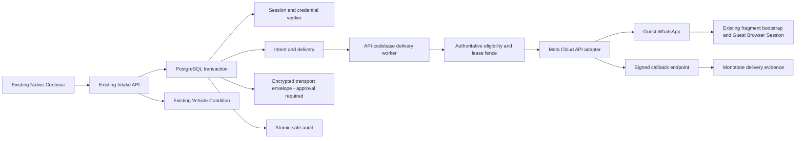
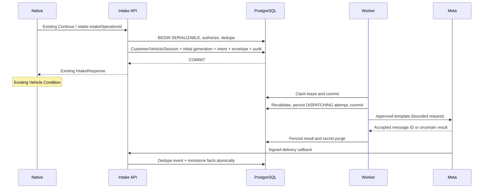
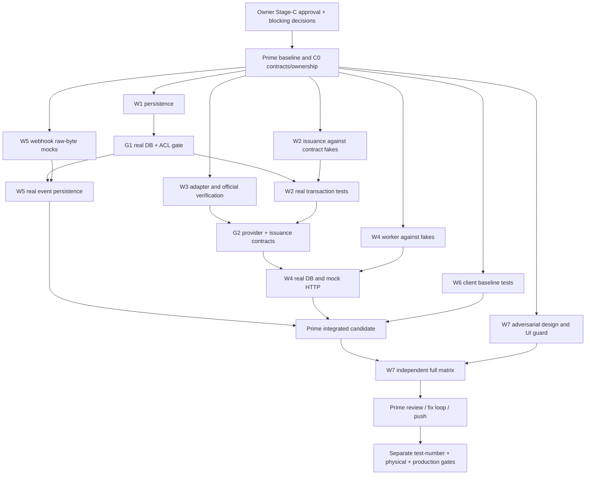

# Automatic WhatsApp Guest Access — Master Execution Plan

Status: **ASTRA planning complete; implementation NOT authorized.**
Prepared: 2026-10-15 (Asia/Amman). Repository: `yamanradwan1-rgb/valet-platform`.
Baseline: `53e9be1ab3a6f0e1411df30952287d0135e6d189` (`main`, remote verified).
Planning branch: `plan/automatic-whatsapp-guest-access`.
Future team: exactly one Prime Supervisor and seven Coding Agents. None launched by this plan.

Evidence labels used throughout: **FACT** = inspected baseline source; **ACCEPTED** = existing accepted project authority; **PROPOSED** = ASTRA recommendation, not permission; **GATE** = unresolved approval or verification. Proposed paths and interfaces below do not imply files already exist. All source references are relative to this pinned repository. See the evidence appendix and protected-file manifest.

## 1. Executive Summary

Use a backend-only, PostgreSQL transactional outbox inside the existing modular monolith. On a newly committed, eligible Intake, issue one initial Guest bootstrap generation and create exactly one logical delivery intent, one pending delivery, and short-lived protected transport material in the same transaction. A separately deployed process in the API codebase sends an approved Meta template. Signed callbacks reconcile messaging facts only. Native continues into Vehicle Condition using its unchanged response contract. No provider call occurs inside an Intake transaction.

This is implementable **after specific authority gates**, not ready for unconditional execution. The critical conflict is explicit: `docs/06_SECURITY_AND_DATA_RULES.md` forbids even an encrypted/reversible persisted Guest bearer. Asynchronous crash-safe sending needs recoverable transport material. Recommended resolution is an Owner-approved, narrowly scoped encrypted outbox exception, with strict expiry/key isolation; it is NOT already permitted. Alternatives and consequences are in WA-D02. Do not work around this by deriving reproducible credentials, rotating on retry, or hiding a bearer in a URL alias.

Other blockers: verifiable messaging permission without frozen UI changes; approved Arabic/English templates and tested fragment transport; Meta account ownership; fresh verification of inaccessible Meta technical documentation. Planning may be delivered with these gates closed. Safe mocked foundations can later run only after explicit Stage-C approval and the relevant contracts are frozen.

## 2. Product Goal and User Journey

Preserve current capture/manual entry → identity confirmation → recognition → details/customer branching → Intake → Vehicle Condition → complete Check-In → Parking flow. A recognized customer can be selected from the returning step; that branch does not necessarily visit the standalone Customer Contact screen. Do not force all paths through the illustrative linear journey.

The server's successful new Intake transaction is the sole automatic trigger. Employee Continue is existing input, not send authority. Staff never need to copy/share/send in the ordinary eligible flow. Existing manual Guest Access remains exceptional recovery. Delivery failure does not roll back an already committed Intake or delay Parking/custody. “Automatic” is subject to consent, configuration, valid recipient, expiry and provider delivery; no guaranteed receipt claim.

## 3. Frozen UI Contract

**UI FROZEN — ZERO PRESENTATION CHANGES.** All Native, Employee Web, Customer, Dashboard, shared UI, assets, styles, copy, translations, accessibility presentation, route order and visual baselines are protected. No WhatsApp/Send button, toast, delivery indicator, loading state or revised SMS wording.

`AUTOMATIC_WHATSAPP_GUEST_ACCESS_UI_FREEZE_MANIFEST.tsv` enumerates protected tracked paths and baseline Git blob IDs. Broad protection covers complete client source/app/public/assets/native directories and shared UI, plus snapshots and visual reference images. This intentionally also freezes nonvisual client code by default. W6's default patch is tests only; a necessary nonvisual exception requires Prime's explicit path-level reassignment and proof that presentation is identical. No TSX production exception is permitted by this mission.

The guard must inspect additions, deletions, renames, mode changes and modifications against the pinned baseline, not just extensions of existing files. Test-only additions are allowed in the exact W6/W7 namespaces; changing snapshots or visual test expectations is forbidden. Physical UI parity remains a separate gate (§47).

## 4. Repository Baseline and Evidence

**FACT:** primary checkout `D:/kndoom/valet-platform` was on `main`, clean in `git status --short`. HEAD and `origin/main` both equal the baseline above. Live `git ls-remote --symref origin HEAD refs/heads/main` confirmed default branch `main` and that SHA. Planning uses a separate local clone; the original checkout and its worktrees are preserved.

Relevant existing worktrees/branches: `fix/guest-client-reliability-t2` (`d285d791`), `feat/guest-t4-deployment-ha-observability` (`74cc7064`), `feat/guest-t5-pilot-completion-recovery` (`82db5b75`), `integrate/issue-215-complete-feature` (baseline), multiple Issue-215 component worktrees, and Issue-278 integration. Worktree presence is not proof of active human editing or unmerged capability. No WhatsApp implementation was found in the placeholder notifications boundary. Do not reuse/reset another task's worktree.

Live GitHub open issue inventory includes #219 (handoff Guest recovery), #224 (Customer HTTPS origin), #227 (production origins/build), #279 (deferred Guest end-to-end/load/physical/production), #215 and #282–293 (photo/runtime/security proof), #294–296 (reported security issues), #272–275 (Native physical/reliability). #215 remains open despite merged implementation; its old description is not current source truth. Only open PR returned was #210, blocked push real-device evidence. These are dependency/risk context, not automatically scope for this feature. Full title inventory is recorded in the evidence appendix.

**FACT:** 85 migration directories, latest `20261015008500_issue_215_p5_photo_integrity_system`; schema includes Guest Browser Sessions and Guest Push. This is repository migration state only: no live database was inspected or migrated. Dependencies are Node >=22, pnpm 10.34.5, Nest 11, PostgreSQL/Prisma. Package scripts are source-verified; no application test suite was run for this docs-only mission.

Authority reviewed through task-relevant sections: AGENTS, CONTRIBUTING, README, docs 00–17; focused decisions below; current schema, migrations, source, tests; docs/plans, docs/security and docs/validation inventory. Blueprint v1.0 PDF is not in `docs/reference`; use accepted `docs/15_BLUEPRINT_V1_REBASELINE.md`. The committed Arabic historical concept PDF is not a replacement for the missing Blueprint. No inaccessible private source is presumed read.

## 5. Current Native Flow Analysis

| Case | Observed source behavior / boundary | Preservation requirement |
|---|---|---|
| New contact | `EmployeeCheckInSession.submitCustomer()` normalizes with `normalizeJordanCheckInPhone`, then private `submit()` | Do not internationalize UI or change validation copy |
| Returning/saved | `useSavedCustomer()` sends `USE_SAVED_CUSTOMER` with opaque ID; returning correction may run after Intake | Resolve phone on server; keep correction and continuation sequence |
| No Phone | Empty trimmed phone calls `submit(undefined)` | Customer absent; zero automatic intent, no exposed credential |
| Incorrect syntax | Native normalization does not submit invalid number; server has its own normalization | Preserve rejection; a syntactically valid wrong number cannot be detected as ownership by formatting |
| Double Continue | First submit synchronously sets `submitting`; phase guards block another UI submit | Backend still enforces operation uniqueness against concurrent direct calls |
| Network/lost response | `runEmployeeCheckInIntake()` separates AMBIGUOUS from FAILURE | Never call issue/rotate as compensation |
| Background | `EmployeeCheckInSessionCore.suspendForBackground()` increments sequence and marks in-flight Intake ambiguous | Late results cannot advance stale UI |
| Reconnect | `recoverAmbiguous()` performs discovery; `retryIntake()` needs recoveryChecked and the original in-memory request | Same operation ID and payload on explicit retry |
| Process death | `pendingRequest` is memory-only; activate discovers server drafts/continuations | No durable Native messaging queue or automatic POST replay |
| Restart recovery | `loadCheckInRecoverables()` reads drafts/continuations; one result hydrates, several show existing choice; exact Vehicles Continue uses `openExistingCheckIn()` | Discovery is not proof that an arbitrary old request never committed |
| Account/Location change | `clear()` / `invalidate()` purge pending intent and fence sequence; `NativeCheckInActions` checks generation and full operational scope | A→B→A stale response must be ignored; committed server intent belongs to original scope |
| Cancellation | DEC-097 exact owner/Shift/CAS command; DEC-098 pre-custody cancellation | Terminal lifecycle invalidates access; no new cancellation credential mutation |
| Manual Guest issue/revoke | Independent staff endpoint and transient Native credential memory | Preserve explicit rotation/reissue and unknown-outcome recovery |

`checkInIntakeSnapshot()` turns success into phase `created`, continuation `select-condition`, default “No visible issue”; `NativeCheckInWorkflow.renderStep()` renders the existing continuation. No messaging state belongs in this snapshot. Routes are in `employee-check-in-transport.ts`: POST `/v1/staff/check-in/intakes`, POST `/vehicle-recognition`, GET `/drafts`, GET `/continuations`, GET `/v1/staff/valet-sessions/:id`; condition completion and final completion remain separate POSTs.

## 6. Current Backend/Guest Access Analysis

`StaffCheckInController.createIntake()` resolves current staff identity, parses strict contracts and invokes `CheckInApiService.executeIntake()` → `createIntakeSessionCommandExecutor()` → `executeOnce()`. The latter opens SERIALIZABLE, authorizes Location, takes an Organization+operation advisory lock, checks durable fingerprint, resolves Vehicle/Customer, calls `insertIntakeSession()`, then commits. Up to three serialization attempts are internal DB retries, not provider retries.

`insertIntakeSession()` writes `disabled:intake:<random hash>`, with expiry and revoked timestamp equal to creation, then creates `VALET_SESSION_CREATED` and `intake_operations`. `intakeResultFromRow()` returns no raw token; replay is a creation result, not a fresh lifecycle projection. Do not infer current state from replay's `CHECKING_IN/version=1`; discovery remains authoritative for later progression.

`createIssueGuestAccessCommandExecutor()` locks exact persisted scope after active employee/supervisor authorization. Initial placeholder → generation 1; ordinary rotation advances generation; real revoked credentials require `REISSUE_REVOKED` and exact `expectedRevokedAt`. It writes credential and audit atomically without physical version/state change. `createRevokeGuestAccessCommandExecutor()` is idempotent on already-revoked state. CANCELLED rejects issuance and Guest resolution. `guestAccessContract` uses 32 random bytes, 43 base64url characters, `sha256:v1:` verifier, 24-hour bootstrap TTL.

DEC-064 T1 means exchanged Browser Sessions survive active visits independently of bootstrap expiry; rotation/revoke invalidates old generation. Do not incorrectly describe all Guest access as a fixed 24-hour browser session. Existing command opens its own transaction: never call that executor from inside Intake and assume atomicity. W2 needs a transaction-local initial-issuance helper, not nested transactions or an HTTP round trip.

## 7. Current Notification Database Analysis

`Notification` in `packages/database/prisma/schema.prisma` has Organization, optional session, channel SMS/WHATSAPP/EMAIL, plaintext recipient, template key, PENDING/SENT/FAILED, provider reference and timestamps. It has no generation fence, logical-intent uniqueness, attempts, lease, out-of-order status model or transport secret custody. `apps/api/src/modules/notifications/README.md` is a placeholder.

**PROPOSED:** dedicated provider-neutral outbound tables under notifications, leaving legacy Notification and Staff/Guest Push unchanged. Do not dual-write a misleading SENT legacy record. Existing `GuestPushDeliveryWorker`, claim repository, worker-role provisioning and lifecycle files are design precedents, not generic reusable semantics: Guest Push retries UNKNOWN; this link-delivery design deliberately does not. DEC-101's four attempts/30-minute policy is not automatically accepted for WhatsApp.

## 8. Existing Accepted Decisions

| Authority | Binding implication |
|---|---|
| Blueprint bridge / product scope | Phone-based secure link, QR fallback, minimal friction; Meta first provider is selected by this planning brief, not deployed |
| VAL-004E/F in engineering/security docs | Atomic Intake; secure explicit issuance; hash-only persistence including prohibition on encrypted copies |
| DEC-024/T3 | Existing durable Guest anti-abuse remains; webhook ingress needs its own bounded provider-authenticated boundary |
| DEC-025 | Separate runtime/migration roles, verified TLS, effective privilege checks |
| DEC-026/027/028/030 | Neutral infrastructure, feature ownership, architecture guard, <=300 lines for new authored code |
| DEC-063 | No client offline outbox or blind mutation replay |
| DEC-064 (including T1/T3 amendments) | Exact fragment transport, one-time exchange, generation invalidation, durable browser continuity |
| DEC-069 | Exact returning association is convenience, not identity; zero/one/many phone resolution within Organization |
| DEC-070, DEC-073/075/076, DEC-101 | Notification and custody independent; push architectures remain separate |
| DEC-084/091 | Minimal visit contact; historical phone/plate not proof of person or ownership |
| DEC-087 | No self-service provider secrets UI; server-controlled integration |
| DEC-097/098 | CANCELLED retained terminal history; no guest scope or physical release |
| DEC-104 / Issue-215 | Real verified condition pipeline now exists; keep its gates and recovery intact |

Focused accepted DEC-069 supersedes older engineering paragraphs saying every phone creates a new Customer. Source already implements zero/one/many reuse. Record this precedence in Prime's reconciliation; do not “fix” behavior back to stale text. No new accepted DEC is created by this planning artifact.

## 9. Target System Architecture



No Redis, broker, microservice or new client SDK. New worker deployment is a separate process of the modular monolith, like Guest Push. Provider-neutral domain contracts use purpose/channel/result classes; only adapter and webhook normalization know Meta JSON.

## 10. Component Ownership

Prime owns frozen shared internal types, composition/bootstrap, feature wiring, cross-cutting docs/config/scripts and release evidence. W1 owns schema/migrations/DB privilege enforcement; W2 Intake and credential material; W3 provider adapter/config; W4 worker/recovery; W5 webhook/normalization/status application; W6 existing-client compatibility tests; W7 independently authored integration/security/UI-freeze evidence. Exact paths and exclusions are in §37. Ownership is exclusive, including tests.

## 11. Complete Data Flow

1. Existing authenticated Intake request supplies stable operation ID, exact vehicle identity and optional contact intent.
2. Existing authorization and idempotency run first. Exact replay returns existing result with no new credential/intent, even after flag changes.
3. Resolve Customer under DEC-069. Resolve actual canonical recipient from locked same-Organization Customer; never use masked suggestion or callback recipient as authority.
4. Evaluate typed Organization default/Location override, consent evidence and test allowlist. Eligible new visit gets one random credential; hash remains on session, transport envelope is separate and short-lived only if WA-D02 accepted.
5. Insert intent/delivery/envelope and issuance audit in the same transaction as Intake. Commit before response. No raw credential or delivery status in response.
6. Worker claims bounded work, revalidates recipient/scope/generation/consent/state/expiry, commits dispatch marker, decrypts only in memory and calls provider once for that attempt.
7. Persist acceptance, definite rejection or UNKNOWN without custody mutations. Callback verifies bytes and account binding, deduplicates and updates facts.
8. Guest follows existing fragment entry/exchange; generation and lifecycle remain authoritative regardless of provider status.

## 12. Trust Boundaries

Native input is intent, not ownership. Staff authentication is separate from exact Location field authority. PostgreSQL is authoritative for scope, generation, recipient binding, time, attempts and leases. Secret manager/KMS protects envelope keys separately from DB backups. Meta necessarily receives the destination and secure link; this disclosure requires explicit Owner approval and privacy handling. Webhook signature proves the application sender, not tenancy: tenancy comes from persisted attempt/account correlation. Guest bearer possession grants only existing guest-safe authority, never physical handoff/release by itself.

Worker must not be given general staff credentials, migration credentials, credential-rotation permission or custody UPDATE privileges. Compromise of a sender that can decrypt queued links exposes those pending links; encryption does not eliminate this trust boundary. Restrict egress, IAM, queues per environment, and key access accordingly.

## 13. Intake Transaction Strategy

Retain current SERIALIZABLE executor and operation fingerprint semantics. Add a transaction-local hook after Customer/session creation and before COMMIT. Existing duplicate path must return before hook. Hook reads locked customer/policy/consent, prepares initial credential and outbox. New unique `(organization_id, valet_session_id, purpose)` enforces one INITIAL_GUEST_ACCESS logical intent for the visit independently of application checks. Initial creation has generation 1; no second intent for later manual rotations.

No network/KMS RPC under transaction locks: load approved wrapping capability at process readiness or use a local public-key envelope encryptor whose private key only sender can access. Chosen cryptographic library and envelope scheme require review before freeze. Do not invent homebrew crypto. If using symmetric AEAD initially, both issuer and worker can decrypt: explicitly record that wider trust in WA-D02 approval.

Flag OFF, absent consent, invalid legacy saved phone or unavailable encryption capability: skip automatic issuance before writing; preserve disabled placeholder and Intake response, emit bounded diagnostic. Sender-only token/template outage does not affect issuer; valid intent queues and eventually expires. If an eligible transaction's outbox/audit write fails, the whole transaction fails/rolls back; never catch that error and claim an atomic intent exists. This is DB correctness, not provider availability. Absolute “Intake succeeds despite any DB failure” is incompatible with atomic durable intent and is not promised.

Lock ordering: retain Location lifecycle and existing actor/operation/vehicle/history order; add customer → consent/policy lock before new session/outbox writes. Existing returning history locking must be retained. Worker never holds delivery lock while waiting for session/customer. W1/W2/W4 must demonstrate no inversion against manual rotation, management contact correction, DEC-097 and DEC-098 with real PostgreSQL barriers before freeze is considered proven.

## 14. Automatic Credential Issuance Strategy

W2 extracts generation/format/hash/audit helpers without expanding the oversized `guest-access-command.ts` (currently >300 lines). Internal `issueInitialGuestAccessInTransaction` accepts only server-derived scope and a newly created disabled session, not arbitrary public intent. Exactly 32 CSPRNG bytes and existing hash format; DB wall time after relevant locks defines issuance and 24-hour expiry. Atomic audit is `GUEST_ACCESS_ISSUED` with approved existing safe metadata; method/channel metadata requires allowlist review.

No raw token in Native response, operation record, legacy notifications, logs or audit. Exact retry never regenerates. Manual issue remains available but will now truthfully be rotation for an automatically issued generation, invalidating a pending message. Manual issuance/reissue does not automatically enqueue another WhatsApp in v1. This behavior requires WA-D03 approval. Revocation can never be undone by worker retry.

## 15. Secure Message Payload Strategy

**GATED recommendation:** encrypted envelope contains only bootstrap token and canonical recipient snapshot; no rendered message, plate, customer name, location name or vehicle data. AEAD additional authenticated data binds version, Organization, Location, session, generation, intent, customer, recipient digest and expiry. Nonce must be fresh per encryption; key version, algorithm identifier and ciphertext lengths validated. Altered AAD/ciphertext/tag fails closed. The durable verifier remains unchanged in the session.

Recipient digest uses dedicated versioned HMAC key (phone numbers are enumerable; plain SHA-256 is insufficient pseudonymization). Compare freshly loaded canonical phone and consent under locks. Never silently re-address old queued material after a phone edit. Destroy envelope on acceptance/UNKNOWN/permanent failure/suppression/expiry; UNKNOWN needs callback evidence, not a reusable secret. Retain envelope only for definitely-not-accepted retries within original lifetime. Deletion is operational secret cleanup, not deletion of audit/visit history. Encrypted backups and key retirement remain separate residual-retention gates.

Default link candidate is canonical Customer origin plus `/#guestToken=<43-char token>`. No query/path bearer, URL shortener, analytics, redirect tracking or link preview fetch from VAYLET. Fragment support in approved Meta URL templates is **unverified**, not asserted. If Meta rejects it: consider an approved template body link first (requires render/preview tests), or separately approved opaque redirect ticket. A redirect ticket is itself bearer-equivalent; hash-only storage, short expiry, generation/lifecycle binding, no open redirects, no GET consumption by previews, no access-log leakage and no-store would be mandatory. That alternative changes transport/security authority and is not included in default worker scopes until re-planned. Never move raw token to a query string.

## 16. WhatsApp Cloud API Integration

Official-source research checked 2026-10-15:

| Source | Verified content / limit |
|---|---|
| [WhatsApp Business Messaging Policy](https://whatsappbusiness.com/policy/) (updated 2026-09-23) | Recipient supplies number and opt-in; honor opt-out; business initiation uses approved templates; 24-hour service window is not automatically opened by an employee entering a phone |
| [Meta official Cloud API collection](https://www.postman.com/meta/whatsapp-business-platform/collection/wlk6lh4/whatsapp-cloud-api) | Business portfolio, WABA, business number; user/system-user tokens; messaging/management permissions; current collection distinguishes token lifetimes |
| [Meta template request](https://www.postman.com/meta/whatsapp-business-platform/request/lwtlz1k/send-message-template-interactive) | Versioned `POST https://graph.facebook.com/{version}/{phone-number-id}/messages` route |
| [Cloud API get started](https://developers.facebook.com/docs/whatsapp/cloud-api/get-started), [Graph webhooks](https://developers.facebook.com/docs/graph-api/webhooks/getting-started), [new webhook overview](https://developers.facebook.com/documentation/business-messaging/whatsapp/webhooks/overview) | Fetch returned 429/unavailable. Technical details below are proposed integration requirements pending fresh official-page verification, not certified current provider behavior |

Research limitation is material: do not claim latest Graph version, test-recipient quota, fragment compatibility, callback retry horizon or provider idempotency guarantees verified. W3/W5 must capture exact current official versions/schemas before real sends. No account, token or recipient was configured, and no message was sent during planning.

Adapter contract: HTTPS fixed Meta origin, explicit supported Graph version (no “latest”/silent fallback), server-controlled Phone Number ID/WABA/account binding, bearer token header, template name and exact language code from allowlist. Typical request fields: `messaging_product: whatsapp`, canonical digits-only `to`, `type: template`, template name/language/components. Validate against newly verified Meta schema, strict size bounds and one returned message ID. Avoid accepting arbitrary URLs or bodies from staff/client. HTTP library retries and redirects disabled. Bounded ten-second total deadline, bounded response body, TLS verification on. Error response text is not logged; normalize approved codes.

No documented provider idempotency capability was verified. An internal attempt UUID is correlation only. If current Meta supports `biz_opaque_callback_data`, send an opaque per-attempt random handle and test its signed callback echo; it must contain no tenant IDs/PII/token. If unavailable, ID-less UNKNOWN cannot be automatically reconciled and remains support-only until expiry. Do not assume lookup-by-client-key exists.

## 17. Template and Localization Strategy

Propose transactional/utility classification for a requested visit-access message, subject to Meta classification and approval; do not use an authentication/OTP template as a loophole. Two explicit approved variants, Arabic and English; provider locale codes must match the actual approved template (do not guess `en` versus `en_US`). Template catalog is versioned, server-owned and includes purpose, account, name, locale, approved URL prefix and safe sample data.

No new Native locale field is required. Recommend typed Organization default with Location override for message language, approved in WA-D04. Employee app language does not prove customer preference; saved Customer has no locale field. Missing variant suppresses sending with CONFIGURATION diagnostic; no silent language or free-text fallback. Template copy is new external message content, not permission to change existing product copy. Owner must approve the exact AR/EN text and opt-out/support instructions before registration.

## 18. Provider Configuration and Secrets

Proposed server-only variables: `GUEST_ACCESS_AUTO_ISSUE_ENABLED=false`, `OUTBOUND_MESSAGING_SEND_ENABLED=false`, `OUTBOUND_MESSAGING_MODE=disabled|test|production`, `OUTBOUND_MESSAGING_WORKER_DATABASE_URL`, `META_WHATSAPP_GRAPH_VERSION`, `META_WHATSAPP_PHONE_NUMBER_ID`, `META_WHATSAPP_WABA_ID`, `META_WHATSAPP_ACCESS_TOKEN`, `META_WHATSAPP_APP_SECRET`, `META_WHATSAPP_WEBHOOK_VERIFY_TOKEN`, `META_WHATSAPP_TEMPLATE_AR`, `META_WHATSAPP_TEMPLATE_EN`, `GUEST_ACCESS_MESSAGE_ORIGIN`, envelope key reference/version and recipient-HMAC key reference. Test allowlist belongs in secret/config storage, never repository fixtures containing real numbers.

Separate development/test/prod accounts/config/keys; reject production mode with test artifacts or unapproved bindings. Runtime sending permission is narrower than account/template administration; management token does not enter worker when unnecessary. System-user token lifecycle, rotation/revocation and account ownership must be evidenced, not called “permanent” as an operational guarantee. Zero `EXPO_PUBLIC_`/`NEXT_PUBLIC_` provider secrets. Customer public origin is not a secret but must be clean HTTPS in production.

Issuer does not require Meta token; worker does not need arbitrary account management. Webhook verifier needs app secret/verify token, not send credentials. Key rotation retains only versions needed by unexpired queued envelopes; old ones are removed after drain/expiry and backup policy review. Invalid enabled sender configuration fails worker readiness without preventing API custody service startup.

## 19. Durable Queue/Outbox Design

Proposed tables (all new, not legacy Notification):

| Table | Required data / invariants |
|---|---|
| `outbound_message_intents` | UUID; Organization/Location/session/customer; purpose INITIAL_GUEST_ACCESS; immutable generation/recipient HMAC/consent evidence ID/policy version/template version/locale/provider binding; created/expiry; unique org+session+purpose |
| `outbound_message_deliveries` | UUID and exact scoped intent FK; channel WHATSAPP, provider META_CLOUD; controlled work state; next-attempt; lease UUID/deadline; attempt_count/max_attempts; accepted/sent/delivered/read/failed fact times; unique intent+channel |
| `outbound_message_attempts` | UUID; delivery and immutable ordinal; random callback handle; dispatch_started_at; provider message ID; outcome; safe code; account binding; unique delivery+ordinal and provider account+message ID where non-null |
| `outbound_message_envelopes` | One per intent; ciphertext/nonce/tag or reviewed sealed envelope; key version, AAD version; purge deadline; narrow role access; no plaintext |
| `outbound_message_events` | Normalized append-only provider facts, dedupe hash, scoped attempt/delivery, provider timestamps + received_at, safe error class; no raw JSON |
| `outbound_messaging_permissions` | Proposed external-consent/suppression evidence scoped Organization+recipient digest+purpose; provenance reference, collected_at, expiry, withdrawn_at, version; no fake blanket consent |

Complete supporting persistence contract (also W1-owned):

- `outbound_provider_bindings`: UUID, Organization FK, purpose, provider enum, environment enum, WABA ID, Phone Number ID, configuration alias, enabled, revision, created/updated timestamps. No access token/app secret/key in this table. Unique `(organization_id, id)`; unique `(environment, provider, phone_number_id)` in v1 binds one sending number to one Organization. An Organization may have multiple disabled historical bindings, but only one enabled binding per environment/purpose via partial unique index. Shared platform-owned business accounts may contain separate numbers; sharing one number across Organizations requires a later reviewed correlation/account model, not a silent relaxation.
- `outbound_messaging_policies`: UUID, Organization, nullable Location, purpose, enabled override, language override, provider-binding reference, template-catalog version, policy version, revision and timestamps. One Organization default per purpose; one Location override per purpose through separate partial unique indexes (do not rely on NULL equality). Composite Organization/Location FK and Organization/binding FK prevent cross-scope overrides. Effective resolution is typed field inheritance; missing Organization default means disabled. Immutable intent snapshot records the resolved policy identity/revision and binding revision; dispatch rechecks current effective values and suppresses on incompatible recipient/template/account changes rather than substituting content.
- `outbound_messaging_control`: singleton per environment with send_enabled, issue_enabled, revision and timestamps; controlled operator update only. API policy resolver and every dispatch authorization read this durable kill switch. Environment variables are additional OFF fences, never permission to override database OFF. Initial row defaults both OFF. Restore procedure forces it OFF before runtime activation.
- `outbound_message_budgets`: provider_binding_id PK/FK, tokens numeric bounded to configured capacity, last_refill_at and revision; and `outbound_recipient_budgets`: binding+recipient_digest composite PK, next_permitted_at, expiry. Neither stores plaintext recipient. Restrict writes to atomic budget-reservation function; cleanup of expired recipient budgets cannot remove an active reservation.
- Permissions use a current row unique `(organization_id, recipient_digest, purpose)` plus append-only `outbound_permission_events` containing revision, action GRANT/WITHDRAW, provenance reference and time. Updates require expected current revision. WITHDRAW always increments revision and nullifies active permission; older imports/events cannot reactivate it. A fresh GRANT requires explicit newer, independently evidenced opt-in, never replay of an old import. Intent pins permission ID/revision; withdrawal-first suppresses; later re-opt-in does not resurrect that old intent. All time/expiry checks use DB wall time. Provider-binding scope is not customer identity proof.

Intent additionally stores the exact binding FK and effective policy/permission revisions; attempts repeat immutable binding ID and account-number identity for callback matching across later configuration changes. Parent composite unique keys include scope+id for every child FK. No arbitrary JSON config, no account identifier supplied by Native and no tenant selected by webhook payload.

Permission schema and import authority remain WA-D01 gated. Typed activation policy follows Organization default/Location override, but temporary operator-managed rollout config rather than Dashboard editing requires WA-D09. If approved, model explicit policy fields/table; never untyped arbitrary JSON. Policy/consent changes are fenced with a revision/locking protocol.

Work states: PENDING → LEASED → DISPATCHING → ACCEPTED or UNKNOWN or RETRY_WAIT or PERMANENT_FAILURE; PENDING/LEASED/RETRY_WAIT → SUPPRESSED/EXPIRED as appropriate. Evidence timestamps are orthogonal: accepted does not imply sent/delivered/read. UNKNOWN is not retryable. A delayed signed callback can resolve UNKNOWN without reopening work. Terminal evidence cannot authorize another send.

## 20. Delivery Worker and Lease Semantics

Proposed policy v1 (Owner approval required): 30-minute intent lifetime, at most four dispatched attempts, 10-second provider deadline, 30-second lease, claim batch <=10, default concurrency 2 per replica, cleanup batch <=100. No auto-extension of original intent TTL; expiry also bounded by bootstrap expiry. PostgreSQL `clock_timestamp()` defines deadlines; monotonic local elapsed time subtracts DB-to-send delay.

Claim PENDING/RETRY_WAIT due rows with `FOR UPDATE SKIP LOCKED`, write random lease token/deadline and COMMIT. Reclaim expired LEASED only if no dispatch marker exists. Expired DISPATCHING becomes UNKNOWN and is never resent. Claim count is separate from dispatched-attempt count; process crashes before dispatch must not invent provider attempts.

Exact accounting: `attempt_count` is the count of committed dispatch permits, including a permit whose process dies before socket creation. Each permit consumes one of four slots and creates immutable ordinal 1..4. A live process that can prove its transport function was never invoked may finalize that permit as NOT_SENT and schedule another permit within the remaining slots; it never decrements/reuses an ordinal. A crash or any uncertainty after permit commit is UNKNOWN, even if no network bytes actually left. Add `transport_started_at` as best-effort evidence only; its absence is never proof of non-send. These conservative permit counts replace any interpretation of “four attempts” as four confirmed network receipts.

Distributed rate budget: in dispatch authorization lock binding budget, then its recipient budget after session/customer/permission/delivery locks; operator policy paths never lock those in reverse order. Refill account tokens by elapsed DB wall time, clamp to configured capacity, consume exactly one token atomically with the dispatch permit. Proposed pilot defaults: capacity 1, refill 1 token/second per binding, recipient spacing 30 seconds; actual values must be <= current approved Meta limits and independently cost-approved. Per-process concurrency is only an additional bound. If budget unavailable, persist next_attempt_at at earliest eligibility, release lease without creating an attempt, and never extend original TTL. Abort/UNKNOWN never refunds a token. Multi-replica tests must assert aggregate admission, not just local concurrency. These are conservative application limits, not claims about Meta's current published quotas.

Before dispatch, lock in agreed order: session → customer → permission/policy → delivery; recheck lease token, remaining deadline, active nonterminal lifecycle, current unconsumed/unrevoked generation and verifier, customer binding/digest, consent and enabled account. Commit a new attempt with DISPATCHING before network. No DB transaction held through provider call. If lease time remaining <= timeout+safety margin, release/reclaim without sending. Finalization must match delivery+lease+attempt and cannot erase stronger webhook evidence.

A process paused after authorization cannot be made atomic with Meta. Rotation/cancellation after dispatch permit may result in delivery of an obsolete link; guest resolution must reject it. A hard no-physical-message-after-revocation guarantee is impossible with in-flight provider traffic; WA-D06 must accept this boundary. Checks at transport creation minimize the gap but do not remove it.

Immediately before constructing transport, recheck monotonic remaining lease/intent TTL and the current persisted permit/kill-switch fence. If the check cannot complete or deadline has elapsed, do not send; live definitely-unsent permits finalize NOT_SENT/EXPIRED, while uncertain or restarted permits remain UNKNOWN. No resumed process may use an old permit after its lease has expired. Test a process pause specifically between permit commit and transport construction. This recheck reduces but cannot eliminate the interval between authorization and external I/O.

On SIGTERM stop claiming; bounded drain in-flight calls; unresolved dispatch remains UNKNOWN, not reset. Health separates process liveness, DB/schema/role/key readiness, and queue age. One worker's failure never owns API readiness. Use distinct restricted DB principal with verified effective ACL and TLS, no owner/superuser/BYPASSRLS/DDL/custody/credential-write powers. Scoped SQL functions/views may expose only eligible sender material; PUBLIC EXECUTE revoked, safe search_path, no caller-selected arbitrary rows.

## 21. Idempotency and Duplicate Mitigation

Intake idempotency remains Organization+stable operation ID+material fingerprint. Different payload same ID conflicts. Intent uniqueness is session+purpose, never phone+timestamp. Delivery is intent+channel; attempt ordinal/handle immutable. Callback uniqueness is provider binding+message ID+normalized status+provider time+safe error identity; bounded canonical hash, not untrusted event ID alone.

Exactly one logical intent is enforceable. Exactly-once external WhatsApp receipt is not. Network timeouts and crash-after-acceptance are UNKNOWN; no blind resend. Definite pre-dispatch failure can retry same material without rotation. Even a duplicate message, if externally produced, refers to the same generation and cannot create new custody or duplicate guest authority.

## 22. Retry and Unknown Outcome Policy

| Outcome | Action |
|---|---|
| Valid 2xx with verified message ID | ACCEPTED; purge envelope; wait for callback facts |
| Timeout/reset after request may have left, malformed 2xx, ambiguous 5xx | UNKNOWN; purge envelope; no automated repeat |
| Definitive local failure before permit | RETRY_WAIT; no permit/attempt counted |
| Live proven local failure after permit but before transport invocation | Finalize that permit NOT_SENT; RETRY_WAIT only if slots/TTL remain; ordinal never reused |
| Explicit documented nonacceptance/rate limit | Retry only allowlisted provider errors proven not accepted; count attempt |
| Invalid recipient/template, permission/auth error | Permanent recipient failure or CONFIGURATION hold; no hot retry loop |
| Provider-reported failed after acceptance | Record FAILED evidence; v1 no automatic resend or SMS |
| Outage/worker offline | Durable rows wait until original TTL; expire without blocking Intake |

Retry delay for attempt n: random uniform `[10, min(300, 10*2^(n-1))]` seconds; honor larger valid Retry-After up to remaining lifetime, otherwise expire. At fourth dispatched failure terminalize. Configuration hold uses RETRY_WAIT with a bounded operator/config revision wakeup, no credential retry storm; lifetime still applies. Late callbacks after local expiry update evidence but never requeue. UNKNOWN reconciliation requires verified message ID or approved callback handle plus all account/recipient checks; absence of callback proves nothing.

## 23. Webhook Security and Processing

Proposed GET/POST `/v1/webhooks/meta/whatsapp`. GET checks exact configured verification token and subscribe mode, returns bounded challenge text only on match. It cannot change records. POST captures original bytes before parsing, limits body (propose 256 KiB) and rate/concurrency, validates exact `X-Hub-Signature-256` HMAC-SHA256 against configured Meta app secret using timing-safe comparison. Header shape/length must be checked before comparing. Verify token is not POST authentication. Confirm current Meta algorithm/schema via official docs before integration.

After signature verification: strict bounded normalized events; allowlisted WABA/Phone Number ID; correlate provider message ID/account or cryptographically random echoed attempt handle. Derive tenant from durable attempt, compare recipient digest where supplied, reject conflicting message-ID attachment. Unknown event/account/recipient never picks tenant from payload. Callback arriving before HTTP response is allowed because attempt was committed before dispatch. No permissive wildcard account routing.

Atomic normalized event insert + monotone evidence update; successful duplicate returns 200 with no extra effect. DB failure returns retriable 5xx; do not ACK before durable processing. Valid irrelevant event returns 200 without storing full body; authenticated unknown correlation may be recorded in a bounded, redacted quarantine only under approved retention, never auto-attached by phone alone. Invalid signature 401/403, malformed 400, oversized 413.

Track facts, not numeric status ranking: read/delivered timestamps cannot be erased by late sent/failed; record contradictory failure independently and raise safe diagnostic. Callback never mutates session/customer/credential/custody. Signature has no assumed trusted freshness timestamp: replay defense is durable dedupe and idempotent monotone transitions, not a fabricated five-minute cutoff that drops legitimate delayed callbacks. Retention must exceed verified Meta retry horizon; tombstone/terminal rows prevent old callbacks recreating sends after cleanup.

## 24. Credential Rotation/Revocation Races

Before dispatch: generation mismatch, consumed bootstrap, revoked credential or changed verifier suppresses. During/after dispatch: provider may still deliver, but old token must fail existing Guest authorization and old Browser Sessions must remain invalidated. Never rotate again to “repair” delivery. Manual reissue preserves exact revocation CAS and staff authority; no worker privilege to clear revocation.

Automatic issuance must coexist with the existing DB generation bridge. W1/W2 verify actual generation returned from insert/update and trigger interaction; do not increment twice. Existing manual command's physical version invariant remains unchanged. No proactive edits to cancellation commands are expected: sender eligibility reads canonical terminal state.

## 25. Cancellation and Expiration Behavior

CANCELLED denies all Guest authority and suppresses unsent messages under DEC-097/098 while retaining credential/audit/history. This feature does not append GUEST_ACCESS_REVOKED merely because cancellation occurred. COMPLETED suppresses initial-message sends as obsolete, without changing existing 24-hour post-visit Browser Session scope. Active visits may outlive bootstrap TTL; existing exchanged browser remains valid, an unopened expired link needs existing staff recovery. No automatic extension or reminder/rotation.

Envelope expiry <= intent expiry <= issuance+30 minutes (proposed), bootstrap expiry remains 24 hours. Maintenance terminalizes stale pending work, records reason and purges envelope. It does not delete ValetSession, IntakeOperation or audit. Proposed normalized delivery/event retention 30 days and minimal dedupe tombstones 90 days require WA-D08 and current provider retry verification; no automatic history deletion before approved policy.

## 26. Saved Customer and No Phone Behavior

`resolveSavedCustomer()` locks completed history, proves one distinct eligible Customer and rechecks same-Organization record; caller ID is not authority. Outbox reads that resolved row's full number internally and keeps it out of response. `resolveDifferentCustomer()` serializes exact normalized-phone lookup: zero creates, one reuses, many rejects. Preserve that behavior; no uniqueness migration/merge of existing Customers.

No Phone creates no Customer and no automatic intent/envelope; keep disabled credential and manual recovery. A saved historical number can be valid syntax but outdated/reassigned. No current proof of phone ownership or consent exists in Customer schema; Owner must accept risk or approve an external verification process. After Intake, changed customer association/phone suppresses old intent; never silently send to either new number or old number after detecting mismatch. No automatic new intent on contact correction in v1.

## 27. Customer Messaging Authorization/Consent

**Blocking WA-D01.** Do not infer consent from entering a phone, saved selection, previous visit, customer record or permission to park. Current schema lacks messaging permission evidence. Recommend documented opt-in collected by the operator outside frozen application UI, imported through a controlled audited operator-only process with scoped recipient/purpose/provenance and withdrawal support. This is proposed capability, not evidence that the operator currently has consent.

Activation requires Owner/legal approval of collection, lawful disclosure, retention and immediate opt-out handling. Verified inbound opt-out handling or staffed support ingestion must update the same suppression store; send-time checks see withdrawal. Never read arbitrary inbound message text into general logs or automatically treat unrelated replies as consent. If compliant permission requires changes to frozen screens, affected delivery activation is BLOCKED; no UI workaround is authorized. Meta policy is a platform requirement, not a country-specific legal opinion.

## 28. Proposed Database Migrations

W1 is sole migration author. Reserve new timestamps after actual latest baseline at Stage C; do not assume migration 086 remains free. Phase M1 additive enums/tables/composite keys/indexes; M2 restricted functions/privileges/policy; no backfill of historical delivery intents or automatic issuance. Preserve all 85 old files byte-for-byte. Update `docs/03_DATABASE_SCHEMA.md` only after authority approval.

Illustrative constraints to translate into Prisma plus SQL (not executed):

```sql
UNIQUE (organization_id, valet_session_id, purpose)
FOREIGN KEY (organization_id, location_id, valet_session_id)
  REFERENCES valet_sessions (organization_id, location_id, id)
FOREIGN KEY (organization_id, customer_id)
  REFERENCES customers (organization_id, id)
CHECK (credential_generation > 0)
CHECK (expires_at > created_at)
CHECK (attempt_count >= 0 AND attempt_count <= max_attempts)
CHECK ((lease_token IS NULL) = (lease_expires_at IS NULL))
-- Additional state-specific checks must require lease fields only when appropriate.
CREATE UNIQUE INDEX outbound_attempt_provider_message_key
  ON outbound_message_attempts(provider_binding_id, provider_message_id)
  WHERE provider_message_id IS NOT NULL;
CREATE INDEX outbound_due_idx
  ON outbound_message_deliveries(next_attempt_at, created_at, id)
  WHERE state IN ('PENDING', 'RETRY_WAIT');
```

Every child includes composite same-scope FK to parent, RESTRICT history deletion and immutable scope/generation/recipient binding. FK alone does not enforce runtime tenant authorization. Required guarded transitions/functions prevent sender/webhook principals from arbitrary INSERT or forged status; verify actual ACL including inherited roles/PUBLIC. Intent/envelope insert role, sender role, webhook role and maintenance role are distinct capabilities. API must not gain DELETE on evidence; maintenance can purge only expired envelope material and approved retention cohorts.

## 29. Shared TypeScript Interface Specifications

Prime creates internal contract files before workers branch; they remain Prime-owned. They are server-only, not exported to Native bundles. IDs below are validated opaque UUIDs; functions use existing transaction/pool types. No external network method accepts a transaction.

```ts
type SendResult =
  | { kind: 'ACCEPTED'; providerMessageId: string }
  | { kind: 'NOT_ACCEPTED'; reason: 'RATE_LIMIT' | 'TRANSIENT'; retryAfterSeconds?: number }
  | { kind: 'PERMANENT'; reason: 'RECIPIENT' | 'TEMPLATE' | 'AUTH' | 'POLICY' }
  | { kind: 'UNKNOWN'; reason: 'TIMEOUT' | 'TRANSPORT' | 'MALFORMED_RESPONSE' };

interface OutboundProvider {
  send(input: {
    attemptHandle: string;
    recipientE164: string; // transient only
    templateName: string;
    templateLanguage: string;
    guestUrl: string; // transient secret; never serialize into logs
    signal: AbortSignal;
  }): Promise<SendResult>;
}

interface InitialGuestDeliveryScope {
  organizationId: string;
  locationId: string;
  sessionId: string;
  customerId: string;
  actorMembershipId: string;
}

interface OutboundClaim {
  deliveryId: string;
  leaseToken: string;
  leaseExpiresAt: Date;
}

interface NormalizedDeliveryEvent {
  providerBindingId: string; // resolved configuration, not payload tenant
  providerMessageId: string;
  attemptHandle?: string;
  recipientDigest?: string;
  status: 'SENT' | 'DELIVERED' | 'READ' | 'FAILED';
  providerTime: Date;
  safeErrorClass?: string; // finite registry, never raw provider message
}
```

Repository boundary functions: `createInitialIntent(tx, scope, approvedPolicy)`, `claimDue(pool)`, `prepareDispatch(tx, claim)`, `finalizeAttempt(tx, claim, attemptId, result)`, `applyDeliveryEvent(tx, event)`, `purgeExpiredEnvelopes(tx, limit)`. `prepareDispatch` returns a discriminated suppress/expire/lost-lease/dispatch result and remaining lifetimes; no nullable “maybe send” default. Issuer output contains no raw material outside the dedicated seal boundary. Detailed contracts freeze DB names, allowed state transitions, unique conflict mapping, lock order, result semantics and retention; an interface compile check alone is insufficient.

## 30. Public/Internal API Contract Changes

Existing Intake request/response and Guest/staff endpoints remain byte-shape compatible. Do not add delivery success fields to strict schemas or send tokens to Native. New externally reachable route is only Meta verification/callback. No generic staff send/resend/recipient API, public diagnostics or CRM endpoint. Internal operator consent/policy tooling is explicitly gated and authenticated outside ordinary staff access; no migration credentials in runtime.

Prime owns `main.ts` raw-body wiring and AppModule import after W5 proves exact ingress requirements. Prefer narrowly scoped raw-body handling; verify all existing JSON/multipart/photo routes unaffected, preserve error/no-store/request-ID behavior. Feature modules may import neutral common database infrastructure; common may not import notifications. No new pool per API feature; webhook restricted credential handling must follow reviewed composition if separate pool is genuinely required.

## 31. Feature Flags and Rollout

Default issuance and sending OFF. Step 1 additive DB/role rollout with API behavior unchanged. Step 2 deploy code and worker disabled. Step 3 synthetic mock-only integration. Step 4 Owner-approved test-number mode with exact test recipient allowlist and test account; feature enabled only on isolated test Organization/Location. Step 5 production permission/template/origin/IAM/retention evidence and explicit activation approval; narrow controlled pilot. No historical backfill after enabling.

Off: unchanged Intake disabled placeholder, no intent. Issuance enabled but sender unavailable: valid intents wait and expire. Issuance not securely configurable: safe automatic-delivery skip with alert and unchanged Intake. Disable send before rollback, then disable issuance. Runtime kill switch must be authoritative across replicas, not a stale per-process env-only promise. Proposed policy revision is checked at dispatch; in-flight requests may finish. No automatic future SMS fallback.

## 32. Observability, Audit and Support Diagnostics

Metrics: counts by safe outcome/reason/provider/environment; queue age buckets; accepted-to-delivered latency; UNKNOWN count; signature rejection; envelope purge lag; credential/recipient suppression. No phone, URL, token/hash, provider raw body, message content, WABA secrets or tenant IDs as metric labels. Internal attempt/intent IDs may be in restricted structured diagnostics, with scoped support authorization; never expose them through public health.

Keep atomic domain issuance audit distinct from transport event history. Callback cannot impersonate a staff actor or create custody audit. Support can query redacted status via operator tool/read-only scoped view; no Dashboard UI change. Investigate UNKNOWN by correlation only; support cannot regenerate or replay through SQL. Alerts proposed: oldest eligible pending >2 minutes, UNKNOWN any sustained increase, bad signature surge, invalid configuration/key readiness, purge beyond TTL. Thresholds are operational recommendations to validate under pilot load.

## 33. Security Threat Model

Assets: Guest bootstrap/browser authority, recipient data, Meta credentials, custody integrity, tenant isolation, delivery evidence and consent. Actors: authorized staff, malicious/stale staff, wrong-number recipient, unauthenticated webhook caller, compromised sender/provider, privileged operator. Boundaries are §12; adversarial tests must use real restricted principals where relevant.

| Threat | Mitigation | Required regression proof |
|---|---|---|
| Cross-tenant intent/recipient substitution | Derived scope, composite FKs, current customer/session binding | Wrong org/location/customer at each SQL/API boundary rejected; zero provider calls |
| Wrong saved customer | DEC-069 sole historical candidate revalidated; canonical phone read server-side | Stale/multiple candidate and forged customer tests |
| Valid but wrong/reassigned phone | Explicit operational consent/verification policy; no false ownership claim | Missing evidence suppressed; residual risk acknowledged by Owner |
| DB leak exposes reusable link | Hash-only session, approved encrypted short-lived envelope, independent key custody | DB-only dump cannot recover token; AAD tampering fails |
| Sender compromise | Restricted keys/roles/egress, only queued eligible material | Cannot rotate, update custody, enumerate arbitrary customers or insert arbitrary sends |
| Logging/preview leak | Secret-safe serializer, fragment transport, no preview fetch or URL telemetry | Capture logs/errors/HTTP instrumentation and search seeded canary secrets |
| Replay/double send | Unique intent, fenced leases, dispatch marker, UNKNOWN stop | Actual concurrent replicas/crash barriers |
| Stale credential delivery | Generation/lifecycle check; authoritative click-time rejection | Rotate/revoke/cancel before and after dispatch |
| Forged/replayed webhook | Raw-byte signature, bound account/message/recipient, durable dedupe | Invalid signatures, foreign account and repeated valid event |
| Out-of-order event destroys truth | Independent monotone fact timestamps | Read-before-sent and failure-after-delivery retain facts |
| Bulk messaging abuse | No send API, one initial intent per authorized visit, policy/consent limits | Mass arbitrary intents denied by worker role; per-account quotas |
| Consent withdrawn during queue | Lock/revision protocol and transport recheck | Withdrawal-first suppresses; in-flight residual documented |
| SSRF/config injection | Fixed Meta origin, allowlisted templates/origin, redirects off | Host/path/template/client JSON injection denied |
| Callback controls vehicle release | Narrow event permissions and no domain command calls | All session/task/handoff/version rows unchanged after every callback |
| Restored backups resend old work | Sending off on restore, reconcile attempts, expire queue | Restore test never resets DISPATCHING/UNKNOWN to PENDING |

## 34. Failure and Recovery Matrix

In this matrix I=intent, D=delivery, A=attempt, E=envelope, V=ValetSession. “Zero new” means also no second issuance audit. All cases must assert unchanged custody except the original requested Intake/cancellation/completion.

| ID / scenario | Expected state and records | Pass/fail criterion |
|---|---|---|
| F01 New valid authorized phone | One CHECKING_IN V, generation 1, one I/D/E, issuance+creation audit | Response unchanged; Condition reached without provider wait |
| F02 Saved customer | Same authorized Customer, new visit-specific I and credential | Provider recipient is server-resolved phone; no association rewrite |
| F03 No Phone | V with disabled placeholder, zero I/D/A/E | Normal Condition/Check-In and manual Guest path remain |
| F04 Invalid phone | Existing request rejection, zero new rows | No provider call |
| F05 Double Continue/exact replay | One V/I/D/E and audit pair | Same operation response; no regeneration |
| F06 Same key changed payload | IDEMPOTENCY_CONFLICT | No second V/I or altered recipient |
| F07 API response lost after commit | Existing committed records recovered | Explicit same-key retry creates zero new; UI recovery unchanged |
| F08 API crash precommit | Zero partial V/I/E/audit | Rollback; later authorized retry succeeds once |
| F09 Worker crash before dispatch permit commit | Expired LEASED reclaimable; zero dispatched A | New lease, same credential; one eventual dispatch |
| F10 Crash after dispatch marker before socket | UNKNOWN after lease expiry | Conservative no resend, even if message never left |
| F11 Crash after provider accepts | A persists; response may be absent; UNKNOWN | Signed correlated callback resolves; no second send |
| F12 Two worker replicas | One valid lease/dispatch per D | Losing token cannot send/finalize |
| F13 Timeout/malformed success | UNKNOWN, E purged | No auto retry/rotation/SMS |
| F14 Duplicate callback | One normalized event identity | 200; zero repeated side effects |
| F15 Out-of-order callbacks | Independent sent/delivered/read facts | Read/delivered cannot regress |
| F16 Cross-tenant callback | No target mutation | Reject/ignore safely; zero disclosure |
| F17 Recipient mismatch | D suppressed before send or callback quarantined | No redirection or update by phone-only match |
| F18 Revoke/rotate before dispatch | D SUPPRESSED, E purged | Zero provider calls; no reactivation |
| F19 Revoke/rotate during I/O | Existing A may be accepted | Old link rejected; no new authority/custody |
| F20 Cancel before dispatch | V CANCELLED, D SUPPRESSED | No GUEST_ACCESS_REVOKED fabricated; zero send |
| F21 Cancel during I/O | Message may arrive | Guest access denied; history retained |
| F22 Bootstrap expired | No usable token; D EXPIRED if unsent | No automatic extension; exchanged browser rule unchanged |
| F23 Template invalid | D terminal/config-held per taxonomy | No free-text substitution or retry storm |
| F24 Explicit rate limit | RETRY_WAIT within TTL and max 4 A | Honor backoff; preserve same generation |
| F25 Provider outage | UNKNOWN for possibly transmitted; retry only definite nonacceptance | Intake/custody unaffected after commit |
| F26 Worker offline | Pending until 30-minute TTL, then EXPIRED | Restart cannot extend TTL |
| F27 Flags off | New V placeholder, zero automatic I | Existing UI and manual issuance preserved |
| F28 Missing sender credentials | Worker unready; valid queue retained until TTL | API Intake remains available; no false delivery |
| F29 Missing issuer encryption | Skip automatic path before writes; safe alert | V succeeds with placeholder; no recoverable plaintext |
| F30 Rollback pending queue | Sending disabled; pending expires/purges | No historical backfill on re-enable |
| F31 Invalid signature/untrusted body | Zero I/D/A/event changes | Non-2xx on invalid input, bounded processing |
| F32 Consent absent/withdrawn | No initial intent or pre-send SUPPRESSED | No send; no customer identity assumption |
| F33 Phone changes after Intake | Old I suppressed; no replacement I | Neither silently old nor new recipient |
| F34 Account/Location switch | Original committed I stays bound; stale UI ignored | No cross-scope token/recipient response |
| F35 Native background/network off | Existing ambiguity/discovery flow | No lifecycle-triggered send or duplicate POST |
| F36 Process death/restart | Server discovery resumes existing V | Zero new messaging trigger; no local secret storage |
| F37 Outbox/audit insert fails | Entire eligible Intake rolls back | No half-issued credential or orphan intent |
| F38 Read receipt absent | ACCEPTED/SENT/DELIVERED only as evidenced | Never invent READ or infer nonreceipt |
| F39 Callback precedes response | Existing A correlated by approved handle | Later response cannot regress stronger evidence |
| F40 Two tenants same phone | Separate permitted visit scopes | No cross-tenant consent inheritance or status join |
| F41 UI freeze | Protected hashes/navigation identical | Any unauthorized client/snapshot change fails |
| F42 Physical Native | Same controls/screens/order in EN/AR/themes | Device evidence required; fixture PASS insufficient |
| F43 Guest link exchange before worker retry | Current generation consumed; unsent D suppressed | No new bootstrap/Browser Session created by sender |
| F44 Expiry/lease lock wait | Recheck wall time after locks | No send using a stale transaction timestamp |
| F45 Provider FAILED after ACCEPTED | Record failure evidence, work stays terminal | No resend or fallback; custody unchanged |

## 35. Sequence Diagrams



```mermaid
sequenceDiagram
  participant W as Worker
  participant DB as PostgreSQL
  participant S as Authorized staff
  participant M as Meta
  participant G as Guest
  W->>DB: Current generation passes; dispatch permit commits
  S->>DB: Rotate/revoke or cancel commits
  W->>M: Already in-flight old-generation message
  M-->>G: May deliver obsolete link
  G->>DB: Existing Guest authorization through API
  DB-->>G: Invalid old generation / CANCELLED
  Note over W,DB: Never rotate or resend to compensate
```

## 36. Seven-Worker Implementation Breakdown

These are **future** packets. All inherit frozen UI, no main/merge/deploy, no production credentials/live sends, <=300-line rule, no unrelated edits, separate worktrees, exact §37 allowlist. Each packet's DoD includes reviewed commit, test commands/results/SHA, security negatives, no secrets, clean owned diff, and explicit unrun physical/production gates. Complexity is relative, not a calendar promise.

### WA-W1 — Database & durable persistence

1. Objective/scope: additive outbox/permission/policy schema, integrity and least-privilege capabilities.
2. Ownership: W1 entries in §37 only; forbidden all runtime modules/client files and old migration edits.
3. Prerequisites: WA-D01/D02/D08/D09 approved; Prime C0 schema/type/lock freeze.
4. Interfaces: intent/attempt/lease/event SQL signatures and row types consumed by W2/W4/W5.
5. Checklist: inventory current migration heads; author additive enums/tables; composite FKs/uniques/checks; due/lease indexes; immutable fields and transition guards; restricted functions/role provision/verification; approved cleanup; DB documentation; fresh+upgrade migration tests.
6. Contracts: §19/28; exact conflict codes; database clock; no down-migration or backfill send.
7. Tests/security: wrong-scope inserts, forged dispatch/event, expired leases, PUBLIC/inherited ACL, restricted sender inability to mutate V/credentials, migration upgrade from all 85 baseline migrations.
8. Acceptance: disposable real PG tests pass, runtime role proofs pass, old files unchanged, no application behavior enabled.
9. DoD/artifacts: `feat(whatsapp-db)` schema/migration/privilege commits plus W1 evidence, reviewed SQL catalog and query plans.
10. Risk/complexity: HIGH/XL — grants and lock ordering; integration via G1 before runtime joins. Prime checks tenant FKs, partial uniques, ACL and no widened audit rights. Rollback is flags off and additive schema retained, never delete visit history.

### WA-W2 — Guest credential and Intake integration

1. Objective/scope: one automatic initial generation + durable intent in existing Intake transaction.
2. Ownership: W2 entries only; forbidden schema, provider/webhook/worker/client UI and cancellation lifecycle changes.
3. Prerequisites: WA-D01/D02/D03/D05/D06 and C0; mock persistence first, actual DB integration after G1.
4. Interfaces: W1 transaction functions; Prime types; approved envelope boundary and policy resolver.
5. Checklist: extract task-relevant oversized Guest helper; preserve manual semantics; implement initial-only helper; server-resolve phone; consent/policy checks; seal transport material; insert unique outbox; preserve replay return path; safe issuance audit; prove rollback; preserve response shape.
6. Contracts: no API field changes; existing 24-hour bootstrap and generation bridge; private bytes never leave seal/send path.
7. Tests/security: new/saved/no-phone, exact duplicate/conflicting key, concurrent transaction retries, failed audit/outbox, hash collision, cancelled/revoked/manual recovery, encryption/AAD tamper, no secrets in projections/logs.
8. Acceptance: exactly one I and generation per eligible new Intake; zero automatic issuance when not eligible; manual routes retain behavior; no token Native response.
9. DoD/artifacts: `feat(whatsapp-intake)` extracted helper/integration tests and W2 evidence on G1 schema.
10. Risk/complexity: HIGH/XL — credential policy conflict and transaction shape. Prime checks no nested executor, no network under locks, current recipient and trigger interaction. Rollback disables issuance; existing hashes/browser sessions remain resolvable.

### WA-W3 — Provider-neutral adapter and Meta

1. Objective/scope: typed bounded Meta template send behind frozen provider interface.
2. Ownership: W3 adapter/config subtree and tests only; forbidden worker/webhook/DB/shared contracts edits.
3. Prerequisites: C0 for mocks; WA-D04/D07/D10 and fresh official docs for real adapter acceptance; no live send authorization inferred.
4. Interfaces: `OutboundProvider`/`SendResult`, W4 call timeout, W5 shared account/correlation definition.
5. Checklist: obtain current official API/schema links; freeze supported Graph version; strict config modes; test-number allowlist; recipient serialization; AR/EN catalog; fixed-host HTTP; no redirect/retry; response validation; conservative taxonomy; mocked transport; rotation instructions.
6. Contracts: unknown distinct from rejection; attempt handle correlation only, no provider idempotency claim.
7. Tests/security: request fixture for both locales, missing/invalid configuration, timeout before/after bytes, oversized/malformed success/error, rate limit, wrong account, URL injection, redaction, no token in snapshot.
8. Acceptance: mock provider protocol contract passes and all unverified provider assumptions enumerated; actual approved-template fragment test separately gated.
9. DoD/artifacts: `feat(whatsapp-meta)` adapter/config tests plus official-source/compatibility evidence.
10. Risk/complexity: HIGH/L — provider contracts/template availability. Prime reviews raw HTTP/retry behavior and secrecy. Rollback sender OFF, preserve events/attempts; no production credentials in branch.

### WA-W4 — Worker and recovery engine

1. Objective/scope: leases, dispatch markers, send-time eligibility, retries, uncertainty and cleanup orchestration.
2. Ownership: W4 worker subtree/entrypoint/tests only; forbidden provider/webhook/credential/schema/shared bootstrap.
3. Prerequisites: C0; develop against fakes immediately; G1 DB + G2 issuer/provider contracts before integrated claims.
4. Interfaces: W1 functions, W2 envelope opening contract, W3 provider, W5 monotone evidence finalization.
5. Checklist: bounded claim; no lock inversion; revalidate authority/recipient; commit attempt before transport; enforce deadline; invoke once; fenced finalization; UNKNOWN stop; backoff; TTL; SIGTERM; health; privilege preflight; purge envelopes without deleting history.
6. Contracts: §20–22; claims are not attempts; no automatic recovery of DISPATCHING through resend.
7. Tests/security: two replicas, paused stale lease, predispatch crash, post-marker crash, post-accept hard kill, exact deadline, expiry under lock, sender DB permissions, consent/recipient/generation race, cleanup resumption.
8. Acceptance: no duplicate automatic dispatch under tested ambiguity, no external I/O under DB lock, custody service unaffected by provider outage.
9. DoD/artifacts: `feat(whatsapp-worker)` focused source/process harness/evidence; integration against real PG and mock HTTP.
10. Risk/complexity: HIGH/XL — distributed side-effect uncertainty. Prime reviews actual process-kill evidence and no copied UNKNOWN retry from Guest Push. Rollback drain/disable; leave UNKNOWN unreplayed.

### WA-W5 — Webhook and delivery reconciliation

1. Objective/scope: verified Meta callbacks into tenant-bound monotone delivery evidence.
2. Ownership: W5 webhook subtree/tests; forbidden W3 adapter/config edits, shared main/app composition and DB schema.
3. Prerequisites: C0 and current official signature/schema verification; mock raw HTTP immediately; G1 before SQL integration.
4. Interfaces: shared account/callback-handle binding, W1 event writer, W4 accepted/unknown outcomes.
5. Checklist: GET challenge; raw bytes POST verifier; bounded parser; strict normalization; account/recipient binding; event uniqueness; early callback support; transactional event/fact merge; safe unknown callback handling; no custody imports.
6. Contracts: §23; duplicates ACK only after durable truth; partial batch processing must have explicit transactional semantics (recommend one bounded request transaction).
7. Tests/security: invalid/missing signature, altered whitespace bytes, invalid JSON, huge body, wrong WABA/phone ID, duplicate/out-of-order callbacks, callback-first race, unknown/foreign message ID, DB failure with retry, delayed replay.
8. Acceptance: forged input cannot update records; delivered/read never regress; all custody and credential rows remain byte-equivalent.
9. DoD/artifacts: `feat(whatsapp-webhook)` controller/normalizer/service/test commits and ingress integration instructions for Prime.
10. Risk/complexity: HIGH/L — raw-body and correlation correctness. Prime reviews signature-before-parse and correlation authorization. Rollback continues authenticated receipt for existing attempts where possible, no new send path.

### WA-W6 — Nonvisual Native/Employee compatibility

1. Objective/scope: demonstrate backend-only solution preserves existing journey and recovery.
2. Ownership: new W6 test files only; forbidden production TSX/styles/copy/assets/navigation/snapshots and all DB/backend files.
3. Prerequisites: C0 public contract freeze; no dependency on migration to prepare tests; G3 integrated API for final compatibility.
4. Interfaces: unchanged IntakeResponse and existing session transport methods; no provider APIs exposed to clients.
5. Checklist: capture baseline behavior; new/saved/No Phone/invalid phone cases; synchronous double tap; ambiguity/background; restart discovery; exact Continue; account/Location A→B→A; manual recovery; condition/completion/parking; compare frozen copy and step order.
6. Contracts: no new client runtime contract expected. If evidence proves a nonvisual fix necessary, submit exact .ts path delta to Prime before ownership transfer; no silent edits.
7. Tests/security: no raw credentials or delivery state in client response/storage, no send on mount/foreground/retry, saved phone remains masked, no mutation replay after auth reconciliation.
8. Acceptance: existing focused parity tests + new behavior tests pass against unchanged client source. Physical Native matrix is explicitly separate.
9. DoD/artifacts: `test(whatsapp-client-compat)` tests/evidence; expected production-file changes ZERO.
10. Risk/complexity: MEDIUM/M — stale recovery assumptions. Prime checks no fixture-only claim of physical parity and no snapshot regeneration. Rollback unnecessary for tests; any approved nonvisual change isolated/revertible.

### WA-W7 — Independent QA/security/integration

1. Objective/scope: independently falsify cross-workstream invariants and produce GO/FIX with evidence.
2. Ownership: W7 integration/security/guard paths only; forbidden implementation fixes in W1–W6 files and production UI.
3. Prerequisites: C0 to prepare matrix/mocks/guard; G1 for DB negatives; G3 for final exact-candidate review.
4. Interfaces: all frozen contracts as adversarial consumer, never weaken expected outcomes to fit code.
5. Checklist: verify actual diffs/ownership; independently author integrated HTTP→PG→mock-provider→callback suite; real concurrency barriers; actual process death; tenant/recipient/consent attacks; secret canaries; UI guard; baseline compare; assemble evidence ledger.
6. Contracts: §34 is minimum oracle; add regression cases from defects; preserve UNKNOWN/no-rotation rule.
7. Tests/security: all F01–F45 plus ACL and restore; no provider credentials or real recipients; scan changed dependency/secret surfaces; independent review of final fixes.
8. Acceptance: report every required row PASS/FAIL/BLOCKED/NOT RUN with command, SHA, fixture/runtime type and artifact; no self-certified production readiness.
9. DoD/artifacts: `test(whatsapp-adversarial)` suites/guard and W7 verdict. W7 reports defects to owners; fixes are reviewed/retested independently.
10. Risk/complexity: HIGH/XL — integration and evidence coverage. Prime checks no skipped required DB tests or wrong baseline. Rollback test tooling only; production rollback verified as a test scenario.

## 37. Exact File Ownership Matrix

All unlisted files are forbidden until Prime records serialized reassignment. Proposed subtrees use exact task prefixes; these are not permission to refactor neighboring code. Tests must be discoverable through Prime-owned harness registration.

| Owner | Exclusive allowed files / new path namespace |
|---|---|
| Prime | `apps/api/src/modules/notifications/contracts/*.ts` (new frozen interfaces); `apps/api/src/app.module.ts`; `apps/api/src/main.ts`; `apps/api/src/modules/check-in-api/check-in-api.service.ts`; `apps/api/src/modules/check-in-api/check-in.module.ts`; `apps/api/src/modules/notifications/notifications.module.ts`; `.env.example`; root/app/database package scripts and lockfile only when necessary; `scripts/test-harness/*` and API/DB Vitest configs only for explicit suite registration; `.github/workflows/*` only approved guard integration; binding docs except W1 schema doc; `docs/decisions/` approved reconciliation; plan/manifest and Prime evidence |
| W1 | `packages/database/prisma/schema.prisma`; **new** `packages/database/prisma/migrations/<reserved>_outbound_*/migration.sql`; `packages/database/scripts/outbound-*.mjs` and declarations; `packages/database/scripts/provision-outbound-*.mjs`; the three existing runtime privilege registry files named below; `packages/database/src/outbound-*.test.ts` and `outbound-test-*.ts`; `docs/03_DATABASE_SCHEMA.md` |
| W2 | Existing `apps/api/src/modules/valet-sessions/intake-session-command.ts`, `intake-session-persistence.ts`, `intake-session-types.ts`, `guest-access-command.ts`, `guest-access-token.ts`; new `apps/api/src/modules/valet-sessions/initial-guest-*.ts`; new `apps/api/src/modules/notifications/issuance/*.ts`; `apps/api/test/whatsapp-intake-*.test.ts`, `whatsapp-credential-*.test.ts`, `whatsapp-issuance-fixture*.ts` |
| W3 | New `apps/api/src/modules/notifications/providers/*.ts`; new `apps/api/src/modules/notifications/config/*.ts`; `apps/api/test/whatsapp-provider-*.test.ts`, `whatsapp-provider-fixture*.ts` |
| W4 | New `apps/api/src/modules/notifications/worker/*.ts`; `apps/api/src/outbound-message-worker.ts`; `apps/api/test/whatsapp-worker-*.test.ts`, `whatsapp-worker-fixture*.ts` |
| W5 | New `apps/api/src/modules/notifications/webhooks/*.ts`; `apps/api/test/whatsapp-webhook-*.test.ts`, `whatsapp-webhook-fixture*.ts` |
| W6 | New `packages/employee-client/src/whatsapp-compat-*.test.ts`; new `apps/valet-native/test/whatsapp-compat-*.test.ts` (no TSX presentation editing); new `apps/valet-native/test/whatsapp-compat-fixture*.ts` |
| W7 | New `apps/api/test/whatsapp-adversarial-*.test.ts`, `whatsapp-e2e-*.test.ts`, `apps/api/test/fixtures/whatsapp-qa-*.ts`; new `scripts/whatsapp-ui-freeze-guard.mjs` and guard test; new `docs/validation/whatsapp/W7-*.md` |
| Each Wi | New `docs/validation/whatsapp/Wi-*.md`, replacing i with exactly its worker number |

Exact existing privilege registry assignment is W1: `packages/database/scripts/runtime-table-privileges.mjs`, `packages/database/scripts/runtime-feature-privilege-verification.mjs`, `packages/database/scripts/verify-runtime-table-privileges.mjs`. Their import graph was inspected: provision calls belong in the first and feature verification calls in the second, reached by the third; avoid touching the third unless necessary. W1 alone owns these files, not Prime. Exact new operator command paths are Prime-owned `apps/api/tools/outbound-messaging/set-policy.ts`, `record-permission.ts`, `withdraw-permission.ts`, `inspect-delivery.ts`, and `apps/api/test/whatsapp-operator-commands.test.ts`; W1 owns their DB functions. These are gated commands, not a general customer directory or resend interface. Exact guard test path is W7-owned `scripts/whatsapp-ui-freeze-guard.test.mjs`. No worker can take `packages/contracts/src/index.ts`; public contract changes are not expected. Provider interface is Prime-owned, implementation W3-owned, eliminating W3/W4 overlap.

Prime's exact new shared files are `contracts/outbound-provider.ts`, `outbound-intent.ts`, `outbound-lease.ts`, `outbound-events.ts`, `outbound-policy.ts`, `outbound-envelope.ts` under the notifications directory. Prime's exact existing package/config files are root `package.json`, `pnpm-lock.yaml`, `apps/api/package.json`, `packages/database/package.json`, `apps/api/vitest.config.mjs`, `packages/database/vitest.config.mjs`, and `.github/workflows/ci.yml`; other harness files require a recorded serialized transfer after actual test-classifier discovery. W7 supplies guard code; Prime alone wires its CI invocation. Prefix namespaces for new worker modules/tests are exclusive; any additional existing-file edit requires a new named owner before coding.

## 38. Parallel Dependency DAG



All seven can prepare nonconflicting work after C0; W4 is not idle waiting for W1. Only actual SQL integration requires G1, provider-backed integrated worker requires G2, final verdict requires G3. Decisions unresolved in a branch gate only the affected work after Owner authorizes the remaining bounded slices. No real sends during coding waves.

## 39. Shared Contract Freeze Checkpoint

C0 must record: approved DEC text and Owner decision IDs; fresh baseline SHA; exact ownership expansion; provider/DB/state/result contracts; consent provenance and withdrawal; encrypted material custody; fragment fallback decision; effective policy resolver; lock ordering; audit metadata; redaction; timeout/TTL/retention; webhook correlation and transition precedence. Include compile-time fake implementations for all ports and a state transition table test owned by Prime.

No worker changes a frozen interface locally to unblock itself. Send `CONTRACT_CHANGE` with old/new shape, rationale, consumers, migration/backward-compatibility impact and test consequences. Prime pauses affected workers, reviews/commits updated contract once, broadcasts SHA, and workers rebase before resuming. If material product/security semantics change, Owner gate reopens.

## 40. Prime Supervisor Operating Procedure

1. Verify explicit approval covers Stage C and each blocking decision; do not treat this plan's push as approval.
2. Read accepted authority, compare current remote main to pinned baseline, inspect open dependencies and worktrees. Re-audit changed target paths and schema; preserve unrelated work.
3. Create integration branch and seven isolated worktrees/branches (no simultaneous writes to one checkout). Pin common C0 commit; give each worker its packet and exact allowlist.
4. Maintain status table: task, owner, base/head SHA, dependencies, contract version, tests, blockers, review disposition. W7 reports independently.
5. Launch exactly seven specialized workers when platform capacity allows; if fewer concurrent slots are available, schedule the same seven identities in waves, never pretend all run concurrently or create extra workers silently.
6. Review every actual diff against allowlist/UI manifest, secrets, scope and structural policy. Reject any unapproved presentation modification or dependency expansion.
7. Integrate in §41 order. Resolve shared conflicts centrally; send focused FIX_REQUEST to original owner. Never blindly accept worker summaries.
8. Run integrated gates; request W7 adversarial review of final candidate; resolve/retest blocking defects. Independent security review may be performed within W7 role; separate product release authority remains Owner.
9. Commit/push reviewed feature branch only within later authorization. No main merge, deployment, real sends, production migration or PR creation inferred from plan approval. Report exact remaining CI/physical/production evidence.

Communication records: `START(task, baseSHA, allowlistHash, contractVersion)`; `BLOCKER(evidence, affectedGate, safeIndependentWork)`; `CONTRACT_CHANGE`; `READY(headSHA, diffPaths, commands/results, gaps)`; `REVIEW(accept/fix, file/function evidence)`; `FIX_REQUEST(regression case)`; `HANDOFF(finalSHA, reproducible tests, risks, rollback)`. Keep these records in task evidence, not only private chats. No secret payloads in messages.

## 41. Patch Integration Order

Wave 0: Prime accepted-authority synchronization and C0. Wave 1: all seven branches prepare independently; W1 schema, W3 provider and W5 signature/parser are early concrete patches. Wave 2: integrate W1 + privilege proof, W2 issuance, W3 adapter; W4/W5 run real persistence integration. Wave 3: integrate W5 then W4 (either order only if independent contracts remain frozen), Prime composition/raw-body/config/worker scripts, W6 tests. Wave 4: W7 final adversarial tests/review, fixes back to owners, fresh cumulative checks and push.

Serial operations: migration sequence, shared contract/index/export edits, main/app wiring, package/lock changes, test classification, binding docs reconciliation, final integrated DB run and candidate freeze. Predicted contention is schema, Guest command extraction, runtime privilege registries, raw body setup and test harness classification; exclusive ownership/Prime transfers address it. No merge into main is necessary to integrate worker commits into the feature branch.

## 42. Automated Test Matrix

Mandatory baseline groups: existing API `intake-session-command.integration.test.ts`, `intake-session-phone-normalization.test.ts`, `guest-access-command.integration.test.ts`, `staff-valet-session-guest-access.integration.test.ts`; existing employee check-in/session/recovery/lifecycle/returning/targeted-entry suites; existing Native customer-phone/returning/condition/visual-parity suites; Guest Browser generation/exchange and cancellation tests discovered from current harness. Include existing Guest/Staff Push regression to detect shared bootstrap breakage.

New coverage: W1 constraints/roles, W2 F01–08/18–22/26–29/32–37/43, W3 F13/23–25/28/38, W4 F09–13/18–26/30/44–45, W5 F14–17/31/38–40/45, W6 F03–07/34–36/41–42, W7 every F-row integrated. Attribution does not transfer exclusive file ownership.

Source-verified root gates for future implementation: `pnpm lint`, `pnpm typecheck`, `pnpm architecture:check`, `pnpm test:non-postgres`, `pnpm test:postgres`, `pnpm build`; `pnpm build:production` only with authorized real-origin configuration and no secret leakage. Use repository owned-test runner for focused PG files, not an unclassified ad hoc Vitest invocation. Prime must register new tests into correct standard/race/compound lanes. Required tests that SKIP due missing PostgreSQL are BLOCKED, not PASS. Planning runs docs validation only.

## 43. PostgreSQL Integration Test Requirements

Use disposable task-owned PostgreSQL following existing target-attestation harness; never application/dev/prod DB by convenient environment fallback. Apply all baseline migrations plus additions, verify fresh and upgrade path, exact migration count/checksums, Prisma validation and real catalog constraints. Exercise runtime/sender/webhook/maintenance users separately; owner-role success is insufficient.

Use real two-connection barriers for lock ordering, unique conflicts, lease reclaim, current generation/consent/recipient checks and callback-first races. Test SQLSTATE mapping and full transaction rollback on audit/outbox failure. Query plans must use bounded due/lease/event lookup indexes at representative load. Record DB version/isolation, process count, fixture IDs and cleanup proof without URLs/passwords. Existing project has PG16/17 evidence; verify supported deployed target at C0 rather than claiming both universally tested.

## 44. Adversarial Concurrency Tests

Required deterministic schedules: duplicate same operation before first commit; same key changed payload; manual rotate vs initial creation; two claimers; lease expires while old worker paused; crash after marker before socket; crash after Meta mock acceptance before DB update; callback before response; callback vs finalizer; revoke/cancel vs authorization and vs socket; consent withdrawal and contact correction vs dispatch; TTL passes during lock wait; restore old queue plus already-delivered callbacks.

Assertions include exact count of V/I/A/audit/events, generation, no stale token validity, no unauthorized receiver, no lifecycle/version mutations and no second external mock request for UNKNOWN. A mocked exception alone is not evidence of process restart durability: at least one actual worker process kill/restart and two real worker replicas against one PG instance required. Do not use timing sleeps as the sole concurrency oracle.

## 45. Provider Mock and Webhook Tests

Mock server records counts and synthetic secret canaries only in isolated test memory, simulates accept-and-drop, slow response, malformed JSON, 429/5xx, early/out-of-order/replayed signed callbacks. Real HTTP raw-body tests must preserve exact whitespace/bytes through Nest middleware. Test missing/wrong signature, wrong app/account, wrong recipient and oversized bodies before any SQL change.

Mock acceptance is not Meta acceptance. Template fixtures are not template approval. Verify finalizer cannot downgrade webhook DELIVERED/READ, event retention cannot reopen dispatch, and no callback path imports a custody transition. Official adapter contract conformance is a separately recorded evidence tier.

## 46. Native Behavior Regression Tests

W6 runs existing journey tests unchanged and adds nonvisual transport/session tests around existing classes. Confirm success moves immediately to `created/select-condition` while mock provider is deliberately stalled/offline. Preserve saved-customer correction flow, No Phone, Jordan input rules, double-tap guard, explicit retry with same operation ID, restart discovery, exact session Continue, cancellation and manual Guest recovery. Account/Location changes must invalidate stale responses.

No new frontend dependency, permission, bundle secret, API polling or send hook. Existing manual screens may show truthful existing credential state after automatic issuance; that state change is expected backend data, not permission to edit copy/layout or add automatic UI transitions. If product demands a new explanation, stop for Owner decision under UI freeze.

## 47. UI Freeze Enforcement and Evidence

W7 guard compares all name-status changes including renames against frozen manifest and protected-prefix rules; verifies blob hashes and rejects new presentation files under client apps/shared UI, assets/styles/copy/locales/navigation/snapshots anywhere relevant. Explicit new W6 test files allowed; existing visual tests and snapshots remain protected. Prime executes guard after each integrated patch and before final push; baseline SHA cannot be rewritten to hide a change.

Source/fixture proof: protected diff zero, existing visual test expectations unchanged, route/step order tests pass. Physical proof: approved Android device/build with API SHA; EN/AR, RTL/LTR, light/dark, new/saved/no-phone, condition optional/required, background/restart, normal Guest entry/recovery and parking; compare baseline captures from the same device/configuration. Record controls, text, ordering and loading states with no updates to approved baseline. Physical proof is NOT RUN in this planning mission and cannot be replaced by mocked React tests.

## 48. Development/Test Number Acceptance

Requires explicit live-test authorization and consenting, authorized test recipients. Set up official Meta test number/WABA/Phone Number ID through current onboarding guide; record current quota/limits instead of assuming historic counts. First use provider's supported test template to validate plumbing, then the actual approved AR/EN access templates; a hello-world receipt does not prove secure link compatibility.

Evidence: synthetic visit, one committed intent, provider acceptance ID stored safely, signed SENT/DELIVERED/READ only if actually supplied, device received message, actual button/body link preserves exact fragment, browser scrubs/exchanges correctly, stale rotated/cancelled link fails, no phone/token in logs. Confirm test mode refuses an unallowlisted recipient and production account binding. No real guest data, production credential, phone verification or live sending is authorized during Stage A.

## 49. Production Readiness Gates

Separate from CODE DELIVERY GO: approved consent/withdrawal process; accepted credential-custody exception; actual AR/EN template classification/approval; verified fragment transport; account/business/number ownership; supported Graph version and callback contract; HTTPS Customer origin (#224/#227), Guest T6 dependency (#279), restricted IAM/DB roles/TLS; key/backup/restore/retention proof; provider quotas/cost/billing; webhook availability and reconciliation; alerts/on-call; physical Native parity and recipient-device tests; required CI; explicit merge/deploy/activation approval.

Open #219 remains handoff recovery context, not permission to redesign recovery UI here. Report known repository Native baseline failures separately (current Issue-215 handoff records five failing suites/six tests plus import failure on its tested candidate); do not transfer historical counts as fresh test results. No blanket production GO while required evidence is missing.

## 50. Rollback and Recovery

Disable sending globally, stop claims, bounded drain; disable new automatic issuance; preserve signed webhook processing for in-flight attempts. Keep additive schema and existing Guest credentials/Browser Sessions; do not restore disabled placeholders or mass-rotate. Pending unattempted work expires/purges under original deadlines. DISPATCHING/UNKNOWN remains nonreplayable. Old API versions must tolerate additive tables and generation bridge; prove rollback in isolated environment.

On compromised key/account: stop sends, revoke provider credential, preserve audit, assess queued/accepted credential exposure and use authorized existing revocation policy—no automatic mass credential mutation without approval. Restore always starts send-OFF; reconcile immutable attempts before enabling, never reset statuses from backup age. No down migration deleting history. Envelope key destruction can intentionally make pending deliveries unsendable; do not regenerate tokens to repair them.

## 51. Definition of Done

Planning DoD: pinned live baseline, evidence and limits, architecture/interfaces/migrations, seven exact packets, ownership/DAG, failure/threat/test matrices, explicit decisions, protected manifest, consistency review, docs-only commit and verified remote push. This document does not claim implementation/test/device/provider completion.

Future code DoD: approved contracts, all workers reviewed/integrated, mandatory test matrix passing or honestly blocked, UI diff zero, no plaintext/reversible storage outside specifically accepted exception, no custody coupling, independent W7 verdict on exact final SHA, and clean feature-branch push. CODE DELIVERY GO is not production/merge/deploy approval. Required failures are FIX; missing required environment evidence is BLOCKED, never implicit PASS.

## 52. Unresolved Owner Decisions

Each row is PROPOSED, not Accepted. Approval must name choice, scope and relevant artifact revision. Prime records accepted reconciliation and updates binding docs before implementing affected behavior.

| ID | Question / options | Recommendation and rationale | Gate / affected work |
|---|---|---|---|
| WA-D01 | How obtain/prove permission with UI frozen: external documented opt-in+controlled import; already-existing auditable source; relax UI freeze; no automatic send | External approved consent/withdrawal process with scoped provenance; phone entry alone insufficient | **BLOCKING** issuance/activation; W1 permission model/W2/W4 |
| WA-D02 | Durable token material: narrowly encrypted envelope exception; approved alternative credential/transport design; keep feature disabled | Explicit short-lived encrypted outbox exception with isolated keys/purge; current security docs explicitly prohibit this today | **BLOCKING architecture** W1/W2/W4; no derivation workaround |
| WA-D03 | Automatic issuance vs manual: initial-only issuance and manual recovery rotation; automatic resend on every rotation | Initial-only; manual recovery remains explicit and unsent automatically | **BLOCKING** W2 lifecycle behavior |
| WA-D04 | Message language/template: Organization/Location default; customer preference source; inferred employee language | Explicit approved AR/EN catalog and typed operator policy, no inference; Meta approval required | **BLOCKING send** W3/catalog; mocks may prepare |
| WA-D05 | Bootstrap lifetime vs long parking: retain 24h; extend credential TTL | Retain accepted 24h bootstrap and active Browser Session continuity; recovery for unopened expired link | Approval to lock plan; extension would be **BLOCKING** new DEC |
| WA-D06 | Rotation/revoke/contact changes in flight: accept obsolete message but fail authorization; require impossible recall guarantee | Suppress before dispatch, reject old token at use; no automatic resend after contact change | **BLOCKING acceptance** W2/W4/QA |
| WA-D07 | Fragment URL template compatibility: prove existing fragment button; approved body link; new redirect transport | First prove exact existing fragment, avoid new bearer transport | **BLOCKING real send**; technical proof outstanding, alternate requires re-plan |
| WA-D08 | TTL/retry/retention/unknown: proposed 30m/4 attempts/no UNKNOWN retry/30d events/90d tombstone; alternatives | Conservative uncertainty stop, short secret lifetime; adjust retention only with legal/provider evidence | **BLOCKING persistence/policy** W1/W4/W5 |
| WA-D09 | Status/config without UI: operator-only typed policy and redacted diagnostics; change Dashboard | Operator-only controlled rollout exception, no public endpoint/UI | **BLOCKING activation**; reconcile Configuration First principle |
| WA-D10 | Who owns WABA/number/app/billing/keys: platform or operator-per-tenant; dev/prod ownership | Start one explicitly bound pilot account with documented customer authorization; design binding supports future separation, no self-service onboarding | **BLOCKING live tests/production**; mocks unaffected |
| WA-D11 | WhatsApp→SMS fallback: none; automatic; explicit later operator action | None in v1; never fallback on UNKNOWN (duplicate/privacy risk) | Nonblocking if “none” approved; any fallback separate scoped plan |
| WA-D12 | Incorrect/reassigned phone and saved-contact trust: operator-confirmed risk with consent; external phone verification | Record real verification/consent provenance where available; never claim syntax/history proves ownership | **BLOCKING production recipient policy**; no UI additions |

Research gate WA-V01: current official technical documentation was rate-limited. W3/W5 must verify supported Graph version, test mode constraints, template variable/fragment handling, signature/header/body schema, callback correlation, status/error codes and retry horizon before declaring adapter/webhook ready. This is a verification gap, not an Owner choice that can manufacture provider behavior.

## 53. Final Implementation Checklist

- [ ] Owner explicitly authorizes Stage C and resolves relevant WA-D decisions; WA-V01 research completed.
- [ ] Prime verifies main/drift, authority, current issues and migration head; creates isolated integration plus seven worker checkouts.
- [ ] C0 exact contracts, SQL/lock model, consent/key design and file ownership frozen.
- [ ] W1 migrations/privileges pass real DB; W2 Intake atomicity and manual compatibility pass.
- [ ] W3 adapter verified/mocked; W5 signature/correlation/event monotonicity pass.
- [ ] W4 actual process/replica/UNKNOWN/expiry tests pass; no network in domain transaction.
- [ ] W6 unchanged Native journey and W7 independent F01–F45 integrated evidence reviewed.
- [ ] Prime composition/harness and cumulative gates pass; no secrets/UI/source-scope violations.
- [ ] Reviewed feature branch pushed with exact SHA; CI/physical/provider/production gaps explicit.
- [ ] Separate approvals govern live tests, merge, migrations, deployment and activation.

**ASTRA STOPS AFTER PLANNING DELIVERY. IMPLEMENTATION STARTED: NO. UI FROZEN.**

## Appendix A. Source evidence index

All references below were inspected at the pinned baseline; line references are intentionally secondary to function names because later code moves. The companion evidence appendix contains generated path/line anchors and open issue titles.

- `apps/api/src/modules/valet-sessions/intake-session-command.ts`: `executeOnce`, `createIntakeSessionCommandExecutor`.
- `apps/api/src/modules/valet-sessions/intake-session-persistence.ts`: `insertIntakeSession`, `loadExistingIntakeOperation`, `intakeResultFromRow`.
- `apps/api/src/modules/valet-sessions/intake-customer-resolution.ts`: `resolveSavedCustomer`, `resolveDifferentCustomer`, `resolveIntakeCustomer`.
- `apps/api/src/modules/valet-sessions/guest-access-command.ts`: issuance/revocation executors; `guest-access-token.ts`: `guestAccessContract` and hash; `guest-access-session-resolution.ts`: locked authorization.
- `apps/api/src/modules/check-in-api/check-in-location-authorization.ts`: `authorizeCheckInLocation`; controller/service and cancellation routes.
- `apps/api/src/modules/guest-access/guest-access.controller.ts`: existing staff issue/revoke and Guest read; browser session/context modules preserve T1.
- `packages/employee-client/src/employee-check-in-session.ts`: `submitCustomer`, `useSavedCustomer`, private `submit`; `employee-check-in-session-core.ts`: activation/background/ambiguity/recovery; transport/discovery/intake-snapshot files.
- `apps/valet-native/src/check-in/native-check-in-workflow.tsx`: `renderStep`; `native-check-in-actions.ts`: exact continuation/owner fence; `src/guest-access/` transient credential boundaries.
- `apps/api/src/modules/guest-push/guest-push-delivery-worker.ts`, claim repository and worker DB config: lease precedent and UNKNOWN-policy difference.
- `packages/database/prisma/schema.prisma`: Customer, ValetSession, IntakeOperation, Notification, GuestPush*; `packages/database/scripts/*runtime*privileges*`: least-privilege patterns.
- `docs/validation/ISSUE_215_COMPLETE_FEATURE_FINAL_SUPERVISOR_HANDOFF.md`: historical real-runtime vs Native/production limitations, not freshly rerun evidence.

## Appendix B. Planning review record

The final planning commit is restricted to this plan and its companion documentation manifests/evidence. Review checks: 53 numbered sections, seven packets with all 20 task requirements grouped explicitly, no overlapping default worker ownership, acyclic dependencies, closed UNKNOWN retry path, current DEC-064 continuity honored, encrypted-storage conflict explicitly gated, no claim of actual Meta/physical testing. An independent read-only planning reviewer (not an implementation worker) reviewed the full plan and selective baseline source. Its five requested corrections were incorporated: explicit policy/provider/consent persistence, shared account rate limiting, exact registry/operator/guard paths, conservative dispatch-permit accounting and freshness recheck, and companion manifest creation. The generated UI manifest contains 2,174 protected baseline files. No Prime or implementation worker was launched.
