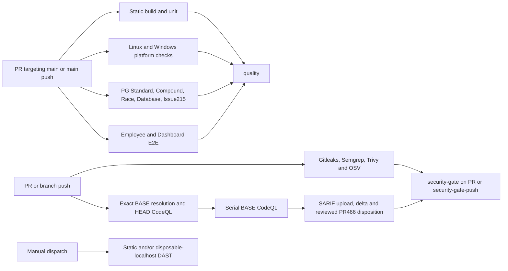
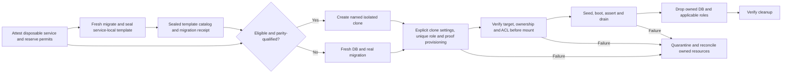
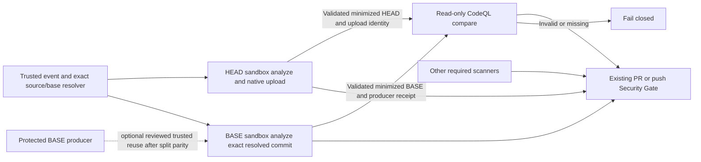
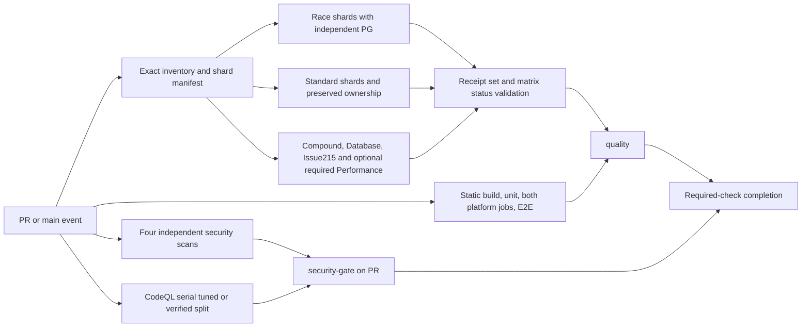
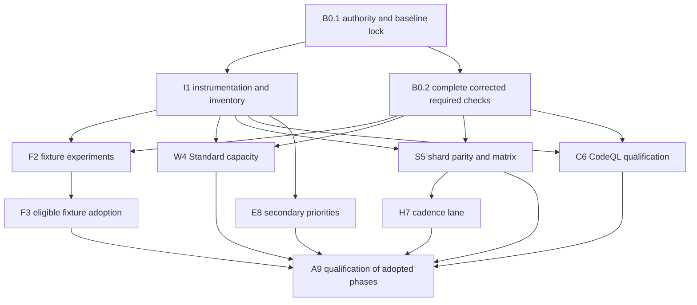
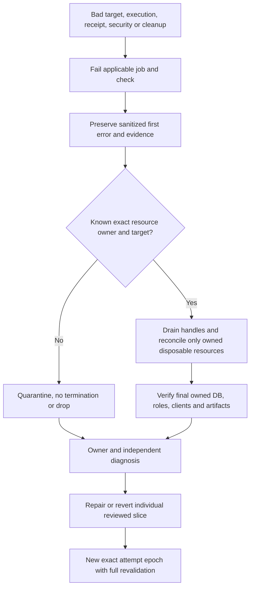

# VAYLET CI performance optimization plan

| Field | Value |
|---|---|
| Version | 1.2 |
| Status | **CONDITIONALLY APPROVED ROADMAP — PHASE 0 ONLY; NO-GO** |
| Date | 2026-11-26, Asia/Amman. COS Phase 0 execution takeover after the v1.1 evidence cut. |
| Tracking | [Issue #467][i467] |
| Audit source / integration tip | `cc507a5b25779e12934a3ead846ceb2c8ddff16b` |
| Initial audit source | `e57c48e9381dd8744bc203bb4e543c425f1ffa7f` |
| Historical comparison | `2413e11590a7f588aae7319ee5baf9fa2f2164b3` |
| Scope | Phase 0 correctness remediation and qualification; later CI performance work remains planning only. |
| Decision | **NO-GO — UNRESOLVED CRITICAL BLOCKERS** for optimization execution. Approve or revise the proposal separately from clearing its phase gates. |

## Executive summary

The latest integrated source retains the 30-minute Race job limit, fresh migration and runtime provisioning per common PostgreSQL fixture, and serial CodeQL HEAD and BASE analyses. The final #466 PR run reached the Race limit again. It reported 269 passing and 12 skipped Race files before cancellation, with zero reported failures in those completed records. The same PR's Standard job passed in 23:31. The subsequent main push passed both PostgreSQL API jobs. Race completed in 23:15 with all 298 files accounted for, including 13 explicit skips, and Standard in 24:03. Main CI still failed its separate database job and took 24:13. The final PR Security CI passed in 14:19 after validating the nine new findings against reviewed, ref-scoped GitHub Code Scanning dispositions for that PR. The result establishes the gate outcome for #466. Main push Security CI failed its raw comparison on those same nine candidates against the previous main revision. Qualification still requires repeatable full PR coverage, a reliable database lane, independent Security correctness for applicable events, and enforcement of both aggregate checks on main. [Final PR CI][pr-ci] · [Final PR Security CI][pr-sec] · [Main CI][main-ci] · [Live ruleset][ruleset]

Prioritize a green reference, then instrument and try a fixture-local subprocess reduction that keeps the actual deploy and provision contracts. Trial deterministic Race shards on separate attested PostgreSQL services and parallel CodeQL analyses independently. Prototype migrated templates only for positively classified fixtures that pass full catalog, role and isolation equivalence. Preserve the real #414 timing in a required lane if moving it demonstrably shortens the critical path. The 8–12-minute objective is a budget to test on official GitHub Actions.


## Phase 0 determination — v1.2 (COS execution)

**Phase 0 NO-GO — B0.1 historical verification complete; B0.2 remains blocked; 0/3 qualifying repetitions.** The owner expressly transferred execution from Codex to COS and authorized separately scoped correctness candidates, isolated tests, independent reviews, reviewed draft PRs, official verification and planning updates. This does not authorize merging, deployment, activation, ruleset changes, extending/dismissing CodeQL dispositions, weakening security gates or starting Phases 1–9. The 8–12 minute objective is unchanged. See the [persistent execution handoff](CI_PERFORMANCE_PHASE0_EXECUTION_HANDOFF.md) for ownership and resume steps.

Prime confirmed with authenticated GitHub issue, PR and Actions job readback and git ls-remote/fetch that source main remains `cc507a5b25779e12934a3ead846ceb2c8ddff16b`; no later main changes were found. PR #466 is closed and merged at this SHA. The documentation ref initially remained `3a54782f1de97c80f1791abe749614579f245c37`. Issue #467 remains open and its v1.0/v1.1 comments were recovered. Main CI and Security failures and final PR cancellation/scoped Security success were independently revalidated. The original local main and prior integration/planning worktrees were preserved.

| Workstream | Current execution status |
|---|---|
| W1 — PostgreSQL 009b cleanup | Isolated correction branch `codex/issue467-w1-009b-nonforce`; candidate and actual PG17 proof pending review. |
| W2 — Staff Push finalization fidelity | Isolated correction branch `fix/issue-467-w2-staff-push-outage`; candidate and actual PG17 proof pending review. |
| W3 — Application CodeQL | Four exact occurrences reviewed: strong source-supported false-positive candidates; no alert or gate change. |
| W4 — Fixture CodeQL | Five exact occurrences reviewed: source-supported false-positive candidates; no test or gate change. |
| W5 — Required-check enforcement | Read-only review complete: live ruleset disabled, branch unprotected, owner restoration prepared; W9 independent cross-review pending. |
| W6/W8 — Independent PostgreSQL review | W6 browser bootstrap failed; replacement W8 active, read-only review in progress. |
| W7/W9 — Independent Security/CI review | W7 browser bootstrap failed; replacement W9 assigned. |

The nine HIGH CodeQL findings remain unresolved for the main push gate. W5 independently observed raw totals 61/52/9/9 in main and final PR official job logs, and the PR-only native reconciliation 9/9/0. Original BASE `bfb4fdccf9d557c371313c9e357faa52e0a71014` must be preserved for remediation evidence; a newer comparison cannot substitute. No previous disposition is extended. A main-push qualification on a corrected SHA necessarily requires a separate owner-authorized integration; the Prime cannot merge. Three comparable full repetitions plus applicable PR and main-push evidence and effective enforcement are mandatory.

W5 reported live owner UI and API readback: ruleset 28117363 Disabled, target `~DEFAULT_BRANCH`, strict `quality` and `security-gate` contexts from GitHub Actions app ID 15368, native CodeQL HIGH-or-higher / Errors, zero bypass actors, PR required with zero approving reviews and deletion/non-fast-forward protection configured. Main reports `protected=false` and the authenticated Branches UI showed no classic rules. Direct branch-protection REST returned 403 for the integration and the effective-rules endpoint was blocked by its connector allowlist; W9 independently obtained the effective-rules API readback with zero applied rules. W5's smallest owner action is to activate the existing ruleset without changing its contents, then re-read and demonstrate failed/missing/cancelled/stale checks prevent merge in an unmerged verification PR. Actual saved enforcement and account billing entitlement have not been tested. No settings write has been performed.

W3/W4 completed the four application and five fixture occurrence reviews, respectively. Their exact committed-byte source hashes, location fingerprints and data-flow findings are recorded in the [handoff ledger](CI_PERFORMANCE_PHASE0_EXECUTION_HANDOFF.md#codeql-occurrence-ledger). SHA-256 operations consume already-verified Argon2id PHC values or canonical protocol frames; fixture SHA-256 operations are independent protocol comparators/golden vectors. These are source-supported false-positive candidates for CWE-916, not owner-approved dispositions. W9 independently recovered both official archives and verified matching sanitized content and the distinct PR-only reconciliation record. Final independent semantic cross-review remains pending. No production source, fixture, alert, policy or security gate change was authorized or made for these findings.

No new correction commit, reviewed candidate, draft PR or qualifying workflow is credited in this checkpoint. The v1.1 determination below remains the historical evidence ledger and original diagnosis; it is not an authorization to repeat the PR-specific exception or begin optimization.

## Phase 0 determination — v1.1

**Phase 0 NO-GO.** The owner accepted v1.0 at `25e83ebae1cd5481ae7f78a7ed261367cae99f46` as the engineering roadmap and authorized B0.1 and B0.2 only. B0.1 verification is complete and found disabled protection. B0.2 remains blocked on separately owned corrections, enforceable checks, and qualification. The 8–12-minute objective remains unchanged. The rest of this document retains the v1.0 performance audit and proposed roadmap. This section supersedes its Phase 0 status.

### B0.1 — Source and live check authority

On November 26, 2026 (Asia/Amman), the authenticated GitHub REST readback and independent review both found remote `main` at `cc507a5b25779e12934a3ead846ceb2c8ddff16b`. No newer main or PR run was returned in the repository’s latest results. Pull request #466’s HEAD matches main, but its PR workflows tested merge snapshot `ccbb2a34e1abef8f19c00a316c3adc4432a972bb`. Both that PR and the main push resolved CodeQL BASE `bfb4fdccf9d557c371313c9e357faa52e0a71014`. No replacement correctness candidate was visible in the open PR listing. [Remote main][branch] · [PR #466][pr466]

| Event and attempt | CI | Security CI | Qualification |
|---|---|---|---|
| Main push, attempt 1 | **Failed**, 24:13. `quality` failed after the database job; Standard and Race passed in 24:03 and 23:15. [Main CI][main-ci] | **Failed**, 14:09. CodeQL and `security-gate-push` failed; Gitleaks, Semgrep, Trivy and OSV passed. [Main Security][main-sec] | 0 qualifying runs |
| #466 PR, attempt 1 | **Cancelled**, 30:48 end-to-end. Race hit its cap, leaving 17 assigned paths unreported. `quality` failed. [PR CI][pr-ci] | **Passed**, 14:19, after the expressly scoped reconciliation for this PR. [PR Security][pr-sec] | 0 qualifying runs |
| #466 feature-branch push, attempt 1 | No matching CI qualification for the push event. | [Passed][pr-push] against its own event BASE, separate from the main comparison. | 0 qualifying runs |
| Earlier candidates | The historical and initial candidates in the evidence index failed or were cancelled. The later `c1deeaab` PR CI was [cancelled](https://github.com/yamanradwan1-rgb/valet-platform/actions/runs/45722163973). An intervening green PR CI on [`2bc6c983`](https://github.com/yamanradwan1-rgb/valet-platform/actions/runs/45696730619) was a different SHA. | `c1deeaab` [PR][prior-sec] and [push][prior-push] failed. [`2bc6c983` PR Security](https://github.com/yamanradwan1-rgb/valet-platform/actions/runs/45696730517) failed. | Historical only |

Neither qualifying reruns nor new test runs were launched in Phase 0. The above ledger and v1.0 evidence index disclose the failed and cancelled audit attempts. Any future qualification ledger must include every attempt initiated or inspected for the selected candidate, including cancellation, skips, timing invalidation and repair-induced SHA changes.

### B0.2 — Database teardown correction package

**Confirmed failure.** The four location configuration cases passed in the main database job. `afterAll` failed at `location-configuration-runtime-role.integration.test.ts:95` with SQLSTATE `42501`, routine `TerminateOtherDBBackends`. The target was the suite database generated under `valet_009b_role_<pid>_<ms>`. At 00:37:29.908 UTC, backend PID 784 issued the expected forbidden runtime update. At 00:37:29.921 UTC, PID 785 issued the forced drop. **785 is the maintenance backend. 784 is a candidate for the remaining connection.** The server logs contain no identity for the termination target. A delayed backend disconnect, or another scoped session, remains possible. Identify the actual backend on a controlled recurrence before attributing it to a particular client. [Main DB log][main-db] · [PR DB pass][pr-db] · [Fixture source][local-drop]

The bootstrap client uses the restricted CI migration/fixture owner. It creates the database, invokes migrations and runtime provisioning, and later owns the drop. Database ownership does not automatically authorize signaling a backend authenticated as a separate runtime role. The runtime client ends in its test's finally block and the admin pool ends before DROP. An awaited client close may finish before PostgreSQL has removed its backend. If FORCE throws, fixture-local role drop and `bootstrap.end()` are skipped. The outer harness reaped one database and two roles. The harness result does not prove fixture-local cleanup succeeded. [Fixture setup and teardown][local-drop] · [Runtime provisioner][runtime] · [PostgreSQL 17 DROP DATABASE](https://www.postgresql.org/docs/17/sql-dropdatabase.html) · [PostgreSQL signal permissions](https://www.postgresql.org/docs/17/functions-admin.html#FUNCTIONS-ADMIN-SIGNAL)

**Minimal independently reviewed proposal for the separate Option C database correctness workstream.** Preserve the actual migrate/provision calls and four ACL cases. Use the existing non-forcing `dropFixtureDatabase` in the location fixture and add the exact `valet_009b_role_<pid>_<ms>` pattern to its allowlist. A namespace match is a guard in addition to the attested endpoint and owned fixture receipt. Track confirmed create ownership, ensure the runtime client, admin pool and both bootstrap lifetimes close on rejection via owned cleanup/finally paths, then drop the database before deleting only the associated owned runtime role. Keep existing bounded `55006` close-wait behavior (two-second retry-loop cutoff, not a server query deadline). A hard cleanup error still fails the job. An uncertain create/drop must go to the owning lease reconciler. No FORCE fallback, extra grants, broad namespace, `42501` retry, assertion changes, or teardown-error swallowing. [Existing helper](https://github.com/yamanradwan1-rgb/valet-platform/blob/cc507a5b25779e12934a3ead846ceb2c8ddff16b/packages/database/src/drop-fixture-database.ts#L4)

**Evidence requested from the correctness owner.** In dedicated PG17 CI with the same restricted identities, capture target-scoped backend PID and category of visible role before/after owned handle close using the existing authority. Omit query text, DSNs and credentials. If restricted observation cannot identify a backend, report that limitation and preserve the failing receipt. Prove normal close, an owned runtime backend closing within the existing window, a persistent backend yielding visible failure and retained ownership, setup failure/unknown outcome, and that unrelated resources survive. Verify the original cases, the full DB lane and final zero owned residue after positive runs. The proposal was sent to the existing Option C correctness workstream. Acceptance and a corrected immutable candidate remain pending.

**Separate Race fidelity finding.** Main Race logged a `42501` on `SELECT pg_terminate_backend(pid)` at 00:51:11.793 UTC. That statement matches the Staff Push finalization outage test’s setup hook, which the worker awaits before any finalization call. Its broad rejection assertion accepts that setup failure. The later durable-lease recovery assertions remain real, while this run did not demonstrate the advertised finalization connectivity failure. This is separate from the database-fixture FORCE failure. Keep it out of the 009b change. The owning Staff Push test workstream should prove the setup hook succeeds under unchanged privileges, cause the outage through an exclusively owned fixture connection lifecycle, and assert the specific finalization failure plus the existing lease recovery. [Race job][main-race] · [Outage setup and assertion](https://github.com/yamanradwan1-rgb/valet-platform/blob/cc507a5b25779e12934a3ead846ceb2c8ddff16b/apps/api/test/staff-push-finalization-outage.integration.test.ts#L100) · [Worker ordering](https://github.com/yamanradwan1-rgb/valet-platform/blob/cc507a5b25779e12934a3ead846ceb2c8ddff16b/apps/api/src/modules/staff-push/staff-push-delivery-worker.ts#L140)

### B0.2 — Main CodeQL resolution path

The main and PR artifacts contain byte-identical `codeql-sanitized.json` payloads (SHA-256 `003be29680384ae3ecee41ab44a79254aafb2359e34ca2db31f0edfe85ba61a2`). Both have 61 results, 52 baseline, nine new and nine blocked, all HIGH `js/insufficient-password-hash`. The PR archive has a distinct disposition report for GitHub alert IDs 50–57 and 61. Main lacks that companion report by design. The raw comparator exits 1, and the reconciliation job step expressly requires PR #466, same-repo PR context and verified scoped native evidence. The same nine findings and BASE reached both workflows. Event eligibility explains the gate divergence. [Main artifact][main-art] · [PR artifact][pr-art] · [Workflow guard](https://github.com/yamanradwan1-rgb/valet-platform/blob/cc507a5b25779e12934a3ead846ceb2c8ddff16b/.github/workflows/security-ci.yml#L334) · [Policy][policy]

**Independent resolution proposal and owner decision.** Route the nine exact rule/path/blob occurrences to the Security correctness owner. Review the four application findings in the VAP1 login/ceremony sources and five fixture findings separately. Trace each input to distinguish raw credentials from an already-processed password representation, protocol commitment or synthetic test value. Produce a pinned occurrence ledger with input provenance, cryptographic contract, source hashes, scope and reviewer. If an actual password-storage or verification defect is substantiated, correct that behavior in a separate reviewed Security change and preserve protocol, auth flow and negative coverage. If evidence instead substantiates false positives, the owner must separately decide the exact durable resolution under the existing reviewed-PR policy, with event/source scope, rule/path fingerprints, accountable owner and expiry. The current push comparator ignores native alert dismissal status. Any separately proposed applicability mechanism would require prior explicit authority and an independent fail-closed design review. This Phase 0 record authorizes no dismissals, suppressions, gate change, policy change or transfer of PR dispositions.

For qualification, require official evidence against the original blocker delta or an independently reviewed equivalent original-base control in the Security workstream, as well as ordinary unmodified PR and main event gates. A subsequent push can change BASE and reclassify these findings as existing. Such green alone says nothing about resolution. Do not replay historical PR-only eligibility.

### B0.1 — Owner-only ruleset restoration instructions

Authenticated readback shows repository ruleset **28117363 Disabled**, targeting `~DEFAULT_BRANCH` with no bypass actors. It declares strict `quality` and `security-gate` checks from integration ID **15368**, plus CodeQL `high_or_higher` / `errors`. It currently requires a PR with zero approving reviews. The effective branch-rules response is empty, and the branch API reports `protected: false` with no classic required contexts. Check-source pinning to the GitHub Actions app does not by itself pin a workflow’s executable revision. [Ruleset][ruleset] · [Effective rules][effective] · [Classic status][branch]

1. After separate explicit authorization, a repository owner/admin with permission to edit rules should open **Settings → Rules → Rulesets → Main — CI and CodeQL protection**. Save the existing configuration and confirm exact default-branch scope, strict up-to-date policy, bypass list and actual GitHub Actions app identity. Keep the existing non-fast-forward/deletion and PR rules. Treat changes to required reviewer counts or workflow source protection as separate decisions.
2. Verify a real PR to main emits the intended `quality` and `security-gate` under the expected GitHub Actions app for the actual evaluated candidate. The `security-gate-push` context is a separate post-merge check. Leave CodeQL **High or higher** and **Errors** intact. GitHub documents branch rulesets as available on public GitHub Free repositories, but Evaluate mode and optional protection features may have separate entitlement constraints. Confirm the current plan and that the saved native CodeQL rule is supported in the owner UI. If a capability is unavailable, record the UI/API error and stop for an explicit owner decision on a supported, equivalent enforcement path. Do not silently remove native protection.
3. With explicit authorization, set **Enforcement → Active** and save the existing ruleset. Re-fetch the exact ruleset, effective rules for main, and check-source metadata. Use a verification PR without merging. Confirm the merge UI blocks missing/cancelled/failing intended checks, that strict freshness works and no unapproved bypass applies. Confirm a fully verified candidate satisfies checks when appropriate. Native CodeQL line/diff coverage is complementary to the VAYLET raw-delta gate. Preserve the independent push qualification. [GitHub rules availability](https://docs.github.com/en/repositories/configuring-branches-and-merges-in-your-repository/managing-rulesets/available-rules-for-rulesets) · [GitHub ruleset setup](https://docs.github.com/en/repositories/configuring-branches-and-merges-in-your-repository/managing-rulesets/creating-rulesets-for-a-repository) · [Code scanning merge protection](https://docs.github.com/en/code-security/concepts/code-scanning/merge-protection)

### Qualification and independent verdict

Main Race reconciled **298 unique files**, 285 pass and 13 explicit skips, with no missing or duplicate records, 1,630 passing cases, and 68 skipped cases. That is an inventory reconciliation. The Staff Push finding above limits proof of substantive coverage. Its cleanup summary means the harness handled one recorded database, one role and no live children, then verified the planned database/role were absent. This is scoped to the cleanup plan. Main Standard handled one role and no databases or live children. PR Race lacks a normal harness cleanup receipt despite service removal. Neither CI run listed artifacts for independently exhaustive cluster-wide resource accounting. [Main Race][main-race] · [Main Standard][main-standard] · [PR Race][pr-race] · [Owned cleanup implementation](https://github.com/yamanradwan1-rgb/valet-platform/blob/cc507a5b25779e12934a3ead846ceb2c8ddff16b/scripts/test-harness/owned-cleanup.mjs#L118)

Independent PostgreSQL review supports the proposed 009b correction design and explicitly withholds attribution of the remaining backend. Independent Security review confirms equal reports and the event boundary and supports the owner-only enforcement handoff. Independent baseline review confirms the two terminal main failures and the Race inventory/cleanup limits. No compensating configuration, runtime change, workflow trigger or privilege was applied.

**B0.2 exit requires three comparable successful baseline repetitions minimum.** Start after independently reviewed fixes are integrated by their owners and enforcement is effective. Pin the corrected immutable candidate, test checkout, workflow versions, comparison BASE, runner and cache condition. Demand complete CI and Security CI success, equivalent applicable PR and main-push verification, no bypass, exact Race membership and explicit skip reasons, verified tested behavior in the Staff Push outage path, and owned cleanup receipts. Record every failed or cancelled attempt and its effect on comparability. Source changes invalidate the prior candidate’s success count. Report push and PR event evidence separately. Current count **0/3**. **Phase 0 NO-GO. Phases 1–9 remain outside the authorized scope.**


## Repository facts discovered

### Baseline Revalidation and Changes Since Initial Audit

- Before and after fetching only the three named remote refs, the original checkout was on local `main` at `eba55b76916a6892059e45622252b87483f4cb1e`, with two pre-existing untracked runbook/handoff files. Its index and working files were left in place. The earlier isolated planning checkout at `D:/v467-ci-plan` was empty of plan edits and based on `bfb4fdccf9d557c371313c9e357faa52e0a71014`. This document is the only edit in the new isolated checkout at `D:/v467-plan`. The repository uses `docs/plans/` for master plans.
- During the first audit, `main` was `bfb4fdccf9d557c371313c9e357faa52e0a71014` and draft [PR #466][pr466] was at `e57c48e9381dd8744bc203bb4e543c425f1ffa7f`. The local integration branch is `integration/option-c-final-security-closure-20261116` in `tmp/option-c-final-closure-20261116`. On resumption its HEAD matched the remote #466 branch and remote `main` at `cc507a5b25779e12934a3ead846ceb2c8ddff16b`. The older `tmp/pr466-ci-*` worktrees were separately registered at `d2391474a1e548eaef86327e046068ec44b184c2` in the worktree inventory. No local-only fixes are credited here. The fresh open-PR listing contained neither #466 nor #464. #466 is the integrated Option C line. #464 is a separate Issue #416 v9 attempt and runs on its SHA are unrelated qualification evidence. [#466][pr466] · [#464][pr464] · [integrated commit][source] · [local-to-remote comparison][delta]
- The 31 intervening commits were enumerated and reviewed by subsystem. `4c48bb37`, `de4a7f6a`, `ebc76b5b`, `2b27567f`, `ec7e34fd`, `422c338b`, `21b315a5`, `ab8365a5`, `1b513987`, `7a061129`, `7196c3b6`, `3b2bb6a4`, `c49081fe`, `3787a84f`, `fc24eeb5`, `2ccf2909`, `a25d7809`, `c4f15968`, `2948722d`, `32db4de4` and `2524be7b` changed test identity, causal locks, transaction fencing, process cleanup or fixtures. `7acb9480` is an existing production alert lock-order change owned by #466, outside #467. `2bc6c983` separated MFA fixture aging from browser refresh. `adcba654`, `afb4176b`, `284cb52b`, `d60bf83c`, `37f2df31`, `c1deeaab`, `fa1931fa` and `cc507a5b` introduced and hardened the native CodeQL reconciliation and separate push check. `ci.yml` stayed at Git blob `8a1f6a8a7e29d26cc1442ac5888ec659fb997a04`. `security-ci.yml` changed from `115cb628340488cc37fd83905f67879ce0ed448d` to `2f282a24a0cfc0f5eaf694d064dca3d9611bf424`. Database-package fixtures, migration/provisioning code, resource budgets and the underlying API classifier were unchanged across this delta. An ownership assertion changed for new tests. The manual audit workflow received no change in this delta. Its recent remote dispatches have separate refs and outcomes and do not establish a required-check baseline. [Intervening commits and diff][delta] · [CI workflow][ci] · [Security workflow][sec]
- Issue #467's full description and all comments were checked. It had no comments during revalidation. The historical logs, the earlier #466 PR pair, the final #466 PR pair and main push were evaluated separately. A branch-push baseline can differ from the PR BASE, even at identical HEAD. GitHub's PR run metadata carries HEAD SHA while checkout can execute the synthetic merge commit. Persist both identities. For the historical run the checked-out merge SHA was `fe5c485e6324ccadb2183878402578d7dfa68988`. For the initial audit it was `cb92ccd1cd9a3b7cf8c12183356ad8a6dfa276ca`. [Issue][i467] · [Historical security log][hist-codeql] · [Initial security run][old-sec]
- **Live enforcement gap.** Public branch inspection reports `protected: false` and no active classic required checks. The named ruleset 28117363 was updated at 03:34:46 Asia/Amman and is present with enforcement disabled, strict required contexts `quality` and `security-gate`, GitHub Actions integration 15368 and native Code Scanning rules high-or-higher/errors. The applied-rules endpoint reports no effective rules. The policy expects both gate checks. Capture authorized settings and validate actual enforcement before optimization promotion. This task changes no GitHub settings. [Branch response][branch] · [Effective rules][effective] · [Ruleset][ruleset] · [Security policy][policy]
- **Clean baseline availability.** The initial #466 pair never became green. The final PR has a green security result and a cancelled CI run. The main integration push has a database failure and a failed Security CI with the raw CodeQL gate blocking nine findings. The PR-only native disposition was absent by design. An older green main pair at `a9c1c06c6632ac9d8f61a7fc8f8f0e87ba207bca` and the #413 CI reference are useful anchors from different revisions. They cannot qualify optimization on current source. [Older green CI][older-ci] · [Older green Security CI][older-sec] · [#413 reference][legacy-ci]

### Evidence index and interpretation

| Key | Immutable evidence | Use |
|---|---|---|
| H | [CI 45662309080][hist-ci], [Security CI 45662309098][hist-sec] | Historical #466 PR. Race cancelled, Standard and CodeQL failed. |
| I | [CI 45669493775][old-ci], [Security CI 45669493764][old-sec], [branch Security CI 45669481576][old-push] | Initial audit of `e57c48e`. Standard passed, Race cancelled, PR CodeQL blocked nine. Feature push BASE was `2413e115...`; it counted 61 existing, zero new. |
| P | [CI 45725392883][pr-ci], [Security CI 45725392928][pr-sec], [feature push Security CI 45725388141][pr-push] | Final #466 PR and separate feature push. Exact job timestamps from Actions attempt 1. |
| M | [CI 45729785587][main-ci], [Security CI 45729785582][main-sec] | Same HEAD on main push. The final PR and main push resolved the same BASE, but used different event scope and checkout. Both main workflows failed. |
| S | [Immutable source tree][source], [source compare][delta], [workflow][ci], [security workflow][sec] | Static source verification, independent of successful execution. |
| A | [PR Security artifact inventory][arts], [historical artifact inventory][hist-arts], [initial CodeQL artifact 15048699187][old-art] | Sanitized 7-day reports. Logs and API timestamps carry timing. Earlier CI files had no Actions test timing artifacts. Archive minimally, with run and attempt, before expiry. |
| D | [PG17 CREATE DATABASE][pg-create], [PG17 statistics visibility][pg-stat], [PG17 roles][pg-role], [GitHub workflow semantics][gh-workflows], [hosted runner specs][gh-runners], [CodeQL CLI options][codeql-cli] | Vendor contracts. Repository behavior requires replay evidence. |

Labels used below are **CI observed**, **source verified**, **derived**, **hypothesis** and **proposed**. A reported check or assertion has the coverage of that attempt. The timing appendix is a censored observation wherever the job did not complete. Time comparisons have no causal attribution without an equivalent A/B pair.

### Complete automated job inventory and timings

Durations below are job-start to job-complete from the GitHub Actions Jobs API, rounded to seconds. Values in parentheses are the primary step or stages. Startup offsets are measured from event/run creation, so they include dispatch and scheduling. A UI duration, runner log span and API timing can differ by several seconds.

| Job / runner / timeout | H (seconds) | I (seconds) | P (seconds) | M (seconds) | P primary step and status |
|---|---:|---:|---:|---:|---|
| static-build / Ubuntu / 20m | 144 | 173 | 244 | 221 | Lint 71, structure 3, typecheck 59, build proof 2, build 80. Pass. |
| unit / Ubuntu / 20m | 263 | 224 | 268 | 174 | Harness 8, Chromium 10, non-PG tests 228. Pass. |
| platform-ubuntu-latest / Ubuntu / 20m | 43 | 32 | 32 | 40 | Checkout and setup 17, install 4, checks 6. Pass. |
| platform-windows-latest / Windows / 20m | 62 | 70 | 91 | 100 | Checkout and setup 54, install 14, checks 18. Pass. |
| postgres-api-standard / Ubuntu / 45m | 1137 | 1750 | 1411 | 1443 | Containers 13, install 7, bounded project 1375. Pass. |
| postgres-api-compound / Ubuntu / 20m | 228 | 308 | 225 | 350 | Containers 12, install 3, bounded project 190. Pass. |
| postgres-api-race / Ubuntu / 30m | 1816 | 1816 | 1816 | 1395 | Containers 12, install 6, bounded project 1779. Cancelled. |
| postgres-database / Ubuntu / 30m | 266 | 339 | 192 | 228 | Containers 11, install 5, bounded database sequence 142. Pass on P, failed on M. |
| postgres-issue215 / Ubuntu / 20m | 173 | 195 | 181 | 165 | Containers 10, build 15, private S3 startup 8, protected tests 123, teardown. Pass. |
| employee-e2e / Ubuntu / 20m | 247 | 299 | 291 | 290 | Containers 10, migrations 5, writer provision/cutover 9, contract/API build 14, Chromium 10, server starts 30, Valet 68, Dashboard 111. Pass. |
| quality / Ubuntu / 5m | 2 | 4 | 2 | 3 | Aggregate matrix and required jobs. All four attempts failed. |
| secrets-gitleaks / Ubuntu 24.04 / 20m | 17 | 27 | 14 | 24 | Checkout 5, redacted scan 5, report upload 1. Pass. |
| sast-semgrep / Ubuntu 24.04 / 30m | 40 | 38 | 48 | 37 | Checkout 9, install 13, scan 18, upload 2. Pass. |
| dependencies-trivy / Ubuntu 24.04 / 35m | 35 | 40 | 39 | 37 | Checkout 7, HEAD image/scan 22, BASE scan 2, upload 2. Pass. |
| dependencies-osv / Ubuntu 24.04 / 35m | 38 | 37 | 36 | 29 | Checkout 13, HEAD 11, BASE 2, upload 2. Pass. |
| sast-codeql / Ubuntu 24.04 / 90m | 1044 | 763 | 835 | 822 | Checkout 6, bundle setup 13, serial scan 781, SARIF upload 8, compare/native verification 19, artifact 1. Pass on P only. |
| security-gate / Ubuntu 24.04 / 5m | 20 | 16 | 19 | 20 | Checkout 9, contract tests 3, then aggregate scanner status. Pass on P only. |

CI triggers on PRs targeting main and pushes to main. It uses workflow/ref concurrency with cancellation, separate OS and five-lane PostgreSQL matrices with `fail-fast: false` and no YAML `max-parallel` cap, one PostgreSQL service per matrix cell and another for E2E. `quality` depends on all five job IDs and rejects any non-success result. Security CI triggers for PRs and branch pushes, has independent workflow/ref cancellation, five parallel scanner jobs, and an always-evaluated gate with different PR and push names. The manual audit is dispatch-only with independently selected static/DAST jobs, Ubuntu 24.04, 40/55m caps, cancellation off, and seven-day artifacts. Static runs Semgrep, Trivy, Gitleaks, OSV and pnpm audit. DAST is scoped to disposable localhost and is outside the required-check path. This audit did not invoke it. [CI workflow][ci] · [Security CI][sec] · [Manual workflow][manual]



**Critical path.** In P, all ordinary CI jobs started about +27s. Race finished at +1843s and the quality gate at +1847s (30:47). That is a failed required-check latency measurement with a censored Race duration. Standard's project step was 22:55. Security started about +3s, CodeQL ended at +838s and its gate ended at +859s (14:19). In H, CI reached quality at +1844s (30:44), Security at +1104s (18:24), including roughly 24s and 37–38s initial dispatch respectively. In I, the corresponding endpoints were about 30:25 and 13:06. M parallel startup offset was about 2–3s. Standard was the critical path at 24:03 (bounded API step 23:25). Race passed at 23:15 (bounded API step 22:33). Quality failed after Standard, due to Database, with 24:13 total CI run elapsed. M CodeQL API job 13:42, internal log span 13:40.52 and serial shell 13:09. The push Security run failed in 14:09 from creation to completion. On a PR the target is from event creation to the later of the two required gate completions, with queue included. Independently report push aggregate timing by name; push results do not satisfy the PR rule. No totals in the job table may be added to infer latency. [Historical attempt][hist-ci] · [Initial attempt][old-ci] · [Final PR attempt][pr-ci] · [Security timing][pr-sec]

**Runner consumption.** Summing individual API job elapsed times gives roughly 79.2 runner-minutes CI + 16.5 Security in P, 73.0 + 19.7 in H 86.8 + 15.4 in I, and 73.5 + 16.2 in M. These are elapsed job allocations including cancellations. Exact billed usage is unavailable. Public standard GitHub-hosted runners are documented as free for public repositories, subject to runner availability and continued plan/repo eligibility. Price paid runners separately and include scheduler capacity, workflow duplication and any retained storage. As a planning comparison, 100 billed standard Linux x64 minutes at the published private-runner rate of $0.006/min would be $0.60 before allowances or storage. For an eligible organization, an eight-minute Linux x64 8-core larger-runner job would cost about $0.176 at $0.022/min, before usage credits. This repo’s current public standard jobs are not charged at those rates. Use organization billing exports rather than quoting that example as a charge. [GitHub runners][gh-runners] · [Pricing][gh-price]


## Binding requirements

The existing CI paths are verification clients of the ValetSession, Task/Dispatch, identity, tenant/location, Guest, photo and Option C protected mutation contracts. This plan introduces no product entities, state transitions, persistence schema, indexes, runtime policy or Company/Location override. All proposed writes concern disposable test resources, isolated workflow artifacts or timing records. Authority-before-mutation, append-only audit, runtime/Writer separation, real migrations where required, and transaction semantics remain the controlling contracts. This task changes only this plan. [Repository authority][agents] · [Security rules][security-rules] · [Structure ceiling][structure] · [Collaboration][collab]

Maintain all approved tests and relevant security queries, suites and scan scopes. Preserve file/case ownership and explicit existing target-based skips with reasons. A missing result, unexpected skip, unhandled rejection, infrastructure fail, coverage shortfall, malformed report or conclusion other than success fails its applicable gate. No blind retries or deadline inflation. No permission elevation, default PostgreSQL access, schema-sharing shortcut, cross-trust acceptance, newly added suppression, or production behavior change.

## Existing implementation patterns

### PostgreSQL fixture lifecycle and costs

The wrapper starts an owned invocation, runs attestation before leasing and destructive cleanup, and starts Vitest per project. The global hook admits the configured worker profile against live connection settings, obtains a cluster lease, performs owned stale recovery and exports an ownership snapshot. Pool/setup hooks reserve capacity, check endpoint and principals, intercept create/drop and register the resource lifecycle. Database projects run sequentially through the wrapper. Cleanup revalidates scope, refuses protected/job-owned identities, and should leave no owned disposable objects or live backends. [Invocation wrapper][pg-runner] · [Global setup][pg-global] · [Ownership][pg-own] · [Owned cleanup][pg-cleanup] · [Pool cap][pg-pool]

```mermaid
flowchart LR
  A[Verify target, CI job and service] --> B[Invocation and cluster leases]
  B --> C[Budget admission and stale-owned recovery]
  C --> D[Create disposable DB]
  D --> M[Fresh Prisma migrate deploy]
  M --> P[Runtime and applicable Writer provisioning]
  P --> S[Seed and boot fixture clients or app]
  S --> T[Real test and assertions]
  T --> X[Drain, close, drop DB then owned roles]
  X --> V[Verify inventory and release leases]
```



The common fixture wraps database creation, migrations, runtime provisioning, and teardown as four spans. The migration wrapper retains environment/TLS/target semantics and delegates through pnpm to Prisma. Runtime provisioning handles DB/schema/object ACLs, roles and membership reset, audit and writer restrictions, and owner verification before commit. In addition, mounted protected staff may reprovision or open additional Auth/MFA identities. Management Writer is job-owned when attested CI provisioning explicitly created it. Closing a database must release registered clients and drain in-flight work before dropping a database and then eligible roles. [Shift context][shift] · [Prisma wrapper][migrate] · [Runtime role provisioner][runtime] · [Mounted Writer helper][mounted-writer] · [CI-owned Management Writer][management-writer]

| Stage | H Standard, 197 complete | P Standard, 195 complete | P Race, partial, sum across workers |
|---|---:|---:|---:|
| CREATE DATABASE | 9.429s | 11.310s; p50 52ms, p95 96ms | 7.075s / 115 |
| Migration command total | 584.022s | 703.329s; p50 3471ms, p95 4380ms | 474.376s / 115 |
| Runtime provision command total | 236.032s | 311.899s; p50 1598ms, p95 1628ms | 274.857s / 114 |
| Teardown wrapper total | 6.920s | 7.664s; p50 33ms, p95 67ms | 24.122s / 115 |
| Total | 836.403s | 1034.201s | 780.430s across observed spans |
| Share of Vitest invocation | 76.0% of 1101.01s | 75.3% of 1372.54s | Parallel and cancelled, no valid wall-time share |

These buckets do not separate process spawn, pnpm resolution, Prisma initialization, migration SQL, role creation versus grants/default ACL, direct Writer/S04 provisioning, seeding, app boot, query work, or connection drain versus DROP. Throwing stages may lack timing output. Phase 1 must add monotonic child-entry, connection-ready, transaction/work and process-exit boundaries with fixture mode and outcome. Fixed owner and Management Writer bootstrap is about 0–1s per job, distinct from per-fixture work. E2E's five-second migrate and seven-second runtime/Writer provision, plus two-second cutover, are separately measured steps on a different fixture. [Historical Standard][hist-standard] · [Final PR Standard][pr-standard] · [Final PR Race][pr-race] · [Main jobs][main-ci]

M Standard completed the same 209-file ownership set (207 pass, two skips) in 1,403.17s Vitest. Across 195 full cycles, create/migrate/provision/teardown took 9.118s / 705.634s / 329.348s / 6.506s, for 1050.606s (74.9% of Vitest). Approximate per-stage median values were 45/3608/1686/30ms. M Race completed all 298 assigned paths in 1,351.25s Vitest, with 123 full tagged cycles and one teardown-only trace. Stage totals were 4.770s / 353.381s / 211.329s / 8.954s, totaling 578.434s across workers. These anchors differ from P's PR checkout and share no causal A/B identity. [Main Standard][main-standard] · [Main Race][main-race]

Other paths include database Direct with lean scratch clients, Provision with real Prisma and role checks, dedicated Issue215 database ownership plus protected API and private object-store boot, Issue309 photo/browser, private Issue319 and Issue333/W4, private Issue429 OCR, Issue414 HTTP preflight and employee E2E Option C cutover. API standard/compound/Race access through several context adapters that call the same Shift fixture, plus standalone fixtures and direct connections. Audit lifecycle at the owning helper, not just filename. Defaults, migration-prefix/upgrade and negative role cases stay fresh. [API project routing][api-vite] · [Database routing][db-vite] · [Classifier][classifier] · [Issue215 ownership][pg-215] · [Issue414 target][pg-414]

### Resource admission and ownership

| Profile | Configured workers | Envelope per worker | Nominal admitted / available headroom at max 100 |
|---|---:|---:|---:|
| Standard and Compound | 1 | 36 = 24 pooled + 2 direct + 10 subprocess reserve | 36 / 41 |
| Race | 2 | 38 = 24 pooled + 4 direct + 10 subprocess reserve | 76 / 1 |
| Issue215 API | 1 | 50 = 36 + 4 + 10 | 50 / 27 |
| Issue309 photo browser | 1 | 48 = 24 + 4 + 20 | 48 / 29 |
| Database direct | 2 | 11 = 8 + 3 + 0 | 22 / 55 |
| Database provision and database Issue215 | 2 | 21 = 8 + 3 + 10 | 42 / 35 |
| Private OCR | 1 | 12 = 1 + 6 + 5 | 12 / 65 at these nominal settings |

Admission is `workers * envelope <= max_connections - reserved_connections - superuser_reserved_connections - 20`. On observed PG 17.12, there were 100 max, three reserved and 20 non-test allowance. Two Standard workers leave five nominal slots. A third Race worker would reserve 114 and fail admission. Standard has up to six pools with cap four, Race up to six with per-pool cap six and tighter aggregate pool reservation 24. Browser has two subprocess reserves, common API/project provisioning paths one. These are reserves. Actual peak connections, CPU, memory and acquisition wait telemetry are unavailable. GitHub documents standard public Ubuntu runners as 4 vCPU / 16 GB RAM / 14 GB SSD. Capture actual image/build, CPU quota/memory and disk in each benchmark. [Resource profiles][pg-budget] · [Global setup][pg-global] · [Runner specs][gh-runners]

Logged reference environment includes hosted agent 2.338.2, Ubuntu image generation 20261116.202.1 for P Standard, Node 22.23.5, pnpm 10.34.5, Vitest 4.1.10 and PostgreSQL 17.12 from the moving postgres:17-alpine tag. Compare actual digests and image revisions across repetitions.

Current configured lanes include 209 Standard, 298 Race, 28 Compound, 12 Issue215 API, one Issue309 browser, and private Issue319/333/W4 of 20/15/2. DB non-PG/Direct/Provision/Issue215 own 8/43/46/8. API non-PG owns 301 paths (290 Vitest under test, three source-adjacent Vitest, eight native Node). Main official output has 293 Vitest API files (291 passed, two skipped), with native Node files run separately. Keep classifier-owned paths distinct from per-run status, per-case counts and any additional runner-owned files. Guest photo browser and private target projects have independent contracts and are outside the general CI matrices. The plan preserves those entry points and gates. The previous candidate owned 210 Standard and 297 Race. The latest moved the zone-recovery fixture to Race and added two non-PG tests. [API classifier][classifier] · [Main unit log][main-unit] · [Database PR log][pr-db]

### Security scanning and comparison

Gitleaks checks the verified Git range and blocks secrets with redacted output. Semgrep uses approved registry policies on changed supported paths, explicitly accounts for an eligible zero-change case, fails parser errors or empty unverified coverage, and can recover empty incremental coverage through full HEAD/BASE scans. Trivy uses identical image/cache within the comparison and checks both lockfile extraction manifests. OSV compares package/advisory and versions, failing new high/critical or unrated. Their baseline is event-derived and validated against Git ancestry. The required current resolver fails on an unresolved comparison. Policy prose describes a fallback that this workflow does not implement, and its Semgrep path list lacks the current workflow’s additional .github scope. Preserve executable fail-closed behavior and refer prose drift to its owner. Preserve event-specific handling, confidence/coverage checks, alert and severity escalation rules, and artifact sanitization. The PR Security Gate joins all five scanners, with tests run before its exact-result check. [Security workflow][sec] · [Baseline resolver][sec-base] · [Security policy][policy]

CodeQL resolves and checks out exact BASE, uses pinned setup/upload actions, then builds JS/TS HEAD and BASE using whole committed checkout roots and runs `codeql/javascript-queries:codeql-suites/javascript-security-extended.qls` with two threads and 4096 MiB. Observed bundle 2.27.6 and JavaScript query pack 2.5.2 loaded 105 queries on each side. Preserve source extraction inputs and the current raw comparison's findings, multiplicity, fingerprints, severity mapping and completeness, including analysis/format failures. Native HEAD upload is limited to same-repo PRs/pushes and uses wait-for-processing, category `/language:javascript-typescript`. Fork PRs follow the applicable upload and raw gate policy. The approved PR466 branch of the gate checks a valid raw findings failure, same-repo PR number, exact candidate/reference source, ref-scoped native dismissal and evidence age/actor. The first green attempt preserved raw 61 total / 52 existing / 9 new / 9 blocked, then validated nine false-positive dispositions and left zero unresolved. It did not remove those findings from the raw comparator. The main push did not inherit #466's exceptional case. Its CodeQL finished/uploaded and the comparator then returned 61 total / 52 existing / 9 new / 9 blocked. The main push Security run failed in 14:09. The source lock applies to #466 only. [Main CodeQL][main-codeql] · [Main gate][main-secg] · [Main report][main-art] [CodeQL workflow][codeql-wf] · [Raw comparator][codeql-gate] · [Native verification][native] · [PR CodeQL log][pr-codeql] · [Case evidence artifact][pr-art]

| CodeQL stage, log seconds | H | I | P |
|---|---:|---:|---:|
| Entire serial shell | 1012.1 | 730.7 | 780.7 |
| HEAD create (extraction + finalization) | 123.5 (92.4 + 31.2) | 81.9 (61.0 + 20.9) | 96.1 (68.8 + 27.2) |
| HEAD analyze (queries) | 392.0 (384.0) | 295.2 (288.7) | 305.0 (297.2) |
| BASE create (extraction + finalization) | 117.2 (87.3 + 29.9) | 79.0 (58.6 + 20.5) | 96.5 (66.4 + 30.0) |
| BASE analyze (queries) | 378.8 (371.5) | 274.0 (268.0) | 282.7 (275.3) |
| Setup action / upload | 10.6 / 8.3 | 11.3 / 7.8 | 13.2 / 7.7 |
| Raw compare / native validation | 0.27 / absent | 0.17 / absent | 0.19 / 18.56 |
| Sanitized artifact upload | about 1 | about 1 | about 1 |

H and I used identical workflow code and BASE. The large difference even in BASE execution is direct evidence that one time difference cannot establish causality. In P the actual checkout was `ccbb2a34e1abef8f19c00a316c3adc4432a972bb` with BASE `bfb4fdccf9d557c371313c9e357faa52e0a71014`. P feature push and main push are separate observations. The `c1deeaab` PR Security run failed native validation; its push failed source-lock history resolution. `fa1931fa` restored full history for that test and `cc507a5b` uses effective scoped dismissal readback. P job logs and the pinned report verify the narrower corrected outcome. [Prior PR Security][prior-sec] · [Prior push Security][prior-push] · [Final PR log][pr-codeql] · [Policy and report contract][policy]


## LOCKED decisions

| ID | Proposition | Classification and falsification |
|---|---|---|
| L1 | Continue actual migrations and provisioning where the test asserts installation, upgrade, ownership, grants, proof handling or compatibility. | LOCKED by #467. The database Provision and E2E entry points exercise those paths. A replacement path that starts after migration cannot support the proposition. [Issue][i467] · [Database projects][db-vite] |
| L2 | The existing trust, resource, race, privacy and branch-check requirements remain controlling. | LOCKED by project authority and #467. Workflow skip examples, setup hooks and the disabled live ruleset are accounted for as exceptions/evidence gaps, rather than permissions to relax checks. [Authority][agents] · [Policy][policy] · [Live ruleset][ruleset] |
| L3 | Preserve real time and concurrency for tests that prove database clocks, lease recovery or ordered commits. | LOCKED by #467 and current assertions. The #414 two-wave and control-stall paths falsify treating all sleeps as removable harness overhead. [Issue414 performance][issue414] · [Control stall][stall] |
| L4 | Instrumentation and orchestration may write only to owned CI resources. Production and existing remediation remain outside this task. | LOCKED by #467 and target contracts. Existing workflows and hooks route protected jobs to explicit disposable services. [Issue][i467] · [Ownership][pg-own] |

## DERIVED conclusions

| ID | Proposition | Classification and falsification |
|---|---|---|
| D1 | Race limits H/I/P. The latest complete main push shifts the critical path to Standard. | DERIVED from the final P jobs. A later normal clean elapsed time could change the prospective critical path. P Race and M Standard gate timestamps support the change in limiting lane. [P CI][pr-ci] |
| D2 | An approach that eliminates only the measured Standard migration bucket would still leave 669.21s of the observed P Vitest invocation before real replacement costs, runner setup and queue. | DERIVED subtraction from matched instrumentation scope; excludes gains that could be obtained from worker distribution and assumes the remainder stays constant. [P Standard][pr-standard] |
| D3 | Two Standard workers are eligible by connection arithmetic. Three Race workers on one current service are outside its capacity model. | DERIVED from the live maximum and profile envelopes. CPU/peak evidence is needed to qualify eligible concurrency. [Budget source][pg-budget] · [P Race][pr-race] |
| D4 | Removing serial BASE from the P CodeQL critical path leaves more than 6m40s of measured HEAD extraction/query work before setup and gate. | DERIVED from the phase timings. It cannot substitute for a measured split or tuned run. [P CodeQL][pr-codeql] |
| D5 | Security success for #466 does not cover future PRs or every push. | DERIVED from the PR-number and source/BASE checks. Check the main event's different eligibility despite the same BASE and the closed PR state. [Native verification][native] · [Main Security][main-sec] |

Falsification checks above cover nine named propositions across four locked and five derived entries, at source/official evidence level.

## UNRESOLVED decisions

| ID | Blocking choice or evidence | Owner and resolution |
|---|---|---|
| U1 | Same SHA green quality and PR security under active rules, with complete repeatable Race, stable DB cleanup and applicable PR and main Security qualification. | Repository owner and #466/#416 maintainer. Qualify Phase 0 against actual check enforcement. |
| U2 | Can an eligible clone fixture preserve job-scoped Management Writer behavior and deny other fixture identities without changing product provisioning? | DB/security reviewers. Prove within the binding current contract or reject B1 for the affected pools. |
| U3 | How many Race/Standard shards and Standard workers meet inventory, resources, repeatability, cost and queue objectives? | CI owner with independently measured comparable runs. |
| U4 | Can a complete minimized CodeQL interchange preserve approved semantics, native identities, and report privacy? | Security owner approves data format and trust boundary with parity evidence before a workflow split. Use serial tuning as default until cleared. |
| U5 | Is BASE reuse worth a trusted publisher and retention/security overhead once E3 and E1 are measured? | Security/platform owners decide after demonstrated value and proven active protections. |
| U6 | Is #414 lane separation required after sharding, and can production-like resource behavior and event coverage be maintained? | Issue #414/CI owners, with chrono evidence and reliable gate. |
| U7 | Actual account queue concurrency, budget for runner-minute growth, and observed capacity. | CI owner supplies billing/usage and chooses cost/latency guardrail before change selection. |

## Findings and reconciliation register

The statuses apply to the stated proposition, with current source `cc507a5b` unless an earlier commit is specified. “Resolved” for a reported historical failure is scoped to equivalent suites observed passing, not a completed Race gate. “Partially resolved” preserves cases that were censored or have remaining observation gaps. Seconds in Race rows are file elapsed, overlapping with the other worker. See [historical Race][hist-race], [final PR Race][pr-race] and [main Race][main-race] for underlying records.

| ID | Previous issue / present finding | Revalidation status and evidence | Disposition and verification |
|---|---|---|---|
| F01 | Race cancelled near 30m | **CHANGED**. H 243 timed results (61 failed) plus 11 skips, I 208 timed (34 failed) plus 11 skips, P 269 timed passes plus 12 skips and 17 assigned paths absent. M passes all assigned coverage at 285 pass / 13 skips / 298 total, with 1,630 cases passed and 68 skipped. Both P and passing M have 3 lock timeout and 2 idle termination messages versus 74/11 in H. | Requalify on comparable complete runs, inventory intentional skips and link timeout messages to cases before attributing defects. [M Race][main-race] |
| F02 | Common fixture repeated migration/provision | **CONFIRMED**. Same helper after I. 195 tagged cycles consume 1034.20s in P and 1050.61s in M Standard versus 836.40s H. | Split timing, prove B2 first, gate B1 with isolation checks. |
| F03 | Standard 18:54 failing | **CHANGED**. M Standard 24:03 and P Standard 23:31 pass, I 29:10 passes. Earlier `c1deeaab` 18:56 passes, showing high variation. | Repeat fixed source and cache conditions. No trend from mixed source/event samples. [Earlier Standard][prior-standard] |
| F04 | Standard 1 worker / Race 2 | **CONFIRMED** with latest logs and unchanged envelope. Real peaks **unverified**. | Standard 2 only under P4; independently isolated Race shards. |
| F05 | Count-based Staff Management lock witness failures | **RESOLVED for reported suite failures** by `ebc76b5b`, `2b27567f`, and P suite passes. LM, Incident, Task, Shift 53.080/73.776/72.512/69.417s → 15.859/14.305/14.571/16.622s. Custody and deactivation/refresh also pass. New observer scopes database/backend and walks causal blocker tree. | Re-run all assertions on full Race. Prove unrelated blockers fail witness and errors drain without secondary fallout. [Observer][race-observer] · [Task race][race-task] · [Incident race][race-incident] · [LM race][race-lm] · [Shift race][race-shift] |
| F06 | Shift Presence role-masked/global witness failures | **PARTIALLY RESOLVED**. Foundation/authority/read/current 44.129/80.704/56.601/36.238s fail → 7.376/10.019/7.776/7.536s pass. `ec7e34fd`, `422c338b`, `fc24eeb5`, `2948722d` moved to role-correct observations, admission and drain. Several paths unreported in P later passed in M, including the session and read HTTP races. Seventeen exact optional-holder call sites still accept any blocker in the scoped runtime role. | Separate proof-strength backlog with an unrelated-waiter negative and exact holder where available. No causal link to P cancellation established. [Presence helper][presence] · [Convergence][presence-conv] |
| F07 | Force End proof/work waits | **PARTIALLY RESOLVED**. Proof 134.411s → 12.119s and work 92.213s → 14.118s, both pass. `ebc76b5b`, `2ccf2909` bind actual COMMIT backend and persisted identity. Replay lacked P result and passed in M at 9.838s. | Complete replay and assert commit/rollback and one-shot cleanup on error. [Force End fixture][force-end] |
| F08 | Staff Activation proof and races | **RESOLVED for original recorded cases**. 51.380s failure → 15.719s pass; separate proof 14.475s pass. Exact held-backend and advisory relationships, one-shot settle. | Verify misleading actor/lock rejection and both settlement orderings in complete run. [Activation][activation] |
| F09 | Staff Onboarding count observations | **RESOLVED for reported failures**. 51.553s failed → 15.937s pass, isolated observer from `ff67cea7`. Email/org advisory, held blocker comparisons, 20ms poll and 10s bound. Generic fallback is a separate proof-strength question. | Audit fallback callers before any performance change. [Onboarding observer][onboarding] |
| F10 | Staff MFA authority/refresh races | **RESOLVED for historical failed file records**. `21b315a5`, `ab8365a5`, `c4f15968` pin runtime and Writer backend trees, drain requests and cover execution orders. Authority 14.361 → 12.642s, session 9.299 → 15.157s. | Preserve both orderings, real protected Writer identities and cleanup. [MFA authority][mfa-auth] · [MFA session][mfa-session] |
| F11 | Management Control Plane activity | **RESOLVED for reported failed suite**. 12.648 → 13.177s passing after real runtime pool, scoped Writer, and distinct invalid session vs step-up handling (`4c48bb37`, `c49081fe`). | Correctness outcome, no measured acceleration. [Control plane activity][management] |
| F12 | Management SLA and location waits | **RESOLVED for reported file failures**. SLA 86.812 → 12.413s, exact held row backend and commit order (`e57c48e9`); location now passed. | Preserve scoped proof and location lock order in all shards. [SLA race][sla] · [Location race][mgt-location] |
| F13 | Guest T3 transient service and contention failures | **PARTIALLY RESOLVED**. `10241328`, `9c35a8b1` real S04 and scoped legacy compatibility. P Standard cost 22.528s passes. Race runtime/lease/budget 9.668/22.478/7.154s failing → 31.561/28.311/9.517s passing. Crash suite lacked P record and passed in M at 5.978s. | Preserve transaction/lease deadlines and deliberate pool pressure. Complete crash/rollback evidence. [Legacy role fixture][guest-legacy] · [Observer][guest-observe] · [Guest lease][guest-lease] |
| F14 | Issue #352 takeover/supervisor races | **RESOLVED for observed cases**. `0c0f0e73` exact backend, 35.522/30.232s failed → 8.603/7.446s pass. | Preserve same role and target; re-run both request orderings. [Takeover fixture][takeover] |
| F15 | Issue #414 lock/DB-clock races | **PARTIALLY RESOLVED**. P retrieval/queue/postlock 8.929/5.332/8.179s pass, H 13.671/6.276/8.562s failures. `7196c3b6`, `a25d7809`, `7acb9480` are prior scoped correction. | Preserve real database-time offset and lock order; complete Phase 2/3 HTTP ownership and alert suites. [Post-lock assertion][issue414-lock] · [HTTP preflight][pg-414] |
| F16 | Reset diagnostics and control stall | **RESOLVED for reported failures**. `de4a7f6a` observed same role on writable fixture. Reset 6.790s failed → 9.966s pass; control 7.325 → 11.795s pass. | Preserve intentional rollback, late acquire, 25P02 and COMMIT/acquisition stress. [Reset][reset] · [Control stall][stall] |
| F17 | Runtime role safety eight failures | **RESOLVED for original cases**. Restricted migration and T1 fixtures `baa1502e`, `d0233a29`; P production DB safety suite passes in 1.902s. | Keep actual migrations and restricted allow/deny assertions. [Role safety suite][db-safety] · [P Standard][pr-standard] |
| F18 | Task dispatch teardown permission denied | **RESOLVED for named historical suite**, after `c959b723` and P Db and main suite-level success. Broader teardown class recurs in a different fixture. | Keep existing helper where equivalent and investigate F20 individually. [Task/Dispatch test][task-drop] · [P DB][pr-db] |
| F19 | Dashboard MFA restore locator failure | **RESOLVED for observed job**. `2bc6c983` decouples fixture aging from browser refresh. P and M E2E pass, c. 291s/290s each. | Keep restore/cutover coverage and verify no extra retries. [E2E fixture][e2e-proof] · [M E2E][main-e2e] |
| F20 | New main DB failure (different teardown path) | **NEW**. M `location-configuration-runtime-role.integration.test.ts` asserted tests then failed at DROP DATABASE WITH FORCE with insufficient termination authority. P DB green at synthetic merge checkout, M fails at integration SHA. Possible live-session drain or ownership mismatch. | Identify owner/auth PID and exact state with bounded diagnostics. Unwind registered clients before drop, preserve grants/deadlines. Fix belongs to correctness owner. [Test teardown][local-drop] · [M failure][main-db] |
| F21 | Historical cleanup residual role and resource leaks | **UNVERIFIED** as a leak from count alone. Cancellation 17 missing results does not prove resource leaks. Shared Management Writer bootstraps as a job resource. | Emit created/dropped/preserved counts by owner and exact final dry catalog reconciliation. Reject unauthorized terminate/drop. [Ownership][pg-own] |
| F22 | Serial CodeQL on critical path | **CONFIRMED**, analysis topology unchanged. H/I/P 1012/731/781s serial shell, preexisting variation even with identical BASE. | Profile in-place settings, then split only with approved trust and semantic parity. |
| F23 | Nine new CodeQL blockers on #466 | **RESOLVED for #466's gate outcome**. Raw nine remain present. P verified nine reviewed native false positives and zero remaining on exact ref/suite. Do not extrapolate. `fa1931fa` and `cc507a5b` repaired contract and ref readback. | Retain raw outcome, expiry/ref pins and failure semantics in testing. [Native helper][native] · [PR CodeQL log][pr-codeql] |
| F24 | #414 long real-time profile | **CONFIRMED**, 189.508s H, 192.984s P and 189.205s M. Three populations, two genuine waves each. | Trial dedicated required lane with identical contract and gates. [Performance scenario][issue414] |
| F25 | Setup duplication and old action warnings | **CONFIRMED** duplication; cost low relative to Race/Standard and CodeQL. Cache restores on inspected logs. Compatibility warnings are separate maintenance, no demonstrated speed root cause. | Measure repeated store install/build/checkout and prioritize only if actual savings survive extra transfer/queue. |
| F26 | Effective required checks missing | **NEW** as enforced-state finding. Strict configured contexts exist in disabled ruleset, with no effective rules returned. | Separate owner operation, verify enforceable contexts by source integration and negative merge eligibility before promotion. [Ruleset][ruleset] |
| F27 | Cluster-global shared Management Writer plus advisory serialization | **NEW** source-verified risk for templates and capacity. CI runtime-provision hook substitutes the fixed job role, serializes provisioning via a common bootstrap DB session lock and writes per-fixture S04 before normal grants. This applies beyond suites that explicitly mount the Writer. | Instrument lock acquisition+hold and prove isolation. Do not strip S04 or replace fixed role as a shortcut. [CI Writer hook][management-writer] · [Child hook][child-hook] |
| F28 | Main push rejects nine raw CodeQL findings after the PR passes | **NEW** qualification distinction. P scope allowed reviewed native reconciliation. M CodeQL still verified all queries, uploaded and failed raw gate against previous main, with an independently failing push gate. | Track under security correctness. Do not change policy or project reports merely to make a fast baseline. [Main CodeQL][main-codeql] · [Main gate][main-secg] |
| F29 | Written baseline/fallback wording diverges from current Security CI | **NEW** source verification. Current resolver exits nonzero when it cannot verify a comparison and the permitted no-scope Semgrep path test includes .github; policy prose does not describe either detail. | Coordinate documentation with Security owner, preserve current behavior and executable scanner coverage. [Resolver][sec-base] · [Workflow][sec] · [Policy][policy] |

The register contains 10 present issues or constraints supported by current evidence, including five CONFIRMED carryovers and five NEW findings. Changed, resolved, partially resolved and unverified rows are separately listed.

### Intentional waits, races and unresolved timeouts

The shared exact observer checks a specific held backend and waiter-to-holder blocking relationship with `pg_blocking_pids`, using a recursive tree where intermediary locks matter and checking lock kind/database where the test needs it. Some helpers use matching current role because PostgreSQL masks activity fields for other non-privileged roles. Issue215's separate observer receives scoped, non-settable read-only statistics membership on its service. Role reads alone do not prove that a blocker is the operation's blocker. Tests hold separate clients, begin/lock before launching requests, see the causal edge, commit or roll back deliberately, and await every started operation. Error cases must preserve the primary exception, avoid double release, explicitly drain pending work before pool close, and distinguish cancellation/admin shutdown from domain behavior. Record deadline categories independently (pool acquire, statement, lock, idle-in-transaction, explicit witness, process shutdown). Existing witness bounds are helper-specific, including 20ms/10s for Onboarding and staff-tree polling. Some Presence scopes use 15ms/2s or setImmediate, which can change observer overhead. Keep short runtime budgets distinct from general fixture defaults. [PostgreSQL blockers][pg-block] Retain all limits until correctness owners establish an equivalent proof. No current evidence establishes general pool exhaustion. [PG statistics][pg-stat] · [Race observer][race-observer] · [Independent fixture globals][pg-global]

| Group | Intentional cost and inspection outcome |
|---|---|
| #414 administrative read | A 25/100/200 simulated-tab bound mixes real launches and waits until the 60s second wave for each case. With three serial populations the intentional floor is near 180s. Preserve two fixed relative waves, read/write visibility, the existing assertions, and reported elapsed/tail metrics. The suite does not impose a numeric p95 threshold. Results describe simulated DB reads with signed queries and the test harness, not production dashboard/HTTP latency. [Test][issue414] · [Phase 1 plan][issue414-plan] |
| #414 postlock and other SQL-time paths | Retain database-time checks, the deliberate 300ms post-witness clock offset and equality/+1ms ordering assertions. [Retrieval stage lock][issue414-lock] |
| Guest T3 and reset/control | Real lease expiry, lock waits, connection acquisition, delayed statements and diagnostics intentionally exercise retry/rollback or failure classification. Control stall waits around transaction/acquire deadlines and separately validates writes. Issue416 after-Management expiry deliberately holds a real lock across expiry; Issue215 child watchdogs are upper bounds rather than mandatory delay. A fixed Rating Analytics browser delay and dashboard authority negative absence windows deserve separate classification and cannot be assumed equivalent. [Guest lease][guest-lease] · [Reset][reset] · [Control stall][stall] |
| Browser and process readiness | CI API, valet and dashboard readiness loops sleep 1s per probe. Employee E2E includes targeted browser assertions and runtime route/request awaits. Push crash fixture was corrected to track the owned worker, using a barrier rather than counting launcher exit. Use whole-run time and explicit assertions. [Workflow][ci] · [Push crash][push-crash] |
| Inventory of remaining candidates | Before classifying any new wait as overhead, collect exact timed cases and static hits for `pg_sleep`, timeout and lock GUCs, `setTimeout`, real wait/poll helpers, child exits, retry backoffs, and Playwright waits across source and all protected projects. Resolve transitively through imported helpers; classify each as readiness, proof, negative, stress or removable overhead. Current audits establish the categories above and available timing appendix; they do not prove that every indirect or dynamic wait has been classified. The static discovery index is in Appendix C. Track unmatched calls in P1 and use complete reporter runs before modifying a wait. |

### Secondary repeated work

| Opportunity | Observed cost / evidence | Action and test |
|---|---|---|
| pnpm store and frozen installs | Cache keys are OS/arch + lockfile-based through setup-node. Downloaded logs showed exact store-key restore in 10/10 H, 10/10 P and 10/10 M jobs configured for the store. The P and M Standard logs and P Race log reported 1,043 reused and zero downloads. This is a warm sample, not a long-term hit rate. P Linux installs mostly 3–7s; Windows 14s. | Keep frozen installs and exact lockfile validation. Capture exact/partial/miss outcomes and restore time. Evaluate installer changes on misses and hits before adopting. |
| Builds / TypeScript / Turbo | P verification lint/typecheck/build 71/59/80s, E2E contract/API 5/9s, Issue215 5/10s. Independent setup duplicates artifact compilation but E2E and photo use their own verified runtime paths. Turbo verification/build contract differs from production. | Current cross-job duplication is roughly 14–15s at the individual consumers, before upload/download and queue. Review exact input and emitted manifests, path relocatability and provenance. Compare local turbo/TS incremental state on clean vs warm; preserve a clean validation route. No production artifact promotion from PR CI. [Turbo config][turbo] · [Build contract][build-contract] |
| Chromium | 10s each in P unit and E2E. Same major browser may still differ by pinned Playwright requirements. | Preserve dependency and browser-version validation. Reuse only if restore and compatibility checks are faster, without privileged or cross-repo cache effects. |
| PostgreSQL/S3 images and readiness | P containers 10–13s; protected S3 starts 8s, I took 46s. E2E server readiness 30s combined. | Capture pull, restart, cache and readiness spans. Pinned digests for repeatability can be evaluated separately. Keep health/identity gates. |
| Checkouts and scanners | P security checkout 5–13s each, Semgrep installation 13s, CodeQL setup 13s, Trivy HEAD image+scan 22s. Full history needed for provenance, change baseline, static checks and exact source lock. | Trial partial checkout only where known inputs suffice. Measure tooling cache and runner image choices with approved version pinning. Python setup cost is low. |
| PR and feature push duplication | Overlapping same-SHA workflows can start 10 CI roots + 5 PR scanners + 5 branch-push scanners. P PR Security took 14:19, its feature-push Security 13:25 with a different comparison. | Preserve both event semantics, same event cancellation, gate names and history. Do not infer redundancy from SHA. Trial matrix sizing with empirical queue data. GitHub Free documents a concurrency limit of 20 jobs, but observed account quota and other consumers must be checked. [Actions limits][gh-limits] |
| Action maintenance | Historical Node 20 action deprecation reported. Action version updates and cache access changes can affect contracts and security. | Track an independently reviewed pinned-action update after primary improvements, measure runner setup changes separately. |


## Risks / boundary violations

Likelihood reflects exposure under the proposal. The safeguards describe future acceptance, not changes made here.

| Risk | Component | Severity / likelihood | Failure and impact | Prevention | Detection | Recovery | Acceptance proof | Residual |
|---|---|---|---|---|---|---|---|---|
| R01 | Disposable PG target | Critical / low | Migration, terminate or DROP on wrong endpoint, production or another invocation. | Verify local daemon, disposable service labels, live server identity/endpoint/principal, GitHub job, run/attempt/shard and lease before writes. | Wrong cluster, forged labels/port/URL and dead-owner negatives. | Abort, quarantine owned disposable service, preserve unrelated state. | V01/V04, including non-target never touched. | Low |
| R02 | Template catalog | Critical / medium | Clone copies privileged OIDs, unsafe defaults, proof material or migration drift. | Owner-only sealed template, catalog/checksum/settings validation, issue-specific fresh paths. | Compare golden/candidate catalog and explicit cross-fixture tests. | Drop owned template/clone, disable mode in reviewed change. | V02/V03. | Medium until proof |
| R03 | Writer and tenant scope | Critical / high for same-service B1 | Shared Writer credentials or transitive membership grants cross-fixture effects, changes tenant security assertion. | Unique per-fixture runtime and validated isolated service boundaries. Explicit cross-DB checks against actual applicable shared role. | Two fixture/two principal matrix and audit/custody traces. | Reject same-service B1; use fresh or service-isolated approach. | V02/V03. | Medium until owner and reviewers sign |
| R04 | Lifecycle / race | High / medium | Kill after DDL, unhandled promise, forced close, orphan DB, role or child. | Ownership journal, release-once, drain first, quarantine unknown outcome. | Kill during each stage; terminal inventory reconciliation, original error retained. | Stale recovery only under verified ownership, dispose whole service for indeterminate state. | V04/V05. | Low after certification |
| R05 | Test scheduling | Critical / medium | Missing suite, wrong role, unexpected skip or duplicate passes gate. | Classifier × explicit selector × reporter × GitHub job result with set/multiset assertions. | Deliberately remove, duplicate, misroute and cancel work. | Unshard without changing gates or approved inventory. | V06/V07. | Low with review |
| R06 | PostgreSQL capacity | High / medium | Exhaust reserved slots, I/O/RAM pressure skews timing or causes false failures. | Keep service isolation and exact envelopes, measure resource peaks before increasing workers. | OOM, acquire wait, deadlocks, resource high water and runtime variance. | Restore previous workers/shards, retain evidence. | V08. | Medium due hosted runner variability |
| R07 | CodeQL provenance | Critical / medium | Forged/stale/partial or mismatched analysis hides a new blocker. | Pin revisions/tool/query/input, same-run trusted workflow, exact protected producer for future reuse, schema and completeness checks. | Swap HEAD/BASE, stale run, wrong repo, changed pack, duplicates, forged manifest and report corruption controls. | Fail gate and quarantine input. Fresh recompute only on an ordinary trusted-cache miss. | V09/V10. | Medium until format approved |
| R08 | CodeQL privacy and native continuity | Critical / medium | Public raw SARIF leaks source or native uploader loses analysis/ref identity. | Retain raw reports on runner; preserve upload category, job identity and PR/native policy. | Report allowlist, fork/no-token, outage and wrong-ref checks. | Use original same-job serial compare; revoke unsafe transfer path. | V09/V11. | Low in E3, unresolved for E1 |
| R09 | Cadence | High / medium | Split/mocks change #414, PG-time or fault acceptance. | Whole suite, unchanged resource/cadence contract, required gate. | Exact wave, per-case and commit assertions including the negative path. | Restore original placement and manifests. | V12. | Low |
| R10 | Branch protection | Critical / high observed | Successful checks are advisory or check names collide. | Separate owner-authorized enforcement operation with stable check names/sources. | Effective rules, safe merge-eligibility simulations, missing/cancelled/wrong-source contexts. | Restore previously approved enforceable settings under owner control. | V07. | High while disabled |
| R11 | Tool supply chain and cache | High / medium | Untrusted action, dependency or build artifact poisons verification. | Pin tool digests, locked installs, restrict writes, approved artifact provenance, no executable cache across trust zones. | Lock mismatch, stale manifest, poisoned-cache, cold/warm equivalence. | Invalidate exact cache/schema version and revert experiment. | V10/V13. | Low–medium |
| R12 | Runner contention and spend | Medium / high | Parallelism moves work into queue and increases allocation without meeting target. | Paired experiments, fixed coverage, burst-capacity budget, validated job-minute limits. | Compare end-to-end wall, first/last queue, tails and Linux/Windows allocations. | Return to prior topology or select documented speed/cost point. | V08/V14. | Medium |
| R13 | Correctness fork | High / medium | Optimization repeats/reverts merged #466 fixes or hides active issue. | Reconcile immutable integration before each experiment; route correctness failures to owning team. | Scope diff and unchanged coverage/invariant checks. | Stop the slice and revert only its experiment. | V05/V14. | Low with source locks |

## Proposed implementation plan

### ADR 467-A — Fixture execution (proposed)

| Option | Decision | Reason and measurable condition |
|---|---|---|
| B2 reduce subprocess startup | **First fixture experiment** | Remove at most a test-only shim after proving equivalent CLI, cwd, env allowlist, node flags, TLS/preflight/attestation, hooks, child exit and output. Reuse checked-in entry point or exact Prisma invocation through owner-reviewed interface. Retain authoritative wrapper behavior and real deploy. Time child spawn through exit and inner SQL independently. |
| B3 reduce redundant provisioning | **Second, limited** | Resolve immutable plan inputs once per exact fixture mode, reuse vetted role-policy parsing and tool resolution. Keep per-database ACL/default privileges, memberships, runtime grants, Writer checks, S04 proof, role/ledger/cross-DB validation and transaction boundaries. The main bootstrap is already once per job. Instrument advisory wait/hold before restructuring. |
| B1 per-service migrated template + DB-per-fixture | **Sandbox POC only** | Removes a potentially large bucket, but PostgreSQL copies object ownership, role references/default ACL and `SECURITY DEFINER` owners. Clone OWNER applies to the database object. DB-level ACL/settings are not copied. Global roles/memberships and role GUCs remain cluster-wide. Existing job-owned Management Writer is shared and runtime provisioning applies it per database. Unique runtime user alone cannot establish two-fixture isolation. No adoption absent U2. [PostgreSQL CREATE DATABASE][pg-create] · [PG roles][pg-role] |
| B4 per-worker template or separate service per shard | **Prefer service isolation for parallelism** | Separate runner+service per shard isolates cluster identity and role namespaces. A template per worker inside one service repeats preparation without isolating global roles. Try only after observing contention. Per-worker service raises resource overhead and requires separate attestation. |
| B4 schema-per-fixture / shared mutable worker DB / rollback reuse | **Reject** | Weakens database ACL, migration history, session/advisory and real commit/rollback isolation. A suite with independent clients or asynchronous workers can outlive a test transaction. |

**B1 design.** Begin in a disposable, single-active-fixture Standard service. Satisfy all existing target admission and ownership checks, allocate exact template and clone identifiers to one run/attempt/configuration, and migrate once with the current restricted owner. Keep only vetted migrated state and approved migration seed data. A fresh, attested owner with `CREATEDB` establishes the owner-specific template. Keep the template unmarked as public template, verify seed and migration ledger checksums, make it inaccessible to app logins, close all sessions, switch it to `ALLOW_CONNECTIONS false` and verify readiness before any clone. Use PostgreSQL 17's default WAL_LOG strategy as control. Measure I/O, WAL, locks and capacity before trialing other supported creation strategy or concurrent clones. Bind eligibility to PostgreSQL major/minor and image digest, locale/extensions, toolchain and lockfile, ordered migration hashes, role/schema policy and attested cluster fingerprint. A version change creates a new epoch. Service-local only. No off-service export or cross-workflow database cache. [PG17 template semantics][pg-create] · [Migration wrapper][migrate]

Clone with an initial connection fence and explicit owner. Trial CREATE DATABASE with ALLOW_CONNECTIONS false, establish database ACL/settings from the attested control database, restrict CONNECT to allowed provisioning identities as required, and only then open under the controlled provisioning process. Verify ordinary and other fixture clients see no pre-validation access window. Prohibit blanket REASSIGN OWNED, which can change shared objects while leaving default ACLs and existing grants. Execute current unique-principal provisioning and generate fixture-specific proof material. [PG ownership reassignment][pg-reassign] Verify database and object ownership, catalog schema/table/column/sequence/function ACLs, default ACLs per owner, memberships and SET ROLE, security-definer attributes and safe search path, `PUBLIC` privileges, migration history/metadata, absence of copied credential data, and all constrained/dormant Writer paths. Compare normalized effective rights to fresh setup. Test both A→B and B→A tenant and fixture access with runtime/Mgmt/Staff/MFA roles, exact DB states and unprivileged caller. The original provisioning path's PUBLIC privileges and shared role deserve direct measurement. A mismatch stops B1 adoption and goes to independent review. Keep the default fresh path available.

**Eligibility and exceptions.** Initial allowed set is an explicit list of simple Standard common-fixture consumers, chosen by audited call graph and metadata only after parity. Every unclassified suite stays fresh. Keep database package Direct/Provision/Issue215 unchanged initially. Keep forward migration and restricted-role safety, alternate schema upgrades, fresh defaults, direct/mounted compatibility, Option C ACL/S04/Writer transitions, Issue215, Issue309, Issue414 timing/HTTP and the existing protected/private projects on their real required paths. Sample `shift-presence-forward-migration.integration.test.ts`, `production-database-safety.integration.test.ts`, and database location/Task/Dispatch runtime role tests as explicit negative eligibility fixtures. [DB config][db-vite] · [Role safety][db-safety] · [Owner-bound migration][owner-migration]



For resource mutations, the sequence is principal/process identity → persisted endpoint/run/ownership proof → approved operation guard → cluster/worker lease and reservation → mutation → run-scoped lifecycle receipt → exact verification. New IDs capture first use, duplicate delivery, simultaneous identical/conflicting attempts, commit, rollback and unknown acknowledgment. For an unknown outcome reconcile by exact cluster identity/name/run ownership before cleanup and reject ambiguous state. An identical rerun uses a new invocation epoch and cannot replay ownership onto another invocation's live objects. Recover after all owning processes are gone, remove child clones before template and remove roles only after dependencies drain. Preserve all primary failure and cleanup evidence.

### ADR 467-B — Test scheduling and aggregation (proposed)

Retain the parent classifier and its project names and resource profile keys. Derive a versioned execution manifest from the exact checked-out SHA, approved workflow and event, existing entry points and classifier. Record repo-relative path, original project, assigned lane/shard, eligibility, expected skip disposition, and suite/case identity. Canonicalize path/Unicode, reject traversal/double canonicalization and symlinks, and ensure disjoint exact union for required paths and existing classified special targets. Stable mapping uses descending median from complete comparable runs, deterministic lexical tie-break and least assigned weight (also stable tie-break). New files get a conservative deterministic weight. Fail on unknown ownership. Scope dynamic assignment experiments to centrally generated frozen plans for the run, avoiding competing live work stealing. Persist a manifest digest and selected revisions. Do not use the speed of failures, aborted runs or the same timing artifact to relax coverage.

Own one runner and fresh attested PostgreSQL container/cluster per matrix cell. Run the wrapper with an exact validated include set and use the same protected `GITHUB_JOB=postgres` identity where required. Preserve Issue215 private S3/observer and Issue309/private activation enforcement. Preserve mandatory preflight for Issue414 P2/3 before any relevant lease. An optional new #414 Performance job is best introduced as a new attested cell in matrix job ID `postgres` with its own exact contract. Do not reclassify by filename heuristics. Keep one real scheduling owner for each existing special-case test.

Each required job emits observed discovery/canonical test identification, execution result, approved skip reason counts and cleanup evidence. Bind to the run/attempt/revisions, job/project/shard, service identity digest and manifest hash, with no application/credential data. Verify against the Actions job conclusions and expected IDs, reject duplicates and missing artifacts, and check all unexpected skips and missed cases at aggregation. For conditional jobs ensure intentional policy absence is reviewed and never confused with a missing expected shard. With `always()`, `quality` still explicitly requires each aggregate dependency plus receipts. A hard cancellation that prevents the gate from running provides no successful check. Bind actual required checks to Actions and validate active enforcement with missing/wrong-source/cancelled contexts.

### ADR 467-C — CodeQL execution and report trust (proposed)

| Choice | Decision and constraints | Budget implication |
|---|---|---|
| E3 serial resource tuning | **First experiment.** Benchmark 2t/4096 MiB control vs 3t/6 GiB then 4t/6–8 GiB on same runner, individually and within real cgroup/process-tree limits. Capture memory/CPU/throttle/disk and diagnostic identity. Optional same-runner dual isolated process trial only with measured combined RSS, CPU and I/O. Keeps raw reports colocated, current analysis key, native upload and compare. The CLI RAM setting is not total process-tree RSS or disk headroom. | Unknown savings. Favor small reversible changes only with A/B evidence. |
| E1 split HEAD and BASE | **Conditional**. Keep HEAD job ID/analysis key/category and native upload, and use dedicated read-only exact BASE job. Shared trusted facts record event and both checked-out IDs from current resolver. Third job verifies both analyzed multisets and current comparator/native semantics, then Security Gate joins both producers + compare + all four scanners. HEAD upload ordering changes require parity review. | From P HEAD work 401.1s, H 515.5s, plus setup/verified transfer/compare/queue. Conditional target 7.5–10.5m including final gate, no observed split. |
| E2 immutable BASE reuse | **Deferred.** Trusted protected default-branch workflow producer only. Require exact resolved BASE, repository, workflow Git blob and producer identity/ref/run/attempt, checkout revision, tool/bundle digest, language/extractor/model packs, exact query suite and transitive pack digests/options, relevant extraction source, canonicalization/comparator/report schema versions and attested byte digests. Reject user-selectable fallback keys and mutable artifact names as identity. | On a genuine miss or expiry independently recompute exact BASE. A suspicious artifact or provenance mismatch fails closed and is quarantined. Keep independent complete extraction. |
| E4 combined | **Deferred.** Compare measured results from E3 against E1, then E2's independent marginal gain/operations burden. | A warmed BASE that already finishes before HEAD yields little critical-path gain. Do not add both reductions to a single interval. |

Current policy permits sanitized reports only for public artifacts. Never upload raw HEAD/BASE SARIF as general cross-job artifacts or pass code-scanning enriched SARIF as the complete BASE. Keep full local parser validation. E1 needs an explicitly approved complete normalized finding stream or controlled private transport. If approved for minimum data transfer, carry rule and severity, repository-relative path where policy permits, occurrence multiplicity, a SHA-256 digest of the existing primary-location line fingerprint and the existing SHA-256 of exact message bytes, and completeness metadata for tool, invocation and query execution. Preserve all findings needed for regression tests, including duplicate matches and severity changes. A producer manifest binds that canonical output to exact raw bytes, schema, source, suite and independently observed execution/diagnostic identity. Treat query descriptors as insufficient proof of execution. Same-run artifact ID and digest confirm the selected bytes, while GitHub job/run facts and trusted workflow identity authenticate origin. Validate archive paths/size/schema, source pins, duplicate semantics and strict comparability; reject incomplete, mismatched, corrupt and stale inputs. Privileged verification and BASE production require exact owner-reviewed workflow and helper code, separate from analyzed PR source. No privileged consumer checks out and executes untrusted PR code or accepts cross-repo untrusted baseline artifacts. Keep token scopes and identifiers and fault-test fork cases, missing reports, close/age and upload failures. No change to #466's historical decision branch outside separate approval.



### ADR 467-D — Timing lane (proposed)

Move the complete Issue414 administrative-read suite to an attested required cell only after sharding trials can attribute a reduction. Preserve four-case count, suite pool bounds and test-owned lease, 25/100/200 cohorts, two real 60s-spaced waves for each cohort, database-time, write/authorization/row assertions and summaries. Compare ordered real query outcomes, timing/coverage parity and matrix accounting. Keep independent opt-in W7 HTTP and DB profiles in existing ownership. Moving a ~193s file out of Race frees at most its contribution to the slowest worker schedule. Job setup repeats and the new lane can contend for queue capacity. Do not replace clock proof with fake time. [Issue414][issue414] · [Accepted phase policy][dec109] · [Cadence evidence][issue414-cadence]

### Target dependency graph and resource/performance budget



| Target job/lane | Proposed elapsed budget (excludes initial global queue unless stated) | Allocation |
|---|---:|---|
| Static build | 3–4.5m | One current Ubuntu |
| Unit | 3–5m | One current Ubuntu |
| Platform Ubuntu / Windows | 0.5–1 / 1–2m | Separate current runners |
| Employee + Dashboard E2E | 4–6m | Current service+Ubuntu |
| Compound / DB / Issue215 | 3–6 / 3–6 / 2.5–5m | Separate current services |
| Shard manifest and final CI gate | ≤0.5m each excluding queue | Minimal permissions, lightweight static manifest |
| Race maximum shard | 8–10.5m target after correctness and isolated trials | Compare 2, 3 and 4 independent services at two workers each |
| Standard maximum shard | 7–10.5m | 2 or 3 one-worker services, or proven two workers where admission and host evidence agree |
| Issue414 performance, if adopted | 3.7–5m | One dedicated service |
| Gitleaks / Semgrep / Trivy / OSV | 0.5 / 1.3 / 1.3 / 1.3m ceilings | Four independent jobs |
| CodeQL execution, including verified compare and gate | 7.5–10.5m design range with proven tuning/split | Begin serial. Conditional E1 uses two runners plus verification, no raw public transfers |
| Conditional CodeQL E1 components | Resolver ≤0.35m, HEAD 6.8–9.2m, BASE 6.4–8.9m, verify/compare ≤0.6m, gate ≤0.35m | HEAD and BASE run in parallel. Use their maximum plus resolver, compare, gate and measured queue. |
| End-to-end | 8–12m objective | Later required gate, subject to initial and handoff queue |

Use the complete M Race work of 2452.259 suite-seconds with fixed-cost, perfect-utilization scenarios. Four, six or eight worker slots give 10:13, 6:49 or 5:07 before real overhead. The slower, censored P work of 3231.553 seconds gives a sensitivity of 13:28/8:59/6:44 without the 17 missing outcomes. Account for import, imbalance, queue and provisioning contention. Excluding #414's 189.205s gives M scenarios of 9:26/6:17/4:43, plus an independent lane. M Standard's 1299.176s across two or three one-worker services gives 10:50 or 7:13 before overhead, and its four-worker scenario is 5:25 subject to admission and host evidence. The corresponding P bounds are 10:39, 7:06 and 5:20. Treat these values as scenario bounds under fixed durations, not predictions or physical lower bounds in an optimized design. Compare 2R/2S, 3R/2S, 4R/2S and 3R/3S against 1R/1S. M makes a two-Race-shard control worth measuring. Judge by end-to-end queue and robust timing, since the slower PR reference could exceed budget even at three shards. If retained fixture costs or security transport constrain this architecture, prioritize sustained green quality and the fastest measured safe alternative. The current evidence supports no claim that 8–12m is achieved. If E1 is disallowed and E3 cannot measurably shorten serial analysis, use the measured serial Security envelope as the alternative planning constraint. It has been 13:06–18:24 across H/I/P with P green at 14:19 and M red at 14:09. Even a 10m qualified PostgreSQL path would still leave the end-to-end result bounded by that security gate under those run conditions.

Additional isolated service overhead is nominally ~35–50s of runner allocation per extra job plus repeated imports. A 3R/2S topology adds three PG jobs (~2–2.5 runner-minutes of setup alone). A 4R/3S topology adds five (~3–4.2m); the dedicated performance cell adds another setup. More runner allocation may be justified by significantly shorter wall time, but compare tail queue across simultaneous push/PR workloads, possible #414 lane, repeated provision recovery, and E1 handoffs. The published free capacity and current account plan are separate inputs. Report measurements with Linux/Windows entry costs, monthly observed event counts/reruns and artifact bytes/retention.


### Benchmark and measurement protocol

1. Register an immutable benchmark record before approval. Pin source HEAD, checkout/merge tree, resolved comparison BASE per scanner, workflow blob and action SHAs, event type/ref, run/attempt and execution images. Record Linux/Windows image, hosted label, runner agent, effective CPU quota/memory and disk, PostgreSQL full version and image digest, connection settings, Node/pnpm versions, Prisma/Vitest/Playwright versions and Chromium build, CodeQL bundle/extractor/transitive packs/query suite, and versions/database timestamps for other scanners. Separate push from PR and compare equivalent triggers. Since #466 is closed, main moved and the disposition evidence is time-bound, P's conditional native gate cannot serve as a reproducible green control. Use an approved, unexceptioned, pinned future PR and baseline.
2. Define cold dependency/cache state with a controlled fresh experimental cache identity and no broad prefix fallback. Define warm with a verified exact hit for the approved dependency key. Control image pulls, offline/mirror choices and PostgreSQL caches separately. Never evict shared production/user caches in an experiment. Use independent services and CI workflow forks/experiments only after owner approval. Alternate control/variant execution order and sample matched time windows to reduce hosted-load bias.
3. Require **at least three full successful comparable runs** in each selected cold/warm condition before comparing control and variant. For Class/phase promotion, target at least five paired successes per warm condition and at least three per cold; require ten paired attempts for noisy candidate decisions or failure-prone workloads. Count and report all attempts and causes, including cancellations, environmental failures and flakes. An initial success quota cannot hide failures. Where reporting p90/p95 use ≥20/40 complete comparable samples respectively, disclose method and interpretation. Smaller samples report all durations, median, min/max and IQR or MAD where meaningful. A single P pass does not satisfy Phase 0.
4. Compute event creation → later successful required gate completion and separate run-level dispatch, job readiness/queue after predecessor completion, critical path, per-job/step time and resource allocation. Join per-suite and per-case outcomes with fixture mode and monotonic create/migrate/provision/seed/boot/test/drain/drop durations. Capture process-tree CPU time/RSS, host and container peak memory, disk I/O, lock-window wait/hold, real connection high-water and pool wait/acquire at a validated cadence. Avoid observability side effects: read-only restricted observer, sample overhead canary and immutable experimental labeling. Capture final owned resource counts including preserved shared roles and external store objects.
5. Record exact and qualified test manifests, role/catalog snapshots normalized by purpose, artifact Security comparison digests/results, check conclusions, permission and stale recovery outcomes. Archive only sanitized and repo-approved evidence for the approved retention. Store run/attempt, source, event, profile, stage and outcome with bounded labels. No secrets, DSNs, raw SARIF or production payloads. Separate instrumented and uninstrumented timing comparisons if telemetry overhead is material.
6. Analyze coverage first, then median, worst and variability, cold/warm, critical path stage and Linux/Windows runner minutes. Count exact allocations including failed/cancelled jobs and handoffs. Cost model = per-platform allocated minutes × actual rate/allowance plus artifact/storage/transfer and any runner provisioning. Report monthly scenario for observed PR/main event counts and retries. Public standard runners currently have zero direct usage charge for public repositories. Label larger-runner prices as scenario assumptions until owner validates availability and billing.
7. Pre-register decision criteria by experiment. For initial adoption require zero unintended coverage/security/ownership drift and no invalid harness abort, then a reproducible median or worst improvement material enough to pay added setup/queue. Proposal for rollout is median ≤12m across comparable qualified warm runs, report cold and worst even above 12m, require no unresolved correctness or security regression, and review tail/runner-minute tradeoff with owner. The 8-minute end of the range is aspirational. Set a cost cap with the owner before expanding a matrix or choosing paid runners. Record an evidenced safe alternative if the target proves infeasible.

### Phase roadmap and independent gates

All phases below are future work. Common excluded file families X are production app and package runtime code, API/contracts, Prisma schema/migrations, product decisions, security policies/allowed rules, branch protection and deploy configuration. No phase may alter them under #467. Branch rules assurance is an independent owner-controlled prerequisite. Read the current integrated source before each change and keep each experiment reversible.

| Phase / task ID | Prerequisites, technical tasks and likely file scope | Verification, GO / NO-GO, independent owner | Benefit range and rollback |
|---|---|---|---|
| **P0 — B0.1 verify baseline and rights; B0.2 close correctness dependencies** | Owner direction. Record active protected check names/provider/settings and independent exact-SHA CI with complete Race. Route M DB teardown (F20), main-push Security findings (F28) and any Race regressions to their current owners. Document all classified and explicitly skipped tests. #467 changes benchmark planning/evidence only here. Excludes X and all test/workflow sources. | CI + DB + Security reviewers sign latest exact immutable PR pair and applicable main-push checks, ≥3 comparable greens for a benchmark, no borrower privileges or masked errors, active checks. V01/V05/V07/V14. NO-GO if the rules remain disabled, required Race evidence is incomplete, DB intermittently fails, or applicable main/PR Security remains red. | 0 performance credit. Re-attest source if remediation moves. |
| **P1 — I1.1 schema and fixtures timing; I1.2 inventory and run evidence** | B0.1 authority and target contracts. Shadow bounded instrumentation may be developed while the qualifying baseline is pending after separate approval. Likely `scripts/test-harness/` existing lease/child hooks and telemetry helper, `apps/api/test/shift-test-context.ts`, scoped CI/read-only reporting jobs and security timing manifests. Excludes X and assertions, roles and code paths under test. | CI reviewer verifies stage partition and failed rows, signer/identity, units and measured telemetry overhead, no payload leaks. V01/V04/V06/V14. GO for collection only if observational safety holds. | 0 saved, target ≤1% observation overhead, measure it. Revert/disable telemetry only. |
| **P2 — F2.1 B2 parity trial; F2.2 B1 feasibility** | B0.2 + I1.1. Use test-only fixture launcher/hook family to test one fewer shim while still running the real migration wrapper/CLI. Sample fresh vs service-local immutable template in a single-active-fixture disposable service with explicit sealed state. Conditional additions in `scripts/test-harness/`, `apps/api/test/` and source-only harness tests. Excludes X, production migrator and role scripts, protected suites. | Independent PostgreSQL/security review proves V01–V05 under fault/kill, catalog parity and no cross-fixture reach. Template developer does not own eligible review. GO for B2 independently. B1 NO-GO until U2 and owner assent. | B2 0–120s Standard scenario if 0–0.6s/fixture removed, unmeasured. B1 gross 0–703s observed-bucket ceiling before template/provision overhead and exclusions. Revert launcher or mark mode fresh-only. |
| **P3 — F3.1 eligibility manifest; F3.2 optional qualified adoption** | F2.1 and F2.2 outcome; can ship B2 if successful while B1 deferred. Exact allowlist with migration/upgrade/role protected families excluded. Test Shift context and test-only provision adapter, classifier/ownership tests for eligibility, and sealed template cleanup. Excludes X, special test routing and fixture assertions. | V01–V06 real PG17 under next source+migration hash and wrong role/cluster conditions. Independent DB + authorization reviewers. GO per fixture class, not global. | Between unchanged and trial's reproduced per-fixture delta × eligible fixtures, less setup. Do not sum with P2 as new savings. Disable mode then reconcile owned templates/clones. |
| **P4 — W4.1 capacity control; W4.2 Standard worker trial** | B0.2 + I1.1. Keep fresh baseline and measure eligible 1 vs 2 Standard workers without altering reserves or roles. `scripts/test-harness/resource-budget.mjs`, API config and approved experimental settings. Excludes X and shared Race/resource cap increases. | V01/V05/V08/V14. Live settings and utilization demonstrate allocatable capacity with no hidden extra clients, lock regressions, or resource caps. DB independent reviewer. | 0 to theoretical ~10m file-work overlap using P, gross, contention unknown. Restore single Standard worker if load or duration regresses. |
| **P5 — S5.1 ownership/receipts; S5.2 isolated shard matrix trial** | B0.2 + I1.2. No dependency on B1 adoption; separate comparisons. Expected compile-time manifest, Vitest exact selector/JSON output, matrix and fail-closed aggregation under `.github/workflows/ci.yml` and `scripts/test-harness/`, ownership tests, API config only as necessary. Excludes X, Issue215/309/private contracts and case assertions. | V01/V04/V06/V07/V08/V14. Exact set/multiset parity, cancellation/missing/foreign receipts fail independent of job. CI + DB reviewers. Select measured feasible size across 2R/2S, 3R/2S, 4R/2S, 3R/3S and other evidence-based cell counts. | M models ~5m07s–10m13s for 4–2 Race shards before overhead, with slower censored P sensitivity. Practical benefit requires paired successful trials. Revert to unsharded routing and original aggregate. |
| **P6 — C6.1 tune; C6.2 conditional split; C6.3 conditional reuse** | B0.2 + I1.1. Profile current `security-ci.yml` in-place first, then approved transfer/normalization, exact verifier, source and baseline provenance tests in `scripts/security/`. E2 only under U5. Excludes X, rule suite, source scope, baseline resolver semantics, approval record and scanner coverage. | Independent security, CI and data privacy review V07/V09/V10/V11/V14. Require exact raw/delta parity, same applicable native behavior, scanner completeness, malicious and normal miss cases. | E3 unknown. E1 modeled 0–~6m19s P serial BASE removal ceiling before duplicated overhead/queue. E2 incremental benefit may be zero. Roll back to same-job serial and purge only experiment artifacts. |
| **P7 — H7.1 cadence ledger; H7.2 conditional performance lane** | B0.2 + S5.1 and attested #414 test owners. Use whole-file ID in new matrix lane only if clearly helps. `ci.yml`, classifier/manifest and runner integration. Excludes X and all timing/clock/negative assertions. | V01/V06/V07/V12/V14. #414 reviewer signs same four-case result, true inter-wave timings, measured offered load and correct gate. | At most ~193s observed file contribution before overhead; zero if hitting another critical path. Restore Race ownership/placement if required. |
| **P8 — E8.1 repeated setup; E8.2 portable cache decisions** | I1.1 and current critical-path evidence, independent of P7 if it survives. Compare existing store installs, builds, Chromium and image pull. Consider version-pinned setup action updates separately. CI workflow and test-only build/cache metadata. Excludes X, product build contracts and executable artifacts across untrusted boundaries. | V09/V13/V14. Maintainer and supply-chain review cold/warm artifacts and exact test/runtime outputs. Adopt only positive measured tradeoffs. | Usually seconds before queue in current data; fits 0–30s on an affected job as initial trial budget, unmeasured. Revert each cache/build slice. |
| **P9 — A9.1 qualify exact final candidate; A9.2 pilot and observation** | B0.2 plus adopted/reviewed experiment slices, independently active checks. Run full official required pair in cold/warm normal cases, report and retain baseline/control evidence. Files limited to approved test/CI slices and plan/evidence. | Independent cross-review of all V cases and official runs, check stability, plan drift and rollback exercise. NO-GO on any weakened behavior, missing tests/checks, new correctness/security blocker, or target/cost conditions without written decision. | Uses directly measured delta. Revert the newest failing experiment first, then restore known-good original schedules; preserve the already integrated correctness fixes. |



An experiment rejected by its GO/NO-GO may be recorded as closed and omitted from A9's adopted set. This preserves independent rollout. A phased stop leaves the current correctness revision and required-check boundaries intact.

### Mutation replay and concurrency checks

| Proposed CI-side state mutation | First execution and identical retry | Concurrent identical/conflicting work | Known success, rollback and unknown outcomes |
|---|---|---|---|
| Disposable DB, clone/template and role lifecycle | Create only after exact target/owner/lease attestation. Identical retry inspects the owning invocation and reconciles prior stage receipt rather than creating a second object. | Concurrent identical attempts have one lease owner; conflicting role or target fails closed. CAS-equivalent ownership evidence is required before any adoption. | Retry after success can report the verified existing owned object in the same epoch. After rollback confirm absence. After unacknowledged DDL quarantine until checked by exact target/name/object identity. Drop children before template. |
| Run and shard receipt publication | Submit once under authorized run scope. Content-address identity includes attempt, owner, shard and input. Identical retry cannot turn a rejected shard into success. | Concurrent identical receipts are detectable and unambiguous. Conflicting bytes or duplicate shard claims hard fail the aggregator. | Verify publisher using platform metadata on retry after success. Missing after cancellation still fails. Unknown write acknowledgment is resolved through exact artifact lookup, never by accepting a stale prior attempt. |
| Conditional immutable BASE registration | Publish through the verified producer only after completeness checks. Identical retry resolves exact key, role, run/attempt and bytes. | Concurrent identical attempts must agree by approved producer and content. Different reports for the same material inputs quarantine the key and require review. | Preserve immutable replacement version receipt. Missing/expired is an ordinary miss, invalid bytes with correct name fail closed. Unknown publication never permits fallback to an unverified report. |

### Failure and recovery flow



Failures include preflight rejection, partial migration or unknown DDL acknowledgment, child SIGKILL/OOM, integration checkout drift, tool/cache integrity, processor timeout, stale lease recovery, skipped or cancelled shard, and complete workflow cancellation. Preserve first error and cause, drain owned work in permitted order and quarantine ambiguous resources. Disposal of a service is only valid if its exact owning job and container remain attested. No force on a backend of unproven ownership and no automatic retries to create green results. Preserve aggregate checks during rollback. A rollback to prior code that changes what an archived comparison meant is disallowed.

## Test matrix

| ID | Proposed verification | Acceptance evidence |
|---|---|---|
| V01 | Actual PG17 for explicit owned runner+cluster; wrong URL/daemon/container/name, wrong role and unrecognized owner; supported local/CI and misrouted special-target tests. | Valid target admitted; invalid defaults and unauthorized resources get zero writes; disposable cleanup verified. |
| V02 | Fresh vs clone effective ACL/catalog, security-definer/role/SET ROLE/default ACL snapshots and real two-fixture/two-tenant operations under runtime and relevant Writer logins. | Cross-access and unauthorized actions denied, expected DML/EXECUTE and audit unchanged, no copied proof or unsafe grant. |
| V03 | Genuine real migrate deploy from fresh and historical starts, migration checksum replay, runtime/mounted role provisioning and proof material rotate per fixture. | Keep full original suites and transitions; stale, missing and altered hashes fail closed. |
| V04 | Failure injection after allocate, create, migrate, clone, provision, app start and prior to drop; kill process and/or worker, OOM-like abrupt death and lost acknowledgment; overlap independently owned resources. | Safe same-owner reconciliation, isolated cleanup, no double release, foreign resources untouched, zero owned residue on success, explicit quarantine otherwise. |
| V05 | Original targeted correctness families including waiter/blocker distractors, ordered commit/rollback, real expected timeout negatives, termination permission, incomplete child and unknown race result. | Full race results, unchanged deadlines, no unhandled error or failed teardown, preserve raw state/result and failure causes. |
| V06 | Exact discovered and executed test file/case sets per source and classifier, baseline approved skips, new path, duplicate, missing, misroute, run mismatch and malformed receipts. | Compare expected to observed exactly, rejects unauthorized target or count drift, no unintended omission or duplicate. |
| V07 | Actual workflow success and adversarial miss/skips, failure, cancellation, spoofed/wrong integration context, wrong attempt and native rule status. | Aggregate can't be satisfied by incomplete checks. Owner-confirmed branch settings, stable names, no rule change under #467. |
| V08 | One and two Standard workers, separate Standard/Race services, profiler CPU/RSS/connection/pool wait peaks, runner queue and headroom. | No resource cap breaches, accepts tier under observed envelope with low variance, no overruns from revised scheduling. |
| V09 | Tool/extractor, executed query coverage, raw categories/findings, duplicates, severity escalations, invalid report/docs, missing native upload, fork and wrong ref. | Exact valid comparison semantics and native path when applicable; malformed and missing fail closed. |
| V10 | Poisoned or wrong-source BASE/cache/artifact, dormant policy snapshot, corrupted byte hash, report migration, approval and precise version pins. | Correct origin and exact match, cache miss recompute, invalid provenance fail closed. |
| V11 | Repo-approved artifact allowlist, known test refs and negative native conditions, upload processing failure and fork token scopes. | No raw data leaks; preserved category/analysis key and expected alert coverage; no new cross-trust credential access. |
| V12 | #414 real wave cadence, unchanged test population/pool and outcomes, explicit assertion preserving hold/lock/visibility. | All four cases succeed on released topology; cadence and existing intentional waits evidenced. |
| V13 | Cache/cold/warm/build correctness and version drift with invalid inputs. | Frozen lockfile and runtime/build proof, exact generated outputs and unchanged artifact trust. |
| V14 | Official clean CI and Security pairs, repeated per benchmark, changed-case failure evidence, rollback check. | ≥3 successful comparable runs minimum; report all attempts, medians/worst/distribution, allocation/cost and check enforcement. |

## Files expected to change

- Definitely relevant to later experiments: `.github/workflows/ci.yml`, `.github/workflows/security-ci.yml`, `apps/api/vitest.config.mjs`, the existing fixture test contexts and `scripts/test-harness/` classification, ownership, admission and runner helpers. Relevant does not mean every file must be edited.
- Conditional on design and approved phases: separate test-only helpers for metrics, exact execution lists and verified receipts, focused harness regressions, and `scripts/security/` normalized/report handling for E1/E2. Include actual file list once a slice is approved. Preserve existing package entry points and keep new authored source files within 300 physical lines.
- No justification for production source, Prisma schema, migrations, accepted decisions, deploy changes, scanner policy, app authorization, data configuration, or branch rule changes in #467.

## Explicitly out of scope

Production implementation, runtime/source or workflow behavior changes during this planning task, deploying, merging, closing #467, operational access, database test execution against local/default environments, altering permissions, branch protection changes, or accepting/extending any CodeQL exceptions. Follow-ups for correctness and settings are separately owned. No PostgreSQL tests or jobs were launched as audit diagnostics.

## Independent plan review

Three independent read-only workstreams examined the integration candidate. PostgreSQL reviewed migration/provisioning fidelity and challenged same-cluster clone eligibility. Race review reconciled censored job outcomes with exact classifier ownership, inspected protected target preflight and preserved role-correct causal waiters. Security reviewed the draft from evidence through verification and checked the latest native report, gate, scope, and live rules separately. The parent independently checked the public run/job records, workflow delta, fixture-stage data and source anchors.

| Objection | Disposition |
|---|---|
| A new clone database owner does not reset object owners, copied ACLs or global Writer identities. Default CONNECT behavior needs proof. | ADR 467-A requires explicit fence, two-fixture wire/effective rights tests, protected fresh paths and no broad reassignment. U2 remains open for B1 rollout. |
| Sharding can lose classified or privately gated cases and underreport after cancellation. | ADR 467-B keeps original source ownership and exact independent file/case receipts. Wrong, missing or cancelled shards cannot satisfy an enforced gate. U1 and V06/V07 remain mandatory. |
| CodeQL split might publish raw SARIF, alter multiplicity or lose native analysis/ref identity. | E3 first with unchanged reports. E1/U4 adds reviewed minimized transfer, pinned trust, full comparison and native parity. E2 is deferred; no cross-run reuse authorization. |
| Current fixture data and security timings tempt a double count or unjustified four-shard decision. | Historical/partial work is scenario input, not score. Uses actual critical-path max, fixed-duration sensitivity and separately measured setup, queue, checks and costs. |
| Passing PR-specific Security evidence could disguise a failing main push and disabled rules. | Separate exact refs, event outcomes and live rules. U1 still blocks, as confirmed by main logs and disabled ruleset. |
| Rollback could weaken controls or disturb the existing remediation. | Revert only the experimental slice within approved test/CI scope. Preserve current source and gate semantics, record ownership and failure receipts. |

**Independent verdict:** proposed plan can be published for owner review. **NO-GO — UNRESOLVED CRITICAL BLOCKERS** for optimization execution. No unresolved blocker is waived. Main DB cleanup, complete green qualification and check enforcement remain essential. This is source and official CI evidence review. No test experiment, workflow change or runner configuration trial was executed in planning.

## Ready-to-implement verdict

**DECISION REQUIRED under the repository planning guardian. NO-GO — UNRESOLVED CRITICAL BLOCKERS for execution under this plan.** The planning artifact is proposed and can be reviewed by the owner now. U1 (current green reproducible pair and real enforcement), U2 (template rollout only), U3 (resource/shard sizing), U4 (CodeQL split only), U5 (BASE reuse only) and U6 (optional performance lane only) require explicit evidence. Keep eligible plans reversible and stop the relevant phase when a conditional requirement fails.

### Document verification

All seven Mermaid graphs parsed with Mermaid 11. Source paths and referenced line anchors were verified against the immutable candidate. Whitespace and the documentation-only Git diff were reviewed. The planning guardian heuristic flags references to existing BASE identity and conditional future BASE work, plus definitive language about mandatory acceptance criteria. The independent review checked those warnings against the explicit U1–U7 gates. BASE split/reuse and template adoption remain unresolved and conditional.

### Owner approval checklist

- [ ] Agree the above evidence, exact refs and baseline qualification scope with #466/#416 correctness owner.
- [ ] Separately assign recovery of required-check enforcement and distinct PR/push naming.
- [ ] Approve only the next test/CI phase on its exact input SHA and specify runner cost/concurrency budget.
- [ ] Request independent DB/authorization and Security parity gates before template or CodeQL transport promotion.
- [ ] Choose acceptable evidence/cost tradeoff if the 8–12-minute objective conflicts with mandatory reliability or security.
- [ ] Preserve separate approval for each production-affecting or external operational decision.


<!-- links -->

[i467]: https://github.com/yamanradwan1-rgb/valet-platform/issues/467
[pr466]: https://github.com/yamanradwan1-rgb/valet-platform/pull/466
[pr464]: https://github.com/yamanradwan1-rgb/valet-platform/pull/464
[source]: https://github.com/yamanradwan1-rgb/valet-platform/tree/cc507a5b25779e12934a3ead846ceb2c8ddff16b
[delta]: https://github.com/yamanradwan1-rgb/valet-platform/compare/e57c48e9381dd8744bc203bb4e543c425f1ffa7f...cc507a5b25779e12934a3ead846ceb2c8ddff16b
[branch]: https://api.github.com/repos/yamanradwan1-rgb/valet-platform/branches/main
[effective]: https://api.github.com/repos/yamanradwan1-rgb/valet-platform/rules/branches/main
[ruleset]: https://api.github.com/repos/yamanradwan1-rgb/valet-platform/rulesets/28117363
[pg-create]: https://www.postgresql.org/docs/17/sql-createdatabase.html
[pg-stat]: https://www.postgresql.org/docs/17/monitoring-stats.html
[pg-role]: https://www.postgresql.org/docs/17/user-manag.html
[pg-reassign]: https://www.postgresql.org/docs/17/sql-reassign-owned.html
[pg-block]: https://www.postgresql.org/docs/17/functions-info.html#FUNCTIONS-INFO-SESSION
[gh-workflows]: https://docs.github.com/en/actions/reference/workflows-and-actions/workflow-syntax
[gh-runners]: https://docs.github.com/en/actions/reference/runners/github-hosted-runners
[gh-price]: https://docs.github.com/en/billing/reference/actions-runner-pricing
[gh-limits]: https://docs.github.com/en/actions/reference/limits
[codeql-cli]: https://docs.github.com/en/code-security/reference/code-scanning/codeql/codeql-cli-manual/database-analyze
[codeql-create]: https://docs.github.com/en/code-security/reference/code-scanning/codeql/codeql-cli-manual/database-create
[arts]: https://api.github.com/repos/yamanradwan1-rgb/valet-platform/actions/runs/45725392928/artifacts
[hist-arts]: https://api.github.com/repos/yamanradwan1-rgb/valet-platform/actions/runs/45662309098/artifacts
[hist-ci]: https://github.com/yamanradwan1-rgb/valet-platform/actions/runs/45662309080
[hist-sec]: https://github.com/yamanradwan1-rgb/valet-platform/actions/runs/45662309098
[hist-codeql]: https://github.com/yamanradwan1-rgb/valet-platform/actions/runs/45662309098/job/139375465799
[hist-race]: https://github.com/yamanradwan1-rgb/valet-platform/actions/runs/45662309080/job/139375319600
[hist-standard]: https://github.com/yamanradwan1-rgb/valet-platform/actions/runs/45662309080/job/139375319853
[old-ci]: https://github.com/yamanradwan1-rgb/valet-platform/actions/runs/45669493775
[old-sec]: https://github.com/yamanradwan1-rgb/valet-platform/actions/runs/45669493764
[old-push]: https://github.com/yamanradwan1-rgb/valet-platform/actions/runs/45669481576
[pr-ci]: https://github.com/yamanradwan1-rgb/valet-platform/actions/runs/45725392883
[pr-sec]: https://github.com/yamanradwan1-rgb/valet-platform/actions/runs/45725392928
[pr-push]: https://github.com/yamanradwan1-rgb/valet-platform/actions/runs/45725388141
[pr-race]: https://github.com/yamanradwan1-rgb/valet-platform/actions/runs/45725392883/job/139594012442
[pr-standard]: https://github.com/yamanradwan1-rgb/valet-platform/actions/runs/45725392883/job/139594012391
[pr-db]: https://github.com/yamanradwan1-rgb/valet-platform/actions/runs/45725392883/job/139594012326
[pr-codeql]: https://github.com/yamanradwan1-rgb/valet-platform/actions/runs/45725392928/job/139593854173
[main-ci]: https://github.com/yamanradwan1-rgb/valet-platform/actions/runs/45729785587
[main-sec]: https://github.com/yamanradwan1-rgb/valet-platform/actions/runs/45729785582
[main-db]: https://github.com/yamanradwan1-rgb/valet-platform/actions/runs/45729785587/job/139608632422
[main-e2e]: https://github.com/yamanradwan1-rgb/valet-platform/actions/runs/45729785587/job/139608632282
[main-unit]: https://github.com/yamanradwan1-rgb/valet-platform/actions/runs/45729785587/job/139608632045
[main-codeql]: https://github.com/yamanradwan1-rgb/valet-platform/actions/runs/45729785582/job/139608632475
[main-secg]: https://github.com/yamanradwan1-rgb/valet-platform/actions/runs/45729785582/job/139614049685
[older-ci]: https://github.com/yamanradwan1-rgb/valet-platform/actions/runs/43231830591
[older-sec]: https://github.com/yamanradwan1-rgb/valet-platform/actions/runs/43231830635
[legacy-ci]: https://github.com/yamanradwan1-rgb/valet-platform/actions/runs/41676375549
[prior-sec]: https://github.com/yamanradwan1-rgb/valet-platform/actions/runs/45722163945
[prior-push]: https://github.com/yamanradwan1-rgb/valet-platform/actions/runs/45722155039
[prior-standard]: https://github.com/yamanradwan1-rgb/valet-platform/actions/runs/45722163973/job/139582901236
[old-art]: https://github.com/yamanradwan1-rgb/valet-platform/actions/runs/45669493764/artifacts/15048699187
[pr-art]: https://github.com/yamanradwan1-rgb/valet-platform/actions/runs/45725392928/artifacts/15074009089
[main-art]: https://github.com/yamanradwan1-rgb/valet-platform/actions/runs/45729785582/artifacts/15076553082
[agents]: https://github.com/yamanradwan1-rgb/valet-platform/blob/cc507a5b25779e12934a3ead846ceb2c8ddff16b/AGENTS.md#L1
[security-rules]: https://github.com/yamanradwan1-rgb/valet-platform/blob/cc507a5b25779e12934a3ead846ceb2c8ddff16b/docs/06_SECURITY_AND_DATA_RULES.md#L1
[structure]: https://github.com/yamanradwan1-rgb/valet-platform/blob/cc507a5b25779e12934a3ead846ceb2c8ddff16b/docs/17_AGENT_CODE_STRUCTURE_RULES.md#L1
[collab]: https://github.com/yamanradwan1-rgb/valet-platform/blob/cc507a5b25779e12934a3ead846ceb2c8ddff16b/docs/13_COLLABORATION_WORKFLOW.md#L242
[ci]: https://github.com/yamanradwan1-rgb/valet-platform/blob/cc507a5b25779e12934a3ead846ceb2c8ddff16b/.github/workflows/ci.yml#L1
[sec]: https://github.com/yamanradwan1-rgb/valet-platform/blob/cc507a5b25779e12934a3ead846ceb2c8ddff16b/.github/workflows/security-ci.yml#L1
[manual]: https://github.com/yamanradwan1-rgb/valet-platform/blob/cc507a5b25779e12934a3ead846ceb2c8ddff16b/.github/workflows/manual-security-audit.yml#L3
[codeql-wf]: https://github.com/yamanradwan1-rgb/valet-platform/blob/cc507a5b25779e12934a3ead846ceb2c8ddff16b/.github/workflows/security-ci.yml#L276
[policy]: https://github.com/yamanradwan1-rgb/valet-platform/blob/cc507a5b25779e12934a3ead846ceb2c8ddff16b/docs/security/security-ci-policy.md#L1
[pg-runner]: https://github.com/yamanradwan1-rgb/valet-platform/blob/cc507a5b25779e12934a3ead846ceb2c8ddff16b/scripts/test-harness/run-postgres-projects.mjs#L28
[pg-global]: https://github.com/yamanradwan1-rgb/valet-platform/blob/cc507a5b25779e12934a3ead846ceb2c8ddff16b/scripts/test-harness/vitest-postgres-global.mjs#L1
[pg-own]: https://github.com/yamanradwan1-rgb/valet-platform/blob/cc507a5b25779e12934a3ead846ceb2c8ddff16b/scripts/test-harness/postgres-ownership-hooks.mjs#L1
[pg-cleanup]: https://github.com/yamanradwan1-rgb/valet-platform/blob/cc507a5b25779e12934a3ead846ceb2c8ddff16b/scripts/test-harness/owned-cleanup.mjs#L1
[pg-pool]: https://github.com/yamanradwan1-rgb/valet-platform/blob/cc507a5b25779e12934a3ead846ceb2c8ddff16b/scripts/test-harness/postgres-pool-cap.mjs#L1
[shift]: https://github.com/yamanradwan1-rgb/valet-platform/blob/cc507a5b25779e12934a3ead846ceb2c8ddff16b/apps/api/test/shift-test-context.ts#L121
[migrate]: https://github.com/yamanradwan1-rgb/valet-platform/blob/cc507a5b25779e12934a3ead846ceb2c8ddff16b/packages/database/scripts/run-migrate-deploy.mjs#L16
[runtime]: https://github.com/yamanradwan1-rgb/valet-platform/blob/cc507a5b25779e12934a3ead846ceb2c8ddff16b/packages/database/scripts/provision-runtime-role.mjs#L114
[mounted-writer]: https://github.com/yamanradwan1-rgb/valet-platform/blob/cc507a5b25779e12934a3ead846ceb2c8ddff16b/apps/api/test/mounted-staff-writer-test-fixture.ts#L7
[management-writer]: https://github.com/yamanradwan1-rgb/valet-platform/blob/cc507a5b25779e12934a3ead846ceb2c8ddff16b/scripts/test-harness/ci-management-writer.mjs#L29
[child-hook]: https://github.com/yamanradwan1-rgb/valet-platform/blob/cc507a5b25779e12934a3ead846ceb2c8ddff16b/scripts/test-harness/child-postgres-hook.mjs#L1
[api-vite]: https://github.com/yamanradwan1-rgb/valet-platform/blob/cc507a5b25779e12934a3ead846ceb2c8ddff16b/apps/api/vitest.config.mjs#L17
[db-vite]: https://github.com/yamanradwan1-rgb/valet-platform/blob/cc507a5b25779e12934a3ead846ceb2c8ddff16b/packages/database/vitest.config.mjs#L8
[classifier]: https://github.com/yamanradwan1-rgb/valet-platform/blob/cc507a5b25779e12934a3ead846ceb2c8ddff16b/scripts/test-harness/test-classification.mjs#L43
[pg-215]: https://github.com/yamanradwan1-rgb/valet-platform/blob/cc507a5b25779e12934a3ead846ceb2c8ddff16b/scripts/test-harness/run-issue215-ci-api.mjs#L9
[pg-414]: https://github.com/yamanradwan1-rgb/valet-platform/blob/cc507a5b25779e12934a3ead846ceb2c8ddff16b/scripts/test-harness/issue414-phase23-http-target.mjs#L82
[pg-budget]: https://github.com/yamanradwan1-rgb/valet-platform/blob/cc507a5b25779e12934a3ead846ceb2c8ddff16b/scripts/test-harness/resource-budget.mjs#L1
[sec-base]: https://github.com/yamanradwan1-rgb/valet-platform/blob/cc507a5b25779e12934a3ead846ceb2c8ddff16b/scripts/security/resolve_scan_base.py#L46
[codeql-gate]: https://github.com/yamanradwan1-rgb/valet-platform/blob/cc507a5b25779e12934a3ead846ceb2c8ddff16b/scripts/security/codeql_gate.py#L161
[native]: https://github.com/yamanradwan1-rgb/valet-platform/blob/cc507a5b25779e12934a3ead846ceb2c8ddff16b/scripts/security/native_codeql_dispositions.py#L55
[race-observer]: https://github.com/yamanradwan1-rgb/valet-platform/blob/cc507a5b25779e12934a3ead846ceb2c8ddff16b/apps/api/test/staff-race-lock-observer.ts#L6
[race-task]: https://github.com/yamanradwan1-rgb/valet-platform/blob/cc507a5b25779e12934a3ead846ceb2c8ddff16b/apps/api/test/staff-management-task-races.integration.test.ts#L134
[race-incident]: https://github.com/yamanradwan1-rgb/valet-platform/blob/cc507a5b25779e12934a3ead846ceb2c8ddff16b/apps/api/test/staff-management-incident-recovery-races.integration.test.ts#L178
[race-lm]: https://github.com/yamanradwan1-rgb/valet-platform/blob/cc507a5b25779e12934a3ead846ceb2c8ddff16b/apps/api/test/staff-management-lm-authority-races.integration.test.ts#L92
[race-shift]: https://github.com/yamanradwan1-rgb/valet-platform/blob/cc507a5b25779e12934a3ead846ceb2c8ddff16b/apps/api/test/staff-management-shift-races.integration.test.ts#L85
[presence]: https://github.com/yamanradwan1-rgb/valet-platform/blob/cc507a5b25779e12934a3ead846ceb2c8ddff16b/apps/api/test/shift-presence-commit-test-helper.ts#L55
[presence-conv]: https://github.com/yamanradwan1-rgb/valet-platform/blob/cc507a5b25779e12934a3ead846ceb2c8ddff16b/apps/api/test/shift-presence-convergence-test-helper.ts#L1
[force-end]: https://github.com/yamanradwan1-rgb/valet-platform/blob/cc507a5b25779e12934a3ead846ceb2c8ddff16b/apps/api/test/staff-shift-force-end-race-fixture.ts#L12
[activation]: https://github.com/yamanradwan1-rgb/valet-platform/blob/cc507a5b25779e12934a3ead846ceb2c8ddff16b/apps/api/test/staff-activation-races.integration.test.ts#L55
[onboarding]: https://github.com/yamanradwan1-rgb/valet-platform/blob/cc507a5b25779e12934a3ead846ceb2c8ddff16b/apps/api/test/staff-onboarding-test-fixture.ts#L92
[mfa-auth]: https://github.com/yamanradwan1-rgb/valet-platform/blob/cc507a5b25779e12934a3ead846ceb2c8ddff16b/apps/api/test/staff-mfa-authority-races.integration.test.ts#L88
[mfa-session]: https://github.com/yamanradwan1-rgb/valet-platform/blob/cc507a5b25779e12934a3ead846ceb2c8ddff16b/apps/api/test/staff-mfa-session-races.integration.test.ts#L92
[management]: https://github.com/yamanradwan1-rgb/valet-platform/blob/cc507a5b25779e12934a3ead846ceb2c8ddff16b/apps/api/test/management-control-plane-activity.integration.test.ts#L114
[sla]: https://github.com/yamanradwan1-rgb/valet-platform/blob/cc507a5b25779e12934a3ead846ceb2c8ddff16b/apps/api/test/management-sla-retrieval-concurrency.integration.test.ts#L80
[mgt-location]: https://github.com/yamanradwan1-rgb/valet-platform/blob/cc507a5b25779e12934a3ead846ceb2c8ddff16b/apps/api/test/management-location-races.integration.test.ts#L1
[guest-legacy]: https://github.com/yamanradwan1-rgb/valet-platform/blob/cc507a5b25779e12934a3ead846ceb2c8ddff16b/apps/api/test/guest-t3-legacy-compatibility-fixture.ts#L19
[guest-observe]: https://github.com/yamanradwan1-rgb/valet-platform/blob/cc507a5b25779e12934a3ead846ceb2c8ddff16b/apps/api/test/guest-t3-postgres-activity-observer.ts#L9
[guest-lease]: https://github.com/yamanradwan1-rgb/valet-platform/blob/cc507a5b25779e12934a3ead846ceb2c8ddff16b/apps/api/test/guest-t3-lease-regression.integration.test.ts#L38
[takeover]: https://github.com/yamanradwan1-rgb/valet-platform/blob/cc507a5b25779e12934a3ead846ceb2c8ddff16b/apps/api/test/issue352-takeover-race-fixture.ts#L26
[issue414-lock]: https://github.com/yamanradwan1-rgb/valet-platform/blob/cc507a5b25779e12934a3ead846ceb2c8ddff16b/apps/api/test/issue414-retrieval-stage-postlock.integration.test.ts#L17
[reset]: https://github.com/yamanradwan1-rgb/valet-platform/blob/cc507a5b25779e12934a3ead846ceb2c8ddff16b/apps/api/test/postgres-reset-diagnostics.integration.test.ts#L56
[stall]: https://github.com/yamanradwan1-rgb/valet-platform/blob/cc507a5b25779e12934a3ead846ceb2c8ddff16b/apps/api/test/postgres-control-stall.integration.test.ts#L23
[db-safety]: https://github.com/yamanradwan1-rgb/valet-platform/blob/cc507a5b25779e12934a3ead846ceb2c8ddff16b/apps/api/test/production-database-safety.integration.test.ts#L1
[task-drop]: https://github.com/yamanradwan1-rgb/valet-platform/blob/cc507a5b25779e12934a3ead846ceb2c8ddff16b/packages/database/src/task-dispatch-runtime-role.integration.test.ts#L1
[local-drop]: https://github.com/yamanradwan1-rgb/valet-platform/blob/cc507a5b25779e12934a3ead846ceb2c8ddff16b/packages/database/src/location-configuration-runtime-role.integration.test.ts#L91
[e2e-proof]: https://github.com/yamanradwan1-rgb/valet-platform/blob/cc507a5b25779e12934a3ead846ceb2c8ddff16b/apps/dashboard/e2e-runtime/auth-principals.spec.ts#L160
[issue414]: https://github.com/yamanradwan1-rgb/valet-platform/blob/cc507a5b25779e12934a3ead846ceb2c8ddff16b/apps/api/test/issue414-administrative-read-concurrency.integration.test.ts#L93
[issue414-plan]: https://github.com/yamanradwan1-rgb/valet-platform/blob/cc507a5b25779e12934a3ead846ceb2c8ddff16b/docs/plans/ISSUE_414_MANAGEMENT_IMPORTANT_CRITICAL_ALERTS_MASTER_PLAN.md#L1
[issue414-cadence]: https://github.com/yamanradwan1-rgb/valet-platform/blob/cc507a5b25779e12934a3ead846ceb2c8ddff16b/docs/validation/issue414/W7_HTTP_FOREGROUND_CADENCE_HARNESS.md#L53
[dec109]: https://github.com/yamanradwan1-rgb/valet-platform/blob/cc507a5b25779e12934a3ead846ceb2c8ddff16b/docs/decisions/DEC-109_ISSUE_414_MANAGEMENT_ALERT_PHASE1_POLICY.md#L48
[push-crash]: https://github.com/yamanradwan1-rgb/valet-platform/blob/cc507a5b25779e12934a3ead846ceb2c8ddff16b/apps/api/test/staff-push-crash-recovery.integration.test.ts#L1
[turbo]: https://github.com/yamanradwan1-rgb/valet-platform/blob/cc507a5b25779e12934a3ead846ceb2c8ddff16b/turbo.json#L1
[build-contract]: https://github.com/yamanradwan1-rgb/valet-platform/blob/cc507a5b25779e12934a3ead846ceb2c8ddff16b/scripts/build/build-contract.mjs#L1
[owner-migration]: https://github.com/yamanradwan1-rgb/valet-platform/blob/cc507a5b25779e12934a3ead846ceb2c8ddff16b/packages/database/prisma/migrations/20261116000200_option_c_staff_session_lock_owner/migration.sql#L9

## Appendix A — Official PostgreSQL per-suite timings

Each value is seconds and status from the emitted Vitest file result. A dash means no file outcome was observed in the retrieved log. A skip has no duration. Relative API paths start at `apps/api/`. Relative database paths start at `packages/database/`. Use the exact workflow/job links to recover original runner context. Historical and initial Race were cancelled, and current PR Race was cancelled. Treat absent, skipped and successful results distinctly. Separate workflows and attempts never share one comparator entry.

### Race

| Project-relative suite path | H | I | P | M |
|---|---:|---:|---:|---:|
| `test/audit-foundation-retry-concurrency.integration.test.ts` | 4.282 pass | — | 6.840 pass | 4.681 pass |
| `test/cancel-before-parking-authority-races.integration.test.ts` | — | — | 8.054 pass | 5.473 pass |
| `test/cancel-before-parking-races.integration.test.ts` | 7.187 pass | 9.179 pass | 8.067 pass | 5.564 pass |
| `test/cancel-check-in-authority-race.integration.test.ts` | 6.242 pass | — | 8.305 pass | 5.512 pass |
| `test/cancel-check-in-child-race.integration.test.ts` | 7.667 pass | — | 5.270 pass | 3.862 pass |
| `test/cancel-check-in-concurrency.integration.test.ts` | 4.931 pass | 8.348 pass | 6.818 pass | 4.763 pass |
| `test/cancel-check-in-exact-credential.integration.test.ts` | 5.860 pass | 7.333 pass | 6.993 pass | 4.989 pass |
| `test/cash-collection.integration.test.ts` | 6.034 pass | 9.121 pass | 7.463 pass | 5.412 pass |
| `test/check-in-api.integration.test.ts` | 14.701 pass | 19.691 pass | 17.246 pass | 10.684 pass |
| `test/check-in-condition-command.integration.test.ts` | 8.165 pass | 9.713 pass | 9.116 pass | 6.618 pass |
| `test/complete-check-in-command.integration.test.ts` | 10.366 fail | 8.494 pass | 7.058 pass | 4.738 pass |
| `test/complete-handoff-financial-command-races.integration.test.ts` | 8.668 fail | 8.991 pass | 8.590 pass | 5.354 pass |
| `test/complete-handoff-financial-concurrency.integration.test.ts` | 17.199 fail | 8.481 pass | 7.736 pass | 5.506 pass |
| `test/confirm-parked-atomicity.integration.test.ts` | 6.687 pass | 8.838 pass | 8.410 pass | 5.934 pass |
| `test/confirm-parked-same-slot-race.integration.test.ts` | 5.975 pass | 7.827 pass | 6.910 pass | 4.644 pass |
| `test/dashboard-analytics-kpis.integration.test.ts` | 5.514 pass | 7.755 pass | 9.153 pass | 6.448 pass |
| `test/dashboard-authorization-fence-concurrency.integration.test.ts` | — | — | 7.277 pass | 5.256 pass |
| `test/dashboard-feature-authority.integration.test.ts` | 10.968 pass | 14.995 pass | 13.370 pass | 9.392 pass |
| `test/dashboard-g8.integration.test.ts` | 10.404 pass | 11.201 pass | 10.089 pass | 7.459 pass |
| `test/dashboard-incident-resolution-integrity.integration.test.ts` | 17.675 fail | 14.281 pass | 12.606 pass | 8.983 pass |
| `test/dashboard-incident-resolution.integration.test.ts` | 11.183 pass | 16.828 pass | 13.428 pass | 10.009 pass |
| `test/dashboard-issue315-concurrency.integration.test.ts` | skip | skip | skip | skip |
| `test/dashboard-issue315-extended.integration.test.ts` | skip | skip | skip | skip |
| `test/dashboard-issue315-kpi-ca-retry.integration.test.ts` | skip | skip | skip | skip |
| `test/dashboard-issue315-kpi-pg.integration.test.ts` | skip | skip | skip | skip |
| `test/dashboard-parking-zone-authority.integration.test.ts` | 9.119 pass | — | 15.665 pass | 10.658 pass |
| `test/dashboard-parking-zone-create.integration.test.ts` | 10.895 pass | 18.157 pass | 15.946 pass | 10.770 pass |
| `test/dashboard-physical-resources-authority.integration.test.ts` | 7.861 pass | — | 9.725 pass | 7.345 pass |
| `test/dashboard-physical-resources.integration.test.ts` | 8.651 pass | 12.670 pass | 13.188 pass | 9.060 pass |
| `test/dashboard-resource-occupancy-authority.integration.test.ts` | 8.032 pass | — | 10.527 pass | 7.484 pass |
| `test/dashboard-resource-occupancy.integration.test.ts` | 10.920 pass | 14.822 pass | 13.164 pass | 9.627 pass |
| `test/digital-collection-concurrency.integration.test.ts` | — | — | 7.101 pass | 5.045 pass |
| `test/dispatch-queue.integration.test.ts` | 5.981 pass | 7.892 pass | 6.901 pass | 4.962 pass |
| `test/dispatch-ranking-shift.integration.test.ts` | 6.011 pass | 10.941 pass | 7.253 pass | 5.046 pass |
| `test/geofence-frontier.integration.test.ts` | 6.089 pass | 11.865 pass | 7.653 pass | 5.439 pass |
| `test/gps-ingestion-idempotency.integration.test.ts` | 4.732 pass | — | 7.630 pass | 5.197 pass |
| `test/guest-access-command.integration.test.ts` | 4.968 fail | 7.243 pass | 7.494 pass | 5.589 pass |
| `test/guest-browser-session-context-switch-races.integration.test.ts` | 7.744 fail | 6.347 pass | 5.717 pass | 4.179 pass |
| `test/guest-browser-session-enrollment-anti-abuse.integration.test.ts` | — | — | 8.394 pass | 5.264 pass |
| `test/guest-browser-session-races.integration.test.ts` | 4.377 pass | 6.523 pass | 6.329 pass | 4.557 pass |
| `test/guest-effective-branding.integration.test.ts` | 7.647 pass | 10.204 pass | 9.087 pass | 6.640 pass |
| `test/guest-information-authority.integration.test.ts` | 8.967 pass | 15.062 pass | 14.767 pass | 11.146 pass |
| `test/guest-information-contact.integration.test.ts` | 7.567 pass | — | 12.344 pass | 8.426 pass |
| `test/guest-information-end-to-end-staff-to-guest.integration.test.ts` | 10.021 pass | 12.645 pass | 13.624 pass | 9.058 pass |
| `test/guest-information-privacy.integration.test.ts` | 10.223 pass | 15.817 pass | 14.420 pass | 9.942 pass |
| `test/guest-information-projection-concurrency.integration.test.ts` | 8.981 pass | 14.395 pass | 12.621 pass | 8.882 pass |
| `test/guest-information-publication-race.integration.test.ts` | 7.947 pass | — | 14.701 pass | 10.178 pass |
| `test/guest-information-scope-race.integration.test.ts` | 8.558 pass | — | 9.707 pass | 7.385 pass |
| `test/guest-rating-concurrency.integration.test.ts` | 6.455 pass | 8.479 pass | 8.482 pass | 5.981 pass |
| `test/guest-retrieval-request.integration.test.ts` | 5.566 pass | 6.738 pass | 6.279 pass | 4.393 pass |
| `test/guest-t3-budget.integration.test.ts` | 7.154 fail | 9.037 pass | 9.517 pass | 6.691 pass |
| `test/guest-t3-lease-regression.integration.test.ts` | 22.478 fail | 28.542 pass | 28.311 pass | 25.591 pass |
| `test/guest-t3-maintenance.integration.test.ts` | 5.438 pass | 7.924 pass | 8.823 pass | 6.029 pass |
| `test/guest-t3-rolling-concurrency.integration.test.ts` | — | — | 7.385 pass | 5.114 pass |
| `test/guest-t3-runtime-resilience.integration.test.ts` | 9.668 fail | 32.816 pass | 31.561 pass | 29.369 pass |
| `test/guest-t3-two-instance.integration.test.ts` | 13.204 pass | 18.213 pass | 14.350 pass | 10.898 pass |
| `test/guest-t4-ha-application.integration.test.ts` | 6.793 pass | 9.706 pass | 9.619 pass | 7.030 pass |
| `test/handoff-command.integration.test.ts` | 6.870 pass | 9.508 pass | 9.274 pass | 6.756 pass |
| `test/handoff-proof-concurrency.integration.test.ts` | 6.769 pass | 8.973 pass | 8.701 pass | 6.399 pass |
| `test/intake-independent-concurrency.integration.test.ts` | — | — | 7.150 pass | 5.034 pass |
| `test/intake-serialization-recovery.integration.test.ts` | 4.859 pass | — | 5.693 pass | 4.367 pass |
| `test/intake-session-command.integration.test.ts` | 5.581 pass | 7.413 pass | 9.028 pass | 6.079 pass |
| `test/issue340-location-reactivation.integration.test.ts` | 7.661 pass | — | 11.869 pass | 8.215 pass |
| `test/issue342-shift-cash-read.integration.test.ts` | 22.077 fail | 14.970 pass | 13.488 pass | 10.088 pass |
| `test/issue346-resume-intake.integration.test.ts` | 22.183 fail | 16.314 pass | 14.769 pass | 11.618 pass |
| `test/issue347-intake-state-races.integration.test.ts` | — | — | 13.951 pass | 9.265 pass |
| `test/issue347-intake-stopped.integration.test.ts` | 12.583 pass | 16.098 pass | 14.259 pass | 10.481 pass |
| `test/issue352-supervisor-tasks-races.integration.test.ts` | 30.232 fail | 9.273 pass | 7.446 pass | 5.341 pass |
| `test/issue352-takeover-races.integration.test.ts` | 35.522 fail | 9.606 pass | 8.603 pass | 6.196 pass |
| `test/issue363-mfa-session-owner.integration.test.ts` | 13.371 pass | 15.827 pass | 14.162 pass | 10.764 pass |
| `test/issue414-administrative-occurrences.integration.test.ts` | 11.918 pass | 15.278 pass | 15.767 pass | 11.278 pass |
| `test/issue414-administrative-read-concurrency.integration.test.ts` | 189.508 pass | — | 192.984 pass | 189.205 pass |
| `test/issue414-administrative-seen-list.integration.test.ts` | — | — | 11.925 pass | 8.258 pass |
| `test/issue414-dispatch-guest-queue-clock.integration.test.ts` | 6.276 fail | — | 5.332 pass | 4.103 pass |
| `test/issue414-dispatch-postlock-clock.integration.test.ts` | 8.562 fail | — | 8.179 pass | 5.990 pass |
| `test/issue414-financial-alert-source.integration.test.ts` | 5.740 pass | 8.584 pass | 7.491 pass | 5.430 pass |
| `test/issue414-http-foreground-load.integration.test.ts` | skip | skip | skip | skip |
| `test/issue414-retrieval-stage-postlock.integration.test.ts` | 13.671 fail | 7.851 pass | 8.929 pass | 6.381 pass |
| `test/issue414-seen-before-limit.integration.test.ts` | 7.938 pass | 11.130 pass | 9.188 pass | 6.877 pass |
| `test/issue414-seen-receipts.integration.test.ts` | 13.619 pass | 19.253 pass | 16.517 pass | 11.338 pass |
| `test/key-eligibility-concurrency.integration.test.ts` | 25.691 fail | 18.121 fail | 7.337 pass | 5.177 pass |
| `test/live-history-dense100-http.integration.test.ts` | skip | skip | skip | skip |
| `test/live-history-native-http.integration.test.ts` | skip | skip | skip | skip |
| `test/live-history-read-authorization-concurrency.integration.test.ts` | skip | skip | skip | skip |
| `test/local-mfa-bypass.integration.test.ts` | 9.162 fail | 3.176 fail | 18.739 pass | 14.108 pass |
| `test/management-alert-aggregate-performance.integration.test.ts` | skip | skip | skip | skip |
| `test/management-alert-audience-fence.integration.test.ts` | 11.011 pass | 14.946 pass | 13.363 pass | 9.499 pass |
| `test/management-alert-audience.integration.test.ts` | 9.908 fail | 16.948 fail | 13.548 pass | 9.791 pass |
| `test/management-alert-mfa-neutral.integration.test.ts` | 9.342 fail | 14.728 pass | 12.014 pass | 8.703 pass |
| `test/management-alert-phase23-http.integration.test.ts` | 10.538 pass | 14.908 pass | 12.618 pass | 9.176 pass |
| `test/management-alert-preview-http-security.integration.test.ts` | 12.135 pass | 14.141 pass | 12.977 pass | 9.487 pass |
| `test/management-alert-preview-http.integration.test.ts` | 10.706 pass | 14.476 pass | 13.737 pass | 9.738 pass |
| `test/management-alert-preview-profile.integration.test.ts` | — | — | skip | skip |
| `test/management-alert-preview.integration.test.ts` | 10.289 pass | 17.428 pass | 14.187 pass | 9.825 pass |
| `test/management-alert-source-performance.integration.test.ts` | 5.716 fail | 8.540 fail | 32.317 pass | 23.450 pass |
| `test/management-alert-source-retrieval-incidents.integration.test.ts` | 5.205 pass | 6.366 pass | 6.923 pass | 4.881 pass |
| `test/management-alert-timing-audit-http.integration.test.ts` | 8.259 pass | 14.389 pass | 12.183 pass | 8.241 pass |
| `test/management-alert-timing-clock.integration.test.ts` | 20.309 fail | — | 13.118 pass | 9.182 pass |
| `test/management-alert-timing-preferences.integration.test.ts` | 10.301 pass | 16.394 pass | 14.039 pass | 9.709 pass |
| `test/management-alert-timing-races.integration.test.ts` | 19.913 fail | 30.620 fail | 13.982 pass | 10.097 pass |
| `test/management-audit-authorization.integration.test.ts` | 9.481 fail | 14.185 pass | 12.657 pass | 8.889 pass |
| `test/management-audit-cursor-filters.integration.test.ts` | 10.464 pass | 13.889 pass | 12.954 pass | 8.756 pass |
| `test/management-audit-http-admin-authorization.integration.test.ts` | 10.655 pass | 15.173 pass | 12.101 pass | 8.380 pass |
| `test/management-audit-http-location-roles.integration.test.ts` | 9.318 pass | 13.044 pass | 12.679 pass | 8.910 pass |
| `test/management-audit-http-scope-side-effects.integration.test.ts` | 10.123 pass | 14.273 pass | 12.719 pass | 8.777 pass |
| `test/management-audit-human-identity.integration.test.ts` | 9.525 pass | 13.912 pass | 12.271 pass | 8.428 pass |
| `test/management-audit-pagination.integration.test.ts` | 10.957 pass | 14.332 pass | 13.652 pass | 9.331 pass |
| `test/management-audit-privacy.integration.test.ts` | 9.503 pass | 13.878 pass | 12.651 pass | 9.367 pass |
| `test/management-audit-projection.integration.test.ts` | 9.513 pass | 13.056 pass | 11.957 pass | 8.464 pass |
| `test/management-audit-supervisor-visibility.integration.test.ts` | — | — | 12.682 pass | 8.442 pass |
| `test/management-branding-commercial.integration.test.ts` | 10.136 pass | 13.123 pass | 11.935 pass | 8.256 pass |
| `test/management-branding.integration.test.ts` | 12.446 pass | 15.909 pass | 14.968 pass | 10.252 pass |
| `test/management-commercial-http.integration.test.ts` | 12.657 pass | 13.404 pass | 16.456 pass | 12.197 pass |
| `test/management-company-analytics-authorization.integration.test.ts` | 11.135 pass | 17.947 pass | 13.295 pass | 9.852 pass |
| `test/management-company-analytics-boundaries.integration.test.ts` | 11.234 pass | 13.546 pass | 12.860 pass | 8.600 pass |
| `test/management-company-analytics-financial.integration.test.ts` | 8.551 pass | 11.721 pass | 12.637 pass | 9.118 pass |
| `test/management-company-analytics-snapshot-concurrency.integration.test.ts` | 15.067 fail | — | 11.774 pass | 6.914 pass |
| `test/management-company-analytics-weighting.integration.test.ts` | 9.933 pass | 13.912 pass | 12.354 pass | 8.562 pass |
| `test/management-company-report-commercial.integration.test.ts` | — | — | 12.490 pass | 8.656 pass |
| `test/management-company-report-export-http.integration.test.ts` | 21.396 pass | 28.133 pass | 25.178 pass | 19.166 pass |
| `test/management-company-report-finalization.integration.test.ts` | 7.740 fail | 10.748 fail | 13.100 pass | 9.141 pass |
| `test/management-company-report-snapshot-concurrency.integration.test.ts` | — | — | 12.409 pass | 8.265 pass |
| `test/management-company-reports.integration.test.ts` | 9.172 pass | 13.675 pass | 11.247 pass | 8.046 pass |
| `test/management-control-plane-activity.integration.test.ts` | 12.648 fail | 15.143 fail | 13.177 pass | 9.483 pass |
| `test/management-control-plane-pagination.integration.test.ts` | 9.348 pass | 14.089 pass | 12.879 pass | 8.986 pass |
| `test/management-control-plane-staleness.integration.test.ts` | 11.167 pass | 14.946 pass | 13.906 pass | 10.075 pass |
| `test/management-control-plane.integration.test.ts` | 11.473 pass | 15.869 pass | 14.509 pass | 10.562 pass |
| `test/management-location-currency-correction.integration.test.ts` | 9.761 pass | 12.814 pass | 12.433 pass | 8.680 pass |
| `test/management-location-export-session-finalization.integration.test.ts` | 11.350 pass | 15.254 pass | 13.880 pass | 10.259 pass |
| `test/management-location-idempotency-readiness.integration.test.ts` | 8.304 pass | 11.326 pass | 13.970 pass | 9.919 pass |
| `test/management-location-lifecycle.integration.test.ts` | 12.826 pass | 16.861 pass | 15.456 pass | 11.234 pass |
| `test/management-location-preactivation.integration.test.ts` | 7.851 pass | — | 9.491 pass | 7.165 pass |
| `test/management-location-races.integration.test.ts` | 58.715 fail | 12.450 pass | 14.699 pass | 10.751 pass |
| `test/management-location-timezone-correction.integration.test.ts` | 9.236 pass | 13.389 pass | 12.023 pass | 8.345 pass |
| `test/management-notification-settings.integration.test.ts` | 9.744 pass | 15.048 pass | 14.838 pass | 10.403 pass |
| `test/management-operating-hours.integration.test.ts` | 8.503 fail | 11.490 fail | 18.369 pass | 12.709 pass |
| `test/management-parking-spot-policy.integration.test.ts` | 7.039 fail | 8.067 pass | 7.366 pass | 5.248 pass |
| `test/management-read-surfaces.integration.test.ts` | 11.421 fail | 17.122 fail | 14.273 pass | 10.499 pass |
| `test/management-settings-concurrency.integration.test.ts` | 13.024 fail | 15.332 pass | 14.840 pass | 10.363 pass |
| `test/management-settings.integration.test.ts` | 11.337 pass | 15.580 pass | 14.754 pass | 10.056 pass |
| `test/management-sla-retrieval-concurrency.integration.test.ts` | 86.812 fail | 10.847 pass | 12.413 pass | 8.673 pass |
| `test/management-sla-settings.integration.test.ts` | 10.119 pass | 13.205 pass | 12.556 pass | 8.436 pass |
| `test/management-tracking-boundaries.integration.test.ts` | 11.391 pass | 18.583 pass | 14.066 pass | 10.857 pass |
| `test/management-visit-contact-authorization.integration.test.ts` | 10.535 pass | 15.133 pass | 14.379 pass | 10.085 pass |
| `test/management-visit-contact-correction.integration.test.ts` | 10.904 pass | 14.241 pass | 14.272 pass | 10.158 pass |
| `test/management-visit-contact-history.integration.test.ts` | 11.107 pass | 16.363 pass | 14.767 pass | 10.401 pass |
| `test/management-visit-contact-privacy.integration.test.ts` | 10.188 pass | — | 12.382 pass | 7.153 pass |
| `test/management-visit-contact-search.integration.test.ts` | 11.069 pass | 16.699 pass | 14.562 pass | 9.777 pass |
| `test/map-setup-area.integration.test.ts` | 6.325 pass | 7.979 pass | 7.290 pass | 5.035 pass |
| `test/map-setup-review-fix.integration.test.ts` | 8.214 fail | 10.043 fail | 7.263 pass | 4.864 pass |
| `test/mark-ready-atomicity.integration.test.ts` | — | — | 7.680 pass | 5.264 pass |
| `test/mfa-admin-activity.integration.test.ts` | 10.903 fail | 13.845 fail | 14.118 pass | 9.851 pass |
| `test/mfa-controlled-recovery-persistence.integration.test.ts` | 6.368 pass | 7.154 pass | 9.077 pass | 6.160 pass |
| `test/mob-008-self-accept-gate.integration.test.ts` | 4.716 pass | — | 7.480 pass | 5.549 pass |
| `test/parking-spot-validation-races.integration.test.ts` | 6.385 pass | 8.450 pass | 7.361 pass | 5.069 pass |
| `test/payment-concurrency-atomicity.integration.test.ts` | — | — | 6.810 pass | 4.644 pass |
| `test/payment-initialization.integration.test.ts` | 5.704 pass | 7.797 pass | 6.374 pass | 4.414 pass |
| `test/payment-mutation-concurrency.integration.test.ts` | — | — | 6.595 pass | 4.479 pass |
| `test/phase4-handoff-policy-gate.integration.test.ts` | 8.115 pass | 11.541 pass | 9.953 pass | 6.990 pass |
| `test/phase4-retrieval-cancellation-safety.integration.test.ts` | 9.128 pass | 10.903 pass | 10.741 pass | 7.361 pass |
| `test/phase5-retention-privacy-gate.integration.test.ts` | 9.014 pass | 11.955 pass | 13.676 pass | 6.670 pass |
| `test/phase5-security-gate.integration.test.ts` | 9.724 pass | 13.222 pass | 11.745 pass | 8.510 pass |
| `test/physical-resource-overview-filters.integration.test.ts` | 9.716 pass | 13.529 pass | 11.892 pass | 8.421 pass |
| `test/physical-resource-overview.integration.test.ts` | 10.703 pass | 14.318 pass | 13.476 pass | 9.078 pass |
| `test/plate-ocr-http.integration.test.ts` | 8.295 pass | 12.959 pass | 9.822 pass | 6.943 pass |
| `test/pool-occupancy.integration.test.ts` | — | — | 6.958 pass | 4.793 pass |
| `test/postgres-control-stall.integration.test.ts` | 7.325 fail | 8.740 fail | 11.795 pass | 9.820 pass |
| `test/postgres-release-isolation.integration.test.ts` | 6.840 pass | 8.313 pass | 7.989 pass | 6.165 pass |
| `test/postgres-reset-diagnostics.integration.test.ts` | 6.790 fail | 8.854 fail | 9.966 pass | 7.857 pass |
| `test/protected-custody-command.integration.test.ts` | 5.609 pass | 7.982 pass | 6.728 pass | 4.643 pass |
| `test/provider-event-concurrency.integration.test.ts` | 5.696 pass | 8.330 pass | 6.881 pass | 4.890 pass |
| `test/provider-event-refund.integration.test.ts` | 5.904 pass | 8.111 pass | 7.483 pass | 5.273 pass |
| `test/provision-staff-rejections.integration.test.ts` | — | — | 4.834 pass | 3.153 pass |
| `test/rating-analytics-company-http.integration.test.ts` | 10.331 pass | 16.597 pass | 12.575 pass | 8.773 pass |
| `test/rating-analytics-location-http.integration.test.ts` | 18.883 fail | 21.720 fail | 12.164 pass | 7.764 pass |
| `test/refund-concurrency.integration.test.ts` | — | — | 9.455 pass | 6.285 pass |
| `test/returning-check-in-mutations.integration.test.ts` | 5.658 pass | 7.217 pass | 7.064 pass | 4.864 pass |
| `test/returning-check-in.integration.test.ts` | 6.001 pass | 8.064 pass | 6.866 pass | 4.901 pass |
| `test/route-history.integration.test.ts` | 6.465 pass | 8.996 pass | 8.747 pass | 6.230 pass |
| `test/security-issue-296-role-races.integration.test.ts` | 9.423 pass | 16.410 pass | 14.256 pass | 10.131 pass |
| `test/shift-cash-reconciliation.integration.test.ts` | 4.722 pass | — | 5.323 pass | 3.950 pass |
| `test/shift-end.integration.test.ts` | 5.457 pass | 8.484 pass | 9.520 pass | 5.854 pass |
| `test/shift-presence-approver.integration.test.ts` | 6.131 pass | 8.592 pass | 7.548 pass | 5.286 pass |
| `test/shift-presence-authority-races.integration.test.ts` | 80.704 fail | 83.231 fail | 10.019 pass | 7.187 pass |
| `test/shift-presence-configuration-races.integration.test.ts` | 6.813 pass | 10.619 pass | 7.748 pass | 5.498 pass |
| `test/shift-presence-consumer-policy-races.integration.test.ts` | 5.007 pass | — | 5.338 pass | 3.889 pass |
| `test/shift-presence-convergence-fences.integration.test.ts` | 6.532 fail | 8.522 fail | 10.316 pass | 7.062 pass |
| `test/shift-presence-convergence-proof.integration.test.ts` | 6.179 pass | 8.373 pass | 7.788 pass | 5.427 pass |
| `test/shift-presence-convergence-races.integration.test.ts` | 7.564 fail | — | 6.545 pass | 4.672 pass |
| `test/shift-presence-current-authority-races.integration.test.ts` | 36.238 fail | 38.632 fail | 7.536 pass | 5.568 pass |
| `test/shift-presence-expiry-races.integration.test.ts` | 7.645 pass | 11.120 pass | 10.021 pass | 8.138 pass |
| `test/shift-presence-forward-migration.integration.test.ts` | 1.457 pass | 1.812 pass | 1.748 pass | 1.056 pass |
| `test/shift-presence-foundation.integration.test.ts` | 44.129 fail | 43.545 fail | 7.376 pass | 4.957 pass |
| `test/shift-presence-maintenance-expiry.integration.test.ts` | 4.612 pass | — | 9.827 pass | 6.900 pass |
| `test/shift-presence-maintenance.integration.test.ts` | 5.662 pass | 8.280 pass | 7.520 pass | 5.184 pass |
| `test/shift-presence-no-evidence-races.integration.test.ts` | 7.119 pass | 10.176 pass | 8.702 pass | 6.298 pass |
| `test/shift-presence-no-evidence-retention.integration.test.ts` | 4.406 pass | — | 7.044 pass | 4.933 pass |
| `test/shift-presence-policy-noop-recovery.integration.test.ts` | 6.198 pass | 8.354 pass | 8.312 pass | 5.975 pass |
| `test/shift-presence-read-authority-races.integration.test.ts` | 56.601 fail | 58.834 fail | 7.776 pass | 5.643 pass |
| `test/shift-presence-read-contention.integration.test.ts` | 14.534 fail | 17.015 fail | 10.713 pass | 8.593 pass |
| `test/shift-presence-read-database-errors.integration.test.ts` | — | — | 10.323 pass | 7.370 pass |
| `test/shift-presence-readiness-races.integration.test.ts` | 5.019 fail | 6.718 fail | 7.758 pass | 5.364 pass |
| `test/shift-presence-recovery.integration.test.ts` | 7.830 pass | 8.109 pass | 6.923 pass | 4.813 pass |
| `test/shift-presence-zone-create-recovery.integration.test.ts` | — | — | 6.983 pass | 4.945 pass |
| `test/shift-presence-zone-evaluation-races.integration.test.ts` | 6.634 pass | 9.974 pass | 8.281 pass | 6.201 pass |
| `test/shift-start.integration.test.ts` | 5.864 pass | 6.639 pass | 6.737 pass | 4.741 pass |
| `test/staff-activation-anti-abuse.integration.test.ts` | 14.056 pass | — | 12.658 pass | 10.488 pass |
| `test/staff-activation-proof-races.integration.test.ts` | — | — | 14.475 pass | 10.504 pass |
| `test/staff-activation-races.integration.test.ts` | 51.380 fail | 69.386 fail | 15.719 pass | 11.440 pass |
| `test/staff-activation.integration.test.ts` | 13.482 pass | 18.861 pass | 15.801 pass | 13.169 pass |
| `test/staff-auth.integration.test.ts` | — | — | 26.920 pass | 20.094 pass |
| `test/staff-directory-filters.integration.test.ts` | 9.555 pass | 13.434 pass | 13.564 pass | 9.272 pass |
| `test/staff-directory-plan.integration.test.ts` | — | — | 11.521 pass | 7.743 pass |
| `test/staff-incident-recovery-races.integration.test.ts` | 5.613 pass | 7.478 pass | 6.992 pass | 4.998 pass |
| `test/staff-management-cas.integration.test.ts` | 10.749 pass | — | 12.993 pass | 7.272 pass |
| `test/staff-management-custody-race.integration.test.ts` | 18.330 fail | 24.811 fail | 15.231 pass | 9.634 pass |
| `test/staff-management-deactivation-refresh-race.integration.test.ts` | 18.035 fail | 24.227 fail | 15.198 pass | 10.790 pass |
| `test/staff-management-deactivation.integration.test.ts` | 9.853 pass | 13.897 pass | 11.869 pass | 8.298 pass |
| `test/staff-management-handover-blockers.integration.test.ts` | 13.493 pass | 16.349 pass | 16.529 pass | 12.076 pass |
| `test/staff-management-incident-recovery-races.integration.test.ts` | 73.776 fail | 75.372 fail | 14.305 pass | 9.939 pass |
| `test/staff-management-last-admin.integration.test.ts` | 9.995 pass | 15.068 pass | 15.492 pass | 9.606 pass |
| `test/staff-management-lm-authority-races.integration.test.ts` | 53.080 fail | 59.569 fail | 15.859 pass | 11.743 pass |
| `test/staff-management-lm-directory.integration.test.ts` | 8.222 pass | 11.193 pass | 9.969 pass | 7.504 pass |
| `test/staff-management-lm-mutations.integration.test.ts` | 9.132 pass | 13.987 pass | 12.844 pass | 8.982 pass |
| `test/staff-management-push-deactivation.integration.test.ts` | 10.631 pass | 14.113 pass | 11.503 pass | 8.291 pass |
| `test/staff-management-races.integration.test.ts` | — | — | 13.148 pass | 9.067 pass |
| `test/staff-management-shift-races.integration.test.ts` | 69.417 fail | 74.630 fail | 16.622 pass | 12.114 pass |
| `test/staff-management-task-races.integration.test.ts` | 72.512 fail | 75.897 fail | 14.571 pass | 10.780 pass |
| `test/staff-management-transitions.integration.test.ts` | 12.252 pass | 18.620 pass | 15.463 pass | 10.581 pass |
| `test/staff-management.integration.test.ts` | 11.295 pass | 15.830 pass | 14.649 pass | 9.832 pass |
| `test/staff-mfa-assurance.integration.test.ts` | 7.989 pass | 10.648 pass | 9.410 pass | 6.994 pass |
| `test/staff-mfa-authority-races.integration.test.ts` | 14.361 fail | 17.390 fail | 12.642 pass | 9.029 pass |
| `test/staff-mfa-eligibility.integration.test.ts` | 11.061 pass | — | 13.310 pass | 9.133 pass |
| `test/staff-mfa-enrollment.integration.test.ts` | 10.695 pass | 15.668 pass | 12.405 pass | 8.862 pass |
| `test/staff-mfa-lm-closure.integration.test.ts` | 8.372 pass | 11.739 pass | 13.849 pass | 9.825 pass |
| `test/staff-mfa-security.integration.test.ts` | 10.617 pass | 14.144 pass | 12.361 pass | 8.975 pass |
| `test/staff-mfa-session-races.integration.test.ts` | 9.299 fail | 13.953 fail | 15.157 pass | 10.879 pass |
| `test/staff-onboarding-authority.integration.test.ts` | 10.680 pass | — | 11.852 pass | 7.699 pass |
| `test/staff-onboarding-database.integration.test.ts` | 16.436 pass | 22.029 pass | 21.199 pass | 13.915 pass |
| `test/staff-onboarding-quarantine.integration.test.ts` | 10.595 pass | — | 12.732 pass | 7.144 pass |
| `test/staff-onboarding-races.integration.test.ts` | 51.553 fail | 20.430 pass | 15.937 pass | 11.874 pass |
| `test/staff-onboarding-rate-limit.integration.test.ts` | 13.323 pass | 15.824 pass | 13.587 pass | 9.624 pass |
| `test/staff-onboarding-resend.integration.test.ts` | 10.497 pass | 15.525 pass | 13.449 pass | 9.949 pass |
| `test/staff-onboarding.integration.test.ts` | 11.145 pass | 15.193 pass | 16.390 pass | 10.593 pass |
| `test/staff-pending-read.integration.test.ts` | 10.486 pass | 14.292 pass | 13.432 pass | 9.395 pass |
| `test/staff-push-claim.integration.test.ts` | 8.750 pass | 10.138 pass | 9.138 pass | 6.591 pass |
| `test/staff-push-cleanup.integration.test.ts` | 6.381 pass | 7.847 pass | 7.158 pass | 5.120 pass |
| `test/staff-push-crash-recovery.integration.test.ts` | 11.467 fail | 13.405 fail | 8.744 pass | 6.277 pass |
| `test/staff-push-expired-lease-race.integration.test.ts` | 6.997 pass | 9.672 pass | 9.119 pass | 6.171 pass |
| `test/staff-push-fcm-token-delay-race.integration.test.ts` | 4.492 pass | — | 6.694 pass | 4.537 pass |
| `test/staff-push-finalization-outage.integration.test.ts` | 5.374 pass | 7.566 pass | 6.644 pass | 4.460 pass |
| `test/staff-push-invalid-endpoint.integration.test.ts` | 5.799 pass | 8.506 pass | 8.041 pass | 5.405 pass |
| `test/staff-push-management-policy-race.integration.test.ts` | 4.804 pass | 6.183 pass | 5.665 pass | 3.960 pass |
| `test/staff-push-registration-concurrency.integration.test.ts` | — | — | 12.217 pass | 8.595 pass |
| `test/staff-push-stale-confirmation-race.integration.test.ts` | 11.989 fail | 16.173 fail | 11.221 pass | 8.282 pass |
| `test/staff-push-worker-eligibility.integration.test.ts` | 8.820 pass | 14.820 pass | 12.032 pass | 9.287 pass |
| `test/staff-push-worker-results.integration.test.ts` | 7.599 pass | 10.306 pass | 9.802 pass | 6.866 pass |
| `test/staff-security-disable-races.integration.test.ts` | 8.236 pass | 13.103 pass | 13.089 pass | 9.408 pass |
| `test/staff-shift-force-end-audit.integration.test.ts` | — | — | 16.255 pass | 11.033 pass |
| `test/staff-shift-force-end-authority.integration.test.ts` | 17.580 pass | 20.123 pass | 18.416 pass | 14.679 pass |
| `test/staff-shift-force-end-proof-races.integration.test.ts` | 134.411 fail | — | 12.119 pass | 9.732 pass |
| `test/staff-shift-force-end-scope.integration.test.ts` | — | — | 14.493 pass | 9.893 pass |
| `test/staff-shift-force-end-work-races.integration.test.ts` | 92.213 fail | 95.939 fail | 14.118 pass | 10.446 pass |
| `test/staff-shift-force-end.integration.test.ts` | 9.250 pass | 12.544 pass | 14.845 pass | 10.931 pass |
| `test/staff-shift-history-authority.integration.test.ts` | 10.297 pass | 15.160 pass | 12.593 pass | 9.023 pass |
| `test/staff-shift-history-candidates.integration.test.ts` | 9.285 pass | — | 11.683 pass | 8.626 pass |
| `test/staff-shift-history-plan.integration.test.ts` | 9.261 pass | — | 10.966 pass | 7.818 pass |
| `test/staff-shift-history.integration.test.ts` | 8.798 pass | 15.266 pass | 13.801 pass | 9.860 pass |
| `test/staff-valet-session-projection-and-invariants.integration.test.ts` | 5.045 pass | 7.617 pass | 7.008 pass | 5.612 pass |
| `test/start-parking-atomicity.integration.test.ts` | 8.265 pass | 10.330 pass | 11.690 pass | 9.140 pass |
| `test/start-retrieval-atomicity.integration.test.ts` | 5.415 pass | 7.457 pass | 8.337 pass | 5.604 pass |
| `test/task-route-revocation.integration.test.ts` | 6.596 pass | 8.883 pass | 7.697 pass | 5.367 pass |
| `test/tracking-lifecycle-parking.integration.test.ts` | 7.483 pass | 6.799 pass | 8.359 pass | 5.811 pass |
| `test/validation-mutation.integration.test.ts` | 6.294 pass | 8.289 pass | 7.540 pass | 5.445 pass |
| `test/vehicle-identity-command.integration.test.ts` | 10.008 fail | 12.190 fail | 7.749 pass | 4.644 pass |
| `test/whatsapp-intake-postgres-guards.test.ts` | skip | skip | skip | skip |
| `test/whatsapp-intake-postgres-lifecycle.test.ts` | skip | skip | skip | skip |
| `test/whatsapp-settings-authorization.integration.test.ts` | 7.936 pass | — | 13.270 pass | 9.179 pass |
| `test/whatsapp-worker-multireplica-claims.test.ts` | 1.831 pass | 2.511 pass | 2.106 pass | 1.444 pass |
| `test/whatsapp-worker-multireplica-recovery.test.ts` | 2.201 pass | 2.539 pass | 2.224 pass | 1.448 pass |
| `test/whatsapp-worker-phone-change-pg.test.ts` | 15.083 pass | 17.449 pass | 16.117 pass | 9.384 pass |
| `test/complete-handoff-concurrency.integration.test.ts` | — | — | — | 4.741 pass |
| `test/financial-policy-resolver.integration.test.ts` | — | — | — | 6.487 pass |
| `test/gps-ingestion-concurrency.integration.test.ts` | — | — | — | 4.487 pass |
| `test/guest-t3-crash.integration.test.ts` | — | — | — | 5.978 pass |
| `test/intake-operation-concurrency.integration.test.ts` | — | — | — | 4.769 pass |
| `test/issue414-dispatch-performance.integration.test.ts` | — | — | — | skip |
| `test/issue416-s02-mounted-forgery.integration.test.ts` | — | — | — | 8.417 pass |
| `test/local-mfa-bypass-off.integration.test.ts` | — | — | — | 8.342 pass |
| `test/physical-resource-key-label-idempotency.integration.test.ts` | — | — | — | 8.742 pass |
| `test/pool-startup-burst.integration.test.ts` | — | — | — | 4.592 pass |
| `test/postgres-lock-observer.integration.test.ts` | — | — | — | 4.426 pass |
| `test/shift-presence-read-http.integration.test.ts` | — | — | — | 6.514 pass |
| `test/shift-presence-session-races.integration.test.ts` | — | — | — | 4.699 pass |
| `test/staff-management-directory-pagination.integration.test.ts` | — | — | — | 8.553 pass |
| `test/staff-management-entitlement.integration.test.ts` | — | — | — | 8.330 pass |
| `test/staff-push-fixture-guard.integration.test.ts` | — | — | — | 4.982 pass |
| `test/staff-shift-force-end-replay-races.integration.test.ts` | — | — | — | 9.838 pass |

### Standard

| Project-relative suite path | H | I | P | M |
|---|---:|---:|---:|---:|
| `test/audit-foundation-writers.integration.test.ts` | 4.636 pass | 6.592 pass | 6.778 pass | 5.615 pass |
| `test/auth-reset-admission.integration.test.ts` | 4.226 pass | 6.781 pass | 5.207 pass | 5.547 pass |
| `test/cancel-before-parking-consumers.integration.test.ts` | 4.815 pass | 6.932 pass | 5.567 pass | 5.824 pass |
| `test/cancel-before-parking-financial.integration.test.ts` | 4.473 pass | 6.761 pass | 5.337 pass | 5.588 pass |
| `test/cancel-before-parking-guards.integration.test.ts` | 4.432 pass | 7.186 pass | 5.695 pass | 5.815 pass |
| `test/cancel-before-parking-http.integration.test.ts` | 4.673 pass | 7.126 pass | 5.572 pass | 5.903 pass |
| `test/cancel-before-parking.integration.test.ts` | 4.675 pass | 7.515 pass | 6.022 pass | 6.337 pass |
| `test/cancel-check-in-http.integration.test.ts` | 4.423 pass | 7.017 pass | 6.007 pass | 5.672 pass |
| `test/cancel-check-in.integration.test.ts` | 6.936 pass | 7.117 pass | 5.701 pass | 6.071 pass |
| `test/cancelled-guest-compatibility.integration.test.ts` | 5.038 pass | 6.868 pass | 5.435 pass | 5.679 pass |
| `test/check-in-directory-coverage.integration.test.ts` | 4.578 pass | 7.155 pass | 6.920 pass | 5.955 pass |
| `test/complete-handoff-api.integration.test.ts` | 4.782 pass | 8.141 pass | 6.044 pass | 6.630 pass |
| `test/complete-handoff-atomicity.integration.test.ts` | 4.621 pass | 7.453 pass | 6.488 pass | 6.103 pass |
| `test/complete-handoff-authorization.integration.test.ts` | 5.596 pass | 8.993 pass | 7.286 pass | 7.369 pass |
| `test/complete-handoff-command.integration.test.ts` | 4.848 pass | 7.520 pass | 5.993 pass | 6.258 pass |
| `test/complete-handoff-financial-release.integration.test.ts` | 6.094 pass | 8.915 pass | 7.310 pass | 7.637 pass |
| `test/complete-handoff-guards.integration.test.ts` | 5.538 pass | 8.714 pass | 6.802 pass | 7.233 pass |
| `test/confirm-parked-api.integration.test.ts` | 9.657 pass | 7.375 pass | 5.908 pass | 6.149 pass |
| `test/confirm-parked-command.integration.test.ts` | 4.466 pass | 7.705 pass | 5.889 pass | 6.372 pass |
| `test/confirm-parked-guards.integration.test.ts` | 4.957 pass | 8.130 pass | 6.634 pass | 6.772 pass |
| `test/confirm-parked-key-return.integration.test.ts` | 4.711 pass | 7.600 pass | 5.898 pass | 6.196 pass |
| `test/confirm-parked-post-binding-downstream.integration.test.ts` | 4.584 pass | 6.791 pass | 5.423 pass | 5.962 pass |
| `test/confirm-parked-post-binding-rejections.integration.test.ts` | 4.492 pass | 6.943 pass | 5.498 pass | 5.903 pass |
| `test/confirm-parked-post-binding.integration.test.ts` | 4.123 pass | 7.058 pass | 5.452 pass | 5.779 pass |
| `test/currency-minor-unit-boundaries.integration.test.ts` | 4.176 pass | 6.884 pass | 5.528 pass | 5.871 pass |
| `test/customer-auto-rating.browser.integration.test.ts` | skip | skip | skip | skip |
| `test/dashboard-analytics-financial-cohorts.integration.test.ts` | 4.395 pass | 6.798 pass | 5.225 pass | 5.502 pass |
| `test/dashboard-analytics-financial.integration.test.ts` | 4.425 pass | 6.893 pass | 5.572 pass | 5.730 pass |
| `test/dashboard-analytics.integration.test.ts` | 3.955 pass | 7.029 pass | 5.317 pass | 5.629 pass |
| `test/dashboard-authorization-roundtrips.integration.test.ts` | 4.258 pass | 6.731 pass | 5.913 pass | 5.512 pass |
| `test/dashboard-configuration-mutation.integration.test.ts` | 4.672 pass | 6.844 pass | 5.617 pass | 5.682 pass |
| `test/dashboard-configuration-resolution.integration.test.ts` | 4.412 pass | 6.746 pass | 5.443 pass | 5.521 pass |
| `test/dashboard-g8-authz.integration.test.ts` | 4.579 pass | 6.630 pass | 5.334 pass | 5.602 pass |
| `test/dashboard-incident-reporter.integration.test.ts` | 4.363 pass | 6.635 pass | 5.367 pass | 5.472 pass |
| `test/dashboard-location-authorization.integration.test.ts` | 4.160 pass | 6.892 pass | 5.266 pass | 5.662 pass |
| `test/dashboard-overview-authz.integration.test.ts` | 4.156 pass | 6.717 pass | 5.332 pass | 5.646 pass |
| `test/dashboard-overview-domains.integration.test.ts` | 4.434 pass | 6.832 pass | 5.983 pass | 5.607 pass |
| `test/dashboard-overview-financial.integration.test.ts` | 4.070 pass | 7.006 pass | 5.363 pass | 5.515 pass |
| `test/dashboard-reports-fix.integration.test.ts` | 4.746 pass | 7.033 pass | 5.755 pass | 5.805 pass |
| `test/dashboard-reports.integration.test.ts` | 4.476 pass | 6.603 pass | 5.342 pass | 5.630 pass |
| `test/dashboard-task-cancellation.integration.test.ts` | 4.153 pass | 6.788 pass | 5.590 pass | 5.464 pass |
| `test/dashboard-task-native-cancellation.integration.test.ts` | 5.228 pass | 7.039 pass | 5.687 pass | 5.805 pass |
| `test/digital-collection-initiation.integration.test.ts` | 4.404 pass | 6.840 pass | 5.496 pass | 5.849 pass |
| `test/digital-collection-outcomes.integration.test.ts` | 4.159 pass | 7.025 pass | 5.598 pass | 5.927 pass |
| `test/dispatch-api.integration.test.ts` | 4.711 pass | 6.897 pass | 5.453 pass | 5.736 pass |
| `test/dispatch-assignment.integration.test.ts` | 4.456 pass | 7.280 pass | 5.609 pass | 5.802 pass |
| `test/dispatch-lifecycle.integration.test.ts` | 4.161 pass | 7.036 pass | 5.541 pass | 5.796 pass |
| `test/geofence-allowed.integration.test.ts` | 4.655 pass | 7.431 pass | 7.048 pass | 6.032 pass |
| `test/geofence-baseline.integration.test.ts` | 4.933 pass | 7.151 pass | 5.671 pass | 5.992 pass |
| `test/geofence-restricted.integration.test.ts` | 4.658 pass | 7.273 pass | 5.657 pass | 5.845 pass |
| `test/geofence-state-privacy.integration.test.ts` | 4.559 pass | 7.074 pass | 5.503 pass | 5.802 pass |
| `test/gps-ingestion-api.integration.test.ts` | 4.330 pass | 7.286 pass | 5.744 pass | 5.820 pass |
| `test/gps-ingestion-authorization.integration.test.ts` | 4.843 pass | 8.060 pass | 6.246 pass | 6.671 pass |
| `test/gps-ingestion-validation.integration.test.ts` | 4.695 pass | 7.146 pass | 5.542 pass | 5.942 pass |
| `test/guest-browser-session-context-switch-recovery.integration.test.ts` | 5.185 pass | 7.306 pass | 5.766 pass | 6.143 pass |
| `test/guest-browser-session-context-switch.integration.test.ts` | 5.914 pass | 7.552 pass | 6.637 pass | 6.924 pass |
| `test/guest-browser-session-http.integration.test.ts` | 4.547 pass | 7.250 pass | 5.541 pass | 5.873 pass |
| `test/guest-browser-session-lifecycle.integration.test.ts` | 4.757 pass | 7.355 pass | 5.792 pass | 6.104 pass |
| `test/guest-information-persisted-http.integration.test.ts` | 4.258 pass | 6.943 pass | 5.562 pass | 5.697 pass |
| `test/guest-rating-boundary.integration.test.ts` | 7.327 pass | 10.734 pass | 9.299 pass | 9.031 pass |
| `test/guest-rating-idempotency.integration.test.ts` | 5.273 pass | 8.204 pass | 6.407 pass | 6.690 pass |
| `test/guest-t3-cost.integration.test.ts` | 16.472 fail | 28.388 pass | 22.528 pass | 21.594 pass |
| `test/guest-t3-domain-rollback.integration.test.ts` | 7.323 pass | 10.040 pass | 9.401 pass | 8.622 pass |
| `test/guest-t3-protocol-timeout.integration.test.ts` | 11.420 pass | 13.870 pass | 12.770 pass | 12.472 pass |
| `test/guest-t3-recovery-pressure.integration.test.ts` | 4.563 pass | 7.176 pass | 5.758 pass | 5.938 pass |
| `test/guest-t3-transaction-metrics.integration.test.ts` | 4.085 pass | 6.822 pass | 5.131 pass | 5.412 pass |
| `test/handoff-abuse.integration.test.ts` | 4.743 pass | 7.604 pass | 6.123 pass | 6.223 pass |
| `test/handoff-api.integration.test.ts` | 4.402 pass | 7.237 pass | 5.784 pass | 5.955 pass |
| `test/handoff-atomicity.integration.test.ts` | 4.810 pass | 7.526 pass | 6.694 pass | 6.068 pass |
| `test/handoff-authorization.integration.test.ts` | 5.093 pass | 7.762 pass | 6.316 pass | 6.556 pass |
| `test/issue300-closure-search.integration.test.ts` | skip | skip | skip | skip |
| `test/issue352-supervisor-tasks.integration.test.ts` | 5.639 pass | 8.044 pass | 7.211 pass | 6.834 pass |
| `test/issue352-takeover-authority.integration.test.ts` | 5.067 pass | 8.002 pass | 6.300 pass | 6.772 pass |
| `test/issue352-takeover-command.integration.test.ts` | 5.747 pass | 8.349 pass | 7.003 pass | 7.122 pass |
| `test/issue352-takeover-custody-xid.integration.test.ts` | 5.453 pass | 7.462 pass | 5.893 pass | 6.356 pass |
| `test/issue352-takeover-persistence.integration.test.ts` | 4.338 pass | 6.906 pass | 5.414 pass | 5.890 pass |
| `test/issue352-takeover-tracking.integration.test.ts` | 4.424 pass | 7.424 pass | 5.877 pass | 6.203 pass |
| `test/issue358-stale-scope-denial.integration.test.ts` | 4.281 pass | 6.978 pass | 6.327 pass | 5.547 pass |
| `test/issue414-custody-occurrence-readers.integration.test.ts` | 4.739 pass | 6.748 pass | 5.720 pass | 5.654 pass |
| `test/issue414-dispatch-cutover-precision.integration.test.ts` | 4.480 pass | 6.908 pass | 5.508 pass | 5.722 pass |
| `test/issue414-dispatch-source-chronology.integration.test.ts` | 4.694 pass | 6.679 pass | 5.484 pass | 5.709 pass |
| `test/issue414-dispatch-uncovered-authorization.integration.test.ts` | 4.466 pass | 6.695 pass | 5.426 pass | 5.518 pass |
| `test/issue414-dispatch-uncovered-limit.integration.test.ts` | 4.988 pass | 7.672 pass | 5.898 pass | 6.298 pass |
| `test/issue414-dispatch-uncovered-reader.integration.test.ts` | 4.398 pass | 6.842 pass | 6.424 pass | 5.788 pass |
| `test/issue414-financial-alert-authorization.integration.test.ts` | 4.703 pass | 6.702 pass | 5.369 pass | 5.692 pass |
| `test/issue414-financial-alert-limit.integration.test.ts` | 4.292 pass | 6.828 pass | 6.222 pass | 5.545 pass |
| `test/issue414-financial-alert-mixed-limit.integration.test.ts` | 4.394 pass | 6.917 pass | 5.270 pass | 5.617 pass |
| `test/issue414-geofence-violation-negatives.integration.test.ts` | 4.917 pass | 6.813 pass | 5.504 pass | 5.769 pass |
| `test/issue414-geofence-violation-plan.integration.test.ts` | 4.609 pass | 7.136 pass | 5.591 pass | 5.858 pass |
| `test/issue414-geofence-violation-seen-page.integration.test.ts` | 4.474 pass | 6.970 pass | 5.597 pass | 5.790 pass |
| `test/issue414-geofence-violation-source-pg17.integration.test.ts` | 4.799 pass | 7.262 pass | 5.997 pass | 5.792 pass |
| `test/issue414-retrieval-ready-source.integration.test.ts` | 4.678 pass | 6.942 pass | 5.491 pass | 5.732 pass |
| `test/issue414-retrieval-stage-access.integration.test.ts` | 4.451 pass | 7.008 pass | 5.305 pass | 5.609 pass |
| `test/issue414-retrieval-stage-pagination.integration.test.ts` | 4.631 pass | 7.084 pass | 5.509 pass | 5.858 pass |
| `test/issue414-retrieval-stage-source.integration.test.ts` | 4.777 pass | 6.968 pass | 5.641 pass | 5.854 pass |
| `test/issue414-seen-p2-sources.integration.test.ts` | 4.278 pass | 6.690 pass | 5.547 pass | 5.629 pass |
| `test/issue414-seen-takeover-integrity.integration.test.ts` | 4.058 pass | 7.054 pass | 5.427 pass | 5.631 pass |
| `test/issue414-takeover-correlation-pg17.integration.test.ts` | 4.403 pass | 7.284 pass | 5.491 pass | 5.909 pass |
| `test/key-assignment.integration.test.ts` | 4.296 pass | 6.845 pass | 5.462 pass | 5.622 pass |
| `test/key-correction.integration.test.ts` | 4.638 pass | 6.781 pass | 5.644 pass | 5.807 pass |
| `test/key-custody-api.integration.test.ts` | 4.241 pass | 7.158 pass | 5.969 pass | 5.695 pass |
| `test/live-map-api.integration.test.ts` | 5.017 pass | 7.445 pass | 5.668 pass | 6.094 pass |
| `test/live-map-areas-privacy.integration.test.ts` | 4.679 pass | 7.512 pass | 6.698 pass | 6.034 pass |
| `test/live-map-authorization.integration.test.ts` | 4.686 pass | 7.336 pass | 6.898 pass | 6.022 pass |
| `test/live-map-freshness-ordering.integration.test.ts` | 4.493 pass | 7.058 pass | 5.696 pass | 5.933 pass |
| `test/live-map-pagination.integration.test.ts` | 4.311 pass | 6.971 pass | 5.530 pass | 5.717 pass |
| `test/live-map-position.integration.test.ts` | 4.548 pass | 7.732 pass | 6.078 pass | 6.368 pass |
| `test/live-map-snapshot.integration.test.ts` | 4.390 pass | 6.676 pass | 5.326 pass | 5.582 pass |
| `test/live-map-tracker-owner.integration.test.ts` | 4.324 pass | 7.219 pass | 5.506 pass | 5.860 pass |
| `test/management-alert-source-presence-parity.integration.test.ts` | 4.481 pass | 7.029 pass | 5.488 pass | 5.845 pass |
| `test/management-alert-source-presence.integration.test.ts` | 4.330 pass | 6.985 pass | 5.385 pass | 5.626 pass |
| `test/management-alert-source-retrieval-phase.integration.test.ts` | 4.237 pass | 6.680 pass | 5.415 pass | 5.532 pass |
| `test/management-alert-source-session-revalidation.integration.test.ts` | 4.831 pass | 6.785 pass | 5.923 pass | 5.538 pass |
| `test/management-commercial-location-export-finalization.integration.test.ts` | 4.283 pass | 6.583 pass | 5.216 pass | 5.429 pass |
| `test/map-setup-client-cas.integration.test.ts` | 6.842 pass | 6.933 pass | 5.426 pass | 5.727 pass |
| `test/map-setup-parking-zone-projection.integration.test.ts` | 4.188 pass | 7.008 pass | 5.447 pass | 5.717 pass |
| `test/map-setup-point.integration.test.ts` | 4.225 pass | 7.054 pass | 6.188 pass | 5.720 pass |
| `test/mark-ready-api.integration.test.ts` | 4.467 pass | 7.249 pass | 7.012 pass | 5.873 pass |
| `test/mark-ready-command.integration.test.ts` | 5.193 pass | 8.861 pass | 6.778 pass | 7.056 pass |
| `test/mark-ready-guest-progression.integration.test.ts` | 4.521 pass | 7.492 pass | 5.795 pass | 6.242 pass |
| `test/parking-spot-validation-api.integration.test.ts` | 4.855 pass | 7.813 pass | 6.053 pass | 6.508 pass |
| `test/parking-spot-validation-authority.integration.test.ts` | 5.020 pass | 8.731 pass | 6.687 pass | 7.150 pass |
| `test/parking-spot-validation.integration.test.ts` | 4.892 pass | 7.825 pass | 7.798 pass | 6.374 pass |
| `test/payment-correction.integration.test.ts` | 4.267 pass | 7.303 pass | 5.520 pass | 5.924 pass |
| `test/payment-mutation-authorization.integration.test.ts` | 4.369 pass | 7.162 pass | 5.593 pass | 5.640 pass |
| `test/physical-resource-v2-operational.integration.test.ts` | 4.444 pass | 7.236 pass | 5.675 pass | 5.877 pass |
| `test/plate-ocr-boundary-diagnostics.integration.test.ts` | 5.502 pass | 9.232 pass | 7.003 pass | 7.313 pass |
| `test/pool-route-cost.integration.test.ts` | 4.620 pass | 7.248 pass | 5.889 pass | 5.937 pass |
| `test/postgres-startup-release-context.integration.test.ts` | 10.562 pass | 12.615 pass | 11.346 pass | 11.507 pass |
| `test/production-database-safety.integration.test.ts` | 0.199 fail | 2.058 pass | 1.902 pass | 1.944 pass |
| `test/provider-event-authentication.integration.test.ts` | 4.281 pass | 6.866 pass | 5.776 pass | 5.623 pass |
| `test/provider-event-collection.integration.test.ts` | 4.816 pass | 7.045 pass | 6.665 pass | 5.979 pass |
| `test/provision-staff.integration.test.ts` | 3.422 pass | 4.684 pass | 3.797 pass | 3.817 pass |
| `test/refund-core.integration.test.ts` | 4.595 pass | 7.071 pass | 5.719 pass | 6.228 pass |
| `test/retrieval-dispatch.integration.test.ts` | 4.518 pass | 7.154 pass | 6.439 pass | 6.075 pass |
| `test/retrieval-push-atomicity.integration.test.ts` | 4.897 pass | 7.230 pass | 6.010 pass | 5.917 pass |
| `test/retrieval-push-eligibility.integration.test.ts` | 5.690 pass | 8.651 pass | 7.034 pass | 7.256 pass |
| `test/retrieval-push-intent.integration.test.ts` | 5.252 pass | 8.644 pass | 8.355 pass | 8.303 pass |
| `test/route-history-api.integration.test.ts` | 4.354 pass | 7.086 pass | 5.461 pass | 5.768 pass |
| `test/shift-api.integration.test.ts` | 4.669 pass | 7.139 pass | 5.460 pass | 5.761 pass |
| `test/shift-eligibility.integration.test.ts` | 4.381 pass | 7.133 pass | 6.527 pass | 5.899 pass |
| `test/shift-presence-anti-abuse-privacy.integration.test.ts` | 4.385 pass | 6.886 pass | 6.366 pass | 5.644 pass |
| `test/shift-presence-anti-abuse.integration.test.ts` | 4.817 pass | 7.130 pass | 5.652 pass | 6.027 pass |
| `test/shift-presence-consumer-continuation.integration.test.ts` | 5.310 pass | 7.669 pass | 6.049 pass | 6.485 pass |
| `test/shift-presence-consumer-integrity.integration.test.ts` | 4.187 pass | 7.409 pass | 6.067 pass | 5.889 pass |
| `test/shift-presence-consumer-policy.integration.test.ts` | 4.526 pass | 7.079 pass | 5.822 pass | 5.904 pass |
| `test/shift-presence-consumer-recovery.integration.test.ts` | 4.849 pass | 7.574 pass | 5.874 pass | 6.204 pass |
| `test/shift-presence-enforcement.integration.test.ts` | 4.946 pass | 7.259 pass | 6.489 pass | 6.093 pass |
| `test/shift-presence-exceptions.integration.test.ts` | 5.010 pass | 7.272 pass | 5.829 pass | 6.097 pass |
| `test/shift-presence-failure.integration.test.ts` | 5.075 pass | 7.497 pass | 5.893 pass | 6.400 pass |
| `test/shift-presence-http.integration.test.ts` | 5.068 pass | 7.522 pass | 7.143 pass | 6.312 pass |
| `test/shift-presence-management-authority.integration.test.ts` | 4.618 pass | 6.823 pass | 5.509 pass | 5.624 pass |
| `test/shift-presence-management-failure.integration.test.ts` | 4.417 pass | 7.148 pass | 5.503 pass | 5.767 pass |
| `test/shift-presence-management-http-recovery.integration.test.ts` | 4.714 pass | 7.432 pass | 5.738 pass | 6.135 pass |
| `test/shift-presence-management-result-database.integration.test.ts` | 4.144 pass | 7.137 pass | 5.370 pass | 5.693 pass |
| `test/shift-presence-management.integration.test.ts` | 4.740 pass | 7.045 pass | 5.668 pass | 5.904 pass |
| `test/shift-presence-mocked-denial.integration.test.ts` | 4.915 pass | 7.855 pass | 6.044 pass | 6.240 pass |
| `test/shift-presence-mocked-http.integration.test.ts` | 5.083 pass | 8.614 pass | 8.939 pass | 7.267 pass |
| `test/shift-presence-mocked-recovery.integration.test.ts` | 4.792 pass | 7.791 pass | 5.997 pass | 6.298 pass |
| `test/shift-presence-negative.integration.test.ts` | 5.163 pass | 7.415 pass | 6.051 pass | 6.351 pass |
| `test/shift-presence-no-evidence-fences.integration.test.ts` | 5.203 pass | 7.816 pass | 6.044 pass | 6.520 pass |
| `test/shift-presence-no-evidence-recovery.integration.test.ts` | 5.251 pass | 7.596 pass | 6.339 pass | 6.620 pass |
| `test/shift-presence-policy-function.integration.test.ts` | 4.692 pass | 6.867 pass | 5.255 pass | 5.618 pass |
| `test/shift-presence-selector-compatibility.integration.test.ts` | 4.496 pass | 7.112 pass | 6.006 pass | 5.716 pass |
| `test/shift-presence-strict-rollout.integration.test.ts` | 4.673 pass | 7.331 pass | 5.712 pass | 6.003 pass |
| `test/shift-presence-zone-create-recovery.integration.test.ts` | 4.446 pass | 7.456 pass | — | — |
| `test/staff-auth-continuity.integration.test.ts` | 7.479 pass | 12.946 pass | 9.776 pass | 10.081 pass |
| `test/staff-auth-native-database-drop.test.ts` | — | 0.413 pass | 0.409 pass | 0.411 pass |
| `test/staff-auth-native.integration.test.ts` | 8.733 pass | 13.910 pass | 10.743 pass | 11.110 pass |
| `test/staff-check-in-continuations-auth.integration.test.ts` | 4.597 pass | 6.807 pass | 5.449 pass | 5.781 pass |
| `test/staff-check-in-continuations-discovery.integration.test.ts` | 4.682 pass | 7.091 pass | 5.661 pass | 6.006 pass |
| `test/staff-check-in-drafts-auth.integration.test.ts` | 4.740 pass | 6.958 pass | 5.359 pass | 5.723 pass |
| `test/staff-check-in-drafts-discovery.integration.test.ts` | 4.319 pass | 6.983 pass | 5.391 pass | 5.656 pass |
| `test/staff-context-lease.integration.test.ts` | 4.472 pass | 6.919 pass | 5.465 pass | 5.615 pass |
| `test/staff-incident-recovery-authorization.integration.test.ts` | 4.583 pass | 7.374 pass | 5.930 pass | 6.047 pass |
| `test/staff-incident-recovery-idempotency.integration.test.ts` | 4.720 pass | 7.227 pass | 5.532 pass | 5.966 pass |
| `test/staff-incident-recovery.integration.test.ts` | 4.648 pass | 7.002 pass | 5.745 pass | 5.909 pass |
| `test/staff-incident-reporting.integration.test.ts` | 4.637 pass | 7.131 pass | 5.435 pass | 5.887 pass |
| `test/staff-operational-context-batching.integration.test.ts` | 4.266 pass | 6.723 pass | 5.304 pass | 5.587 pass |
| `test/staff-operational-context-timezone.integration.test.ts` | 4.403 pass | 6.667 pass | 5.373 pass | 5.577 pass |
| `test/staff-operational-context.integration.test.ts` | 4.553 pass | 6.906 pass | 5.691 pass | 5.913 pass |
| `test/staff-push-inactive-newer-owner.integration.test.ts` | 7.786 pass | 12.662 pass | 10.664 pass | 9.909 pass |
| `test/staff-push-logout.integration.test.ts` | 7.375 pass | 13.242 pass | 10.027 pass | 10.146 pass |
| `test/staff-push-registration-authority.integration.test.ts` | 9.584 pass | 16.030 pass | 12.468 pass | 12.859 pass |
| `test/staff-push-registration-lifecycle.integration.test.ts` | 8.930 pass | 14.478 pass | 11.230 pass | 11.758 pass |
| `test/staff-push-stale-maintenance.integration.test.ts` | 4.605 pass | 7.350 pass | 6.118 pass | 6.177 pass |
| `test/staff-push-worker-ttl.integration.test.ts` | 14.635 pass | 17.795 pass | 16.078 pass | 16.284 pass |
| `test/staff-security-disable.integration.test.ts` | 4.432 pass | 6.870 pass | 7.389 pass | 5.492 pass |
| `test/staff-task-queue-authorization.integration.test.ts` | 4.314 pass | 7.042 pass | 5.483 pass | 5.731 pass |
| `test/staff-task-queue-ordering-and-lifecycle.integration.test.ts` | 4.189 pass | 7.033 pass | 5.428 pass | 5.681 pass |
| `test/staff-task-queue-projection.integration.test.ts` | 4.549 pass | 6.801 pass | 5.496 pass | 5.750 pass |
| `test/staff-task-tracking-projection.integration.test.ts` | 4.214 pass | 7.294 pass | 5.692 pass | 6.032 pass |
| `test/staff-valet-session-auth-and-states.integration.test.ts` | 4.524 pass | 7.078 pass | 5.692 pass | 6.026 pass |
| `test/staff-valet-session-guest-access.integration.test.ts` | 4.286 pass | 6.855 pass | 5.526 pass | 5.673 pass |
| `test/staff-valet-session-handoff-recovery.integration.test.ts` | 4.669 pass | 7.361 pass | 6.154 pass | 6.250 pass |
| `test/staff-valet-session-requested-retrieval-authorization.integration.test.ts` | 4.301 pass | 6.991 pass | 5.830 pass | 5.666 pass |
| `test/staff-valet-session-retrieval-lifecycle.integration.test.ts` | 4.657 pass | 6.809 pass | 5.370 pass | 5.794 pass |
| `test/staff-valet-session-retrieval-recovery.integration.test.ts` | 4.650 pass | 7.023 pass | 5.470 pass | 5.677 pass |
| `test/staff-vehicle-directory-employee-visibility.integration.test.ts` | 5.038 pass | 7.014 pass | 5.827 pass | 5.976 pass |
| `test/staff-vehicle-directory.integration.test.ts` | 4.576 pass | 6.937 pass | 5.461 pass | 5.847 pass |
| `test/start-parking-api.integration.test.ts` | 5.057 pass | 7.250 pass | 5.699 pass | 6.057 pass |
| `test/start-parking-command.integration.test.ts` | 5.135 pass | 7.547 pass | 6.611 pass | 6.454 pass |
| `test/start-parking-null-key-slot.integration.test.ts` | 4.554 pass | 7.381 pass | 5.746 pass | 6.040 pass |
| `test/start-retrieval-api.integration.test.ts` | 4.474 pass | 7.190 pass | 5.757 pass | 5.993 pass |
| `test/start-retrieval-command.integration.test.ts` | 5.944 pass | 8.898 pass | 7.054 pass | 7.613 pass |
| `test/task-route-api.integration.test.ts` | 4.662 pass | 7.118 pass | 5.556 pass | 5.984 pass |
| `test/task-route-recordings.integration.test.ts` | 5.469 pass | 7.884 pass | 6.303 pass | 6.762 pass |
| `test/tip-mutation.integration.test.ts` | 4.488 pass | 7.037 pass | 5.601 pass | 5.857 pass |
| `test/tracking-lifecycle-retrieval.integration.test.ts` | 4.547 pass | 7.361 pass | 6.140 pass | 6.155 pass |
| `test/whatsapp-worker-callback-first-pg.test.ts` | 1.258 pass | 1.648 pass | 1.390 pass | 1.376 pass |

### Compound

| Project-relative suite path | H | I | P | M |
|---|---:|---:|---:|---:|
| `test/cash-api.integration.test.ts` | 5.974 pass | 8.648 pass | 6.446 pass | 10.555 pass |
| `test/dashboard-analytics-api.integration.test.ts` | 5.181 pass | 7.814 pass | 5.459 pass | 9.560 pass |
| `test/dashboard-branding-commercial.integration.test.ts` | 5.007 pass | 7.310 pass | 5.205 pass | 9.061 pass |
| `test/dashboard-configuration-api.integration.test.ts` | 5.328 pass | 9.745 pass | 5.608 pass | 9.553 pass |
| `test/dashboard-g8-audit-color.integration.test.ts` | 4.889 pass | 7.086 pass | 5.121 pass | 8.942 pass |
| `test/dashboard-g8-matrix.integration.test.ts` | 5.294 pass | 8.234 pass | 5.536 pass | 9.461 pass |
| `test/dashboard-overview-api.integration.test.ts` | 5.405 pass | 9.257 pass | 5.618 pass | 9.755 pass |
| `test/dashboard-report-commercial.integration.test.ts` | 5.034 pass | 7.274 pass | 5.362 pass | 9.395 pass |
| `test/dashboard-reports-api.integration.test.ts` | 5.859 pass | 9.282 pass | 6.258 pass | 10.445 pass |
| `test/dashboard-scope-discovery.integration.test.ts` | 5.470 pass | 9.479 pass | 6.173 pass | 9.746 pass |
| `test/guest-t3-source-exhaustion.integration.test.ts` | 5.269 pass | 8.204 pass | 5.604 pass | 9.554 pass |
| `test/guest-t4-mutation-retry.integration.test.ts` | 3.926 pass | 7.598 pass | 4.097 pass | 6.920 pass |
| `test/issue241-live-operations.integration.test.ts` | 5.637 pass | 8.306 pass | 5.850 pass | 10.106 pass |
| `test/org-admin-field-authority.integration.test.ts` | 7.970 pass | 12.571 pass | 8.343 pass | 14.947 pass |
| `test/payment-guest-api.integration.test.ts` | 5.440 pass | 9.711 pass | 5.804 pass | 9.842 pass |
| `test/payment-projection-api.integration.test.ts` | 4.948 pass | 8.246 pass | 5.097 pass | 9.017 pass |
| `test/payment-projection-staff-api.integration.test.ts` | 5.574 pass | 9.065 pass | 5.827 pass | 9.821 pass |
| `test/payment-staff-api.integration.test.ts` | 5.719 pass | 9.823 pass | 6.020 pass | 10.133 pass |
| `test/phase3-operations-gate.integration.test.ts` | 5.042 pass | 7.500 pass | 5.352 pass | 9.266 pass |
| `test/phase4-retrieval-cancellation.integration.test.ts` | 5.309 pass | 7.702 pass | 5.568 pass | 9.853 pass |
| `test/phase4-retrieval-handoff-gate.integration.test.ts` | 5.441 pass | 8.194 pass | 5.737 pass | 9.934 pass |
| `test/phase4-retrieval-security-gate.integration.test.ts` | 5.399 pass | 9.632 pass | 5.562 pass | 9.756 pass |
| `test/phase5-parking-tracking-gate.integration.test.ts` | 5.363 pass | 7.962 pass | 6.106 pass | 9.747 pass |
| `test/phase5-retrieval-tracking-gate.integration.test.ts` | 5.598 pass | 8.190 pass | 5.762 pass | 9.913 pass |
| `test/phase6-core-e2e.integration.test.ts` | 5.245 pass | 7.516 pass | 5.426 pass | 9.474 pass |
| `test/phase6-core-security.integration.test.ts` | 8.625 pass | 12.733 pass | 9.015 pass | 15.650 pass |
| `test/rating-analytics-browser-e2e.integration.test.ts` | skip | skip | skip | skip |
| `test/refund-api.integration.test.ts` | 5.194 pass | 7.518 pass | 5.506 pass | 9.442 pass |

### Database

| Project-relative suite path | H | I | P | M |
|---|---:|---:|---:|---:|
| `src/audit-foundation-constraints.integration.test.ts` | 1.510 pass | 1.763 pass | 0.745 pass | 2.413 pass |
| `src/audit-foundation-migration.integration.test.ts` | 2.269 pass | 4.900 pass | 0.998 pass | 2.072 pass |
| `src/audit-foundation-runtime-role.integration.test.ts` | 6.055 pass | 7.104 pass | 3.932 pass | 4.871 pass |
| `src/basic-branding-hardening.integration.test.ts` | 1.498 pass | 1.540 pass | 0.690 pass | 1.091 pass |
| `src/basic-branding-migration.integration.test.ts` | 1.364 pass | 1.772 pass | 0.665 pass | 1.427 pass |
| `src/basic-branding-runtime-privilege.integration.test.ts` | 6.041 pass | 7.246 pass | 3.182 pass | 5.389 pass |
| `src/cash-reconciliation-migration.integration.test.ts` | 0.611 pass | 0.903 pass | 0.304 pass | 0.606 pass |
| `src/check-in-cancellation-migration.integration.test.ts` | 3.912 pass | 3.442 pass | 1.365 pass | 3.897 pass |
| `src/condition-photo-p1-audit-availability.integration.test.ts` | 4.016 pass | 4.551 pass | 2.441 pass | 3.435 pass |
| `src/condition-photo-p1-integrity.integration.test.ts` | 5.052 pass | 4.585 pass | 2.511 pass | 3.085 pass |
| `src/condition-photo-p1-negative.integration.test.ts` | 4.944 pass | 5.936 pass | 2.748 pass | 3.674 pass |
| `src/condition-photo-p1-owned-target.test.ts` | 0.009 pass | 0.013 pass | 0.008 pass | 0.007 pass |
| `src/condition-photo-p1-stored.integration.test.ts` | 4.135 pass | 4.873 pass | 2.513 pass | 3.294 pass |
| `src/condition-photo-p1-upgrade.integration.test.ts` | 4.012 pass | 4.969 pass | 2.795 pass | 3.644 pass |
| `src/condition-photo-p2-anti-abuse.integration.test.ts` | 3.698 pass | 3.853 pass | 1.869 pass | 2.501 pass |
| `src/condition-photo-runtime-privileges.integration.test.ts` | 10.948 pass | 13.134 pass | 7.682 pass | 9.484 pass |
| `src/financial-policy-migration.integration.test.ts` | 0.761 pass | 0.617 pass | 0.334 pass | 0.401 pass |
| `src/guest-browser-session-context-switch-failures.integration.test.ts` | 1.977 pass | 11.318 pass | 0.683 pass | 1.249 pass |
| `src/guest-browser-session-context-switch.integration.test.ts` | 1.104 pass | 1.283 pass | 0.580 pass | 0.997 pass |
| `src/guest-browser-session-enrollment-cleanup.integration.test.ts` | 1.281 pass | 1.438 pass | 0.555 pass | 1.079 pass |
| `src/guest-browser-session-exchange-expiry.integration.test.ts` | 1.001 pass | 0.982 pass | 0.470 pass | 0.755 pass |
| `src/guest-browser-session-legacy-writer-compat.integration.test.ts` | 0.939 pass | 0.995 pass | 0.508 pass | 0.962 pass |
| `src/guest-browser-session-lock-expiry.integration.test.ts` | 3.167 pass | 3.473 pass | 2.610 pass | 3.000 pass |
| `src/guest-browser-session-migration.integration.test.ts` | 1.012 pass | 1.269 pass | 0.551 pass | 1.231 pass |
| `src/guest-browser-session-runtime-role.integration.test.ts` | 6.301 pass | 6.231 pass | 3.849 pass | 5.118 pass |
| `src/guest-information-migration.integration.test.ts` | skip | skip | skip | skip |
| `src/guest-push-registration-concurrency.integration.test.ts` | 5.902 pass | 7.374 pass | 3.628 pass | 4.635 pass |
| `src/guest-push-role-separation.integration.test.ts` | 6.302 pass | 6.692 pass | 3.683 pass | 4.788 pass |
| `src/guest-push-worker-replica.integration.test.ts` | 8.313 pass | 10.682 pass | 6.157 pass | 7.597 pass |
| `src/guest-rating-migration.integration.test.ts` | 2.694 pass | 2.729 pass | 1.333 pass | 2.385 pass |
| `src/guest-rating-runtime-role.integration.test.ts` | 5.109 pass | 9.426 pass | 3.495 pass | 4.606 pass |
| `src/guest-t3-migration.integration.test.ts` | 0.993 pass | 1.073 pass | 0.473 pass | 0.965 pass |
| `src/incident-recovery-runtime-role.integration.test.ts` | 5.458 pass | 7.380 pass | 3.614 pass | 4.746 pass |
| `src/incident-runtime-read-privilege.integration.test.ts` | 5.198 pass | 6.327 pass | 3.545 pass | 4.679 pass |
| `src/issue309-photo-scope-migration.integration.test.ts` | 0.238 pass | 0.269 pass | 0.101 pass | 0.229 pass |
| `src/issue363-mfa-owner-deletion.integration.test.ts` | 1.453 pass | 2.201 pass | 0.680 pass | 1.252 pass |
| `src/issue416-audit-boundary.integration.test.ts` | 7.630 pass | 8.328 pass | 4.882 pass | 6.146 pass |
| `src/issue416-diagnostics.integration.test.ts` | 5.251 pass | 6.707 pass | 3.584 pass | 4.526 pass |
| `src/issue416-runtime-inventory.integration.test.ts` | 5.700 pass | 6.110 pass | 3.581 pass | 4.564 pass |
| `src/location-configuration-currency.integration.test.ts` | 5.886 pass | 7.053 pass | 3.759 pass | 4.845 pass |
| `src/location-configuration-migration.integration.test.ts` | 2.084 pass | 4.029 pass | 0.724 pass | 1.097 pass |
| `src/location-configuration-runtime-role.integration.test.ts` | 5.412 pass | 6.703 pass | 3.512 pass | 4.173 fail |
| `src/location-lifecycle-migration.integration.test.ts` | 2.191 pass | 2.504 pass | 1.055 pass | 2.104 pass |
| `src/location-lifecycle-runtime-role.integration.test.ts` | 8.497 pass | 14.268 pass | 5.217 pass | 6.600 pass |
| `src/management-audit-index.integration.test.ts` | 0.187 pass | 0.234 pass | 0.087 pass | 0.210 pass |
| `src/management-company-reports-migration.integration.test.ts` | 2.495 pass | 2.755 pass | 1.153 pass | 2.314 pass |
| `src/management-kpi-migration.integration.test.ts` | 2.723 pass | 5.707 pass | 1.083 pass | 2.082 pass |
| `src/management-pagination-snapshot-migration.integration.test.ts` | 8.035 pass | 7.829 pass | 4.030 pass | 5.922 pass |
| `src/management-settings-migration.integration.test.ts` | 0.985 pass | 1.781 pass | 0.429 pass | 1.257 pass |
| `src/management-settings-runtime-role.integration.test.ts` | 6.971 pass | 8.796 pass | 4.670 pass | 6.271 pass |
| `src/management-sla-runtime-role.integration.test.ts` | 8.580 pass | 10.880 pass | 5.554 pass | 6.930 pass |
| `src/maps-tracking-persistence.integration.test.ts` | 1.582 pass | 1.739 pass | 0.757 pass | 2.343 pass |
| `src/maps-tracking-runtime-role.integration.test.ts` | 5.816 pass | 6.441 pass | 3.627 pass | 4.717 pass |
| `src/mfa-constraints.integration.test.ts` | 1.410 pass | 1.662 pass | 1.072 pass | 1.377 pass |
| `src/mfa-migration.integration.test.ts` | 1.497 pass | 1.629 pass | 0.762 pass | 1.268 pass |
| `src/mfa-recovery-constraints.integration.test.ts` | 1.430 pass | 1.588 pass | 0.668 pass | 1.259 pass |
| `src/mfa-runtime-role.integration.test.ts` | 6.813 pass | 8.377 pass | 4.836 pass | 6.199 pass |
| `src/parking-zone-authority-races.integration.test.ts` | 6.561 pass | 7.931 pass | 4.618 pass | 5.795 pass |
| `src/parking-zone-migration-upgrade.integration.test.ts` | 6.232 pass | 7.092 pass | 3.928 pass | 5.311 pass |
| `src/parking-zone-runtime-role.integration.test.ts` | 8.512 pass | 10.260 pass | 6.675 pass | 7.414 pass |
| `src/payment-collection-constraints.integration.test.ts` | 1.610 pass | 1.948 pass | 0.885 pass | 1.258 pass |
| `src/payment-collection-migration.integration.test.ts` | 1.836 pass | 2.116 pass | 0.895 pass | 1.549 pass |
| `src/payment-collection-runtime-role.integration.test.ts` | 5.195 pass | 6.296 pass | 3.531 pass | 4.536 pass |
| `src/phase3-persistence.integration.test.ts` | 3.219 pass | 2.070 pass | 1.017 pass | 2.582 pass |
| `src/phase3-runtime-role.integration.test.ts` | 5.119 pass | 6.253 pass | 3.582 pass | 4.659 pass |
| `src/phase4-runtime-role.integration.test.ts` | 5.382 pass | 6.058 pass | 3.678 pass | 4.746 pass |
| `src/physical-resource-runtime-role.integration.test.ts` | 5.237 pass | 6.301 pass | 3.587 pass | 4.632 pass |
| `src/pre-custody-cancellation-migration.integration.test.ts` | 2.414 pass | 2.803 pass | 1.150 pass | 2.356 pass |
| `src/provider-event-runtime-role.integration.test.ts` | 5.258 pass | 6.504 pass | 4.010 pass | 4.934 pass |
| `src/rating-analytics-runtime-role.integration.test.ts` | skip | skip | skip | skip |
| `src/raw-gps-retention.integration.test.ts` | 5.457 pass | 6.762 pass | 3.842 pass | 5.099 pass |
| `src/runtime-authority-privileges.integration.test.ts` | 9.255 pass | 11.510 pass | 6.640 pass | 8.379 pass |
| `src/runtime-role.integration.test.ts` | 13.337 pass | 16.217 pass | 9.468 pass | 11.211 pass |
| `src/schema.integration.test.ts` | 6.218 pass | 20.452 pass | 2.681 pass | 5.287 pass |
| `src/secure-handoff-policy.integration.test.ts` | 1.504 pass | 1.618 pass | 0.678 pass | 1.202 pass |
| `src/seed.integration.test.ts` | 10.868 pass | 12.941 pass | 7.654 pass | 8.727 pass |
| `src/shift-force-end-migration.integration.test.ts` | 6.996 pass | 7.434 pass | 4.101 pass | 5.619 pass |
| `src/shift-presence-completion.integration.test.ts` | 8.213 pass | 8.365 pass | 4.704 pass | 5.985 pass |
| `src/shift-presence-convergence.integration.test.ts` | 7.907 pass | 8.253 pass | 4.802 pass | 6.079 pass |
| `src/shift-presence-persistence.integration.test.ts` | 5.602 pass | 6.343 pass | 3.506 pass | 4.633 pass |
| `src/shift-presence-privacy.integration.test.ts` | 7.609 pass | 9.142 pass | 4.343 pass | 6.634 pass |
| `src/shift-presence-release-gate.integration.test.ts` | 6.115 pass | 7.313 pass | 4.163 pass | 5.361 pass |
| `src/shift-presence-runtime-role.integration.test.ts` | 8.911 pass | 10.795 pass | 5.480 pass | 7.141 pass |
| `src/staff-activation-migration.integration.test.ts` | 10.798 pass | 11.058 pass | 5.589 pass | 8.019 pass |
| `src/staff-identity-migration.integration.test.ts` | 14.783 pass | 15.711 pass | 8.883 pass | 12.107 pass |
| `src/staff-management-lm-authority-migration.integration.test.ts` | 0.755 pass | 1.000 pass | 0.410 pass | 1.108 pass |
| `src/staff-management-migration-preservation.integration.test.ts` | 0.781 pass | 0.920 pass | 0.365 pass | 1.367 pass |
| `src/staff-management-migration.integration.test.ts` | 1.702 pass | 1.667 pass | 0.772 pass | 1.980 pass |
| `src/staff-onboarding-migration.integration.test.ts` | 9.411 pass | 10.415 pass | 5.623 pass | 7.980 pass |
| `src/staff-push-intent-delivery.integration.test.ts` | 1.992 pass | 2.472 pass | 1.055 pass | 1.545 pass |
| `src/staff-push-migration.integration.test.ts` | 2.314 pass | 2.896 pass | 1.004 pass | 1.967 pass |
| `src/staff-push-registration.integration.test.ts` | 1.852 pass | 2.187 pass | 0.942 pass | 1.998 pass |
| `src/task-active-concurrency.integration.test.ts` | 1.404 pass | 1.618 pass | 0.649 pass | 1.221 pass |
| `src/task-dispatch-persistence.integration.test.ts` | 1.452 pass | 1.653 pass | 0.728 pass | 1.390 pass |
| `src/task-dispatch-runtime-role.integration.test.ts` | 8.146 fail | 5.867 pass | 3.990 pass | 4.239 pass |
| `src/task-dispatch-upgrade.integration.test.ts` | 0.501 pass | 0.646 pass | 0.247 pass | 0.466 pass |
| `src/visit-contact-runtime-role.integration.test.ts` | 6.267 pass | 7.519 pass | 3.317 pass | 4.568 pass |

### Issue215

| Project-relative suite path | H | I | P | M |
|---|---:|---:|---:|---:|
| `test/condition-photo-concurrent-http.integration.test.ts` | 10.375 pass | 8.224 pass | 10.891 pass | 8.895 pass |
| `test/issue215-policy-recovery.test.ts` | 5.017 pass | 4.039 pass | 5.016 pass | 4.536 pass |
| `test/issue215-real-http-integration.test.ts` | 8.132 pass | 6.431 pass | 8.691 pass | 6.985 pass |
| `test/issue215-real-http-negative.test.ts` | 7.562 pass | 6.386 pass | 8.048 pass | 6.395 pass |
| `test/issue215-real-nest-hardkill.integration.test.ts` | 10.460 pass | 8.261 pass | 11.123 pass | 9.155 pass |
| `test/issue215-recovery-real-s3.integration.test.ts` | 7.920 pass | 6.890 pass | 8.287 pass | 7.117 pass |
| `test/issue215-recovery.integration.test.ts` | 8.088 pass | 6.345 pass | 8.447 pass | 7.217 pass |
| `test/issue215-staff-credential-races.test.ts` | 7.460 pass | 6.136 pass | 8.001 pass | 6.796 pass |
| `test/issue309-photo-cross-commit-pg17.integration.test.ts` | 11.930 pass | 9.891 pass | 12.692 pass | 10.346 pass |
| `test/issue309-photo-db-blocker-proof.test.ts` | 6.735 pass | 5.442 pass | 7.278 pass | 5.719 pass |
| `test/issue309-photo-grant-race.integration.test.ts` | 7.994 pass | 9.616 pass | 8.683 pass | 6.744 pass |
| `test/issue309-photo-viewer.integration.test.ts` | 8.962 pass | 10.335 pass | 9.602 pass | 7.760 pass |


## Appendix B — Other official test timing evidence

Unit/platform replay matrix uses milliseconds and preserves repeated emitted results as comma-separated observations. A dash means no Vitest file timer in that source. Package prefix comes from the adjacent Vitest project banner. Other runners emit case-level or aggregate results with different scope. Use the official logs for native Node TAP timing and ownership. The Playwright console supplies step duration and outcome, with no stable suite-file timing series. [H E2E](https://github.com/yamanradwan1-rgb/valet-platform/actions/runs/45662309080/job/139375319908) · [P E2E](https://github.com/yamanradwan1-rgb/valet-platform/actions/runs/45725392883/job/139594012276) · [M E2E][main-e2e]

- H unit, 1151 result rows. [Official log](https://github.com/yamanradwan1-rgb/valet-platform/actions/runs/45662309080/job/139375319341)
- P unit, 1153 result rows. [Official log](https://github.com/yamanradwan1-rgb/valet-platform/actions/runs/45725392883/job/139594011912)
- M unit, 1153 result rows. [Official log](https://github.com/yamanradwan1-rgb/valet-platform/actions/runs/45729785587/job/139608632045)
- H Windows platform, 5 result rows. [Official log](https://github.com/yamanradwan1-rgb/valet-platform/actions/runs/45662309080/job/139375319412)
- H Ubuntu platform, 5 result rows. [Official log](https://github.com/yamanradwan1-rgb/valet-platform/actions/runs/45662309080/job/139375319474)
- P Windows platform, 5 result rows. [Official log](https://github.com/yamanradwan1-rgb/valet-platform/actions/runs/45725392883/job/139594012175)
- P Ubuntu platform, 5 result rows. [Official log](https://github.com/yamanradwan1-rgb/valet-platform/actions/runs/45725392883/job/139594012312)

```text
path | H unit | P unit | M unit | H Windows | H Ubuntu | P Windows | P Ubuntu
apps/api/src/modules/tracking/live-map-cursor.test.ts | 10 | 7 | 4 | — | — | — | —
apps/api/src/modules/tracking/point-in-polygon.test.ts | 6 | 10 | 3 | — | — | — | —
apps/api/src/modules/tracking/route-history-cursor.test.ts | 12 | 6 | 9 | — | — | — | —
apps/api/test/anti-abuse-boundaries.test.ts | 20 | 18 | 9 | — | — | — | —
apps/api/test/api-operation-runner.test.ts | 12 | 9 | 6 | — | — | — | —
apps/api/test/api-request-id-boundary.test.ts | 8 | 9 | 5 | — | — | — | —
apps/api/test/api-security-bootstrap.test.ts | 7 | 12 | 7 | — | — | — | —
apps/api/test/api-security-http.test.ts | 286 | 281 | 180 | — | — | — | —
apps/api/test/app.controller.test.ts | 3 | 3 | 2 | — | — | — | —
apps/api/test/architecture-check.test.ts | 631 | 681 | 497 | 2570 | 329 | 4244 | 360
apps/api/test/architecture-line-baseline.test.ts | 25 | 28 | 12 | — | — | — | —
apps/api/test/architecture-line-policy.test.ts | 79 | 41 | 39 | 133 | 33 | 182 | 34
apps/api/test/architecture-mobile-boundaries.test.ts | 1655 | 1619 | 1138 | — | — | — | —
apps/api/test/architecture-repository-files.test.ts | 378 | 390 | 312 | 1763 | 229 | 2378 | 224
apps/api/test/cancelled-guest-resolution.test.ts | 8 | 13 | 7 | — | — | — | —
apps/api/test/capacity-harness.test.ts | 39 | 24 | 19 | 73 | 21 | 63 | 21
apps/api/test/capacity-process-sampler.test.ts | 13 | 10 | 7 | 3063 | 8 | 3377 | 8
apps/api/test/check-in-photo-command-credential.test.ts | 17 | 14 | 9 | — | — | — | —
apps/api/test/check-in-photo-preflight.test.ts | 17 | 18 | 10 | — | — | — | —
apps/api/test/condition-photo-admission.test.ts | 12 | 11 | 7 | — | — | — | —
apps/api/test/condition-photo-db-errors.test.ts | 9 | 13 | 12 | — | — | — | —
apps/api/test/condition-photo-decode-queue.test.ts | 13 | 13 | 9 | — | — | — | —
apps/api/test/condition-photo-disconnect-http.test.ts | 4210 | 4251 | 4148 | — | — | — | —
apps/api/test/condition-photo-evidence-summary-query.test.ts | 24 | 16 | 12 | — | — | — | —
apps/api/test/condition-photo-execution-cancellation.test.ts | 1715 | 1726 | 1046 | — | — | — | —
apps/api/test/condition-photo-http.test.ts | 396 | 408 | 231 | — | — | — | —
apps/api/test/condition-photo-ingress.test.ts | 4 | 4 | 3 | — | — | — | —
apps/api/test/condition-photo-jpeg-concurrency.test.ts | 1581 | 1513 | 1009 | — | — | — | —
apps/api/test/condition-photo-jpeg-decoder.test.ts | 1478 | 1431 | 880 | — | — | — | —
apps/api/test/condition-photo-maintenance-integrity.test.ts | 9 | 12 | 8 | — | — | — | —
apps/api/test/condition-photo-maintenance-policy.test.ts | 9 | 8 | 4 | — | — | — | —
apps/api/test/condition-photo-maintenance-restore.test.ts | 6 | 6 | 4 | — | — | — | —
apps/api/test/condition-photo-maintenance-s3.test.ts | 12 | 13 | 6 | — | — | — | —
apps/api/test/condition-photo-maintenance-sweep.test.ts | 14 | 13 | 8 | — | — | — | —
apps/api/test/condition-photo-multipart.test.ts | 24 | 24 | 12 | — | — | — | —
apps/api/test/condition-photo-private-storage.test.ts | 12 | 13 | 8 | — | — | — | —
apps/api/test/condition-photo-processing-metrics.test.ts | 5 | 7 | 3 | — | — | — | —
apps/api/test/condition-photo-qualification-gate.test.ts | 21 | 19 | 11 | — | — | — | —
apps/api/test/condition-photo-qualified-receipt.test.ts | 14 | 22 | 7 | — | — | — | —
apps/api/test/condition-photo-s3-wire.test.ts | 112 | 96 | 41 | — | — | — | —
apps/api/test/condition-photo-status-query.test.ts | 15 | 15 | 8 | — | — | — | —
apps/api/test/condition-photo-worker-recovery.test.ts | 1327 | 1368 | 682 | — | — | — | —
apps/api/test/console-operation-observer.test.ts | 12 | 26 | 8 | — | — | — | —
apps/api/test/currency-minor-units.test.ts | 7 | 6 | 3 | — | — | — | —
apps/api/test/dashboard-issue315-kpi-regression.test.ts | 29 | 23 | 22 | — | — | — | —
apps/api/test/dashboard-read-revocation-fence.test.ts | 9 | 13 | 8 | — | — | — | —
apps/api/test/dashboard-session-photo-errors.test.ts | 28 | 27 | 15 | — | — | — | —
apps/api/test/dashboard-session-photo.test.ts | 51 | 39 | 30 | — | — | — | —
apps/api/test/dashboard-task-assignee-history.test.ts | 7 | 6 | 3 | — | — | — | —
apps/api/test/database-operation-context.test.ts | 15 | 14 | 5 | — | — | — | —
apps/api/test/emergency-takeover-domain.test.ts | 8 | 8 | 3 | — | — | — | —
apps/api/test/emergency-takeover-idempotency.test.ts | 9 | 8 | 3 | — | — | — | —
apps/api/test/emergency-task-takeover-authority.test.ts | 18 | 17 | 10 | — | — | — | —
apps/api/test/emergency-task-takeover-context.test.ts | 27 | 32 | 19 | — | — | — | —
apps/api/test/fcm-http-v1-adapter.test.ts | 38 | 40 | 24 | — | — | — | —
apps/api/test/fcm-result-mapper.test.ts | 12 | 12 | 5 | — | — | — | —
apps/api/test/feature-check-in-ownership.test.ts | 7 | 7 | 3 | — | — | — | —
apps/api/test/feature-module-ownership.test.ts | 15 | 12 | 5 | — | — | — | —
apps/api/test/guest-browser-transport.test.ts | 10 | 12 | 7 | — | — | — | —
apps/api/test/guest-information-audit-projection.test.ts | 11 | 7 | 6 | — | — | — | —
apps/api/test/guest-information-http.integration.test.ts | 329 | 318 | 186 | — | — | — | —
apps/api/test/guest-information-service.test.ts | 21 | 23 | 11 | — | — | — | —
apps/api/test/guest-no-store.integration.test.ts | 293 | 378 | 206 | — | — | — | —
apps/api/test/guest-push-delivery-worker.test.ts | 18 | 18 | 8 | — | — | — | —
apps/api/test/guest-push-eligibility.test.ts | 12 | 11 | 6 | — | — | — | —
apps/api/test/guest-push-idle-delay.test.ts | 15 | 20 | 7 | — | — | — | —
apps/api/test/guest-push-maintenance-contract.test.ts | 12 | 9 | 3 | — | — | — | —
apps/api/test/guest-push-registration-contract.test.ts | 28 | 31 | 17 | — | — | — | —
apps/api/test/guest-push-registration-controller.test.ts | 22 | 19 | 15 | — | — | — | —
apps/api/test/guest-push-worker-principal.test.ts | 9 | 9 | 4 | — | — | — | —
apps/api/test/guest-rating-command.test.ts | 5 | 6 | 3 | — | — | — | —
apps/api/test/guest-rating-module-ownership.test.ts | 4 | 6 | 2 | — | — | — | —
apps/api/test/guest-rating-service.test.ts | 11 | 12 | 5 | — | — | — | —
apps/api/test/guest-t3-policy.test.ts | 19 | 13 | 5 | — | — | — | —
apps/api/test/guest-t4-health.test.ts | 78 | 81 | 81 | — | — | — | —
apps/api/test/guest-t4-observability.test.ts | 18 | 18 | 7 | — | — | — | —
apps/api/test/guest-t4-readiness-concurrency.test.ts | 286 | 287 | 241 | — | — | — | —
apps/api/test/guest-web-push-sender.test.ts | 52 | 43 | 36 | — | — | — | —
apps/api/test/handoff-secret.test.ts | 27 | 19 | 9 | — | — | — | —
apps/api/test/handoff-takeover-proof-guard.test.ts | 16 | 18 | 9 | — | — | — | —
apps/api/test/health-pool-attribution.test.ts | 33 | 45 | 23 | — | — | — | —
apps/api/test/http-infrastructure-ownership.test.ts | 7 | 7 | 4 | — | — | — | —
apps/api/test/incident-recovery-controller.test.ts | 17 | 16 | 9 | — | — | — | —
apps/api/test/incident-recovery-result.test.ts | 9 | 8 | 3 | — | — | — | —
apps/api/test/incident-recovery-rollout.test.ts | 38 | 35 | 21 | — | — | — | —
apps/api/test/intake-serialization-retry.test.ts | 13 | 14 | 8 | — | — | — | —
apps/api/test/intake-session-phone-normalization.test.ts | 9 | 7 | 5 | — | — | — | —
apps/api/test/issue-276-canonical-writer-diagnostic.test.ts | 10 | 9 | 6 | — | — | — | —
apps/api/test/issue215-real-s3-unknown.test.ts | skip | skip | skip | — | — | — | —
apps/api/test/issue215-real-s3.test.ts | skip | skip | skip | — | — | — | —
apps/api/test/issue215-recovery-minio-target.test.ts | 13 | 11 | 4 | — | — | — | —
apps/api/test/issue215-recovery-target.test.ts | 21 | 19 | 20 | — | — | — | —
apps/api/test/issue300-closure-search-static.test.ts | 10 | 11 | 6 | — | — | — | —
apps/api/test/issue300-closure-security.integration.test.ts | 18 | 21 | 6 | — | — | — | —
apps/api/test/issue300-closure-timeline.integration.test.ts | 21 | 15 | 9 | — | — | — | —
apps/api/test/issue300-production-route-registration.test.ts | 315 | 279 | 192 | — | — | — | —
apps/api/test/issue300-production-safe-cohort.test.ts | 7 | 10 | 4 | — | — | — | —
apps/api/test/issue300-r2-build-attestation.integration.test.ts | 42 | 60 | 29 | — | — | — | —
apps/api/test/issue300-r2-local-proof-gate.integration.test.ts | 92 | 110 | 61 | — | — | — | —
apps/api/test/issue300-r2-positive-signed-gate.integration.test.ts | 59 | 63 | 35 | — | — | — | —
apps/api/test/issue300-r2-v2-ledger-runtime.test.ts | 12 | 9 | 5 | — | — | — | —
apps/api/test/issue300-r2-versioned-proof-files.test.ts | 22 | 22 | 12 | — | — | — | —
apps/api/test/issue300-search/search-query.test.ts | 26 | 29 | 17 | — | — | — | —
apps/api/test/issue300-search/search-selector-cursor.test.ts | 13 | 10 | 7 | — | — | — | —
apps/api/test/issue300-search/search-selectors.test.ts | 19 | 16 | 10 | — | — | — | —
apps/api/test/issue300-search/u05-signed-cursor.test.ts | 16 | 16 | 12 | — | — | — | —
apps/api/test/issue300-security/investigation-api-error-map.test.ts | 16 | 6 | 2 | — | — | — | —
apps/api/test/issue300-security/investigation-authorization.test.ts | 11 | 10 | 8 | — | — | — | —
apps/api/test/issue300-security/investigation-cursor.test.ts | 34 | 35 | 21 | — | — | — | —
apps/api/test/issue300-security/investigation-persisted-composition.test.ts | 12 | 15 | 6 | — | — | — | —
apps/api/test/issue300-security/investigation-snapshot-precision.test.ts | 12 | 11 | 6 | — | — | — | —
apps/api/test/issue300-security/investigation-source-boundary.test.ts | 11 | 14 | 5 | — | — | — | —
apps/api/test/issue309-photo-admission-boundaries.test.ts | 24 | 25 | 14 | — | — | — | —
apps/api/test/issue309-photo-cross-commit-http.test.ts | 66 | 64 | 36 | — | — | — | —
apps/api/test/issue309-session-photo-authorization.test.ts | 20 | 20 | 9 | — | — | — | —
apps/api/test/issue309-session-photo-controller-commit.test.ts | 21 | 19 | 11 | — | — | — | —
apps/api/test/issue309-session-photo-controller-socket.test.ts | 61 | 58 | 45 | — | — | — | —
apps/api/test/issue309-session-photo-dev-gate.test.ts | 19 | 19 | 7 | — | — | — | —
apps/api/test/issue336-evidence-startup.test.ts | 1043 | 902 | 587 | — | — | — | —
apps/api/test/issue336-evidence-target.test.ts | 30 | 29 | 15 | — | — | — | —
apps/api/test/issue414-administrative-occurrences.test.ts | 9 | 11 | 10 | — | — | — | —
apps/api/test/issue414-administrative-read-authority.test.ts | 21 | 21 | 10 | — | — | — | —
apps/api/test/issue414-alert-source-lock-order.test.ts | — | 16 | 7 | — | — | — | —
apps/api/test/issue414-commercial-restriction-source-reader.test.ts | 18 | 12 | 11 | — | — | — | —
apps/api/test/issue414-custody-occurrence-readers.test.ts | 17 | 16 | 6 | — | — | — | —
apps/api/test/issue414-financial-alert-source.test.ts | 22 | 21 | 12 | — | — | — | —
apps/api/test/issue414-geofence-violation-projection.test.ts | 12 | 14 | 4 | — | — | — | —
apps/api/test/issue414-geofence-violation-source-read.test.ts | 16 | 14 | 10 | — | — | — | —
apps/api/test/issue414-handoff-terminal-occurrence-readers.test.ts | 17 | 15 | 9 | — | — | — | —
apps/api/test/issue414-http-evidence.test.ts | 6 | 5 | 2 | — | — | — | —
apps/api/test/issue414-http-foreground-cadence.test.ts | 55 | 52 | 39 | — | — | — | —
apps/api/test/issue414-http-telemetry.test.ts | 7 | 10 | 6 | — | — | — | —
apps/api/test/issue414-location-intake-alert-eligibility.test.ts | 7 | 5 | 4 | — | — | — | —
apps/api/test/issue414-location-intake-source-reader.test.ts | 18 | 23 | 13 | — | — | — | —
apps/api/test/issue414-optional-source-assurance.test.ts | 10 | 9 | 5 | — | — | — | —
apps/api/test/issue414-ready-episode.test.ts | 9 | 11 | 4 | — | — | — | —
apps/api/test/issue414-retrieval-phase-reader-guards.test.ts | 23 | 26 | 14 | — | — | — | —
apps/api/test/issue414-retrieval-phase-stage-clock-cutover.test.ts | 10 | 9 | 6 | — | — | — | —
apps/api/test/issue414-staff-security-occurrences.test.ts | 9 | 13 | 7 | — | — | — | —
apps/api/test/issue414-unified-controller.test.ts | 28 | 35 | 17 | — | — | — | —
apps/api/test/issue414-unified-correlation.test.ts | 38 | 39 | 24 | — | — | — | —
apps/api/test/issue414-unified-projection.test.ts | 15 | 15 | 6 | — | — | — | —
apps/api/test/issue416-a01-limiter-contract.test.ts | 13 | 11 | 7 | — | — | — | —
apps/api/test/issue416-a01-request-fingerprint.test.ts | 14 | 13 | 7 | — | — | — | —
apps/api/test/issue416-a01-request-owned-login.test.ts | 710 | 761 | 508 | — | — | — | —
apps/api/test/issue416-a01-unknown-commit.test.ts | 8 | 8 | 5 | — | — | — | —
apps/api/test/issue416-contract-policy.test.ts | 16 | 12 | 7 | — | — | — | —
apps/api/test/issue416-onboarding-quota-order.test.ts | 24 | 28 | 14 | — | — | — | —
apps/api/test/issue416-option-c-management-mfa-errors.test.ts | 5 | 7 | 4 | — | — | — | —
apps/api/test/issue416-option-c-t5/owned-target-memberships.test.ts | 8 | 8 | 2 | — | — | — | —
apps/api/test/issue416-r01-status-projection.test.ts | 22 | 23 | 7 | — | — | — | —
apps/api/test/issue416-r02-atomic-closure.test.ts | 27 | 22 | 16 | — | — | — | —
apps/api/test/issue416-r03-atomic-closure.test.ts | 16 | 16 | 10 | — | — | — | —
apps/api/test/issue416-redeem-budget-order.test.ts | 17 | 25 | 9 | — | — | — | —
apps/api/test/issue416-reset-authority-policy.test.ts | 15 | 15 | 8 | — | — | — | —
apps/api/test/issue416-reset-caller-ceremony.test.ts | 10 | 10 | 6 | — | — | — | —
apps/api/test/issue416-reset-credential-w19.test.ts | 26 | 19 | 10 | — | — | — | —
apps/api/test/issue416-reset-issue-bundle-keys.test.ts | 21 | 23 | 13 | — | — | — | —
apps/api/test/issue416-reset-local-mfa-bypass.test.ts | 7 | 5 | 4 | — | — | — | —
apps/api/test/issue416-reset-management-guards.test.ts | 18 | 15 | 9 | — | — | — | —
apps/api/test/issue416-reset-mounted-http.test.ts | 276 | 309 | 186 | — | — | — | —
apps/api/test/issue416-reset-redeem-guards.test.ts | 17 | 17 | 7 | — | — | — | —
apps/api/test/issue416-reset-route-variants-http.test.ts | 314 | 354 | 199 | — | — | — | —
apps/api/test/issue416-shift-force-end-projection.test.ts | 11 | 9 | 5 | — | — | — | —
apps/api/test/issue416-u2-sql-key-order.test.ts | 9 | 11 | 5 | — | — | — | —
apps/api/test/issue416-vap1-a01-ceremony-binding.test.ts | 3756 | 3964 | 2799 | — | — | — | —
apps/api/test/issue416-vap1-issuer-boundary.test.ts | 15 | 17 | 9 | — | — | — | —
apps/api/test/issue416-vap1-keyring-offline-format.test.ts | 12 | 19 | 5 | — | — | — | —
apps/api/test/issue416-vap1-staff-login-preflight.test.ts | 428 | 425 | 321 | — | — | — | —

apps/api/test/live-history-read-authorization.test.ts | 13 | 12 | 9 | — | — | — | —
apps/api/test/live-session-overview-cursor.test.ts | 13 | 9 | 8 | — | — | — | —
apps/api/test/live-sessions-query-unit.test.ts | 18 | 16 | 8 | — | — | — | —
apps/api/test/local-dev/bootstrap-summary.test.ts | 6 | 6 | 3 | — | — | — | —
apps/api/test/local-dev/demo-employee-credential-hash.test.ts | 269 | 275 | 213 | — | — | — | —
apps/api/test/local-dev/demo-employee-credential.test.ts | 7 | 7 | 5 | — | — | — | —
apps/api/test/local-dev/local-auth-state-reset.test.ts | 9 | 10 | 5 | — | — | — | —
apps/api/test/local-dev/local-database-guard.test.ts | 14 | 14 | 8 | — | — | — | —
apps/api/test/local-dev/resource-status.test.ts | 11 | 10 | 4 | — | — | — | —
apps/api/test/local-dev/smoke-environment.test.ts | 19 | 16 | 6 | — | — | — | —
apps/api/test/local-dev/status-read-only.test.ts | 16 | 14 | 7 | — | — | — | —
apps/api/test/local-mfa-bypass.test.ts | 16 | 18 | 9 | — | — | — | —
apps/api/test/management-alert-clock-cutover.test.ts | 9 | 6 | 5 | — | — | — | —
apps/api/test/management-alert-correlation.test.ts | 21 | 20 | 16 | — | — | — | —
apps/api/test/management-alert-seen-source-sql.test.ts | 5 | 6 | 3 | — | — | — | —
apps/api/test/management-alert-seen-unseen-sql.test.ts | 9 | 7 | 5 | — | — | — | —
apps/api/test/management-alert-source-exact.test.ts | 18 | 20 | 8 | — | — | — | —
apps/api/test/management-alert-source-readers.test.ts | 17 | 20 | 11 | — | — | — | —
apps/api/test/management-alert-timing-audit-projection.test.ts | 22 | 16 | 9 | — | — | — | —
apps/api/test/management-audit-human-identity.test.ts | 27 | 26 | 14 | — | — | — | —
apps/api/test/management-audit-projection.test.ts | 92 | 93 | 52 | — | — | — | —
apps/api/test/management-commercial-field-boundary.test.ts | 33 | 42 | 13 | — | — | — | —
apps/api/test/management-commercial-policy.test.ts | 6 | 6 | 3 | — | — | — | —
apps/api/test/management-integrations-status.test.ts | 6 | 7 | 5 | — | — | — | —
apps/api/test/management-writer-database-source.test.ts | 10 | 10 | 11 | — | — | — | —
apps/api/test/mark-ready-guest-push.test.ts | 9 | 9 | 5 | — | — | — | —
apps/api/test/mfa-assurance-policy.test.ts | 5 | 6 | 4 | — | — | — | —
apps/api/test/mfa-controlled-recovery-tool.test.ts | 19 | 16 | 8 | — | — | — | —
apps/api/test/mfa-http-registry.test.ts | 8 | 10 | 6 | — | — | — | —
apps/api/test/mfa-recovery-code.test.ts | 12 | 12 | 6 | — | — | — | —
apps/api/test/mfa-secret-protection.test.ts | 11 | 16 | 8 | — | — | — | —
apps/api/test/mfa-totp.test.ts | 17 | 20 | 14 | — | — | — | —
apps/api/test/mfa-vap1-ceremony-checks.test.ts | 26 | 28 | 18 | — | — | — | —
apps/api/test/mfa-vap1-pending-material.test.ts | 16 | 18 | 9 | — | — | — | —
apps/api/test/ocr-control-commands.test.ts | 23 | 20 | 11 | — | — | — | —
apps/api/test/ocr-maintenance-boundary.test.ts | 22 | 15 | 9 | — | — | — | —
apps/api/test/ocr-restricted-connection.test.ts | 41 | 32 | 18 | — | — | — | —
apps/api/test/ocr-settlement-boundary.test.ts | 20 | 17 | 12 | — | — | — | —
apps/api/test/operational-history-audit-discovery.test.ts | 10 | 9 | 6 | — | — | — | —
apps/api/test/operational-history-evidence-versions.test.ts | 6 | 8 | 5 | — | — | — | —
apps/api/test/operational-history-projection.test.ts | 16 | 19 | 12 | — | — | — | —
apps/api/test/payment-release-satisfaction.test.ts | 5 | 8 | 4 | — | — | — | —
apps/api/test/performance-pool-diagnostics.test.ts | 86 | 80 | 64 | — | — | — | —
apps/api/test/performance-request-diagnostics.test.ts | 12 | 13 | 10 | — | — | — | —
apps/api/test/physical-resource-cursor.test.ts | 9 | 6 | 5 | — | — | — | —
apps/api/test/physical-resource-key-label-idempotency.test.ts | 10 | 11 | 9 | — | — | — | —
apps/api/test/physical-resource-overview-query.test.ts | 19 | 11 | 8 | — | — | — | —
apps/api/test/plate-ocr-admission-executor.test.ts | 17 | 19 | 11 | — | — | — | —
apps/api/test/plate-ocr-admission-permit.test.ts | 7 | 12 | 10 | — | — | — | —
apps/api/test/plate-ocr-cost-guard.test.ts | 15 | 14 | 7 | — | — | — | —
apps/api/test/plate-ocr-observed-provider.test.ts | 64 | 59 | 33 | — | — | — | —
apps/api/test/plate-ocr-production-provider-errors.test.ts | 48 | 53 | 32 | — | — | — | —
apps/api/test/plate-ocr-production-service.test.ts | 386 | 367 | 341 | — | — | — | —
apps/api/test/plate-ocr-provider-diagnostics.test.ts | 38 | 46 | 23 | — | — | — | —
apps/api/test/plate-ocr-provider.test.ts | 94 | 92 | 47 | — | — | — | —
apps/api/test/plate-ocr-request-cancellation.test.ts | 7 | 8 | 6 | — | — | — | —
apps/api/test/plate-ocr-transport-permit.test.ts | 32 | 27 | 16 | — | — | — | —
apps/api/test/postgres-release-context.test.ts | 94 | 73 | 66 | — | — | — | —
apps/api/test/postgres.test.ts | 17 | 17 | 8 | — | — | — | —
apps/api/test/presence-api-errors.test.ts | 14 | 14 | 7 | — | — | — | —
apps/api/test/presence-management-read-recovery.test.ts | 27 | 25 | 8 | — | — | — | —
apps/api/test/provision-staff-database.test.ts | 280 | 278 | 218 | — | — | — | —
apps/api/test/provision-staff.test.ts | 252 | 334 | 214 | — | — | — | —
apps/api/test/returning-check-in-normalization.test.ts | 9 | 8 | 5 | — | — | — | —
apps/api/test/runtime-metric-window.test.ts | 23 | 21 | 8 | — | — | — | —
apps/api/test/s04-signed-sql-proof.test.ts | 7 | 7 | 4 | — | — | — | —
apps/api/test/shift-presence-audit-projection.test.ts | 8 | 11 | 4 | — | — | — | —
apps/api/test/shift-presence-evaluator.test.ts | 24 | 27 | 13 | — | — | — | —
apps/api/test/shift-presence-fingerprint.test.ts | 21 | 15 | 12 | — | — | — | —
apps/api/test/shift-presence-mocked-evaluator.test.ts | 22 | 17 | 12 | — | — | — | —
apps/api/test/shift-presence-mocked-fingerprint.test.ts | 19 | 18 | 11 | — | — | — | —
apps/api/test/shift-presence-module-ownership.test.ts | 7 | 5 | 3 | — | — | — | —
apps/api/test/shift-presence-retention.test.ts | 9 | 9 | 5 | — | — | — | —
apps/api/test/shift-test-context-names.test.ts | 9 | 11 | 3 | — | — | — | —
apps/api/test/staff-activation-observability.test.ts | 7 | 6 | 4 | — | — | — | —
apps/api/test/staff-auth-native-created-role-cleanup.test.ts | 14 | 8 | 5 | — | — | — | —
apps/api/test/staff-auth-native-session-lock-owner.test.ts | 13 | 13 | 5 | — | — | — | —
apps/api/test/staff-auth-native-test-environment.test.ts | 9 | 15 | 8 | — | — | — | —
apps/api/test/staff-auth-native-writer-role-lifecycle.test.ts | 9 | 10 | 11 | — | — | — | —
apps/api/test/staff-auth-vap1-bearer.test.ts | 9 | 8 | 6 | — | — | — | —
apps/api/test/staff-auth-vap1-ceremony-regression.test.ts | 11 | 12 | 7 | — | — | — | —
apps/api/test/staff-auth-vap1-login-ceremony.test.ts | 11 | 13 | 7 | — | — | — | —
apps/api/test/staff-auth-vap1-mfa-guard.test.ts | 11 | 12 | 5 | — | — | — | —
apps/api/test/staff-auth-vap1-refresh.test.ts | 12 | 23 | 8 | — | — | — | —
apps/api/test/staff-auth-writer-atomic.test.ts | 16 | 18 | 8 | — | — | — | —
apps/api/test/staff-auth-writer-boundary.test.ts | 11 | 18 | 8 | — | — | — | —
apps/api/test/staff-auth.service.test.ts | 14 | 14 | 5 | — | — | — | —
apps/api/test/staff-directory-cursor.test.ts | 11 | 11 | 6 | — | — | — | —
apps/api/test/staff-mfa-pg-barrier.test.ts | — | 13 | 6 | — | — | — | —
apps/api/test/staff-onboarding-policy.test.ts | 15 | 11 | 7 | — | — | — | —
apps/api/test/staff-push-operational-policy.test.ts | 16 | 13 | 13 | — | — | — | —
apps/api/test/staff-push-payload.test.ts | 8 | 11 | 4 | — | — | — | —
apps/api/test/staff-push-redaction.test.ts | 8 | 10 | 3 | — | — | — | —
apps/api/test/staff-push-registration-ownership.test.ts | 6 | 4 | 4 | — | — | — | —
apps/api/test/staff-push-retry.test.ts | 6 | 8 | 3 | — | — | — | —
apps/api/test/staff-response-user-revalidation.test.ts | 13 | 13 | 8 | — | — | — | —
apps/api/test/staff-session-lock.test.ts | 14 | 16 | 9 | — | — | — | —
apps/api/test/staff-shift-force-end-controller.test.ts | 18 | 17 | 10 | — | — | — | —
apps/api/test/staff-shift-history-cursor.test.ts | 10 | 11 | 7 | — | — | — | —
apps/api/test/staff-vehicle-directory-cap.test.ts | 8 | 8 | 3 | — | — | — | —
apps/api/test/task-cancellation-projection.test.ts | 9 | 9 | 4 | — | — | — | —
apps/api/test/tracking-takeover-attribution.test.ts | 8 | 9 | 6 | — | — | — | —
apps/api/test/vap1-codec.test.ts | 34 | 39 | 25 | — | — | — | —
apps/api/test/vap1-typed-a01-contract.test.ts | 60 | 67 | 29 | — | — | — | —
apps/api/test/vap1-typed-admissions.test.ts | 69 | 79 | 55 | — | — | — | —
apps/api/test/vap1-typed-array.test.ts | 38 | 31 | 11 | — | — | — | —
apps/api/test/vap1-typed-p0c-boundary.test.ts | 165 | 180 | 94 | — | — | — | —
apps/api/test/vap1-typed-state.test.ts | 30 | 25 | 17 | — | — | — | —
apps/api/test/whatsapp-credential-crypto.test.ts | 792 | 444 | 357 | — | — | — | —
apps/api/test/whatsapp-intake-eligibility.test.ts | 17 | 18 | 11 | — | — | — | —
apps/api/test/whatsapp-intake-issuance.test.ts | 14 | 20 | 14 | — | — | — | —
apps/api/test/whatsapp-operator-commands.test.ts | 7 | 7 | 5 | — | — | — | —
apps/api/test/whatsapp-provider-meta-contract.test.ts | 54 | 53 | 33 | — | — | — | —
apps/api/test/whatsapp-provider-outcomes.test.ts | 52 | 79 | 28 | — | — | — | —
apps/api/test/whatsapp-webhook-padded-message-id.test.ts | 7 | 13 | 8 | — | — | — | —
apps/api/test/whatsapp-webhook-persistence.test.ts | 14 | 12 | 7 | — | — | — | —
apps/api/test/whatsapp-webhook-readiness.test.ts | 14 | 11 | 6 | — | — | — | —
apps/api/test/whatsapp-webhook-signature.test.ts | 23 | 7 | 5 | — | — | — | —
apps/api/test/whatsapp-worker-bounds.test.ts | 15 | 11 | 8 | — | — | — | —
apps/api/test/whatsapp-worker-encryption.test.ts | 206 | 311 | 62 | — | — | — | —
apps/api/test/whatsapp-worker-lifecycle.test.ts | 11 | 19 | 7 | — | — | — | —
apps/api/test/whatsapp-worker-permit.test.ts | 82 | 82 | 71 | — | — | — | —
apps/api/test/whatsapp-worker-postgres-repository.test.ts | 24 | 25 | 13 | — | — | — | —
apps/api/test/whatsapp-worker-preflight.test.ts | 13 | 12 | 8 | — | — | — | —
apps/customer/src/app/document-bootstrap-script.test.tsx | 11 | 11 | 5 | — | — | — | —
apps/customer/src/app/guest-auto-rating-eligibility.mounted.test.tsx | 154 | 177 | 75 | — | — | — | —
apps/customer/src/app/guest-confirm-intent.mounted.test.tsx | 776 | 874 | 492 | — | — | — | —
apps/customer/src/app/guest-refresh-mounted.test.tsx | 259 | 318 | 169 | — | — | — | —
apps/customer/src/app/guest-switch-proof.mounted.test.tsx | 284 | 369 | 184 | — | — | — | —
apps/customer/src/app/guest-web-push-mount.test.tsx | 12 | 15 | 7 | — | — | — | —
apps/customer/src/app/readyz/readiness-concurrency.test.ts | 167 | 104 | 64 | — | — | — | —
apps/customer/src/app/readyz/route.test.ts | 66 | 71 | 30 | — | — | — | —
apps/customer/src/components/layout/bottom-sheet.mounted.test.tsx | 44 | 55 | 22 | — | — | — | —
apps/customer/src/components/primitives/btn.accessibility.test.tsx | 94 | 93 | 55 | — | — | — | —
apps/customer/src/components/primitives/pickup-pin.test.tsx | 56 | 78 | 48 | — | — | — | —
apps/customer/src/features/auth/guest-auth-bootstrap-rate-limit.test.ts | 94 | 79 | 46 | — | — | — | —
apps/customer/src/features/auth/guest-auth-bootstrap.mounted.test.tsx | 100 | 111 | 44 | — | — | — | —
apps/customer/src/features/auth/guest-auth-context-switch.test.tsx | 64 | 69 | 61 | — | — | — | —
apps/customer/src/features/auth/guest-auth-context.test.tsx | 72 | 73 | 55 | — | — | — | —
apps/customer/src/features/auth/guest-auth-navigation.test.tsx | 166 | 187 | 92 | — | — | — | —
apps/customer/src/features/auth/guest-token-adapter.test.ts | 8 | 8 | 6 | — | — | — | —
apps/customer/src/features/auth/overlay-guest-context-conflict.test.tsx | 25 | 42 | 17 | — | — | — | —
apps/customer/src/features/deferred/guest-information-content.test.tsx | 21 | 22 | 10 | — | — | — | —
apps/customer/src/features/deferred/overlay-guest-information.mounted.test.tsx | 87 | 90 | 52 | — | — | — | —
apps/customer/src/features/demo/customer-navigation-removal.test.tsx | 40 | 28 | 24 | — | — | — | —
apps/customer/src/features/demo/demo-registry.test.ts | 21 | 21 | 9 | — | — | — | —
apps/customer/src/features/demo/demo-safety.test.tsx | 112 | 121 | 67 | — | — | — | —
apps/customer/src/features/demo/demo-screen-renderer.test.tsx | 197 | 177 | 67 | — | — | — | —
apps/customer/src/features/demo/demo-visual-matrix.test.tsx | 284 | 282 | 159 | — | — | — | —
apps/customer/src/features/handoff/qr-code.test.ts | 40 | 41 | 21 | — | — | — | —
apps/customer/src/features/handoff/use-handoff.mounted.test.tsx | 56 | 45 | 23 | — | — | — | —
apps/customer/src/features/handoff/use-handoff.reconcile-failure.mounted.test.tsx | 45 | 28 | 18 | — | — | — | —
apps/customer/src/features/handoff/use-handoff.recovery.mounted.test.tsx | 55 | 42 | 22 | — | — | — | —
apps/customer/src/features/handoff/use-handoff.test.ts | 11 | 7 | 5 | — | — | — | —
apps/customer/src/features/post-visit/guest-auto-rating.mounted.test.tsx | 111 | 116 | 72 | — | — | — | —
apps/customer/src/features/post-visit/guest-post-visit.mounted.test.tsx | 135 | 130 | 61 | — | — | — | —
apps/customer/src/features/rating/guest-rating-submission.test.ts | 17 | 14 | 6 | — | — | — | —
apps/customer/src/features/rating/rating-presentation-outcome.test.ts | 10 | 8 | 5 | — | — | — | —
apps/customer/src/features/rating/rating-presentation-policy.test.ts | 6 | 9 | 5 | — | — | — | —
apps/customer/src/features/ready-alert/guest-ready-alert-audio.test.ts | 8 | 7 | 4 | — | — | — | —
apps/customer/src/features/ready-alert/guest-ready-alert-tracker.test.ts | 12 | 12 | 7 | — | — | — | —
apps/customer/src/features/ready-alert/guest-vehicle-ready-alert.test.tsx | 19 | 20 | 11 | — | — | — | —
apps/customer/src/features/retrieval/use-request-confirmation.test.tsx | 54 | 69 | 28 | — | — | — | —
apps/customer/src/features/retrieval/use-retrieval.test.ts | 10 | 12 | 6 | — | — | — | —
apps/customer/src/features/session/guest-bootstrap-flow.test.ts | 7 | 7 | 4 | — | — | — | —
apps/customer/src/features/session/guest-brand-palette.test.ts | 34 | 54 | 17 | — | — | — | —
apps/customer/src/features/session/guest-branding-coverage.test.tsx | 146 | 178 | 81 | — | — | — | —
apps/customer/src/features/session/guest-branding.mounted.test.tsx | 133 | 134 | 76 | — | — | — | —
apps/customer/src/features/session/guest-branding.test.tsx | 202 | 168 | 103 | — | — | — | —
apps/customer/src/features/session/guest-read-error-classification.test.ts | 4 | 4 | 2 | — | — | — | —
apps/customer/src/features/session/guest-request-coordinator.test.ts | 19 | 19 | 12 | — | — | — | —
apps/customer/src/features/session/guest-session-ready-alert-composition.test.ts | 6 | 4 | 3 | — | — | — | —
apps/customer/src/features/session/production-behavior.test.ts | 16 | 19 | 10 | — | — | — | —
apps/customer/src/features/session/session-state-flow.test.ts | 17 | 12 | 8 | — | — | — | —
apps/customer/src/features/web-push/guest-web-push-boundaries.test.ts | 37 | 25 | 17 | — | — | — | —
apps/customer/src/features/web-push/guest-web-push-client.test.ts | 33 | 22 | 9 | — | — | — | —
apps/customer/src/features/web-push/guest-web-push-copy.test.ts | 51 | 46 | 28 | — | — | — | —
apps/customer/src/features/web-push/guest-web-push-feedback.mounted.test.tsx | 118 | 119 | 68 | — | — | — | —
apps/customer/src/features/web-push/guest-web-push-feedback.test.ts | 15 | 15 | 9 | — | — | — | —
apps/customer/src/features/web-push/guest-web-push-permission-card.mounted.test.tsx | 90 | 84 | 49 | — | — | — | —
apps/customer/src/features/web-push/guest-web-push-permission-card.test.tsx | 16 | 20 | 11 | — | — | — | —
apps/customer/src/features/web-push/guest-web-push-refresh-events.regression.test.tsx | 140 | 114 | 58 | — | — | — | —
apps/customer/src/features/web-push/guest-web-push-refresh-status.regression.test.ts | 22 | 18 | 9 | — | — | — | —
apps/customer/src/features/web-push/guest-web-push-status.mounted.test.tsx | 196 | 161 | 89 | — | — | — | —
apps/customer/src/features/web-push/guest-web-push-sw.test.ts | 63 | 33 | 33 | — | — | — | —
apps/customer/src/features/web-push/guest-web-push-transport.test.ts | 62 | 49 | 36 | — | — | — | —

apps/customer/src/features/web-push/guest-web-push-vapid.test.ts | 9 | 8 | 4 | — | — | — | —
apps/customer/src/i18n/locale-integration.test.ts | 23 | 16 | 11 | — | — | — | —
apps/customer/src/i18n/locale.test.ts | 63 | 47 | 22 | — | — | — | —
apps/customer/src/i18n/preference-providers.mounted.test.tsx | 68 | 64 | 28 | — | — | — | —
apps/customer/src/lib/api/api-error.test.ts | 5 | 5 | 3 | — | — | — | —
apps/customer/src/lib/api/api-origin.test.ts | 11 | 13 | 5 | — | — | — | —
apps/customer/src/lib/api/guest-api-client-context-switch.test.ts | 60 | 45 | 25 | — | — | — | —
apps/customer/src/lib/api/guest-api-client.test.ts | 65 | 63 | 32 | — | — | — | —
apps/customer/src/lib/api/guest-http-transport.test.ts | 61 | 57 | 34 | — | — | — | —
apps/customer/src/lib/api/guest-information-client.test.ts | 57 | 57 | 32 | — | — | — | —
apps/customer/src/lib/api/guest-t5-api.test.ts | 61 | 69 | 36 | — | — | — | —
apps/customer/src/lib/app-info.test.ts | 3 | 3 | 2 | — | — | — | —
apps/customer/src/lib/guest-presentation-context.test.ts | 8 | 9 | 4 | — | — | — | —
apps/customer/src/lib/pwa/development-worker.test.ts | 45 | 52 | 24 | — | — | — | —
apps/customer/src/lib/pwa/guest-static-cache.test.ts | 168 | 139 | 88 | — | — | — | —
apps/customer/src/lib/pwa/register-pwa.test.ts | 29 | 31 | 17 | — | — | — | —
apps/customer/src/theme/theme-matrix.test.tsx | 250 | 208 | 122 | — | — | — | —
apps/customer/src/theme/theme.test.ts | 31 | 13 | 8 | — | — | — | —
apps/dashboard/src/app/manifest.test.ts | 8 | 9 | 3 | — | — | — | —
apps/dashboard/src/app/staff/reset-password/route.test.ts | 38 | 34 | 21 | — | — | — | —
apps/dashboard/src/components/foundation/authority-separation.test.ts | 21 | 19 | 10 | — | — | — | —
apps/dashboard/src/components/foundation/dashboard-feature-target.test.ts | 9 | 8 | 4 | — | — | — | —
apps/dashboard/src/components/foundation/emergency-tasks-access.test.ts | 17 | 13 | 9 | — | — | — | —
apps/dashboard/src/components/foundation/header-preferences.test.tsx | 19 | 19 | 10 | — | — | — | —
apps/dashboard/src/components/foundation/location-maps-revalidation.test.ts | 18 | 18 | 9 | — | — | — | —
apps/dashboard/src/components/foundation/md04-feature-authority-revalidation.test.ts | 20 | 24 | 11 | — | — | — | —
apps/dashboard/src/components/foundation/md05-intelligence-authority.test.ts | 13 | 19 | 10 | — | — | — | —
apps/dashboard/src/components/foundation/navigation-authority-demand.test.ts | 6 | 6 | 3 | — | — | — | —
apps/dashboard/src/components/foundation/navigation-authority-generation.test.ts | 12 | 12 | 6 | — | — | — | —
apps/dashboard/src/components/foundation/navigation-authority-special-scopes.test.ts | 16 | 18 | 10 | — | — | — | —
apps/dashboard/src/components/foundation/resolve-navigation-authority.test.ts | 21 | 21 | 13 | — | — | — | —
apps/dashboard/src/components/foundation/root-product-landing-help.test.tsx | 18 | 24 | 8 | — | — | — | —
apps/dashboard/src/components/foundation/selected-scope-base-authority-sharing.test.ts | 11 | 10 | 6 | — | — | — | —
apps/dashboard/src/components/foundation/selected-scope-restoration-hint.test.ts | 18 | 12 | 6 | — | — | — | —
apps/dashboard/src/components/foundation/selected-scope-restoration-lifecycle.test.ts | 10 | 7 | 4 | — | — | — | —
apps/dashboard/src/components/foundation/selected-scope-restoration-location-manager.test.ts | 14 | 13 | 6 | — | — | — | —
apps/dashboard/src/components/foundation/selected-scope-restoration.test.ts | 12 | 17 | 9 | — | — | — | —
apps/dashboard/src/components/foundation/supervisor-foundation-access.test.ts | 8 | 8 | 6 | — | — | — | —
apps/dashboard/src/components/foundation/use-nested-mfa-bridge.test.tsx | 9 | 9 | 5 | — | — | — | —
apps/dashboard/src/components/foundation/use-selected-management-draft-memory.test.ts | 6 | 8 | 4 | — | — | — | —
apps/dashboard/src/components/foundation/use-selected-scope-revalidation.test.ts | 15 | 17 | 9 | — | — | — | —
apps/dashboard/src/components/scope/location-maps-scope-entry.test.ts | 17 | 14 | 7 | — | — | — | —
apps/dashboard/src/components/scope/location-switch-authority.test.ts | 13 | 17 | 12 | — | — | — | —
apps/dashboard/src/components/scope/location-switch-policy.test.ts | 8 | 9 | 3 | — | — | — | —
apps/dashboard/src/components/scope/scope-entry-policy.test.ts | 6 | 4 | 4 | — | — | — | —
apps/dashboard/src/components/security/mfa-ui.test.ts | 4 | 6 | 4 | — | — | — | —
apps/dashboard/src/features/administration/administration-api.test.ts | 12 | 9 | 5 | — | — | — | —
apps/dashboard/src/features/administration/administration-navigation.test.ts | 8 | 9 | 4 | — | — | — | —
apps/dashboard/src/features/administration/administration-scope.test.ts | 4 | 4 | 3 | — | — | — | —
apps/dashboard/src/features/administration/locations/location-lifecycle-explanation.test.ts | 4 | 7 | 4 | — | — | — | —
apps/dashboard/src/features/administration/locations/location-resume-error.test.ts | 7 | 8 | 3 | — | — | — | —
apps/dashboard/src/features/administration/physical-resources/issue304-action-dialogs.test.tsx | 22 | 25 | 14 | — | — | — | —
apps/dashboard/src/features/administration/physical-resources/issue304-action-intent.test.ts | 4 | 7 | 3 | — | — | — | —
apps/dashboard/src/features/administration/physical-resources/issue304-action-reopen.test.tsx | 17 | 21 | 11 | — | — | — | —
apps/dashboard/src/features/administration/physical-resources/issue304-create-key-slot.test.ts | 16 | 18 | 10 | — | — | — | —
apps/dashboard/src/features/administration/physical-resources/issue304-native-variant.test.tsx | 31 | 28 | 15 | — | — | — | —
apps/dashboard/src/features/administration/physical-resources/issue304-option3-create-form.test.tsx | 23 | 22 | 12 | — | — | — | —
apps/dashboard/src/features/administration/physical-resources/issue304-option3-heading.test.tsx | 18 | 31 | 11 | — | — | — | —
apps/dashboard/src/features/administration/policies-studio/adapters/help-whatsapp/whatsapp-studio-policy.test.ts | 19 | 25 | 11 | — | — | — | —
apps/dashboard/src/features/administration/policies-studio/adapters/presence/presence-policy-adapter.test.ts | 24 | 17 | 13 | — | — | — | —
apps/dashboard/src/features/administration/policies-studio/adapters/presence/presence-scope.test.ts | 5 | 7 | 4 | — | — | — | —
apps/dashboard/src/features/administration/policies-studio/adapters/presence/presence-zone-adapter.test.ts | 19 | 23 | 12 | — | — | — | —
apps/dashboard/src/features/administration/policies-studio/adapters/settings/studio-settings-commands.test.ts | 27 | 26 | 16 | — | — | — | —
apps/dashboard/src/features/administration/policies-studio/adapters/settings/studio-settings-confirmation.test.ts | 12 | 7 | 5 | — | — | — | —
apps/dashboard/src/features/administration/policies-studio/adapters/settings/studio-settings-read.test.ts | 9 | 13 | 7 | — | — | — | —
apps/dashboard/src/features/administration/policies-studio/studio-presence-read-state.test.tsx | 89 | 82 | 41 | — | — | — | —
apps/dashboard/src/features/administration/policies-studio/ui/studio-zone-map-runtime.test.ts | 24 | 28 | 13 | — | — | — | —
apps/dashboard/src/features/administration/policies-studio/ui/StudioZoneMap.test.tsx | 29 | 24 | 14 | — | — | — | —
apps/dashboard/src/features/administration/roles/roles-page.test.ts | 15 | 9 | 7 | — | — | — | —
apps/dashboard/src/features/administration/settings/attendance-zone-bounds.test.ts | 11 | 10 | 5 | — | — | — | —
apps/dashboard/src/features/administration/settings/shift-presence-api.test.ts | 82 | 74 | 36 | — | — | — | —
apps/dashboard/src/features/administration/settings/shift-presence-guided-apply.test.ts | 22 | 24 | 13 | — | — | — | —
apps/dashboard/src/features/administration/settings/shift-presence-guided-copy.test.ts | 29 | 46 | 11 | — | — | — | —
apps/dashboard/src/features/administration/settings/shift-presence-id.test.ts | 6 | 6 | 3 | — | — | — | —
apps/dashboard/src/features/administration/settings/shift-presence-map-first-layout.test.tsx | 31 | 35 | 19 | — | — | — | —
apps/dashboard/src/features/administration/settings/shift-presence-policy.test.tsx | 147 | 134 | 72 | — | — | — | —
apps/dashboard/src/features/administration/settings/shift-presence-retained-intent.test.ts | 10 | 9 | 5 | — | — | — | —
apps/dashboard/src/features/administration/settings/shift-presence-validation.test.tsx | 49 | 43 | 35 | — | — | — | —
apps/dashboard/src/features/administration/settings/shift-presence-zone-code.test.tsx | 25 | 27 | 11 | — | — | — | —
apps/dashboard/src/features/administration/settings/shift-presence-zone-readiness.test.ts | 13 | 18 | 7 | — | — | — | —
apps/dashboard/src/features/administration/settings/whatsapp-settings-api.test.tsx | 4 | 4 | 3 | — | — | — | —
apps/dashboard/src/features/administration/staff/staff-exceptions-body.test.tsx | 25 | 26 | 17 | — | — | — | —
apps/dashboard/src/features/administration/staff/staff-force-end-intent.test.ts | 12 | 14 | 9 | — | — | — | —
apps/dashboard/src/features/administration/staff/staff-force-end-recovery.test.ts | 7 | 7 | 3 | — | — | — | —
apps/dashboard/src/features/administration/staff/staff-password-reset-ambiguity.test.ts | 9 | 12 | 5 | — | — | — | —
apps/dashboard/src/features/administration/staff/staff-password-reset-api.test.ts | 12 | 12 | 7 | — | — | — | —
apps/dashboard/src/features/administration/staff/staff-presentation.test.ts | 29 | 20 | 19 | — | — | — | —
apps/dashboard/src/features/administration/staff/staff-shift-cash-facts.test.tsx | 60 | 53 | 33 | — | — | — | —
apps/dashboard/src/features/administration/staff/staff-shift-force-end-api.test.ts | 72 | 46 | 29 | — | — | — | —
apps/dashboard/src/features/administration/staff/staff-shift-time.test.ts | 31 | 37 | 17 | — | — | — | —
apps/dashboard/src/features/administration/use-sensitive-mutation.test.ts | 11 | 14 | 5 | — | — | — | —
apps/dashboard/src/features/audit/audit-alert-timing.test.ts | 8 | 7 | 5 | — | — | — | —
apps/dashboard/src/features/audit/audit-api.test.ts | 8 | 12 | 5 | — | — | — | —
apps/dashboard/src/features/audit/audit-event-labels.test.ts | 23 | 27 | 15 | — | — | — | —
apps/dashboard/src/features/audit/audit-guest-information.test.ts | 8 | 6 | 4 | — | — | — | —
apps/dashboard/src/features/audit/audit-presentation.test.ts | 78 | 67 | 39 | — | — | — | —
apps/dashboard/src/features/audit/audit-safe-renderer.test.ts | 37 | 43 | 18 | — | — | — | —
apps/dashboard/src/features/audit/investigation-demo-audit-guard.test.tsx | 28 | 31 | 15 | — | — | — | —
apps/dashboard/src/features/audit/investigation-demo-fixtures.test.ts | 12 | 9 | 6 | — | — | — | —
apps/dashboard/src/features/audit/investigation-demo-ui.test.tsx | 74 | 80 | 44 | — | — | — | —
apps/dashboard/src/features/audit/investigation-live-query.test.ts | 42 | 47 | 33 | — | — | — | —
apps/dashboard/src/features/audit/investigation/investigation-ui-manifest.test.tsx | 50 | 41 | 28 | — | — | — | —
apps/dashboard/src/features/audit/investigation/issue300-browser-safety.test.ts | 29 | 29 | 14 | — | — | — | —
apps/dashboard/src/features/audit/investigation/issue300-closure.test.ts | 63 | 50 | 31 | — | — | — | —
apps/dashboard/src/features/audit/investigation/search/investigation-live-panel.test.tsx | 68 | 72 | 36 | — | — | — | —
apps/dashboard/src/features/audit/investigation/search/investigation-member-options.test.ts | 82 | 80 | 63 | — | — | — | —
apps/dashboard/src/features/audit/investigation/search/investigation-search-contract.test.ts | 24 | 35 | 18 | — | — | — | —
apps/dashboard/src/features/audit/investigation/search/investigation-search-controller.test.ts | 20 | 29 | 9 | — | — | — | —
apps/dashboard/src/features/audit/investigation/search/investigation-selector-controller.test.ts | 20 | 16 | 7 | — | — | — | —
apps/dashboard/src/features/audit/investigation/search/investigation-selector-resolution.test.ts | 8 | 11 | 5 | — | — | — | —
apps/dashboard/src/features/audit/investigation/timeline/investigation-live-projection.test.tsx | 133 | 83 | 57 | — | — | — | —
apps/dashboard/src/features/audit/investigation/timeline/timeline-api.test.ts | 27 | 23 | 18 | — | — | — | —
apps/dashboard/src/features/audit/investigation/timeline/timeline-projection.test.ts | 35 | 32 | 13 | — | — | — | —
apps/dashboard/src/features/audit/investigation/timeline/timeline-state.test.ts | 36 | 45 | 20 | — | — | — | —
apps/dashboard/src/features/guest-information/guest-contact-phone.test.ts | 13 | 12 | 7 | — | — | — | —
apps/dashboard/src/features/guest-information/guest-information-focus.test.tsx | 14 | 20 | 12 | — | — | — | —
apps/dashboard/src/features/guest-information/guest-information-mfa-bridge.test.tsx | 8 | 8 | 4 | — | — | — | —
apps/dashboard/src/features/guest-information/guest-information-model.test.ts | 8 | 9 | 5 | — | — | — | —
apps/dashboard/src/features/guest-information/use-revisioned-draft.test.ts | 6 | 9 | 4 | — | — | — | —
apps/dashboard/src/features/help/administration-settings-help.test.ts | 3711 | 3831 | 2555 | — | — | — | —
apps/dashboard/src/features/help/context-help-administration-mounts.test.ts | 9 | 10 | 4 | — | — | — | —
apps/dashboard/src/features/help/context-help-coverage.test.ts | 30 | 20 | 10 | — | — | — | —
apps/dashboard/src/features/help/context-help-phase-e-mounts.test.ts | 9 | 12 | 4 | — | — | — | —
apps/dashboard/src/features/help/context-help-registry.test.ts | 35 | 38 | 15 | — | — | — | —
apps/dashboard/src/features/help/context-help.test.tsx | 6675 | 6487 | 4277 | — | — | — | —
apps/dashboard/src/features/intelligence/analytics-presentation.test.ts | 17 | 11 | 8 | — | — | — | —
apps/dashboard/src/features/intelligence/customer-feedback-api.test.ts | 12 | 10 | 7 | — | — | — | —
apps/dashboard/src/features/intelligence/customer-feedback-section.test.tsx | 87 | 94 | 49 | — | — | — | —
apps/dashboard/src/features/intelligence/dashboard-period-calendar.test.ts | 35 | 26 | 22 | — | — | — | —
apps/dashboard/src/features/intelligence/dashboard-period-selection.test.ts | 10 | 12 | 6 | — | — | — | —
apps/dashboard/src/features/intelligence/intelligence-api.test.ts | 77 | 79 | 54 | — | — | — | —
apps/dashboard/src/features/intelligence/intelligence-generation.test.ts | 11 | 8 | 9 | — | — | — | —
apps/dashboard/src/features/intelligence/intelligence-navigation.test.ts | 5 | 7 | 3 | — | — | — | —
apps/dashboard/src/features/intelligence/intelligence-period-validation.test.ts | 7 | 5 | 4 | — | — | — | —
apps/dashboard/src/features/intelligence/overview-duration.test.ts | 31 | 21 | 18 | — | — | — | —
apps/dashboard/src/features/intelligence/overview-presentation.test.ts | 11 | 11 | 5 | — | — | — | —
apps/dashboard/src/features/intelligence/overview-session-state.test.ts | 7 | 7 | 3 | — | — | — | —
apps/dashboard/src/features/intelligence/payments-labels.test.ts | 7 | 5 | 3 | — | — | — | —
apps/dashboard/src/features/intelligence/payments-presentation.test.ts | 14 | 14 | 5 | — | — | — | —
apps/dashboard/src/features/intelligence/report-row-label.test.ts | 4 | 6 | 3 | — | — | — | —
apps/dashboard/src/features/intelligence/reports-export-api.test.ts | 20 | 21 | 11 | — | — | — | —
apps/dashboard/src/features/intelligence/reports-presentation.test.ts | 11 | 12 | 4 | — | — | — | —
apps/dashboard/src/features/management-alerts/alert-commercial-restriction.test.ts | 5 | 6 | 3 | — | — | — | —
apps/dashboard/src/features/management-alerts/alert-contract.test.ts | 10 | 14 | 7 | — | — | — | —
apps/dashboard/src/features/management-alerts/alert-legacy-source-click.test.ts | 3 | 6 | 3 | — | — | — | —
apps/dashboard/src/features/management-alerts/alert-poll-owner.test.ts | 26 | 30 | 15 | — | — | — | —
apps/dashboard/src/features/management-alerts/alert-read-lease.test.ts | 21 | 19 | 12 | — | — | — | —
apps/dashboard/src/features/management-alerts/alert-source.test.ts | 7 | 10 | 4 | — | — | — | —
apps/dashboard/src/features/management-alerts/alert-unified-actions-api.test.ts | 16 | 15 | 7 | — | — | — | —
apps/dashboard/src/features/management-alerts/alert-unified-preview-api.test.ts | 11 | 14 | 10 | — | — | — | —
apps/dashboard/src/features/management-alerts/issue414-commercial-restricted-shell.test.ts | 5 | 8 | 4 | — | — | — | —

apps/dashboard/src/features/operations/incidents/incident-presentation.test.ts | 17 | 13 | 7 | — | — | — | —
apps/dashboard/src/features/operations/keys/key-presentation.test.ts | 5 | 9 | 3 | — | — | — | —
apps/dashboard/src/features/operations/keys/resource-inspector-contract.test.ts | 9 | 9 | 3 | — | — | — | —
apps/dashboard/src/features/operations/live-operations/issue-276-baseline-diagnostic.test.tsx | 46 | 54 | 27 | — | — | — | —
apps/dashboard/src/features/operations/live-operations/live-operations-presentation.test.ts | 47 | 38 | 19 | — | — | — | —
apps/dashboard/src/features/operations/live-operations/live-sessions-transport.test.ts | 8 | 5 | 4 | — | — | — | —
apps/dashboard/src/features/operations/live-operations/session-staff-attribution.test.tsx | 81 | 93 | 46 | — | — | — | —
apps/dashboard/src/features/operations/map-setup-api.test.ts | 18 | 18 | 9 | — | — | — | —
apps/dashboard/src/features/operations/maps/live-map-refresh-owner.test.ts | 21 | 23 | 19 | — | — | — | —
apps/dashboard/src/features/operations/maps/map-presentation.test.ts | 33 | 31 | 17 | — | — | — | —
apps/dashboard/src/features/operations/maps/operational-google-map-config.test.ts | 5 | 3 | 2 | — | — | — | —
apps/dashboard/src/features/operations/maps/operational-google-map-runtime.test.ts | 10 | 12 | 8 | — | — | — | —
apps/dashboard/src/features/operations/maps/operational-map-camera-fit.test.ts | 4 | 6 | 3 | — | — | — | —
apps/dashboard/src/features/operations/maps/operational-map-model.test.ts | 26 | 37 | 22 | — | — | — | —
apps/dashboard/src/features/operations/maps/use-map-setup-mutation.test.ts | 17 | 17 | 12 | — | — | — | —
apps/dashboard/src/features/operations/operations-api.test.ts | 12 | 11 | 5 | — | — | — | —
apps/dashboard/src/features/operations/operations-navigation.test.ts | 6 | 8 | 4 | — | — | — | —
apps/dashboard/src/features/operations/operations-presentation.test.ts | 65 | 34 | 19 | — | — | — | —
apps/dashboard/src/features/operations/operations-scope.test.ts | 5 | 7 | 4 | — | — | — | —
apps/dashboard/src/features/operations/session-photos/photo-client.test.ts | 32 | 30 | 17 | — | — | — | —
apps/dashboard/src/features/operations/session-photos/photo-download-scheduler.prime.test.ts | 64 | 72 | 61 | — | — | — | —
apps/dashboard/src/features/operations/session-photos/protected-photo-get.test.ts | 51 | 58 | 30 | — | — | — | —
apps/dashboard/src/features/operations/tasks/emergency-takeover-intent.test.ts | 11 | 10 | 8 | — | — | — | —
apps/dashboard/src/features/operations/tasks/emergency-takeover-view.test.ts | 6 | 6 | 4 | — | — | — | —
apps/dashboard/src/features/operations/tasks/emergency-tasks-visibility.test.ts | 7 | 6 | 4 | — | — | — | —
apps/dashboard/src/features/operations/tasks/route-history/historical-google-runtime.test.ts | 46 | 60 | 20 | — | — | — | —
apps/dashboard/src/features/operations/tasks/route-history/route-history-api.test.ts | 14 | 14 | 7 | — | — | — | —
apps/dashboard/src/features/operations/vehicles/vehicle-search.test.ts | 10 | 11 | 6 | — | — | — | —
apps/dashboard/src/features/visit-contacts/md04-generation.test.ts | 13 | 11 | 6 | — | — | — | —
apps/dashboard/src/features/visit-contacts/visit-contact-correction-recovery.test.ts | 6 | 6 | 2 | — | — | — | —
apps/dashboard/src/features/visit-contacts/visit-contact-privacy.test.ts | 6 | 6 | 3 | — | — | — | —
apps/dashboard/src/features/visit-contacts/visit-contact-time.test.ts | 19 | 35 | 13 | — | — | — | —
apps/dashboard/src/features/visit-contacts/visit-contacts-api.test.ts | 21 | 15 | 9 | — | — | — | —
apps/dashboard/src/lib/api/api-origin.test.ts | 11 | 12 | 5 | — | — | — | —
apps/dashboard/src/lib/api/dashboard-api-before-transport.test.ts | 43 | 33 | 23 | — | — | — | —
apps/dashboard/src/lib/api/dashboard-api-client-binary.test.ts | 73 | 96 | 33 | — | — | — | —
apps/dashboard/src/lib/api/dashboard-api-client.test.ts | 76 | 73 | 41 | — | — | — | —
apps/dashboard/src/lib/api/dashboard-api-url.test.ts | 4 | 7 | 3 | — | — | — | —
apps/dashboard/src/lib/api/dashboard-protected-jpeg-body.test.ts | 39 | 48 | 23 | — | — | — | —
apps/dashboard/src/lib/app-info.test.ts | 3 | 3 | 2 | — | — | — | —
apps/dashboard/src/lib/auth/staff-auth-client.test.ts | 107 | 97 | 30 | — | — | — | —
apps/dashboard/src/lib/auth/staff-auth-context.test.ts | 4 | 3 | 2 | — | — | — | —
apps/dashboard/src/lib/auth/staff-auth-continuity.test.ts | 52 | 82 | 32 | — | — | — | —
apps/dashboard/src/lib/auth/staff-auth-fail-closed.test.ts | 81 | 57 | 40 | — | — | — | —
apps/dashboard/src/lib/i18n/locale-storage-failure.test.ts | 10 | 17 | 5 | — | — | — | —
apps/dashboard/src/lib/i18n/locale.test.ts | 3 | 4 | 3 | — | — | — | —
apps/dashboard/src/lib/maps/google-maps-sdk-ownership.test.ts | 58 | 65 | 30 | — | — | — | —
apps/dashboard/src/lib/maps/google-maps-sdk.test.ts | 37 | 32 | 22 | — | — | — | —
apps/dashboard/src/lib/mfa/dashboard-mfa-client.test.ts | 16 | 16 | 7 | — | — | — | —
apps/dashboard/src/lib/navigation/account-security-navigation.test.ts | 7 | 6 | 3 | — | — | — | —
apps/dashboard/src/lib/navigation/dashboard-navigation.test.ts | 9 | 9 | 4 | — | — | — | —
apps/dashboard/src/lib/navigation/location-maps-navigation.test.ts | 18 | 9 | 3 | — | — | — | —
apps/dashboard/src/lib/navigation/md04-feature-authority-navigation.test.ts | 7 | 6 | 5 | — | — | — | —
apps/dashboard/src/lib/navigation/md04-production-navigation.test.ts | 8 | 6 | 5 | — | — | — | —
apps/dashboard/src/lib/navigation/md05-intelligence-navigation.test.ts | 11 | 13 | 5 | — | — | — | —
apps/dashboard/src/lib/navigation/navigation-commercial-access.test.ts | 6 | 6 | 4 | — | — | — | —
apps/dashboard/src/lib/navigation/navigation-landing.test.ts | 7 | 10 | 7 | — | — | — | —
apps/dashboard/src/lib/navigation/navigation-registry.test.ts | 14 | 14 | 12 | — | — | — | —
apps/dashboard/src/lib/presentation/resource-vehicle-identity-text.test.tsx | 13 | 14 | 8 | — | — | — | —
apps/dashboard/src/lib/presentation/resource-vehicle-identity.test.ts | 7 | 4 | 3 | — | — | — | —
apps/dashboard/src/lib/scope/dashboard-commercial-access.test.ts | 8 | 8 | 8 | — | — | — | —
apps/dashboard/src/lib/scope/dashboard-scope.test.ts | 13 | 16 | 9 | — | — | — | —
apps/valet-native/test/android-expo-notification-adapter.test.ts | 26 | 19 | 13 | — | — | — | —
apps/valet-native/test/app-config.test.mjs | 13 | 13 | 8 | — | — | — | —
apps/valet-native/test/contracts-metro-boundary.test.mjs | 8 | 8 | 3 | — | — | — | —
apps/valet-native/test/employee-brand-assets.test.mjs | 9 | 18 | 7 | — | — | — | —
apps/valet-native/test/employee-font-contract.test.tsx | 27 | 22 | 14 | — | — | — | —
apps/valet-native/test/employee-icon-foundation.test.tsx | 17 | 25 | 12 | — | — | — | —
apps/valet-native/test/employee-shell-contract.test.mjs | 8 | 10 | 6 | — | — | — | —
apps/valet-native/test/employee-shell-frame.test.tsx | 18 | 14 | 8 | — | — | — | —
apps/valet-native/test/employee-ui-controls.test.tsx | 17 | 13 | 10 | — | — | — | —
apps/valet-native/test/employee-ui-feedback.test.tsx | 17 | 18 | 7 | — | — | — | —
apps/valet-native/test/employee-ui-fields.test.tsx | 16 | 18 | 9 | — | — | — | —
apps/valet-native/test/employee-ui-foundation.test.tsx | 12 | 13 | 9 | — | — | — | —
apps/valet-native/test/expo-native-connectivity-adapter.test.ts | 13 | 15 | 4 | — | — | — | —
apps/valet-native/test/expo-native-push-response-platform.test.ts | 7 | 9 | 5 | — | — | — | —
apps/valet-native/test/foundation-locale.test.ts | 7 | 8 | 4 | — | — | — | —
apps/valet-native/test/identity-state-boundary.test.ts | 5 | 5 | 4 | — | — | — | —
apps/valet-native/test/issue-255-native-action-ownership.test.ts | 12 | 13 | 6 | — | — | — | —
apps/valet-native/test/issue-255-native-cancel-lifecycle.test.ts | 12 | 8 | 7 | — | — | — | —
apps/valet-native/test/issue-255-native-vehicles-freeze.test.tsx | 202 | 197 | 108 | — | — | — | —
apps/valet-native/test/issue-261-cancellation-accessibility.test.tsx | 12 | 10 | 6 | — | — | — | —
apps/valet-native/test/issue-261-cancellation-runtime.test.ts | 16 | 17 | 8 | — | — | — | —
apps/valet-native/test/issue-261-cancellation-ui.test.tsx | 630 | 605 | 355 | — | — | — | —
apps/valet-native/test/issue-261-entry-fences.test.ts | 11 | 8 | 6 | — | — | — | —
apps/valet-native/test/issue-275-incident-diagnostic-retention.test.ts | 20 | 19 | 9 | — | — | — | —
apps/valet-native/test/issue347-native-intake-stopped.test.tsx | 18 | 28 | 13 | — | — | — | —
apps/valet-native/test/mobile-poc-script.test.mjs | 334 | 337 | 232 | — | — | — | —
apps/valet-native/test/native-active-header-parity.test.tsx | 24 | 21 | 11 | — | — | — | —
apps/valet-native/test/native-active-parking-panel.test.tsx | 13 | 14 | 7 | — | — | — | —
apps/valet-native/test/native-active-shift-panel.test.tsx | 35 | 38 | 30 | — | — | — | —
apps/valet-native/test/native-android-build-mode.test.mjs | 11 | 16 | 7 | — | — | — | —
apps/valet-native/test/native-appearance-camera.test.ts | 21 | 15 | 8 | — | — | — | —
apps/valet-native/test/native-appearance-contrast.test.ts | 7 | 7 | 3 | — | — | — | —
apps/valet-native/test/native-appearance-coverage.test.ts | 824 | 771 | 449 | — | — | — | —
apps/valet-native/test/native-appearance-owner.test.ts | 16 | 18 | 12 | — | — | — | —
apps/valet-native/test/native-appearance-provider.test.tsx | 6 | 6 | 4 | — | — | — | —
apps/valet-native/test/native-appearance-render-matrix.test.ts | 3413 | 3424 | 1896 | — | — | — | —
apps/valet-native/test/native-appearance-root.test.ts | 80 | 84 | 63 | — | — | — | —
apps/valet-native/test/native-appearance-settings.test.ts | 507 | 510 | 279 | — | — | — | —
apps/valet-native/test/native-appearance-storage.test.ts | 6 | 9 | 5 | — | — | — | —
apps/valet-native/test/native-appearance-style-freeze.test.ts | 1066 | 1182 | 706 | — | — | — | —
apps/valet-native/test/native-auth-http.test.ts | 53 | 43 | 31 | — | — | — | —
apps/valet-native/test/native-auth-storage.test.ts | 10 | 7 | 5 | — | — | — | —
apps/valet-native/test/native-battery-platform.test.ts | 12 | 8 | 5 | — | — | — | —
apps/valet-native/test/native-battery-render-matrix.test.ts | 262 | 290 | 179 | — | — | — | —
apps/valet-native/test/native-battery-settings-return.test.ts | 211 | 214 | 211 | — | — | — | —
apps/valet-native/test/native-battery-status.test.ts | 570 | 575 | 568 | — | — | — | —
apps/valet-native/test/native-battery-warning.test.tsx | 11 | 11 | 5 | — | — | — | —
apps/valet-native/test/native-camera-permission-lifecycle.test.ts | 6 | 10 | 3 | — | — | — | —
apps/valet-native/test/native-check-in-busy-recovery-parity.test.tsx | 19 | 20 | 9 | — | — | — | —
apps/valet-native/test/native-check-in-color-selector.test.tsx | 72 | 70 | 36 | — | — | — | —
apps/valet-native/test/native-check-in-color-values.test.ts | 9 | 9 | 4 | — | — | — | —
apps/valet-native/test/native-check-in-completion-parity.test.tsx | 21 | 24 | 10 | — | — | — | —
apps/valet-native/test/native-check-in-condition-completion.test.tsx | 13 | 21 | 11 | — | — | — | —
apps/valet-native/test/native-check-in-condition-step.test.tsx | 44 | 42 | 24 | — | — | — | —
apps/valet-native/test/native-check-in-continuation.test.tsx | 29 | 24 | 11 | — | — | — | —
apps/valet-native/test/native-check-in-customer-phone.test.tsx | 15 | 17 | 6 | — | — | — | —
apps/valet-native/test/native-check-in-interruption.test.tsx | 1110 | 1101 | 1092 | — | — | — | —
apps/valet-native/test/native-check-in-locale-state-matrix.test.tsx | 100 | 93 | 43 | — | — | — | —
apps/valet-native/test/native-check-in-localization-contract.test.tsx | 17 | 19 | 10 | — | — | — | —
apps/valet-native/test/native-check-in-panel.test.tsx | 13 | 20 | 11 | — | — | — | —
apps/valet-native/test/native-check-in-parking-task-step.test.tsx | 10 | 11 | 9 | — | — | — | —
apps/valet-native/test/native-check-in-plate-confirm-card.test.tsx | 14 | 13 | 7 | — | — | — | —
apps/valet-native/test/native-check-in-plate-provenance.test.tsx | 19 | 17 | 9 | — | — | — | —
apps/valet-native/test/native-check-in-presentation.test.tsx | 22 | 20 | 15 | — | — | — | —
apps/valet-native/test/native-check-in-recoverables-parity.test.tsx | 15 | 16 | 6 | — | — | — | —
apps/valet-native/test/native-check-in-repair.test.ts | 38 | 42 | 21 | — | — | — | —
apps/valet-native/test/native-check-in-returning-customer-parity.test.tsx | 22 | 22 | 16 | — | — | — | —
apps/valet-native/test/native-check-in-returning-editor.test.tsx | 11 | 13 | 7 | — | — | — | —
apps/valet-native/test/native-check-in-visual-parity.test.tsx | 39 | 28 | 21 | — | — | — | —
apps/valet-native/test/native-cold-start-telemetry.test.ts | 19 | 20 | 12 | — | — | — | —
apps/valet-native/test/native-completed-check-in-parking.test.ts | 68 | 65 | 58 | — | — | — | —
apps/valet-native/test/native-condition-photo-async-copy.test.ts | 13 | 20 | 11 | — | — | — | —
apps/valet-native/test/native-condition-photo-b1-slots.test.tsx | 19 | 21 | 10 | — | — | — | —
apps/valet-native/test/native-condition-photo-confirm.test.tsx | 2268 | 2296 | 2265 | — | — | — | —
apps/valet-native/test/native-condition-photo-files.test.ts | 24 | 28 | 16 | — | — | — | —
apps/valet-native/test/native-condition-photo-scope.test.ts | 4 | 5 | 3 | — | — | — | —
apps/valet-native/test/native-condition-photo-source-recovery.test.ts | 15 | 14 | 7 | — | — | — | —
apps/valet-native/test/native-condition-photo-thumbnails.test.ts | 66 | 66 | 59 | — | — | — | —
apps/valet-native/test/native-condition-photo-transport.test.ts | 45 | 40 | 24 | — | — | — | —
apps/valet-native/test/native-condition-photo-upload-diagnostics.test.ts | 20 | 25 | 14 | — | — | — | —
apps/valet-native/test/native-connectivity-banner.test.tsx | 9 | 9 | 5 | — | — | — | —
apps/valet-native/test/native-contextual-lifecycle-fences.test.ts | 29 | 17 | 16 | — | — | — | —
apps/valet-native/test/native-contextual-workflow-repair.test.tsx | 10 | 10 | 5 | — | — | — | —
apps/valet-native/test/native-crypto-capability.test.ts | 15 | 11 | 7 | — | — | — | —
apps/valet-native/test/native-dictionary-parity.test.mjs | 149 | 104 | 63 | — | — | — | —
apps/valet-native/test/native-gate-gradient.test.tsx | 9 | 8 | 5 | — | — | — | —
apps/valet-native/test/native-gate-parity.test.tsx | 15 | 12 | 6 | — | — | — | —
apps/valet-native/test/native-guest-access-adapters.test.ts | 64 | 76 | 43 | — | — | — | —
apps/valet-native/test/native-guest-access-error-repair.test.tsx | 53 | 46 | 30 | — | — | — | —
apps/valet-native/test/native-guest-access-issuance.test.ts | 19 | 29 | 18 | — | — | — | —
apps/valet-native/test/native-guest-access-parity.test.tsx | 108 | 99 | 60 | — | — | — | —
apps/valet-native/test/native-guest-access-recovery.test.ts | 30 | 37 | 19 | — | — | — | —
apps/valet-native/test/native-handoff-guest-access-recovery.test.ts | 10 | 14 | 4 | — | — | — | —
apps/valet-native/test/native-handoff-panel.test.tsx | 23 | 23 | 17 | — | — | — | —
apps/valet-native/test/native-handoff-privacy.test.tsx | 14 | 12 | 7 | — | — | — | —
apps/valet-native/test/native-handoff-protection.test.ts | 9 | 8 | 4 | — | — | — | —
apps/valet-native/test/native-handoff-recovery-mounted.test.tsx | 10 | 11 | 6 | — | — | — | —
apps/valet-native/test/native-handoff-recovery-production-mounted.test.tsx | 19 | 29 | 12 | — | — | — | —
apps/valet-native/test/native-handoff-routing.test.ts | 6 | 5 | 6 | — | — | — | —
apps/valet-native/test/native-header-theme-geometry.test.ts | 523 | 463 | 283 | — | — | — | —
apps/valet-native/test/native-incident-context-lifecycle.test.ts | 11 | 16 | 9 | — | — | — | —
apps/valet-native/test/native-incident-context-observer.test.ts | 17 | 18 | 9 | — | — | — | —
apps/valet-native/test/native-incident-marker-submit-fence.test.ts | 130 | 134 | 121 | — | — | — | —
apps/valet-native/test/native-incident-parity.test.tsx | 99 | 115 | 74 | — | — | — | —
apps/valet-native/test/native-incident-preflight-stage.test.ts | 54 | 55 | 32 | — | — | — | —
apps/valet-native/test/native-incident-process-death-intent.test.ts | 89 | 88 | 71 | — | — | — | —
apps/valet-native/test/native-incident-recovery-boundaries.test.ts | 134 | 130 | 121 | — | — | — | —

apps/valet-native/test/native-incident-recovery-context.test.ts | 12 | 11 | 7 | — | — | — | —
apps/valet-native/test/native-incident-recovery-fence.test.ts | 46 | 52 | 26 | — | — | — | —
apps/valet-native/test/native-incident-recovery-storage-fence.test.ts | 18 | 16 | 9 | — | — | — | —
apps/valet-native/test/native-incident-recovery-store.test.ts | 13 | 15 | 6 | — | — | — | —
apps/valet-native/test/native-incident-recovery-telemetry-shapes.test.ts | 20 | 20 | 12 | — | — | — | —
apps/valet-native/test/native-incident-recovery-telemetry.test.ts | 25 | 25 | 19 | — | — | — | —
apps/valet-native/test/native-incident-repair.test.ts | 19 | 26 | 15 | — | — | — | —
apps/valet-native/test/native-incident-success-lifecycle.test.ts | 20 | 21 | 10 | — | — | — | —
apps/valet-native/test/native-locale-authority.test.mjs | 8 | 8 | 3 | — | — | — | —
apps/valet-native/test/native-locale-preference.test.ts | 11 | 7 | 6 | — | — | — | —
apps/valet-native/test/native-manual-refresh-button.test.tsx | 16 | 10 | 5 | — | — | — | —
apps/valet-native/test/native-notification-auth-race.test.ts | 58 | 67 | 26 | — | — | — | —
apps/valet-native/test/native-operational-auth-race.test.ts | 48 | 50 | 38 | — | — | — | —
apps/valet-native/test/native-operational-http.test.ts | 84 | 73 | 52 | — | — | — | —
apps/valet-native/test/native-parking-confirm-panel.test.tsx | 27 | 29 | 15 | — | — | — | —
apps/valet-native/test/native-parking-key-return-step.test.tsx | 22 | 16 | 7 | — | — | — | —
apps/valet-native/test/native-parking-protection.test.ts | 4 | 4 | 2 | — | — | — | —
apps/valet-native/test/native-parking-qr-input.test.tsx | 24 | 21 | 15 | — | — | — | —
apps/valet-native/test/native-parking-spot-step.test.tsx | 10 | 13 | 7 | — | — | — | —
apps/valet-native/test/native-parking-spot-validation.test.tsx | 28 | 27 | 14 | — | — | — | —
apps/valet-native/test/native-parking-start.test.tsx | 76 | 76 | 61 | — | — | — | —
apps/valet-native/test/native-parking-success-details.test.tsx | 14 | 16 | 11 | — | — | — | —
apps/valet-native/test/native-physical-diagnostics-gate.test.mjs | 8 | 9 | 4 | — | — | — | —
apps/valet-native/test/native-physical-diagnostics.test.ts | 24 | 23 | 16 | — | — | — | —
apps/valet-native/test/native-pinned-diagnostics.test.ts | 7 | 10 | 4 | — | — | — | —
apps/valet-native/test/native-plate-camera-fallback.test.ts | 28 | 35 | 22 | — | — | — | —
apps/valet-native/test/native-plate-camera-lifecycle.test.ts | 16 | 25 | 11 | — | — | — | —
apps/valet-native/test/native-plate-camera-step-fallback.test.ts | 21 | 19 | 11 | — | — | — | —
apps/valet-native/test/native-plate-camera-step.test.ts | 38 | 42 | 18 | — | — | — | —
apps/valet-native/test/native-plate-camera-trace-adapter.test.ts | 23 | 24 | 12 | — | — | — | —
apps/valet-native/test/native-plate-camera-trace-capture.test.ts | 24 | 24 | 10 | — | — | — | —
apps/valet-native/test/native-plate-camera-trace-lifecycle.test.ts | 46 | 46 | 23 | — | — | — | —
apps/valet-native/test/native-plate-camera-trace-roi.test.ts | 22 | 18 | 13 | — | — | — | —
apps/valet-native/test/native-plate-camera-trace-ui.test.ts | 24 | 30 | 11 | — | — | — | —
apps/valet-native/test/native-plate-camera-trace.test.ts | 23 | 22 | 12 | — | — | — | —
apps/valet-native/test/native-plate-capture-policy.test.ts | 5 | 5 | 5 | — | — | — | —
apps/valet-native/test/native-plate-ocr-capture.test.ts | 18 | 19 | 11 | — | — | — | —
apps/valet-native/test/native-plate-ocr-client.test.ts | 79 | 64 | 38 | — | — | — | —
apps/valet-native/test/native-plate-ocr-confirmation.test.tsx | 34 | 30 | 27 | — | — | — | —
apps/valet-native/test/native-plate-ocr-diagnostics.test.ts | 24 | 28 | 15 | — | — | — | —
apps/valet-native/test/native-plate-ocr-loop-telemetry.test.ts | 29 | 28 | 13 | — | — | — | —
apps/valet-native/test/native-plate-ocr-loop.test.ts | 18 | 32 | 15 | — | — | — | —
apps/valet-native/test/native-plate-roi-binding.test.ts | 17 | 22 | 11 | — | — | — | —
apps/valet-native/test/native-plate-roi-boundaries.test.ts | 13 | 12 | 6 | — | — | — | —
apps/valet-native/test/native-plate-roi-capture.test.ts | 130 | 138 | 122 | — | — | — | —
apps/valet-native/test/native-plate-roi-cleanup.test.ts | 10 | 9 | 6 | — | — | — | —
apps/valet-native/test/native-plate-roi-crop-adapter.test.ts | 13 | 13 | 7 | — | — | — | —
apps/valet-native/test/native-plate-roi-failure.test.ts | 18 | 19 | 7 | — | — | — | —
apps/valet-native/test/native-plate-roi-geometry.test.ts | 18 | 10 | 8 | — | — | — | —
apps/valet-native/test/native-plate-roi-rotation-diagnostic.test.ts | 8 | 15 | 7 | — | — | — | —
apps/valet-native/test/native-plate-roi-viewport.test.ts | 37 | 37 | 25 | — | — | — | —
apps/valet-native/test/native-plate-torch-control.test.ts | 32 | 32 | 13 | — | — | — | —
apps/valet-native/test/native-plate-torch.test.ts | 19 | 20 | 9 | — | — | — | —
apps/valet-native/test/native-poc-presentation.test.ts | 8 | 8 | 4 | — | — | — | —
apps/valet-native/test/native-poc-probes.test.ts | 49 | 44 | 29 | — | — | — | —
apps/valet-native/test/native-process-death-recovery.test.ts | 33 | 29 | 16 | — | — | — | —
apps/valet-native/test/native-process-death-routing.test.ts | 6 | 9 | 4 | — | — | — | —
apps/valet-native/test/native-production-entry.test.mjs | 11 | 11 | 11 | — | — | — | —
apps/valet-native/test/native-production-lifecycle-auth-ready.test.ts | 13 | 16 | 11 | — | — | — | —
apps/valet-native/test/native-production-lifecycle-authority.test.ts | 29 | 26 | 17 | — | — | — | —
apps/valet-native/test/native-production-lifecycle-owner.test.ts | 37 | 33 | 21 | — | — | — | —
apps/valet-native/test/native-production-navigation.test.tsx | 12 | 15 | 10 | — | — | — | —
apps/valet-native/test/native-production-shell-task-entry.test.tsx | 19 | 20 | 10 | — | — | — | —
apps/valet-native/test/native-protected-recovery.test.ts | 86 | 91 | 51 | — | — | — | —
apps/valet-native/test/native-push-account-transition.test.ts | 13 | 12 | 7 | — | — | — | —
apps/valet-native/test/native-push-backup-config.test.mjs | 39 | 25 | 17 | — | — | — | —
apps/valet-native/test/native-push-foreground-attention-volume.test.ts | 132 | 98 | 68 | — | — | — | —
apps/valet-native/test/native-push-installation.test.ts | 13 | 14 | 5 | — | — | — | —
apps/valet-native/test/native-push-lifecycle.test.ts | 30 | 30 | 17 | — | — | — | —
apps/valet-native/test/native-push-payload.test.ts | 9 | 15 | 6 | — | — | — | —
apps/valet-native/test/native-push-permission-status.test.tsx | 13 | 16 | 7 | — | — | — | —
apps/valet-native/test/native-push-purge-race.test.ts | 11 | 15 | 6 | — | — | — | —
apps/valet-native/test/native-push-registration-failure.test.ts | 6 | 10 | 5 | — | — | — | —
apps/valet-native/test/native-push-registration-transport.test.ts | 40 | 63 | 27 | — | — | — | —
apps/valet-native/test/native-push-response-bootstrap.test.ts | 409 | 478 | 234 | — | — | — | —
apps/valet-native/test/native-push-response-capture.test.ts | 24 | 15 | 10 | — | — | — | —
apps/valet-native/test/native-push-response-parser.test.ts | 11 | 13 | 7 | — | — | — | —
apps/valet-native/test/native-push-route-auth.test.ts | 8 | 8 | 4 | — | — | — | —
apps/valet-native/test/native-push-route-denial.test.ts | 18 | 13 | 6 | — | — | — | —
apps/valet-native/test/native-push-route-lifecycle.test.ts | 22 | 27 | 12 | — | — | — | —
apps/valet-native/test/native-push-route-shell.test.ts | 8 | 8 | 3 | — | — | — | —
apps/valet-native/test/native-push-timing-diagnostics.test.ts | 10 | 10 | 5 | — | — | — | —
apps/valet-native/test/native-qr-boundary.test.mjs | 16 | 16 | 6 | — | — | — | —
apps/valet-native/test/native-qr-controller.test.ts | 17 | 19 | 9 | — | — | — | —
apps/valet-native/test/native-qr-lifecycle.test.ts | 17 | 18 | 9 | — | — | — | —
apps/valet-native/test/native-qr-panel.test.ts | 27 | 25 | 13 | — | — | — | —
apps/valet-native/test/native-release-config.test.ts | 10 | 7 | 5 | — | — | — | —
apps/valet-native/test/native-release-panel.test.tsx | 26 | 31 | 10 | — | — | — | —
apps/valet-native/test/native-release-protection.test.ts | 5 | 5 | 3 | — | — | — | —
apps/valet-native/test/native-release-verification-truth.test.tsx | 32 | 31 | 16 | — | — | — | —
apps/valet-native/test/native-retrieval-alert-gesture.test.ts | 8 | 8 | 5 | — | — | — | —
apps/valet-native/test/native-retrieval-attention.test.tsx | 19 | 24 | 9 | — | — | — | —
apps/valet-native/test/native-retrieval-handoff-parity-repair.test.ts | 5 | 7 | 2 | — | — | — | —
apps/valet-native/test/native-retrieval-location.test.tsx | 921 | 1267 | 596 | — | — | — | —
apps/valet-native/test/native-retrieval-panel.test.tsx | 29 | 41 | 30 | — | — | — | —
apps/valet-native/test/native-retrieval-protection.test.ts | 9 | 6 | 3 | — | — | — | —
apps/valet-native/test/native-retry-after.test.ts | 54 | 47 | 26 | — | — | — | —
apps/valet-native/test/native-rtl-closure.test.mjs | 11 | 9 | 6 | — | — | — | —
apps/valet-native/test/native-scan-hub-gates.test.ts | 8 | 9 | 7 | — | — | — | —
apps/valet-native/test/native-scan-hub-screen.test.tsx | 11 | 15 | 8 | — | — | — | —
apps/valet-native/test/native-secure-crypto.test.ts | 15 | 18 | 9 | — | — | — | —
apps/valet-native/test/native-shell-copy.test.ts | 22 | 12 | 7 | — | — | — | —
apps/valet-native/test/native-shell-layering-repair.test.tsx | 7 | 6 | 4 | — | — | — | —
apps/valet-native/test/native-shift-copy.test.ts | 10 | 13 | 6 | — | — | — | —
apps/valet-native/test/native-shift-detached-lifecycle-repair.test.tsx | 6 | 7 | 4 | — | — | — | —
apps/valet-native/test/native-shift-end-http.test.ts | 78 | 50 | 30 | — | — | — | —
apps/valet-native/test/native-shift-format-repair.test.tsx | 26 | 42 | 20 | — | — | — | —
apps/valet-native/test/native-shift-presence-adapter.test.ts | 34 | 33 | 16 | — | — | — | —
apps/valet-native/test/native-shift-presence-connectivity.test.ts | 68 | 69 | 29 | — | — | — | —
apps/valet-native/test/native-shift-presence-known-failure.test.ts | 16 | 22 | 13 | — | — | — | —
apps/valet-native/test/native-shift-presence-restore-retry.test.ts | 31 | 36 | 17 | — | — | — | —
apps/valet-native/test/native-shift-presence-runtime.test.ts | 41 | 44 | 20 | — | — | — | —
apps/valet-native/test/native-shift-presence-status.test.tsx | 32 | 37 | 17 | — | — | — | —
apps/valet-native/test/native-shift-presence-store.test.ts | 20 | 30 | 16 | — | — | — | —
apps/valet-native/test/native-shift-protection.test.ts | 6 | 7 | 4 | — | — | — | —
apps/valet-native/test/native-shift-recovery-freeze.test.ts | 1535 | 1446 | 773 | — | — | — | —
apps/valet-native/test/native-shift-retirement.test.ts | 19 | 15 | 10 | — | — | — | —
apps/valet-native/test/native-shift-start-panel.test.tsx | 18 | 16 | 9 | — | — | — | —
apps/valet-native/test/native-startup-branding.test.mjs | 933 | 892 | 463 | — | — | — | —
apps/valet-native/test/native-support-diagnostics-card.test.tsx | 44 | 38 | 19 | — | — | — | —
apps/valet-native/test/native-support-diagnostics.test.ts | 13 | 11 | 8 | — | — | — | —
apps/valet-native/test/native-task-action-sequence.test.ts | 19 | 14 | 12 | — | — | — | —
apps/valet-native/test/native-task-card.test.tsx | 39 | 44 | 18 | — | — | — | —
apps/valet-native/test/native-task-gps-publisher.test.ts | 31 | 35 | 15 | — | — | — | —
apps/valet-native/test/native-task-gps-retry.test.ts | 4 | 6 | 3 | — | — | — | —
apps/valet-native/test/native-task-location-adapter.test.ts | 7 | 6 | 3 | — | — | — | —
apps/valet-native/test/native-task-location.test.tsx | 797 | 857 | 461 | — | — | — | —
apps/valet-native/test/native-task-presentation.test.ts | 42 | 39 | 20 | — | — | — | —
apps/valet-native/test/native-task-reentry.test.ts | 17 | 21 | 9 | — | — | — | —
apps/valet-native/test/native-task-shift-strip.test.tsx | 25 | 29 | 18 | — | — | — | —
apps/valet-native/test/native-task-tracking-context-fence.test.ts | 14 | 10 | 7 | — | — | — | —
apps/valet-native/test/native-task-tracking-definitive-refresh.test.ts | 26 | 20 | 14 | — | — | — | —
apps/valet-native/test/native-task-tracking-fence-reconcile.test.ts | 24 | 28 | 11 | — | — | — | —
apps/valet-native/test/native-task-tracking-late-terminal.test.ts | 20 | 16 | 10 | — | — | — | —
apps/valet-native/test/native-task-tracking-network-background.test.ts | 10 | 11 | 6 | — | — | — | —
apps/valet-native/test/native-task-tracking-runtime.test.ts | 23 | 22 | 11 | — | — | — | —
apps/valet-native/test/native-task-tracking-server-terminal.test.ts | 22 | 34 | 11 | — | — | — | —
apps/valet-native/test/native-task-tracking-terminal-stale-queue.test.ts | 23 | 27 | 11 | — | — | — | —
apps/valet-native/test/native-tasks-panel-actions.test.tsx | 10 | 10 | 4 | — | — | — | —
apps/valet-native/test/native-tasks-panel.test.tsx | 23 | 25 | 14 | — | — | — | —
apps/valet-native/test/native-tasks-warm-navigation.test.tsx | 13 | 18 | 12 | — | — | — | —
apps/valet-native/test/native-telemetry-adversarial-operation.test.ts | 40 | 53 | 28 | — | — | — | —
apps/valet-native/test/native-telemetry-adversarial.test.ts | 28 | 50 | 18 | — | — | — | —
apps/valet-native/test/native-telemetry-auth-correlation.test.ts | 57 | 56 | 33 | — | — | — | —
apps/valet-native/test/native-telemetry-business-preservation-correlation.test.ts | 16 | 12 | 5 | — | — | — | —
apps/valet-native/test/native-telemetry-business-preservation.test.ts | 904 | 811 | 312 | — | — | — | —
apps/valet-native/test/native-telemetry-operation.test.ts | 8 | 6 | 5 | — | — | — | —
apps/valet-native/test/native-telemetry-privacy.test.ts | 64 | 95 | 48 | — | — | — | —
apps/valet-native/test/native-telemetry-surfaces.test.ts | 12 | 18 | 10 | — | — | — | —
apps/valet-native/test/native-telemetry-vocabulary.test.ts | 8 | 11 | 5 | — | — | — | —
apps/valet-native/test/native-telemetry.test.ts | 28 | 24 | 13 | — | — | — | —
apps/valet-native/test/native-vehicle-directory-revalidation.test.ts | 5 | 5 | 3 | — | — | — | —
apps/valet-native/test/native-vehicle-row-parity.test.tsx | 42 | 28 | 21 | — | — | — | —
apps/valet-native/test/native-vehicles-parity.test.tsx | 10 | 11 | 7 | — | — | — | —
apps/valet-native/test/package-manifest.test.mjs | 11 | 11 | 5 | — | — | — | —
apps/valet-native/test/production-shell-revalidation.test.ts | 18 | 14 | 7 | — | — | — | —
apps/valet-native/test/production-shell-routing.test.ts | 21 | 11 | 13 | — | — | — | —
apps/valet-native/test/production-shell-state.test.ts | 11 | 10 | 5 | — | — | — | —
apps/valet-native/test/repository-contract.test.mjs | 23 | 19 | 17 | — | — | — | —
apps/valet/src/app/manifest.test.ts | 10 | 8 | 3 | — | — | — | —
apps/valet/src/components/employee-app.live-flow.test.tsx | 32 | 33 | 19 | — | — | — | —
apps/valet/src/components/employee-app.live-retrieval-flow.test.tsx | 26 | 24 | 12 | — | — | — | —
apps/valet/src/components/employee-app.start-shift.test.tsx | 77 | 80 | 36 | — | — | — | —
apps/valet/src/components/employee-app.test.tsx | 71 | 69 | 34 | — | — | — | —
apps/valet/src/components/end-shift-recovery.test.tsx | 167 | 188 | 76 | — | — | — | —
apps/valet/src/components/scanner/handoff-qr-scan-section.test.tsx | 25 | 25 | 12 | — | — | — | —
apps/valet/src/components/scanner/resource-qr-scan-section.test.tsx | 38 | 25 | 13 | — | — | — | —
apps/valet/src/components/screens/cash-entry.test.ts | 6 | 6 | 4 | — | — | — | —
apps/valet/src/components/screens/check-in-flow.test.tsx | 37 | 39 | 16 | — | — | — | —
apps/valet/src/components/screens/check-in/check-in-form-field-labels.test.tsx | 33 | 30 | 17 | — | — | — | —
apps/valet/src/components/screens/check-in/check-in-intake-stopped-flow.test.tsx | 19 | 18 | 11 | — | — | — | —
apps/valet/src/components/screens/check-in/check-in-plate-camera-step.test.tsx | 44 | 41 | 20 | — | — | — | —
apps/valet/src/components/screens/check-in/check-in-recoverable-step.test.tsx | 26 | 29 | 16 | — | — | — | —
apps/valet/src/components/screens/check-in/check-in-returning-steps.test.tsx | 33 | 32 | 18 | — | — | — | —
apps/valet/src/components/screens/guest-access/guest-access-flow-actions.test.tsx | 56 | 39 | 31 | — | — | — | —
apps/valet/src/components/screens/incident-flow.live.test.tsx | 15 | 17 | 12 | — | — | — | —
apps/valet/src/components/screens/ltr-isolation.test.tsx | 24 | 16 | 14 | — | — | — | —

apps/valet/src/components/screens/parking-flow.key-return.test.tsx | 43 | 32 | 19 | — | — | — | —
apps/valet/src/components/screens/parking-flow.live-scanner.test.tsx | 30 | 31 | 11 | — | — | — | —
apps/valet/src/components/screens/parking-flow.test.tsx | 26 | 24 | 14 | — | — | — | —
apps/valet/src/components/screens/retrieval-flow.test.tsx | 27 | 40 | 26 | — | — | — | —
apps/valet/src/components/screens/retrieval.scanner.test.tsx | 29 | 28 | 10 | — | — | — | —
apps/valet/src/components/screens/retrieval/retrieval-handoff-gate.test.tsx | 29 | 29 | 13 | — | — | — | —
apps/valet/src/components/screens/scan-hub-live.test.tsx | 30 | 43 | 16 | — | — | — | —
apps/valet/src/components/screens/shift-summary-live.interaction.test.tsx | 71 | 74 | 39 | — | — | — | —
apps/valet/src/components/screens/shift-summary-live.test.tsx | 62 | 84 | 49 | — | — | — | —
apps/valet/src/components/screens/task-queue-cards.test.tsx | 27 | 42 | 30 | — | — | — | —
apps/valet/src/components/screens/task-queue-screen-concurrency.test.tsx | 21 | 23 | 12 | — | — | — | —
apps/valet/src/components/screens/task-queue-screen.test.tsx | 66 | 56 | 31 | — | — | — | —
apps/valet/src/components/screens/vehicle-directory-row-card.test.tsx | 56 | 56 | 27 | — | — | — | —
apps/valet/src/components/screens/vehicles-list-live.test.tsx | 46 | 70 | 41 | — | — | — | —
apps/valet/src/components/shell/app-header.test.tsx | 22 | 22 | 12 | — | — | — | —
apps/valet/src/components/shell/bottom-nav.live-gating.test.tsx | 20 | 29 | 17 | — | — | — | —
apps/valet/src/components/shell/connectivity-banner.ssr.test.tsx | 18 | 18 | 9 | — | — | — | —
apps/valet/src/components/shell/employee-access-actions.test.ts | 12 | 8 | 6 | — | — | — | —
apps/valet/src/components/shell/employee-gates.test.tsx | 33 | 36 | 17 | — | — | — | —
apps/valet/src/components/shell/employee-live-router.vui011a.test.tsx | 44 | 41 | 29 | — | — | — | —
apps/valet/src/components/shell/employee-live-router.vui011b.test.tsx | 31 | 33 | 17 | — | — | — | —
apps/valet/src/components/shell/employee-navigation.vui011b.test.ts | 7 | 7 | 4 | — | — | — | —
apps/valet/src/components/shell/employee-navigation.vui011c.test.ts | 5 | 10 | 4 | — | — | — | —
apps/valet/src/components/shell/employee-retrieval-alert.interaction.test.tsx | 20 | 20 | 13 | — | — | — | —
apps/valet/src/components/shell/employee-retrieval-alert.test.tsx | 19 | 21 | 14 | — | — | — | —
apps/valet/src/components/shell/employee-start-shift-panel.test.tsx | 32 | 33 | 18 | — | — | — | —
apps/valet/src/components/shell/employee-task-queue-owner.test.ts | 5 | 6 | 2 | — | — | — | —
apps/valet/src/components/shell/employee-workspace.test.ts | 9 | 8 | 4 | — | — | — | —
apps/valet/src/components/shell/scan-hub-tiles.test.ts | 11 | 13 | 6 | — | — | — | —
apps/valet/src/features/check-in/check-in-api.test.ts | 30 | 33 | 14 | — | — | — | —
apps/valet/src/features/check-in/check-in-controller-mutations.test.ts | 33 | 25 | 18 | — | — | — | —
apps/valet/src/features/check-in/check-in-controller-resume-identity.test.ts | 17 | 13 | 11 | — | — | — | —
apps/valet/src/features/check-in/check-in-controller.test.ts | 24 | 25 | 12 | — | — | — | —
apps/valet/src/features/check-in/check-in-customer-phone.test.ts | 19 | 20 | 10 | — | — | — | —
apps/valet/src/features/check-in/check-in-intake-idempotency.test.ts | 27 | 34 | 16 | — | — | — | —
apps/valet/src/features/check-in/check-in-intake-stopped.test.tsx | 38 | 41 | 18 | — | — | — | —
apps/valet/src/features/check-in/check-in-membership-ownership.test.ts | 13 | 13 | 7 | — | — | — | —
apps/valet/src/features/check-in/check-in-returning-api.test.ts | 18 | 19 | 10 | — | — | — | —
apps/valet/src/features/check-in/check-in-returning-controller.test.ts | 37 | 35 | 15 | — | — | — | —
apps/valet/src/features/check-in/check-in-returning-isolation.test.ts | 19 | 30 | 15 | — | — | — | —
apps/valet/src/features/check-in/check-in-returning-refetch-recovery.test.ts | 24 | 35 | 18 | — | — | — | —
apps/valet/src/features/guest-access/customer-app-origin.test.ts | 8 | 12 | 6 | — | — | — | —
apps/valet/src/features/guest-access/guest-access-api.test.ts | 18 | 17 | 9 | — | — | — | —
apps/valet/src/features/guest-access/guest-access-controller-recovery.test.ts | 21 | 23 | 13 | — | — | — | —
apps/valet/src/features/guest-access/guest-access-controller.test.ts | 16 | 22 | 11 | — | — | — | —
apps/valet/src/features/handoff/handoff-api.test.ts | 64 | 67 | 34 | — | — | — | —
apps/valet/src/features/handoff/handoff-controller.test.ts | 26 | 27 | 17 | — | — | — | —
apps/valet/src/features/incidents/incident-controller.test.ts | 54 | 67 | 31 | — | — | — | —
apps/valet/src/features/parking/parking-api.test.ts | 15 | 23 | 8 | — | — | — | —
apps/valet/src/features/parking/parking-controller-fallback.test.ts | 18 | 17 | 11 | — | — | — | —
apps/valet/src/features/parking/parking-controller-hydration.test.ts | 12 | 13 | 9 | — | — | — | —
apps/valet/src/features/parking/parking-controller-rerender.test.ts | 10 | 10 | 4 | — | — | — | —
apps/valet/src/features/parking/parking-controller-stale.test.ts | 25 | 25 | 17 | — | — | — | —
apps/valet/src/features/parking/parking-controller.test.ts | 18 | 19 | 9 | — | — | — | —
apps/valet/src/features/parking/parking-task-runner.test.ts | 21 | 21 | 11 | — | — | — | —
apps/valet/src/features/plate-camera/plate-camera-browser.test.ts | 14 | 14 | 7 | — | — | — | —
apps/valet/src/features/plate-camera/plate-camera-session.test.ts | 11 | 12 | 12 | — | — | — | —
apps/valet/src/features/plate-camera/use-plate-camera.startup.test.ts | 29 | 25 | 17 | — | — | — | —
apps/valet/src/features/recovery-boundaries.test.ts | 54 | 51 | 38 | — | — | — | —
apps/valet/src/features/retrieval-alert/retrieval-alert-audio.test.ts | 10 | 10 | 5 | — | — | — | —
apps/valet/src/features/retrieval-alert/retrieval-alert-gesture.test.ts | 6 | 9 | 5 | — | — | — | —
apps/valet/src/features/retrieval-alert/retrieval-alert-tracker.test.ts | 15 | 10 | 6 | — | — | — | —
apps/valet/src/features/retrieval/retrieval-api.test.ts | 27 | 19 | 11 | — | — | — | —
apps/valet/src/features/retrieval/retrieval-controller-key-confirmation.test.ts | 5 | 8 | 3 | — | — | — | —
apps/valet/src/features/retrieval/retrieval-controller.test.ts | 23 | 25 | 11 | — | — | — | —
apps/valet/src/features/retrieval/retrieval-mutations.test.ts | 21 | 29 | 16 | — | — | — | —
apps/valet/src/features/retrieval/retrieval-task-runner.test.ts | 18 | 22 | 10 | — | — | — | —
apps/valet/src/features/scanner/camera-environment.test.ts | 9 | 9 | 4 | — | — | — | —
apps/valet/src/features/scanner/qr-resource-payload.test.ts | 12 | 8 | 5 | — | — | — | —
apps/valet/src/features/scanner/qr-scan-session.startup-cancellation.test.ts | 19 | 20 | 11 | — | — | — | —
apps/valet/src/features/scanner/qr-scan-session.test.ts | 16 | 12 | 10 | — | — | — | —
apps/valet/src/features/scanner/use-qr-scanner-capture.startup.test.ts | 23 | 22 | 17 | — | — | — | —
apps/valet/src/features/shift/end-shift-auth-loss.test.ts | 14 | 15 | 9 | — | — | — | —
apps/valet/src/features/shift/end-shift-controller-scope.test.ts | 17 | 17 | 9 | — | — | — | —
apps/valet/src/features/shift/end-shift-controller.test.ts | 14 | 19 | 13 | — | — | — | —
apps/valet/src/features/shift/start-shift-controller.test.ts | 27 | 26 | 17 | — | — | — | —
apps/valet/src/features/shift/start-shift-reconciliation.test.ts | 6 | 7 | 3 | — | — | — | —
apps/valet/src/features/staff-operational-context/select-startable-locations.test.ts | 5 | 8 | 4 | — | — | — | —
apps/valet/src/features/staff-operational-context/staff-operational-context-auth-transition.test.ts | 24 | 23 | 10 | — | — | — | —
apps/valet/src/features/staff-operational-context/staff-operational-context-controller.test.ts | 30 | 23 | 15 | — | — | — | —
apps/valet/src/features/staff-operational-context/staff-operational-context-session-boundary.test.tsx | 18 | 13 | 11 | — | — | — | —
apps/valet/src/features/staff-operational-context/staff-operational-context.test.ts | 16 | 22 | 11 | — | — | — | —
apps/valet/src/features/task-queue/task-queue-api.test.ts | 18 | 18 | 10 | — | — | — | —
apps/valet/src/features/task-queue/task-queue-controller.test.ts | 27 | 34 | 12 | — | — | — | —
apps/valet/src/features/task-queue/task-queue-scoping.test.tsx | 79 | 77 | 60 | — | — | — | —
apps/valet/src/features/task-queue/task-queue-session-boundary.test.tsx | 18 | 18 | 8 | — | — | — | —
apps/valet/src/features/task-queue/task-queue-snapshot-count.test.ts | 9 | 9 | 5 | — | — | — | —
apps/valet/src/features/task-queue/task-queue-view-model.test.ts | 10 | 6 | 5 | — | — | — | —
apps/valet/src/features/task-queue/use-task-queue.test.ts | 13 | 13 | 5 | — | — | — | —
apps/valet/src/features/vehicles-directory/vehicles-directory-api.test.ts | 23 | 21 | 12 | — | — | — | —
apps/valet/src/features/vehicles-directory/vehicles-directory-loader.test.ts | 27 | 33 | 15 | — | — | — | —
apps/valet/src/lib/api/api-origin.test.ts | 11 | 8 | 5 | — | — | — | —
apps/valet/src/lib/api/employee-api-client-regression.test.ts | 34 | 40 | 22 | — | — | — | —
apps/valet/src/lib/api/employee-api-client.test.ts | 62 | 58 | 38 | — | — | — | —
apps/valet/src/lib/app-info.test.ts | 5 | 3 | 2 | — | — | — | —
apps/valet/src/lib/auth/staff-auth-client-refresh.test.ts | 121 | 123 | 94 | — | — | — | —
apps/valet/src/lib/auth/staff-auth-client.test.ts | 53 | 53 | 32 | — | — | — | —
apps/valet/src/lib/auth/staff-auth-context.test.tsx | 27 | 28 | 16 | — | — | — | —
apps/valet/src/lib/auth/staff-auth-logout-intent.test.ts | 73 | 74 | 43 | — | — | — | —
apps/valet/src/lib/auth/staff-auth-recovery.test.ts | 10 | 11 | 5 | — | — | — | —
apps/valet/src/lib/i18n/arabic-rendering.test.tsx | 53 | 45 | 24 | — | — | — | —
apps/valet/src/lib/i18n/dictionary-scanner.test.ts | 10 | 7 | 5 | — | — | — | —
apps/valet/src/lib/i18n/dictionary.test.tsx | 40 | 25 | 30 | — | — | — | —
apps/valet/src/lib/i18n/shift-duration.test.ts | 6 | 7 | 4 | — | — | — | —
packages/config/src/index.test.ts | 4 | 4 | 2 | — | — | — | —
packages/contracts/src/audit-investigation-common.test.ts | 21 | 15 | 9 | — | — | — | —
packages/contracts/src/audit-investigation-detail.test.ts | 20 | 21 | 8 | — | — | — | —
packages/contracts/src/audit-investigation-filters.test.ts | 8 | 12 | 6 | — | — | — | —
packages/contracts/src/audit-investigation-search.test.ts | 18 | 14 | 11 | — | — | — | —
packages/contracts/src/audit-investigation-timeline.test.ts | 12 | 13 | 10 | — | — | — | —
packages/contracts/src/cancel-before-parking.test.ts | 10 | 13 | 13 | — | — | — | —
packages/contracts/src/cancel-check-in.test.ts | 13 | 11 | 9 | — | — | — | —
packages/contracts/src/check-in-guest-access.test.ts | 15 | 11 | 21 | — | — | — | —
packages/contracts/src/check-in-phone.test.ts | 11 | 15 | 11 | — | — | — | —
packages/contracts/src/company-analytics.test.ts | 37 | 41 | 23 | — | — | — | —
packages/contracts/src/company-report.test.ts | 28 | 21 | 15 | — | — | — | —
packages/contracts/src/complete-handoff.test.ts | 16 | 11 | 14 | — | — | — | —
packages/contracts/src/condition-photo-evidence-summary.test.ts | 10 | 13 | 5 | — | — | — | —
packages/contracts/src/condition-photo-upload.test.ts | 28 | 24 | 13 | — | — | — | —
packages/contracts/src/confirm-parked.test.ts | 18 | 17 | 11 | — | — | — | —
packages/contracts/src/customer-feedback-analytics.test.ts | 21 | 14 | 12 | — | — | — | —
packages/contracts/src/dashboard-feature-authority.test.ts | 10 | 12 | 7 | — | — | — | —
packages/contracts/src/dispatch.test.ts | 18 | 30 | 9 | — | — | — | —
packages/contracts/src/emergency-task-takeover.test.ts | 25 | 20 | 14 | — | — | — | —
packages/contracts/src/gps-ingestion.test.ts | 15 | 20 | 10 | — | — | — | —
packages/contracts/src/guest-effective-branding.test.ts | 9 | 12 | 8 | — | — | — | —
packages/contracts/src/guest-information-contracts.test.ts | 17 | 24 | 12 | — | — | — | —
packages/contracts/src/guest-rating.test.ts | 19 | 15 | 10 | — | — | — | —
packages/contracts/src/handoff.test.ts | 19 | 19 | 11 | — | — | — | —
packages/contracts/src/incident-recovery.test.ts | 18 | 15 | 8 | — | — | — | —
packages/contracts/src/incident-resolution.test.ts | 7 | 7 | 4 | — | — | — | —
packages/contracts/src/index.test.ts | 20 | 23 | 13 | — | — | — | —
packages/contracts/src/issue300-closure-contract.test.ts | 12 | 10 | 6 | — | — | — | —
packages/contracts/src/live-operations-map.test.ts | 12 | 11 | 9 | — | — | — | —
packages/contracts/src/live-session-overview.test.ts | 20 | 23 | 11 | — | — | — | —
packages/contracts/src/location-analytics-kpis.test.ts | 18 | 18 | 10 | — | — | — | —
packages/contracts/src/location-configuration.test.ts | 23 | 24 | 9 | — | — | — | —
packages/contracts/src/management-alert-category-inventory.test.ts | 12 | 14 | 4 | — | — | — | —
packages/contracts/src/management-alert-timing-preferences.test.ts | 18 | 11 | 9 | — | — | — | —
packages/contracts/src/management-alert-unified-preview.test.ts | 20 | 14 | 11 | — | — | — | —
packages/contracts/src/management-audit-human-identity.test.ts | 16 | 22 | 12 | — | — | — | —
packages/contracts/src/management-audit.test.ts | 34 | 34 | 29 | — | — | — | —
packages/contracts/src/management-commercial.test.ts | 16 | 11 | 7 | — | — | — | —
packages/contracts/src/management-control-plane.test.ts | 18 | 20 | 10 | — | — | — | —
packages/contracts/src/management-settings.test.ts | 24 | 29 | 13 | — | — | — | —
packages/contracts/src/management-visit-contacts.test.ts | 22 | 21 | 12 | — | — | — | —
packages/contracts/src/map-setup.test.ts | 21 | 28 | 10 | — | — | — | —
packages/contracts/src/mark-ready.test.ts | 12 | 12 | 6 | — | — | — | —
packages/contracts/src/parking-spot-validation.test.ts | 18 | 23 | 9 | — | — | — | —
packages/contracts/src/parking-zone-creation.test.ts | 16 | 12 | 7 | — | — | — | —
packages/contracts/src/payment-projections.test.ts | 13 | 17 | 13 | — | — | — | —
packages/contracts/src/payments.test.ts | 30 | 25 | 12 | — | — | — | —
packages/contracts/src/physical-resource-configuration.test.ts | 10 | 10 | 8 | — | — | — | —
packages/contracts/src/physical-resource-overview.test.ts | 18 | 20 | 9 | — | — | — | —
packages/contracts/src/plate-ocr.test.ts | 12 | 18 | 7 | — | — | — | —
packages/contracts/src/resource-occupancy.test.ts | 16 | 14 | 15 | — | — | — | —
packages/contracts/src/returning-check-in.test.ts | 23 | 17 | 7 | — | — | — | —
packages/contracts/src/route-history.test.ts | 9 | 10 | 7 | — | — | — | —
packages/contracts/src/session-overview-query.test.ts | 19 | 13 | 7 | — | — | — | —
packages/contracts/src/shift-presence-consumer.test.ts | 21 | 25 | 18 | — | — | — | —
packages/contracts/src/shift-presence-management-result.test.ts | 20 | 18 | 7 | — | — | — | —
packages/contracts/src/shift-presence-mocked.test.ts | 16 | 15 | 8 | — | — | — | —
packages/contracts/src/shift-presence-public.test.ts | 26 | 22 | 13 | — | — | — | —
packages/contracts/src/shift-presence.test.ts | 25 | 17 | 10 | — | — | — | —
packages/contracts/src/shifts-correlation.test.ts | 20 | 17 | 10 | — | — | — | —
packages/contracts/src/staff-activation.test.ts | 14 | 15 | 7 | — | — | — | —
packages/contracts/src/staff-auth.test.ts | 12 | 11 | 9 | — | — | — | —
packages/contracts/src/staff-check-in-continuations.test.ts | 11 | 13 | 7 | — | — | — | —
packages/contracts/src/staff-check-in-drafts.test.ts | 13 | 16 | 9 | — | — | — | —
packages/contracts/src/staff-context.test.ts | 15 | 19 | 8 | — | — | — | —
packages/contracts/src/staff-management.test.ts | 22 | 25 | 15 | — | — | — | —
packages/contracts/src/staff-mfa.test.ts | 19 | 20 | 9 | — | — | — | —
packages/contracts/src/staff-onboarding.test.ts | 14 | 15 | 13 | — | — | — | —
packages/contracts/src/staff-password-reset.test.ts | 23 | 35 | 8 | — | — | — | —
packages/contracts/src/staff-push.test.ts | 21 | 27 | 13 | — | — | — | —
packages/contracts/src/staff-shift-cash-reconciliation.test.ts | 11 | 12 | 5 | — | — | — | —
packages/contracts/src/staff-shift-force-end.test.ts | 18 | 20 | 13 | — | — | — | —
packages/contracts/src/staff-shift-history.test.ts | 21 | 23 | 12 | — | — | — | —

packages/contracts/src/staff-valet-session.test.ts | 24 | 26 | 11 | — | — | — | —
packages/contracts/src/staff-vehicle-directory.test.ts | 42 | 38 | 21 | — | — | — | —
packages/contracts/src/start-parking.test.ts | 7 | 11 | 6 | — | — | — | —
packages/contracts/src/start-retrieval.test.ts | 15 | 11 | 11 | — | — | — | —
packages/contracts/src/task-route-recordings.test.ts | 14 | 14 | 8 | — | — | — | —
packages/contracts/src/utf16-string-max.test.ts | 20 | 21 | 8 | — | — | — | —
packages/contracts/src/utf16-string-min.test.ts | 12 | 20 | 8 | — | — | — | —
packages/database/src/condition-photo-p1-test-target.test.ts | 25 | 22 | 9 | — | — | — | —
packages/database/src/condition-photo-privilege-policy.test.ts | 27 | 34 | 16 | — | — | — | —
packages/database/src/database-connection-policy.test.ts | 18 | 18 | 9 | — | — | — | —
packages/database/src/guest-push-migration-contract.test.ts | 10 | 9 | 6 | — | — | — | —
packages/database/src/guest-push-worker-provisioning-policy.test.ts | 8 | 8 | 6 | — | — | — | —
packages/database/src/index.test.ts | 3 | 3 | 2 | — | — | — | —
packages/database/src/issue304-migration-source-appendix.test.ts | 8 | 6 | 4 | — | — | — | —
packages/database/src/maps-tracking-migration-baseline.test.ts | 12 | 8 | 6 | — | — | — | —
packages/employee-client/src/api-error.test.ts | 8 | 11 | 9 | — | — | — | —
packages/employee-client/src/employee-auth-read-concurrency.test.ts | 12 | 9 | 7 | — | — | — | —
packages/employee-client/src/employee-cancel-check-in-session.test.ts | 12 | 12 | 10 | — | — | — | —
packages/employee-client/src/employee-cancel-check-in-transport.test.ts | 14 | 17 | 9 | — | — | — | —
packages/employee-client/src/employee-check-in-condition-recovery.test.ts | 15 | 20 | 11 | — | — | — | —
packages/employee-client/src/employee-check-in-condition-replay.test.ts | 13 | 13 | 6 | — | — | — | —
packages/employee-client/src/employee-check-in-condition.test.ts | 17 | 16 | 8 | — | — | — | —
packages/employee-client/src/employee-check-in-continuation.test.ts | 25 | 25 | 13 | — | — | — | —
packages/employee-client/src/employee-check-in-correction-recovery.test.ts | 18 | 19 | 7 | — | — | — | —
packages/employee-client/src/employee-check-in-intake-stopped.test.ts | 21 | 21 | 10 | — | — | — | —
packages/employee-client/src/employee-check-in-lifecycle-fence.test.ts | 10 | 9 | 5 | — | — | — | —
packages/employee-client/src/employee-check-in-phone.test.ts | 15 | 16 | 6 | — | — | — | —
packages/employee-client/src/employee-check-in-recovery.test.ts | 13 | 14 | 8 | — | — | — | —
packages/employee-client/src/employee-check-in-returning-correction.test.ts | 8 | 9 | 6 | — | — | — | —
packages/employee-client/src/employee-check-in-revalidation.test.ts | 10 | 9 | 5 | — | — | — | —
packages/employee-client/src/employee-check-in-secure-id.test.ts | 7 | 7 | 4 | — | — | — | —
packages/employee-client/src/employee-check-in-session.test.ts | 26 | 24 | 15 | — | — | — | —
packages/employee-client/src/employee-check-in-targeted-entry.test.ts | 73 | 73 | 63 | — | — | — | —
packages/employee-client/src/employee-check-in-transport.test.ts | 21 | 21 | 12 | — | — | — | —
packages/employee-client/src/employee-client.test.ts | 12 | 21 | 15 | — | — | — | —
packages/employee-client/src/employee-condition-photo-b1.test.ts | 36 | 40 | 22 | — | — | — | —
packages/employee-client/src/employee-condition-photo-missing-resend.test.ts | 10 | 12 | 6 | — | — | — | —
packages/employee-client/src/employee-condition-photo-session.test.ts | 20 | 18 | 11 | — | — | — | —
packages/employee-client/src/employee-condition-photo-transport.test.ts | 20 | 18 | 14 | — | — | — | —
packages/employee-client/src/employee-confirm-parked-fences.test.ts | 21 | 21 | 10 | — | — | — | —
packages/employee-client/src/employee-confirm-parked-flow.test.ts | 14 | 13 | 9 | — | — | — | —
packages/employee-client/src/employee-confirm-parked-recovery.test.ts | 17 | 22 | 11 | — | — | — | —
packages/employee-client/src/employee-connectivity-owner.test.ts | 10 | 13 | 5 | — | — | — | —
packages/employee-client/src/employee-gps-ingestion-transport.test.ts | 14 | 14 | 8 | — | — | — | —
packages/employee-client/src/employee-gps-sample-buffer.test.ts | 15 | 22 | 13 | — | — | — | —
packages/employee-client/src/employee-handoff-flow-fences.test.ts | 6 | 5 | 3 | — | — | — | —
packages/employee-client/src/employee-handoff-flow-session.test.ts | 15 | 18 | 11 | — | — | — | —
packages/employee-client/src/employee-handoff-flow-transport.test.ts | 12 | 14 | 7 | — | — | — | —
packages/employee-client/src/employee-http-failure-taxonomy.test.ts | 17 | 21 | 10 | — | — | — | —
packages/employee-client/src/employee-locale.test.ts | 4 | 5 | 3 | — | — | — | —
packages/employee-client/src/employee-operational-accept.test.ts | 19 | 19 | 10 | — | — | — | —
packages/employee-client/src/employee-operational-action-scope.test.ts | 13 | 11 | 6 | — | — | — | —
packages/employee-client/src/employee-operational-background-action-fence.test.ts | 13 | 14 | 5 | — | — | — | —
packages/employee-client/src/employee-operational-barrier.test.ts | 21 | 18 | 12 | — | — | — | —
packages/employee-client/src/employee-operational-bootstrap-ordering.test.ts | 11 | 11 | 6 | — | — | — | —
packages/employee-client/src/employee-operational-context-action-recovery.test.ts | 18 | 12 | 10 | — | — | — | —
packages/employee-client/src/employee-operational-identity.test.ts | 13 | 13 | 7 | — | — | — | —
packages/employee-client/src/employee-operational-lifecycle-race.test.ts | 9 | 9 | 4 | — | — | — | —
packages/employee-client/src/employee-operational-load.test.ts | 10 | 14 | 5 | — | — | — | —
packages/employee-client/src/employee-parking-bootstrap-background-fence.test.ts | 7 | 10 | 5 | — | — | — | —
packages/employee-client/src/employee-parking-cancellation-queue.test.ts | 15 | 13 | 6 | — | — | — | —
packages/employee-client/src/employee-parking-cancellation-session.test.ts | 20 | 19 | 9 | — | — | — | —
packages/employee-client/src/employee-parking-cancellation-transport.test.ts | 18 | 19 | 9 | — | — | — | —
packages/employee-client/src/employee-parking-spot-validation-fences.test.ts | 25 | 17 | 11 | — | — | — | —
packages/employee-client/src/employee-parking-spot-validation.test.ts | 31 | 32 | 16 | — | — | — | —
packages/employee-client/src/employee-parking-start-session.test.ts | 18 | 20 | 9 | — | — | — | —
packages/employee-client/src/employee-parking-start-transport.test.ts | 20 | 28 | 11 | — | — | — | —
packages/employee-client/src/employee-process-death-handoff.test.ts | 17 | 17 | 8 | — | — | — | —
packages/employee-client/src/employee-process-death-parking.test.ts | 25 | 23 | 11 | — | — | — | —
packages/employee-client/src/employee-process-death-release.test.ts | 12 | 12 | 5 | — | — | — | —
packages/employee-client/src/employee-process-death-retrieval.test.ts | 12 | 14 | 7 | — | — | — | —
packages/employee-client/src/employee-process-death-shift-task.test.ts | 20 | 17 | 13 | — | — | — | —
packages/employee-client/src/employee-release-flow-lifecycle.test.ts | 8 | 11 | 6 | — | — | — | —
packages/employee-client/src/employee-release-flow-session.test.ts | 13 | 21 | 7 | — | — | — | —
packages/employee-client/src/employee-release-flow-transport.test.ts | 15 | 16 | 8 | — | — | — | —
packages/employee-client/src/employee-retrieval-attention.test.ts | 10 | 12 | 11 | — | — | — | —
packages/employee-client/src/employee-retrieval-flow-fences.test.ts | 8 | 11 | 5 | — | — | — | —
packages/employee-client/src/employee-retrieval-flow-session.test.ts | 19 | 14 | 8 | — | — | — | —
packages/employee-client/src/employee-retrieval-flow-transport.test.ts | 24 | 17 | 13 | — | — | — | —
packages/employee-client/src/employee-revalidation-coordinator.test.ts | 10 | 7 | 5 | — | — | — | —
packages/employee-client/src/employee-shift-end-fences.test.ts | 16 | 21 | 10 | — | — | — | —
packages/employee-client/src/employee-shift-end-reconciliation.test.ts | 80 | 72 | 50 | — | — | — | —
packages/employee-client/src/employee-shift-end-recovery-fences.test.ts | 67 | 42 | 31 | — | — | — | —
packages/employee-client/src/employee-shift-end-session.test.ts | 23 | 19 | 11 | — | — | — | —
packages/employee-client/src/employee-shift-end-state.test.ts | 18 | 19 | 9 | — | — | — | —
packages/employee-client/src/employee-shift-presence-definite-failure.test.ts | 29 | 41 | 22 | — | — | — | —
packages/employee-client/src/employee-shift-presence-exceptions.test.ts | 39 | 36 | 17 | — | — | — | —
packages/employee-client/src/employee-shift-presence-fencing.test.ts | 31 | 23 | 18 | — | — | — | —
packages/employee-client/src/employee-shift-presence-local-provenance.test.ts | 37 | 35 | 16 | — | — | — | —
packages/employee-client/src/employee-shift-presence-modes.test.ts | 38 | 41 | 23 | — | — | — | —
packages/employee-client/src/employee-shift-presence-recovery.test.ts | 30 | 30 | 11 | — | — | — | —
packages/employee-client/src/employee-shift-presence-restart.test.ts | 46 | 46 | 23 | — | — | — | —
packages/employee-client/src/employee-shift-presence-stage.test.ts | 23 | 27 | 12 | — | — | — | —
packages/employee-client/src/employee-shift-presence-transport.test.ts | 23 | 33 | 19 | — | — | — | —
packages/employee-client/src/employee-shift-start-background-fence.test.ts | 15 | 9 | 9 | — | — | — | —
packages/employee-client/src/employee-shift-start-integration.test.ts | 7 | 9 | 5 | — | — | — | —
packages/employee-client/src/employee-shift-start-mutation.test.ts | 12 | 17 | 9 | — | — | — | —
packages/employee-client/src/employee-shift-start-reconciliation.test.ts | 18 | 16 | 8 | — | — | — | —
packages/employee-client/src/employee-shift-start-selection.test.ts | 12 | 12 | 7 | — | — | — | —
packages/employee-client/src/employee-task-queue-invalidation.test.ts | 22 | 13 | 10 | — | — | — | —
packages/employee-client/src/employee-task-queue-lifecycle.test.ts | 73 | 74 | 64 | — | — | — | —
packages/employee-client/src/employee-task-tracking-authority.test.ts | 12 | 14 | 6 | — | — | — | —
packages/employee-client/src/employee-telemetry-operation-types.test.ts | 10 | 12 | 4 | — | — | — | —
packages/employee-client/src/employee-telemetry-privacy.test.ts | 11 | 15 | 8 | — | — | — | —
packages/employee-client/src/employee-telemetry.test.ts | 31 | 36 | 20 | — | — | — | —
packages/employee-client/src/employee-vehicle-directory-actions-transport.test.ts | 14 | 18 | 11 | — | — | — | —
packages/employee-client/src/employee-vehicle-directory-session.test.ts | 18 | 25 | 12 | — | — | — | —
packages/employee-client/src/employee-workflow-background-fences.test.ts | 16 | 15 | 9 | — | — | — | —
packages/employee-client/src/employee-workflow-read-background-fences.test.ts | 16 | 11 | 8 | — | — | — | —
packages/employee-client/src/incident-recovery-cleanup-binding.test.ts | 26 | 18 | 12 | — | — | — | —
packages/employee-client/src/incident-recovery-identity-race.test.ts | 11 | 11 | 6 | — | — | — | —
packages/employee-client/src/incident-recovery-preflight.test.ts | 20 | 18 | 13 | — | — | — | —
packages/employee-client/src/incident-recovery-provider.test.ts | 21 | 18 | 10 | — | — | — | —
packages/employee-client/src/incident-recovery.test.ts | 31 | 30 | 18 | — | — | — | —
packages/employee-client/src/native-auth-account-switch-truth.test.ts | 11 | 20 | 6 | — | — | — | —
packages/employee-client/src/native-auth-login.test.ts | 15 | 18 | 9 | — | — | — | —
packages/employee-client/src/native-auth-logout.test.ts | 23 | 21 | 17 | — | — | — | —
packages/employee-client/src/native-auth-restore.test.ts | 19 | 25 | 13 | — | — | — | —
packages/employee-client/src/native-auth-storage-matrix.test.ts | 21 | 25 | 11 | — | — | — | —
packages/employee-client/src/qr-capture-session.test.ts | 9 | 12 | 7 | — | — | — | —
packages/employee-client/src/qr-input.test.ts | 19 | 16 | 10 | — | — | — | —
packages/testing/src/index.test.ts | 3 | 3 | 2 | — | — | — | —
packages/ui/src/index.test.ts | 6 | 6 | 5 | — | — | — | —
```

## Appendix C — Static waits and fixture discovery

The immutable source scan covered 2330 tracked test/spec paths under apps, packages and scripts. 626 contained at least one direct timing marker in the scan. Line references name the first hit per signal and are navigational. Comments, mock clocks, expectation-only constants and string fixtures may match. Indirect or dynamic activity may have no literal hit. An isolated reporter trace is required to attribute measured delay or prove finished execution.

```text
apps/api/test/auth-reset-admission.integration.test.ts | clock/fake timers L50, DB deadlines L64
apps/api/test/cancel-before-parking-authority-races.integration.test.ts | clock/fake timers L39
apps/api/test/cancel-check-in-authority-race.integration.test.ts | clock/fake timers L47
apps/api/test/cancel-check-in.integration.test.ts | clock/fake timers L161
apps/api/test/capacity-harness.test.ts | explicit sleep L137
apps/api/test/check-in-api.integration.test.ts | clock/fake timers L914
apps/api/test/check-in-condition-command.integration.test.ts | clock/fake timers L119
apps/api/test/complete-check-in-command.integration.test.ts | explicit sleep L536, clock/fake timers L151, poll/readiness L1029
apps/api/test/complete-handoff-financial-command-races.integration.test.ts | poll/readiness L18
apps/api/test/condition-photo-decode-queue.test.ts | clock/fake timers L55
apps/api/test/condition-photo-qualified-receipt.test.ts | clock/fake timers L157
apps/api/test/condition-photo-worker-recovery.test.ts | clock/fake timers L77
apps/api/test/dashboard-analytics-kpis.integration.test.ts | clock/fake timers L102
apps/api/test/dashboard-branding-commercial.integration.test.ts | clock/fake timers L19
apps/api/test/dashboard-incident-resolution-integrity.integration.test.ts | clock/fake timers L16
apps/api/test/dashboard-issue315-concurrency.integration.test.ts | poll/readiness L166, DB deadlines L109
apps/api/test/dashboard-issue315-extended.integration.test.ts | clock/fake timers L178, poll/readiness L88, DB deadlines L63
apps/api/test/dashboard-issue315-kpi-pg.integration.test.ts | explicit sleep L160, poll/readiness L140, DB deadlines L124
apps/api/test/dashboard-issue319-adjacent-eligibility.integration.test.ts | clock/fake timers L137
apps/api/test/dashboard-issue319-adjacent-remediation-races.integration.test.ts | explicit sleep L103
apps/api/test/dashboard-issue319-ca-mfa-rr-candidate.integration.test.ts | clock/fake timers L32
apps/api/test/dashboard-issue319-ca-mfa-rr-regression.integration.test.ts | explicit sleep L130, clock/fake timers L29
apps/api/test/dashboard-issue319-ca-rr-company-analytics-gate.integration.test.ts | explicit sleep L145, clock/fake timers L26
apps/api/test/dashboard-issue319-ca-rr-company-export-finalizer.integration.test.ts | explicit sleep L65, clock/fake timers L24
apps/api/test/dashboard-issue319-ca-rr-company-report-gate.integration.test.ts | clock/fake timers L25
apps/api/test/dashboard-issue319-ca-rr-kpi-gate.integration.test.ts | clock/fake timers L30
apps/api/test/dashboard-issue319-extension-http.integration.test.ts | explicit sleep L54, clock/fake timers L93
apps/api/test/dashboard-issue319-extension-locks.integration.test.ts | explicit sleep L30, poll/readiness L20, DB deadlines L136
apps/api/test/dashboard-issue319-final-retry-cleanup.integration.test.ts | DB deadlines L85
apps/api/test/dashboard-issue319-http.integration.test.ts | explicit sleep L32
apps/api/test/dashboard-issue319-lifecycle.integration.test.ts | explicit sleep L44, poll/readiness L33
apps/api/test/dashboard-issue319-physical-lease.integration.test.ts | explicit sleep L29, DB deadlines L39
apps/api/test/dashboard-issue319-physical-matrix.integration.test.ts | clock/fake timers L18
apps/api/test/dashboard-issue319-remediation-races.integration.test.ts | explicit sleep L158
apps/api/test/dashboard-issue333-harness.integration.test.ts | explicit sleep L72, DB deadlines L38
apps/api/test/dashboard-issue333-live-map.integration.test.ts | explicit sleep L116
apps/api/test/dashboard-issue333-practical-contact-inflight.integration.test.ts | explicit sleep L34
apps/api/test/dashboard-issue333-practical-emergency.integration.test.ts | explicit sleep L150
apps/api/test/dashboard-issue333-practical-revocation.integration.test.ts | explicit sleep L37, clock/fake timers L166
apps/api/test/dashboard-issue333-scope-races.integration.test.ts | explicit sleep L41
apps/api/test/dashboard-issue333-scope-rollback.integration.test.ts | explicit sleep L17
apps/api/test/dashboard-issue333-u002-capacity.integration.test.ts | explicit sleep L61, DB deadlines L39
apps/api/test/dashboard-issue333-u002-emergency.integration.test.ts | explicit sleep L65
apps/api/test/dashboard-issue333-u002-lease.integration.test.ts | explicit sleep L39
apps/api/test/dashboard-issue333-u002-locks.integration.test.ts | explicit sleep L252
apps/api/test/dashboard-physical-resources.integration.test.ts | clock/fake timers L26
apps/api/test/dashboard-report-commercial.integration.test.ts | clock/fake timers L50
apps/api/test/dashboard-resource-occupancy.integration.test.ts | clock/fake timers L107
apps/api/test/dispatch-ranking-shift.integration.test.ts | explicit sleep L252
apps/api/test/guest-access-command.integration.test.ts | clock/fake timers L151
apps/api/test/guest-browser-session-context-switch-races.integration.test.ts | clock/fake timers L105
apps/api/test/guest-browser-session-context-switch-recovery.integration.test.ts | clock/fake timers L41
apps/api/test/guest-browser-session-context-switch.integration.test.ts | clock/fake timers L52
apps/api/test/guest-browser-session-enrollment-anti-abuse.integration.test.ts | clock/fake timers L92
apps/api/test/guest-browser-session-http.integration.test.ts | clock/fake timers L58
apps/api/test/guest-browser-session-races.integration.test.ts | explicit sleep L260, clock/fake timers L208
apps/api/test/guest-effective-branding.integration.test.ts | clock/fake timers L39
apps/api/test/guest-information-authority.integration.test.ts | clock/fake timers L132
apps/api/test/guest-information-end-to-end-staff-to-guest.integration.test.ts | clock/fake timers L64
apps/api/test/guest-information-persisted-http.integration.test.ts | clock/fake timers L93
apps/api/test/guest-information-projection-concurrency.integration.test.ts | poll/readiness L175, DB deadlines L61
apps/api/test/guest-information-publication-race.integration.test.ts | explicit sleep L37
apps/api/test/guest-information-scope-race.integration.test.ts | explicit sleep L63
apps/api/test/guest-push-idle-delay.test.ts | clock/fake timers L11
apps/api/test/guest-retrieval-request.integration.test.ts | clock/fake timers L87
apps/api/test/guest-t3-budget.integration.test.ts | clock/fake timers L201
apps/api/test/guest-t3-cost.integration.test.ts | clock/fake timers L86
apps/api/test/guest-t3-crash.integration.test.ts | clock/fake timers L68
apps/api/test/guest-t3-domain-rollback.integration.test.ts | explicit sleep L31, clock/fake timers L22
apps/api/test/guest-t3-lease-regression.integration.test.ts | explicit sleep L15, DB deadlines L60
apps/api/test/guest-t3-maintenance.integration.test.ts | clock/fake timers L34
apps/api/test/guest-t3-policy.test.ts | DB deadlines L73
apps/api/test/guest-t3-protocol-timeout.integration.test.ts | explicit sleep L51
apps/api/test/guest-t3-runtime-resilience.integration.test.ts | explicit sleep L61, DB deadlines L81
apps/api/test/guest-t3-two-instance.integration.test.ts | clock/fake timers L107
apps/api/test/guest-t4-health.test.ts | clock/fake timers L141
apps/api/test/guest-t4-mutation-retry.integration.test.ts | clock/fake timers L85
apps/api/test/guest-t4-readiness-concurrency.test.ts | clock/fake timers L99
apps/api/test/guest-web-push-sender.test.ts | clock/fake timers L173
apps/api/test/intake-serialization-retry.test.ts | explicit sleep L9, clock/fake timers L18
apps/api/test/issue215-policy-recovery.test.ts | clock/fake timers L208, DB deadlines L112
apps/api/test/issue215-real-http-negative.test.ts | clock/fake timers L74
apps/api/test/issue215-real-nest-hardkill.integration.test.ts | explicit sleep L20, clock/fake timers L196
apps/api/test/issue215-recovery-real-s3.integration.test.ts | explicit sleep L72, clock/fake timers L147
apps/api/test/issue215-recovery.integration.test.ts | explicit sleep L122, clock/fake timers L67
apps/api/test/issue215-staff-credential-races.test.ts | explicit sleep L71, clock/fake timers L84, DB deadlines L254
apps/api/test/issue300-closure-search.integration.test.ts | clock/fake timers L146
apps/api/test/issue300-security/investigation-snapshot-precision.test.ts | clock/fake timers L30
apps/api/test/issue300-timeline/timeline-boundaries.test.mjs | clock/fake timers L149
apps/api/test/issue309-photo-browser.integration.test.ts | clock/fake timers L74, poll/readiness L131
apps/api/test/issue309-photo-cross-commit-http.test.ts | explicit sleep L103
apps/api/test/issue309-photo-cross-commit-pg17.integration.test.ts | explicit sleep L152, clock/fake timers L17, DB deadlines L98
apps/api/test/issue309-photo-grant-race.integration.test.ts | explicit sleep L29, poll/readiness L17
apps/api/test/issue346-resume-intake.integration.test.ts | clock/fake timers L138
apps/api/test/issue347-intake-stopped.integration.test.ts | clock/fake timers L217
apps/api/test/issue352-supervisor-tasks-races.integration.test.ts | clock/fake timers L104
apps/api/test/issue352-supervisor-tasks.integration.test.ts | clock/fake timers L164
apps/api/test/issue352-takeover-authority.integration.test.ts | clock/fake timers L102
apps/api/test/issue352-takeover-command.integration.test.ts | clock/fake timers L112
apps/api/test/issue352-takeover-persistence.integration.test.ts | clock/fake timers L82
apps/api/test/issue352-takeover-races.integration.test.ts | clock/fake timers L183
apps/api/test/issue352-takeover-tracking.integration.test.ts | clock/fake timers L21
apps/api/test/issue363-mfa-session-owner.integration.test.ts | explicit sleep L171, clock/fake timers L35
apps/api/test/issue414-administrative-occurrences.integration.test.ts | clock/fake timers L77
apps/api/test/issue414-administrative-occurrences.test.ts | clock/fake timers L82
apps/api/test/issue414-administrative-read-concurrency.integration.test.ts | explicit sleep L134, DB deadlines L65
apps/api/test/issue414-custody-occurrence-readers.integration.test.ts | clock/fake timers L46
apps/api/test/issue414-dispatch-guest-queue-clock.integration.test.ts | explicit sleep L59, clock/fake timers L61
apps/api/test/issue414-dispatch-postlock-clock.integration.test.ts | explicit sleep L30, clock/fake timers L32
apps/api/test/issue414-dispatch-source-chronology.integration.test.ts | clock/fake timers L177
apps/api/test/issue414-dispatch-uncovered-limit.integration.test.ts | explicit sleep L68
apps/api/test/issue414-dispatch-uncovered-reader.integration.test.ts | clock/fake timers L221
apps/api/test/issue414-financial-alert-authorization.integration.test.ts | clock/fake timers L139
apps/api/test/issue414-financial-alert-limit.integration.test.ts | clock/fake timers L21
apps/api/test/issue414-financial-alert-mixed-limit.integration.test.ts | clock/fake timers L28
apps/api/test/issue414-financial-alert-source.integration.test.ts | clock/fake timers L61
apps/api/test/issue414-geofence-violation-negatives.integration.test.ts | clock/fake timers L67
apps/api/test/issue414-geofence-violation-plan.integration.test.ts | clock/fake timers L59
apps/api/test/issue414-geofence-violation-seen-page.integration.test.ts | clock/fake timers L63
apps/api/test/issue414-geofence-violation-source-pg17.integration.test.ts | clock/fake timers L109
apps/api/test/issue414-http-foreground-cadence.test.ts | poll/readiness L66
apps/api/test/issue414-http-foreground-load.integration.test.ts | clock/fake timers L111
apps/api/test/issue414-retrieval-ready-source.integration.test.ts | clock/fake timers L40
apps/api/test/issue414-retrieval-stage-pagination.integration.test.ts | clock/fake timers L29
apps/api/test/issue414-retrieval-stage-postlock.integration.test.ts | explicit sleep L30, clock/fake timers L32
apps/api/test/issue414-retrieval-stage-source.integration.test.ts | clock/fake timers L71
apps/api/test/issue414-seen-p2-sources.integration.test.ts | clock/fake timers L47
apps/api/test/issue414-seen-receipts.integration.test.ts | clock/fake timers L236
apps/api/test/issue414-seen-takeover-integrity.integration.test.ts | clock/fake timers L30
apps/api/test/issue414-staff-security-occurrences.test.ts | clock/fake timers L93
apps/api/test/issue414-takeover-correlation-pg17.integration.test.ts | clock/fake timers L39
apps/api/test/issue416-s02-mounted-forgery.integration.test.ts | clock/fake timers L25
apps/api/test/live-history-dense100-http.integration.test.ts | clock/fake timers L61
apps/api/test/live-history-native-http.integration.test.ts | clock/fake timers L255, poll/readiness L210
apps/api/test/live-history-read-authorization-concurrency.integration.test.ts | clock/fake timers L60
apps/api/test/live-map-api.integration.test.ts | clock/fake timers L69
apps/api/test/live-map-areas-privacy.integration.test.ts | clock/fake timers L13
apps/api/test/local-mfa-bypass.integration.test.ts | clock/fake timers L101
apps/api/test/management-alert-aggregate-performance.integration.test.ts | clock/fake timers L159, poll/readiness L97
apps/api/test/management-alert-audience-fence.integration.test.ts | clock/fake timers L203
apps/api/test/management-alert-audience.integration.test.ts | clock/fake timers L182
apps/api/test/management-alert-mfa-neutral.integration.test.ts | clock/fake timers L19
apps/api/test/management-alert-phase23-http.integration.test.ts | clock/fake timers L57
apps/api/test/management-alert-preview-http-security.integration.test.ts | clock/fake timers L18
apps/api/test/management-alert-preview-http.integration.test.ts | clock/fake timers L22
apps/api/test/management-alert-preview-profile.integration.test.ts | clock/fake timers L81
apps/api/test/management-alert-preview.integration.test.ts | clock/fake timers L26
apps/api/test/management-alert-source-presence-parity.integration.test.ts | clock/fake timers L86
apps/api/test/management-alert-source-readers.test.ts | clock/fake timers L265
apps/api/test/management-alert-source-retrieval-incidents.integration.test.ts | clock/fake timers L106
apps/api/test/management-alert-source-retrieval-phase.integration.test.ts | clock/fake timers L72
apps/api/test/management-alert-source-session-revalidation.integration.test.ts | clock/fake timers L68
apps/api/test/management-alert-timing-clock.integration.test.ts | explicit sleep L55, clock/fake timers L51
apps/api/test/management-alert-timing-preferences.integration.test.ts | clock/fake timers L81
apps/api/test/management-audit-authorization.integration.test.ts | clock/fake timers L285
apps/api/test/management-audit-http-admin-authorization.integration.test.ts | clock/fake timers L70
apps/api/test/management-branding-commercial.integration.test.ts | clock/fake timers L34
apps/api/test/management-branding.integration.test.ts | clock/fake timers L144
apps/api/test/management-commercial-http.integration.test.ts | clock/fake timers L34
apps/api/test/management-commercial-location-export-finalization.integration.test.ts | clock/fake timers L65
apps/api/test/management-company-analytics-authorization.integration.test.ts | clock/fake timers L99
apps/api/test/management-company-analytics-snapshot-concurrency.integration.test.ts | clock/fake timers L80, poll/readiness L70
apps/api/test/management-company-report-commercial.integration.test.ts | clock/fake timers L30
apps/api/test/management-company-report-finalization.integration.test.ts | clock/fake timers L108
apps/api/test/management-company-report-snapshot-concurrency.integration.test.ts | poll/readiness L68
apps/api/test/management-control-plane-activity.integration.test.ts | clock/fake timers L51
apps/api/test/management-control-plane-staleness.integration.test.ts | clock/fake timers L128
apps/api/test/management-location-currency-correction.integration.test.ts | clock/fake timers L146
apps/api/test/management-location-export-session-finalization.integration.test.ts | clock/fake timers L124
apps/api/test/management-location-lifecycle.integration.test.ts | clock/fake timers L142
apps/api/test/management-location-races.integration.test.ts | clock/fake timers L195
apps/api/test/management-location-timezone-correction.integration.test.ts | clock/fake timers L172
apps/api/test/management-read-surfaces.integration.test.ts | clock/fake timers L134
apps/api/test/management-settings-concurrency.integration.test.ts | poll/readiness L58
apps/api/test/management-settings.integration.test.ts | clock/fake timers L107
apps/api/test/management-sla-retrieval-concurrency.integration.test.ts | clock/fake timers L20, poll/readiness L95
apps/api/test/management-sla-settings.integration.test.ts | clock/fake timers L152
apps/api/test/management-visit-contact-authorization.integration.test.ts | clock/fake timers L75
apps/api/test/management-visit-contact-correction.integration.test.ts | clock/fake timers L165
apps/api/test/mark-ready-guest-progression.integration.test.ts | clock/fake timers L75
apps/api/test/mfa-admin-activity.integration.test.ts | clock/fake timers L29
apps/api/test/ocr-maintenance-boundary.test.ts | clock/fake timers L50, DB deadlines L28
apps/api/test/performance-pool-diagnostics.test.ts | clock/fake timers L118
apps/api/test/phase4-handoff-policy-gate.integration.test.ts | clock/fake timers L79
apps/api/test/phase4-retrieval-cancellation-safety.integration.test.ts | clock/fake timers L181
apps/api/test/phase4-retrieval-security-gate.integration.test.ts | clock/fake timers L180
apps/api/test/phase5-parking-tracking-gate.integration.test.ts | clock/fake timers L188
apps/api/test/phase5-retention-privacy-gate.integration.test.ts | clock/fake timers L182
apps/api/test/phase5-retrieval-tracking-gate.integration.test.ts | clock/fake timers L111
apps/api/test/phase5-security-gate.integration.test.ts | clock/fake timers L101
apps/api/test/physical-resource-overview-filters.integration.test.ts | clock/fake timers L20
apps/api/test/physical-resource-overview.integration.test.ts | clock/fake timers L33
apps/api/test/physical-resource-v2-operational.integration.test.ts | clock/fake timers L34
apps/api/test/plate-ocr-http.integration.test.ts | clock/fake timers L119
apps/api/test/plate-ocr-observed-provider.test.ts | clock/fake timers L207
apps/api/test/plate-ocr-production-provider-errors.test.ts | clock/fake timers L48
apps/api/test/plate-ocr-production-service.test.ts | explicit sleep L245
apps/api/test/plate-ocr-provider-diagnostics.test.ts | clock/fake timers L105
apps/api/test/plate-ocr-provider.test.ts | clock/fake timers L202
apps/api/test/postgres-release-context.test.ts | clock/fake timers L50
apps/api/test/postgres-release-isolation.integration.test.ts | explicit sleep L36, clock/fake timers L114, DB deadlines L55
apps/api/test/postgres-reset-diagnostics.integration.test.ts | DB deadlines L83
apps/api/test/postgres-startup-release-context.integration.test.ts | explicit sleep L86, clock/fake timers L49, DB deadlines L64
apps/api/test/presence-management-read-recovery.test.ts | clock/fake timers L76
apps/api/test/rating-analytics-browser-e2e.integration.test.ts | explicit sleep L125, clock/fake timers L60
apps/api/test/rating-analytics-company-http.integration.test.ts | clock/fake timers L56
apps/api/test/returning-check-in.integration.test.ts | explicit sleep L259
apps/api/test/shift-eligibility.integration.test.ts | explicit sleep L180
apps/api/test/shift-presence-anti-abuse-privacy.integration.test.ts | clock/fake timers L31
apps/api/test/shift-presence-approver.integration.test.ts | clock/fake timers L98
apps/api/test/shift-presence-consumer-integrity.integration.test.ts | clock/fake timers L27
apps/api/test/shift-presence-convergence-fences.integration.test.ts | clock/fake timers L128
apps/api/test/shift-presence-convergence-proof.integration.test.ts | clock/fake timers L202
apps/api/test/shift-presence-enforcement.integration.test.ts | clock/fake timers L202
apps/api/test/shift-presence-exceptions.integration.test.ts | clock/fake timers L152
apps/api/test/shift-presence-expiry-races.integration.test.ts | clock/fake timers L34, poll/readiness L76
apps/api/test/shift-presence-failure.integration.test.ts | clock/fake timers L85
apps/api/test/shift-presence-http.integration.test.ts | clock/fake timers L243
apps/api/test/shift-presence-maintenance-expiry.integration.test.ts | clock/fake timers L24
apps/api/test/shift-presence-maintenance.integration.test.ts | clock/fake timers L21
apps/api/test/shift-presence-management-authority.integration.test.ts | clock/fake timers L75
apps/api/test/shift-presence-no-evidence-fences.integration.test.ts | clock/fake timers L45
apps/api/test/shift-presence-no-evidence-retention.integration.test.ts | clock/fake timers L47
apps/api/test/shift-presence-policy-noop-recovery.integration.test.ts | clock/fake timers L201
apps/api/test/shift-presence-read-authority-races.integration.test.ts | clock/fake timers L101
apps/api/test/shift-presence-read-http.integration.test.ts | clock/fake timers L71
apps/api/test/shift-presence-recovery.integration.test.ts | clock/fake timers L29
apps/api/test/shift-presence-session-races.integration.test.ts | clock/fake timers L30
apps/api/test/staff-activation-anti-abuse.integration.test.ts | clock/fake timers L58
apps/api/test/staff-activation-proof-races.integration.test.ts | clock/fake timers L64
apps/api/test/staff-activation.integration.test.ts | clock/fake timers L144
apps/api/test/staff-auth-vap1-ceremony-regression.test.ts | clock/fake timers L90
apps/api/test/staff-auth-writer-atomic.test.ts | clock/fake timers L19
apps/api/test/staff-auth.integration.test.ts | explicit sleep L1155, clock/fake timers L883
apps/api/test/staff-incident-recovery-authorization.integration.test.ts | clock/fake timers L80
apps/api/test/staff-incident-recovery-idempotency.integration.test.ts | clock/fake timers L105
apps/api/test/staff-incident-recovery-races.integration.test.ts | explicit sleep L60, clock/fake timers L128, poll/readiness L49
apps/api/test/staff-incident-recovery.integration.test.ts | clock/fake timers L200
apps/api/test/staff-management-last-admin.integration.test.ts | clock/fake timers L74
apps/api/test/staff-management-lm-mutations.integration.test.ts | clock/fake timers L185
apps/api/test/staff-management-push-deactivation.integration.test.ts | clock/fake timers L63
apps/api/test/staff-management-transitions.integration.test.ts | clock/fake timers L92
apps/api/test/staff-management.integration.test.ts | clock/fake timers L187
apps/api/test/staff-mfa-assurance.integration.test.ts | clock/fake timers L24
apps/api/test/staff-mfa-authority-races.integration.test.ts | clock/fake timers L31, poll/readiness L93
apps/api/test/staff-mfa-enrollment.integration.test.ts | clock/fake timers L28
apps/api/test/staff-mfa-lm-closure.integration.test.ts | clock/fake timers L18
apps/api/test/staff-mfa-security.integration.test.ts | clock/fake timers L25
apps/api/test/staff-mfa-session-races.integration.test.ts | clock/fake timers L34, poll/readiness L93
apps/api/test/staff-onboarding-authority.integration.test.ts | clock/fake timers L102
apps/api/test/staff-onboarding-database.integration.test.ts | clock/fake timers L23
apps/api/test/staff-onboarding-quarantine.integration.test.ts | clock/fake timers L113
apps/api/test/staff-onboarding-resend.integration.test.ts | clock/fake timers L90
apps/api/test/staff-push-claim.integration.test.ts | clock/fake timers L77
apps/api/test/staff-push-cleanup.integration.test.ts | clock/fake timers L46
apps/api/test/staff-push-crash-recovery.integration.test.ts | explicit sleep L87, clock/fake timers L137
apps/api/test/staff-push-expired-lease-race.integration.test.ts | clock/fake timers L132
apps/api/test/staff-push-fcm-token-delay-race.integration.test.ts | clock/fake timers L74
apps/api/test/staff-push-finalization-outage.integration.test.ts | clock/fake timers L129
apps/api/test/staff-push-invalid-endpoint.integration.test.ts | clock/fake timers L118
apps/api/test/staff-push-logout.integration.test.ts | explicit sleep L14
apps/api/test/staff-push-management-policy-race.integration.test.ts | clock/fake timers L87, DB deadlines L131
apps/api/test/staff-push-registration-authority.integration.test.ts | explicit sleep L118
apps/api/test/staff-push-registration-concurrency.integration.test.ts | explicit sleep L60
apps/api/test/staff-push-registration-lifecycle.integration.test.ts | explicit sleep L38, clock/fake timers L107
apps/api/test/staff-push-stale-confirmation-race.integration.test.ts | clock/fake timers L17, poll/readiness L57
apps/api/test/staff-push-stale-maintenance.integration.test.ts | clock/fake timers L39
apps/api/test/staff-push-worker-eligibility.integration.test.ts | clock/fake timers L106, poll/readiness L260
apps/api/test/staff-push-worker-results.integration.test.ts | clock/fake timers L198
apps/api/test/staff-push-worker-ttl.integration.test.ts | clock/fake timers L94, poll/readiness L92
apps/api/test/staff-security-disable-races.integration.test.ts | poll/readiness L46
apps/api/test/staff-security-disable.integration.test.ts | clock/fake timers L44
apps/api/test/staff-shift-force-end-authority.integration.test.ts | clock/fake timers L102
apps/api/test/staff-shift-force-end-proof-races.integration.test.ts | clock/fake timers L39
apps/api/test/staff-shift-history-authority.integration.test.ts | clock/fake timers L159
apps/api/test/staff-valet-session-guest-access.integration.test.ts | clock/fake timers L79
apps/api/test/staff-valet-session-projection-and-invariants.integration.test.ts | explicit sleep L260
apps/api/test/task-route-api.integration.test.ts | clock/fake timers L120
apps/api/test/task-route-recordings.integration.test.ts | clock/fake timers L86
apps/api/test/task-route-revocation.integration.test.ts | explicit sleep L88, DB deadlines L157
apps/api/test/whatsapp-intake-eligibility.test.ts | clock/fake timers L93
apps/api/test/whatsapp-intake-issuance.test.ts | clock/fake timers L41
apps/api/test/whatsapp-intake-postgres-guards.test.ts | clock/fake timers L75
apps/api/test/whatsapp-intake-postgres-lifecycle.test.ts | clock/fake timers L119
apps/api/test/whatsapp-provider-outcomes.test.ts | clock/fake timers L99
apps/api/test/whatsapp-settings-authorization.integration.test.ts | clock/fake timers L73
apps/api/test/whatsapp-worker-callback-first-pg.test.ts | clock/fake timers L60
apps/api/test/whatsapp-worker-multireplica-claims.test.ts | clock/fake timers L27, DB deadlines L48
apps/api/test/whatsapp-worker-multireplica-recovery.test.ts | explicit sleep L59, clock/fake timers L94
apps/api/test/whatsapp-worker-permit.test.ts | clock/fake timers L111
apps/api/test/whatsapp-worker-phone-change-pg.test.ts | explicit sleep L197, clock/fake timers L114, DB deadlines L214
apps/customer/src/app/guest-refresh-mounted.test.tsx | clock/fake timers L140
apps/customer/src/features/auth/guest-auth-bootstrap-rate-limit.test.ts | clock/fake timers L78
apps/customer/src/features/auth/guest-auth-bootstrap.mounted.test.tsx | clock/fake timers L89
apps/customer/src/features/auth/guest-auth-navigation.test.tsx | clock/fake timers L197
apps/customer/src/features/handoff/use-handoff.mounted.test.tsx | clock/fake timers L274
apps/customer/src/features/session/guest-branding.mounted.test.tsx | clock/fake timers L53
apps/customer/src/features/session/guest-session-ready-alert-composition.test.ts | explicit sleep L22, poll/readiness L24
apps/customer/src/features/web-push/guest-web-push-boundaries.test.ts | clock/fake timers L35
apps/customer/src/features/web-push/guest-web-push-feedback.mounted.test.tsx | clock/fake timers L213
apps/customer/src/features/web-push/guest-web-push-permission-card.mounted.test.tsx | clock/fake timers L213
apps/customer/src/features/web-push/guest-web-push-refresh-events.regression.test.tsx | clock/fake timers L100
apps/customer/src/features/web-push/guest-web-push-transport.test.ts | clock/fake timers L100
apps/customer/src/lib/api/guest-http-transport.test.ts | clock/fake timers L14
apps/dashboard/e2e-runtime/auth-principals.spec.ts | poll/readiness L138, browser deadline L192
apps/dashboard/e2e-runtime/cross-feature-races.spec.ts | explicit sleep L50, poll/readiness L30
apps/dashboard/e2e-runtime/issue234-security.spec.ts | poll/readiness L84
apps/dashboard/e2e-runtime/issue300-closure.spec.ts | explicit sleep L231, poll/readiness L156
apps/dashboard/e2e-runtime/md-r11-administration.spec.ts | poll/readiness L32, browser deadline L93
apps/dashboard/e2e-runtime/report-generation-race.spec.ts | explicit sleep L44
apps/dashboard/e2e-runtime/reports-privacy.spec.ts | explicit sleep L110, poll/readiness L38
apps/dashboard/e2e-runtime/request-bounds.spec.ts | poll/readiness L16
apps/dashboard/e2e-runtime/scope-races.spec.ts | explicit sleep L49
apps/dashboard/e2e-runtime/session-generation.spec.ts | explicit sleep L35
apps/dashboard/e2e-runtime/two-tab-concurrency.spec.ts | explicit sleep L79, poll/readiness L48
apps/dashboard/e2e/administration-behavior.spec.ts | browser deadline L203
apps/dashboard/e2e/administration-concurrency.spec.ts | explicit sleep L234, poll/readiness L117
apps/dashboard/e2e/administration-r05-authority-budget.spec.ts | explicit sleep L90, poll/readiness L232
apps/dashboard/e2e/administration-r05-cursor-generation.spec.ts | poll/readiness L116
apps/dashboard/e2e/administration-r05-employees-generation.spec.ts | poll/readiness L80
apps/dashboard/e2e/administration-r05-employees-page-scope.spec.ts | poll/readiness L84
apps/dashboard/e2e/administration-r05-employees-pagination.spec.ts | explicit sleep L65, poll/readiness L64
apps/dashboard/e2e/administration-r05-employees-presentation.spec.ts | poll/readiness L103
apps/dashboard/e2e/administration-r05-employees-scope-cursor.spec.ts | poll/readiness L105
apps/dashboard/e2e/administration-r05-employees-session.spec.ts | poll/readiness L47
apps/dashboard/e2e/administration-r05-mutations.spec.ts | poll/readiness L98
apps/dashboard/e2e/administration-r06-authority-budget.spec.ts | explicit sleep L38
apps/dashboard/e2e/administration-r06-corrections.spec.ts | poll/readiness L117
apps/dashboard/e2e/administration-r06-cursor-selection.spec.ts | poll/readiness L59
apps/dashboard/e2e/administration-r06-mfa-state.spec.ts | poll/readiness L55
apps/dashboard/e2e/administration-r06-session-fencing.spec.ts | poll/readiness L80
apps/dashboard/e2e/administration-settings-validation.spec.ts | poll/readiness L94
apps/dashboard/e2e/auth-session.spec.ts | poll/readiness L125, browser deadline L25
apps/dashboard/e2e/foundation-authority-follow-up.spec.ts | browser deadline L36
apps/dashboard/e2e/issue-354-focus.spec.mjs | explicit sleep L92, poll/readiness L104
apps/dashboard/e2e/issue-354-recovery.spec.mjs | explicit sleep L70, poll/readiness L123
apps/dashboard/e2e/issue-354-scope.spec.mjs | explicit sleep L72, poll/readiness L64
apps/dashboard/e2e/issue-428-exceptions.spec.ts | poll/readiness L138, browser deadline L32
apps/dashboard/e2e/issue-428-organization-scope.spec.ts | browser deadline L83
apps/dashboard/e2e/issue-428-recovery.spec.ts | browser deadline L27
apps/dashboard/e2e/issue232-physical-resource-closure.spec.ts | poll/readiness L68
apps/dashboard/e2e/issue232-physical-resource-races.spec.ts | explicit sleep L76, poll/readiness L161
apps/dashboard/e2e/issue234-security-authority.spec.ts | browser deadline L109
apps/dashboard/e2e/issue234-security-lifecycle.spec.ts | poll/readiness L94
apps/dashboard/e2e/issue234-security-shell.spec.ts | browser deadline L81
apps/dashboard/e2e/issue236-parking-zones.spec.ts | poll/readiness L142
apps/dashboard/e2e/issue236-zone-authority-races.spec.ts | explicit sleep L103
apps/dashboard/e2e/issue236-zone-mfa-race.spec.ts | explicit sleep L84
apps/dashboard/e2e/issue236-zone-selector-races.spec.ts | explicit sleep L104, poll/readiness L86
apps/dashboard/e2e/issue237-keys-spots.spec.ts | explicit sleep L121, browser deadline L51
apps/dashboard/e2e/issue237-physical-resource-cursor-race.spec.ts | poll/readiness L108
apps/dashboard/e2e/issue237-physical-resource-session-races.spec.ts | explicit sleep L46
apps/dashboard/e2e/issue238-service-status.spec.ts | browser deadline L28
apps/dashboard/e2e/issue240a-directory-budget.spec.ts | poll/readiness L75
apps/dashboard/e2e/issue240a-directory-detail-races.spec.ts | poll/readiness L76
apps/dashboard/e2e/issue240a-directory-races.spec.ts | poll/readiness L69
apps/dashboard/e2e/issue240b-ca-grant-regression.spec.ts | poll/readiness L90
apps/dashboard/e2e/issue240b-lm-mutation-races.spec.ts | explicit sleep L116, poll/readiness L190
apps/dashboard/e2e/issue240b-lm-read-races.spec.ts | poll/readiness L126
apps/dashboard/e2e/issue240b-lm-staff.spec.ts | explicit sleep L134, poll/readiness L166
apps/dashboard/e2e/issue240b-lm-version-reconcile.spec.ts | poll/readiness L148
apps/dashboard/e2e/issue240d-activation.spec.ts | explicit sleep L119, poll/readiness L36
apps/dashboard/e2e/issue240d-create-fencing.spec.ts | explicit sleep L81
apps/dashboard/e2e/issue240d-create.spec.ts | poll/readiness L82
apps/dashboard/e2e/issue240d-pending-fencing.spec.ts | explicit sleep L99
apps/dashboard/e2e/issue240d-pending.spec.ts | poll/readiness L72
apps/dashboard/e2e/issue240d-retry-authority.spec.ts | poll/readiness L115
apps/dashboard/e2e/issue240d-visual.spec.ts | poll/readiness L50
apps/dashboard/e2e/issue240e-baseline.spec.ts | poll/readiness L78
apps/dashboard/e2e/issue240e-denial-retry.spec.ts | poll/readiness L156
apps/dashboard/e2e/issue240e-history-budget.spec.ts | poll/readiness L114
apps/dashboard/e2e/issue240e-history-races.spec.ts | poll/readiness L140
apps/dashboard/e2e/issue240e-location-recovery.spec.ts | poll/readiness L139
apps/dashboard/e2e/issue240e-session-read.spec.ts | poll/readiness L61
apps/dashboard/e2e/issue240g-auth-cancellation.spec.ts | poll/readiness L72
apps/dashboard/e2e/issue240g-authority.spec.ts | poll/readiness L67
apps/dashboard/e2e/issue240g-freeze.spec.ts | poll/readiness L80
apps/dashboard/e2e/issue240g-mutation-races.spec.ts | poll/readiness L106
apps/dashboard/e2e/issue240g-page-fences.spec.ts | poll/readiness L70
apps/dashboard/e2e/issue240g-reconcile-fences.spec.ts | poll/readiness L156
apps/dashboard/e2e/issue240g-submit.spec.ts | poll/readiness L105
apps/dashboard/e2e/issue241-live-operations.spec.ts | explicit sleep L55, poll/readiness L130
apps/dashboard/e2e/issue242-roles-reference.spec.ts | poll/readiness L132
apps/dashboard/e2e/issue254-resource-races.spec.ts | explicit sleep L77
apps/dashboard/e2e/issue254-resource-rows.spec.ts | explicit sleep L88
apps/dashboard/e2e/issue268-scope-restoration-races.spec.ts | browser deadline L45
apps/dashboard/e2e/issue268-scope-restoration.spec.ts | poll/readiness L138, browser deadline L22
apps/dashboard/e2e/issue270-live-map-refresh.spec.ts | poll/readiness L85
apps/dashboard/e2e/issue278-activation-help-focus.spec.ts | poll/readiness L20
apps/dashboard/e2e/issue278-administration-mobile-help.spec.ts | explicit sleep L117, poll/readiness L231, browser deadline L117
apps/dashboard/e2e/issue278-e-account-activation-help.spec.ts | poll/readiness L33
apps/dashboard/e2e/issue278-e-audit-contacts-help.spec.ts | poll/readiness L48
apps/dashboard/e2e/issue278-e-f-visual-evidence.spec.ts | browser deadline L83
apps/dashboard/e2e/issue278-final-visible-help-overlaps.spec.ts | browser deadline L35
apps/dashboard/e2e/issue278-header-help-geometry.spec.ts | browser deadline L102
apps/dashboard/e2e/issue278-help-authority.spec.ts | poll/readiness L44
apps/dashboard/e2e/issue278-help-lifecycle.spec.ts | poll/readiness L46
apps/dashboard/e2e/issue278-help-zoom.spec.ts | poll/readiness L42
apps/dashboard/e2e/issue278-historical-visual.spec.ts | poll/readiness L104
apps/dashboard/e2e/issue278-intelligence-help.spec.ts | poll/readiness L41
apps/dashboard/e2e/issue278-operations-help.spec.ts | poll/readiness L52
apps/dashboard/e2e/issue278-u004-geometry.spec.ts | poll/readiness L59
apps/dashboard/e2e/issue278-visual-help.spec.ts | poll/readiness L85
apps/dashboard/e2e/issue280-guided-review-apply.spec.ts | explicit sleep L284, poll/readiness L75, browser deadline L284
apps/dashboard/e2e/issue280-guided-review-focus.spec.ts | poll/readiness L37
apps/dashboard/e2e/issue280-map-first-flow.spec.ts | poll/readiness L95
apps/dashboard/e2e/issue280-map-first-receipts.spec.ts | poll/readiness L86
apps/dashboard/e2e/issue280-map-first-visual.spec.ts | browser deadline L87
apps/dashboard/e2e/issue280-map-first-zoom.spec.ts | explicit sleep L12, browser deadline L12
apps/dashboard/e2e/issue300-live-disclosure.spec.ts | poll/readiness L32
apps/dashboard/e2e/issue300-real-source-identity.spec.ts | poll/readiness L60
apps/dashboard/e2e/issue305-controlled-parity.spec.ts | explicit sleep L65, poll/readiness L32, browser deadline L65
apps/dashboard/e2e/issue305-table-alignment.spec.ts | poll/readiness L130
apps/dashboard/e2e/issue306-matched-baseline.spec.ts | explicit sleep L138, poll/readiness L206, browser deadline L138
apps/dashboard/e2e/issue314-independent-acceptance.spec.ts | explicit sleep L106, poll/readiness L167, browser deadline L106
apps/dashboard/e2e/issue321-policies-studio.spec.ts | poll/readiness L97, browser deadline L113
apps/dashboard/e2e/issue339-public-phone.spec.ts | poll/readiness L24
apps/dashboard/e2e/issue343-emergency-geometry-local.spec.ts | explicit sleep L36, browser deadline L36
apps/dashboard/e2e/issue343-route-history.spec.ts | explicit sleep L53, poll/readiness L252
apps/dashboard/e2e/issue343-ui-freeze-local.spec.ts | explicit sleep L47, browser deadline L47
apps/dashboard/e2e/issue352-supervisor-nav-visual.spec.ts | explicit sleep L27, browser deadline L27
apps/dashboard/e2e/issue352-supervisor-takeover.spec.ts | poll/readiness L103, browser deadline L101
apps/dashboard/e2e/issue352-supervisor-task-visual.spec.ts | explicit sleep L48, browser deadline L48
apps/dashboard/e2e/issue352-takeover-interaction.spec.ts | poll/readiness L129
apps/dashboard/e2e/issue352-takeover-visual-freeze.spec.ts | explicit sleep L63, poll/readiness L178, browser deadline L63
apps/dashboard/e2e/issue359-guest-preview-failure.spec.ts | explicit sleep L127, poll/readiness L41
apps/dashboard/e2e/issue407-attendance-map.spec.ts | poll/readiness L22
apps/dashboard/e2e/issue407-map-lifetime.spec.ts | poll/readiness L45
apps/dashboard/e2e/issue409-draft-refresh-conflicts.spec.ts | poll/readiness L34
apps/dashboard/e2e/issue409-guest-information-mfa-fencing.spec.ts | explicit sleep L47, poll/readiness L31, browser deadline L71
apps/dashboard/e2e/issue409-guest-information-mfa-flow.spec.ts | explicit sleep L163, poll/readiness L37, browser deadline L44
apps/dashboard/e2e/issue409-unsaved-drafts-refresh.spec.ts | poll/readiness L45
apps/dashboard/e2e/issue409-unsaved-drafts.spec.ts | poll/readiness L101
apps/dashboard/e2e/issue414-alerts-source-presence.spec.ts | browser deadline L92
apps/dashboard/e2e/issue414-alerts-ui.spec.ts | explicit sleep L187, poll/readiness L200, browser deadline L187
apps/dashboard/e2e/issue414-phase23-alerts-ui.spec.ts | explicit sleep L127, poll/readiness L209, browser deadline L127
apps/dashboard/e2e/issue416-management-reset-status-race.spec.ts | explicit sleep L128, poll/readiness L122
apps/dashboard/e2e/issue416-management-reset-unknown-commit.spec.ts | poll/readiness L70
apps/dashboard/e2e/issue416-management-reset.spec.ts | poll/readiness L147
apps/dashboard/e2e/issue416-public-reset-stale.spec.ts | explicit sleep L56, poll/readiness L41
apps/dashboard/e2e/issue416-public-reset.spec.ts | poll/readiness L45
apps/dashboard/e2e/issues342-346-evidence.spec.ts | explicit sleep L18, browser deadline L18
apps/dashboard/e2e/issues342-346-ui-freeze.spec.ts | explicit sleep L26, browser deadline L26
apps/dashboard/e2e/md-r02-overview-parity.spec.ts | explicit sleep L213, poll/readiness L80
apps/dashboard/e2e/md-r07-map-privacy-budget.spec.ts | explicit sleep L75, poll/readiness L72
apps/dashboard/e2e/md-r07-map-races.spec.ts | explicit sleep L217, poll/readiness L89
apps/dashboard/e2e/md-r07-map-session.spec.ts | poll/readiness L51
apps/dashboard/e2e/md-r07-map-visual.spec.ts | explicit sleep L51
apps/dashboard/e2e/md-r08-privacy-budget.spec.ts | explicit sleep L37
apps/dashboard/e2e/md-r08-races.spec.ts | poll/readiness L95
apps/dashboard/e2e/md-r09-lifecycle.spec.ts | explicit sleep L52, poll/readiness L42
apps/dashboard/e2e/md-r09-payments-races.spec.ts | explicit sleep L72, poll/readiness L62
apps/dashboard/e2e/md-r11-commercial.spec.ts | browser deadline L25
apps/dashboard/e2e/md-r11-presentation.spec.ts | browser deadline L107
apps/dashboard/e2e/md-r11-privacy.spec.ts | explicit sleep L42, browser deadline L20
apps/dashboard/e2e/md-r11-read-races.spec.ts | explicit sleep L121
apps/dashboard/e2e/md-r11-visual.spec.ts | explicit sleep L16, poll/readiness L131, browser deadline L16
apps/dashboard/e2e/md04-audit.spec.ts | explicit sleep L188
apps/dashboard/e2e/md04-auth-reconciliation.spec.ts | explicit sleep L91
apps/dashboard/e2e/md04-corrections.spec.ts | poll/readiness L78
apps/dashboard/e2e/md04-scope-races.spec.ts | explicit sleep L134, poll/readiness L114
apps/dashboard/e2e/md04-visit-contacts.spec.ts | explicit sleep L205
apps/dashboard/e2e/md05-analytics.spec.ts | explicit sleep L160, poll/readiness L52
apps/dashboard/e2e/md05-location-race.spec.ts | explicit sleep L80, poll/readiness L74
apps/dashboard/e2e/md05-navigation-accessibility.spec.ts | browser deadline L133
apps/dashboard/e2e/md05-overview-payments.spec.ts | explicit sleep L99, poll/readiness L64
apps/dashboard/e2e/md05-period-endpoint-focus.spec.ts | poll/readiness L61
apps/dashboard/e2e/md05-reports-export.spec.ts | explicit sleep L169, poll/readiness L156
apps/dashboard/e2e/md05-storage-privacy.spec.ts | poll/readiness L155
apps/dashboard/e2e/md231-map-contract-closure.spec.ts | poll/readiness L220
apps/dashboard/e2e/md231-map-zone-races.spec.ts | poll/readiness L101
apps/dashboard/e2e/md233-period-refresh.spec.ts | poll/readiness L44
apps/dashboard/e2e/md233-period-scope-race.spec.ts | explicit sleep L120, poll/readiness L58
apps/dashboard/e2e/md233-period-ux.spec.ts | poll/readiness L58
apps/dashboard/e2e/md233-period-visual.spec.ts | poll/readiness L52
apps/dashboard/e2e/operations-concurrency.spec.ts | explicit sleep L75, poll/readiness L67
apps/dashboard/e2e/operations-google-map-authority.spec.ts | poll/readiness L38
apps/dashboard/e2e/operations-google-map.spec.ts | poll/readiness L111
apps/dashboard/e2e/operations-map-outcomes.spec.ts | explicit sleep L46
apps/dashboard/e2e/operations-maps.spec.ts | poll/readiness L119
apps/dashboard/e2e/operations-r03-authority.spec.ts | poll/readiness L43
apps/dashboard/e2e/operations-r03-cursor-races.spec.ts | poll/readiness L129
apps/dashboard/e2e/operations-r03-presentation.spec.ts | poll/readiness L181
apps/dashboard/e2e/operations-r03-privacy-budget.spec.ts | explicit sleep L57, poll/readiness L51
apps/dashboard/e2e/operations-r04-authority-budget.spec.ts | explicit sleep L152, poll/readiness L35
apps/dashboard/e2e/operations-r04-cursor.spec.ts | poll/readiness L156
apps/dashboard/e2e/operations-r04-generation.spec.ts | poll/readiness L76
apps/dashboard/e2e/operations-r04-visual.spec.ts | browser deadline L196
apps/dashboard/e2e/operations-visibility.spec.ts | poll/readiness L65
apps/dashboard/e2e/operations-visual-freeze.spec.ts | poll/readiness L53
apps/dashboard/e2e/scope-authority.spec.ts | explicit sleep L259, browser deadline L26
apps/dashboard/e2e/shift-presence-auth-continuity.spec.ts | poll/readiness L22
apps/dashboard/e2e/shift-presence-auth-races.spec.ts | poll/readiness L36
apps/dashboard/e2e/shift-presence-map-lifecycle.spec.ts | poll/readiness L18
apps/dashboard/e2e/shift-presence-map.spec.ts | poll/readiness L29
apps/dashboard/e2e/shift-presence-scope.spec.ts | poll/readiness L76
apps/dashboard/e2e/shift-presence-unmount.spec.ts | poll/readiness L221
apps/dashboard/e2e/subscription-recovery.spec.ts | explicit sleep L193
apps/dashboard/e2e/task01-custom-mutation-races.spec.ts | poll/readiness L117
apps/dashboard/e2e/task01-map-async-race.spec.ts | poll/readiness L152
apps/dashboard/e2e/task01-mfa-session-fencing.spec.ts | explicit sleep L112, poll/readiness L101
apps/dashboard/e2e/task01-mfa-session-race.spec.ts | poll/readiness L64
apps/dashboard/e2e/task01-physical-async-races.spec.ts | explicit sleep L173, poll/readiness L109
apps/dashboard/e2e/task01-scope-epoch-hardening.spec.ts | poll/readiness L115
apps/dashboard/e2e/task02-location-switch-authority.spec.ts | poll/readiness L145, browser deadline L122
apps/dashboard/e2e/task02-location-switch-behavior.spec.ts | explicit sleep L161, browser deadline L67
apps/dashboard/e2e/task02-location-switch-races.spec.ts | explicit sleep L77, poll/readiness L200, browser deadline L104
apps/dashboard/e2e/task02-location-switch-security.spec.ts | browser deadline L64
apps/dashboard/src/features/help/context-help.test.tsx | poll/readiness L237
apps/dashboard/src/features/management-alerts/alert-poll-owner.test.ts | clock/fake timers L45
apps/dashboard/src/features/management-alerts/alert-read-lease.test.ts | clock/fake timers L18
apps/dashboard/src/features/operations/maps/live-map-refresh-owner.test.ts | clock/fake timers L68
apps/dashboard/src/features/operations/session-photos/photo-download-scheduler.prime.test.ts | explicit sleep L27
apps/dashboard/src/lib/maps/google-maps-sdk.test.ts | clock/fake timers L20
apps/dashboard/tests/issue304-accessibility.spec.ts | poll/readiness L64
apps/dashboard/tests/issue304-browser-zoom.spec.ts | poll/readiness L64
apps/dashboard/tests/issue304-paging.spec.ts | poll/readiness L83
apps/dashboard/tests/issue304-qr-actions.spec.ts | poll/readiness L23
apps/valet-native/test/native-appearance-owner.test.ts | clock/fake timers L82
apps/valet-native/test/native-appearance-render-matrix.test.ts | clock/fake timers L241
apps/valet-native/test/native-battery-status.test.ts | clock/fake timers L98
apps/valet-native/test/native-plate-camera-fallback.test.ts | clock/fake timers L108
apps/valet-native/test/native-plate-camera-step.test.ts | clock/fake timers L103
apps/valet-native/test/native-plate-camera-trace-adapter.test.ts | clock/fake timers L29
apps/valet-native/test/native-plate-camera-trace-lifecycle.test.ts | clock/fake timers L10
apps/valet-native/test/native-plate-ocr-client.test.ts | clock/fake timers L195
apps/valet-native/test/native-plate-ocr-confirmation.test.tsx | clock/fake timers L65
apps/valet-native/test/native-plate-ocr-loop-telemetry.test.ts | clock/fake timers L54
apps/valet-native/test/native-plate-ocr-loop.test.ts | clock/fake timers L42
apps/valet-native/test/native-plate-roi-viewport.test.ts | clock/fake timers L75
apps/valet-native/test/native-plate-torch.test.ts | clock/fake timers L88
apps/valet-native/test/native-poc-probes.test.ts | clock/fake timers L53
apps/valet-native/test/native-retrieval-location.test.tsx | clock/fake timers L49
apps/valet-native/test/native-shift-presence-adapter.test.ts | clock/fake timers L112
apps/valet-native/test/native-shift-recovery-freeze.test.ts | clock/fake timers L14
apps/valet-native/test/native-task-gps-publisher.test.ts | clock/fake timers L155
apps/valet-native/test/native-task-location.test.tsx | clock/fake timers L52
apps/valet-native/test/native-task-shift-strip.test.tsx | clock/fake timers L35
apps/valet-native/test/native-task-tracking-definitive-refresh.test.ts | clock/fake timers L189
apps/valet-native/test/native-task-tracking-fence-reconcile.test.ts | clock/fake timers L151
apps/valet/e2e/employee-arabic-offline.spec.ts | explicit sleep L11, poll/readiness L47, browser deadline L11
apps/valet/e2e/employee-incident.spec.ts | explicit sleep L13, browser deadline L13
apps/valet/e2e/employee-lifecycle.spec.ts | explicit sleep L27, browser deadline L27
apps/valet/e2e/employee-recovery.spec.ts | explicit sleep L41, browser deadline L41
apps/valet/e2e/issue358-endshift-transition.spec.ts | poll/readiness L35
apps/valet/e2e/issue358-scope-transition.spec.ts | poll/readiness L31
apps/valet/e2e/issue390-parking-stale.spec.ts | explicit sleep L207, poll/readiness L37, browser deadline L207
apps/valet/src/components/shell/employee-retrieval-alert.interaction.test.tsx | clock/fake timers L139
apps/valet/src/features/plate-camera/use-plate-camera.startup.test.ts | explicit sleep L142
apps/valet/src/features/scanner/qr-scan-session.startup-cancellation.test.ts | explicit sleep L70
apps/valet/src/features/scanner/use-qr-scanner-capture.startup.test.ts | explicit sleep L166
apps/valet/src/features/shift/end-shift-auth-loss.test.ts | explicit sleep L41
apps/valet/src/features/shift/end-shift-controller-scope.test.ts | explicit sleep L40
apps/valet/src/features/shift/end-shift-controller.test.ts | explicit sleep L24
apps/valet/src/features/shift/start-shift-controller.test.ts | explicit sleep L18
apps/valet/src/features/staff-operational-context/staff-operational-context-auth-transition.test.ts | clock/fake timers L48
apps/valet/src/features/staff-operational-context/staff-operational-context-controller.test.ts | clock/fake timers L67
apps/valet/src/features/task-queue/task-queue-controller.test.ts | explicit sleep L59, clock/fake timers L41
apps/valet/src/lib/auth/staff-auth-client-refresh.test.ts | explicit sleep L25
packages/database/issue416-private/pg17-privileges.integration.test.mjs | DB deadlines L14
packages/database/issue416-quota/p0d-acceptance-readiness.unit.test.mjs | clock/fake timers L150
packages/database/issue416-quota/pg17-r02-concurrency.integration.test.mjs | DB deadlines L17
packages/database/issue416-quota/pg17-reset-issue-quota.integration.test.mjs | DB deadlines L25
packages/database/issue416-quota/quota-contract.unit.test.mjs | clock/fake timers L94
packages/database/issue416-races/pg17-private-acl.pg17.test.mjs | DB deadlines L19
packages/database/issue416-s02-protected/s02-activity-proof.pg17.test.mjs | clock/fake timers L32
packages/database/issue416-s02-protected/s02-mfa-writer-acl-pg17-negative.test.mjs | clock/fake timers L124
packages/database/issue416-s02-protected/s02-pg17-negative.test.mjs | clock/fake timers L21
packages/database/issue416-w33-fixture/a01-proof.pg17.test.mjs | clock/fake timers L100
packages/database/issue416-w33-fixture/login-codec.pg17.test.mjs | clock/fake timers L58
packages/database/issue416-w61-cutover/pg17-cutover-race.test.mjs | explicit sleep L71
packages/database/issue429-private/ocr-admission.integration.test.ts | explicit sleep L230, clock/fake timers L215
packages/database/scripts/issue416-r03-private-attempts.unit.test.mjs | clock/fake timers L49
packages/database/scripts/issue416-r03-public-legacy-deny.unit.test.mjs | DB deadlines L35
packages/database/scripts/issue416-reset-forward-integrity.unit.test.mjs | clock/fake timers L60
packages/database/scripts/issue416-reset-hardening.unit.test.mjs | clock/fake timers L33
packages/database/scripts/issue416-s03-forward-migration.pg17.test.mjs | clock/fake timers L71
packages/database/scripts/issue416-s03-management-writer.unit.test.mjs | clock/fake timers L283
packages/database/scripts/option-c-effective-privilege-audit.unit.test.mjs | DB deadlines L165
packages/database/scripts/option-c-protected-cutover-management-bodies.unit.test.mjs | clock/fake timers L140
packages/database/scripts/option-c-staff-session-lock-source.unit.test.mjs | clock/fake timers L81
packages/database/src/condition-photo-p1-audit-availability.integration.test.ts | clock/fake timers L36
packages/database/src/condition-photo-p1-integrity.integration.test.ts | clock/fake timers L49
packages/database/src/condition-photo-p1-negative.integration.test.ts | explicit sleep L235, clock/fake timers L40
packages/database/src/condition-photo-p1-stored.integration.test.ts | clock/fake timers L58
packages/database/src/guest-browser-session-context-switch-failures.integration.test.ts | clock/fake timers L112
packages/database/src/guest-browser-session-context-switch.integration.test.ts | clock/fake timers L140
packages/database/src/guest-browser-session-enrollment-cleanup.integration.test.ts | clock/fake timers L66
packages/database/src/guest-browser-session-legacy-writer-compat.integration.test.ts | clock/fake timers L33
packages/database/src/guest-browser-session-lock-expiry.integration.test.ts | clock/fake timers L38, poll/readiness L17
packages/database/src/guest-browser-session-migration.integration.test.ts | clock/fake timers L155
packages/database/src/guest-browser-session-runtime-role.integration.test.ts | clock/fake timers L242
packages/database/src/guest-push-registration-concurrency.integration.test.ts | clock/fake timers L117
packages/database/src/guest-push-worker-replica.integration.test.ts | explicit sleep L71, clock/fake timers L165
packages/database/src/guest-rating-migration.integration.test.ts | clock/fake timers L56
packages/database/src/guest-rating-runtime-role.integration.test.ts | clock/fake timers L68
packages/database/src/guest-t3-migration.integration.test.ts | clock/fake timers L156
packages/database/src/incident-recovery-runtime-role.integration.test.ts | clock/fake timers L149
packages/database/src/issue416-audit-boundary.integration.test.ts | clock/fake timers L171
packages/database/src/issue416-diagnostics.integration.test.ts | explicit sleep L72, DB deadlines L70
packages/database/src/location-lifecycle-runtime-role.integration.test.ts | clock/fake timers L177
packages/database/src/management-company-reports-migration.integration.test.ts | clock/fake timers L60
packages/database/src/management-kpi-migration.integration.test.ts | clock/fake timers L56
packages/database/src/management-pagination-snapshot-migration.integration.test.ts | clock/fake timers L60
packages/database/src/management-sla-runtime-role.integration.test.ts | clock/fake timers L53
packages/database/src/parking-zone-authority-races.integration.test.ts | poll/readiness L17
packages/database/src/parking-zone-runtime-role.integration.test.ts | clock/fake timers L47
packages/database/src/physical-resource-runtime-role.integration.test.ts | clock/fake timers L20
packages/database/src/rating-analytics-runtime-role.integration.test.ts | clock/fake timers L72
packages/database/src/runtime-role.integration.test.ts | clock/fake timers L918
packages/database/src/schema.integration.test.ts | clock/fake timers L314
packages/database/src/shift-presence-completion.integration.test.ts | clock/fake timers L37
packages/database/src/shift-presence-convergence.integration.test.ts | clock/fake timers L131
packages/database/src/shift-presence-persistence.integration.test.ts | clock/fake timers L126
packages/database/src/shift-presence-privacy.integration.test.ts | clock/fake timers L30
packages/database/src/shift-presence-runtime-role.integration.test.ts | clock/fake timers L75
packages/database/src/staff-management-lm-authority-migration.integration.test.ts | clock/fake timers L62
packages/database/src/staff-management-migration-preservation.integration.test.ts | clock/fake timers L82
packages/database/src/task-active-concurrency.integration.test.ts | poll/readiness L75
packages/database/src/visit-contact-runtime-role.integration.test.ts | clock/fake timers L124
packages/employee-client/src/employee-shift-presence-fencing.test.ts | clock/fake timers L53
packages/employee-client/src/employee-task-queue-invalidation.test.ts | clock/fake timers L88
packages/employee-client/src/employee-task-queue-lifecycle.test.ts | clock/fake timers L44
scripts/issue300-r2-v2-org-fixture-recovery.test.mjs | DB deadlines L91
scripts/test-harness/audit-authored-tests.test.mjs | explicit sleep L62
scripts/test-harness/ownership-state.test.mjs | poll/readiness L255
```

Direct fixture signals below cover test files and test/harness helpers containing database DDL, deploy/provision invocations or role/proof creation. Some are migration source assertions or mocks. Use owning entry points and the call graph before deciding fixture/template eligibility.

```text
apps/api/test/check-in-api.integration.test.ts | database DDL L425, migrate/provision L430, role/proof setup L464
apps/api/test/check-in-condition-command.integration.test.ts | database DDL L397, migrate/provision L404, role/proof setup L450
apps/api/test/complete-check-in-command.integration.test.ts | database DDL L477, migrate/provision L484, role/proof setup L541
apps/api/test/guest-access-command.integration.test.ts | database DDL L315, migrate/provision L320, role/proof setup L346
apps/api/test/guest-t3-cost-database-setup.ts | database DDL L56, migrate/provision L67, role/proof setup L104
apps/api/test/guest-t3-cost-isolation.ts | database DDL L51, role/proof setup L34
apps/api/test/guest-t3-legacy-compatibility-fixture.ts | role/proof setup L19
apps/api/test/intake-command-database-test-harness.ts | database DDL L101, migrate/provision L106, role/proof setup L132
apps/api/test/issue215-http-fixture-database.ts | migrate/provision L73
apps/api/test/issue215-policy-recovery.test.ts | role/proof setup L256
apps/api/test/issue215-recovery-fixture.ts | database DDL L99, migrate/provision L102, role/proof setup L138
apps/api/test/issue300-pg/issue300-option-b-runtime-acl-proof.mjs | role/proof setup L32
apps/api/test/issue300-pg/issue300-u05-privilege-proof.mjs | role/proof setup L41
apps/api/test/issue416-option-c-after/after-migration-topology.ts | role/proof setup L84
apps/api/test/issue416-option-c-after/after-provisioner-runner.ts | migrate/provision L20
apps/api/test/issue416-option-c-after/after-provisioner.after.ts | role/proof setup L77
apps/api/test/issue416-option-c-t5/owned-setup.ts | database DDL L5
apps/api/test/local-mfa-bypass-cluster.ts | database DDL L115, role/proof setup L85
apps/api/test/mounted-staff-writer-test-fixture.ts | migrate/provision L32
apps/api/test/production-database-safety.integration.test.ts | database DDL L59, role/proof setup L54
apps/api/test/protected-custody-command.integration.test.ts | database DDL L286, migrate/provision L292, role/proof setup L320
apps/api/test/provision-staff.integration-fixture.ts | database DDL L132, migrate/provision L33
apps/api/test/returning-check-in-test-context.ts | database DDL L113, migrate/provision L120, role/proof setup L156
apps/api/test/shift-presence-forward-migration.integration.test.ts | database DDL L19
apps/api/test/shift-test-context.ts | database DDL L125, migrate/provision L132, role/proof setup L155
apps/api/test/shift-test-database-cleanup.ts | database DDL L14
apps/api/test/staff-auth-native-created-role-cleanup.test.ts | role/proof setup L38
apps/api/test/staff-auth-native-database-drop.test.ts | database DDL L32
apps/api/test/staff-auth-native-database-drop.ts | database DDL L71
apps/api/test/staff-auth-native-fixture.ts | database DDL L111, migrate/provision L118
apps/api/test/staff-auth-native-writer-role-lifecycle.test.ts | role/proof setup L92
apps/api/test/staff-auth-native-writer-role-lifecycle.ts | role/proof setup L193
apps/api/test/staff-onboarding-database.integration.test.ts | migrate/provision L98
apps/api/test/vehicle-identity-command.integration.test.ts | database DDL L353, migrate/provision L358, role/proof setup L384
apps/api/test/whatsapp-worker-callback-first-pg.test.ts | database DDL L27
apps/api/test/whatsapp-worker-multireplica-fixture.ts | database DDL L50
packages/database/issue416-private/pg17-privileges.integration.test.mjs | database DDL L32
packages/database/issue416-private/target-preflight.unit.test.mjs | migrate/provision L169, role/proof setup L156
packages/database/issue416-quota/pg17-quota-harness.unit.test.mjs | database DDL L36
packages/database/issue416-s02-origin/s02-source-evidence.test.mjs | migrate/provision L95
packages/database/issue416-s02-protected/s02-provisioner-contract.test.mjs | role/proof setup L74
packages/database/issue416-s04/s04-protected-source-contract.test.mjs | migrate/provision L9
packages/database/issue416-w61-cutover/pg17-cutover-race.test.mjs | role/proof setup L29
packages/database/issue416-writer-closure/closure-source.test.mjs | migrate/provision L110
packages/database/scripts/condition-photo-management-lock-owner.test.mjs | database DDL L89, role/proof setup L150
packages/database/scripts/issue416-r03-private-attempts.unit.test.mjs | migrate/provision L135
packages/database/scripts/issue416-r03-public-legacy-deny.unit.test.mjs | migrate/provision L64
packages/database/scripts/issue416-reset-forward-integrity.unit.test.mjs | migrate/provision L133
packages/database/scripts/issue416-s01-auth-permission-contract.unit.test.mjs | migrate/provision L239
packages/database/scripts/issue416-s03-management-writer.unit.test.mjs | role/proof setup L162
packages/database/scripts/option-c-protected-cutover-source.unit.test.mjs | migrate/provision L12
packages/database/scripts/option-c-runtime-provision-guard.unit.test.mjs | migrate/provision L75
packages/database/scripts/vap1-anti-abuse-closure.unit.test.mjs | migrate/provision L84
packages/database/scripts/vap1-runtime-drain-preflight.unit.test.mjs | role/proof setup L165
packages/database/src/audit-foundation-constraints.integration.test.ts | database DDL L86
packages/database/src/audit-foundation-migration.integration.test.ts | database DDL L44
packages/database/src/audit-foundation-runtime-role.integration.test.ts | database DDL L67, migrate/provision L76, role/proof setup L92
packages/database/src/basic-branding-hardening.integration.test.ts | database DDL L40
packages/database/src/basic-branding-migration.integration.test.ts | database DDL L41
packages/database/src/basic-branding-runtime-privilege.integration.test.ts | database DDL L53, migrate/provision L64, role/proof setup L76
packages/database/src/cash-reconciliation-migration.integration.test.ts | database DDL L43
packages/database/src/check-in-cancellation-migration.integration.test.ts | database DDL L70
packages/database/src/condition-photo-p1-owned-target.test.ts | database DDL L34, role/proof setup L27
packages/database/src/condition-photo-runtime-privileges.integration.test.ts | migrate/provision L88
packages/database/src/financial-policy-migration.integration.test.ts | database DDL L62
packages/database/src/guest-browser-session-runtime-role.integration.test.ts | migrate/provision L99, role/proof setup L138
packages/database/src/guest-push-migration-contract.test.ts | role/proof setup L142
packages/database/src/guest-push-registration-concurrency.integration.test.ts | migrate/provision L82, role/proof setup L130
packages/database/src/guest-push-role-separation.integration.test.ts | migrate/provision L78, role/proof setup L74
packages/database/src/guest-rating-migration.integration.test.ts | database DDL L34
packages/database/src/guest-rating-runtime-role.integration.test.ts | database DDL L93, migrate/provision L97, role/proof setup L140
packages/database/src/incident-recovery-runtime-role.integration.test.ts | database DDL L57, migrate/provision L63, role/proof setup L81
packages/database/src/incident-runtime-read-privilege.integration.test.ts | database DDL L57, migrate/provision L68, role/proof setup L136
packages/database/src/issue363-mfa-owner-deletion.integration.test.ts | database DDL L46
packages/database/src/location-configuration-currency.integration.test.ts | database DDL L128, migrate/provision L139, role/proof setup L175
packages/database/src/location-configuration-migration.integration.test.ts | database DDL L41
packages/database/src/location-configuration-runtime-role.integration.test.ts | database DDL L72, migrate/provision L84, role/proof setup L96
packages/database/src/location-lifecycle-migration.integration.test.ts | database DDL L51
packages/database/src/location-lifecycle-runtime-role.integration.test.ts | database DDL L60, migrate/provision L64, role/proof setup L75
packages/database/src/management-audit-index.integration.test.ts | database DDL L52
packages/database/src/management-company-reports-migration.integration.test.ts | database DDL L37
packages/database/src/management-kpi-migration.integration.test.ts | database DDL L34
packages/database/src/management-pagination-snapshot-migration.integration.test.ts | database DDL L38, migrate/provision L118, role/proof setup L168
packages/database/src/management-settings-migration.integration.test.ts | database DDL L55
packages/database/src/management-settings-runtime-role.integration.test.ts | database DDL L123, migrate/provision L127, role/proof setup L165
packages/database/src/management-sla-runtime-role.integration.test.ts | database DDL L92, migrate/provision L96, role/proof setup L141
packages/database/src/maps-tracking-persistence.integration.test.ts | database DDL L53
packages/database/src/maps-tracking-runtime-role.integration.test.ts | database DDL L89, migrate/provision L95, role/proof setup L109
packages/database/src/mfa-constraints.integration.test.ts | database DDL L75
packages/database/src/mfa-migration.integration.test.ts | database DDL L36
packages/database/src/mfa-recovery-constraints.integration.test.ts | database DDL L39
packages/database/src/mfa-runtime-role.integration.test.ts | database DDL L58, migrate/provision L63, role/proof setup L82
packages/database/src/parking-zone-runtime-role.integration.test.ts | migrate/provision L38
packages/database/src/payment-collection-runtime-role.integration.test.ts | database DDL L64, migrate/provision L77, role/proof setup L91
packages/database/src/phase3-persistence.integration.test.ts | database DDL L136
packages/database/src/phase3-runtime-role.integration.test.ts | database DDL L77, migrate/provision L91, role/proof setup L107
packages/database/src/phase4-runtime-role.integration.test.ts | database DDL L65, migrate/provision L80, role/proof setup L94
packages/database/src/pre-custody-cancellation-migration.integration.test.ts | database DDL L40
packages/database/src/provider-event-runtime-role.integration.test.ts | database DDL L163, migrate/provision L168, role/proof setup L184
packages/database/src/rating-analytics-runtime-role.integration.test.ts | database DDL L158, migrate/provision L162, role/proof setup L211
packages/database/src/runtime-authority-privileges.integration.test.ts | database DDL L83, migrate/provision L87, role/proof setup L148
packages/database/src/runtime-role.integration.test.ts | database DDL L233, migrate/provision L239, role/proof setup L272
packages/database/src/schema.integration.test.ts | database DDL L1077
packages/database/src/secure-handoff-policy.integration.test.ts | database DDL L24
packages/database/src/seed.integration.test.ts | database DDL L191, migrate/provision L197
packages/database/src/shift-presence-runtime-role.integration.test.ts | migrate/provision L11
packages/database/src/staff-activation-migration.integration.test.ts | database DDL L68
packages/database/src/staff-identity-migration.integration.test.ts | database DDL L65, migrate/provision L130, role/proof setup L147
packages/database/src/staff-management-lm-authority-migration.integration.test.ts | database DDL L53
packages/database/src/staff-management-migration-preservation.integration.test.ts | database DDL L43
packages/database/src/staff-management-migration.integration.test.ts | database DDL L38
packages/database/src/staff-onboarding-migration.integration.test.ts | database DDL L62
packages/database/src/staff-push-migration.integration.test.ts | database DDL L29
packages/database/src/task-active-concurrency.integration.test.ts | database DDL L31
packages/database/src/task-dispatch-persistence.integration.test.ts | database DDL L48
packages/database/src/task-dispatch-runtime-role.integration.test.ts | database DDL L82, migrate/provision L91, role/proof setup L110
packages/database/src/task-dispatch-upgrade.integration.test.ts | database DDL L24
packages/database/src/visit-contact-runtime-role.integration.test.ts | database DDL L48, migrate/provision L52, role/proof setup L63
scripts/test-harness/ci-management-writer.mjs | migrate/provision L37, role/proof setup L73
scripts/test-harness/ci-management-writer.test.mjs | migrate/provision L5
scripts/test-harness/command-runner.mjs | migrate/provision L128
scripts/test-harness/issue414-phase23-http-preflight.test.mjs | database DDL L48
scripts/test-harness/pinned-vap1-owner.test.mjs | role/proof setup L87
scripts/test-harness/postgres-cleanup-adapter.mjs | database DDL L16, role/proof setup L22
scripts/test-harness/postgres-ownership-target-router.test.mjs | role/proof setup L70
scripts/test-harness/postgres-runtime.mjs | migrate/provision L243
scripts/test-harness/postgres-runtime.test.mjs | database DDL L153, role/proof setup L188
scripts/test-harness/resource-budget.test.mjs | migrate/provision L91
scripts/test-harness/test-classification.mjs | migrate/provision L22
```

[main-race]: https://github.com/yamanradwan1-rgb/valet-platform/actions/runs/45729785587/job/139608632273
[main-standard]: https://github.com/yamanradwan1-rgb/valet-platform/actions/runs/45729785587/job/139608632323
