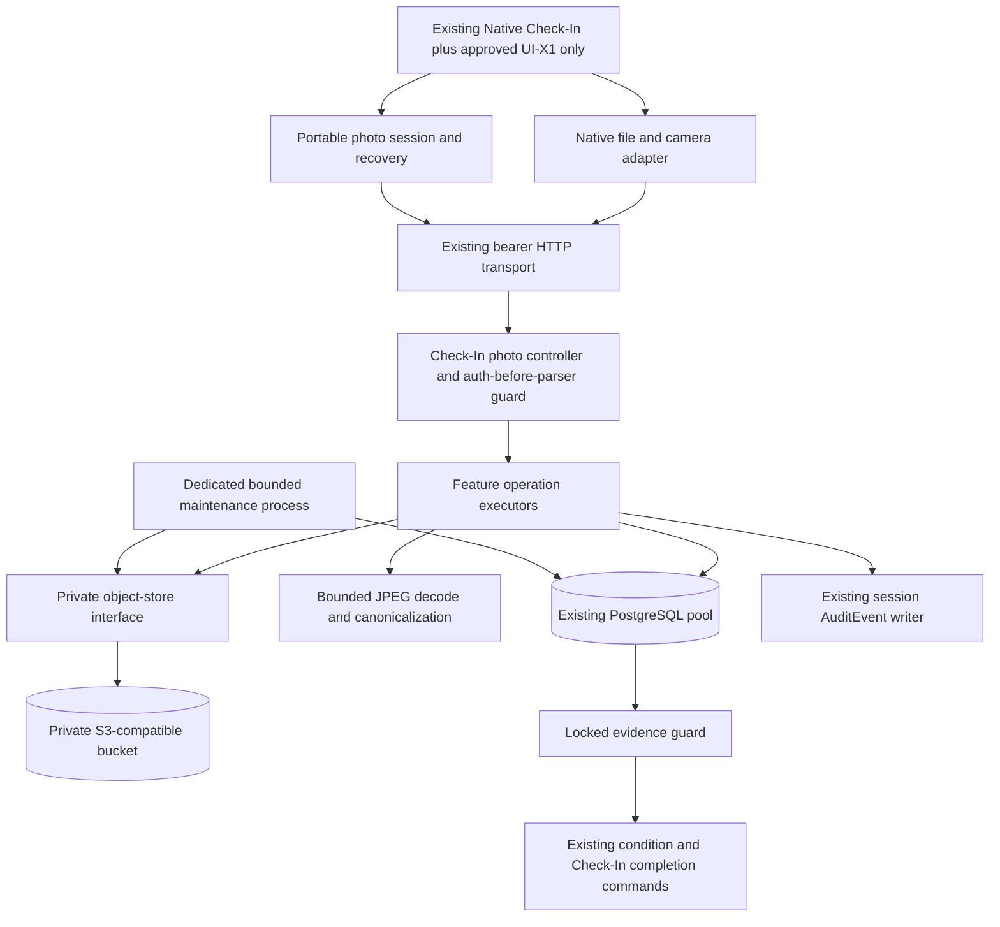
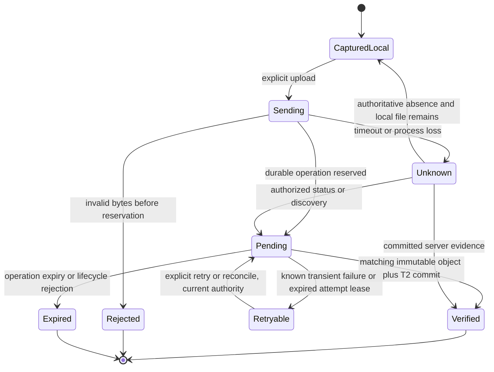
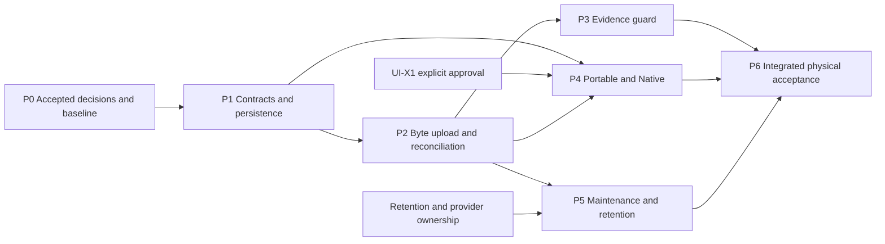

# Issue #215 — Verified Condition-Photo Upload Master Plan

Planning date: 2026-10-14 (Asia/Amman). Repository: `yamanradwan1-rgb/valet-platform`.

Document status: **COMPLETE MASTER PLAN — OWNER C1/U-001–U-007 DIRECTION ACCEPTED IN DEC-104; TECHNICAL/PRODUCTION GATES STILL OPEN**.

**Owner decision addendum (2026-10-14):** [DEC-104](../decisions/DEC-104_VERIFIED_CONDITION_PHOTO_BYTE_EVIDENCE.md) records acceptance of U-001–U-007, including provisional resource limits subject to measured validation, and approval of UI-X1 specifically **using the existing Native QR camera visual/interaction pattern**. The original plan below preserves its historical investigation and requirements; older statements that U/UI-X1 are `unresolved` describe its *initial planning delivery*, not the later owner decision. DEC-104 controls approval status. **Provider selection, legal retention/holds, operational ownership, exact UI regression evidence, test results and production readiness remain unverified/open.** No runtime code, migration, API contract, UI implementation, PR, merge, deployment or issue closure is authorized by this document update.

## 1. Executive Summary

Issue #215 remains a real capability gap on fetched main `923b5ce595fd2a2df9eadc6c7aa5041bd0bb7a93`. Current registration accepts metadata; the locked condition guard deliberately evaluates `FALSE AS qualifying_photo_present`. No production photo byte pipeline or condition-photo client transport was found in tracked source. This is a protected fail-closed state, not a reason to count existing rows.

Recommend **C1: bounded server-mediated JPEG upload**, private S3-compatible storage behind a feature-owned adapter, durable upload operations and fenced attempts, append-only verification facts, exact-session qualification, and explicit server reconciliation. Use the existing PostgreSQL pool, Staff authentication, Check-In command patterns, shared Zod contracts, EmployeeClient transport, Expo camera/file primitives, and current-policy guard. Do not reuse transient OCR images as evidence.

Two blocking findings materially affect execution:

1. The historical photo `DEC-075_VERIFIED_CONDITION_PHOTO_BYTE_EVIDENCE.md` is **Proposed**, on historical branch `glm/mob-011c-condition-photo-decision`. Current main uses DEC-075 for **Accepted Staff Push Operational Policy**. The photo proposal needs a newly allocated decision identifier and explicit acceptance; do not overwrite the push decision.
2. Native Vehicle Condition has three condition choices, optional-photo text, error handling and Continue, but **no condition-photo capture/review/upload affordance**. Strictly unchanged presentation cannot deliver a usable required-photo flow. **DEC-104 subsequently approved UI-X1 only in the existing Native QR-camera visual pattern**; backend and portable work remain nonvisual. No hidden capture, reuse of a plate snapshot, or misleading Continue behavior is permitted.

Seven implementation phases, P0–P6, and seven standalone coding-agent prompts are provided. P0 is the first executable decision/baseline work package after the owner assigns it. Runtime implementation is gated on the new Accepted contract. Required-photo rollout additionally needs provider/retention ownership, UI-X1, real storage and PostgreSQL failure proof, physical Android, independent review and remote CI. Optional-photo behavior remains unchanged.

Affected entities: ValetSession, VehiclePhoto, Organization/Location photo policy, OrganizationMembership/LocationAccess/User/StaffAuthSession, AuditEvent, and proposed upload operation/attempt/verification records. Incident is a retention dependency, not a new incident workflow. Photo upload does not transition ValetSession or Task. Existing condition completion and `CHECKING_IN -> AWAITING_PARKING` retain their own commands, CAS and audit; cancellation remains DEC-097/098 authority.

## 2. Repository Baseline and Source-of-Truth References

### 2.1 Verified checkout and delivery scope

| Item | Observed value |
| --- | --- |
| Fetched remote | `https://github.com/yamanradwan1-rgb/valet-platform.git` |
| Reviewed current main | `923b5ce595fd2a2df9eadc6c7aa5041bd0bb7a93` |
| Historical issue baseline | `945d918004da60c9520c784735644b51eddcbf00`; not used as current implementation truth |
| Historical proposal branch tip | `28af88914edd3a56c51e38fb724766de611ab2af` |
| Planning branch | `plan/issue-215-verified-condition-photo-upload` |
| Isolated planning checkout | `D:/kndoom/valet-platform/tmp/issue-215-planning` |
| Original checkout | `D:/kndoom/valet-platform`, main; initially clean; preserved |
| Authorized changed path | `docs/plans/ISSUE_215_VERIFIED_CONDITION_PHOTO_MASTER_PLAN.md` only |
| Forbidden delivery | PR, merge, issue close/body edit, code, dependencies, migrations, APK, deployment |

Evidence in this plan is **source inspection** unless explicitly stated otherwise. Existing tests were inspected, not executed as proof of future behavior. No real object-store, physical-device, runtime or CI qualification was performed in this planning task. Documentation checks prove the artifact, not the proposed system.

### 2.2 Authority/read manifest

The repository-native Blueprint bridge is `docs/15_BLUEPRINT_V1_REBASELINE.md`. `docs/reference` contains `Valet_Project_Concept_Arabic.pdf`, the historical concept, but no Founder & Product Blueprint v1.0 PDF. Do not claim the original Blueprint PDF was reviewed. The bridge explicitly changes historical mandatory four-photo intake to optional/configurable photos.

| Source reviewed | Task-relevant authority / interpretation |
| --- | --- |
| `AGENTS.md`, `README.md`, `docs/00_SOURCE_OF_TRUTH.md` | Authority precedence, modular monolith, bounded scope, docs-first, preserve work, no main edits |
| `docs/01_PRODUCT_SCOPE.md` | Configurable photos are sellable MVP; no damage AI or marketplace; fast optional path |
| `docs/02_DOMAIN_MODEL.md` | Private session evidence, no invented mandatory directions/count; independent custody/Task/photo lifecycles |
| `docs/03_DATABASE_SCHEMA.md` | VehiclePhoto/ConditionNote, composite scope relations, policy and append-only metadata |
| `docs/04_VALET_SESSION_STATE_MACHINE.md` | Completion actor/role, no Shift prerequisite, CAS, current-policy guard, cancellation |
| `docs/05_ENGINEERING_RULES.md` | VAL-004G/H/I command, retry, audit, transport and observability contracts |
| `docs/06_SECURITY_AND_DATA_RULES.md` | Metadata never qualifies; private bytes; no invented legal retention; current policy/settings locking |
| `docs/07_DEFINITION_OF_DONE.md` | Correctness/security/tests/documentation and evidence gates |
| `docs/08_DECISIONS_LOG.md` and focused decisions | Accepted status wins; focused full contracts prevail over summary mirror lag |
| `docs/09_TECH_STACK.md`, `docs/10_REPOSITORY_STRUCTURE.md` | Private S3-compatible storage, feature ownership, portable Native boundaries |
| `docs/11_REQUIREMENTS_TRACEABILITY.md`, `docs/12_AGENT_EXECUTION_PLAN.md` | VAL-004G/H evidence and future capability mapping; old completion summaries do not prove uploads |
| `docs/13_COLLABORATION_WORKFLOW.md` | Single migration owner, independent review, no concurrent editors in one worktree |
| `docs/14_PROJECT_STATUS.md` | Historical operational snapshot; its MOB-011B next-task text is stale relative to current code |
| `docs/15_BLUEPRINT_V1_REBASELINE.md` | Approved product bridge, optional photos, unresolved legal retention |
| `docs/16_PRODUCTION_DATABASE_DEPLOYMENT_CHECKLIST.md` | Migration/runtime identity separation, TLS, backups and restore evidence |
| `docs/17_AGENT_CODE_STRUCTURE_RULES.md` | 300 physical lines; no growth of oversized legacy files; extract scoped responsibility |
| `docs/18_PHASE3_OPERATIONS_EXECUTION_PLAN.md` | Parking/Task work follows Check-In; do not pull it into upload |
| `docs/20_EMPLOYEE_NATIVE_EXECUTION_PLAN.md` | MC-08, U-002, MOB-011C/D, physical evidence and platform gates |
| DEC-024/026/027 | Durable anti-abuse and existing singleton infrastructure/feature ownership |
| DEC-058, DEC-083, DEC-094 | Typed effective policy, current Management settings, Location lifecycle ordering |
| DEC-059, DEC-077 | Incident authority/recovery is distinct; no automatic photo/incident redesign |
| DEC-063, DEC-067, DEC-071/072/074 | No automatic offline mutation replay; camera portability, Native auth; transient OCR is not evidence |
| DEC-075 staff push | Unrelated Accepted decision occupying the historical photo proposal number |
| DEC-097/098 | Terminal cancellation and child-write races; no implicit deletion of condition history |

Long cross-domain sources were inspected for their relevant contracts and references; this is a complete **Issue #215 scope audit**, not a claim of exhaustive security review of every unrelated module.

### 2.3 GitHub issue reconciliation

- [Issue #215](https://github.com/yamanradwan1-rgb/valet-platform/issues/215): open, zero comments at read; entire body reviewed. Eleven deferred capabilities and eight closure conditions are mapped in sections 20/33.
- [Issue #65](https://github.com/yamanradwan1-rgb/valet-platform/issues/65): closed. Historical evidence-integrity issue was safely addressed through nonqualification; it is not evidence that upload exists. Keep its nonexistent/deleted/corrupt/wrong-scope object regressions.
- [Issue #263](https://github.com/yamanradwan1-rgb/valet-platform/issues/263): navigation/correction/resume work, not upload authority. Do not implement one-step Back or completed-condition rewriting here. Rebase and recheck its eventual integration.
- [Issue #248](https://github.com/yamanradwan1-rgb/valet-platform/issues/248): deferred Native tracker. Release/pilot issues #220–223 remain separate ownership/distribution gates. No superseding accepted photo implementation was found in the reviewed current tree and issue search.
- #255 and #261 supply cancellation compatibility; #253 supplies theme baseline. UI-PARITY-08/MOB-011D required-photo closure remains tied to #215, not unrelated Guest UI work.

### 2.4 External implementation references

These establish library/provider capabilities, not VAYLET policy. Recheck pinned versions during P0/P2.

- [Sharp constructor](https://sharp.pixelplumbing.com/api-constructor/): bounded decoded pixels and strict decoding options are available; metadata inspection alone is insufficient to prove full decode.
- [S3 conditional writes](https://docs.aws.amazon.com/AmazonS3/latest/userguide/conditional-writes.html): conditional creation can prevent overwrite. S3-compatible providers must be tested individually.
- [S3 upload integrity](https://docs.aws.amazon.com/AmazonS3/latest/userguide/checking-object-integrity-upload.html): checksum validation exists; ETag is not the portable evidence checksum contract.
- [Expo FileSystem](https://docs.expo.dev/versions/latest/sdk/filesystem/): File/FormData upload capability. Current repository already appends `new File(uri)`; do not regress to a URI descriptor or copy latest-version assumptions into SDK 57 without verification.

## 3. Current-State Technical Audit

| ID / status | Verified implementation, exact paths and symbols | Limit of evidence |
| --- | --- | --- |
| F01 Implemented | `packages/contracts/src/check-in.ts`: `conditionPhotoRequestSchema` strictly accepts `contentType`, `storageObjectKey`; response omits key | No actual bytes |
| F02 Implemented | `apps/api/src/modules/check-in-api/check-in-api.controller.ts`: `StaffCheckInController.registerConditionPhoto`, POST `sessions/:sessionId/condition-photos` under `@Controller("v1/staff/check-in")` | Metadata registration only |
| F03 Implemented | `apps/api/src/modules/valet-sessions/check-in-condition-command.ts`: `createRegisterCheckInConditionPhotoCommandExecutor` | Validates textual image MIME/key, derives scope, checks state for new rows, writes metadata/audit atomically |
| F04 Implemented | Same command: exact same key/scope/actor/type retry returns existing row; conflicting global key maps SQLSTATE `23505` to non-disclosing conflict | Neither object ownership nor byte identity established |
| F05 Implemented | `check-in-condition-authorization.ts`: `authorizeAndLockCheckInConditionSession`; `staff/custody-staff-authorizer.ts` | ACTIVE User/member/org/location, explicit access, employee/supervisor, session FOR UPDATE; no Shift or checked-in-owner restriction; CANCELLED rejected |
| F06 Implemented | `evaluateLockedCheckInConditionGuard()` in condition command | `FALSE AS qualifying_photo_present`; locked current policy + historical completion marker remain independent |
| F07 Implemented | `createCompleteCheckInConditionCommandExecutor()` | Zero notes/photos accepted when optional; historical marker retry returns original facts; first marker checks required policy |
| F08 Implemented | `complete-check-in-command.ts`: `createCompleteCheckInCommandExecutor()` | Re-evaluates guard; CAS `CHECKING_IN -> AWAITING_PARKING`; no key/Task effects; required policy blocks even with old marker |
| F09 Partially implemented | `packages/database/prisma/schema.prisma`: `VehiclePhoto`; migration `20260809001500_check_in_intake_persistence` | UUID, composite Organization/Location/session/member FKs, unique key, purpose index; no digest/verified facts/upload state |
| F10 Implemented | `packages/database/scripts/provision-append-only-tables.mjs` | VehiclePhoto and condition notes SELECT/INSERT, UPDATE/DELETE/TRUNCATE denied; migrations must preserve this |
| F11 Missing | `apps/api/src/modules/vehicle-photos/README.md` is the module's only current file | No adapter, decoder, byte route, read route, sweeper or verification executor |
| F12 Partially implemented | `.env.example`: S3 endpoint/region/bucket/access key/secret placeholders; `docs/09_TECH_STACK.md` | No tracked API S3 config consumer/client found; configuration names are not provisioned storage |
| F13 Implemented | `check-in-api/plate-ocr.controller.ts`, `plate-ocr-auth.guard.ts` | Guard before bounded multipart, JPEG boundary magic check, buffer clear; no full photo decode or durable evidence; DEC-074 prohibits persistence |
| F14 Implemented | `check-in-api/check-in.module.ts` | AuthModule, RuntimeDatabaseModule, HttpInfrastructureModule; thin services/executors; RequestIdMiddleware per controller; CheckInOperationRunner |
| F15 Implemented | `auth/staff-session-context.ts`: exported `StaffSessionContext`, resolver token; `staff-principal.ts` | Exact-session context capability exists; ordinary Check-In passes only userId, so long-upload final revalidation needs a narrow new use, not assumed reuse |
| F16 Partially implemented | `anti-abuse/anti-abuse.service.ts`, `anti-abuse-key.ts` | Shared PostgreSQL/HMAC 15-minute counter exists; upload scopes/errors are absent and must be explicitly added, not reuse login policy |
| F17 Missing | `packages/employee-client/src/employee-check-in-types.ts`, `employee-check-in-transport.ts` | No upload/status operation or verified-photo state |
| F18 Implemented | `employee-check-in-condition-session.ts`, `employee-check-in-condition-recovery.ts`, `employee-client.ts` | Note fence, marker then final completion, authoritative reread, generation checks; safe GET refresh only, no mutation replay |
| F19 Partially implemented | `apps/valet-native/src/check-in/native-plate-ocr-client.ts`, `tasks/native-operational-http.ts` | Real File/FormData bearer transport, abort, auth fencing; not condition-photo transport |
| F20 Missing | `native-check-in-condition-step.tsx`, `native-check-in-condition-copy.ts` | Three choices/notice/Continue; required error disables choices and removes Continue; photo error currently maps generic operationFailed; no photo controls |
| F21 Implemented | `native-check-in-workflow.tsx`, `auth/native-check-in-runtime.ts`, `native-check-in-actions.ts` | Existing exact recovery/navigation wiring must be preserved, including #255 self-owned Continue |
| F22 Missing | `apps/valet/src/components/screens/check-in/check-in-intake-steps.tsx`: `CheckInVehicleConditionStep` | Optional-photo copy only; Employee Web is not a working required-photo fallback |
| F23 Unverified | Provider deployment, bucket policy/encryption, signing/runtime device and capacity | No production access or evidence supplied; do not infer from env placeholders |
| F24 Decision required | Retention, new byte API/schema, scan stance, UI exception | Historical proposal explicitly awaits owner acceptance |

### Existing regression evidence inspected

`apps/api/test/check-in-condition-command.integration.test.ts` includes invented JPEG/PNG metadata staying unverified, exact retries, cross-scope conflicts, concurrent registration/completion, audit rollback, optional zero-photo success, current-policy guard and false Location override. Keep these cases; add new tests in focused files instead of growing that large suite.

`apps/valet-native/test/native-check-in-condition-step.test.tsx` and the completion/locale/visual-parity suites encode current three-choice presentation, duplicate prevention, RTL plate islands and ambiguous-completion recovery. These are component/fixture coverage, not proof of camera bytes or physical geometry.

`apps/api/vitest.config.mjs` uses repository test classification and bounded standard/compound/race PostgreSQL projects. Tests are raw `pg` through `PostgresPool`/`PostgresTransaction`; do not describe Prisma Client `P2002` behavior for these commands. Runtime role tests and versioned migration tests are separate from API fixture tests.

## 4. Verified Gaps and Root Causes

| Gap | Root cause | Required change / package |
| --- | --- | --- |
| No authoritative bytes | Only metadata crosses current boundary | P1 contracts/persistence, P2 transport/decoder/storage |
| No verified qualification | Guard correctly distrusts metadata | P3 verified query + current object proof without weakening marker/policy/CAS |
| No durable ambiguous recovery | No upload operation or attempt record | P1 journal, P2 reconcile, P4 client recovery |
| Crash can separate object/DB commits | PostgreSQL cannot transact with S3 | P2 immutable attempts, P5 tombstone-driven cleanup |
| Long request auth becomes stale | Existing command principal is userId only | P2 exact StaffSessionContext checked again under final transaction locks |
| No image-bound privacy guarantees | No decode/re-encode/EXIF handling or bucket control | P2, U-003/U-005 deployment acceptance |
| No usable Native condition capture | Current condition screen has no such action | P4 blocked by UI-X1; not solvable by invisible wiring alone |
| Restart loses local correlation | Existing workflow is transient, DEC-063 forbids invented durable drafts | P2 narrow server discovery; P4 no local durable photo queue |
| Required Web remains unsupported | No upload UI/transport | Preserve fail-closed behavior; any Web enablement is separate owner scope |
| Photo proposal not accepted | Proposed historical DEC and identifier collision | P0 allocates nonconflicting new DEC, mirrors contract after acceptance |

### Binding/derived classification and falsification

| Claim | Classification | Falsifier searched / result |
| --- | --- | --- |
| Client metadata/local URI must not satisfy required policy | LOCKED | #65, security photo section and guard inspected; no verified bypass found |
| Photos optional by default; explicit Location false overrides Company true | LOCKED | Policy evaluator and schema inspected; false is distinguished from null |
| No photo/upload state in ValetSession enum | LOCKED | State-machine and schema inspected; independent aggregate rule retained |
| Photo evidence/history is append-only | LOCKED | Provisioning and migration inspected; no ordinary UPDATE/DELETE grant |
| OCR input may not become retained condition evidence | LOCKED | DEC-074 and transient OCR path inspected; persistence forbidden |
| Client may not auto-replay upload after reconnect/401 | LOCKED | DEC-063/072 and EmployeeClient inspected; mutations not replayed |
| Current guard blocks required photos | DERIVED | Actual guard + both consuming commands inspected; predicate remains false |
| Current native condition screen cannot initiate capture | DERIVED | Render tree, props and copy inspected; no capture input/action |
| Existing photo authorizer does not require Shift/self intake ownership | DERIVED | Exported authorizer + no-Shift integration case inspected; #255 restrictions belong to its separate commands |
| New byte trust needs persistent verification distinct from legacy rows | DERIVED | VehiclePhoto model/migrations contain no verification; cannot safely infer from key/type |
| Existing audit writer can record a session-scoped verification event | DERIVED | Writer accepts ValetSession default entity, real actor/scope, scalar safe metadata; cannot accept VehiclePhoto entity without broadening |
| UI-FROZEN prohibits unapproved new capture controls/copy | LOCKED | Latest owner brief + current absent affordance; UI-X1 cannot be assumed |

Falsification coverage: **12/12 listed conclusions classified LOCKED or DERIVED checked against the indicated sources**. This is not an exhaustive repository security claim. New behavior below remains UNRESOLVED/C1 until accepted.

## 5. DEC-075 Review and Decision Status

Historical source: `origin/glm/mob-011c-condition-photo-decision`, tip `28af88914edd3a56c51e38fb724766de611ab2af`, path `docs/decisions/DEC-075_VERIFIED_CONDITION_PHOTO_BYTE_EVIDENCE.md`.

It explicitly says `Status: Proposed`, `Acceptance: Awaiting Project Owner`, U-002 unresolved, and implementation blocked. It recommends server-mediated multipart, server-generated keys, actual-byte validation, durable operations, exact-session verification and recovery. Those are useful design inputs; they are not Accepted authority.

Current main instead contains `docs/decisions/DEC-075_STAFF_PUSH_OPERATIONAL_POLICY.md` with Accepted status. The historical photo file is absent from current main. No accepted replacement photo decision was found. Therefore: **photo proposal pending; identifier collided; not accepted and not demonstrated superseded by an implemented photo pipeline**. Do not cherry-pick its decision number or overwrite push policy. P0 must allocate the next unused identifier after a fresh fetch and establish an explicit supersession link to the historical proposal.

C1 improves the historical proposal in five areas: fenced attempt objects for stale writers; GET remains read-only with explicit POST reconciliation; restart discovery without durable client media; exact credential revalidation after transfer; and an explicit UI-FROZEN conflict. Original proposed retention/limits/pilot values remain undecided rather than silently inherited from OCR or push.

## 6. Recommended Architecture and Alternatives

| Alternative | Security/correctness | Complexity/reliability | Cost/portability | Recommendation |
| --- | --- | --- | --- | --- |
| A: server-mediated bounded multipart | Server observes input, canonical bytes and object read-back; smallest client storage authority | Adds decoder, bounded upload, durable DB/object journal; existing HTTP patterns reusable | API bandwidth/CPU and read-back cost; portable storage interface | **Recommend C1 after U-001–007 approval** |
| B: presigned direct upload + server finalize | Valid only with bounded intent, overwrite prevention and trusted decode of retrieved object; MIME policy alone insufficient | Additional CORS, expiry, signed authority, finalize and provider behavior on Native/Web | Reduces ingress relay but still requires verification reads; more provider/client coupling | Defer until measured volume justifies complexity |
| C: existing repository pipeline | No qualifying implementation found | OCR is explicitly transient; metadata is nonqualifying | Placeholder S3 config is not infrastructure | Cannot reuse as a complete pipeline |

C1 is a feature boundary under `vehicle-photos`, wired through CheckInModule, not a microservice, generic media library, queue platform or duplicate database pool. Thin HTTP service invokes explicit operation executors; executors own transaction boundaries. Storage adapter performs external I/O outside database locks. Shared contracts contain safe product-level fields, never SDK objects, URIs or bucket credentials.

Candidate dependencies: an API-local pinned S3 SDK adapter and Sharp decoder, only after license/security/platform review and P0 acceptance. `sharp` appearing in workspace build allowances/transitive dependencies is not proof the API directly owns it. No Native dependency is currently demonstrated necessary; use installed Expo camera/file/image-manipulator capabilities. Pin a reviewed compatible release during implementation, not a guessed version in this plan.

## 7. Component Architecture Diagram



The diagram describes conditional C1. UI-X1 is blocked until approved. No arrow grants client authority over storage identity or evidence eligibility.

## 8. Complete Upload Data-Flow Diagram

```mermaid
sequenceDiagram
  participant N as Native
  participant A as API
  participant D as PostgreSQL
  participant S as Private storage
  N->>N: Explicit capture, private temporary file, operation UUID
  N->>A: POST exact session multipart JPEG
  A->>D: Authenticate exact credential and authorize persisted session
  D-->>A: Current permitted scope
  A->>A: Admission limit, bounded parse, full decode, canonicalize, hash
  A->>D: T1 reauthorize, reserve operation + fenced attempt + server key
  D-->>A: Commit reservation
  A->>S: Conditional create immutable attempt object
  A->>S: Bounded read-back of exact object/version, recompute SHA-256
  S-->>A: Matching canonical bytes
  A->>D: T2 exact credential + scope + lifecycle + lease recheck
  A->>D: Atomic photo + verification + operation outcome + safe audit
  D-->>A: Commit
  A-->>N: VERIFIED safe DTO
  N->>N: Delete local file; refresh current evidence/session
  N->>A: Existing condition-completion then complete with expectedVersion
  A->>S: Required-photo preflight outside DB locks
  A->>D: Locked current policy and verified evidence; existing guarded write
  A-->>N: Existing authoritative continuation
  Note over N,D: Lost response: GET status/discovery, then explicit POST reconcile if pending
```

Failure boundaries: before T1 no storage side effect; after T1 a durable attempt is discoverable; after object PUT a DB failure leaves a private recoverable orphan; after T2 a lost response converges to the same photo. Only T2 commit establishes evidence. No automatic retry of a mutation is implied by the sequence.

## 9. Evidence State Machine

### 9.1 Conditional C1 server and local states



Local `Unknown`/`Sending`/`CapturedLocal` are not server evidence states. Server operation state is C1 `PENDING | VERIFIED | EXPIRED | REJECTED`; retryable failure remains PENDING with a bounded safe failure code and no active lease. Each storage attempt has C1 `WRITING | STORED | SELECTED | ABANDONED`; operation expiry is irreversible. Verified history is immutable. Availability incidents append a separate fact; they do not rewrite a past verification into a fictional upload failure.

| Transition | Owner / preconditions / authority | Persisted fact and effect | Failure, replay and recovery | Eligible? |
| --- | --- | --- | --- | --- |
| Empty to capture | Native, explicit action, permission, active current workflow | Private cache only, no DB | Permission/capture failure retains old screen; no server claim | No |
| Capture to sending | Portable single-flight, stable operation UUID, online hint | No authoritative fact yet | Abort/timeout after dispatch is unknown | No |
| Sending to PENDING | API T1, exact credential + active permitted member/scope + CHECKING_IN + validated bytes | Immutable source fingerprint, scope, DB expiry; attempt lease/key | Exact identical operation resumes; mismatched bytes conflict; T1 rollback means no PUT | No |
| PENDING to STORED attempt | Server adapter, unexpired leased attempt | Durable private immutable bytes; bounded read-back | Provider timeout unknown; do not replace key or assume absence; explicit reconcile probes | No |
| PENDING to VERIFIED | T2 reauthorization, exact session lock, matching object proof, unexpired operation/current attempt | One photo, one verification, selected attempt, operation terminal result, one audit | Commit/rollback/lost-response branches; GET returns committed truth | Yes, subject to required completion preflight |
| PENDING to retryable | Executor records classified transient error under fencing | Same operation, failed attempt retained | Next explicit action probes existing object first; new attempt only if no selected result | No |
| PENDING to EXPIRED/REJECTED | Current request or maintenance, lease/expiry fence; no qualifying row | Terminal operation, abandoned attempts | Never resurrect; fresh capture/operation is a new explicit intent | No |
| Any local state to unknown | Client after dispatch uncertainty, malformed response, process death | No client-derived DB effect | Read/discover server; no POST until explicit accepted recovery action | No new eligibility |
| Verified to known unavailable | Authorized integrity/retention maintenance, exact evidence relation | Append availability event and update guarded availability projection | Alert, preserve history, required new completion fails; no reverse custody transition | No |
| Verified history after uploader revocation | No new mutation | Historical evidence remains evidence of the authorized commit | Current actor must be authorized to consume/read; uploader departure does not erase history | Yes if object/policy proof valid |

## 10. API Contract Specification

**Everything in 10.2–10.6 is C1, conditional on U-001/U-002/U-004/U-006.** Existing route contracts in 10.1 remain unchanged. New request/response schemas are strict Zod exports from a focused `packages/contracts/src/condition-photo-upload.ts` (proposed path). No client Organization, Location, membership, vehicle, object key, digest, verification flag or server time is accepted.

### 10.1 Existing contracts preserved

`StaffCheckInController` and `CancelCheckInController` both declare `@Controller("v1/staff/check-in")`; `PlateOcrController` does too. Existing metadata POST remains metadata-only. Existing `condition-completion` and `complete` bodies/results remain unchanged. Auth and error infrastructure stays shared. These literals establish convention, not acceptance of new routes.

### 10.2 Proposed endpoint matrix

All routes below require an exact current Staff bearer context, active User/Organization/Location/member, explicit Location access and ordinary photo-role permission. C1 preserves `VALET_EMPLOYEE | VALET_SUPERVISOR`, **without adding Shift or checked-in-actor equality** to photo operations. Operation reads/retries additionally require the original uploading membership; a different staff member may create their own authorized operation, but cannot claim another member's operation ID. A fresh authenticated session for the same current membership may recover it. Admin/manager/Guest/device identity grants no upload authority.

| Method/path | Request | Success | Transaction/audit | Recovery |
| --- | --- | --- | --- | --- |
| POST `/v1/staff/check-in/sessions/:sessionId/condition-photo-uploads` | multipart, exactly `operationId` UUID + one `image` JPEG; empty query | 201 VERIFIED for new commit; 200 same verified replay; 202 PENDING if another valid attempt owns operation | T1 reservation; external I/O; T2 finalization with one verification audit | Status first after uncertainty; same ID/source bytes only |
| GET `/v1/staff/check-in/sessions/:sessionId/condition-photo-uploads/:operationId` | UUID path, empty body/query | 200 discriminated safe status | Read-only, current authorization; no storage writes/finalization/audit | Unknown/foreign ID concealed as 404; absence alone does not prove another in-flight request stopped |
| POST `/v1/staff/check-in/sessions/:sessionId/condition-photo-uploads/:operationId/reconcile` | strictly `{}` | 200 VERIFIED or terminal; 202 PENDING | Claim expired/free attempt lease under authorization, read object outside transaction, T2 may commit evidence/audit | Explicit action only; never GET side effect or automatic POST |
| GET `/v1/staff/check-in/sessions/:sessionId/condition-photo-state` | empty body/query | 200 current policy/qualification summary + actor's pending operation and latest outcome | Read-only bounded exact-session query; no bytes or keys | Restart recovery without local durable IDs; summary does not itself complete custody |

Discovery returns at most one PENDING operation per uploading membership/session/purpose and one latest terminal result for that actor. It also returns `qualifyingPhotoPresent` for the exact session without disclosing another actor's operation/photo details. C1 enforces the one-pending invariant in DB. This avoids inventing a generic paginated media library. A `hasAdditionalHistory` boolean may not silently truncate recovery: all unresolved work is represented by the unique pending row. Historical browsing is out of scope.

### 10.3 Safe schemas and examples

Proposed status union:

```typescript
type PhotoUploadStatus =
  | { operationId: string; valetSessionId: string; status: "PENDING";
      retryAction: "WAIT" | "RECONCILE" | "RESEND_SAME_BYTES"; retryAfterSeconds: number }
  | { operationId: string; valetSessionId: string; status: "VERIFIED";
      vehiclePhotoId: string; contentType: "image/jpeg"; byteSize: number; verifiedAt: string }
  | { operationId: string; valetSessionId: string; status: "EXPIRED" | "REJECTED";
      retryAction: "NEW_CAPTURE"; reason: "EXPIRED" | "INVALID_IMAGE" | "SESSION_INELIGIBLE" };
```

UUIDs validate strictly; byteSize is a positive bounded integer; timestamps are UTC ISO; retryAfterSeconds is integer 1–900. Unknown fields fail parsing. `VERIFIED` describes the historical committed upload, not current authorization to continue or permanent future availability. Pending failure/provider detail is not returned. No raw digest, URI, key, versionId, presigned URL or uploader identity in DTOs.

```http
POST /v1/staff/check-in/sessions/11111111-1111-4111-8111-111111111111/condition-photo-uploads
Authorization: Bearer <credential supplied by transport; never log>
Content-Type: multipart/form-data; boundary=<transport generated>

operationId=22222222-2222-4222-8222-222222222222
image=<actual JPEG bytes, filename ignored for identity>
```

```json
{
  "operationId": "22222222-2222-4222-8222-222222222222",
  "valetSessionId": "11111111-1111-4111-8111-111111111111",
  "status": "VERIFIED",
  "vehiclePhotoId": "33333333-3333-4333-8333-333333333333",
  "contentType": "image/jpeg",
  "byteSize": 184732,
  "verifiedAt": "2026-10-14T10:00:00.000Z"
}
```

Example data are illustrative, not observed production evidence. Discovery shape:

```json
{
  "valetSessionId": "11111111-1111-4111-8111-111111111111",
  "photoPolicy": { "required": true, "source": "LOCATION_OVERRIDE" },
  "qualifyingPhotoPresent": false,
  "pendingOperation": null,
  "latestOperation": null
}
```

`pendingOperation` and `latestOperation` use the status union or null; latest excludes the pending item. Policy is a display hint and is re-read by completion. Do not add these fields to old strict session DTOs without negotiated compatibility; use the new endpoint.

### 10.4 Errors and precedence

Reuse existing auth/transport semantics where they truly match. C1 new codes below require shared mapping, strict tests and safe fixed messages; they are not existing codes.

| HTTP / code | Meaning | Client action |
| --- | --- | --- |
| 401 existing authentication error | Missing/expired/revoked exact credential | Existing auth recovery; never resend POST automatically |
| 404 existing `TENANT_ACCESS_DENIED` / `LOCATION_ACCESS_DENIED` / `AUTHORIZATION_DENIED` | Corresponding current authority failure | Clear inaccessible operation presentation; do not reveal resource existence |
| 404 C1 `CONDITION_PHOTO_NOT_FOUND` | Missing or foreign operation, after safe scope proof | Reconcile exact discovery; never guess success |
| 400 existing `REQUEST_INVALID` | Malformed UUID, unknown fields, duplicate fields, bad multipart | Correct client input |
| 413 C1 `CONDITION_PHOTO_TOO_LARGE` | Raw or normalized bytes exceed cap | New smaller capture; never automatic recompression/replay of changed bytes under old ID |
| 422 C1 `CONDITION_PHOTO_INVALID_IMAGE` | MIME mismatch, corrupt/unsupported JPEG, dimension/decode failure | New capture |
| 409 C1 `CONDITION_PHOTO_OPERATION_CONFLICT` | Same ID changed fingerprint or another pending logical capture in same actor/session | Read current state; do not mint IDs in a loop |
| 409 C1 `CONDITION_PHOTO_LIMIT_REACHED` | Approved verified-photo cap already reached under the session lock | Rehydrate existing evidence; do not recapture or retry automatically |
| 409 existing `INVALID_STATE_TRANSITION` | New qualification when no longer CHECKING_IN | Rehydrate, preserve existing history |
| 409 C1 `CONDITION_PHOTO_EXPIRED` | Expired operation cannot resume | Read then explicit new capture if still eligible |
| 429 C1 `CONDITION_PHOTO_RATE_LIMITED` | Shared durable limit | Honor bounded Retry-After; no automatic mutation |
| 503 existing `ANTI_ABUSE_UNAVAILABLE` | Cannot establish shared admission | Fail closed before accepting bytes |
| 503 C1 `CONDITION_PHOTO_STORAGE_UNAVAILABLE` | Storage/decoder capacity/verification dependency unavailable | Treat dispatched request as potentially pending; GET/reconcile |
| Existing 422 photo-required codes | Existing condition/final completion lacks valid evidence | Stay in condition; never disable policy |

Authenticate first; authorize persisted target before upload reservation/mutation; then validate and classify operation identity; check lifecycle before new finalization. Foreign operation collisions are concealed, not a fingerprint oracle. A verified identical POST retry can return the previous safe result after current read authorization even when state advanced; a new operation cannot. CANCELLED status discovery is read-only and may return a historical result under C1 current photo read authority; it does not reuse the helper that categorically rejects CANCELLED, does not resume the draft, and does not relax DEC-097 Continue/Cancel ownership.

The pre-parser scope guard establishes current read authority without requiring CHECKING_IN: the multipart operation ID is not available yet, and a verified replay may follow lifecycle advancement. After bounded parsing, existing-operation identity and current authority are checked before returning history; T1 and T2 separately require CHECKING_IN for new qualification. Do not invoke the existing cancellation-rejecting mutation helper as the universal upload pre-parser guard.

### 10.5 Admission and resource bounds — candidate values, not accepted policy

U-003 candidate: one file, one UUID field, maximum 8 MiB received JPEG and 8 MiB canonical object, 4096 pixels per side and 12 megapixels total, minimum positive dimensions only; no invented four-angle requirement. Maximum multipart overhead 16 KiB, filename length 128 bytes (ignored), maximum two parts, no trailing parts, reject duplicate fields, empty files and nonempty query. A streaming byte counter must reject chunked overrun even without Content-Length. Validate all limits at startup.

Candidate upload deadline 60 seconds, object call deadline 15 seconds, decode deadline 5 seconds in an isolated bounded worker, lease 120 seconds, operation lifetime 30 minutes, maintenance every 5 minutes. Slow clients must not occupy resources indefinitely. Object calls and decode may not exceed remaining lease/deadline. Lease is server DB-time based, never device clock. Local per-process decoder concurrency 2 is an initial test setting, not a measured production capacity promise.

U-004 candidate shared 15-minute counters: upload starts 20/user + 60/session; status/discovery/reconcile reads 120/user (reconcile also consumes a mutation-start counter); max one active operation per member/session and two live attempts per User across API replicas. Exact replay costs admission but cannot create extra evidence. Use new HMAC-separated scopes in existing durable anti-abuse; do not reuse OCR's process-local guard or a second counter database. Edge unauthenticated body/header/time limits supplement current authentication. Final values require measured P6 capacity evidence.

The two-live-attempt limit is distinct from rolling request counters. C1 reserves a database lease slot atomically in T1 for the persisted User, across memberships and sessions; serialize competing reservations on a dedicated per-User admission row and count only DB-time-live leases. Take that row before operation/attempt locks in every claimant, including reconcile; do not upgrade the shared User authorization lock. P1 must specify the narrow admission-row schema/grants alongside the journal; P2 must prove the complete order against auth writers. No process-local counter or member/session unique index proves this User-wide cap. Release/expiry changes slot availability through the same serialized predicate, and stale workers retain no usable lease.

### 10.6 Audit and operation measurements

C1 verification event: `CHECK_IN_CONDITION_PHOTO_VERIFIED`, entity **ValetSession**, actual persisted actor and exact scope, same DB timestamp as verification, metadata only `{ purpose: "CHECK_IN_CONDITION", mediaCategory: "image", verificationVersion: 1 }`. One event per successful logical operation, no event for a GET or identical replay. Existing writer supports this session entity; do not pretend it supports a VehiclePhoto entity. Audit failure rolls back photo/verification/operation finalization.

C1 abandonment maintenance emits bounded operational metrics; evidence availability changes append a session-scoped SYSTEM event `CHECK_IN_CONDITION_PHOTO_UNAVAILABLE` with coded reason only, no image identifiers outside approved correlation. Approved deletion policy would require its own reviewed append-only disposition fact. Update backend management event catalog classification only if needed for safe existing readers; any new visible Dashboard label/copy is separately gated by UI-FROZEN. Never smuggle free text into audit.

Use existing CheckInOperationRunner, RequestIdMiddleware, centralized filter/no-store response helpers. Register new route templates in telemetry/filter allowlists. One safe measurement per route; no request/body/filename/key/digest in logs, errors or crash attachments. No storage credentials or raw token in the plan or client bundle.

## 11. Storage Architecture and Security

C1 storage interface (proposed `vehicle-photos/private-photo-store.ts`): `putIfAbsent`, `readExact`, `statExact`, `deleteAbandonedExact`; typed opaque server object reference, bounded streams, cancellation/deadline and classified provider errors. This is the single photo adapter, not new common infrastructure importing features.

Server keys use an environment-owned private prefix and cryptographically random operation/attempt identity, e.g. `condition/v1/<random-operation>/<random-attempt>.jpg`; no phone/plate/customer/name in keys. Store an internal bucket alias plus opaque version identity if supported, never arbitrary client URLs. Config endpoint is deployment-owned HTTPS; no caller-provided endpoint, URL fetch or redirects to client destinations. Use private network/egress policy and prohibit provider credentials in Native.

JPEG validation sequence: reject unsupported declared MIME; inspect actual JPEG structure; decode the complete image with explicit byte, pixel, dimension, time and memory caps; reject truncated/malformed/multi-image or unsupported inputs; apply EXIF orientation; produce one canonical JPEG with metadata removed; decode/check canonical output; compute server input SHA-256/length for replay identity and canonical SHA-256/length for retained evidence. Input bytes are discarded after processing. C1 canonicalization quality 90 is a proposed parameter, never a claim of forensic-original preservation. Owner must approve normalization and loss of original metadata under U-005. If original-byte retention is required, a different separately reviewed privacy/storage contract is necessary.

Conditional object creation plus read-back verifies exact bytes; metadata HEAD and ETag alone do not suffice. The adapter verifies encrypted private storage configuration in deployment acceptance and reads back the exact immutable object/version before T2. Hash canonical bytes with Node crypto SHA-256. Provider checksum metadata is supplemental; never trust a checksum supplied by the client. Versioned buckets must bind the exact version; unversioned providers require tested conditional creation and IAM prevention of overwrites/deletes of selected evidence.

No public read API is needed to qualify evidence. C1 ships **no employee/guest photo download route or signed URL**. Authorized retrieval for integration/operations uses a separately restricted service identity and exact persisted reference; operators cannot infer application read permission from bucket access. Future user-facing reads need a focused authority/export/audit contract. This is an explicit scope decision U-007, not a claim that all photo viewing already exists.

At-rest encryption, blocked public access, TLS, separate development/staging/production buckets and identities, secret rotation, backup/restore and deletion permissions require real deployment evidence. API identity may put/read private attempt objects but cannot delete selected evidence. Cleanup identity is isolated and cannot qualify evidence. Bucket lifecycle expiration must never broadly cover selected verified objects. No provider is silently selected by this plan.

## 12. Database and Migration Strategy

**Migration is required under C1; exact approval is U-002.** Existing schema cannot persist verification or recover an object/DB split. Prefer a one-to-one verification child rather than changing old rows to VERIFIED. Do not rewrite migration 15 or any merged migration.

### 12.1 Candidate models and fields

Types: UUID identifiers, `timestamptz(3)` DB times, bounded enums, SHA-256 `bytea` checked to 32 bytes, positive bounded integer lengths/dimensions, bigint fencing generation. Internal records are never public DTOs.

| Proposed model/table | Exact C1 fields |
| --- | --- |
| `ConditionPhotoUploadOperation` / `condition_photo_upload_operations` | `id` server UUID PK; `client_operation_id` UUID; `organization_id`, `location_id`, `valet_session_id`, `actor_membership_id`; `purpose=CHECK_IN_CONDITION`; `source_sha256`, `source_byte_size`; `normalization_version`; `status`; `created_at`, `expires_at`, `updated_at`; nullable `verified_photo_id`, `last_failure_code`; `next_attempt_number` positive bigint |
| `ConditionPhotoUploadAttempt` / `condition_photo_upload_attempts` | `id` server UUID PK; `operation_id`; duplicated enforced `organization_id`, `location_id`, `valet_session_id`, `actor_membership_id`; `attempt_number`; `object_key` unique; `bucket_alias`; nullable `object_version`; `status`; `lease_owner` random UUID, `lease_expires_at`; `canonical_sha256`, `canonical_byte_size`, `width`, `height`; `created_at`, nullable `stored_at`, `selected_at`, `abandoned_at`, `last_cleanup_checked_at`; `normalization_version` |
| `VehiclePhotoVerification` / `vehicle_photo_verifications` | `vehicle_photo_id` PK/FK; `operation_id` unique; `attempt_id` unique; `organization_id`, `location_id`, `valet_session_id`, `captured_by_membership_id`, `purpose`; `object_key`; `verified_at`; `byte_size`, `content_sha256`, `width`, `height`, `normalization_version`; immutable once inserted |
| `VehiclePhotoAvailability` / `vehicle_photo_availability` | `vehicle_photo_id` PK/FK; scope tuple; state `AVAILABLE` or `UNAVAILABLE`; `changed_at`; nullable coded `reason`; maintained only through narrow reviewed function; history in append-only AuditEvent |
| `ConditionPhotoUploadAdmission` / `condition_photo_upload_admission` | `user_id` UUID PK/FK to User with RESTRICT; synchronization row only, no customer media or mutable counters; narrow reserve function inserts on conflict safely and locks this row before claims; current live leases are counted from attempts joined to persisted membership User |

VehiclePhoto itself retains existing fields and append-only semantics. Add a composite UNIQUE over its identity/scope/actor/purpose/key solely to support a verification FK that makes cross-scope or wrong-key verification impossible. Add corresponding operation/attempt composite keys and FKs. An immutable verification must reference the same operation, attempt, actor, exact scope and key; do not validate these only in TypeScript. `verified_photo_id` references the same verified linkage, with deferred constraints/constraint triggers if required to make the transaction's cycle coherent.

### 12.2 Constraints, indexes and privileges

1. Unique `(actor_membership_id, client_operation_id)`; all APIs additionally verify scope before disclosure. Reusing another member's ID grants nothing and may create an independent operation only under that member's own authority.
2. Partial UNIQUE `(actor_membership_id, valet_session_id, purpose) WHERE status='PENDING'`; one discoverable unresolved operation per actor/session, not per device.
3. Unique `(operation_id, attempt_number)`; unique object key; at most one nonabandoned live lease per operation through guarded claim function/partial index; SELECTED attempt cannot be reclaimed.
4. Operation VERIFIED iff one coherent verification/photo/selected-attempt link exists; deferred DB enforcement plus narrow finalization function. No VERIFIED row with missing digest/length/dimensions; timestamps and state-specific fields checked. Enum/status changes require accepted contract.
5. Exact tuple composite FKs to ValetSession and OrganizationMembership, existing parent RESTRICT deletes. No independent vehicle_id; derive Vehicle from session.
6. Recovery index `(organization_id, location_id, valet_session_id, actor_membership_id, created_at DESC, id DESC)`; pending-expiry index `(expires_at,id) WHERE status='PENDING'`; abandoned sweep index `(last_cleanup_checked_at,id) WHERE status='ABANDONED'`; verification lookup `(organization_id,location_id,valet_session_id,purpose)`.
7. No global content dedup by hash: equal bytes in two legitimate operations need not mean the same physical event. Dedup is logical-operation scoped; parallel identical retries cannot make two verification rows. Optional operator-intended extra captures are append-only, subject to approved limits.
8. Runtime role gets only required SELECT plus EXECUTE on reviewed operation reservation/claim/finalization/availability entry points. No generic update/delete on verification or VehiclePhoto; old metadata insert capability stays unchanged. PUBLIC EXECUTE revoked; fixed safe search_path; no dynamic identifiers/SQL; no owner credentials in API. Maintenance has separate narrow expiry/cleanup claims, no evidence finalization or general table delete.
9. Admission is User-scoped infrastructure, not a business-owned photo record; its subject derives from persisted membership. The reserve function serializes all live-lease additions for that User before checking the approved cap, using DB time and indexed operation/member/attempt joins. Membership recreation or two Locations must not create extra capacity. Restrict admission-row writes to the function and include simultaneous cross-membership claim tests. Expired leases can be excluded from capacity only because every storage/finalization writer is separately fenced against their reuse.

A SECURITY DEFINER function cannot cryptographically prove that an application really decoded bytes; the trusted API verifier remains part of the security boundary. DB constraints defend scope/coherence/replay and least privilege, not a malicious fully compromised application. Do not overclaim.

### 12.3 Migration sequence and recovery

P1 reserves migration ownership; choose actual timestamp/name after fresh main inspection. First additive migration adds enums/tables/FKs/indexes/functions without changing legacy data or guard. Add any required composite parent index with assessed lock/runtime cost. Validate constraints on representative existing data; use staged validation if needed. Provision and verify runtime/maintenance privileges after migration. Apply to empty DB and an upgraded main snapshot using real `migrate:deploy`, not schema synchronization.

Legacy rows receive **no verification child**, cannot qualify, and cannot acquire a child through a public metadata route. A new upload creates a new photo; never backfill from key/type or scan guessed legacy object keys. Preserve KPI/history behavior: existing analytics counts VehiclePhoto work evidence; do not redefine it as verified-only without a separate KPI decision.

Rollback is forward-compatible feature disable and prior application redeploy after compatibility proof; do not drop evidence tables or remove migrations to undo a release. Preserve selected objects and records. Missing storage/DB after restore keeps required-photo completion fail-closed; recovery must reconcile paired backups, never fabricate verification rows.

## 13. Authorization and Tenant Isolation

### Authorization-before-mutation proof for C1

| Stage | Reservation/upload/finalize/reconcile | Retry/read/maintenance distinction |
| --- | --- | --- |
| Authenticate | Resolve exported `StaffSessionContext`; verify presented access hash/session/User | GET repeats current credential proof; maintenance uses separate server identity, never acts as arbitrary staff |
| Resolve | Load exact persisted ValetSession org/location; never accept claimed tenant | Foreign UUID has same concealed outcome as missing |
| Authorize | Current active User/member/org/location, explicit access, accepted photo roles; operation belongs to current membership | Prior success/UUID/device is not authority; status may read history but cannot grant Continue |
| Protect | Preserve current User/settings/authorization/session lock order; exact StaffAuthSession validation must be ordered consistently with refresh/revoke; operation then attempt locks | No network while locks held; maintenance takes operation/attempt lock in same order and only terminal abandonment |
| Mutate | T1 reserves identity/attempt after authority; T2 qualifies only CHECKING_IN, current token/session, live operation and current lease | Status GET never mutates; expired/foreign operation cannot be revived |
| Audit | T2 appends safe session verification event in same transaction | No duplicate on replay; no secrets/free text |
| Commit | Photo + verification + SELECTED attempt + operation result + audit atomically | Commit unknown leads to read; not a blind retry |
| Re-read | Repeat scope/actor/current auth before response | No mutation-as-authorization-probe or unauthorized UPDATE followed by rollback |

C1 exact credential revalidation uses `StaffSessionContext` capability but **does not import Management role/MFA authority** into field uploads. New scoped helper must lock/check `staff_auth_sessions` for id/user/current access hash/revocation/expiry and hold appropriate row protection until T2 commit. Inspect actual refresh/logout/disable lock order in P0/P2 and prove both orderings in concurrency tests; no deadlock-fixing global auth refactor is authorized. A credential that expired while bytes were transferring cannot finalize merely because the User is still active. A later explicitly authenticated reconcile may use a new valid credential for the same membership.

Current photo commands allow authorized employee/supervisor action for a session even when not its intake creator and do not require active Shift. These **current facts** are not silently replaced by #255's self-owned Continue/Cancel + Shift semantics. U-006 asks the owner to preserve that existing photo authority for the new boundary. Native shell may be stricter; it is not API authorization.

No ORG_ADMIN/LOCATION_MANAGER override, cross-location transfer, Guest visibility, device ownership or implicit role hierarchy. Location accepting-intakes flag governs new intake; do not add it as a condition that prevents completing an existing draining session unless an Accepted decision requires it. Inactive Location and CANCELLED/new qualification fail closed.

## 14. Concurrency, Idempotency and Reconciliation

### 14.1 C1 transaction algorithm

T1: authenticate/authorize; acquire existing appropriate authorization/session locks; find operation by current member + operation UUID; compare exact scope and server source fingerprint; replay existing VERIFIED result only after current read authority; reject mismatches; create PENDING or claim a new attempt if no live attempt; allocate server key/fencing generation; commit. No PUT before this commit. No client may choose canonical fingerprint.

External step: decode/canonicalization completed before reserving the attempt's canonical facts. PUT once conditionally; if key already exists, read exact bytes and verify rather than overwrite. Read-back and hash under strict size/deadline. No DB lock held during network I/O.

T2: repeat exact credential/scope/current role/access; lock exact session, operation and attempt; verify CHECKING_IN, operation expiry, current attempt generation/lease and immutable facts; insert one photo and verification; select attempt, set VERIFIED and append audit; commit. A stale writer's object can exist, but its expired attempt cannot commit evidence. New attempt uses a different key, so stale writes cannot overwrite selected evidence.

Read-only GET reports durable state. Explicit reconcile can claim the existing abandoned-free pending attempt after prior lease expiry and verify its recorded object. If object is absent, return `RESEND_SAME_BYTES`; if outcome is still uncertain, WAIT. If operation expired, return terminal without resurrecting. Reconcile carries no image, key, hash or requested state. If bytes no longer exist locally and server has no object, explicit recapture uses a new operation after terminalizing the old operation through expiry; do not invent an automatic reset endpoint.

### 14.2 Race matrix

All proposed race mechanisms are C1/U-002; P2 owns upload races, P3 owns completion integration, P5 owns maintenance. Existing protection is only the current session/authority locks and legacy uniqueness; it does not already solve upload races.

| Scenario / Tx A vs Tx B | Resource and unsafe interleaving | C1 sequence / linearization / loser | Proof and owner |
| --- | --- | --- | --- |
| Double tap / identical POSTs | Same member/operation; both read absent | T1 unique key + session/op lock; one reservation, loser sees live PENDING or same VERIFIED; never two photos/audits | Real concurrent HTTP, winner commit/rollback/lost reply; P2 |
| Same ID, changed bytes | Same operation; A reserves source hash, B changes body | Compare server input hash/length/normalization version under op lock; conflict; no PUT for B | Alter one byte with same UUID; P2 |
| Parallel different operations | Same member/session; both may create | Partial unique pending index; one waits/conflicts; after terminal, a separately intended capture may proceed | Actual transactions, no generic 23505 assumption; P1/P2 |
| Two devices same member | Same discovery and IDs | No device authority; same UUID converges; different UUID obeys pending uniqueness | Physical + HTTP; P2/P4 |
| Two permitted members | Same session, independent operations | Both must prove current authority; separate IDs may make distinct evidence; exact session lock orders commits | No cross-member status disclosure; P2/P3 |
| Timeout after T2 success | Server commits; client gets no reply | GET returns same evidence, no second audit; POST never auto-replayed | Cut response after COMMIT; P2/P4 |
| App termination during transfer | Process dies before/after T1 | Before T1 no object; after T1 pending discoverable; no local queue needed | Force-stop, reopen exact session, GET before action; P4/P6 |
| API SIGKILL after PUT | Object exists, T2 absent | Durable operation/attempt survives; current authorized reconcile re-verifies or expiry abandons | Hard kill actual API process/container, not only mocked throw; P2/P5 |
| DB failure after PUT | Storage commits, DB transaction rolls back or ack lost | If rollback, pending/attempt retained; if commit, VERIFIED; caller must read; never delete on unknown DB result | Real DB disconnect/failure injection; P2/P5 |
| Completion vs finalization | Same session; completion sees no evidence then upload commits | Session FOR UPDATE orders writes; no evidence -> required completion fails; upload first -> completion preflight may retry and observe; no optimistic pass | Barriers before each lock/commit; P3 |
| Optional completion wins while upload pending | Session leaves CHECKING_IN | T2 rejects new qualification, preserves private orphan for cleanup; do not reverse state | P3 |
| Cancel/closure vs upload | CANCELLED/deactivated before T2 | Same authoritative session/Location locks; cancel first rejects; upload first retains committed historical evidence after cancellation | DEC-097/094 regressions, P3 |
| Membership/access/User/org/location revocation | Predicate changes after preflight | Share locks/recheck in final transaction; revoker-first denies; finalize-first valid historical commit, later revoked reads deny | Exercise actual revocation writers; P2/P3 |
| Credential refresh/revoke/expiry | User remains active but exact token no longer valid | Exact credential hash/session checked at T2; expired/rotated request rejected; fresh explicit reconcile allowed | Both lock orders; no token logs; P2 |
| Policy optional -> required | Preflight skipped under old optional snapshot | Final locked policy sees required and no proof -> photo-required denial; retry after fresh proof; no bypass | Actual settings mutation ordering; P3 |
| Cleanup vs finalize | Worker decides old attempt orphan while T2 selects it | Both lock operation/attempt; cleanup only terminal abandoned attempts; selected can never become orphan | Winner commit/rollback plus lease expiry boundary; P5 |
| Lease expiry vs stale PUT | Writer A paused, B expires/abandons then A PUT completes | A key stays tracked forever as tombstone; A cannot select after fence loss; repeat sweep finds late object | Suspend beyond lease, resume after deletion, observe second cleanup; P5 |
| Integrity loss vs completion | Object deleted/corrupted before required completion | Fresh exact-object preflight fails, guard lacks receipt; known-unavailable projection excludes evidence | Real deleted/corrupt object tests; P3/P5 |

For every waiting transaction test three branches: A commits, A rolls back, and the caller cannot determine A's commit due to timeout. A unique constraint does not prescribe the same HTTP result in all branches. Catch SQLSTATE `23505` only for the intended constraint and re-read under fresh authority; unexpected DB failures are not user conflicts.

### 14.3 Reusable guard and deleted-object protection

Preserve `evaluateLockedCheckInConditionGuard(transaction, scope)` as the internal command boundary, extracting its responsibility from the 784-line source before growth. C1 extends its internal inputs with a **server-only object-check receipt**, never a DTO flag. Receipt binds exact photo/verification/attempt/object version, canonical digest/size and request identity; only the trusted verifier constructs it. It is valid only for the current request and immutable evidence tuple, never a cached client success.

Both condition and final completion executors perform an authorized bounded object preflight **outside** the DB transaction when current policy may require a photo, then lock/re-authorize/re-read policy and verification inside their existing write transaction. The guard intersects receipt IDs with coherent exact-scope verification + AVAILABLE rows. If policy became required after an optional preflight, it fails closed and the caller rehydrates/retries. If another upload committed after preflight, a conservative retry is acceptable; no stale receipt may qualify another photo.

This detects missing/corrupt bytes before completion (including #65 regression). Avoid unbounded reads: inspect a bounded candidate set newest first, and a failure to establish one valid candidate is no evidence. Candidate bound C1 is 10 verified photos/session and creation is rejected at that cap under session lock; this is an **operational cap for approval**, not a product requirement to take 10 photos. No global count/direction policy added.

Object-store reads cannot be atomic with PostgreSQL. The check-to-commit interval is protected against application deletion by prohibiting deletion/overwrite of selected evidence while CHECKING_IN and by immutable references; catastrophic provider loss or a privileged operator bypass remains a deployment risk. Do not claim mathematical cross-system atomicity. Required completion fails on observed unavailability; integrity alerts and restricted deletion controls are release gates. If the owner requires stronger storage guarantees than these, U-005 must select versioning/Object Lock-compatible controls before release.

Existing repeated condition-completion with a historical marker remains an idempotent historical response; it is **not** proof current photo policy passes. Final Check-In always runs the full current guard. Do not rewrite completion retry semantics in order to add uploads.

## 15. Failure Recovery and Cleanup

| Boundary | Authoritative outcome | C1 recovery |
| --- | --- | --- |
| Auth/admission denied before parser | No upload side effect | Safe fixed error; do not buffer attacker body |
| Decode rejects before T1 | No durable operation/object | New explicit valid capture; clear buffers/files |
| T1 fails/rolls back | No authorized object write | Status may be absent; keep unknown until in-flight request deadline is over |
| PUT fails conclusively | PENDING recorded, no verified row | Explicit same-byte resend only after probe and lease safety |
| PUT timeout | Object presence unknown | Read exact recorded key/version; never overwrite or guess success |
| Read-back missing/mismatch | No evidence | Fail closed; abandon corrupt attempt, alert; new attempt under same source fingerprint only |
| T2 DB/audit failure | Object may exist, no new verified transaction | Preserve journal, GET/reconcile after recovery |
| T2 response loss | Possible committed evidence | GET authoritative result; no duplicate upload or audit |
| Reconcile can't authorize | No new qualification or disclosure | Native boundary clears; retention maintenance still preserves historical evidence |
| Operation expires | Never qualifies later | Mark terminal under locks, retain tombstones, clean attempt objects |
| Selected object lost later | Historical verification retained but availability fails | Alert, append coded unavailability fact, block new required completion; no reverse completed custody |

Maintenance is a bounded command/process in the modular monolith, not a second queue platform. C1 candidate sweep batch 100, one active worker initially, explicit DB lease/claim and monotonic continuation by `(timestamp,id)`. Worker expiry reads PostgreSQL time. Expire PENDING only after operation deadline and any live lease has safely elapsed. Mark attempts ABANDONED before deleting externally. Re-read exact reference and selected/verified protection before claim; cleanup never touches legacy keys or scans arbitrary provider prefixes supplied by clients.

Keep abandonment tombstones. A stale PUT can arrive after a successful DELETE; therefore `deleted once` is not a sufficient terminal cleanup condition. Sweep tracked abandoned keys again after the maximum request/provider deadline plus grace and periodically thereafter, with alerts on late objects. A candidate 10-minute grace is subject to U-003/provider failure tests. Do not garbage-collect tombstones until the provider's maximum late-write boundary and accepted retention have been proven. If no finite bound is provable, retain the tombstone; maintenance must continue to revisit it. This prevents a stale worker from silently leaking permanent objects without pretending a DB fence can cancel an external write.

No background worker may finalize a photo under an expired caller's credential. It may expire and clean only; a fresh authorized explicit reconcile owns qualification. Scheduled maintenance credentials are not permission to impersonate an uploader.

## 16. Retention and Privacy

U-005 is a release blocker. No legal duration is invented. Owner/deployment record must select verified-byte minimum/maximum retention, jurisdiction/customer contract, incident/legal-hold authority, backup retention, controlled deletion/export procedure, and accountable custodian. Operational metadata/audit history remains append-only even if a later approved byte-disposition process removes content.

Recommended initial envelope: automatic cleanup **only for never-qualified abandoned attempts**; verified objects excluded from lifecycle/sweeper deletion. This is a conservative interim design, not approval for indefinite production retention. Required-photo pilot cannot enable until the owner approves a bounded contractual retention and incident-preservation procedure. If production needs automatic verified-byte expiry, that is a gated P5 extension requiring a typed retention/hold/disposition contract and tests; do not add a generic settings blob or assume GPS retention applies.

Incident preservation: current Incident references session; no reviewed generic legal-hold/photo linkage is assumed. With verified deletion disabled, all evidence remains preserved while retention authority is resolved. If deletion is approved, require an exact-session incident/hold check serialized with deletion authorization and a durable disposition claim. An incident arriving concurrently must prevent irreversible deletion when policy requires preservation. No hard delete of VehiclePhoto, verification, Incident or AuditEvent. Full ClaimShield remains out of scope.

EXIF/GPS: C1 strips metadata through server canonicalization; source hash is restricted replay evidence, not log data; no source EXIF persisted. Native requests no gallery save and no location metadata for this capture. A hash proves byte identity, not truth of damage, time, photographer or subject; do not describe technical verification as authenticity certification.

Private cache files are removed on confirmed upload, rejection, cancellation, scope/auth loss and workflow abandonment. No image/URI in SecureStore, AsyncStorage, navigation, analytics or generic outbox. Process death can leave OS cache files: use a dedicated app-private condition-photo directory with startup cleanup before any new capture, no cross-feature deletion, and tested bounds. Files are not restored as actionable drafts after restart. Failure to delete is observable via safe coded metric; never log URI.

## 17. Employee Client Integration

C1 proposed portable files under `packages/employee-client/src/`: `employee-condition-photo-types.ts`, `employee-condition-photo-transport.ts`, `employee-condition-photo-session.ts`, and focused tests. Their exact creation is conditional on U-001/002/006. The package owns product states, stable correlation, single-flight, strict parsing, server recovery and identity/scope fencing. It must not import Expo, React Native, DOM, Node crypto, File, URI or S3 types.

Inject a platform upload callback accepting an opaque in-memory capture handle and operation/session IDs; the Native adapter resolves the handle to an app-private file and constructs FormData. The portable layer never serializes the handle. GET/status transports can use the existing EmployeeClient. Keep upload snapshot separate from general Check-In continuation to avoid adding dozens of fields to the 299-line condition session. Integrate only a narrow readiness/reconciliation hook before its existing note/marker/complete sequence; extract a scoped helper if that file must change.

Fences: auth generation, User/membership/Organization identity, exact Location, exact session, workflow owner, capture revision and attempt sequence. A→B→A still changes generation/revision. Late callbacks cannot mark a replacement capture verified, open a screen or trigger completion. A local boolean never supplies server evidence.

No automatic POST after reconnect, foreground, 401 or timeout. Safe GET may use existing one-refresh policy. Upload/reconcile are mutations and remain explicit. On uncertain upload, read status; after restart, hydrate exact existing Check-In through accepted navigation then read photo-state. If server operation has bytes, employee explicitly reconciles; if absent and no local file, employee recaptures after safe terminal resolution. Do not persist an upload queue merely to remember operation IDs.

Optional Locations: no image required, no storage preflight dependency for zero-photo completion, no extra delay to the ordinary path. An explicitly initiated optional upload must not be reported successful if skipped/failed. Whether optional capture is exposed is UI-X1; current optional screen remains unchanged without approval. Required Locations: policy from server drives presentation but current server guard is final authority. A policy change after display can still deny completion.

## 18. Native Implementation Design

Native root is **`apps/valet-native`**, not `apps/employee-native`. Reuse installed Expo camera/files/image-manipulator and `createNativeEmployeeClient`. Photo capture must be a new explicit condition capture lifecycle, never OCR automatic sampling or saved OCR URI.

| Existing screen/component | Existing behavior | Required C1 change | Visual change? | Risk | Verification |
| --- | --- | --- | --- | --- | --- |
| `native-check-in-condition-step.tsx` | Three options, optional notice, Continue/error | Connect current policy and photo readiness; approved capture entry and safe state presentation | **Yes, UI-X1 blocked** | Misleading required status, altered geometry | Exact approved delta + full locale/theme/device matrix |
| `native-check-in-condition-copy.ts` + EN/AR dictionaries | photoRequired is generic operationFailed; optional text | Approved localized required/upload/error/retry wording only | **Yes, UI-X1 blocked** | Wrong text wrapping/focus | Owner-reviewed copy, line bounds, TalkBack |
| `native-check-in-workflow.tsx` | Existing step switch, header/Back | Narrow approved capture return integration, no generic back-stack change | Interaction exception only if approved | #263 collision, wrong session return | Header/hardware Back, cancel and reentry tests |
| `native-check-in-panel.tsx`, `auth/native-check-in-runtime.ts` | Own current portable Check-In runtime | Compose photo owner and clear/suspend/reconcile hooks | No normal visual delta | Late result after scope replacement | Generation and lifecycle tests |
| `native-plate-camera-step.tsx`, OCR adapter/loop/ROI files | Automatic bounded plate assistance | Read-only reference; do not repurpose or alter OCR | No | Accidental evidence reuse or ROI regression | Existing plate parity suites unchanged |
| `tasks/native-operational-http.ts` | FormData-aware bearer request and auth recovery | Reuse as-is where possible; route telemetry allowlist addition only if needed | No | JSON conversion, secret telemetry | Real multipart request test and canary logs |
| `native-check-in-primitives.tsx`, styles, appearance theme | Existing visual primitives | Reuse; no token/geometry changes | No | Infrastructure task becomes redesign | Hash/style/render comparison |
| Vehicles Continue/Cancel and parking continuation | Existing exact recovery/terminal control | Rehydrate photo status after safe exact session entry; preserve authority and routes | No | Duplicate intake/Task or stale reentry | #255/261 regression and navigation recordings |
| Employee Web `CheckInVehicleConditionStep` | Optional text, no capture | No feature UI work; shared contract regression only | No | False claim Web fallback supports required photos | Optional succeeds, required fails closed |

Proposed Native internals: `native-condition-photo-capture.ts` (explicit camera action/readiness), `native-condition-photo-files.ts` (private cache ownership/cleanup), `native-condition-photo-upload.ts` (File/FormData/abort/deadline), `native-condition-photo-owner.ts` (lifecycle and capture handles). An approved UI-X1 may add `native-condition-photo-step.tsx`, composed from existing primitives, with no more than 300 lines/file. Do not create these files until the corresponding phase is authorized.

Capture: wait for real camera readiness, single-flight still image, no gallery/audio/location capture; inspect actual file existence/size; orientation and maximum dimensions prepared only with installed compatible primitives; server still revalidates everything. `new File(uri)` goes into FormData; never send the URI as evidence, manually set multipart boundary or base64 encode entire photos into JSON. Abort on background/focus loss/auth change, then classify a dispatched operation as unknown, never canceled-on-server.

Restart: restore auth through existing NativeAuthSession, hydrate exact eligible session, discover server photo state; delete abandoned local condition cache first. No client mutation during bootstrap. Existing error/Check server patterns may cover recovery, but any new visible text, action, role or focus semantics requires the UI exception record.

## 19. STRICT UI-FROZEN Contract and Verification Matrix

**Owner addendum — approved UI-X1 reference:** The owner approved the natural look and flow of the **existing Native QR camera**, not a new bespoke design. In particular review `scanner/native-qr-panel.tsx`, `parking/native-parking-qr-input.tsx` and `handoff/native-handoff-scanner.tsx`; reuse their familiar camera open/close, permissions, existing controls and error/status visual conventions for a new **still JPEG condition photo**. Keep all unaffected Check-In geometry/branding/buttons frozen. A photo is not a QR/plate scan; do not reuse QR/plate bytes or scanning acceptance semantics. Any visual difference exceeding the minimal QR-pattern capture/review/upload affordance needs another owner decision. EN/AR, Light/Dark, RTL/LTR, accessibility and physical BEFORE/AFTER evidence remain mandatory. See [DEC-104](../decisions/DEC-104_VERIFIED_CONDITION_PHOTO_BYTE_EVIDENCE.md).

**Unauthorized UI regression = NO-GO.** Protected: layout, geometry, padding, spacing, typography, themes/colors, icons, borders/shadows, headers/logo, button dimensions, component positions, navigation presentation, modal/sheet/safe areas, responsive rules, wrapping, accessibility/focus and existing loading/error/retry treatment. No cleanup refactor of presentation is authorized.

UI-X1 exact conflict: there is no condition-photo initiation control, preview/review, retry or verified indication in the current condition render tree. Continue currently submits a condition note/marker/final completion; silently changing it to take/upload a photo changes interaction and cannot pass as unchanged behavior. Existing plate camera represents a different purpose and DEC-074 prohibits retaining its image.

Smallest proposal for owner review: one explicitly labeled condition-photo entry in the existing policy area; a focused capture/review presentation using existing camera/button/error primitives; required/upload/unknown/retry/verified text/actions within an owner-approved bounded area. Preserve the three condition rows, VehicleCard, header, button geometry and every unrelated screen. Owner must approve concrete EN/AR mockups, bounds, navigation/Back, TalkBack semantics and optional-path treatment. **No such mockup or exception is approved by this plan.** Backend/portable packages may proceed after their own decisions; Native UI activation may not.

| Matrix axis | Mandatory variants | Acceptance |
| --- | --- | --- |
| Locale/direction | EN-LTR; AR-RTL, identifier LTR islands; supported forced direction overrides tested for robustness | No mirrored plate/QR content, incorrect reading order or unexpected wrapping |
| Theme | Light and Dark | No hard-coded light-only feedback or changed tokens |
| Viewport | Small 360×640 dp, common 393×851 dp, large 412×915 dp; actual fleet metrics recorded | Same baseline geometry at same density/insets/font scale; exception bounds only |
| Font/accessibility | Default and supported large font, TalkBack, focus/disabled state | No hidden errors, inaccessible retry, focus theft or clipping |
| State | Initial optional, initial required, captured, uploading, interrupted, failed, retrying, unknown, verified, permission denied, authority lost | Truthful server-owned outcome; unapproved states remain blocked rather than fabricated |
| Flow | Plate/manual/no plate, confirm/edit, customer/vehicle, condition, Continue, Vehicles resume/cancel, parking handoff | Existing route/order/authority retained outside approved capture excursion |

Baseline capture comes from pinned reviewed main, with matching build/device/font/theme/locale/data. New states absent from main compare against the **owner-approved UI-X1 reference**, never a fabricated historical screenshot. Unchanged existing states compare directly before/after; tests may not simply regenerate snapshots and call the difference accepted. Section 28 defines evidence and difference thresholds.

## 20. Detailed Phase-by-Phase Implementation Roadmap

The following remains a gated execution envelope, not permission to implement unassigned tasks. DEC-104 has accepted C1/U-001–U-007 and the QR-pattern UI-X1 direction. Each phase still requires a named human owner, a reviewed current code base, and approved task scope. If the owner changes C1 materially, revise dependent contracts/tests first. Do not mechanically execute incompatible prompts; operational/provider/retention and tested UI-evidence gates remain binding.

### Shared validation commands (actual repository scripts)

Run from the implementation worktree root with Node >=22.13 and pnpm 10.34.5. Use a new disposable PostgreSQL target and isolated private object-store namespace for integration; verify resolved target before provisioning/migrations. Never use an unrelated developer/production database. Keep credentials out of command output.

```text
pnpm architecture:check
pnpm --filter @valet/contracts typecheck
pnpm --filter @valet/employee-client typecheck
pnpm --filter @valet/api lint
pnpm --filter @valet/api typecheck
pnpm --filter @valet/valet-native lint
pnpm --filter @valet/valet-native typecheck
pnpm --filter @valet/valet-native test
pnpm --filter @valet/employee-client test
pnpm --filter @valet/database migrate:deploy
pnpm --filter @valet/database runtime:provision
pnpm test:postgres:database
pnpm test:postgres:api
pnpm test:non-postgres
pnpm test:platform
pnpm lint
pnpm typecheck
pnpm test
pnpm build
git diff --check
```

Focused API tests must use the owned-test runner, not a broad wildcard that silently bypasses PostgreSQL classification:

```text
pnpm --filter @valet/api exec node ../../scripts/test-harness/run-owned-tests.mjs api vitest.config.mjs test/check-in-condition-command.integration.test.ts test/check-in-api.integration.test.ts
```

Add proposed new test filenames to the command only after creating and registering them. Verify classification behavior and budgets in `scripts/test-harness/test-classification.mjs` and related manifests; a test file excluded by its project is not a passing test. The plan does not claim any proposed script already exists. Commands here are future gates; this documentation-only task does not install dependencies, migrate, build APKs or run production services.

### P0 — Decision acceptance, baseline and UI evidence boundary

| Required item | Execution instruction |
| --- | --- |
| Objective | Convert U-001–U-007 to an explicit Accepted photo contract, resolve UI-X1 separately, capture a truthful baseline, assign release owners |
| Verified baseline | Main SHA in section 2; photo DEC proposed/collided; missing runtime and UI affordance |
| Dependencies | Owner decisions and a named task; no runtime prerequisite |
| READ FIRST | AGENTS; source-of-truth, scope, state machine, schema, engineering/security, structure/workflow docs; DEC-063/071/072/074/083/094/097/098; historical proposal; this full plan |
| Existing files | Relevant binding docs, `docs/20_EMPLOYEE_NATIVE_EXECUTION_PLAN.md`, `docs/08_DECISIONS_LOG.md`, condition guard/authorization, current Native condition/render and auth refresh/revoke paths |
| New files | Newly allocated focused DEC and task-owned baseline evidence manifest only after explicit documentation scope; never overwrite DEC-075 push |
| File-level instructions | Re-fetch main, inspect branch drift and #263; compare full historical proposal; record exact accepted endpoints, state/fields/limits/roles/recovery/retention; synchronize binding docs and canonical log with owner approval; record no APK/production claim |
| Contracts | Accept/reject C1 as a coherent set; settle exact status/history reads after CANCELLED, fresh-session recovery, canonicalization, operation caps, private retrieval exclusion |
| Domain invariants | No new custody/Task transition; optional policy and current guard unchanged |
| Security | Approve exact credential final recheck and photo role boundary; review lock ordering against real auth/Location writers |
| Database effects | None in P0; approve P1 additive design and migration ownership |
| Concurrency | Review all section 14 races and proof ownership; verify lock-order candidate using current writer code, not memory |
| Error/recovery | Ratify strict response/error union and mutation-vs-read semantics; no auto replay |
| UI-FROZEN | Capture old states; DEC-104 accepts existing QR-camera pattern, but exact EN/AR copy/bounds/focus and parity evidence are required; no production UI edits during P0 |
| Negative tests | Decision review rejects any metadata qualification, client scope/key trust, hidden capture, direct signed authority or generic queue |
| Integration tests | None executed as implementation; specify actual provider/test target and credentials owner without revealing secrets |
| Commands | `git fetch origin`, `git rev-parse origin/main`, `git status --short`, scoped diff and `git diff --check`; documentation audit script |
| Artifacts | Accepted decision or explicit remaining blockers; source/decision matrix; before evidence manifest; provider/retention owner record |
| Acceptance | Every affected runtime choice has authoritative approval; no issue/plan approval falsely marked runtime proof |
| Independent review | Other contributor reviews decision coherence and scope; owner approves material values and UI-X1 |
| Rollback | Revise proposed docs before acceptance; never rewrite accepted history silently |
| Complexity | M, dominated by decisions and evidence gathering |
| Parallelism | Read-only backend/security and UI baseline investigations may run independently; one writer per worktree; shared docs single owner |
| GO / NO-GO | GO for P0 owner-approved documentation; implementation remains under phase review and operational gates; UI-X1 QR-pattern approved in DEC-104, not unchecked novel UI changes |

### P1 — Shared contracts, journal, verification persistence and privileges

| Required item | Execution instruction |
| --- | --- |
| Objective | Establish an additive, scoped, constrained persistence/DTO foundation with no legacy qualification |
| Verified baseline | VehiclePhoto lacks verification; append-only grants; no upload journal; `pg` execution pattern |
| Dependencies | P0 Accepted U-001/002/004/006; single migration owner; pinned approved predecessor SHA |
| READ FIRST | Accepted photo DEC, schema/security/structure/deployment docs, migration 15, provisioning/verification scripts, current contracts and test harness |
| Existing files | `packages/database/prisma/schema.prisma`, runtime privilege allowlists/verifiers, `packages/contracts/src/index.ts`, database docs and test ownership config |
| New files | New timestamped migration(s); focused photo privilege provisioning/verifier; proposed `condition-photo-upload.ts`; separate schema/constraint/privilege test files |
| File-level instructions | Implement section 12 only as accepted; add exact composite FKs/checks/indexes; narrow mutation functions; export strict DTOs; keep existing metadata shapes untouched; no default VERIFIED backfill |
| Contracts | Upload/status/discovery/reconcile schemas, strict errors/constants and versioning; schemas exclude provider details and client authority |
| Domain invariants | One logical operation -> at most one verified photo/audit; legacy unverified forever; independent upload lifecycle |
| Security | Runtime cannot generically mutate verification/history; PUBLIC denied; fixed search_path; no dynamic SQL; maintenance cannot finalize |
| Database effects | Forward additive migrations, fresh and upgrade preservation, privilege provisioning post-migrate; parent composite-index cost assessed |
| Concurrency | Unique member+operation, unique active pending member/session, attempt fences, deferred coherent verification links; raw SQLSTATE tests |
| Error/recovery | Constraint rejection is not success; partial inserts rollback; old apps continue metadata behavior after additive migration |
| UI-FROZEN | No app UI or style files |
| Negative tests | Cross-tenant/session/actor/key FK mismatch, null/partial verification, duplicate op/attempt, invalid status, unauthorized UPDATE/DELETE/EXECUTE |
| Integration tests | Fresh DB, main-snapshot upgrade, actual restricted runtime + maintenance roles; legacy row still nonqualifying |
| Commands | Contracts lint/typecheck/test; database migrate:deploy/runtime:provision on disposable target; `pnpm test:postgres:database`; architecture/diff checks |
| Artifacts | Migration/constraint/grant report, old-row compatibility proof, contracts examples and actual passing test output |
| Acceptance | DB cannot represent mismatched verified tuple; privileges verified using runtime identity; no guard change yet |
| Independent review | Database/security reviewer checks SQL, cyclic FK/deferred enforcement and least privilege; owner of migration approves |
| Rollback | Disable new feature; preserve additive tables/data; forward fix only; no down migration deleting evidence |
| Complexity | L; highest-contention foundation |
| Parallelism | Contract review/test design may be read-only parallel; schema/migrations/provisioning one owner; P2 starts after stable contracts |
| GO / NO-GO | NO-GO for unresolved schema/retention authority or failed role/upgrade tests; GO only after independent P1 approval |

### P2 — Authenticated bytes, private storage and authoritative reconciliation

| Required item | Execution instruction |
| --- | --- |
| Objective | Deliver C1 byte transport and durable finalization without yet enabling condition guard qualification |
| Verified baseline | OCR demonstrates guarded multipart; CheckInModule owns HTTP wiring; VehiclePhoto module placeholder; exact StaffSessionContext exists |
| Dependencies | Approved P1; U-003 limits, U-004 budgets, U-005 normalization/provider, U-006 auth, U-007 no public reads |
| READ FIRST | New photo DEC; CheckInModule/runner/filter; OCR guard/controller only as ordering reference; staff-session-context and actual refresh/logout writers; custody authorizer/audit writer |
| Existing files | `check-in-api/check-in.module.ts`, auth exports as needed, central error/route-template mappings, anti-abuse scopes/module, API package/lock only for approved dependencies |
| New files | Feature storage interface/S3 adapter, config, JPEG decoder, upload guard/controller/service, reserve/finalize/reconcile/status executors and focused repositories under `vehicle-photos`/`check-in-api` |
| File-level instructions | Keep thin service -> command executor -> transaction; no SQL-controller; authenticate/authorize/admit before parser; bounded decode/canonicalize; T1 then PUT/read-back then T2; exact credential recheck; GET never finalizes |
| Contracts | Implement section 10 exactly as accepted, including safe union, no-store, 200/201/202 distinctions, explicit reconcile and restart discovery |
| Domain invariants | No ValetSession/Task state change; guard remains false until P3; real verification is committed with audit |
| Security | Two-principal IDOR tests; current role/access/state; exact credential on final commit; private immutable objects; no logs/body/URLs; decoder isolation/resource caps |
| Database effects | Consume P1 functions/journal; no extra schema without accepted dependency; single pool |
| Concurrency | Fenced attempts and immutable keys; no DB lock over external I/O; stale writer cannot select; verified replay reauthorizes |
| Error/recovery | Distinguish rejected bytes, in-flight, transient failure, operation conflict, expired, terminal state and unknown commit; never delete object on uncertain DB commit |
| UI-FROZEN | No UI code; no plate OCR behavior changes |
| Negative tests | Bad MIME/magic-only/truncated JPEG, pixel bomb, excess parts/chunked size, foreign IDs, revoked/rotated credential, malicious key/URL fields, signed material leakage |
| Integration tests | Real HTTP+PostgreSQL+selected private provider, storage failures, exact object read-back, API hard kill after PUT, audit rollback, identical races, fresh-session reconcile |
| Commands | API lint/typecheck, focused owned upload tests, API PostgreSQL lane, contracts tests, architecture/diff; real-provider harness command documented when implemented |
| Artifacts | HTTP traces with safe fields, DB/object correlation evidence in restricted QA output, resource-budget measurements, kill/recovery report |
| Acceptance | A valid upload commits one coherent private evidence record/audit; every hostile case fails closed; status/discovery cannot disclose foreign operations |
| Independent review | Security reviewer traces auth before parser/T1/T2 and DB+storage failure windows; adapter review verifies provider assumptions |
| Rollback | Disable new route admission; allow safe read reconciliation if compatible; retain journal and selected objects; never fall back to metadata trust |
| Complexity | XL; split transport, decoder/storage, operation execution into reviewable commits within this phase |
| Parallelism | P4 portable client unit work can start from approved P1 DTOs in separate worktree; no shared exports/lockfile simultaneous edits |
| GO / NO-GO | NO-GO without real provider immutability/read-back or exact credential race proof; endpoint unit mocks alone insufficient |

### P3 — Verified evidence guard and existing Check-In integration

| Required item | Execution instruction |
| --- | --- |
| Objective | Required photos count only current exact-session verified evidence with trusted object preflight, preserving optional and existing completion contracts |
| Verified baseline | `evaluateLockedCheckInConditionGuard` always false; first marker versus repeated marker semantics; final completion current policy/CAS |
| Dependencies | P2 approved real byte evidence; U-002/005 guard receipt/availability and retention behavior accepted |
| READ FIRST | Condition command/authorization, complete-check-in command, settings lock, DEC-083/094/097/098, #65 tests |
| Existing files | `check-in-condition-command.ts`, `complete-check-in-command.ts`, CheckInApiService wiring; existing focused regression tests |
| New files | Extracted condition guard module, required-photo preflight verifier, focused condition-photo qualification integration tests |
| File-level instructions | Extract guard responsibility without growing 784-line command; extract completion helper if needed from 350-line command; authorize preflight outside tx, pass internal exact object receipt; inside existing tx lock/read current policy and verified tuple; never trust client receipt |
| Contracts | Preserve HTTP completion DTOs, note/marker behavior and CAS; internal server-only verifier/guard boundary from section 14.3 |
| Domain invariants | Optional zero-photo still works; marker independent of current policy; no automatic completion or new Task; upload never increments custody version |
| Security | Exact scope/purpose/actor linkage; missing/corrupt/known-unavailable evidence never qualifies; auth invalidation and cancellation before write deny |
| Database effects | Use P1 verification/availability; no history rewrite or legacy promotion; any unexpected schema need returns to P1 review |
| Concurrency | Existing session lock/settings advisory ordering retained; required policy toggles, upload vs marker/final complete, cancellation/Location closure races |
| Error/recovery | Existing photo-required codes; unavailable verification fails safely; no marker rewrite; stale/advanced state follows existing authoritative reread |
| UI-FROZEN | No UI changes; old clients remain safe; optional performance budget preserved |
| Negative tests | Legacy metadata, wrong session, expired op, corrupt/deleted object, forged receipt, stale receipt after new attempt, required policy after old marker, CANCELLED |
| Integration tests | Real uploaded JPEG -> marker -> complete; optional zero-photo; both race orders; audit failure rollback; no duplicate note/completion event |
| Commands | Focused existing/new condition/complete-check-in suites via owned runner, API PostgreSQL lane, API typecheck/lint, architecture/diff |
| Artifacts | Guard truth table, receipt-boundary review, current-policy concurrency and object-loss evidence, no-photo latency comparison |
| Acceptance | Only verified exact object qualifies; existing completion semantics/CAS unchanged; no uncontrolled object I/O under DB locks |
| Independent review | Domain reviewer and security reviewer inspect full preflight/check/write interval; test green alone is insufficient |
| Rollback | Disable qualification to return required flow to fail-closed; preserve evidence; do not force policy optional |
| Complexity | L; narrow code changes with high semantic risk |
| Parallelism | Can overlap isolated P4 work after P1/P2 contracts; never simultaneous edits to shared condition contracts/exports |
| GO / NO-GO | NO-GO if missing/deleted-object or current-policy tests fail, or extraction changes unrelated behavior |

### P4 — Portable recovery and Native integration under approved UI exception

| Required item | Execution instruction |
| --- | --- |
| Objective | Actual condition capture/upload/recovery from Native with exact server outcomes and approved minimum UI delta |
| Verified baseline | Portable condition workflow has no photo transport; Native File/FormData exists for OCR; current condition has no capture affordance |
| Dependencies | P1 contracts; P2 endpoint; P3 for live completion; U-006 restart/actor rules; **UI-X1 accepted before visible edits** |
| READ FIRST | DEC-063/071/072/074, current Native workflow/runtime/condition/primitives/styles, EmployeeClient/recovery/condition-session, #255/261 authority, #263 current state |
| Existing files | `packages/employee-client/src/index.ts`, narrow condition integration, Native runtime/panel/workflow, approved condition view/copy only; telemetry route allowlists if required |
| New files | Portable photo types/transport/session/tests; Native capture/files/upload/owner/tests; approved capture presentation only after UI-X1 |
| File-level instructions | Compose independent photo state; no URI/Expo in portable package; use existing bearer transport with File/FormData; single-flight; full identity/scope/revision fences; local private cache cleanup; server discovery on restart; no general workflow refactor |
| Contracts | Strict upload/status/reconcile/discovery results, no automatic POST; internal opaque local capture handle; no image material in navigation |
| Domain invariants | Native never grants evidence or completes locally; existing note/marker/final sequence preserved; optional path remains fast |
| Security | Permission/camera lifecycle, file isolation/purge, credential generation, no media logs/crash uploads; no OCR evidence reuse |
| Database effects | None; shared client uses public contract only |
| Concurrency | Duplicate tap, replacement capture, A→B→A, unmount/background during PUT, account switch, late verified response, another device completion |
| Error/recovery | After dispatch unknown -> GET; explicit reconcile/resend only; expired credential handled without replay; missing local file -> recapture after server resolution |
| UI-FROZEN | Freeze every unapproved screen/property; do not regenerate baseline snapshots to hide changes; owner-approved UI-X1 bounds/copy/focus only |
| Negative tests | Permission denied, missing file, oversized file, offline, malformed VERIFIED, foreign response session, wrong generation, pending completion tap, failed deletion |
| Integration tests | Native real file + API/storage success and response loss; optional no-photo regression; Vehicles resume/cancel and parking transition unchanged |
| Commands | Employee-client tests/typecheck; Native test/lint/typecheck; contracts build for local runtime when needed; architecture/diff; approved device runbook in P6 |
| Artifacts | Portable state transition tests, actual multipart byte proof, cache lifecycle report, before/after approved visual comparison, navigation/TalkBack recordings |
| Acceptance | No local/metadata success; no durable queue; required path works with real evidence; all unapproved geometry identical |
| Independent review | Native reviewer verifies interaction and UI-X1; security reviewer verifies account/scope fences and telemetry |
| Rollback | Disable approved photo capability; required path remains blocked; preserve optional and legacy rendering; no offline queued work to replay |
| Complexity | L; visual approval is a real dependency, not a coding detail |
| Parallelism | Portable/headless adapter work may overlap P2/P3 after contract approval; visual work waits UI-X1; separate worktrees |
| GO / NO-GO | NO-GO for UI edits without approval, missing physical byte path or stale-generation success |

### P5 — Maintenance, retention, privacy and hostile failures

| Required item | Execution instruction |
| --- | --- |
| Objective | Recover hard crashes and safely clean never-qualified bytes without deleting retained evidence; close operational security gaps |
| Verified baseline | No photo maintenance/retention worker; current append-only evidence; other worker leases provide patterns, not photo policy |
| Dependencies | P1/P2 journal/adapter, accepted U-003/004 expiry/budgets, U-005 retention/hold/backup/deletion ownership |
| READ FIRST | Sections 11–16, accepted photo DEC, runtime role scripts, existing PostgreSQL transaction/deadline utilities and worker deployment conventions |
| Existing files | Narrow API lifecycle/config/package scripts and provisioning allowlists; no unrelated push-worker behavior change |
| New files | Photo maintenance entrypoint, bounded claim/expiry/cleanup modules, integrity checker, runbook and real failure tests |
| File-level instructions | Claim under DB lock/lease, expire once, retain tombstones, delete exact abandoned object only, repeat detection after late PUT; never claim selected objects; separate maintenance credential; integrity failures append unavailable fact |
| Contracts | Maintenance DB functions and typed policy; no public cleanup endpoint; no new staff role/override |
| Domain invariants | Selected evidence/history survives worker/restart/cancellation; cleanup never completes/checks-in/changes Task |
| Security | Separate IAM/DB identities, public bucket denied, safe logs, encrypted backups, restricted restore; incident/hold preservation |
| Database effects | Use approved P1 schema; any verified retention/disposition extension requires explicit accepted design and coordinated new migration |
| Concurrency | Cleanup vs T2, lease expiry vs healthy/stale writer, two sweepers, repeated delete failure, late PUT after delete, integrity check vs completion |
| Error/recovery | Provider outage retains tombstones and alerts; restart resumes bounded claims; loss of maintenance never turns failed evidence valid |
| UI-FROZEN | No UI changes or hidden retry behavior; client errors use approved states only |
| Negative tests | Selected object targeted, wrong tenant/key prefix, malicious DB reference, unexpired lease, hold/incident, failed delete/read, unauthorized worker finalization |
| Integration tests | Real SIGKILL/OOM-equivalent container loss, actual provider/DB outage, repeat cleanup after late write, paired backup/restore, IAM denial |
| Commands | API/database PostgreSQL lanes, focused worker tests, lint/typecheck/architecture; real maintenance invocation documented with redacted env names and isolated namespace |
| Artifacts | Failure timelines, orphan-age/backlog metrics, retention/hold approvals, backup restore report, least-privilege matrix |
| Acceptance | Abandoned bytes eventually reconciled/cleaned under tested provider behavior; selected bytes never deleted by orphan worker; no invented retention |
| Independent review | Operations + security reviewer checks actual identity permissions and hard-crash proof, not only graceful shutdown |
| Rollback | Stop cleanup independently without losing evidence; retain tombstones; never purge to recover a failed deployment |
| Complexity | L; dual-write failure and retention carry release risk |
| Parallelism | Runbook/failure-harness work can parallel P4 in isolated checkout; schema/grants and entrypoint ownership coordinated |
| GO / NO-GO | NO-GO without retention owner, late-write cleanup proof, backup controls or selected-object deletion denial |

### P6 — Integrated acceptance, physical Android and release recommendation

| Required item | Execution instruction |
| --- | --- |
| Objective | Prove the entire actual device-to-storage-to-guard path and produce bounded release/issue recommendation |
| Verified baseline | Planning task supplies no runtime, CI or device pass; future P1–P5 evidence must be current for integrated SHA |
| Dependencies | Approved P0–P5, actual provider/DB targets, UI-X1, release owner/device access, no unresolved P0/P1 risk |
| READ FIRST | Accepted photo DEC, this acceptance matrix, DEC-071 device matrix, release/pilot ownership and current CI/test scripts |
| Existing files | CI workflows, test classification, Native check-in parity/recovery suites; only task-approved tests/docs changes |
| New files | Focused integrated scenario harness, safe evidence manifest and final verification report; no unapproved production assets |
| File-level instructions | Pin API/client/schema/config/build hashes; run real migrations and restricted identities; perform full device path; inject failure at every dual-write boundary; compare approved UI baseline; record actual CI run |
| Contracts | No new contract selection; mismatches go back to owning phase with review |
| Domain invariants | Required only verified; optional zero-photo; no duplicate custody/audit; no Task/handoff scope expansion |
| Security | Two principals/tenants/locations, revocation, corruption/deletion, privacy canaries, provider access and legal-hold checks |
| Database effects | Disposable qualification and authorized staging migration rehearsal only; production deployment separately authorized |
| Concurrency | Repeat genuine concurrent HTTP/DB and hard-crash cases on integrated build; include second device and cleanup overlap |
| Error/recovery | Demonstrate unknown stays unknown until server read, exact same result after lost reply, no auto replay |
| UI-FROZEN | Entire section 19/28 matrix; approved exception only; physical TalkBack/Back/camera/keyboard checks |
| Negative tests | All section 24–26 rows; unsupported provider, missing config, old client and rollback binary |
| Integration tests | Real Native JPEG -> API decode -> private object -> verification -> marker -> complete -> existing continuation, plus all failure branches |
| Commands | Focused gates then `pnpm lint`, `pnpm typecheck`, `pnpm test`, `pnpm build`, `pnpm architecture:check`, `git diff --check`; observe actual remote CI; signed/device build only with separate release-task authorization |
| Artifacts | SHA-bound evidence bundle, test counts/commands, CI URL/result, physical device matrix, approved visual diffs, risk disposition, rollback rehearsal |
| Acceptance | Section 33 all passed; no P0/P1 defect or unverified critical invariant; owner accepts release envelope |
| Independent review | Other contributor/security reviewer verifies source and evidence, followed by human release/closure decision |
| Rollback | Rehearse compatible old client/API behavior with new additive schema and retained objects; required stays fail-closed |
| Complexity | L; physical/environment access can dominate elapsed time |
| Parallelism | Separate devices/locale runs and read-only reviews can parallel; no competing edits, shared DB fixtures or destructive provider tests |
| GO / NO-GO | GO recommendation only with full evidence; local mocks, merged code or green build alone are NO-GO for closure |

## 21. File-Level Change Matrix

**Definitely relevant** means reviewed current source boundary, not authority to change it now. **Conditional** means C1/accepted phase determines exact new artifact. **Not justified** work is excluded.

| Classification / file family | Owner phase and exact responsibility | Constraint |
| --- | --- | --- |
| Definitely relevant: `apps/api/src/modules/valet-sessions/check-in-condition-command.ts` (784 lines) | P3 extract guard and preserve exports/callers | Cannot grow; no note/correction refactor beyond necessary extraction |
| Definitely relevant: `complete-check-in-command.ts` (350 lines) | P3 preflight/locked integration | Cannot grow; extract scoped completion preflight orchestration |
| Definitely relevant: `check-in-condition-authorization.ts` | P2/P3 inspect/reuse current authority | Existing CANCELLED rejection is unsuitable for historical status; separate narrow read authorizer, no broad relaxation |
| Definitely relevant: `check-in-api/check-in-api.controller.ts` (304 lines) | Compatibility review only preferred | New controller avoids growing oversized existing file |
| Definitely relevant: `check-in-api/check-in.module.ts`, runner/service | P2 wire new boundary using existing singleton modules/middleware | No duplicate pool/global filter |
| Definitely relevant: `common/http/api-errors.ts` (251 lines), exception filter, telemetry templates | P2 central safe codes/template mapping | Extract focused mapping if approaching 300; no route leakage |
| Conditional: `modules/vehicle-photos/private-photo-store.ts`, `s3-private-photo-store.ts`, `condition-photo-image.ts`, config | P2 storage/codec boundary | Each <=300; isolate SDK/CPU execution; no public generic fetch |
| Conditional: `condition-photo-upload-command.ts`, `condition-photo-finalize-command.ts`, `condition-photo-reconcile-command.ts`, query/repository/authorization helpers | P2 explicit commands and transactions | Split by responsibility, no service-owned god executor |
| Conditional: `check-in-api/condition-photo-upload.controller.ts`, guard/service | P2 routes and strict parsing | New literals only after U approval |
| Conditional: extracted `check-in-condition-guard.ts` and object preflight | P3 internal downstream capability | No own-API HTTP calls; guard requires caller's lock/authority |
| Definitely relevant: schema, `prisma/migrations/**`, provision/verify runtime files | P1 models, FKs and grants | Single owner; old SQL immutable |
| Conditional: photo privilege/function modules and maintenance entrypoint | P1/P5 | Maintenance cannot issue verified evidence |
| Conditional: `packages/contracts/src/condition-photo-upload.ts`, exports/tests | P1 strict DTOs and bounds | Do not duplicate API-local transport schemas |
| Definitely relevant: `employee-check-in-condition-session.ts` (299 lines) | P4 narrow coordination | Extract before adding; keep note replay fence and existing success sequence |
| Conditional: `packages/employee-client/src/employee-condition-photo-*.ts` | P4 state/transport/recovery | Platform-neutral, no durable URI or queue |
| Definitely relevant: Native condition/workflow (173/233 lines), runtime/panel/owner | P4 approved integration | UI-X1 only; no #263 implementation |
| Conditional: `apps/valet-native/src/check-in/native-condition-photo-*.ts[x]` | P4 file/camera/transport and approved presentation | No OCR image reuse, no platform code in portable package |
| Definitely relevant: existing Web condition/mutations | P6 regression review | No new Web photo UI assumed; fallback limitation explicit |
| Conditional: `.env.example`, `apps/api/package.json`, `pnpm-lock.yaml`, maintenance script entries | P2/P5 approved storage/decoder/config dependencies only | Secrets empty, no Native secret/config changes; coordinate high-contention files |
| Definitely relevant: API/database/Native tests and test ownership | P1–P6 focused coverage | New files <=300; never grow giant integration suite |
| Conditional: docs new DEC/schema/security/Native plan updates | P0/P1 accepted contracts/evidence | Current planning task changes none of these |
| Not justified | Guest photo UI, incident attachment UI, Dashboard photo gallery, image AI, hardware, new queues/microservice, generic settings, #263 navigation rewrite | Out of scope |

## 22. Dependency Graph and Execution Order



Strict order: decision -> schema/contracts -> upload verifier -> guard qualification -> integrated required-photo success. The guard must never temporarily count metadata while waiting for upload. P4 portable tests/adapters can proceed concurrently with P2/P3 only after contract freeze; live completion waits P3. P5 maintenance can overlap Native work after journal/storage acceptance. Database, lockfile, shared exports and binding docs remain single-owner. Parallel review or separate branches never authorize two editors in one worktree.

Each phase: implement -> focused tests -> local diff/self-review -> commit/push authorized phase scope -> independent review -> address findings -> phase approval -> dependent work. Do not merge your own phase based solely on its tests. This current planning delivery creates no PR.

## 23. Standalone Coding Agent Prompts for Every Phase

These are complete future task prompts, not active implementation authorization. Each can be copied without this conversation; every agent **must first read DEC-104**, which records acceptance of U-001–U-007 and the exact QR-camera-style UI-X1 limitation after this original plan was authored. Remaining operational/provider/retention proofs are NOT waived. Suggested model is **GPT-6 Astra, high effort** for architectural/security work; model availability must be checked by the invoking owner. The phase owner supplies the approved predecessor commit through the task record; where absent the agent must resolve it from reviewed Git history and stop if approval cannot be established, never invent a SHA.

### Prompt P0 — Acceptance and baseline

```text
You are the VAYLET Issue #215 P0 planning/decision agent. Recommended model:
GPT-6 Astra, high effort. Repository yamanradwan1-rgb/valet-platform.
Read docs/plans/ISSUE_215_VERIFIED_CONDITION_PHOTO_MASTER_PLAN.md completely.
Its audited main is 923b5ce595fd2a2df9eadc6c7aa5041bd0bb7a93, not a promise of
current HEAD. Fetch origin; record actual main, branch and status. Create an
owner-assigned isolated docs branch from current main, preserving all work.
Never edit main, reset, clean, stash, force-push, merge or close Issue #215.

Task: resolve the photo decision and baseline before runtime implementation.
Read AGENTS.md, docs 00/01/02/03/04/05/06/07/08/09/10/11/13/15/17,
docs/20_EMPLOYEE_NATIVE_EXECUTION_PLAN.md, DEC-063/071/072/074/083/094/097/098,
and the historical photo proposal on glm/mob-011c-condition-photo-decision at
28af88914edd3a56c51e38fb724766de611ab2af. That photo DEC-075 is Proposed;
current DEC-075 is Accepted staff push. Allocate a fresh unused DEC identifier,
not an overwrite. Do not mark anything Accepted without actual owner approval.

Allowed scope: task-approved decision/binding-document synchronization and
baseline evidence only. Forbidden: API, DB migrations, app implementation,
dependency upgrades, production configuration, APK/deploy and UI edits.
Inspect condition guard/authorization, complete-check-in, CheckInModule,
VehiclePhoto schema/privileges, actual auth refresh/revoke writers, portable
condition session and Native condition screen. Recheck #263 and newer main.

Present U-001 through U-007 with concrete options/recommendation: mediated
JPEG architecture; operation/attempt/verification/availability persistence;
byte/pixel/time/admission limits; canonicalization/provider/retention/holds;
current field role/no Shift policy plus exact credential revalidation;
same-member fresh-session reconciliation and no public photo read route.
The candidate API is multipart POST upload, GET operation, explicit POST
reconcile and GET exact-session photo-state. Freeze schemas/errors/transaction
ordering only after acceptance. Existing metadata remains nonqualifying,
optional zero-photo succeeds, and no upload changes custody/Task state.

UI-X1 owner direction is now DEC-104's existing QR-camera visual pattern;
verify and specify the minimal capture/review/status/EN-AR/focus bounds without
editing production UI in P0. Do not interpret this as a new bespoke design
license or promise zero-delta required-photo completion. Escalate any visible
deviation from the QR pattern or the minimum condition-area exception.
Record provider, retention, secret, incident-preservation and release owners.

Security review must cover current tenant/location/member authority before
mutation, exact token/session after transfer, immutable keys, input vs canonical
hashes, leases, cleanup vs stale PUT and deleted-object completion. Review every
section-14 race including commit, rollback and unknown response. No automatic
POST, local URI evidence, OCR reuse, generic offline queue or legal-period guess.

Validate source/decision consistency, all path references and git diff --check.
Run the planning audit script if available; warnings require reasoning.
No runtime tests are claimed. Commit/push only owner-approved documentation
scope on the task branch; never a PR/merge unless separately authorized.
Report exact base/head/push state, files, owner choices, remaining blockers,
UI exception status and independent review request. P0 passes only when all
affected implementation choices are locked; otherwise DECISION REQUIRED.
```

### Prompt P1 — Foundation

```text
You are the VAYLET Issue #215 P1 contracts/database agent. Recommended model:
GPT-6 Astra, high effort. Repository yamanradwan1-rgb/valet-platform.
Read docs/plans/ISSUE_215_VERIFIED_CONDITION_PHOTO_MASTER_PLAN.md and its P1
table, full C1 candidate and U gates. Planning baseline was
923b5ce595fd2a2df9eadc6c7aa5041bd0bb7a93. Fetch and verify current approved
P0/main predecessor and actual Accepted photo DEC; stop if U-001/002/004/006
remain unresolved. Never implement merely because this proposal was pushed.
Use isolated owner-assigned codex/issue-215-p1-foundation branch/worktree;
inspect existing branch first, preserve unrelated changes and never force-push.

Read AGENTS, schema/domain/state/security/engineering/structure/deployment and
collaboration docs, accepted photo DEC, migration 20260809001500, current
VehiclePhoto model, provision-append-only-tables.mjs, runtime-table-privileges
and verify-runtime-table-privileges, current contracts exports and test harness.
Confirm one migration owner before touching schema/migrations/root lockfiles.

Objective: additive scoped operation/attempt/verification/availability foundation
and strict upload/status/discovery/reconcile DTOs. Allowed files: coordinated
schema/new migrations, focused privilege modules/verifiers, contracts/schema
exports/tests, test ownership and required schema documentation. Forbidden:
application upload implementation, guard qualification, Native/Web UI, changes
to old migrations, accepted decisions, Task/payment/Guest behavior or dependencies
without the accepted P0 scope.

Implement exactly the Accepted version of section 12: immutable source hash and
actor/session binding, unique member+client operation, one pending member/session,
fenced attempt numbers/server keys, composite scope/key FKs, coherent one-to-one
verified photo relation and controlled availability. All times DB authoritative;
length/digest/dimension/status checks DB-enforced. Preserve VehiclePhoto
SELECT/INSERT legacy behavior and forbid UPDATE/DELETE/TRUNCATE. Old rows get no
verification child and can never qualify by default. New statuses are not
ValetSession states. Shared strict DTOs expose no key/hash/URL/provider/token.

Narrow SECURITY DEFINER functions must use fixed safe search_path, revoke PUBLIC
EXECUTE, avoid dynamic identifiers, validate exact scope before mutation, and
keep evidence/audit finalization atomic. Runtime gets required EXECUTE/SELECT,
not generic verification writes; maintenance cannot qualify evidence. The DB
does not magically validate JPEG bytes; trusted server verifier is explicit.

Prove cross-tenant/session/member/key FK denials, partial verification rejection,
duplicate pending/operation/attempt races, state checks, commit/rollback branches,
old-row compatibility, actual runtime/maintenance/PUBLIC privilege matrix.
Use a verified disposable DB, not an unrelated local/production instance.
Run real migrate:deploy then runtime:provision on empty and representative
main-snapshot upgrade; run pnpm test:postgres:database, contracts tests/typecheck,
pnpm architecture:check and git diff --check. Register new tests in the owned
harness and keep new authored files <=300 lines; no oversized legacy growth.

UI-FROZEN is absolute: no presentation edits. Forward recovery keeps additive
data and disables new capability; no destructive down migration. Stage only
phase files, self-review, commit/push the authorized phase branch, do not merge
or close issue. Report actual SHAs, files, commands/counts, DB target class,
constraint/grant proof, blockers and independent database/security review gate.
P1 passes only with real migration/privilege proof and reviewed contracts.
```

### Prompt P2 — Byte pipeline

```text
You are VAYLET Issue #215 P2 upload/backend agent. Recommended model GPT-6 Astra,
high effort. Repository yamanradwan1-rgb/valet-platform. Read the complete
docs/plans/ISSUE_215_VERIFIED_CONDITION_PHOTO_MASTER_PLAN.md. Baseline audited
main was 923b5ce595fd2a2df9eadc6c7aa5041bd0bb7a93. Fetch, verify approved P1
commit and Accepted photo DEC; stop on unresolved U-001–007 affecting this phase.
Use isolated owner-assigned codex/issue-215-p2-upload; inspect any existing branch,
preserve all unrelated work, no main edit/reset/clean/stash/force push/merge.

Read AGENTS, structure/security/engineering/schema docs, DEC-024/026/027/063/072/
074, CheckInModule, CheckInOperationRunner, OCR controller/guard, exact auth
context/refresh/logout code, custody authorizer, audit writer, API error filter,
P1 contracts/functions and test ownership. OCR bytes are transient and cannot
be evidence. Actual field photo role policy has no generic Shift prerequisite.

Allowed: focused vehicle-photos storage/decoder/command/query/repository files,
new check-in controller/guard/service, CheckInModule wiring, safe error/template
and durable anti-abuse scopes, approved API dependencies/config examples, tests.
Forbidden: Native/Web UI, condition guard activation, old migrations, generic
storage platform, public download route, direct upload URLs, Task/Guest/payment
changes, auth policy redesign or dependency upgrades outside accepted scope.

Implement Accepted C1: multipart POST upload, GET operation, explicit POST
reconcile, GET bounded exact-session photo-state. Strict schemas reject authority
fields. Authenticate exact StaffSessionContext and authorize persisted target
before admission/parser. Bound parts/body/time/concurrency. Fully decode JPEG,
enforce dimensions/pixels, canonicalize/strip metadata as approved, compute source
and canonical SHA-256/length. Use separate bounded decoder execution.

T1 reauthorizes, locks current session/operation, binds same-member UUID and
fingerprint, reserves fenced immutable attempt/key and commits. PUT-if-absent
private object outside DB locks, bounded exact-version read-back/hash. T2
revalidates exact current credential, User/member/org/location/access/role,
CHECKING_IN, operation expiry and lease generation; atomically insert photo,
verification, selected attempt, terminal result and safe ValetSession audit.
Do not widen audit entity union. GET never mutates. Reconcile is explicit,
current-authorized, no client key/hash and no background user impersonation.
Retries converge only for exact same identity/bytes; different payload conflicts.

Test actual HTTP/PG/provider: malformed/mismatched/truncated JPEG and pixel bombs,
body/part/chunked/deadline limits, two principals/tenants/locations/sessions,
revoked/rotated/expired credentials after transfer, exact and conflicting races,
PUT timeout, audit rollback, DB failure after PUT, lost T2 response, actual hard
process kill and fresh-authorized reconcile. No log/body/URI/key/hash/token leaks.
Keep existing guard fail-closed until P3 and optional behavior unchanged.

Run API lint/typecheck, contracts tests, focused owned API integration tests,
pnpm test:postgres:api, architecture:check and diff --check; register each test
and record actual provider namespace/identity without secrets. New files <=300
lines, no legacy growth. UI-FROZEN: no visible changes. Rollback stops admission
and preserves journals/objects; never trust metadata. Commit/push only approved
phase scope, no merge/issue close. Report SHA, exact tests/evidence levels,
resource limits and remaining real-provider/failure gaps. Independent security
and adapter review is required before P2 approval; mocks alone are insufficient.
```

### Prompt P3 — Qualification

```text
You are VAYLET Issue #215 P3 domain integration agent. Recommended model GPT-6
Astra, high effort. Repository yamanradwan1-rgb/valet-platform. Read the full
docs/plans/ISSUE_215_VERIFIED_CONDITION_PHOTO_MASTER_PLAN.md and Accepted photo
DEC. Audited main: 923b5ce595fd2a2df9eadc6c7aa5041bd0bb7a93. Fetch and verify
actual approved P2/P1 predecessors; stop if guard/availability/object protection
decisions U-002/005 remain unresolved. Work only in isolated owner-assigned
codex/issue-215-p3-qualification, preserving unrelated work; no destructive Git.

Read AGENTS, state/schema/engineering/security/structure docs, DEC-063/083/094/
097/098, check-in-condition-command.ts, check-in-condition-authorization.ts,
complete-check-in-command.ts, management-settings-lock.ts and #65 regression
tests. Current condition command is 784 lines, completion 350: extract scoped
responsibilities before adding logic, no growth or line-count compression.

Objective: count only actual verified exact-session bytes without weakening
existing Check-In rules. Allowed: focused extracted guard/preflight modules,
minimal command/service wiring, necessary scoped tests/docs. Forbidden: UI,
new public completion DTOs, generic auth/Shift changes, new custody/Task state,
historical marker/metadata rewrite, policy disablement or unrelated refactor.

Implement accepted server-only preflight receipt: authorize exact target,
bounded read/hash of selected immutable object/version outside DB locks; bind
receipt to exact verification/attempt/digest/size and current request. In the
existing write transaction reauthorize, retain settings/session lock order,
read current policy and exact coherent verification/AVAILABLE tuple. Count only
intersection with trusted receipt. A policy that became required after optional
preflight must fail closed. Client flags never construct a receipt.

Preserve current condition marker retry: historical marker may return original
facts, not current-policy success. Final complete always checks marker, current
policy/evidence, Vehicle identity, expected version and CHECKING_IN, then changes
only AWAITING_PARKING/timestamp/version and one existing audit atomically. No
Shift/self-intake rule copied from #255 into existing completion. Upload never
changes session version. Optional zero-photo completes without storage dependency.

Tests: legacy/invented metadata, wrong scope/purpose/key, pending/expired attempt,
forged/stale receipt, deleted/corrupt exact object, policy toggles after marker,
explicit false Location override, upload/condition/final completion both race
orders, optional completion before upload, cancellation/Location disable and
membership/access invalidation, audit rollback and version retries. Use actual
PG and object store for relevant boundaries; no I/O while DB locks held.

Run focused owned existing/new condition/complete/API suites, API PostgreSQL
lane, lint/typecheck, architecture:check and diff --check. Preserve UI-FROZEN and
all shared strict response compatibility. Rollback disables qualification and
keeps history/objects; required remains fail-closed, no global optional override.
Self-review, commit/push only phase scope, no merge/issue close. Report actual
SHAs/files/test counts, truth table, lock/preflight proof and any failure gaps.
Independent domain/security review must inspect check-to-write interval and
provider deletion assumptions. NO-GO if deleted objects or policy races pass.
```

### Prompt P4 — Portable and Native

```text
You are VAYLET Issue #215 P4 client/Native agent. Recommended model GPT-6 Astra,
high effort. Repository yamanradwan1-rgb/valet-platform. Read full
docs/plans/ISSUE_215_VERIFIED_CONDITION_PHOTO_MASTER_PLAN.md and Accepted photo
DEC. Audited main was 923b5ce595fd2a2df9eadc6c7aa5041bd0bb7a93; fetch and pin
approved P1/P2 contracts and P3 for live completion. Use isolated owner-assigned
codex/issue-215-p4-native. Preserve all unrelated work and branch boundaries.
Do not edit main, reset/clean/stash, force-push, merge or close Issue #215.

Read AGENTS, structure/security docs, DEC-063/071/072/074, EmployeeClient and
recovery-policy, employee-check-in-condition-session/recovery, Native condition/
workflow/panel/runtime/primitives/styles, native-operational-http and OCR file
transport for mechanics only. Inspect #255/261 and newer #263 integration first.

HARD GATE: current condition screen has no capture affordance. Visible edits
require recorded UI-X1 owner approval with concrete EN/AR copy, geometry,
navigation, accessibility and optional behavior. If absent, implement only the
separately authorized headless portable/adapter scope; report Native activation
blocked. Do not silently repurpose Continue, plate OCR or invisible auto capture.

Allowed: focused portable photo state/types/transport/tests, Native private-file/
camera/upload/owner modules and narrow approved runtime integration. UI files
only to exact UI-X1 extent. Forbidden: UI redesign, style/token/spacing changes,
generic workflow/back-stack changes (#263), Web photo UI, server schema/API
invention, offline queue, durable URI/draft, new Native dependencies without proof.

Portable layer is pure TypeScript without DOM/Node/Expo/React Native. Use opaque
in-memory capture handles; Native alone resolves private URI and appends actual
File bytes to FormData through existing bearer transport. Keep photo state
separate; 299-line condition session must not grow past 300, extract a narrow
coordination helper. Preserve note fence, marker and complete sequence.

Single-flight and fence auth generation/User/member/org/Location/session/workflow/
capture revision/request sequence. Abort on background/unmount/scope changes but
treat dispatched outcome as unknown. Never auto POST after 401, reconnect or
foreground. GET status first; explicit reconcile/resend only. Restart restores
auth/exact session then server photo-state; no local durable operation queue.
Delete private files on completion/rejection/cancel/auth loss; startup cleans
only owned condition cache. Never retain OCR image or save gallery/EXIF/GPS.

Tests: permission/camera failure, real missing/oversize file, malformed VERIFIED,
offline/timeout/lost reply, duplicate taps, replacement capture, A-B-A identity,
session mismatch, background/kill/reopen, revoked credential, deletion failure,
another device completion. Required stays blocked until authoritative evidence;
optional no-photo stays fast and unchanged. Preserve Vehicles Continue/Cancel
and parking navigation, no duplicate intake/Task.

Run employee-client test/typecheck, Native lint/typecheck/test, architecture:check
and diff --check. Capture approved before/after EN/AR RTL/LTR Light/Dark viewport,
TalkBack and Back evidence; render fixtures are not physical proof. Actual byte
and physical acceptance belongs to P6 and must remain explicitly open until run.
No APK or deployment without separate release authorization. Stage only allowed
phase files, self-review, commit/push, independent Native/security review.
Report exact SHAs/tests, UI exception reference/delta, privacy/recovery evidence,
remaining physical gaps. Any unapproved visual/interaction delta is NO-GO.
```

### Prompt P5 — Reliability and maintenance

```text
You are VAYLET Issue #215 P5 reliability/security agent. Recommended model GPT-6
Astra, high effort. Repository yamanradwan1-rgb/valet-platform. Read full
docs/plans/ISSUE_215_VERIFIED_CONDITION_PHOTO_MASTER_PLAN.md and Accepted photo
DEC. Audited main 923b5ce595fd2a2df9eadc6c7aa5041bd0bb7a93 is historical now;
fetch and verify approved P1/P2 journal/adapter and actual accepted U-003/004/005.
Use isolated owner-assigned codex/issue-215-p5-reliability branch. Preserve work;
no main edits/reset/clean/stash/force push/merge/issue closure.

Read AGENTS, security/schema/engineering/structure/deployment docs, accepted
retention/incident-preservation record, photo journal/functions/adapter and current
worker/deadline/privilege conventions. Do not copy push/GPS retention values as
photo policy. Missing verified-byte retention/hold authority is a release blocker.

Allowed: focused photo maintenance/expiry/claim/cleanup/integrity modules and
entrypoint, approved configuration/scripts/privileges, runbook and failure tests.
Any new migration requires coordinated acceptance. Forbidden: UI, new generic
queue/broker, background staff impersonation, incident workflow or photo gallery,
hard deletion of operational history, broad bucket expiration or table grants.

Implement bounded DB-time claims and fenced lease expiry. Expire PENDING once;
ABANDON attempts before external deletion; selected evidence never becomes an
orphan. Cleanup uses exact persisted server key/version and separate narrow
DB/IAM identity. Retain tombstones and repeat checking because a stale PUT may
arrive after DELETE. Test the maximum late-write bound; if not finite, retain
tombstones and keep reconciliation active. No worker finalization under old
credentials. Fresh explicit authorized reconcile alone can qualify uploads.

Verified bytes are excluded from automatic orphan deletion. Implement only the
accepted retention/hold/disposition procedure; absent approval, do not invent a
legal interval or silently retain forever as a production policy. Preserve
incident evidence, backups and append-only metadata/audit. Integrity mismatch
appends safe unavailable fact under guarded scope; no reverse custody change.
No public cleanup API or provider URL supplied by clients. Exclude secrets,
object keys, hashes, filenames, image bytes and PII from normal telemetry.

Prove actual hard process/container kill after T1/PUT/before T2, DB disconnect,
object-store outage, two sweepers, active lease, cleanup vs finalize, delayed
PUT after deletion, selected-object deletion denial, foreign reference denial,
worker inability to qualify, incident/hold preservation and paired backup restore.
Use isolated disposable DB/bucket identities, never production for destructive
tests. Graceful shutdown or mocked exceptions alone do not prove crash safety.

Run focused owned worker/integration tests, API/database PostgreSQL lanes,
lint/typecheck, architecture:check and diff --check. Document actual invocation,
safe policy values, batch limits, metrics/alerts and recovery runbook. Keep new
files <=300 lines and no legacy growth. UI-FROZEN: no presentation changes.
Rollback stops maintenance independently and preserves objects/journal.
Commit/push only approved scope; request independent operations/security review.
Report SHAs, real failure timelines, remaining provider/retention gaps and exact
proof levels. NO-GO if selected evidence can be cleaned or late writes escape.
```

### Prompt P6 — Acceptance and handoff

```text
You are VAYLET Issue #215 P6 acceptance agent. Recommended model GPT-6 Astra,
high effort. Repository yamanradwan1-rgb/valet-platform. Read complete
docs/plans/ISSUE_215_VERIFIED_CONDITION_PHOTO_MASTER_PLAN.md, Accepted photo DEC
and P0–P5 independent review records. Audited planning main was
923b5ce595fd2a2df9eadc6c7aa5041bd0bb7a93. Fetch and pin the actual integrated
API/client/schema/config candidate and approved UI-X1. Use an isolated
owner-assigned codex/issue-215-p6-acceptance checkout; preserve all unrelated
work, never reset/clean/stash/force push/main edit/merge or close the issue.

Read AGENTS, Definition of Done, structure/security/deployment/CI docs,
DEC-063/071/072/074/097/098 and all test matrices in the plan. Allowed: task-owned
verification harness/tests and safe evidence/report artifacts. Product/code fixes
return to their owning phase for review; no opportunistic UI/architecture work.
APK/signing/device install or staging deployment require the separately assigned
release task's authorization; do not assume this prompt grants production deploy.

Prove real physical Native JPEG capture -> authenticated bounded byte upload ->
actual server decode/canonical SHA-256 -> private immutable object read-back ->
atomic exact-session verification/audit -> required condition marker -> existing
CHECKING_IN-to-AWAITING_PARKING continuation. Optional zero-photo must remain
unchanged. A local URI, fixture, metadata record or merged branch is not proof.

Run section 24–26 matrices using real PG and selected provider where specified.
Use two principals/tenants/locations, wrong sessions, revoked/rotated credentials,
byte corruption/deletion, duplicate requests, policy toggles, cancellation,
cleanup races, lost responses, actual process kill/restart and DB/provider outage.
Record one logical evidence/audit, safe unknown outcomes and no auto POST replay.
Verify scoped IAM/DB grants, public object denial, EXIF/privacy canaries, incident
preservation and backup/restore. Keep raw images/credentials out of public Git.

Physical Android covers DEC-071 OS/device matrix, at least a real Samsung or
midrange device, slow/offline/reconnect/background/force-stop, two-device behavior,
permission denial, hardware/header Back, TalkBack and file cleanup. Record actual
model/OS/build/SHA/config and distinguish emulator supplements. Compare EN/AR,
RTL/LTR, Light/Dark, small/common/large viewport and default/large font states.
Unchanged states match pinned baseline; new states match only approved UI-X1.
No unapproved geometry/copy/focus/navigation delta is allowed.

Run focused tests followed by pnpm lint, pnpm typecheck, pnpm test, pnpm build,
pnpm architecture:check and git diff --check. Observe actual remote CI run URL,
SHA and result; local command success is not CI success. Rehearse rollback with
additive schema and retained evidence; missing capability must fail closed.

Produce a SHA-bound evidence manifest with commands/counts, safe runtime/failure
traces, restricted photo-evidence location, physical matrix, UI diffs, reviewer
signoffs, unresolved findings and release checklist. Commit/push only authorized
tests/docs, no PR/merge/issue close unless separately instructed. Report READY
only when all critical evidence and owner gates pass; otherwise NOT READY with
exact gaps. Human owner makes release and issue-closure decision after independent
security/domain/Native review. Never approve based only on green tests.
```

## 24. Unit Test Matrix

All C1-specific expected outputs below are conditional on P0 acceptance. Tests for existing policy/no-replay/UI constraints remain binding now. Proposed test files are created in their owning phase; they are not reported as existing or executed.

| ID | Case and expected proof | Owner / test layer |
| --- | --- | --- |
| U01 | JPEG valid baseline/progressive supported variant decodes fully; deterministic canonical version/hash/length | P2 decoder |
| U02 | `image/jpeg` declaration with PNG/WebP/PDF/text, JPEG magic-only, truncated scan/trailer and malformed segment rejected | P2 decoder |
| U03 | Empty, exactly cap, cap+1, missing Content-Length and stream overrun bounded | P2 parser/stream |
| U04 | Width/height/pixel product overflow, 4096 boundary, 12MP boundary, pathological dimensions and decoder timeout | P2 decoder worker |
| U05 | EXIF orientation retained in pixels; EXIF/GPS/comments/thumbnails removed; normalized output decode succeeds | P2 privacy |
| U06 | Source hash identifies identical input; canonical hash matches actual stored buffer; source/canonical distinction explicit | P2 hashing |
| U07 | Duplicate image/operation fields, extra parts/authority fields/URL/key rejected by strict schema/parser | P1/P2 contracts |
| U08 | VERIFIED union requires all safe fields, wrong session/UUID/time/size and unknown fields rejected | P1/P4 contract parsing |
| U09 | First intent, exact retry, changed bytes, changed scope, same ID other actor and terminal replay rules | P2 operation logic, integration also required |
| U10 | Local capture/progress/HTTP 202 never sets verified/complete | P4 state machine |
| U11 | Unknown -> status -> explicit reconcile/resend, no automatic POST | P4 recovery |
| U12 | Optional/default false, explicit override false, inherited true; historical marker independent | P3 policy/guard |
| U13 | Legacy/PENDING/EXPIRED/wrong-purpose/unavailable evidence excluded; only trusted receipt + exact tuple qualifies | P3 query/preflight |
| U14 | Cleanup refuses live lease/SELECTED/coherent verification; ABANDON tombstone revisited after delete | P5 maintenance |
| U15 | DB-time expiry comparison boundary and stale lease generation cannot finalize | P2/P5 |
| U16 | Auth/location/session/capture A→B→A invalidates late success/error | P4 portable |
| U17 | Error/status/metrics contain no canary token, key, URI, image, source hash or provider stack | P2/P4 privacy |
| U18 | Missing/invalid config, timeout >= lease, negative caps, incompatible storage mode fail closed | P2/P5 config |
| U19 | Concurrent local taps produce one upload; replace creates new revision and never sends altered bytes under old UUID | P4 |
| U20 | Unknown provider outcome not classified as absence/success; failed cleanup not silently swallowed | P2/P5 |

## 25. Integration Test Matrix

Use actual HTTP, real versioned PostgreSQL migrations and provisioned runtime roles. Storage tests must use actual private S3-compatible service; repeat provider-dependent cases against the selected deployment provider. A local compatible emulator proves only that implementation, not all S3-compatible behavior. Each case records base/candidate SHA, target identity class, timestamps, commands and expected/actual DB/object/audit counts.

| ID | Setup/action | Required observable result | Phase |
| --- | --- | --- | --- |
| I01 | Valid exact-session employee upload | One operation/selected attempt/photo/verification/audit; exact object bytes match server digest | P2 |
| I02 | Authorized supervisor and different intake creator | Accepted photo authority preserved; no implicit self/Shift rule | P2 |
| I03 | Unauthenticated, expired, revoked bearer before bytes | Denial before parser/storage/operation mutation | P2 |
| I04 | Actor A resource, actor B authenticated other tenant | Concealed denial, no data/object/audit mutation or disclosure | P2 |
| I05 | Same org wrong Location access; wrong session/operation | Deny before upload/finalize/status; no operation oracle | P2 |
| I06 | ORG_ADMIN, LOCATION_MANAGER, Guest, inactive User/member/org/location | No role hierarchy; current accepted authority denial | P2 |
| I07 | Revoke access/member/User or rotate/revoke token during PUT | Revoker-first denies T2; finalize-first retains valid history; late request cannot borrow new token | P2 |
| I08 | Two identical requests genuinely race | At most one selected evidence/audit; winner commit, rollback and response-unknown branches tested | P2 |
| I09 | Same operation changed byte/body/scope | Conflict/concealment per contract; no second object selected | P2 |
| I10 | Different operations same member/session, two devices | One pending operation; deterministic recovery; no duplicate logical evidence | P2/P4 |
| I11 | Storage denied/unavailable/timeout | No qualification; durable pending or no T1 as appropriate; safe response | P2 |
| I12 | PUT succeeds, read-back missing/corrupt/wrong length | No VERIFIED; exact candidate quarantined/abandoned; no trusted HEAD-only shortcut | P2 |
| I13 | DB/audit insert fails after object PUT | Atomic DB rollback; private orphan tracked; recovery yields one result | P2 |
| I14 | Kill API after PUT before T2; restart different replica | DB journal survives, explicit authorized reconcile or expiry works | P2/P5 |
| I15 | Commit T2 then cut HTTP response | GET same result; no extra row/event; Native unknown resolves | P2/P4 |
| I16 | GET status/discovery repeatedly | No mutation/storage finalize/audit; strict no-store projection and bounded cost | P2 |
| I17 | New valid auth session same member after original credential revocation | Fresh explicit reconcile allowed as accepted; old credential never finalizes | P2 |
| I18 | Operation expires at boundary, then stale worker returns | Cannot resurrect/finalize; new operation only explicit eligible capture | P2/P5 |
| I19 | Completion/upload both lock orders | Required completion passes only coherent verified receipt; conservative retry allowed | P3 |
| I20 | Optional completion wins while upload pending | Check-In succeeds optional; upload cannot add new evidence after state changed | P3 |
| I21 | Optional zero note/photo; old marker then required policy; explicit false override | Existing semantics preserved, final current guard authoritative | P3 |
| I22 | Insert invented legacy JPEG/PNG metadata | Neither condition nor final required completion passes | P3 |
| I23 | Delete/corrupt selected object before completion | Preflight fails; no false required success; history retained | P3/P5 |
| I24 | Upload vs CANCELLED / final Location closure | Child-first retained; terminal-first rejects qualification; no resurrected intake | P3 |
| I25 | Concurrent sweeper and finalize | Selected evidence never deleted; rollback/commit/unknown branches | P5 |
| I26 | Pause PUT beyond lease, sweep, resume late PUT after DELETE | Stale attempt cannot qualify; repeated tombstone sweep finds/removes late object | P5 |
| I27 | Two sweepers, delete timeout, crash after external DELETE before DB update | Idempotent bounded cleanup resumes; no history loss | P5 |
| I28 | Anonymous object GET/list; client forged key/URL | Access denied; API does not fetch client URL; no signed exposure | P2/P5 |
| I29 | Runtime/PUBLIC/maintenance raw DB attempts | No generic verification/history UPDATE/DELETE; maintenance cannot qualify; composite FKs enforce scope | P1 |
| I30 | Empty and main-snapshot migration, provision then old client | Preserved rows/counts/grants; old metadata stays nonqualifying | P1 |
| I31 | Incident/legal hold and attempted evidence deletion | Approved retention wins, selected evidence excluded from orphan cleanup; no broad lifecycle policy | P5 |
| I32 | Paired DB/object backup restore; missing exact version | Restore verified only with matching object; missing version fails closed | P5/P6 |
| I33 | Across two API replicas exhaust user/session admission | Shared budget, 429 Retry-After, no process-local bypass; low-resource bound observed | P2/P6 |
| I34 | Auth/provider/DB errors with secret/PII canaries | Logs, audit, responses, telemetry omit forbidden material | P2/P6 |
| I35 | Actual Native capture through integrated live stack | Real retained canonical JPEG; guard and continuation succeed without fixture bypass | P6 |
| I36 | Roll back API/client with additive schema/evidence present | No legacy trust, no corruption/deletion; required unsupported path remains fail-closed | P6 |

Race harnesses must synchronize real transaction barriers, not simulate concurrency with sequential promises. Destructive tests run only on disposable targets. Record any unavailable boundary as **NOT RUN / NOT READY**, not skipped-pass.

## 26. Native Test Matrix

| ID | Scenario | Expected outcome / proof |
| --- | --- | --- |
| N01 | First camera permission, deny, permanently deny, Settings return | Approved accessible recovery; no hidden camera or false file |
| N02 | Camera ready/orientation/capture failure/low storage | Only actual existing JPEG handle enters upload; safe error/cleanup |
| N03 | Capture file and inspect actual multipart bytes at test API | File contents sent, not URI descriptor/base64 JSON; no manual boundary |
| N04 | Upload success + required completion | Server verified state then existing commands; no optimistic custody |
| N05 | Offline before send | No POST/no queued promise; optional path unaffected |
| N06 | Network lost mid-upload, reconnect | Unknown -> safe GET; explicit reconciliation; no auto resend |
| N07 | Timeout after server commit/lost or malformed response | Same durable evidence discovered; no duplicate note/photo/audit |
| N08 | Force-stop before/after T1/PUT/T2 and reopen | Startup cache purge, auth restore/exact session hydration, bounded server discovery |
| N09 | Background/focus loss/unmount while capture/upload/verify | Camera stops, abort attempted, stale callbacks ignored, unknown remains safe |
| N10 | Token expiry/revocation during request | Existing auth behavior, no POST replay or stale verified state |
| N11 | User A→B→A, Location/session change, replacement capture | All generations/revisions checked; no cross-account/file/result leak |
| N12 | Duplicate taps/retry taps | One in-flight logical operation; no changed bytes under old ID |
| N13 | Required policy newly enabled after display/marker | Server denial respected and approved truthful recovery |
| N14 | Optional with no photo / optional chosen failed upload | No-photo normal flow preserved; failed photo never called verified |
| N15 | Another device completes/cancels/revokes access | Rehydrate current truth; no new intake or resurrected workflow |
| N16 | Header/hardware Back, Vehicles Continue/Cancel, parking handoff | Existing accepted navigation/authority unchanged beyond UI-X1 |
| N17 | EN/AR, direction, Light/Dark, font scale | Exact approved layout/copy/focus; no unintended mirrored identifiers |
| N18 | TalkBack, disabled/busy/error/check-server states | Announcements/actions reachable; no hidden failure or inaccessible recovery |
| N19 | Delete failure/process cache residue | Safe coded diagnostic, bounded owned-dir cleanup; no URI/log leak |
| N20 | Telemetry/crash sinks with canary file/key/token/PII | No forbidden material; no raw body or screenshot auto-attachment |

Component tests prove state/render semantics; real Native filesystem/network tests prove adapter behavior; physical Android proves permission/camera/lifecycle/geometry. Report these separately. Future iOS portability review is required, but Android evidence does not claim physical iOS success.

## 27. Physical Android Acceptance Plan

Use an owner-authorized native development/release binary against an isolated qualification API and private provider, not Expo Go. Record binary digest/build version, commit, API SHA, migration head, policy version, provider environment alias, device model, OS/API, camera orientation, viewport dp/px/density, font scale, locale, theme, navigation mode, date and tester. No credentials or real customer imagery in public evidence.

DEC-071 matrix: Android 10/API29 floor; Android 11, 13, 15 and 16 coverage; Samsung, Pixel/reference and representative mid-range behavior, including at least a real Samsung/mid-range physical device. Record which combinations are physical and which are emulator supplements; do not claim an entire fleet from one phone. Final fleet selection/remaining gaps need the release owner's explicit disposition.

Physical procedure:

1. Restore/login through real Native authentication; choose controlled Location with effective required-photo policy. Start a legitimate Check-In without bypass principal injection.
2. Use approved condition capture, take a test vehicle image, upload. Record safe request correlation and operation result, never raw bearer headers.
3. In restricted QA tooling, inspect input/canonical byte lengths and digests, private object reference/version, exact DB linkage and one audit. Decode retained canonical object and verify EXIF/GPS absence. Keep this sensitive diagnostic evidence outside public Git.
4. Complete condition and Check-In, show existing continuation/parking entry. Verify DB transition/version and event count; no direct SQL edit to make the flow pass.
5. Repeat on optional Location with no image; compare interaction count/time and UI baseline. Explicit Location false must override Company true.
6. Run physical N01–N20, including airplane mode during PUT, network reconnect, app background/force-stop, revoked auth, delayed response, two-device operation conflict and late result after session switch.
7. Perform invalid image/cross-scope cases by controlled API test client; physical app proof does not replace adversarial HTTP proof.
8. Capture full EN/AR × theme × viewport state matrix, TalkBack navigation and header/hardware Back recording. New states must follow UI-X1, not a developer-selected design.
9. Inspect owned cache after confirmed success/cancel/restart and device logs/telemetry; verify no image/URI/token data persists outside approved cache lifetime.
10. Link exact automated/real-provider/failure/CI runs and independent review. Owner signs go/no-go; do not close issue from the device screenshot alone.

Artifacts: before/after screenshots, interaction recordings, redacted API logs, restricted DB/object verification report, cache-cleanup observations, test outputs, device matrix and signed reviewer checklist. Include failed attempts and corrective retest evidence; do not select only the successful recording.

## 28. UI-FROZEN Before/After Evidence Plan

Create a baseline manifest before any UI change: file hashes for protected styles/primitives, application/source SHA, device and environment parameters, state seed, screenshot filename, pixel dimensions and stable widget/accessibility bounds. Seed synthetic stable plate/customer data; never treat synthetic screenshots as live upload proof. Record separately actual device captures of live upload.

Compare unchanged screens with identical viewport/insets/font/locale/theme/data. No geometry changes are allowed outside approved UI-X1. For deterministic fixtures require exact layout/style values and exact bounding rectangles; allow pixel-only anti-aliasing differences only in explicitly reviewed text-edge masks, never whole-screen thresholding. For physical runs record each protected element's dp/px bounds and investigate any difference beyond measurement rounding (candidate <=1 physical pixel tolerance, not permission to move components). Fix device/font/insets first rather than accepting unexplained drift.

Protected landmarks: top header/logo/Back, VehicleCard bounds, three condition row rectangles and icons, policy area, primary button rectangle, error region, safe-area margins, keyboard avoidance and scroll reachability. Compare text wrapping/line count and focus order, not just total screenshot difference. No broad masks over condition/error/action areas.

Required before/after set: 2 locales × 2 themes × 3 viewports = 12 baseline combinations for every applicable existing state. Supported direction overrides and large-font/TalkBack cases supplement that core set. For six key upload states (initial/uploading/interrupted/failed/retrying/verified), create 72 approved-reference comparisons when UI-X1 is accepted. Record N/A explicitly where a state is intentionally unavailable; do not fabricate baseline screenshots of nonexistent old features.

Interaction parity: manual/no-plate and OCR confirmation unchanged; vehicle/customer entry order unchanged; Continue follows current authoritative sequence; Back behavior changed only by approved capture excursion; no unexpected focus jump on async update; no duplicate API action on repeated press; canceled/advanced session never opens stale condition UI. Employee Web optional flow is smoke-tested unchanged and required flow remains truthfully unsupported unless separately approved.

Review outputs: side-by-side images, pixel diff, bounds table, style hash delta, accessibility-tree/labels/states, navigation recording and explicit exception allowlist. Reviewer verifies the allowlist is owner-approved and narrowly bounded. Snapshot updates without this review do not count. Any unapproved visual, text, accessibility or interaction change is NO-GO.

## 29. Security Risk Register

Priority means release triage, not an unsupported CVSS rating. P0 = false authority/evidence or tenant disclosure; P1 = serious integrity/privacy/reliability failure; P2 = bounded operational degradation. Every risk needs actual prevention, detection, recovery and proof.

| ID / priority | Threat/failure | Prevention | Detection | Recovery | Test proof / owner |
| --- | --- | --- | --- | --- | --- |
| R01 P0 | Metadata/local URI accepted as evidence | Separate verification relation + trusted actual-byte/object receipt | Guard/audit invariant checks | Disable qualification, investigate affected records without rewriting history | U10/U13, I22; P1–P3 |
| R02 P0 | Cross-tenant/location/session IDOR | Persisted scope/actor authorization before writes and reads; composite FKs | Two-principal negative tests and bounded denial metrics | Revoke compromised access, preserve forensic history | I04/I05/I29; P1/P2 |
| R03 P0 | Stale/revoked principal finalizes after transfer | Exact credential and current membership/access recheck held through T2 | Revocation race tests | Deny old request, fresh explicit reconcile only | I07/I17; P2 |
| R04 P1 | Malicious JPEG or decompression bomb exhausts API | Byte/pixel/time/memory limits and isolated bounded decode | Decoder timeout/RSS/admission metrics | Reject, release worker/buffers, preserve API availability | U02–05, I33; P2/P6 |
| R05 P1 | Public bucket, signed URL or secret leak | Private IAM, no public read route/key DTO, no-store, safe logs | Anonymous access and canary scans | Revoke credentials/access, incident response, preserve evidence | I28/I34, N20; P2/P5 |
| R06 P1 | Object changed/deleted after verification | Immutable exact reference, selected-object delete prohibition, fresh completion preflight | Integrity read-back and availability event | Block new required completion, recover exact version from backup | I12/I23/I32; P3/P5 |
| R07 P1 | PUT succeeds/DB fails leaving orphan or fake success | Durable pre-PUT journal, T2 atomicity, explicit reconciliation | Pending-age/orphan backlog | Reverify same attempt or expire and clean | I13–15; P2/P5 |
| R08 P1 | Cleanup deletes selected evidence / stale writer recreates orphan | Fenced attempts, selected exclusion, retained tombstones and repeated sweep | Late-object/delete-attempt alerts | Stop worker, preserve records, restore selected object if violated | I25–27; P5 |
| R09 P1 | Duplicate evidence/audit on retry/race | Scoped uniqueness, exact fingerprint, session/op locks, atomic finalization | DB counts/unique constraints | GET committed truth, repair code not history | I08–10; P1/P2 |
| R10 P1 | Upload result applies to another account/session | Full client generation/scope/capture fences | A→B→A tests | Purge local handle/state, safe current rehydrate | N09–12; P4 |
| R11 P1 | Process-death recovery becomes offline replay queue | Server discovery, no durable local draft/URI, explicit mutation | Startup/network trace assertions | Purge owned cache; read authoritative state | N06–08; P4 |
| R12 P1 | EXIF/GPS/PII escapes through objects/logs | Accepted canonicalization, no raw logs/analytics, private object | Metadata decoder and canary audit | Restrict affected objects, follow incident/privacy procedure | U05/U17, I34; P2/P5 |
| R13 P1 | Retention deletes incident evidence or retains illegally | Owner contract/hold authority, selected deletion disabled until approved | Retention inventory/review | Stop deletion; preserve/restore within approved procedure | I31/I32; P0/P5 |
| R14 P1 | UI freeze bypass hides failure or removes access | Explicit UI-X1, truthful state/error/focus, approved comparisons | Physical and fixture diff review | Disable feature; restore approved presentation | N17/N18, section 28; P4/P6 |
| R15 P1 | Policy/cancellation race bypasses required guard | Current locked policy/session + receipt intersection | Real race barriers | Fail closed, explicit rehydrate | I19–24; P3 |
| R16 P2 | Provider/decoder outage slows optional path | No-photo optional path skips storage; bounded admission/circuit behavior | Latency, queue/decode utilization | Stop photo admission; retain optional flow | I11/I21/I33; P2/P6 |
| R17 P2 | Test/CI excludes new suites | Owned harness registration and observed run counts | Classification/CI report review | Fix manifests and rerun actual boundary | P1–P6 validation |
| R18 P1 | Privilege or SECURITY DEFINER expansion | Explicit functions/grants/search_path, no dynamic SQL, separate worker role | Restricted role/PUBLIC tests | Revoke incorrect grants, forward migration | I29/I30; P1 |

## 30. Owner Decisions and Approval Gates

**Owner decision resolved 2026-10-14:** U-001 through U-007 and the **QR-camera-pattern** limitation of UI-X1 were approved in [DEC-104](../decisions/DEC-104_VERIFIED_CONDITION_PHOTO_BYTE_EVIDENCE.md). The table below is the **original proposal/choice record**, not an assertion that these choices remain undecided. Initial numeric limits still require operational measurement; provider/retention/legal holds/owners, exact technical proof and any non-QR-pattern UI expansion remain separately gated.

At the **original planning delivery**, all seven U items below were unresolved. **DEC-104 subsequently approved their C1 directions and conditional limits.** This table preserves the original choice record; any proposed deviation must specify the replacement contract and affected sections/tests.

| ID | Choice/options | Recommended candidate | Blocking scope |
| --- | --- | --- | --- |
| U-001 | Mediated upload vs presigned direct; JPEG-only vs broader media | C1 mediated single JPEG, private feature adapter, no generic media service | P1/P2 onward |
| U-002 | Durable schema, status/error/route/receipt/audit contracts, attempt fencing, availability and DB privileges | C1 sections 9–14, including child verification rather than legacy-row promotion; max 10 evidence/session as bounded candidate | P1/P2/P3/P5 |
| U-003 | Bytes/pixels/decode time/request deadline/lease/expiry/grace/sweep batch | C1 8MiB, 4096 per side/12MP, 5s decode, 60s upload, 15s object, 120s lease, 30min op, 5min sweep, batch100; benchmark before release | P2/P5/P6 |
| U-004 | Shared abuse/capacity policy and environment scaling | C1 existing durable counters with new upload scopes; candidate 20/user and 60/session per 15min, reads120/user, one pending/session/member, two live attempts/User, bounded per-process decoder | P1/P2/P5/P6 |
| U-005 | Provider/bucket/identity owner, canonicalized vs original evidence, scan stance, retention/holds/export/backups | C1 canonical JPEG metadata stripping; decoder+re-encode baseline, additional malware scanning if owner/deployment threat model requires; automatic orphan-only cleanup; no verified deletion until explicit contractual retention/hold procedure approved | P0/P2/P5; production blocked until completed |
| U-006 | New upload roles/Shift/ownership and exact credential semantics; restart recovery | Preserve current photo employee/supervisor explicit-access no-Shift/no-intake-owner authority; operation owner is uploading membership; fresh same-member session may reconcile; GET history allowed after lifecycle advance with current read authority; no auto replay/local persistence | P1/P2/P4 |
| U-007 | Native-only capability vs Employee Web required-photo scope; user-facing photo retrieval | Native required-photo in #215; Web stays unchanged/fail-closed; no public viewing/download endpoint in this slice; any required Web rollout is a separately approved package | P2/P4/P6 release envelope |

**UI-X1 — QR VISUAL PATTERN OWNER-APPROVED IN DEC-104:** minimal condition capture/review/status/retry behavior must reuse the existing Native QR camera style and controls, as constrained in section 19. Exact new layout/wording/focus and comparisons must be documented; any non-QR-pattern extension requires a new approval. Do not treat approval of the visual pattern as physical or visual QA signoff.

Deployment acceptance must name provider/environment, credential custodian, data retention/incident owner, physical QA owner, release/rollback owner and review approver. These are accountable inputs, not secrets. No legal advice or universal retention duration is implied. If scanning beyond strict decode is mandatory, specify provider-neutral scanner result/timeout/quarantine contract and include it before T2; no fail-open scan bypass.

## 31. Deployment and Rollback Prerequisites

1. Approve contract and UI-X1; allocate isolated staging/provider resources and disposable tests. Confirm old/current clients do not acquire new authority through schema defaults.
2. Apply real additive migrations with migration identity; provision runtime and separate maintenance grants; verify least privilege/TLS. API cannot receive migration credentials.
3. Provision private environment-specific bucket, tested conditional writes/immutability/version behavior, encrypted storage/backups, network controls and separate read/write/cleanup identities. Verify anonymous GET/list denied.
4. Configure explicit typed caps/timeouts/lease/expiry/admission policy, decoder worker budget, safe observability, cleanup schedule and alert ownership. Missing/malformed configuration disables photo capability, never policy enforcement.
5. Deploy backend with photo capability disabled, exercise schema/health/old optional client compatibility, then enable upload only in qualification environment. Required-policy guard must not count metadata at any point.
6. Enable verified qualification only after P2/P3 proof; deploy approved Native UI capability after P4 approval. If a feature flag is used it is deployment enablement, not a customer policy override. Required Locations remain unavailable when capability off.
7. Run P5 failure/restore and P6 physical/CI/UI gates. Photo policy is changed only by existing authorized Management workflow under separately authorized operations, never mass SQL or global disablement.
8. Controlled pilot uses approved device/location envelope. Employee Web is not a required-photo fallback. A rollback plan must state what operators do at required Locations while capability is unavailable; do not silently switch policy to optional.

Rollback levels: stop new upload admission; stop maintenance independently; revert compatible app/API binary while preserving additive schema, selected bytes and journal; restore exact private versions from tested backup if required. Never delete evidence to make old software work. Do not automatically replay pending operations after deployment. A final failed required-photo path is truthful unavailability, not permission to bypass the guard.

## 32. Independent Review Gates

| Gate | Reviewer challenge / required result |
| --- | --- |
| P0 architecture/authority | New photo DEC accepted under a unique ID, all U choices resolved, UI-X1 explicit; no proposal mislabeled fact |
| P1 database/contracts | Composite linkage, one operation result, deferred coherence, exact grants, old-row preservation and actual upgrade tests |
| P2 security/storage | Trace every HTTP branch through auth before parser/mutation, exact credential T2, private immutable bytes, real decode/read-back, no GET mutation |
| P3 domain | Existing CAS/policy/marker preserved; fresh object receipt cannot be forged/reused; policy/cancel races and deleted object fail |
| P4 Native/UI | No auto replay or platform leakage; generation/privacy; only approved visual/focus/navigation changes |
| P5 reliability/ops | Real hard crash, late-write cleanup, deletion fencing, bounded leases, retention/hold and restore ownership |
| P6 release | Integrated SHA-bound automated/runtime/failure/CI/device/UI proof, no open P0/P1, owner go/no-go |

For every review, examine the actual diff and code, not only a green checklist. The reviewing contributor must not edit concurrently with the implementing agent in the same worktree. Fixes invalidate affected evidence and require proportionate retest/review. Human merge/release decisions remain separate from agent commit/push.

Planning quality pass: verify the 36 required sections, seven complete phase records/prompts, issue capability mapping, all new contracts consistently marked C1, no U choice presented as Accepted, source paths/symbols, privacy, authorization-before-mutation, dual-write/cleanup branches, UI exception and deployment/readiness separation. The local planning audit script is heuristic, not a semantic security review. Its standard twelve-heading template differs from the owner's explicitly required 36-section order. The twelve missing-heading warnings are format exceptions: repository facts map to sections 2–3; binding requirements and existing patterns to 2–4; locked and derived conclusions to 4; unresolved decisions to 30/34; risks to 29; proposed implementation to 6–20; tests to 24–28; files to 21; excluded work to 19/20/23; readiness to 35–36. Preserve the owner's headings. Because several script checks depend on exact section names, those checks are not automated coverage for this custom format; the manual consistency review must cover the mapped content. No independent external review is claimed by this planning delivery.

## 33. Final Release/Issue Closure Checklist

### Issue capability traceability

| #215 required capability | Work package | Acceptance proof |
| --- | --- | --- |
| 1 authenticated scoped bytes | P2 | I01–07, N03 |
| 2 server-derived org/location/session/actor | P1/P2 | I04–07/I29 |
| 3 private S3-compatible storage | P2/P5 | I28/I32 and deployment IAM/encryption evidence |
| 4 server-generated object identity | P1/P2 | Immutable attempt key/strict field tests |
| 5 actual JPEG decode/bounded size/dimensions | P2 | U01–05, real malformed payload tests |
| 6 server length/SHA-256 | P2 | U06 + read-back I01/I12 |
| 7 durable object before qualification | P2/P3 | I12–15/I19/I23 |
| 8 durable retry/unknown recovery | P1/P2/P4 | I08–18, N06–12 |
| 9 orphan cleanup/retention | P5 | I25–32 + accepted retention/hold procedure |
| 10 portable client/Native state | P4 | U10/11/16/19, N01–20 |
| 11 required UI/physical proof | P4/P6 | UI-X1, I35, device and section-28 matrix |

Closure requires all of:

- [ ] Accepted noncolliding photo decision and recorded owner/deployment decisions.
- [ ] Actual Native JPEG captured and uploaded with real authentication, no fixture bypass.
- [ ] Server fully decodes, canonicalizes as approved, derives length/hash and verifies exact private stored bytes.
- [ ] Evidence exact tenant/location/session/actor/purpose and one operation/one audit linkage.
- [ ] Required first condition/final Check-In succeeds only with valid verified evidence; legacy metadata/local URI never qualifies.
- [ ] Optional zero-photo flow and current policy/marker/CAS semantics preserved.
- [ ] Wrong principal/tenant/location/session/role/revoked authority and malicious bytes fail closed.
- [ ] Duplicate/parallel/timeout/lost-response/restart outcomes reconcile authoritatively without automatic mutation replay.
- [ ] Hard-crash DB+storage windows, late writers and cleanup races tested against real boundaries.
- [ ] Private access, encryption, EXIF/privacy, incident preservation, retention and paired backup/restore controls accepted and tested.
- [ ] All applicable unit/integration/Native tests pass; new suites actually included in harness.
- [ ] Actual remote CI passed for the integrated candidate; workflow configuration/local commands alone insufficient.
- [ ] Physical Android/device evidence and strict UI-FROZEN comparisons pass, only explicit UI-X1 deltas.
- [ ] Security/domain/Native/operations independent reviews complete; no unresolved P0/P1 defect.
- [ ] Release/rollback/pilot owners approve actual environment and support plan.
- [ ] Owner explicitly decides issue closure; this plan/commit/merge does not close it.

## 34. Outstanding Unknowns and Blockers

**Current status after DEC-104:** owner choice of C1 and QR-pattern UI-X1 is accepted. Still open: provider/environment/credential custodian, contractual retention and incident/legal holds, threat-model/scanning decision, named QA/release/rollback owners, capacity benchmark outcomes, implementation proof, real integration/CI, physical Android and exact visual-difference evidence. These are not inferred from acceptance of the architecture.

At planning delivery, U-001–U-007 and UI-X1 are unresolved; no acceptance is inferred from the request to write/push a proposal. Provider environment, retention/hold values, named deployment/release owners, physical devices and real failure/CI proof are not supplied. The original Founder Blueprint PDF is not present in the reviewed reference tree; the approved repository bridge governs.

Current code gaps are verified at the pinned main, not hypothetical. Runtime behavior of the future pipeline is unverified because it does not exist. Current tests were inspected but not rerun for a documentation-only task. No blanket claim of passing repository tests, security scan, production storage or device behavior is made.

Specific design verification tasks remaining for P0/P2: prove final auth/session lock ordering against all relevant actual refresh/revocation writers; select/pin decoder/SDK and validate provider conditional-create/version/late-write properties; obtain exact UI-X1 reference; finalize operational caps; confirm accepted retention/deletion/incident obligations. These are bounded approval/implementation gates, not invitations for a coding agent to guess.

No acceptance of arbitrary file retention, malware-scan exemption, new role override, silent change to photo/complete-check-in ownership, or new Web/photo gallery scope exists. If the owner requires byte-original forensic storage, indefinite legal hold, customer download, Web required-photo capability or different navigation, revise the affected contract and packages before proceeding.

## 35. Final Architecture Recommendation

**Accepted owner direction:** DEC-104 adopts the C1 technical direction and the existing-QR-camera UI-X1 pattern. The recommendations below remain subject to implementation tests, security/DB reviews and production gates; no pre-implementation design approval proves the feature works.

Adopt C1 after explicit acceptance: server-mediated bounded JPEG bytes, canonical private immutable attempt objects, PostgreSQL operation journal with fencing, append-only verification and atomic audit, exact credential/scope revalidation, trusted required-completion object preflight, narrow authoritative recovery, and bounded orphan maintenance. This is the smallest architecture grounded in the current missing feature boundary and existing Check-In/Native foundations that covers the requested failure cases without trusting metadata.

Do not ship a shortcut that flips the current FALSE predicate, trusts S3 metadata/ETag/client hash, reuses OCR images, holds a DB transaction over upload, retries POST automatically, or deletes objects after an ambiguous DB result. Do not hide the missing UI interaction behind the phrase UI-FROZEN. The interface exception is a separate explicit gate.

Current verdict following DEC-104: **OWNER ARCHITECTURE DIRECTION ACCEPTED; EXECUTION STILL SUBJECT TO STAGED IMPLEMENTATION/OPERATIONAL GATES**. The plan contains conditional executable work packages, but no implementation tests, real storage integration or Native device/UI proof have been provided. Issue #215 is **NOT READY FOR CLOSURE**.

## 36. Complete Implementation Agent Handoff Summary

**Post-planning handoff:** The first P0 approval record is [DEC-104](../decisions/DEC-104_VERIFIED_CONDITION_PHOTO_BYTE_EVIDENCE.md). Future agents must read it *before* the original P0–P6 prompts: the accepted design and QR visual reference supersede only prior approval-status placeholders. Unproved implementation details/real provider, retention and device evidence remain explicit GO/NO-GO prerequisites.

Canonical deliverable is this single Markdown document on `plan/issue-215-verified-condition-photo-upload`. Its delivery commit is obtained from Git; no self-referential or invented SHA is embedded in the file. Reviewed main: `923b5ce595fd2a2df9eadc6c7aa5041bd0bb7a93`. Historical proposed photo branch tip: `28af88914edd3a56c51e38fb724766de611ab2af`.

First package: **P0 decision acceptance and baseline**, with a new unique photo DEC identifier and UI-X1 review. Then P1 schema/contracts, P2 upload/storage, P3 guard, P4 portable/Native, P5 maintenance/retention and P6 integrated/device acceptance. Seven phases and seven standalone prompts. P4 headless work may parallel P2/P3 after contracts; P5 may overlap P4 after journal/adapter acceptance. Schema/grants/root lockfile/shared exports require single ownership; final integration is strictly after all dependencies.

Highest-risk invariant: **no client assertion, stale credential, foreign scope, incomplete object, failed attempt or metadata-only row may become verified exact-session evidence or bypass the current required-photo guard**. Atomic DB finalization is necessary but does not alone make external storage atomic; immutable references, current preflight, deletion controls and real failure evidence complete the design.

No application, schema, migration, dependency, accepted decision or UI is changed by this planning delivery. Only this file is authorized for commit/push. No PR, merge, issue closure, APK or deployment accompanies it. Subsequent agents must report actual branch/SHA/diff, approvals, test evidence level, UI exception status and remaining blockers, and must never represent planned tests as executed proof.
