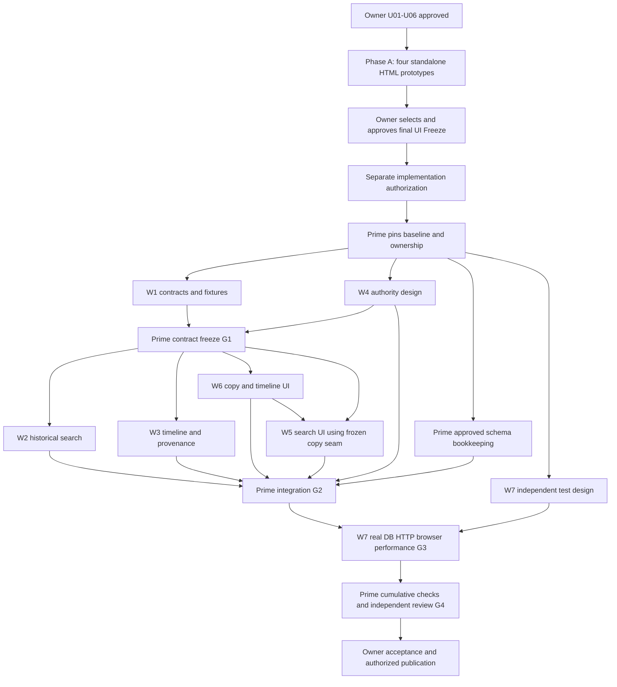

# Issue #300 — Audit Investigation Master Implementation Plan

Status: **OWNER CONCEPT A APPROVED — REAL DASHBOARD UI FROZEN — FULL ISSUE #300 CODE IMPLEMENTATION AUTHORIZED**
Implementation verdict: **WAVES 0–6 MAY START ONLY AFTER PRIME READS THIS ENTIRE PLAN AND BINDING DOCS; FROZEN UI IS IMMUTABLE**, subject to §32, the existing security/DB proof gates and a fresh baseline check.
Prepared: 2026-10-17, Asia/Amman. Repository: `yamanradwan1-rgb/valet-platform`.  
Inspected baseline: `a5426bde0bbcd264fc9a47ce7e9d2edc8ba4ee1e`, local `main` and GitHub `main`.  
Delivery: the original planning/documentation-only history below is retained for traceability. The Owner subsequently authorized and accepted Concept A's real Dashboard UI integration and now separately authorized the remaining Issue #300 code implementation **after this plan-only status update**. This plan update itself authorizes **no push, PR, merge, deployment, issue closure or editing of other files**; downstream code runs only in separately owned task worktrees.

The eight prompts in Appendix A were authored before the real UI was frozen. They are **historical task-card templates**, now executable only when reconciled with the current Owner authorization and the stronger UI immutability rule in §0. Prime MUST NOT execute their obsolete UI-building instructions (especially W5/W6), create new visual components or repeat Phase A. Contract/API/database/authorization/testing waves are now authorized locally under their existing gates; schema changes remain conditional and fully proven, not automatic.

## 0. Owner-approved progress update and immutable UI contract (2026-10-17)

This section supersedes all earlier **historical phase-status and UI-authoring permission** statements in this plan, but does **not** change U01–U06, locked business/search/security decisions, source coverage, query design or acceptance criteria.

| Gate / deliverable | Verified stage as of Owner approval | Next step |
|---|---|---|
| U01–U06 product decisions | APPROVED; unchanged | Implement and prove exactly as §§8–18,32 |
| Phase A: concepts A/B/C/D | COMPLETED (standalone prototypes) | No further concept exploration |
| Owner's selection | **Concept A — Split Investigation Workspace: APPROVED** | Do not substitute another design |
| React integration in real Audit Log | **COMPLETED LOCALLY**, isolated branch, fixture-driven | Reuse as frozen implementation baseline |
| Owner visual approval and **A4 UI FREEZE** | **APPROVED EXPLICITLY, 2026-10-17** | Zero subsequent UI design/edit changes |
| Local frontend review proof | Reported 20/20 Vitest, 28/28 keyboard, 15/15 integrated Chromium; TS/ESLint/architecture pass, independent P0/P1=0 | These are UI-only historical results; future real-data proof remains pending |
| Visual evidence caveat | Synthetic root CSS zoom=2 Arabic Chromium blank also occurs on original Audit mode; effective browser zoom examples passed | Keep documented caveat; Owner approval is not a claim of every-pixel/canvas proof |
| Real historical search, timeline, authorization, contracts, DB/query work | **NOT STARTED** | Waves 0–6 approved for local development, subject to gates |
| Actual-writer DB/HTTP/security/concurrency/performance/CI proof | **NOT RUN for full investigation** | Must be obtained, cannot be inferred from UI demo tests |
| Push / PR / merge to main / deployment / Issue closure | **NOT AUTHORIZED by this request** | Separate explicit Owner approval required |

**Frozen frontend baseline:** original main `6d7bd5991e66d8f5d93978512352a52c72bdc7f6`; task branch `feat/issue-300-concept-a-ui-integration`; task worktree `D:\kndoom\valet-platform\tmp\issue-300-concept-a-ui-integration`; UI source commit `e6414613738e3a5465f019999b9d3ac59ec26ffe`; integration report commit `d50bc8f8`; final observed local UI branch HEAD before this plan edit `0d5d0482559e5576293e341ac7ac02c655267a60` (local-review tab improvement). UI report: `docs/validation/ISSUE_300_CONCEPT_A_UI_INTEGRATION_REPORT.md`. Reference: `tmp/issue-300-ux-prototypes/concept-a-split-workspace.html` and corresponding captures. Treat the latest verified local task branch, **not the earlier HTML-only planning SHA**, as the UI freeze reference. The UI remains locally committed, not merged to main.

**Absolute Owner prohibition — ZERO UI CHANGES:** No changes whatsoever to the approved UI's visual appearance, geometry, CSS, JSX structure, visible copy, placement, responsive breakpoints, themes, RTL/LTR, icons, tabs, interactions, drawers, keyboard/focus behavior, Help or real Audit Events. No UI refactoring, cleanup, re-styling, redesign, placeholder substitution or opportunistic accessibility alteration. The **only** permitted frontend change is eliminating isolated fictional/mock Investigation data and connecting the exact existing component interfaces to real authorized API data using new/isolated client hooks, adapters and typed mapping. Preserve the rendered UI and user-visible behavior exactly, including loading/error/empty states without inventing new designs. Prefer untouched `.tsx` and `.module.css` files; any fixture-import/data-source swap must be the minimum possible behind the existing interfaces, with pre/post comparison proving no UI diff. **If any required real-data behavior cannot be supported without changing a frozen UI element or interaction, STOP that part and request Owner approval before touching it.** No agent may reinterpret an API integration as UI-edit authorization. Tests may add independent snapshots/interaction proof without modifying UI.

**Prime first-action gate:** BEFORE writing code or spawning implementation workers, read **this entire plan, §§0–35 and Appendices A/B**, `AGENTS.md`, the Accepted focused DECs and core documents listed in §4; read the frozen UI source and integration report; inspect the fresh local/remote Git state and reserve non-overlapping worktrees/owned paths. Confirm the actual frozen component interfaces before freezing W1 contracts. Do not overwrite the UI worktree or copy only its mock HTML into a new implementation tree. Document a UI file hash/baseline manifest and compare it after integration.

## 1. Executive Summary

Add an Investigation mode inside the existing Dashboard Audit Log. An authorized operator selects one Location and an event-time interval, finds Sessions using historical custody and actor relationships plus explicitly labelled current vehicle identity, and opens the full available Session timeline. The timeline combines persisted Audit, Key Custody, Dispatch and Incident records, including records outside the discovery interval. It never claims to reconstruct missing evidence or determine liability.

Historical truth has priority over a convincing UI. A Session's current key slot and a Task's current assignee cannot prove who held a key or completed an action earlier. Current employee names and vehicle descriptions are display/search aids, not immutable historical snapshots. A timestamp match is not a causal relationship. A paired Audit and domain event remain separately identifiable evidence.

The existing code supports much of the authorization, safe projection, pagination and UI machinery. The difficult work is multi-source correlation, deterministic pagination during concurrent inserts, truthful actor semantics, and independent real-database/HTTP/browser proof. Seven workers work in separate worktrees; Prime owns all shared wiring, migrations and integration. No worker is permitted to independently reinterpret a contract or broaden its owned paths.

The Owner approved U01–U06: same-Session AND between filter categories with independent in-window witnesses (no false same-event responsibility claim); CA and LM access for the new full investigation mode with existing Supervisor Audit Events retained; clearly labelled current vehicle/name/slot data, with no unsupported frozen-current-identity pagination claim; safe Incident fields without new sensitive evidence access; conditional database-owned pagination bookkeeping only if necessity and rollout safety are proven; exact Session search respects the event window while separately authorized direct open can show all available history. Vehicle filters are **Make, Model, and Plate only** (no type/category). The Owner later selected and froze the integrated React Concept A UI and authorized the remaining local code implementation (§0); this **does not** authorize any UI changes or release/publication operations.

## 2. Issue #300 Scope and Approved Decisions

Primary task: [Issue #300](https://github.com/yamanradwan1-rgb/valet-platform/issues/300). The inspected issue had zero comments. The pasted owner directive is the latest task instruction.

### Locked decisions

| ID | Classification | Binding requirement |
|---|---|---|
| L01 | LOCKED | Work inside Audit Log; retain its ordinary Events experience. No separate Investigations page. |
| L02 | LOCKED | Search is scoped to exactly one authorized Location; no cross-Location investigation union. |
| L03 | LOCKED | Historical event time is `[from, to)`. Session creation time does not replace it. |
| L04 | LOCKED | Opening a discovered Session shows its full available, authorized timeline, including outside the discovery interval. |
| L05 | LOCKED | Cover Audit Events, Key Custody, Dispatch/Tasks and Incidents. Use persisted evidence only. |
| L06 | LOCKED | Search by historical key slot and employee involvement, Session identity, and supported vehicle fields; unsupported vehicle type/category is not fabricated. |
| L07 | LOCKED | Results include first/last matching event time, matching-event count and incident indication with an explicit scope definition. |
| L08 | LOCKED | No CSV/PDF/export, new operational mutations, event backfill, replacement event store or UI redesign. |
| L09 | LOCKED | Arabic/English, RTL/LTR, exact authorization on every read and privacy-safe projection. |
| L10 | HISTORICAL GATE SATISFIED | Original planning was documentation-only. The Owner later explicitly approved Concept A UI Freeze and full Issue #300 local coding; remaining publication and release actions still require separate approval. |

### Owner approvals and completed UI-first gate (2026-10-17)

U01–U06 are approved exactly as recorded in §32. Vehicle search is limited to **Make, Model and License Plate**; no Vehicle Type/Category filter or inferred SUV/Sedan/Pickup classification. Phase A's four prototypes and the subsequent **real Dashboard Concept A UI integration are locally complete**; the Owner explicitly approved the integrated appearance as **A4 UI Freeze** and authorized the remaining Issue #300 code work. The historical Phase-A-only restriction is superseded by §0. Prime must **reuse the immutable integrated React UI**, connecting only its existing mock-data seam to real read-only investigation data. Deployment, push, PR, main merge and closure remain separate decisions.

### Explicitly out of scope

New domain event writers, historical plate/name snapshots, employee scoring or liability conclusions, GPS replay, continuous tracking, photo-provider qualification, new photo viewer authority, payment investigation expansion, guest access, global platform administration, searching across Locations, notifications, export, Native/Employee/Customer changes, generic query builders, Elasticsearch, data warehouses, new services and automatic evidence repair.

## 3. Current Repository Baseline and Commit SHA

### Repository facts discovered

| Item | Verified observation and qualification |
|---|---|
| Workspace | Primary `D:\kndoom\valet-platform` remains on `main`; frozen UI exists in isolated `tmp/issue-300-concept-a-ui-integration` worktree. This progress update edits the Master Plan only; future code must use isolated task worktrees. |
| Baseline | Local HEAD and GitHub main both `a5426bde0bbcd264fc9a47ce7e9d2edc8ba4ee1e`. |
| Concurrent movement | Inspection began at `11afb194bbe692e0df3762ee0dc2644d0a0126c5`. Another workflow advanced main during planning. Relevant delta was checked; freeze/revalidate an execution SHA rather than assuming main stayed still. |
| Worktree state | No tracked changes observed before writing this file. Pre-existing untracked `RUN-VAYLET.ps1`, `START-VAYLET.cmd`, `VAYLET_LOCAL_QA_README.md` belong to the user and remain untouched. |
| Task branch | Historical planning found none; now `feat/issue-300-concept-a-ui-integration` exists locally with frozen React UI at `0d5d0482` before the plan update. Prime must not replace or reset it. |
| Issue #215 | Closed as not planned after merged photo work. Closure is not full provider/physical/retention acceptance; follow-up gates #288/#290/#291 remain relevant. Old metadata-only assumptions are obsolete. |
| Issue #287 | Closed completed. Final issue comment reports merge `9ef50cf4b3d0f2d8f9551112b28dbf868deb07e7` and CI success. Comment-reported CI is not an independently rerun check in this task. |
| Issue #297 | Closed completed; Native change present at initial `11afb...`; no new backend historical identity persistence. Physical verification was owner-deferred. |
| Issue #299 | Relevant implementation now present: Dashboard completed Task assignee projection. It is an assignee display fix, not a completion-actor evidence contract. Issue state can lag merged code. |
| Issue #275 | Latest merge changes incident recovery/privacy handling. Reuse its current response boundary; do not resurrect old Incident response assumptions. |
| PR/CI evidence | UI integration report documents 20/20 Vitest, 28/28 keyboard, 15/15 Chromium locally. Full real-data DB/HTTP/performance validation and Issue #300 PR/CI acceptance are not thereby proven. |
| Tool limitations | `gh` was unavailable; Git remote transport failed with Windows credential/TLS plumbing. GitHub connector reads provided independent remote issue/branch/commit evidence. No credentials were changed. |

`docs/14_PROJECT_STATUS.md` is a dated handoff snapshot, not current release truth. Its Issue-215 P0 wording predates merged code. Source, focused Accepted decisions and verified GitHub state must be distinguished from that snapshot.

## 4. Authority/Blueprint Compliance

### Binding requirements

Apply the supplied AGENTS authority order: latest explicit owner instruction; Accepted focused decisions and their canonical log; `docs/15_BLUEPRINT_V1_REBASELINE.md`; product/state/schema/domain documents; stack/structure/engineering/security/workflow rules. A material focused-DEC/log conflict stops the affected work. This plan does not promote its proposals to Accepted status.

The Founder Blueprint PDF is not present in the inspected reference directory; the repository-native bridge is the available approved source. The historical Arabic concept PDF is not substituted for the missing Blueprint. Relevant read set includes `docs/00_SOURCE_OF_TRUTH.md`, `01_PRODUCT_SCOPE.md`, `02_DOMAIN_MODEL.md`, `03_DATABASE_SCHEMA.md`, `04_VALET_SESSION_STATE_MACHINE.md`, `05_ENGINEERING_RULES.md`, `06_SECURITY_AND_DATA_RULES.md`, `07_DEFINITION_OF_DONE.md`, `08_DECISIONS_LOG.md`, `09_TECH_STACK.md`, `10_REPOSITORY_STRUCTURE.md`, `11_REQUIREMENTS_TRACEABILITY.md`, `13_COLLABORATION_WORKFLOW.md`, `14_PROJECT_STATUS.md`, `15_BLUEPRINT_V1_REBASELINE.md`, `17_AGENT_CODE_STRUCTURE_RULES.md`, and the Dashboard integration/execution plans. Focused inspections underpin the facts below; this is not a claim of full production qualification.

| Authority | Consequence for #300 |
|---|---|
| DEC-033 / DEC-068 | Five persisted key-custody types; slot reassignment is clear+assign. Normal unbound parking need not contain an earlier key checkout. Absence is not automatically evidence loss. |
| DEC-034 / DEC-035 | Task lifecycle is separate from physical custody. Dispatch actor, previous assignee and new assignee have different meanings. |
| DEC-049 | No new raw tracking access or tracking retention assumptions; GPS is excluded from this query. |
| DEC-059 / DEC-080 | Incident access and CA management access have their own boundaries. Do not reuse operational write authority as management read authority. |
| DEC-078 / DEC-079 / DEC-082 | Current exact staff session, MFA for CA, scope/role separation, allowlisted projections and non-recursive Audit reads. |
| DEC-088 / DEC-094 | Current Dashboard commercial eligibility; historical access to inactive Locations where the applicable management contract permits it. Resource-specific detail boundaries still apply. |
| DEC-096 | Physical resource UUID is identity; exact code formatting is meaningful. QR or a code is not authorization. |
| DEC-102 | Live historical staff attribution is deliberately strict and purpose-specific. Checked-in association and current assignee do not prove completion; no silent reuse as an all-Audit liability classifier. |
| DEC-103 | Three-arm Audit discovery and anomaly handling are useful bounded patterns, not permission to trust arbitrary metadata or broaden existing partial indexes. |
| DEC-104 | Verified photo infrastructure exists but management byte-view permission does not follow from it. Provider/physical/retention gaps remain separate. |

Affected entities: Organization, Location, current staff session, OrganizationMembership, Location access, Shift (only existing Supervisor rules), ValetSession, Vehicle, KeySlot, KeyCustodyEvent, Task, DispatchEvent, AuditEvent and Incident. RetrievalRequest, HandoffVerification, ConditionNote and photo records are supporting evidence with narrower boundaries.

Affected ValetSession transitions: **none**. Affected Task/Dispatch transitions: **none**. Configuration-policy impact: **none**; Company-default/Location-override behavior is unchanged. Search limits are technical safeguards, not a new operating-policy settings object. Scope is the owner-approved operational investigation capability within the modular monolith, not advanced BI.

### Derived conclusions

DERIVED: multi-source history needs purpose-built projections; existing current-state Dashboard endpoints cannot answer historical-slot queries. DERIVED: raw table SELECT permission does not establish end-user disclosure permission. DERIVED: schema bookkeeping may be needed for strong pagination, but a migration is conditional rather than presumed unnecessary.

## 5. Existing Implementation Inventory

### Existing implementation patterns

All paths below are existing baseline paths; proposed files are separately labelled in §22.

| Area | Existing path / exported seam | Reuse and limit |
|---|---|---|
| Audit HTTP | `apps/api/src/modules/management/management-audit.controller.ts` | Organization-prefixed management routes, strict shared parsing, request runner, no-store. Existing Events routes stay unchanged. |
| Service | `management-audit.service.ts` in that directory | Transactional authorization, snapshot capture, limit+1 and projection. Do not overload it with every source query. |
| Authority | `management-audit-authorization.ts`: `authorizeManagementAuditOrganization`, `authorizeManagementAuditLocation` | Exact credential/current membership/MFA/commercial scope. Wrap with investigation-specific allowed-role rules. |
| Safe audit | `management-audit-query.ts`, `management-audit-projection.ts`, `management-audit-detail-projection.ts`, `management-audit-event-catalog.ts` | Known-event allowlist; unknown events minimal; identity enrichment bounded. Helpers are not all exported. Do not widen global Events output for convenience. |
| Snapshot/cursor | `management-pagination-snapshot.ts`, `management-audit-cursor.ts` | Signed bounded snapshot encoding and validation; existing domain must not accept a new cursor type accidentally. |
| Module | `management.module.ts` | Prime-only controller/provider and RequestIdMiddleware wiring. Keep management composition, avoid a speculative subsystem. |
| Actor history | `apps/api/src/modules/dashboard/operational-history-audit-discovery.ts` | Three discovery arms and anomaly awareness. Live-specific classifier is not a generic management adapter. |
| Current assignee | `dashboard/operational-assignee-projection.ts`, `overview-retrieval-tasks-query.ts` | #299 completed Task display is a current assignee relation; it is never substituted for a Dispatch actor. |
| Current key/incidents | `dashboard/overview-shifts-keys-incidents-query.ts` | Current occupancy/open incidents only; cannot supply full history. |
| Identity | `vehicles/vehicle-identity-command.ts`, `vehicle-details-command.ts` | Shared normalization semantics; current mutable fields; Audit omits old/new identity values. |
| Custody writers | `keys/key-custody-event-writer.ts`, `assign-key-slot-command.ts` | Persisted slot at event time, actual actor and reassignment pair. |
| Parking writers | `parking/start-parking-command.ts`, `confirm-parked-command.ts`, `confirm-parked-audit.ts` | Conditional checkout, slot binding/return, correlated Task and Audit versions. |
| Dispatch writers | `dispatch/dispatch-event-writer.ts`, `record-task-mutation.ts`, `queue-parking-task-command.ts` | QUEUED is real Dispatch evidence even without a matching Audit row. |
| Retrieval/handoff | `retrieval/guest-retrieval-request-command.ts`, `start-retrieval-audit.ts`, `complete-handoff-audit.ts` | Snake/camel metadata variants are writer-specific; release and completion are distinct records. |
| Incident writer | `incidents/incident-reporting-command.ts` | Incident OPEN plus paired Audit; no complete resolution lifecycle writer established. |
| Photo authority | `vehicle-photos/condition-photo-authorization.ts` | Operational staff permission does not grant CA/LM a byte viewer. |
| MFA side effect | `auth/mfa/mfa-assurance-policy.ts`: `recordAdminActivityInTransaction` | Existing security-session activity update; no domain/evidence mutation and no MFA assurance refresh. |
| Contracts | `packages/contracts/src/management-audit*.ts` | Strict schemas, safe unions, bounds and existing identity labels. New schemas remain separate. |
| UI | `apps/dashboard/src/features/audit/` | `audit-page.tsx`, `use-audit-page.ts`, `audit-api.ts`, `audit-scope.ts`, filters/table/drawer/copy/styles. Reuse scope generation and current query client patterns. |
| Existing UI evidence | `apps/dashboard/e2e/md04-audit.spec.ts`, `md-r08-audit-security.spec.ts`, Issue-277/278 Audit suites | Regression anchors for Events, identity, long timestamps, Help, RTL and geometry; verify exact filenames before invoking. |
| Runtime/CI | `scripts/test-harness/`, `packages/database/scripts/runtime-table-privileges.mjs`, `.github/workflows/ci.yml` | Owned resources, PostgreSQL lanes, least privilege and cumulative quality job. Local pass is not CI. |

Structure: existing Audit drawer is about 207 lines, event copy about 277, and `audit.module.css` 300. New work belongs in small investigation modules, not those files. Recount physical authored lines at execution time; no minification or compressed formatting to evade the ceiling.

## 6. Source Coverage Matrix

The following joined matrices use the same row IDs. Matrix A supplies required fields 1–10 (name, source/table, exact type, ID, scope, Session, time, actor, historical relation). Matrix B supplies fields 11–20 (safe metadata, existing API, authorization, indexes, overlap, completeness, retention, adapter, owner, proof). A row with multiple exact event types describes the same persistence contract; each type must receive a fixture. “Partial” means evidence is limited, not that the implementation should manufacture a missing event.

### Matrix A — persisted facts and relationships (fields 1–10)

| ID / user-facing event | Canonical source / table | Exact type/status and primary ID | Org/Location and authoritative Session link | Timestamp meaning | Actor relationship | Historical slot/Task/vehicle relation |
|---|---|---|---|---|---|
| S01 Slot assigned / cleared | KeyCustodyEvent / `key_custody_events` | `SLOT_ASSIGNED`, `SLOT_CLEARED`; row `id` | Row org/loc/session, checked against parent Session | `occurred_at`: command operation time; `created_at`: insertion time | `actor_membership_id` | Persisted `key_slot_id`, not Session.currentKeySlot; Session vehicle association only |
| S02 Key checkout / return / release | Same | `CHECKED_OUT`, `RETURNED_TO_SLOT`, `RELEASED`; row `id` | Same composite scope | Same | Persisted actor; label actor, not unproved continuous holder | Persisted slot; no inferred custody interval or hidden handoff |
| S03 Task queued | DispatchEvent / `dispatch_events` | `QUEUED`; row `id` | Row org/loc/session and composite Task FK | `occurred_at` operation time; `created_at` insertion | Nullable actor; absence remains unknown/system only where actor provenance proves system | Persisted `task_id`, previous/new assignee separately |
| S04 Task assigned / reassigned | Same | `ASSIGNED`, `REASSIGNED`; row `id` | Same | Same | Actor executes assignment; `previous_assignee_membership_id` and `new_assignee_membership_id` are participants | Historical Task relation; current Task assignee never overrides these columns |
| S05 Task accepted / declined / started / completed / cancelled | Same | `ACCEPTED`, `DECLINED`, `IN_PROGRESS`, `COMPLETED`, `CANCELLED`; row `id` | Same | Same | Actor plus independently labelled previous/new assignee | Historical Task UUID/type from same scoped Task; statuses are Dispatch facts, not inferred physical state |
| S06 Check-in lifecycle | AuditEvent / `audit_events` | `VALET_SESSION_CREATED`, `VALET_SESSION_CHECK_IN_COMPLETED`, `VALET_SESSION_CHECK_IN_CANCELLED`, `VALET_SESSION_PRE_CUSTODY_CANCELLED`; `id` | Direct Session FK preferred; scoped recognized Session entity fallback; mismatch reported | `occurred_at` writer event time; `created_at` ingestion/insertion | `actor_membership_id` / actor type; no substitution with checked-in-by | Entity/session UUID; safe state/version metadata |
| S07 Parking / retrieval start / ready | AuditEvent | `VALET_SESSION_PARKING_STARTED`, `VALET_SESSION_PARKED`, `VALET_SESSION_RETRIEVAL_STARTED`, `VALET_SESSION_READY`; `id` | Direct/entity plus verified scoped Task reference discovery | Same | Persisted Audit actor | Writer-specific `taskId` or `task_id`, parking IDs; version coherence required for causal grouping |
| S08 Guest retrieval request / cancellation | AuditEvent; supporting `retrieval_requests` | `RETRIEVAL_REQUESTED`, `RETRIEVAL_CANCELLED`; Audit `id` | Audit scope + Session; request belongs through Session | Audit occurred; supporting `requested_at` is request fact, not arbitrary new timeline event | Nullable staff actor / guest actor type | Request UUID only if allowlisted and relation validates; mutable request status is not history |
| S09 Handoff verification / override | AuditEvent; supporting `handoff_verifications` | `HANDOFF_VERIFIED`, `HANDOFF_SUPERVISOR_OVERRIDE`, `HANDOFF_VERIFICATION_ISSUED`, `HANDOFF_VERIFICATION_ROTATED`, `HANDOFF_VERIFICATION_FAILED`, `VALET_SESSION_HANDOFF_INITIATED`, `VALET_SESSION_HANDOFF_ABORTED`; Audit `id` | Scoped Session + Task where recorded | Audit occurred; `verified_at` supporting fact only | Audit actor; never derive actor from current assignee | Method allowed; `secret_hash`, codes, attempt secrets and free override reason excluded |
| S10 Vehicle release / Session completion | AuditEvent | `VALET_SESSION_VEHICLE_RELEASED`, `VALET_SESSION_COMPLETED`; distinct Audit `id`s | Scoped Session; writer metadata `task_id`, `key_slot_id` etc validated | Audit occurred; equal operation times allowed | Audit actor; release authority not inferred from verification alone | Actual persisted references; `consumed_at` does not prove release |
| S11 Other known Session-related Audit actions | AuditEvent | `VALET_SESSION_KEY_SLOT_ASSIGNED`, `VALET_SESSION_KEY_SLOT_REASSIGNED`, `VALET_SESSION_KEY_SLOT_CLEARED`; `TASK_ASSIGNED`, `TASK_ACCEPTED`, `TASK_DECLINED`, `TASK_REASSIGNED`; `CHECK_IN_CONDITION_NOTE_RECORDED`, `CHECK_IN_CONDITION_NOTE_CORRECTED`, `CHECK_IN_CONDITION_PHOTO_REGISTERED`, `VALET_SESSION_CHECK_IN_CONDITION_COMPLETED`; `GUEST_ACCESS_ISSUED`, `GUEST_ACCESS_ROTATED`, `GUEST_ACCESS_REVOKED`; `id` | Direct link or explicitly permitted entity/Task link only | Audit occurred | Exact recorded actor | Safe per-type relationships; generic metadata scanning prohibited; guest credential values never projected |
| S12 Incident reported | Incident / `incidents` plus distinct Audit | Incident `status=OPEN` at writer creation; Audit `INCIDENT_OPENED`; each source has its own `id` | Incident org/loc/session FK; Audit INCIDENT entity can join scoped Incident | Incident `created_at` is creation fact, writer currently uses application Date; Audit occurred is separate source time | Incident `reported_by_membership_id`; Audit actor separate | Incident UUID; no invented participants, key holder or causal culprit |
| S13 Incident later lifecycle | Incident current row | `OPEN`, `INVESTIGATING`, `RESOLVED`, `CLOSED` schema states; row `id`, optional resolved fields | Same | `resolved_at` if stored; no general closed-at history | `resolved_by_membership_id` if present; no participant collection | Current status / optional recorded resolution fact, not manufactured transition events |
| S14 Vehicle identity/detail correction | Vehicle + Vehicle-scoped Audit | `VEHICLE_CONFIRMED_PLATE_IDENTITY_SET`, `VEHICLE_CONFIRMED_PLATE_IDENTITY_CORRECTED`, `VEHICLE_TEMPORARY_DESCRIPTOR_IDENTITY_SET`, `VEHICLE_TEMPORARY_DESCRIPTOR_IDENTITY_CORRECTED`, `VEHICLE_DETAILS_CORRECTED`; Audit `id` | Current writers explicitly supply scoped `valetSessionId` to the custody Audit helper; use that direct relation. Vehicle ID alone may span many Sessions | Audit occurred; Vehicle updated_at is current revision only | Audit actor when visible under existing allowlist | Audit stores mode/change flags, not old/new plate/make/model; attach the recorded direct Session only, not every Session of the Vehicle |
| S15 Condition notes/photo evidence | ConditionNote / photo records and existing Audit | Persisted note/photo purpose/status per current schema; record `id` | Through scoped Session and own authorization | Note `created_at`, photo capture/upload/verification fields have distinct meanings | Note author / photo captured-by | Private evidence references only if permitted; not raw object key/URL or new management viewing grant |
| S16 Unknown/unlinked/contradictory record | Existing source row | Unknown Audit type or incompatible links; original source `id` retained internally | Cannot be attached to another Session by guesswork | Preserve source timestamp internally | Do not enrich unknown event with names/raw payload | Minimal safe unknown item only where Session association itself is proven; otherwise diagnostic count, not a fabricated link |

Exact type registry in S06–S11/S14 is grounded in `packages/contracts/src/management-audit-events.ts` and inspected writers. W1/W3 must revalidate it against the execution baseline before freeze; this is not permission to create a new event enum. Every other already-allowlisted Audit event with a proven Session relation retains its existing safe projection, including financial events if already linked and authorized; this does not add payment investigation fields or new financial workflows. Unlinked shift/configuration/location events are not forced onto a Session.

### Matrix B — disclosure, coverage and implementation (fields 11–20)

Authority codes: **M** = proposed CA/LM investigation authority (§17/§32); **E** = existing role-scoped Audit Events authority; **P** = evidence's own separately established permission. Index abbreviations are expanded in §18. Retention “no operational deletion” means repository rules protect operational history; it is not proof every historical deployment retained every row.

| ID | Permitted metadata / existing projection | Authority | Index | Multi-source overlap / completeness | Retention availability | Required adapter; owner | Mandatory proof |
|---|---|---|---|---|---|---|---|
| S01 | Type, source ID, time, safe slot label/ID, actor; existing raw writer, no full management historical read | M | K-session, K-location; proposed K-slot | Paired Audit possible; direct slot evidence complete for row, coverage partial over life | No operational deletion; legacy gaps possible | Custody query+safe projection; W3, search W2 | T01,T02,T03 |
| S02 | Same; no inferred holder/reason | M | Same | May overlap parking/retrieval Audit; absent checkout can be expected | Same | Same | T04,T05 |
| S03 | Task ID/type, event type, explicit actor/assignee roles | M | D-session,D-location | QUEUED may have no Audit; direct record authoritative | No operational deletion | Dispatch adapter W3; W2 participation | T06,T07 |
| S04 | Same; raw free-text reason omitted | M | Same; actor indices conditional | Current Task differs normally; no collapsing different actions | Same | W3 | T08,T09 |
| S05 | Same; completion actor remains separate from assignee | M | Same | Audit overlap possible, contradictions visible safely | Same | W3 | T10,T11 |
| S06 | Existing per-type state/version projection; current display name labelled | M/E intersection | A-session,A-org | Direct/entity discovery duplicate dedup by Audit ID only | No operational deletion | Audit adapter W3 | T12,T13 |
| S07 | Safe state/versions and verified Task/parking refs; no raw JSON | M/E intersection | A-session; A-Parked entity/task partial | PARKED+Dispatch coherence may group, not replace either | Same | W3 using own management adapter | T14,T15 |
| S08 | Request actor kind and safe reference; no guest bearer/contact | M/E intersection | A-session; request supporting index | Request table is supporting current fact; preserve Audit as event | No deletion of operational history | W3 | T16 |
| S09 | Method enum, safe state/refs; no code/hash/override free text | M/E intersection | A-session | Verification is distinct from release, including repeated attempts | Secret expiry is not timeline deletion | W3 | T17 |
| S10 | Method, safe slot/task/version fields from allowlist | M/E intersection | A-session | Two Audit rows plus possible custody release, all distinct | No operational deletion | W3 | T18 |
| S11 | `projectManagementAuditDetails`-compatible safe detail; type-specific adapter | M/E intersection | A-session; bounded other arms | Partial by existing writer; unknown remains minimal | Per-source actual retention only | W3 | T19,T20 |
| S12 | Incident ID/type/severity/time/reporter/current status; description excluded pending U04 | M; detail P separately | I-session proposal; existing scoped filters | Incident creation and Audit opening are different evidence rows, not two incidents | No operational deletion; no photo inference | Incident adapter W3; W2 indication | T21,T22 |
| S13 | Current status labelled current; optional resolution attributes only if P permits | M/P | Scoped primary key | Full lifecycle history absent; do not invent transitions from schema enum | Unknown historical completeness | Truthful status detail W3; UI W6 | T23 |
| S14 | Current plate/make/model/descriptor, labelled current; safe correction flags only | M for current identity; E for linked Audit | Vehicle PK/plate unique; bounded Session join | Historical values absent; Vehicle-wide Audit not automatically a Session event | Current field can change; old value unavailable | W2 current search; W3 no false attachment | T24,T25 |
| S15 | Evidence availability/ref state only where own policy permits; current Audit safe projection remains | M ∩ P | Scoped evidence indices | Evidence record != proof bytes verified; no new Note/Photo union silently | Provider/retention can remove bytes; #288/#290/#291 not closed here | W3 unavailable/unsupported reference; W6 messaging | T26,T27 |
| S16 | Unknown minimal kind, time/source ID if safe; no raw type/metadata/actor enrichment | M/E intersection | Bounded discovered set | Partial/unverifiable, never confidently attributed | Cannot infer deletion reason | W3 diagnostics, W4 privacy | T28,T29 |

## 7. Missing Evidence and Data Gaps

| Gap | Verified limitation | Truthful behavior / execution consequence |
|---|---|---|
| Historical vehicle identity | Current Vehicle fields are mutable; identity Audit records mode/change indicators, not old/new values | Label current vehicle identity. Never claim a previous plate search is supported. U03 approval required. |
| Historical staff names | Membership/user joins resolve current names; no immutable name snapshot established | Search selects canonical membership ID; display current name or unavailable. IDs, not name text, establish participation. |
| Vehicle type/category | No persisted type/category field found in the current Vehicle model | Hide unsupported filter; make/model/descriptor remain. Do not derive type from model. |
| Key slot code history | Event records slot UUID, joined code is current; no historical label snapshot | Use UUID identity and “current slot code” where relevant; never match Session.currentKeySlot as history. |
| Full Incident lifecycle | Creation writer proved; schema states/resolution fields do not prove writers for every later transition | Show report plus current status/recorded facts; state “transition history unavailable” when applicable. |
| Incident participants | Reporter and optional resolver exist, not a generalized participant set | Employee filter matches those roles only if approved source inclusion; never call all nearby staff participants. |
| Complete evidence bytes | Photo infrastructure exists; management viewing authority and provider/retention proof remain separate | Show a safe unavailable/not-authorized reference state; no unauthorized signed URL. |
| Cross-source snapshot fence | Actual migration/Prisma birth-XID exists for Audit and Sessions, not Custody/Dispatch/Incident | U05 gates stronger cross-page snapshot claim; timestamp-only is insufficient for late commits. |
| Schema-doc mismatch | `docs/03_DATABASE_SCHEMA.md` describes custody pagination birth metadata not found in actual migrations/Prisma | Prime must reconcile this discrepancy before DB work. Documentation is not proof a column exists. |
| Event registry drift | The inspected catalog can change before execution | W1/W3 revalidate the listed exact types and test every supported source; no new event spelling introduced by UI. |
| Deployment history | Repo/source/issue closure does not prove every live deployment wrote/retained all records | Timeline says “available recorded history”, not “complete custody truth”; no zero-gap warranty. |

No gap is permission to modify historical rows, backfill attribution, add domain writers or conceal contradictions. A material authority conflict is escalated to Prime and Owner, not repaired by a worker's interpretation.

## 8. Historical Search Semantics

Owner-approved U01/U03/U06 semantics (with the current-identity consistency qualification in §16):

1. Resolve current caller authority to Organization + exactly one Location before looking up candidates or revealing counts.
2. Build a bounded union of proven event relationships in that Location and `[from,to)`. One witness is one canonical source record, not one join row.
3. Key-slot filter matches `KeyCustodyEvent.key_slot_id` (and only separately approved verified Audit slot references if needed); it never uses the Session's current assignment. A slot reassigned later still finds its earlier Sessions.
4. Employee selector resolves a canonical membership ID, including inactive historical members within the Organization. Participation is the OR of separately typed actor/previous-assignee/new-assignee/reporter roles within each approved source. Current Task assignee alone is excluded. UI identifies which role matched.
5. Session filter is an exact UUID. It still obeys the event window in search. A separately labelled direct Session open can omit discovery time, but it must use the same exact-Location detail authorization and has no authority from possession of an ID.
6. Plate filter applies the actual plate normalization semantics (trim, NFKC, uppercase and approved separator removal), then bounded current-identity comparison. Country disambiguation must follow stored fields; no fuzzy transliteration, OCR inference or unrestricted wildcard SQL.
 7. Make/model are bounded current fields, not historical event text. Proposed prefix match uses escaped literal input; search result labels this clearly. Missing value does not match. Vehicle Type/Category and separate temporary-descriptor **search filters** are excluded by the Owner's current Make/Model/Plate-only decision; a plate-less descriptor may still appear as a safe current identity fallback in results.
8. Match results are grouped by Session UUID only after per-source scope and event predicates. Return first/last matched time, distinct matching-record count, source/role match reasons and current summary. Never count raw joined rows.
9. Incident indication is proposed as `hasVisibleIncident` for the Session as of the investigation snapshot, irrespective of the discovery window, labelled “Session has recorded incidents”; a separate `matchedIncidentCount` counts incident witnesses in the window. Neither reveals unauthorized incident existence.
10. No fuzzy employee-name free-text across all audit payloads. Proposed bounded selectors load authorized current labels for stable membership/slot IDs, including inactive resources when permitted. Duplicate names show distinct safe identities without email/phone fallback.

Search result truth example: Session X used slot A at 09:00, moved to B at 10:00 and is now in C. Searching A over 08:30–09:30 returns X with the actual 09:00 witness; current C may appear only as a separately labelled current fact. It does not move the witness to C.

## 9. Combined Filter Semantics

**APPROVED U01**: AND between Session-level predicates, each selected historical category having its own in-window witness, even when different events satisfy different filters. This finds an operational investigation where one employee reassigned a Task and another returned the key, without pretending those actions were one record.

Define `W(S)` = authorized canonical events of Session S inside `[from,to)` and the snapshot. `K(S)` = events in W with the chosen slot; `E(S)` = events in W with chosen membership in a supported role. Match requires `K(S) nonempty AND E(S) nonempty` when both are selected, plus any exact Session/current vehicle predicate. `matchingEvents` is the deduplicated union of the witnesses for active historical categories; with no historical category it is W. Session/current vehicle predicates qualify the Session but do not manufacture event witnesses.

| Case | Recommended result | Proof/message |
|---|---|---|
| Slot A at 09:00, employee E on another event at 09:20, both in window | Match | Two independent match reasons; never “E handled A” unless a single record proves that. |
| Slot A in window, E only outside window | No search match | Full detail may later show E outside window; it does not qualify discovery. |
| One event proves E + slot A | Match, count once | Canonical source ID dedup before count. |
| Vehicle matches but no event in window | No search match | Direct Session open is separate, if approved. |
| Slot A belongs to another Location | Denied/invalid scope without cross-scope suggestions | Not a zero-count oracle. |
| Employee name duplicates | Explicit membership choice | No accidental union of namesakes. |

Same-event AND is **not** the approved behavior; do not silently switch to it. A UI checkbox must not silently switch semantics. Exact-match Session plus other filters also uses AND; no hidden “ID bypasses filters”.

## 10. Timezone and Timestamp Rules

UTC instants are the transport and database comparison unit. Accept strict ISO-8601 UTC strings (`...Z`) after UI conversion; reject invalid dates, non-finite values, `from >= to`, unknown fields and over-limit ranges. Proposed initial maximum is 31 elapsed days, default 24 hours, subject to performance/Owner acceptance (§28); this is a proposed guardrail, not an existing policy.

UI uses the authoritative exact Location timezone, consistent with existing `audit-presentation.ts` and its authority tests. `Location.timezone` is persisted; Organization Audit currently uses UTC, but Investigation requires one Location. Never fall back silently to the browser timezone. Preserve the resolved timezone on the applied search; a Location/timezone revision invalidates the draft or requires explicit reapplication. Convert once at Apply; show the resolved UTC interval in accessible detail. DST nonexistent local times require correction; ambiguous times require an explicit offset choice rather than guessing. Midnight inclusive start and exclusive end receive real tests. Relative presets freeze “now” when applied, not on each page fetch.

Database columns use millisecond precision (`timestamptz(3)`); preserve that precision in cursors. `occurred_at` is source event time; `created_at` is insertion/record time; Incident creation currently uses application time. Do not sort by browser time, reformat-and-parse strings or assume source clocks establish a causal ordering. Late arrival can have old occurred time. Display chronological order and provenance, not an invented causal sequence.

## 11. Search API Design

**Proposed, conditional on §32; no endpoint is implemented by this plan.** Follow the two existing management controller patterns: Audit and staff-shift-history under `/v1/staff/management/organizations/:organizationId`.

| Route | Purpose / owning worker |
|---|---|
| `GET /v1/staff/management/organizations/:organizationId/locations/:locationId/audit-investigations/sessions` | Search; W2 controller/service. |
| `GET .../audit-investigations/filters` | Bounded membership or key-slot suggestions for canonical selection; W2, W4 authorization. Reuse an existing management selector only if its inactive-history semantics and disclosure are equivalent. |

Search query proposal: required `from`, `to`; optional `sessionId`, `keySlotId`, `membershipId`, `plateCountry`, `plate`, `make`, `model`; `limit` default 25/max 100; opaque `cursor`. Strict parsing rejects client role/organization override, metadata keys, SQL sort names, unsupported category/type and a `descriptor` search parameter. At least time + exact Location is required; bounded time-only search is allowed. All string bounds must be frozen by W1 before consumer work; proposal plate 32, country 8, make/model 80, selector text 80, cursor 4096 bytes, subject to existing tighter domain bounds.

Response proposal: `{ items, nextCursor, snapshotAt, semanticsVersion, coverage }`. Each item: `sessionId`, `currentVehicle`, `firstMatchedAt`, `lastMatchedAt`, `matchingRecordCount`, bounded `matchReasons`, `hasVisibleIncident`, `matchedIncidentCount`, `currentState` explicitly labelled current, and `coverage`. No unbounded event arrays in results. No total-universe count query on every keystroke. Suggestions return at most 20 with continuation or a “refine” state, never an entire staff directory.

Apply performs the request; editing fields does not send unbounded network calls. Selector requests are debounced/cancelled and scoped; no raw query text in telemetry. Use existing API errors for authentication/denial/unavailability; proposed machine code for invalid/expired cursor must be frozen in W1/Prime's existing error mapping ownership. HTTP 400 for invalid filters/cursor; existing indistinguishable inaccessible-resource response contract for scoped resource lookup; no new differentiating tenant oracle.

No-store and existing request ID headers apply to success and error paths. GETs do not write Audit/domain rows. Existing CA activity touch is retained (§17), so a literal PostgreSQL READ ONLY transaction cannot be blindly applied.

## 12. Timeline API Design

Proposed routes under the same exact-Location prefix:

| Route | Purpose |
|---|---|
| `GET .../audit-investigations/sessions/:sessionId/timeline` | Session header, available coverage and one chronological page. W3. |
| `GET .../audit-investigations/sessions/:sessionId/events/:source/:eventId` | Optional lazy safe detail for one timeline item; W3. Omit route if frozen DTO contains all permitted detail; never introduce it without a distinct authorization test. |

Timeline query: `limit` default 50/max 100, opaque cursor. Optional discovery-context token carries only bounded non-sensitive highlights, not authority. It must not filter out events outside the original search interval. Initial timeline obtains its own snapshot and explicitly states that newer records may exist since the search; do not pretend independently captured pages share a snapshot. For a common search/detail snapshot, W1 must explicitly bind and validate it under U05 instead.

Response: `{ session, items, nextCursor, snapshotAt, order: 'ASC', coverage, discoveryContext? }`. Each item includes stable key, source, source event ID, occurred time, safe event kind, persisted actor/participation roles, safe references, provenance/quality state and safe detail. Unknown event is minimal. Coverage is per source, with `AVAILABLE`, `PARTIAL`, `NOT_SUPPORTED`, `NOT_AUTHORIZED` or `UNAVAILABLE` only when the reason is known; no inferred “deleted” reason.

Timeline source query errors are fail-closed for a successful full page: do not silently return only three of four expected sources as complete. Retryable failure shows an error/retry state. Explicit unsupported evidence references may be partial without invalidating the core four-source page. A denial on optional detail yields unavailable detail, never stale previously authorized data.

Detail independently authenticates, authorizes Location, proves Session containment and proves the selected source record belongs to that Session/scope. A source/event UUID from another row, cursor or prior page is not permission. It returns only the same purpose-specific safe detail. No raw metadata endpoint, signed object URL, arbitrary table name or source name reaches SQL.

## 13. Zod/TypeScript Contract Proposals

W1 owns new files; consumer workers import from the frozen package entry, never maintain local copies. This is an interface sketch, not implementation:

```ts
type InvestigationSource = 'AUDIT' | 'KEY_CUSTODY' | 'DISPATCH' | 'INCIDENT';
type EvidenceQuality = 'RECORDED' | 'PARTIAL' | 'UNVERIFIABLE';
type ParticipationRole = 'ACTOR' | 'PREVIOUS_ASSIGNEE' | 'NEW_ASSIGNEE' | 'REPORTER';
type CurrentLabel<T> = { value: T | null; basis: 'CURRENT'; unavailable: boolean };
type TimelineKey = { source: InvestigationSource; eventId: string };
type InvestigationReadScope = {
  organizationId: string; locationId: string; membershipId: string;
  role: 'ORG_ADMIN' | 'LOCATION_MANAGER';
};
```

The read scope is server-derived and never accepted as a client authority object. Exact staff-session identity for cursor binding remains internal, not a response credential. A safe member reference contains membership UUID and bounded current full name or unavailable state; no email, phone, account status explanation or cross-tenant fallback.

Freeze exports: `auditInvestigationSearchQuerySchema`, `auditInvestigationSearchResponseSchema`, `auditInvestigationTimelineQuerySchema`, `auditInvestigationTimelineResponseSchema`, `auditInvestigationEventDetailSchema`, `auditInvestigationFilterQuerySchema`, `auditInvestigationFilterResponseSchema`; inferred TS types. Discriminated detail schemas are strict. IDs are UUIDs; dates canonical; numeric counts nonnegative safe integers; list sizes bounded. `unknown`/arbitrary `record<string, unknown>` is not an outward metadata escape hatch.

Cursor internal payload proposal: version/purpose, org/location, current principal+exact session binding digest, normalized-filter digest, snapshot timestamp+DB snapshot, last sort tuple, issued/expiry times. No raw plate, employee search text, bearer token or password enters it. Signed does not mean encrypted; keep payload non-sensitive and purpose-specific. Existing HMAC helper/keying pattern can be reused without a new secret if domain separation is explicit.

Contract freeze artifact: a small fixture set for every source, unknown, partial, empty, stale-cursor and denial; W1 passes contract tests; Prime publishes its exact commit SHA. Only Prime approves a versioned contract change and wakes all dependants.

## 14. Source Correlation and Provenance

1. Direct composite scoped Session relation wins. Validate org/loc/session together in SQL; UUID equality alone is insufficient.
2. For Audit rows without direct Session linkage, allow only explicitly recognized `entity_type`/`entity_id` routes and known writer-specific Task metadata keys. A Task reference resolves through a Task in the same Organization/Location/Session. Incident entity resolves through the same scoped Incident. Vehicle entity alone cannot identify which Session a correction concerned.
3. If direct Session and metadata/entity disagree, do not silently choose the convenient Session. Exclude unsafe attribution, retain a privacy-safe diagnostic for the already authorized scope, and classify as UNVERIFIABLE. Never reveal the other tenant's reference.
4. Deduplicate three-arm Audit discovery by Audit primary key before joining names/counting. Do not deduplicate across source families. Cross-source links are `relatedEvidence`, with explicit basis (same verified Task+versions/operation facts), not replacement events.
5. “Actor” means the recorded actor of that event. “Assigned to” means recorded assignment participant. “Reported by” means Incident reporter. “Checked in by” is a Session association unless a check-in event proves the completing actor. No universal “responsible employee” field.
6. Current name/vehicle/slot labels are separately marked. Unavailable labels leave stable safe references; don't replace with credentials/contact. Unknown event projections retain minimal known-safe fields only.
7. A shared timestamp alone, proximity, same name, current assignment, current vehicle plate or same slot code cannot establish causation. No automatic blame, missing-step repair or synthetic transfer.

Provenance displayed in detail: source family, stable source ID (safe copy affordance), event time, record time if useful and authorized, explicit participant role, quality and linked-reference basis. Retention status is only shown when actually known. Preserve contradictory records; don't prettify them into a false linear narrative.

## 15. Event Ordering and Deduplication

Proposed fixed source rank: AUDIT=0, KEY_CUSTODY=1, DISPATCH=2, INCIDENT=3. Timeline order is `(occurredAt ASC, sourceRank ASC, eventId ASC)` using explicit PostgreSQL UUID ordering. This is deterministic display order, not causal precedence. Do not locale-sort IDs in the browser. Equal-time events remain distinct and can show “same recorded time”.

Search result order is `(lastMatchedAt DESC, sessionId DESC)`, with aggregates computed over the entire bounded witness set before pagination. `firstMatchedAt`/`lastMatchedAt` and count derive from the exact same witness definition. The cursor carries both components; offset pagination is prohibited.

Canonical identity is `(source,eventId)`; an Incident creation fact uses the Incident ID once. Optional current resolved fields stay in detail, avoiding two synthetic “events” with one source ID. Audit duplicates reached through multiple discovery arms count once. Incident and INCIDENT_OPENED Audit each count as a recorded witness if both qualify; UI calls the metric **matching records**, not number of real-world actions. If Owner wants action counts, a new explicit semantic decision is needed rather than timestamp deduplication.

## 16. Pagination and Consistency

Existing Audit/Sessions birth-XID fencing addresses concurrent late commits. It does not automatically protect other sources. A transaction timestamp cutoff alone fails when a writer begins before snapshot capture, commits later and carries an earlier event/created time. `xmin` is not adopted as a durable bookkeeping substitute.

**U05 approved conditionally:** forward-only database-owned immutable `pagination_birth_xid` metadata on KeyCustodyEvent, DispatchEvent and Incident creation records **only if the necessity and safety of this approach are verified** against the current schema, alternatives and real concurrency tests, following the existing insert-trigger design. Use one captured DB snapshot across source arms and `pg_visible_in_snapshot`, plus event-time bounds and keyset order. Legacy null rows are a documented fixed pre-rollout cohort, not fabricated historical transaction identities. Prime must prove rollout concurrency around null rows, lock timing and activation before claiming a stable cohort; no backfill assigning fake historic XIDs.

This is a conditionally Owner-approved **future implementation option**, not permission to change persistence during Phase A or write operational events. If verification shows this option is unnecessary or unsafe, strong multi-source cross-request snapshot guarantees cannot be claimed from current columns without alternative proof. Escalate for a separately accepted weaker live-pagination contract or another bounded design; do not silently ship timestamp-only pagination. Server-side materialized investigation sessions would add persistence/retention and are not the default.

Even birth fencing freezes insertion membership, not mutable values: current Vehicle identity, current names, Task status, Incident status can change. **Approved U03:** freeze immutable event witness membership/order where provable, return current labels/status explicitly labelled CURRENT, and **never promise frozen current-identity filtering without evidence**. For vehicle filters, use clearly disclosed live-current semantics; restart the search if a change is detectably incompatible with cursor continuation. If a reliable revision fence cannot be established, the UI/API must openly disclose that current-identity matches can change between pages; do not falsely claim an immutable result set. The exact restart/detection mechanism is a G1 engineering proof obligation, not another Owner choice or permission to silently weaken historical event pagination.

Cursor expiry proposed 15 minutes; fresh search after expiry. Current authorization is rechecked on every page regardless of snapshot. Revoked grants, expired MFA, changed staff session or commercial denial invalidate access immediately. A previously signed cursor cannot retain access. Filters/scope/order/semantics changes reset pagination. Retry of a failed GET reauthorizes and has no domain side effects.

## 17. Authorization and Security Matrix

**U02 APPROVED**: new full investigation mode is CA/LM only, because all four source families do not share Supervisor disclosure rights. Existing Supervisor Events mode stays as-is. Do not grant incident history merely because a Supervisor can see some operational Audit records.

| Principal / state | Search & suggestions | Timeline | Detail/evidence | Required negative proof |
|---|---|---|---|---|
| ORG_ADMIN, current membership/session, valid standard MFA, DASHBOARD_ACCESS | Exact own-org Location only | Same, including allowed inactive Location history | Safe investigation detail; photo bytes need own permission | Cross-org path, stale MFA/session, disabled user/membership, denied commercial gate |
| LOCATION_MANAGER, current grant/session, DASHBOARD_ACCESS | Exact granted Location | Same; inactive Location only under historical-management contract | Intersection with resource-specific rules; inactive Incident detail must not bypass existing active-only route | Revoked grant, ungranted/inactive scope combinations, grant revoked between pages |
| VALET_SUPERVISOR | New mode denied under U02; current Events keeps active Location+active Shift rules | Denied | Denied | No hidden direct route access; existing Events regression passes |
| VALET_EMPLOYEE / guest / Venue Client / platform principal | Denied | Denied | Denied | No role coercion, unsupported membership invention or guest token use |
| Logged-out/expired staff access | Existing authentication failure | Same | Same | No cached data or token in URL |

Authorization order: authenticate exact credential → resolve persisted Organization/Location and current membership/grants/commercial eligibility/MFA → validate resource containment and snapshot binding → query safe bounded evidence → project → permitted CA activity update → return/commit. Never use a query result or a successful previous read as authority. Use existing lock/transaction abstractions; W4 must test revocation/lock ordering with W2/W3 rather than hold broad long-lived locks casually.

Read-only means zero operational/evidence writes: no ValetSession/Task/Incident changes, no new Audit rows, no token consumption, no retention changes. Existing CA `last_admin_activity_at` update in `recordAdminActivityInTransaction` remains the documented security-session exception. It must not update `mfa_authenticated_at` or extend MFA age. A `SET TRANSACTION READ ONLY` wrapper would conflict with this established behavior and is not prescribed.

Responses and logs exclude guest tokens, pickup codes, QR secrets, hashes, payment details, raw metadata, storage object keys, signed URLs, contact fallback and unapproved free-text reasons. No logging of search plate/descriptor/name or returned payload. Safe telemetry: request ID, route, duration, bounded counts, outcome class and source availability without sensitive values.

Scope changes clear data, drawer, selection, pending requests and query cache identity. Authentication refresh/reconciliation re-proves scope; no old result flashes after identity/session/Location change. No cross-scope prefetch. Detail reauthorization is independently tested, including a forged source/event relationship after a legitimate search.

## 18. Database Query and Index Strategy

W2/W3 own query proposals; Prime exclusively owns actual schema/migration/doc edits; W7 independently measures. Use parameterized SQL under existing Postgres helpers and current least-privilege runtime. No dynamic identifier interpolation from user input.

| Baseline index / pattern | Current utility | Limitation / conditional candidate |
|---|---|---|
| K-session: custody `(valet_session_id, occurred_at, id)` | Full Session timeline arm | Slot discovery needs measured `(organization_id, location_id, key_slot_id, occurred_at, id)` including Session/actor if useful. |
| K-location: migration 043 `(organization_id, location_id, occurred_at)` including actor | Time-bounded scoped discovery | Actor+slot selectivity and stable ID sort need EXPLAIN evidence. |
| D-session: Dispatch `(valet_session_id, occurred_at, id)` | Timeline arm | Previous/new/actor discovery may need selective separate indexes; don't add three blindly. |
| D-location: migration 044 `(organization_id, location_id, occurred_at)` including Task/type | All Dispatch types, unlike partial activity index | Migration 043 actor index excludes some types; cannot be sole source of reassignment/queue search. |
| A-session / A-org | Audit Session history and org time ordering | Exact Location/time discovery candidate only if baseline plan inadequate. |
| A-Parked entity/task: migration 079 + `scripts/dec103-online-index-rollout.sql` | Partial PARKED discovery | Partial predicate is not a general index for every Audit type/metadata key. |
| Incident scoped FK/filters | Scoped Incident access | Measure `(organization_id, location_id, valet_session_id, created_at, id)` or time-first alternative; choose workload, not both by default. |
| Vehicle unique normalized plate and PK | Exact current plate resolution | Prefix make/model/descriptor across large populations needs bounded design; trigram extension is not preapproved. |
| Existing retrieval/verified handoff activity indices | Supporting facts | Canceled retrieval excluded by a partial predicate; no use as complete history index. |

Search CTE shape: authorized scope → per-source bounded witnesses with predicates → canonical distinct witnesses → Session qualification by agreed AND algebra → aggregate match summaries → keyset limit+1 Session page → bounded label/reference joins for that page. Avoid current-resource joins before historical predicates when they erase inactive actors or multiply rows. Count only the source identity set.

Timeline shape: first prove Session containment, then indexed per-source reads sharing snapshot/order, UNION ALL fixed safe columns, global deterministic keyset and limit+1, followed by bounded enrichments. Do not fetch a page from each source and truncate without proving the merged algorithm yields the same global next tuple. Detail queries are point lookups plus containment, not reruns of the full search.

Existing runtime grants already include reads of these sources; new broad grants are not justified. Incident runtime is SELECT+INSERT, not unrestricted UPDATE/DELETE. Additive trigger columns require explicit provision/migration tests; do not use admin credentials in application runtime. Any extension, generated column, materialized view, worker, schema contract change or widening of runtime privileges is a new gate.

## 19. Dashboard UI Architecture

**PHASE A AND A4 UI FREEZE COMPLETED:** Four HTML concepts were created; Concept A was selected, integrated into the authentic Dashboard Audit Log as fixture-backed React and explicitly accepted by the Owner. The frozen React integration is now the non-negotiable UI baseline (§0); no future worker may redesign, rebuild, replace, refactor or polish its visuals or interactions.

**Already present in frozen local UI:** the original Audit page/navigation and controlled **Events / Investigation** review selector. The mode selector's layout, styling and behavior, and the original Events layout, filters, pagination, drawer, Help and role behavior, are all immutable. Future implementation connects authorized read APIs **behind existing UI interfaces**; no new top-level route or sidebar item.

Mount one mode's query owner at a time. Do not leave `useAuditPage` issuing Events requests behind Investigation. Prime may make the smallest extraction needed for mode composition; W5/W6 cannot edit the old components. Investigation is disabled until an exact Location is selected; no automatic cross-Location fallback.

The frozen Concept A React components already own search form/results, timeline/detail, locale copy, styles and Help presentation. **W5/W6 now own isolated client data adapters, request lifecycle, safe model mapping, and tests only**, not UI presentation or copy edits. Contracts belong to W1; W4 supplies server authorization. Prime owns coordinated, strictly nonvisual wiring and module/package exports where unavoidable. The existing UI props/model seams constrain W1's DTO mapping; source truth and authorization still constrain what real data can be shown. If they cannot fit safely without a visible change, escalate to Owner (§0).

Flow remains frozen: select Location → choose Investigation → enter bounded filters/time → Apply → see Session rows with matched times/count/reasons/current identity labels → open Session timeline in the existing page context → open safe event detail if needed → return to the same scoped results. Demo fixtures are removed/replaced at the data layer once real endpoint integration has been proven. Never expose mock results as authoritative real history or auto-fetch real data from the review-only opt-in route without the accepted authorization contract.

Use the existing `auditScopeKey` concept: identity generation, exact session generation, selection revision, organization, role and Location plus mode/filter fingerprint. Query cancellation and stale-response fences protect every response and drawer selection. Filter edits do not mutate committed query until Apply. Changing active filters/time resets cursor and detail. Back/forward/deep-link choices must not put PII or credentials in URL; default local state until an explicit sanitized navigation contract is agreed.

## 20. UX/RTL/Accessibility Constraints

| State | Required behavior |
|---|---|
| No exact Location | Clear selection requirement; no hidden broad request. |
| Loading first page / next page | Stable layout, accessible status; disable duplicate load-more; no old-scope placeholders. |
| Empty | Explain no recorded matches for applied filters/window; don't claim no incident ever occurred. |
| Error / expired cursor | Existing safe error + retry or restart; no automatic loop and no partial-complete misrepresentation. |
| Partial historical evidence | Source-specific explanation; current labels explicit; missing value is not “unknown employee caused it”. |
| Revoked access | Clear protected data immediately, recover through current scope flow. |
| Outside discovery window | Timeline events stay visible with a discreet “outside search period” label. |
| Inactive/missing name | Safe unavailable label; no email fallback. |
| Evidence unavailable | Explain known limitation only; no fake preview/link. |

Arabic copy is composed independently with technical IDs isolated using bidi-safe elements; do not mirror plate characters, UUIDs or timestamps. Keyboard access includes mode control, labelled inputs, applied-filter summary, result activation, pagination, nested detail and Help. Drawer focus is trapped only for the topmost dialog, Escape affects only that dialog, and focus returns to the originating row/button. Preserve the existing nested Help behavior. Test long Arabic names and event text, narrow tablet and desktop, LTR/RTL, empty and multi-page histories. No reliance on color alone for source/quality/match status.

Visual freeze protects existing Events screenshots/geometry; the new mode may use repository components/tokens without redesigning shell, table system, navigation or old styles. Separate CSS modules; no growth of the existing 300-line CSS file. Human review is required for real Arabic wording and visual behavior, not just DOM assertions.

## 21. Prime + 7 Worker Organization

**Owner UI Freeze and separate authorization are now GRANTED (§0).** Prime may coordinate the seven implementation roles after independently verifying binding docs/current source. **W5/W6 are data integration/adapter owners, NOT owners of visual UI, CSS, JSX markup, copy or interaction changes.** Eight logical roles do not require eight simultaneous processes; obey actual runner capacity and resource leases. One editor per worktree. Prime may schedule fewer agents without dropping roles or proof.

| Agent | Exact responsibility | Depends on | Wave | Estimated focused effort | Expected output |
|---|---|---|---|---|---|
| Prime | Approval/authority, pinned baseline, shared wiring/docs/migrations, integration and final report | Owner U gates | 0–6 | 3–5 engineer-days | Contract freeze, integrated candidate, reviewed migration if approved, evidence ledger |
| W1 | Strict DTO/time/cursor semantics and fixtures | Owner decisions + Prime baseline | 1 | 2–3 days | Frozen package schemas/types and tests |
| W2 | Historical search/selectors and query correctness | W1 freeze; W4 guard seam; U01/U03/U05 | 2 | 3–5 days | Search service/controller/queries and focused DB/HTTP tests |
| W3 | Four-source timeline, safe detail and correlation | W1 freeze; W4 guard; U04/U05 | 2 | 4–6 days | Source adapters, stable merge, provenance and correctness tests |
| W4 | Exact authorization/privacy guard and denial/race tests | Prime decisions; W1 types | 1–3 | 2–4 days | Reusable investigation read guard; independent endpoint security proof |
| W5 | Frozen Concept A search data adapter, API client, scope/query lifecycle and tests **without UI edits** | Frozen UI model, W1 DTO, W2 API, W4 authority | 2–3 | Re-estimate after interface check | Swap mock search source for real scoped reads; exact same rendered components |
| W6 | Frozen Concept A timeline/detail data adapter, model/provenance mapping, state tests **without UI edits** | Frozen UI model, W1 DTO, W3 API, W4 authority | 2–3 | Re-estimate after interface check | Swap mock timeline/detail source for real authorized records, preserving existing copy/interaction |
| W7 | Independent adversarial QA, actual-writer DB/HTTP/browser/performance evidence | Test design at wave 1; integrated candidate at wave 4 | 1,4–6 | 4–6 days | Acceptance matrix, reproducible benchmarks, failure/race and real-runtime evidence |

Total approximately 23–37 focused engineer-days; ideal coordinated elapsed implementation work about 9–14 working days **after Owner A4 UI Freeze and separate implementation approval**, assuming reusable fixtures, an available disposable PostgreSQL runtime and one browser runtime. **Phase A design/review/revision time is excluded.** This is a planning range, not a promise. Owner decision latency, deployment approval and CI queues are excluded. W3 is the implementation bottleneck; W7 is the final evidence bottleneck. Prime reduces W3's integration churn by freezing source/DTO semantics first, and books W7 resource slots early rather than transferring unreviewed files to another owner.

## 22. Exclusive File Ownership Matrix

### Files expected to change

All paths marked NEW are proposals. Within a listed new directory, only its named worker may create files; every authored code file remains ≤300 physical lines. No worker writes another's tests. Prime's allowlist is explicit, not permission to edit any file whenever integration is inconvenient.

| Owner | Exclusive authorized paths | Boundary |
|---|---|---|
| W1 | NEW `packages/contracts/src/audit-investigation-search.ts`, `audit-investigation-timeline.ts`, `audit-investigation-detail.ts`, `audit-investigation-filters.ts`, `audit-investigation-common.ts`, corresponding same-basename `.test.ts` | No `index.ts`, existing Audit schemas, DB, controllers, UI or package metadata. |
| W2 | NEW `apps/api/src/modules/management/audit-investigation/search/` including controller/service/query/selectors modules; NEW `apps/api/test/issue300-search/` | No timeline/security/common management files; does not register controller or edit migrations. |
| W3 | NEW `apps/api/src/modules/management/audit-investigation/timeline/` including controller/service/source adapters/detail/provenance modules; NEW `apps/api/test/issue300-timeline/` | No search/security files, existing writers, migrations or shared Audit projector edits. |
| W4 | NEW `apps/api/src/modules/management/audit-investigation/security/`; NEW `apps/api/test/issue300-security/` | Guard may import existing auth helpers; changes to those helpers require Prime transfer/approval. |
| W5 | NEW isolated `apps/dashboard/src/features/audit/investigation/search/` **data client/hook/adapter/tests only** (proposed; inspect actual frozen files first) | **No new form/results markup/CSS/copy** and no edits to frozen search panel/workspace, existing Audit page, Help or shell. |
| W6 | NEW isolated `apps/dashboard/src/features/audit/investigation/timeline/` **data adapter/mapping/tests only** (proposed; inspect actual frozen files first) | **No new timeline/detail presentation/CSS/copy** and no edits to frozen timeline, drawer, search or Help. |
| W7 | NEW `apps/api/test/issue300-acceptance/`, `packages/database/test/issue300/`, `apps/dashboard/e2e/issue300-*.spec.ts`, `scripts/validation/issue300/`, `docs/validation/issue300/` | Independent acceptance/fixtures/scripts/evidence only; no application fixes, migration, harness globals or acceptance waiver. |
| Prime | Existing `apps/api/src/modules/management/management.module.ts`, `packages/contracts/src/index.ts`; this master plan; NEW `docs/validation/ISSUE_300_INTEGRATION_REPORT.md`; required binding doc sync named below | **Frozen `audit-page.tsx` and existing `investigation-*.tsx` / CSS are not owned for modification**. Shared integration must use new nonvisual data seams/exports; if frozen JSX must change, STOP and ask Owner. No concurrent edits in worker-owned trees. |
| Prime — conditional | `docs/03_DATABASE_SCHEMA.md`, `docs/08_DECISIONS_LOG.md`, a newly reserved `docs/decisions/DEC-<reserved>.md`, `packages/database/prisma/schema.prisma`, one newly reserved `packages/database/prisma/migrations/<reserved_issue300>/migration.sql` | Only U-gate approved changes; do not assume a free DEC/migration number or label a decision Accepted without Owner. |
| Prime — only if necessary | Existing API error mapping, contract/package export metadata, API test discovery configuration, `scripts/test-harness/test-classification.mjs`, Dashboard Help registry/coverage entries | Exact paths must be enumerated in wave-0 manifest after inspecting baseline; no worker starts with a wildcard shared-file permission. If unnecessary, zero changes. |

Universal protected paths: `AGENTS.md`, root package/lock/workspace/Turbo files, existing migrations, operational writers, Native/Employee/Customer apps, unrelated docs and user untracked files. **Additional protected frozen files: all current real-dashboard Audit/Investigation presentation components, JSX, CSS modules, translation/copy, Help and Shell.** Only the distinct mock data source may be removed/replaced through new nonvisual adapters or a strictly necessary data-import substitution with a proven zero-UI-change diff; escalate before touching presentation files. Shared fixtures are avoided: W1 contract fixture exports are immutable after freeze; each worker owns its local DB fixture files; W7 owns independent adversarial fixtures.

If an existing file crosses/approaches 300 lines, Prime plans a responsibility-based extraction with a named new owner/path before edits. A handoff transfers whole path ownership explicitly and pauses the former owner; it is not simultaneous editing. No generic `audit-investigation/**` grant overlaps the three backend subdirectories.

## 23. Dependency Graph



Schema-dependent queries cannot be validated against an imaginary column: Prime provides the migration/base SHA before W2/W3 database validation. **The React UI is already built and frozen**: W5/W6 must adapt frozen data interfaces to W1/W2/W3 rather than building new UI. Integration acceptance waits for real endpoints. W4's final security proof waits for both endpoints. W7 starts adversarial test design early, not final acceptance early. No circular dependency permits W2/W3 to invent DTOs while waiting for W1.

## 24. Implementation Waves

### Phase A and real Dashboard Concept A UI Freeze — COMPLETE

**Historical instructions for the now-completed Phase A follow; DO NOT REPEAT THIS PHASE.** The Owner has selected and frozen integrated React Concept A (§0). The four standalone HTML prototype definitions below are an archival design record, **not** instructions to rebuild any UI:

1. **A — Split Investigation Workspace:** filters + Session matches beside the selected full timeline.
2. **B — Table-First Audit Explorer:** preserves the familiar Audit table-first workflow with detail inspection.
3. **C — Visual Custody Timeline:** chronology/provenance-centric evidence presentation.
4. **D — Guided Incident Investigation:** structured Session overview, custody, dispatch, incidents, then full timeline.

Each uses the **same fictional demo dataset** (e.g., 2026-10-23, 14:00–15:00, Key Slot K-07), real local-only interactions for search/results/Session selection/timeline/detail, and clearly marked **Demo Data**. Filters include Location, time, Key Slot, employee, Make, Model, Plate, Session ID; **no Vehicle Type/Category or separate descriptor search filter**. Every option supports EN/AR, RTL/LTR, light/dark and responsive previews at 320/390/768/1440px (plus representative 200% zoom). The full timeline demonstrates events outside the discovery interval and explicitly distinguishes actor from assignee/current identity and unavailable evidence.

Deliver **`tmp/issue-300-ux-prototypes/index.html`**, `concept-a-split-workspace.html`, `concept-b-table-explorer.html`, `concept-c-custody-timeline.html`, `concept-d-guided-investigation.html`, `DESIGN_COMPARISON.md` and representative screenshots, or a verified equivalent isolated scratch path. The four concept HTML files must be independently openable without VAYLET APIs, remote assets or production credentials. The index acts only as a chooser, not an approval control. Verify each in a real browser where available and report any unverified visual/runtime claims honestly. Keep existing Dashboard source, `main`, GitHub Issue, this execution plan and all production files untouched during prototype creation.

**Gate A4 — UI Freeze: SATISFIED on 2026-10-17.** Owner approved integrated React Concept A and separately authorized completion of Issue #300 code under §0's absolute frozen-UI rule. Prime must still revalidate the implementation baseline, existing decisions, worktree ownership and conditional DB design before Wave 0, and cannot infer release/merge/push approval.

| Wave | Work that can run | Entry gate | Exit artifact/gate |
|---|---|---|---|
| 0 | Prime baseline/decision/ownership reconciliation | **OWNER GATES SATISFIED; fresh source/doc/branch check and immutable UI manifest required** | Pinned SHA, accepted behavior record, frozen UI hashes, no unresolved material authority conflict |
| 1 | W1 contracts; W4 guard design; W7 independent test/fixture design | Wave 0 | G1 exact contract+guard signatures+fixture SHA; migration decision recorded |
| 2 | W2 historical search; W3 source/timeline; W5/W6 frozen-UI **data adapters only**; Prime conditionally approved migration | G1; separate worktrees and leases; frozen UI untouched | Focused source/contract/unit proof, all files owned, migration base if needed |
| 3 | Wire authorized APIs **behind unchanged UI**; W4 endpoint/race proof; workers repair their own nonvisual findings | Backend/data artifacts ready | G2 integrated candidate, no fixture-only acceptance, zero UI changes |
| 4 | W7 actual writers, HTTP, browser, privacy and performance | Stable integrated SHA and disposable runtime | G3 evidence ledger with pass/fail/gap, reproducible scripts |
| 5 | Owners repair; Prime integrates once per coherent batch; W7 retests affected failures | Explicit defect ownership | No unresolved P0/P1; cumulative checks and independent review |
| 6 | Prime final report/Owner review | G4, verified Git state, observed CI if publishing authorized | Owner acceptance; no automatic merge/deploy/closure |

The earlier documentation-publication authorization was scoped to the previous planning pass and **does not authorize pushing or merging this new status update**. Full Issue #300 **local implementation and task-local commits** are now authorized by the Owner. No PR, push, `main` merge, deployment or Issue closure is authorized; keep all work in isolated worktrees.

## 25. Detailed Worker Task Cards

| Card | Preconditions / exact implementation sequence | Interface / handoff | Stop conditions |
|---|---|---|---|
| P-300 | Resolve U gates → fresh docs/issue/SHA read → allocate paths/worktrees → publish interfaces → integrate small reviewed slices → run final gates | Baseline/decision/ownership manifest, integrated SHA, evidence ledger | Baseline drift affects contract; material doc conflict; missing authority; resource ownership unclear |
| W1-300 | Enumerate actual source types → strict time/filter/detail schemas → cursor payload spec and fixtures → tests → freeze | Exports in §13; no local consumer DTO clones | Historical/type/filter policy undecided; package export needed beyond Prime manifest |
| W2-300 | Implement current guard call → witnesses → AND qualification → summaries/keyset → selectors → HTTP tests | `searchAuditInvestigationSessions(tx, scope, query, snapshot)` and `listAuditInvestigationFilterOptions(...)`, exact final signatures at G1 | Needs new event source/identity snapshot; query cannot meet frozen snapshot/limits; unapproved index |
| W3-300 | Source adapters separately → safe projections → link validation → deterministic merge → detail → actual-writer tests | `readAuditInvestigationTimeline(tx, scope, sessionId, page)` and `readAuditInvestigationEventDetail(...)`; source keys preserved | Causal inference needed; unsupported Incident lifecycle/photo access; source conflict would leak |
| W4-300 | Confirm imported helper behavior → implement role wrapper → exact session/scope resource checks → privacy and revocation tests | `authorizeAuditInvestigationLocation(tx, credentialContext, organizationId, locationId)` returns server scope; no caller role input | Existing helper requires global semantic change; locks deadlock; MFA/session boundaries unclear |
| W5-300 | Inspect frozen search model → scoped API hook/cancellation + canonical model mapping → replace mock source without UI changes → tests | Frozen search props/callbacks retained; Session UUID + non-authoritative discovery context only | Any required JSX/CSS/copy/interaction edit; unstable DTO; stale response cannot be fenced |
| W6-300 | Inspect frozen timeline/detail model → safe provenance mapping + real authorized data adapter → replace mock source without UI changes → tests | Frozen timeline/detail/copy/drawer interfaces retained; no authority inferred from props | Any required JSX/CSS/copy/interaction edit; unsupported evidence viewer/free text; false actor claims |
| W7-300 | Independent oracle fixtures → actual writers + runtime role → HTTP + browser → concurrency + load → report without waivers | Test IDs §27, command/commit/runtime/evidence manifests, severity findings | Non-disposable DB, unknown process ownership, unreliable harness, unprovable runtime; return GAP |

Every card includes focused tests in its owned paths. W7 tests are independent acceptance proof, not a replacement for worker tests. Worker completion means its local deliverable is reviewable, not that Issue #300 is accepted.

## 26. Prime Integration Procedure

1. Verify each worktree branch/base/dirty state and owned-path diff. Reject patches touching another owner's files; do not silently resolve their overlap.
2. Review W1 and W4 together against decisions, including DTO disclosure and exact authorization-before-read. Publish G1 SHA. Prime integrates contract exports and module dependencies.
3. If U05/index work is approved, Prime documents schema first, creates forward migration, verifies disposable upgrade/fresh paths and sends the integrated base to W2/W3/W7. Do not rewrite existing migrations.
4. Integrate W2/W3 independently, running their contract/DB/HTTP tests after each. Add controller/provider/request-ID wiring centrally. Recheck no raw metadata or unknown-event enrichment.
5. Integrate W5/W6 **data adapters only** behind the already-frozen Concept A React view/mode composition. **No page, component, copy, style, drawer, Help or interaction changes**. Verify existing scope invalidation and old Events parity; if a real-data interface cannot be wired invisibly, stop for Owner decision.
6. Freeze a candidate SHA for W7. Do not mutate the acceptance runtime while evidence is being collected. Worker repairs create a new explicit candidate and a targeted retest list.
7. Run cumulative repository gates, inspect diff/line counts and independently review source contracts and security. A self-review or local test pass does not authorize own merge.
8. Report observed evidence by category: contract/unit, fixture PostgreSQL, actual domain writer, real HTTP, browser, performance, CI and Owner manual. Missing levels remain GAP, never substituted by a weaker proof.

Contract change protocol: stop affected consumers → describe change and reason → resolve Owner decision if material → W1 revises schema/fixtures → Prime publishes new freeze SHA → consumers update → W7 retests. No opportunistic patching of exported types during integration.

## 27. Testing and Acceptance Matrix

Tests below are future requirements, not results of this planning turn. “DB” means disposable PostgreSQL with real constraints/runtime role, not a mocked transaction. “HTTP” means actual controller/auth transport, not service-only invocation. Each test records exact candidate SHA and command.

| ID | Scenario / required assertion | Owner / level |
|---|---|---|
| T01 | Session moved A→B→C; A-window returns it using historical event, never current C | W2 DB; W7 actual writer |
| T02 | Same slot used by many Sessions across windows; only in-window witnesses qualify | W2 DB |
| T03 | Reassignment clear+assign at same time retained as two source records, no synthetic transfer | W3 DB; W7 writer |
| T04 | Normal unbound parking lacks checkout; UI does not mark fabricated loss | W3 writer; W6 UI |
| T05 | Retrieval checkout/return/release uses event slot and actor, not current assignment | W3 DB |
| T06 | QUEUED Dispatch exists without Audit; Session discoverable and timeline includes it | W2/W3 focused; W7 independent |
| T07 | Nullable actor stays unavailable; no automatic “system” attribution | W3 contract/DB |
| T08 | A assigns B, later C reassigned; actor/previous/new roles correct | W3 writer |
| T09 | Employee participation finds historical previous/new assignee even if current assignee changed | W2 DB |
| T10 | Completed Task current assignee differs from completing actor; no false completion label | W3 DB; W7 #299 regression |
| T11 | Same-time different Task events do not merge | W3 DB |
| T12 | Audit found by direct/entity/Task arms counts once by ID | W3 DB |
| T13 | Checked-in association differs from check-in completion actor | W3 writer |
| T14 | PARKED Audit+Dispatch coherent relation preserved as related separate facts | W3 DB |
| T15 | Wrong Task/session/version relation produces safe unverifiable handling, not attribution | W3/W4 DB |
| T16 | Retrieval request plus mutable canceled status does not erase request Audit history | W3 DB |
| T17 | Verified/consumed handoff without vehicle release never shown as released | W3 DB |
| T18 | VEHICLE_RELEASED and COMPLETED equal-time records both retained | W3 actual writer |
| T19 | Every baseline allowlisted Session event type has safe projection fixture | W1/W3 unit/contracts |
| T20 | Free reasons/raw metadata/payment/secret fields cannot pass safe schema | W4 HTTP |
| T21 | Incident reporter and Audit actor retained; incident count distinct from evidence count | W2/W3 DB |
| T22 | Incident indication semantics outside search window match approved U06 | W2 HTTP; W5 UI |
| T23 | Schema-only lifecycle states don't create invented transitions/resolver participants | W3 DB; W6 UI |
| T24 | Corrected current plate searchable with CURRENT label; old plate not falsely claimed | W2 DB; W5 UI |
| T25 | Vehicle shared across Sessions does not attach every correction Audit to every Session | W3 DB |
| T26 | Photo reference cannot return object key/signed URL or imply verified bytes | W4 HTTP |
| T27 | Known unavailable/unauthorized evidence truthful; no “deleted” guess | W6 UI; W7 browser |
| T28 | Unknown Audit type minimal: no raw type/metadata/actor enrichment | W3/W4 HTTP |
| T29 | Conflicting cross-tenant metadata does not disclose other tenant IDs or labels | W4 HTTP |
| T30 | U01 separate in-window witnesses qualify; outside-window witness does not | W1 fixtures; W2 DB |
| T31 | Exact Session+vehicle+employee filters obey AND, no ID bypass | W2 HTTP |
| T32 | Duplicate employee names require canonical ID; inactive member still searchable when authorized | W2 DB; W5 UI |
| T33 | Plate NFKC/case/separators and literal wildcard escaping match existing domain rules | W1/W2 unit+DB |
| T34 | Unsupported vehicle type/category/unknown query keys rejected; no SQL interpolation | W1 contract; W4 HTTP |
| T35 | `[from,to)` exact millisecond edges and midnight | W1 unit; W2 DB |
| T36 | DST gap/fold resolved explicitly; timezone display survives pagination | W5/W6 unit; W7 browser |
| T37 | Search ignores Session.created_at for historical event qualification | W2 DB |
| T38 | Timeline includes before/after discovery window events with clear markers | W3 HTTP; W6 browser |
| T39 | Equal times across all four sources page without duplicates/skips | W3 DB |
| T40 | Search aggregate order/count stable across page boundaries | W2 DB |
| T41 | Late-commit transaction with old event time excluded by approved snapshot fence | W7 two-connection DB race |
| T42 | Inserts after page1 and retry/back navigation don't create duplicate/omitted eligible records | W7 DB/HTTP |
| T43 | Legacy null birth rows and online rollout overlap behave as documented | W7 DB migration/race |
| T44 | Current identity correction between pages follows approved restart/live rule, no false frozen claim | W7 DB/HTTP |
| T45 | Cursor tamper/wrong purpose/scope/filter/principal/session/expiry rejected | W4 HTTP; W1 unit |
| T46 | CA valid MFA passes; expired/inactive/other exact session fails; no assurance refresh | W4 HTTP/DB |
| T47 | LM current grant passes; revoked grant before next page/detail denies and clears UI | W4 race; W7 browser |
| T48 | Cross-org and cross-Location IDs fail search, selectors, timeline and detail independently | W4 HTTP |
| T49 | Supervisor new mode denied under U02; existing scoped Events remains correct | W4 HTTP; W7 regression |
| T50 | Employee/guest/platform principal cannot use management route | W4 HTTP |
| T51 | Commercial gate/user/member/session disable enforced on every page | W4 HTTP |
| T52 | Inactive Location history versus resource-specific Incident detail authority preserved | W4 HTTP |
| T53 | Detail source/event belongs to different Session despite valid surrounding path → denial | W4 HTTP |
| T54 | Repeated reads create zero Audit/domain/evidence writes; CA activity-only exception measured | W4 DB; W7 independent |
| T55 | No-store/request-ID/redacted error/log behavior on success/failure | W4 HTTP |
| T56 | UI scope/session/selection revision switch cancels and fences all stale responses/drawers | W5/W6 tests; W7 browser |
| T57 | Apply/reset/load more/error/empty/cursor expiry avoid duplicate requests and stale rows | W5 UI |
| T58 | Keyboard/focus/return/Escape nested Help and timeline detail | W6 UI; W7 browser |
| T59 | Arabic/English, RTL/LTR, long labels, tablet/desktop and bidi IDs | W6; W7 browser/manual |
| T60 | Existing Events geometry, filters, identity, Help, security and pagination unchanged | W7 existing Audit suites |
| T61 | Incident/privacy recovery regression from latest #275 preserved | W4/W7 HTTP |
| T62 | Worst-case broad time search + highly reused slot plans bounded at target scale | W7 EXPLAIN/benchmark |
| T63 | Long timeline, 100-row page, count aggregation and deep cursor stay bounded, no N+1 | W7 benchmark |
| T64 | Simultaneous readers and domain writers: no unacceptable blocking/deadlocks | W7 DB/load |
| T65 | Fresh migration and existing-schema upgrade, runtime grants, immutable birth trigger | W7 DB; Prime migration |
| T66 | Unapproved source/table/metadata selector cannot reach SQL | W4 HTTP |
| T67 | One source query failure does not return a falsely complete timeline | W3 failure injection; W7 HTTP |
| T68 | Matching count dedup includes union of witnesses; paired source records labelled records | W2/W3 DB; W5 UI |
| T69 | Boundary limits/cursor decompression/oversized filter inputs fail safely | W1/W4 contract+HTTP |
| T70 | Runtime/API disconnect then retry reauthorizes; no evidence mutation or automatic repeated loop | W5/W6 browser; W4 HTTP |

Actual-writer fixtures must drive real check-in, assignment/parking, key reassignment, retrieval/handoff and Incident report commands where available, then query via actual HTTP with scoped credentials. Direct SQL adversarial fixtures are useful for malformed legacy links and late commits but cannot substitute for writer integration. Native physical tests are not required for this Dashboard-only slice; prior photo physical acceptance remains outside it.

## 28. Performance/Resource Plan

Proposed initial acceptance budgets, to be approved against available hardware and realistic fixtures: on a documented local/staging-like runtime, warm p95 search ≤1.5s, timeline page ≤750ms, safe point detail ≤400ms at five concurrent readers with operational writer traffic; no unbounded full-table scan caused by scope/filter omission, no per-result query loop, no lock timeout/deadlock in the agreed workload. These are targets, not measured facts or product SLOs. Record p50/p95/max, cold and warm runs, query count, rows scanned/returned, buffers, sort spill, DB size, hardware and writer latency delta. If hardware cannot support a meaningful comparison, report GAP rather than relabel a small fixture benchmark production-ready.

Fixture tiers: correctness small deterministic; medium 100k source records; large at least 1m mixed records with skew (one busy Location, heavily reused slot, long Session, sparse actor, many inactive memberships, equal timestamps and cross-tenant noise). Scale counts may be adjusted with a written resource budget; record actual counts. Use `EXPLAIN (ANALYZE, BUFFERS)` on disposable data, not production user records. Compare candidate index with baseline cost and write overhead before approval.

Prime controls one PostgreSQL-heavy lease and one browser runtime lease at a time, using existing owned-test harness/resource-budget/invocation-lease/owned-cleanup patterns. W2/W3 may run unit/type checks concurrently; DB races/load and migrations are scheduled. W7 owns the acceptance runtime; other workers do not restart it. Never kill arbitrary Node/Postgres/Java processes, reuse an unknown DSN, point at a live tenant, alter a shared Docker volume or clean a foreign worktree. Cleanup requires task-owned resource/process identity proof.

Tests must respect the root harness classification. Existing scripts include `pnpm lint`, `pnpm typecheck`, `pnpm architecture:check`, `pnpm test:non-postgres`, PostgreSQL API/database lanes, `pnpm build`, `pnpm test:platform`, `pnpm test:build-contract`, and `pnpm format:check`. Focused API invocations use the existing owned runner, for example `pnpm --filter @valet/api exec node ../../scripts/test-harness/run-owned-tests.mjs api vitest.config.mjs test/<owned-file>`, only after verifying the current CLI accepts the file/lane. Dashboard unit and e2e/runtime suites have separate configs. No root dependency upgrade or new test framework is justified.

CI currently separates static/build, unit, PostgreSQL standard/compound/race/database/Issue215, platform and employee/dashboard runtime e2e jobs with a cumulative quality gate. Prime observes the actual candidate CI run if publication is authorized; planning has not run it. Do not substitute `pnpm build` verification for a separately required production build contract or deploy proof.

## 29. Migration and Rollback Strategy

No migration is executed or authored in this planning task. U05 can authorize additive pagination bookkeeping and §18 may justify measured indexes. Until that decision, **no-migration-required is not a valid conclusion**.

Prime alone reserves the new migration identifier and any DEC number, updates `docs/03_DATABASE_SCHEMA.md` first, aligns Prisma only where applicable, and follows existing migration/runtime-role patterns. Additive columns/triggers must be immutable/database-owned, preserve append-only operational history and not create domain events. Legacy records must not receive fictitious transaction identity. If concurrent index creation is chosen, use the repository's established separate online rollout approach; do not place unsupported concurrent statements inside a transactional migration.

Validate fresh database, upgrade from pinned baseline with historical rows, interrupted/failed rollout, concurrent writer around activation, runtime privileges and migration-role separation. Include schema drift detection and observed query plan after rollout. No destructive change or existing migration rewrite.

Rollback preference: disable/remove new route/UI wiring through an approved code rollback, leaving harmless additive metadata/indexes in place until reviewed cleanup. Never delete operational records or reverse production migration history to hide a change. An unused index may later be dropped by a new reviewed migration/online operation. If a partial rollout leaves bookkeeping unsafe, fail the new mode closed and retain existing Audit Events. Production deployment and rollback execution require separate authorization and actual runtime evidence.

## 30. Git/Worktree/Branch Strategy

Historical note: original planning was documentation-only and a previous Owner instruction permitted publishing that planning version. **Current state (§0): Owner approved and froze the integrated Concept A UI and authorized local completion of the remaining Issue #300 implementation.** The present status-only plan edit stays **local**. Future implementation must never work directly on `main` and has **no automatic push/PR/merge/deploy/closure permission**.

Owner local implementation approval now exists. Prime verifies remote/local HEAD, dirty status, relevant Issue/DEC updates, **frozen UI source/hash manifest** and active worktrees, then **preserves and reuses the existing isolated Concept A integration branch as the immutable UI baseline**. Create an additional isolated integration worktree/branch only if that is safest without copying/reverting the frozen UI. Worker branch proposals are `codex/issue-300-w1-contracts`, `...-w2-search`, `...-w3-timeline`, `...-w4-security`, `...-w5-search-data`, `...-w6-timeline-data`, `...-w7-qa`. Check for collisions; never overwrite an existing branch. Each worker gets a separate worktree based on the published dependency SHA, not an uncommitted shared tree.

Workers do not merge main, rebase another worker, push, create PRs or clean user files unless explicitly authorized. If local commits are approved, commit only owned paths with `issue300(<area>): <concrete result>` and report SHA/base/tests/gaps. Prime reviews and integrates coherent commits into its own branch, never wholesale copies a dirty tree. Shared wiring and migrations remain Prime-owned. Update the baseline deliberately between waves; don't chase main during acceptance tests.

At every handoff: branch, absolute worktree, base SHA, HEAD, dirty status, changed paths, test commands/results, dependency SHA and blockers. Before any publication, independently verify remote artifact and CI. PR attachment/review and human merge approval follow repository workflow; Prime cannot self-merge because tests passed. No issue closure/deployment implied.

## 31. Risk Register

### Risks / boundary violations

| ID / priority | Risk | Prevention / gate | Owner |
|---|---|---|---|
| R01 P0 | Current slot/assignee falsely attributed historically | Canonical event links, typed participants, T01–T18 | W2/W3/W7 |
| R02 P0 | Cross-tenant/location leak through metadata/detail/suggestions | Composite scope before projection; independent detail checks; T45–T55 | W4 |
| R03 P0 | Missing source rows concealed as complete history | Four-source coverage, fail-closed source failure, explicit missing evidence | W3/W6 |
| R04 P0 | Timestamp-only pagination admits late commits / false stable snapshot | U05, two-connection race and immutable bookkeeping proof | Prime/W7 |
| R05 P1 | Current vehicle/name filters presented as historical immutable truth | U03, CURRENT labels, explicit pagination semantics | W1/W2/W5 |
| R06 P1 | Supervisor receives Incident/photo data beyond existing authority | U02/U04, least-privilege intersection | W4 |
| R07 P1 | Broad search/index load blocks operational writers | Bounds, measured plans, one heavy test lease, load test | W2/W7 |
| R08 P1 | Shared-contract/ownership drift across seven workers | G1 freeze, disjoint paths, Prime-only shared edits | Prime |
| R09 P1 | Schema docs imply custody birth field already exists | Reconcile migration/Prisma/doc before execution | Prime |
| R10 P1 | Fake Incident resolution/transfer/release events | Writer-grounded registry and no synthetic lifecycle | W3 |
| R11 P1 | UI stale result after Location/session change | Scope-generation fence and cancellation; T56 | W5/W6 |
| R12 P1 | Photo issue closure mistaken for bytes/provider acceptance | No new viewer, source-specific unavailable message | W3/W4 |
| R13 P2 | Existing Audit layout/Help regresses | Separate mode/styles, regression screenshots/focus tests | W5/W6/W7 |
| R14 P2 | Arabic or timestamp ambiguity changes investigation meaning | Independent copy, bidi/DST fixtures/manual review | W6 |
| R15 P1 | Source or accepted decisions move during work | Pinned SHA + explicit delta review between waves | Prime |
| R16 P2 | Counts mistaken for real-world actions | “Matching records”; dedup source IDs, explain overlap | W1/W5 |

No P0/P1 is waived by a polished UI, successful build or issue closure. Severity reflects impact; actual discovered defects must include reproducible evidence and affected paths.

## 32. Owner Decision Gates

### Owner decisions approved (2026-10-17)

The Owner explicitly approved the recommended U01–U06 decisions and limited vehicle search to Make, Model and Plate. These are now **Owner-approved Issue #300 planning requirements**, not newly invented architecture. **A4 UI Freeze and local implementation authorization are now satisfied (§0)**; Prime must record/synchronize the approvals in the appropriate repository decision workflow before affected code and migration changes, without inventing a new Accepted DEC or changing the approved UI. This status-only document edit is not itself code implementation.

| Gate | Approved decision / implementation qualification | Required proof or restriction | Remaining engineering gate (A4/authorization already satisfied) |
|---|---|---|---|
| U01 — APPROVED | Same-Session AND; separate in-window events may independently satisfy Key Slot and Employee filters. Show per-event matching reasons; never infer they handled the same object together. | Use the same witness algebra in API/UX/fixtures and tests. | G1 contracts and real query tests |
| U02 — APPROVED | New full investigation is restricted to Company Admin (CA) and Location Manager (LM); preserve existing Supervisor Audit Events. | Enforce current-session, Location, commercial/MFA and per-source detail rights. | Security implementation and negative proof |
| U03 — APPROVED WITH INTEGRITY CONDITIONS | Display **CURRENT** labels for employee, vehicle and slot, with explicit historical limitations. Vehicle search = **Make, Model, Plate only**; no type/category/descriptor search filter. Current-identity matching may be live; detect incompatible changes and restart where feasible, otherwise disclose no stable frozen-current-match guarantee. | Preserve truly historical event-snapshot guarantees separately; demonstrate truthful cursor behavior for mutable filters and avoid claiming absent historical plate/name snapshots. | G1/QA consistency proof |
| U04 — APPROVED | Safe Incident type/severity/reporter/current status only by default; no sensitive free description/reason or photo bytes. Extra evidence only under independently proven existing resource permission. | No broad permission from being able to see the Session. | Per-source authorization/privacy tests |
| U05 — CONDITIONALLY APPROVED | Database-owned additive birth metadata may be used for missing source pagination **if actual necessity and safe rollout are proven**; no invented legacy XIDs, historical rewrites, or operational mutations. | Prove real late-commit, concurrent rollout, legacy/cohort and runtime-role safety. If not safe/needed, stop for a new approved truthful alternative; no timestamp-only guarantee. | Conditional migration/rollout gate |
| U06 — APPROVED | Exact Session filter obeys the search window; a separately authorized direct Session open may show full available history. Incident indicator includes all visible snapshot Incident records for that Session and is explicitly labelled; in-window matched Incident count is separate. | Avoid hidden time bypass and unauthorized incident-count disclosures. | G1/QA result/detail proof |

Proposed technical bounds in §10/§11/§28 are implementation recommendations to ratify with G1 and measurements, not extra product features. U03 is resolved as truthful live-current semantics plus a tested restart where detectable, **not** a promise of frozen make/model/plate matches. If later evidence makes this inadequate, do not ship a false snapshot claim; escalate a new focused Owner decision. If Owner wants Supervisor full mode, historical identity snapshots, incident descriptions or photo viewing, request a focused authority/persistence decision and revise scope/estimates first.

### Ready-to-implement verdict (updated 2026-10-17)

**OWNER DECISIONS APPROVED; PHASE A COMPLETED; CONCEPT A REAL REACT UI FROZEN; FULL LOCAL IMPLEMENTATION AUTHORIZED.** Prime may begin the remaining code waves **only after fully reading this plan and binding docs and publishing G0 manifest**. Never change the approved UI; replace mock data source only. The custody-birth documentation mismatch, conditional U05 design/rollout, real security/DB/HTTP/QA evidence and appropriate engineering gates remain unresolved implementation obligations. No publication, merge, deployment or Issue closure authorization exists yet.

## 33. Definition of Done

Issue #300 is implementation-complete only when the four HTML prototype options have been reviewed, one design has received explicit Owner A4 UI Freeze, **separate implementation authorization** has been granted, approved decisions are recorded, all four core sources are covered with proven relationships, source gaps are truthful, exact Location/time/filter semantics pass the independent oracle, full timeline includes outside-window records, current identity is labelled, and search/detail/suggestions each pass current authorization and privacy proof.

Required engineering gates: relevant focused tests; actual-writer PostgreSQL tests; real HTTP; revocation/concurrency; deterministic pagination including late commit and mutable filter behavior; migration fresh/upgrade/runtime-role proof if applicable; measured performance; bilingual/browser accessibility and old Events regression; lint/typecheck/architecture/format; repository-required test/build/CI gates. Every changed authored code file obeys structural limits. Documentation reflects final behavior and no forbidden feature is included.

No unresolved P0/P1, no failing applicable tests, no unreviewed ownership overlap, no secrets, no unverified “CI passed”, no assumed photo/provider acceptance. Any deferred nonblocking item has Owner-visible scope/impact and a distinct follow-up; it cannot conceal an unmet core acceptance criterion. Human cross-review and Owner acceptance precede merge/release under repository process.

## 34. Final Handoff and Evidence Checklist

Prime's final implementation report must include:

- Approved decision IDs/Owner messages; baseline, branch, worktree and exact final candidate SHA.
- Changed-file inventory by owner, schema/index changes and rollback boundaries.
- Contract version, real endpoint examples with synthetic non-sensitive data, and per-source coverage/limitations.
- Test-ID ledger T01–T70 with commands, outcomes, source fixture/writer distinction, runtime identity and artifact paths.
- HTTP authority/denial evidence, real browser EN/AR/LTR/RTL screenshots and accessibility observations.
- Query plans, workload/size/hardware/timing, writer impact and snapshot race evidence.
- Migration/privilege proof if applicable; clear “not applicable” rationale otherwise after U05 resolution.
- Required cumulative checks and independently observed remote CI link/status for the same candidate if publication is authorized.
- Remaining gaps, deferred items, Owner manual review results and no inflated release claims.
- Final Git status, untouched user files, no unexpected branch/PR/issue/deployment mutation, and exact next approval step.

Planning completion evidence: 35 numbered sections, two-part 20-field source coverage matrix, exclusive ownership, dependency DAG, a mandatory Phase A four-HTML-prototype/UI Freeze gate before existing waves, eight dormant standalone implementation prompts, 70 test cases, estimates, risks and approved owner decisions with engineering proof gates. This planning document and its Git publication do not provide implementation acceptance evidence.

## 35. Step-by-Step Execution Runbook

### Remaining implementation runbook — Owner UI Freeze and local code authorization satisfied

1. **DONE:** Phase A concepts A–D, Owner selection of Concept A, real Dashboard React visual integration, scoped UI tests and explicit **A4 UI Freeze**. Do not redo the visual phase, modify the frozen UI or repeat a visual redesign.
2. **NOW, before coding:** Prime reads **the whole current master plan**, `AGENTS.md`, relevant binding docs/Accepted DECs, latest Issue #300, frozen `docs/validation/ISSUE_300_CONCEPT_A_UI_INTEGRATION_REPORT.md` and actual integrated React modules. Verify branch/SHA/status, remote delta and the frozen UI hash manifest without altering the user's checkout. The Owner has authorized local code/commits; no push/PR/merge/deployment/closure.
3. Prime resolves documented schema/authority discrepancies, records decisions without inventing Accepted status, and allocates disjoint worktrees/paths and resource leases.
4. Start W1, W4 and W7 design work only. W1 freezes actual event registry/DTO/time/cursor semantics; W4 freezes guard; W7 independently defines expected histories.
5. Prime publishes G1 commit/interface manifest. If approved, prepare and validate additive migration/index work and publish its base.
6. Release W2/W3 backend work and W5/W6 **adapter/mapping work only** after prerequisites. Reuse existing frozen search/results/timeline/detail components and copy unchanged. Eliminate/replace mock data at its existing controlled source; do not add, remove or restyle UI components. Fixture UI alone is not full real-data completion.
7. Each owner delivers focused proof and owned-path diff. Prime integrates contracts, security, backend, **nonvisual data adapters** and shared wiring in that order; separately diff frozen UI files against their baseline hashes.
8. W4 exercises real endpoints and revocation races. Prime freezes candidate G2 and books W7 acceptance resources.
9. W7 drives actual writers, SQL adversarial cases, real HTTP/browser, snapshot races and performance. Record evidence and gaps; do not patch application code from QA ownership.
10. Route findings to their owners, create new candidate SHA, retest affected and cumulative gates. Stop on unresolved material decisions, missing evidence or P0/P1.
11. Prime performs independent source/ownership/privacy/diff review; runs required checks; observes CI only after separately authorized publication. Do not self-merge.
12. Deliver final evidence ledger and Owner acceptance request. Merge, deployment and issue closure remain separate authorized actions.

STOP CONDITION FOR THIS PROGRESS-ONLY PLAN UPDATE: edit and verify **this Markdown file alone**; then stop. Actual code execution belongs to Prime in its next separately dispatched run, under the Owner-approved UI freeze and local implementation limits in §0.

## Appendix A — Eight standalone future execution prompts

**Historical task cards, superseded wherever they conflict with §0.** Four HTML concepts, Owner selection, real React integration, Owner A4 UI Freeze and separate local code authorization have now happened. Prime may dispatch after completing the new full-plan/docs preflight and pinning worktrees/base/dependency SHAs. Any W5/W6 directions to author JSX/CSS, copy, timeline/search rendering or UI behavior are **REVOKED**; W5/W6 may only replace mock data with real authorized data using separate adapters and run tests. Placeholders must be resolved by Prime, never guessed by a worker. Use the new kickoff prompt supplied with Owner authorization; do not execute archival prompt 0 unchanged.

### Prompt 0 — Prime kickoff and coordination

```text
ROLE: Issue #300 Prime — technical lead, authority coordinator and integrator.
AUTHORIZATION: This is a dormant future implementation prompt. U01–U06 are approved,
but do not implement, spawn workers, create implementation branches, commit feature
code or publish until four standalone HTML concepts have been reviewed, the Owner
explicitly approves a selected A4 UI Freeze, AND the Owner separately authorizes
Prime+7 implementation with precise Git/publication limits. Without both gates,
read the plan and return UI FREEZE / IMPLEMENTATION AUTHORIZATION REQUIRED.

BASELINE: Planning inspected a5426bde0bbcd264fc9a47ce7e9d2edc8ba4ee1e in
yamanradwan1-rgb/valet-platform. Verify current Issue #300, Accepted DECs, local
and remote SHA, branch, dirty status and worktrees. Review delta before pinning
the execution base. Never implement on main. Use an isolated approved integration
worktree/branch codex/issue-300-prime; preserve all existing uncommitted work.

READ FIRST: AGENTS.md; the entire master plan; docs/00_SOURCE_OF_TRUTH.md;
docs/03_DATABASE_SCHEMA.md; docs/04_VALET_SESSION_STATE_MACHINE.md;
docs/06_SECURITY_AND_DATA_RULES.md; docs/07_DEFINITION_OF_DONE.md;
docs/08_DECISIONS_LOG.md; docs/13_COLLABORATION_WORKFLOW.md;
docs/15_BLUEPRINT_V1_REBASELINE.md; docs/17_AGENT_CODE_STRUCTURE_RULES.md;
the relevant focused Accepted DEC-033/034/035/049/059/068/078/079/080/082/
088/094/096/102/103/104 files. Apply the VAYLET implementation guardian when
execution is authorized. Read current management Audit/controller/auth/snapshot
code, actual writers, schema/migrations, Audit page/scope/presentation, CI/harness.

OWNERSHIP: Exclusively own management.module.ts, contracts/src/index.ts,
audit/audit-page.tsx and new audit/investigation/investigation-mode.tsx;
the master plan and docs/validation/ISSUE_300_INTEGRATION_REPORT.md.
Only after decision approval own the exact reserved new migration, Prisma schema,
docs/03 and approved decision/log sync. Enumerate exact additional existing error,
export, test-discovery and Help registry paths in the wave-0 manifest before edits.
Never edit worker-owned files concurrently. Never change AGENTS, root dependencies,
lockfile, old migrations, operational writers or unrelated apps without approval.

UPSTREAM/INTERFACES: Owner U decisions first; W1 strict schemas and fixture SHA;
W4 authorizeAuditInvestigationLocation signature; W2 search/selectors; W3 timeline
and optional safe detail; W6 copy interface; W5 search selection callback.
Freeze these at G1. Do not solve DTO disagreements by changing consumer-local types.

SEQUENCE: FIRST verify Owner A4 UI Freeze and separate implementation authorization,
then reconcile schema-doc birth-XID mismatch and current identity pagination
semantics; allocate seven disjoint worktrees/branches and resource leases; start
W1/W4/W7 design; publish G1; implement approved additive schema work; release
W2/W3/W6/W5 after prerequisites; integrate reviewed owned-path commits/patches;
wire API and Audit mode; freeze G2 candidate; let W7 test; route defects to owners;
run cumulative gates; independently review and report. No separate Investigations
page, export, historical backfill, new event store or fabricated responsibility.

PROOF: Enforce T01–T70, structure ≤300 authored physical lines, contract/focused
tests, actual-writer DB, HTTP auth/detail, late-commit/mutable-filter races, browser
EN/AR RTL/LTR and old Events geometry, migration/runtime grants if applicable,
measured query plans/performance and repository lint/typecheck/test/build/CI gates.
Do not claim fixture/CI/physical/provider proof interchangeably.

RESOURCES: One editor per worktree; one PostgreSQL-heavy lease and one browser
acceptance runtime at a time. Use owned harness and disposable databases only.
Schedule eight logical roles within available concurrency; no shared-runtime
restart during W7 evidence. No arbitrary process kill/reset/clean/stash.

HANDOFF/COMMITS: If locally authorized, integrate owned changes with descriptive
issue300(area) commits. Report base/final SHA, paths, contracts, decisions,
commands/results/evidence levels, risks and remaining gaps. No push/PR/merge/
deployment/issue closure without separate authorization; never self-merge.

STOP: Material authority conflict, missing owner decision, false historical
attribution, source leakage, unresolved P0/P1, failing required tests, unsafe
resource ownership or unapproved scope expansion. Return exact GAP/DECISION
REQUIRED with evidence and affected dependency. Final approval is the Owner's.
```

### Prompt 1 — Worker 1: contracts, DTOs and time/cursor semantics

```text
ROLE: Issue #300 Worker 1 — sole owner of investigation shared contracts.
AUTHORIZATION: U01–U06 are approved; this implementation prompt remains dormant
until four HTML concepts receive Owner A4 UI Freeze, separate implementation
authorization and Prime dispatch. This prompt alone authorizes no execution.

BASELINE: Planning SHA a5426bde0bbcd264fc9a47ce7e9d2edc8ba4ee1e. Use Prime's
fresh pinned base in an isolated codex/issue-300-w1-contracts worktree. Verify
branch/SHA/status, preserve unrelated files, never work on main or another tree.

READ FIRST: AGENTS.md; docs/plans/ISSUE_300_AUDIT_INVESTIGATION_MASTER_PLAN.md
especially §§6–17,22,27,32; docs/17_AGENT_CODE_STRUCTURE_RULES.md;
docs/03_DATABASE_SCHEMA.md; applicable Accepted DEC-078/079/082/094/102/103;
packages/contracts/src/management-audit*.ts; management-audit-cursor.ts;
management-pagination-snapshot.ts; actual source writers and Audit catalog;
audit-presentation.ts and tests for authoritative Location timezone.

AUTHORIZED FILES: NEW packages/contracts/src/audit-investigation-common.ts,
audit-investigation-search.ts, audit-investigation-timeline.ts,
audit-investigation-detail.ts, audit-investigation-filters.ts, and each matching
.test.ts. No other files. Prime owns index.ts/export/package configuration.
DO NOT MODIFY: existing Audit contracts, API, DB/migrations, UI, root metadata,
decision files, other workers' fixtures or any operational writer.

UPSTREAM: Prime's approved semantics including same-Session/event AND, permitted
roles/fields, current identity consistency, snapshot design, exact-ID/time rules.
INTERFACES: Publish strict search/timeline/detail/filter schemas and inferred types
named in §13, safe discriminated source union, canonical source/event ID, typed
participation, current-label provenance, bounded coverage and match reasons.
Coordinate server-only cursor purpose/filter/scope/session binding with W4/Prime;
do not expose bearer material or raw PII in signed-but-readable payloads.

SEQUENCE: Verify exact source enum names; define field/null/bounds semantics;
define UTC millisecond [from,to), Location-timezone conversion contract and cursor
version/order; create fixtures for all four sources plus unknown/partial/empty;
add schema/time/cursor validation tests; send freeze candidate to Prime.
No local consumer DTO forks and no arbitrary metadata record escape hatch.

PROOF: T19,T30,T33–T36,T45,T69 and contract tests for bounds, nulls, unknown
keys, counts, union discrimination and privacy allowlist. Run contracts lint,
typecheck/test/build as applicable; physical line limits ≤300. Missing source
history is explicit, not default-filled. Report executed commands accurately.

RESOURCES: Unit/contract tests only; no DB/runtime/provider startup, new dependency
or uncoordinated workspace-wide build. Request Prime-owned resource slot if needed.
HANDOFF: Exact export list, fixture IDs, semantic examples, changed paths,
base/HEAD/dirty state, tests/results and unresolved gaps. Prime alone freezes G1.
COMMIT: Only if Owner/Prime has granted local commit permission, commit owned paths
as issue300(contracts): <result>; no push/PR/merge. Otherwise hand off local diff.
STOP: Any unresolved material semantic/privacy choice, required unsupported field,
new schema/state policy or owned-file overflow requiring extraction outside allowlist.
Escalate to Prime, do not silently choose behavior or edit another owner's files.
```

### Prompt 2 — Worker 2: historical Session search backend

```text
ROLE: Issue #300 Worker 2 — historical search and canonical filter selection.
AUTHORIZATION: U gates are Owner-approved, but implementation remains dormant
until four HTML concepts, explicit Owner A4 UI Freeze, separate implementation
authorization and Prime dispatch after G1.
BASELINE: Planning SHA a5426bde0bbcd264fc9a47ce7e9d2edc8ba4ee1e; use Prime's
current frozen contract/security/migration base in isolated codex/issue-300-w2-search.
Verify branch/SHA/status and dependency commits. Never main/shared worktree.

READ FIRST: AGENTS.md; master plan §§5–11,13–18,22,27–32; docs/17 structure;
relevant Accepted DEC-033/034/035/068/078/079/080/082/088/094/096;
management-audit.controller/service/authorization/query/cursor and snapshot helper;
key/dispatch actual writers; schema/migrations; vehicle identity normalization;
runtime-role and owned test harness. Understand current slot/assignee limitations.

AUTHORIZED: NEW apps/api/src/modules/management/audit-investigation/search/**
and apps/api/test/issue300-search/** only. Create small controller/service/query/
selector/cursor modules as needed, each ≤300 authored physical lines.
FORBIDDEN: timeline/security siblings, existing management files, global error
mapping/module wiring, contracts exports, DB/schema/migrations, domain writers,
Dashboard, root dependencies and other workers' fixtures. Send index proposals
to Prime; never implement them yourself.

UPSTREAM: G1 schemas/fixtures, W4 guard signature, Owner U01/U03/U05/U06 choices,
Prime migration SHA when needed. EXPECTED INTERFACES:
searchAuditInvestigationSessions(tx,scope,query,snapshot) and
listAuditInvestigationFilterOptions(...), finalized at G1. Route GET exact-org/
exact-Location audit-investigations/sessions and filters; strict no-store transport.

SEQUENCE: Guard before candidate lookup; build bounded per-source in-window
witnesses; match historical slot and persisted employee participant IDs; apply
approved AND algebra and current vehicle predicates; dedup source IDs; aggregate
one Session row with first/last/count/reasons; keyset page then enrich bounded
labels; build limited inactive-aware canonical selectors; HTTP and DB proof.
No current-slot historical shortcut, client-wide scan, N+1, raw JSON or fuzzy
names-as-identity. Exact Session ID obeys approved time semantics.

PROOF: T01,T02,T06,T09,T21,T22,T24,T30–T35,T37,T40,T68 plus focused real HTTP,
runtime-role DB and query-plan observations; current filters between pages must
obey U03/U05. Exercise reused slots, duplicate/inactive names, empty search, no
event in window and canceled/open Sessions. Zero domain/Audit writes.

RESOURCES: Request Prime's DB-heavy lease; disposable task-owned DB only; use
owned harness, never foreign DSN or process cleanup. Unit work can run independently.
HANDOFF: Controller registration needs, exact exported interfaces, owned paths,
base/HEAD, test commands/results, query plans/index recommendations, known limits.
COMMIT: Only if authorized, issue300(search): <result>, owned paths only; no
push/PR/merge/deploy. Otherwise supply reviewed local diff.
STOP: Unresolved filter/snapshot decision, missing migration column, unsupported
history, unacceptable query plan, authorization disagreement or required out-of-scope
change. Escalate to Prime rather than weaken guarantees or widen permissions.
```

### Prompt 3 — Worker 3: multi-source timeline and correlation

```text
ROLE: Issue #300 Worker 3 — timeline source truth, correlation and safe detail.
AUTHORIZATION: U gates are approved, but implementation remains dormant until four
HTML concepts, explicit Owner A4 UI Freeze, separate implementation authorization
and Prime dispatch after G1. Do not infer permission from this prompt.
BASELINE: Planning SHA a5426bde0bbcd264fc9a47ce7e9d2edc8ba4ee1e; use the Prime
published contracts/guard/migration base in isolated codex/issue-300-w3-timeline.
Verify branch/SHA/dirty state; preserve unrelated work; never main/shared tree.

READ FIRST: AGENTS.md; entire master plan, especially source matrices and §§12–18;
docs/03,04,06,17; Accepted DEC-033/034/035/068/079/080/082/094/102/103/104;
Audit safe query/projection/detail/catalog; operational-history-audit-discovery.ts;
key-custody/dispatch writers, confirm-parked-audit.ts, complete-handoff-audit.ts,
Incident writer, Vehicle identity/detail writers, photo authorization and current
schema. Do not assume metadata spelling or lifecycle writers from schema alone.

AUTHORIZED: NEW apps/api/src/modules/management/audit-investigation/timeline/**
and apps/api/test/issue300-timeline/** only. Split source adapters, projection,
correlation, merge/cursor, service/controller and detail responsibilities ≤300 lines.
FORBIDDEN: search/security siblings, existing projectors/writers, module wiring,
contracts, migrations/schema, UI and shared fixtures. Request Prime changes explicitly.

UPSTREAM: Frozen W1 source/detail DTOs and cursor semantics; W4 guard; U04 detail
permission and U05 snapshot decision; approved migration base if applicable.
INTERFACES: readAuditInvestigationTimeline(tx,scope,sessionId,page), optional
readAuditInvestigationEventDetail(...), fixed canonical source/event keys and safe
provenance. Exact signatures frozen by Prime. Never accept client scope as authority.

SEQUENCE: Prove Session containment; independently adapt Audit/Custody/Dispatch/
Incident creation; validate direct/entity/known Task links; dedup same-source IDs;
preserve separate paired records; merge by occurredAt/sourceRank/id; paginate full
available history outside discovery window; return safe partial/current facts;
implement independent detail reauthorization if route is approved. Unknown events
stay minimal. Vehicle correction direct Session link is valid; Vehicle ID alone
does not attach the correction to all Sessions. Current assignee is not completer.

PROOF: T03–T20,T21,T23,T25–T29,T38,T39,T67,T68. Drive actual writers for parking,
reassignment, retrieval/release and Incident creation, plus malformed-link fixtures.
Prove no synthetic transfer, no release from consumedAt, no invented incident
resolution/continuous holder. Test long histories, equal-time records, missing/null
references and source failure. Zero domain/evidence/Audit writes.

RESOURCES: Prime-owned DB lease, disposable runtime role, owned harness. No photo
provider calls, production data, GPS reads or arbitrary cleanup. Unit tests first.
HANDOFF: Per-source coverage/projection map, link rules, controller wiring needs,
base/HEAD/paths, exact test evidence and limitations; do not call source gaps fixed.
COMMIT: If authorized, issue300(timeline): <result>, owned paths only; no push/PR/
merge/deploy. Otherwise hand off local diff.
STOP: Ambiguous causal attribution, new event-writing need, unsupported sensitive
detail permission, unsafe cross-scope reference, missing snapshot prerequisites or
unresolved source failure semantics. Escalate to Prime without fabricating evidence.
```

### Prompt 4 — Worker 4: security and authorization

```text
ROLE: Issue #300 Worker 4 — exact investigation authority and privacy proof.
AUTHORIZATION: Dormant until four HTML concepts, explicit Owner A4 UI Freeze,
separate implementation authorization and Prime dispatch (U gates already approved).
You may not use this prompt to start a separate repository-wide security scan.
BASELINE: Planning SHA a5426bde0bbcd264fc9a47ce7e9d2edc8ba4ee1e; use Prime's
fresh base in isolated codex/issue-300-w4-security; verify branch/SHA/status.

READ FIRST: AGENTS.md; master plan §§4–7,13,16–18,22,27,31–32; docs/06/17;
Accepted DEC-078/079/080/082/088/094/049/059/104; management-audit-authorization.ts,
management-audit.service.ts, auth/mfa/mfa-assurance-policy.ts, current runtime grants,
safe Audit projector, Incident privacy boundary and photo authorization. Read W1
schemas and both W2/W3 controllers when available.

AUTHORIZED: NEW apps/api/src/modules/management/audit-investigation/security/**
and apps/api/test/issue300-security/** only, each authored file ≤300 lines.
FORBIDDEN: existing global auth/MFA/helpers, search/timeline implementation, DB,
module wiring, contract exports, UI, other test folders and root configuration.
If helper change is necessary, send an evidence-backed request to Prime first.

UPSTREAM: Owner U02/U04 role/disclosure choices, W1 frozen DTO/cursor contract,
Prime exact dependency SHAs. INTERFACE: authorizeAuditInvestigationLocation(tx,
credentialContext,organizationId,locationId) returns server-derived bounded scope;
final signature at G1. Detail/source containment remains mandatory per request.

SEQUENCE: Publish guard seam early; reuse current exact session/MFA/current grant/
commercial eligibility; enforce approved CA/LM boundary; audit every source
projection and selector; test actual endpoints independently; run revocation and
lock-order races once W2/W3 are integrated. Preserve existing Supervisor Events.
No global permission expansion and no trust in route UUID/cursor/old successful read.

PROOF: T20,T26,T28,T29,T45–T55,T61,T66,T69,T70. Cover BOLA, cross-org/Location,
stale MFA, role demotion/grant revocation, inactive scope, commercial denial,
selector enumeration, unknown metadata, forged event source/Session, no-store/errors,
cursor purpose/filter/session tampering, logs and raw PII. Demonstrate zero domain/
Audit writes; existing CA last_admin_activity_at touch is allowed but cannot refresh
mfa_authenticated_at. Do not force a READ ONLY transaction that breaks that helper.

RESOURCES: Unit first, scheduled DB/HTTP race lease with task-owned disposable DB.
No provider/prod access, credential disclosure or arbitrary process management.
HANDOFF: Authority matrix, guard export, tested denial cases/lock behavior, exact
commands/results and gaps, base/HEAD/changed paths. Independent QA remains W7.
COMMIT: Only if authorized, issue300(security): <result>; own paths only, no push/
PR/merge/deploy. Otherwise supply local diff.
STOP: Material authority contradiction, unapproved sensitive fields, deadlock or
revocation gap, unknown runtime privileges or required global policy change.
Escalate to Prime; never mark a safety gap accepted by yourself.
```

### Prompt 5 — Worker 5: Investigation Search UI

```text
ROLE: Issue #300 Worker 5 — Audit Investigation search UI and scoped results.
AUTHORIZATION: Dormant until four HTML concepts, explicit Owner A4 UI Freeze,
separate implementation authorization and Prime dispatch after W1 contract freeze
and W6 copy interface. No approval inferred from this prompt.
BASELINE: Planning SHA a5426bde0bbcd264fc9a47ce7e9d2edc8ba4ee1e; use Prime's
published dependency SHA in isolated codex/issue-300-w5-search-ui; verify status.

READ FIRST: AGENTS.md; master plan §§8–13,16–20,22,27,32; docs/17;
existing audit-page/use-audit-page/audit-api/audit-scope/audit-query-identity/
audit-presentation, ScopeGenerationGuard and selected-scope provider; W1 schemas,
W6 copy exports and existing Audit e2e security/geometry/timezone fixtures.

AUTHORIZED: NEW apps/dashboard/src/features/audit/investigation/search/** only,
including API client, hook, form/results, own CSS modules and colocated tests.
FORBIDDEN: existing Audit page/drawer/table/style/copy, timeline/copy directories,
Help registry, shared shell/navigation, e2e files, contracts, backend, root metadata.
Prime owns page integration; W6 owns bilingual copy interface. Each file ≤300 lines.

UPSTREAM: G1 DTO/fixture SHA, approved AND/current identity/exact-ID semantics,
W6 copy keys; real W2 routes later. INTERFACE: search view takes current protected
scope generation; emits selected Session UUID and non-authoritative discovery
context to Prime/W6. No local DTO copies or permission inferred from a UI role.

SEQUENCE: Render exact-Location requirement; explicit Location timezone; bounded
draft filters/canonical selectors; Apply commits UTC interval/filters; scoped query
and cancellation; one row per Session with current identity/state, match times/
record count/roles/incident indication; load more/reset/retry; connect real endpoint.
Do not leave old Events requests active behind this mode; report wiring to Prime.
No new page, export, fabricated data, client-wide scan, type/category inference,
name-based identity merge or hidden time bypass for exact Session ID.

PROOF: T22,T24,T30–T36,T38,T56,T57,T68,T70 and colocated interaction tests.
Scope/identity/session/selection change must clear data and drawer selection and
discard late responses. Verify duplicate names, inactive/unavailable labels,
current-identity warning, empty/error/cursor-expired/loading and no duplicate fetch.
Test EN/AR LTR/RTL and dark/light with W6 copy; W7 owns acceptance screenshots.

RESOURCES: Fixture-driven unit work first, one Prime-booked browser runtime for
real integration. No shared server restart/port kill or provider access.
HANDOFF: Exported component/callback/API client signature, page wiring instructions,
base/HEAD/paths, unit results and real-runtime gaps explicitly distinguished.
COMMIT: If authorized, issue300(search-ui): <result>; owned paths only; no push/
PR/merge/deploy. Otherwise provide local diff.
STOP: Need to alter frozen old UI, missing copy/contract, unapproved field/permission,
timezone ambiguity or stale-response fence failure. Escalate to Prime/W6 instead
of editing their paths or silently changing semantics.
```

### Prompt 6 — Worker 6: timeline UI and localization

```text
ROLE: Issue #300 Worker 6 — source-labelled timeline/detail and bilingual copy.
AUTHORIZATION: Dormant until four HTML concepts, explicit Owner A4 UI Freeze,
separate implementation authorization, W1 freeze and Prime dispatch.
BASELINE: Planning SHA a5426bde0bbcd264fc9a47ce7e9d2edc8ba4ee1e; use Prime's
published base in isolated codex/issue-300-w6-timeline-ui; verify branch/SHA/status.

READ FIRST: AGENTS.md; master plan §§6–7,12–17,19–20,22,27; docs/17;
existing Audit drawer, presentation, detail rendering, ScopeGenerationGuard,
nested ScopedContextHelp behavior and Issue-278 focus/geometry tests; W1 DTOs and
approved U04 disclosure rules. Understand actual custody/Dispatch role distinctions.

AUTHORIZED: NEW apps/dashboard/src/features/audit/investigation/timeline/** and
apps/dashboard/src/features/audit/investigation/copy/**, including own CSS and
colocated tests. Publish a small stable copy interface to W5 before deep UI work.
FORBIDDEN: search directory, existing Audit components/styles/copy, shared shell/
Help registry, contracts/backend/DB, W7 e2e paths and root metadata. ≤300 lines/file.

UPSTREAM: W1 frozen source/detail/coverage fixtures; Prime U02/U04/U06 decisions;
W3 real timeline/detail later. INTERFACE: timeline receives scoped generation,
Session UUID, discovery context and onClose; localized labels map safe event codes;
current name/identity and typed participants stay distinct. No UI authority inference.

SEQUENCE: Freeze EN/AR copy keys; build chronological source-labelled timeline;
preserve distinct equal-time records; show outside-window items, current state,
available-history limits and partial/unverifiable provenance; add safe detail and
reference availability; implement topmost-dialog focus/Escape/backdrop/return;
integrate real W3 API with cancellation and denial clearing.
Never invent responsible employee, key return, incident resolution or photo preview.
No export, separate page, redesign or mirrored plates/IDs. Existing drawer untouched.

PROOF: T23,T27,T38,T56,T58,T59,T67,T70 plus unit tests for all source types,
unknown/partial/null labels and current provenance. Test long Arabic/English strings,
bidi IDs, explicit Location timezone, dark/light, keyboard and screen-reader names,
nested Help, loading/error/empty, source failure and focus return. Coordinate W7
screenshots at 320/390/768/1440 px and appropriate 200% zoom, not fixture-only signoff.

RESOURCES: Unit fixtures first; Prime-scheduled one-browser runtime; no photo/GPS/
provider access or unowned process cleanup. Do not start a competing acceptance server.
HANDOFF: Copy export and component prop contracts, wiring instructions, base/HEAD/
paths, tests/screenshots and limitations. Ask Prime for Help registrations if needed.
COMMIT: If authorized, issue300(timeline-ui): <result>, own paths only; no push/
PR/merge/deploy. Otherwise provide local diff.
STOP: Missing authority for evidence, new data fields, need to alter frozen UI or
another owner's copy consumer, misleading provenance or unresolved accessibility
behavior. Escalate rather than conceal gaps with polished presentation.
```

### Prompt 7 — Worker 7: independent QA, database and performance evidence

```text
ROLE: Issue #300 Worker 7 — independent adversarial acceptance and evidence.
AUTHORIZATION: Dormant until four HTML concepts, explicit Owner A4 UI Freeze,
separate implementation authorization and Prime dispatch.
Early work is test design; actual acceptance waits for Prime's frozen G2 candidate.
This prompt does not authorize fixing application code or waiving acceptance gates.
BASELINE: Planning SHA a5426bde0bbcd264fc9a47ce7e9d2edc8ba4ee1e; use isolated
codex/issue-300-w7-qa at Prime's precise candidate SHA; verify branch/status and
running API/browser actually use that candidate, not another worktree build.

READ FIRST: AGENTS.md; entire master plan and approved U01–U06 decisions;
docs/07 and docs/17; relevant Accepted DECs; real source writers, schema/migrations,
runtime grants; current root/package test scripts, owned harness/classification and
CI; existing management Audit tests and Dashboard Audit regression suites. Build
expected histories independently from the implementation's query output.

AUTHORIZED: NEW apps/api/test/issue300-acceptance/**,
packages/database/test/issue300/**, apps/dashboard/e2e/issue300-*.spec.ts,
scripts/validation/issue300/** and docs/validation/issue300/** only.
FORBIDDEN: application/UI/contracts/security code, migration/schema, shared test
harness/configuration, other workers' tests, root dependencies and old evidence.
Each authored code file ≤300 lines. Ask Prime to register test discovery if needed.

UPSTREAM: Approved semantics, G1 fixture/schema SHA, G2 candidate/runtime manifest,
migration decision, resource lease. INTERFACE: test-ID ledger T01–T70 with exact
commands, environment/resource identity, outcomes, artifacts and evidence level.
Do not use test-only bypass credentials as proof of real authorization.

SEQUENCE: Create independent oracle fixtures; exercise actual domain writers for
key reuse/reassignment/parking/retrieval/handoff/Incident; add adversarial SQL legacy
cases; call actual HTTP search/timeline/detail/selectors with real scoped sessions;
test equal-time pages, late commits, current identity changes, revocation and no
domain writes; verify real browser mode/RTL/focus/stale-scope behavior; benchmark
large skewed histories and writer contention; run existing Audit regressions;
report findings to owners; retest each new candidate explicitly.

PROOF: All §27 acceptance IDs covered by collected owner evidence plus independent
core rechecks. Own T41–T44,T62–T65 and actual-runtime T01/T03/T06/T10/T18/T47/
T54/T56/T58–T60. Fresh/upgrade migration and runtime-role tests if U05 approved.
Record EXPLAIN ANALYZE BUFFERS, rows/scale/hardware, cold/warm p50/p95/max, query
count, writer latency/locks. Browser screenshots 320/390/768/1440 px, 200% zoom
where appropriate, EN/AR RTL/LTR dark/light, Help/backdrop/Escape/focus return.
No claim of physical/provider/CI/deployment proof from local fixture tests.

RESOURCES: Exclusive Prime-booked PostgreSQL-heavy lease and acceptance browser
runtime; owned disposable database/ports/process IDs only. Never inspect production
PII, kill arbitrary processes, reset a shared DB, reuse an unknown DSN or alter
retention/provider settings. Stop if the harness cannot prove ownership.

HANDOFF: Pass/fail/GAP per test, source/writer/HTTP/browser distinction, candidate
SHA/runtime identities, reproducible commands, artifact paths, severity/affected
owner and remaining acceptance conditions. Don't mark the Issue accepted yourself.
COMMIT: If authorized, issue300(qa): <result>, owned tests/evidence only, redact
credentials/PII. No push/PR/merge/deploy; otherwise supply local diff and report.
STOP: False attribution, privacy leak, unstable pagination, failing required tests,
unowned resources, unverifiable runtime or any material contract ambiguity. Report
GAP/NOT READY and route to Prime; no implementation patch or acceptance waiver.
```

## Appendix B — Planning review and evidence limits

This document was reviewed against the owner directive, current Issue #300, the inspected source/authority paths and the 35-section/eight-prompt requirements. The review corrected exact Audit event spellings, confirmed that Vehicle correction writers supply a direct Session link (while old/new vehicle values remain absent), and preserved the authoritative Location timezone instead of a browser-timezone assumption. It also distinguished the merged #299 assignee change from completion evidence and the #275 Incident privacy boundary from a new investigation entitlement.

Ownership audit: W1 contracts; W2 search; W3 timeline; W4 security; W5 search UI; W6 timeline/copy; W7 independent tests/evidence; Prime shared files. New subtree grants are disjoint. Prime's conditional shared-file additions require an exact pre-edit manifest; they are not open-ended worker permissions. No implementation agent was launched during planning.

Dependency audit: U decisions and baseline precede G1; schema-dependent queries wait for migration base; W5 waits for copy seam; real security/QA waits for integrated endpoints; acceptance waits for a frozen candidate; publication/merge are separate. Unsupported history and permissions are visible gates rather than assumed future work.

Planning verification is a document/source consistency check, not an application test pass. Owner decisions U01–U06, frozen integrated Concept A UI and remaining **local implementation authorization** are now approved (§0). The 20/20, 28/28 and 15/15 UI-review test counts in the separate integration report are **not** evidence of real historical query correctness, security or production readiness. Implementation remains gated by real contracts, authorization, writer/DB/HTTP/browser, pagination race and performance proofs. The existing planning audit script is a heuristic backstop; distinguish template warnings from substantive gaps.

