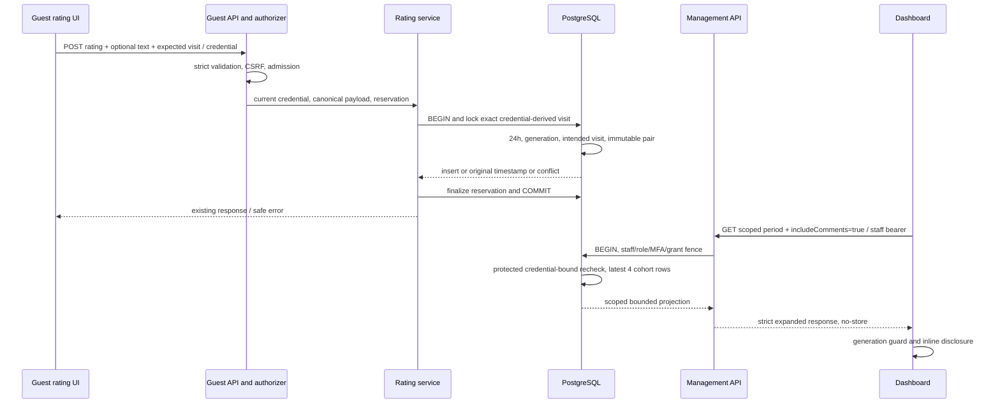
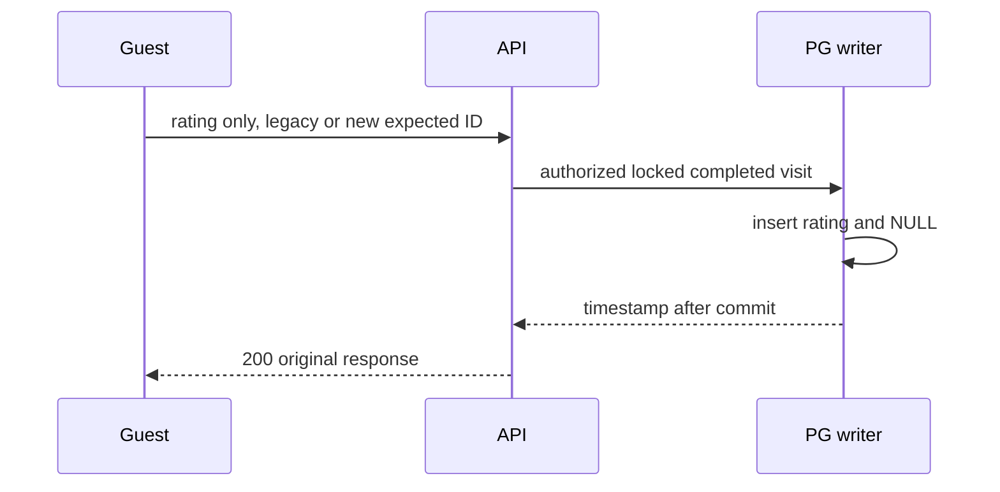
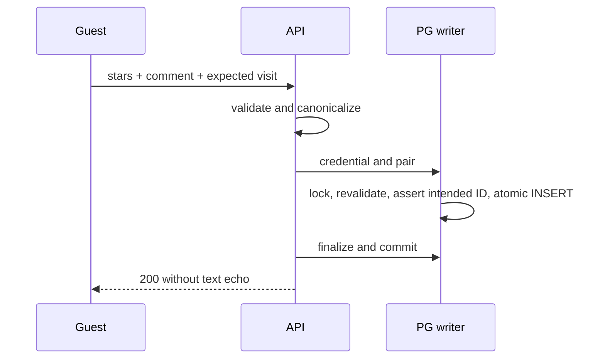
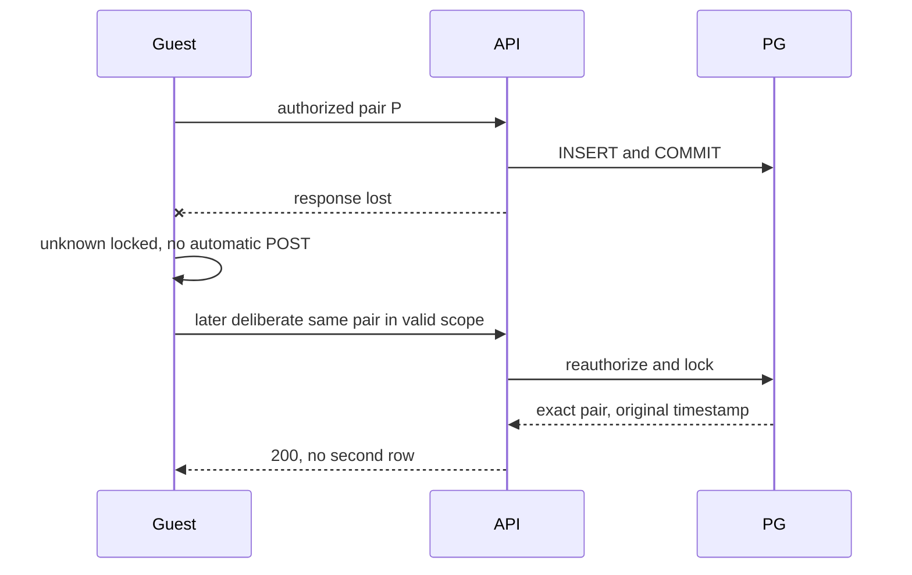
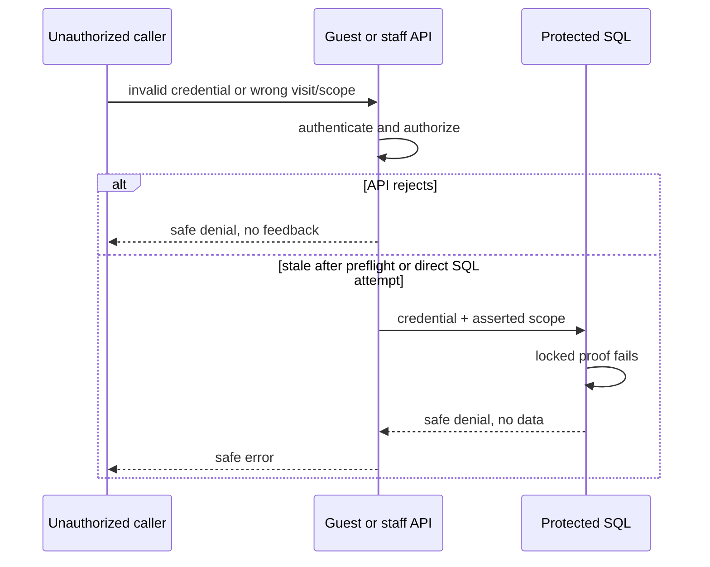
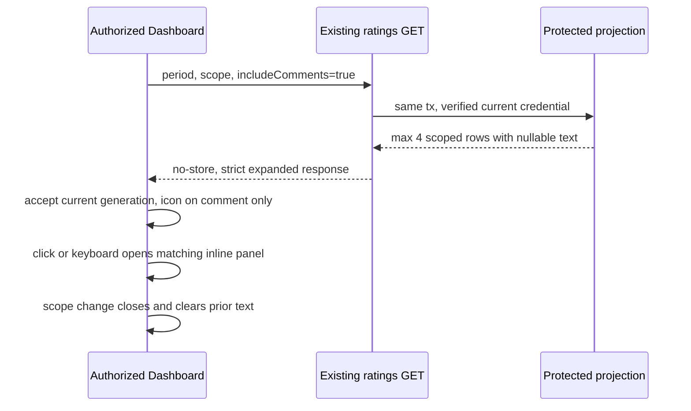
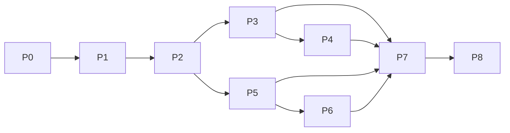

# Issue #463 — Guest Rating Comments: Full Feature Implementation Master Plan

**Version:** 1.0 (2026-11-26)

**Status:** PLANNING ONLY — UI APPROVED / DESIGN FREEZE 100%; implementation authorization pending.
**Planning verdict:** NO-GO — UNRESOLVED CRITICAL BLOCKERS (see §§17–18; owner review only).
**Repository:** [valet-platform](https://github.com/yamanradwan1-rgb/valet-platform) · [Issue #463](https://github.com/yamanradwan1-rgb/valet-platform/issues/463).
**Audited integrated main:** [cc507a5b25779e12934a3ead846ceb2c8ddff16b](https://github.com/yamanradwan1-rgb/valet-platform/tree/cc507a5b25779e12934a3ead846ceb2c8ddff16b).
**Immutable design:** [2166a6760803e1a5084c6230b15706549426d8c8](https://github.com/yamanradwan1-rgb/valet-platform/tree/2166a6760803e1a5084c6230b15706549426d8c8/docs/prototypes/issue-463), branch `prototype/issue-463-rating-comments`; original publication [comment](https://github.com/yamanradwan1-rgb/valet-platform/issues/463#issuecomment-7180149384). The Owner subsequently explicitly approved BOTH designs and froze them 100% in this planning assignment. The publication comment itself predates approval; this plan records the later Owner authority. Do not ask for UI approval again.
**Evidence legend:** CONFIRMED = pinned source/verified archive/observed planning-only result; PROPOSED = recommended implementation design, not Accepted decision or existing behavior; GATE = required future verification; OWNER = pending explicit Owner decision. No production code, migrations, workflows, security policies, application behavior, deployment or activation changed by this plan.

## 1. Executive summary and scope

Implement one atomic immutable feedback record per authorized completed visit: existing 1–5 rating plus optional canonical service comment. Extend the existing Guest POST, protected SQL writers and bounded Management rating analytics. Reuse the mounted Guest rating screen and Customer Feedback on existing /analytics, after original KPI cards and before charts. No second write, comment store, lookup endpoint, dashboard page, notification, reply, edit, deletion, moderation, search, metrics, sentiment, custody/payment/hand-off or CI optimization. No new dependencies, queues, workers or infrastructure. New technical state is invisible or uses existing status slot; a visual exception requires a specific Owner decision.

**Critical findings:** (a) existing strict request accepts rating only, response strict too; the approved Guest prototype stores a comment in local state but submits only stars; dashboard is independent mock data. (b) both SQL writer signatures currently compare only integer rating. (c) legacy analytics JSON is strict and its SQL function is executable by runtime with caller-supplied scope, so adding free text to that function would widen arbitrary SQL access and break old parsers. (d) Guest browser marker checking alone is not an atomic intended-visit fence at cookie dispatch. Proposed solution: strict backwards-compatible request variants, unchanged write response, credential-bound intended-visit assertion for new requests, canonical immutable pair, nullable column, safe legacy writer wrappers, opted-in comment-aware representation on existing read endpoints backed by a separate credential-bound SQL read, exact same metrics/cohort. Phases 0–8, with dependencies/gates in §14.

## 2. Baseline, authority, concurrency and evidence

- CONFIRMED remote main and local origin/main both cc507a5b; local checked-out main eba55b76916a6892059e45622252b87483f4cb1e, 772 commits behind. Two pre-existing untracked user files VAYLET_COMPLETE_LOCAL_RUNBOOK.md and VAYLET_META_SANDBOX_HANDOFF.md preserved; no reset/stash/fast-forward. Read using pinned Git objects, not stale main files. Prototype parent is exact audited main; no integrated code delta since prototype baseline. Remote frozen branch matches 2166a676; diff from audited main contains only 14 docs/prototypes/issue-463 artifacts.
- GitHub open PR searches (global repo qualifier and repository-filtered open search) returned zero at inspection; no assertion about changes after that time. Worktree inventory 457 entries, many historical/prunable. Relevant visible worktrees: tmp/issue-313-option1-implementation a7539b65 (historical integrated design), tmp/option-c-final-closure-20261116 cc507a5b (integrated security), tmp/prototype-463-publish 2166a676 (frozen), D:/v467-ci-plan bfb4fdcc / D:/v467-plan 3a54782f and tmp/issue467-w1-009b-nonforce a3419c57 (CI/security provisioning investigation), tmp/wa-prime 26228691 (WhatsApp), branch fix/issue-467-w2-staff-push-outage. These are observed references, not proof of active implementation/merge. Do not disturb them. Before phase 1, recheck open PRs/ref diffs for rating, auth, contract, migration/provisioning and test harness; coordinate one migration owner and rebaseline on relevant changes. No concurrent-worktree writes.
- Read #463 body and its single prototype publication comment; #312 and closure comment (auto-open, exact visit, intentional Back/dismiss, no automatic retry; #312 historical CI not awaited); #313 and all three comments (Option 1, existing cards/charts, prior nonzero-pixel waiver limited to that reviewed candidate; no permission to reuse waiver for #463). #312 and #313 are closed code deliveries; their comments do not prove deployment.
- Binding AGENTS.md authority order, docs/17_AGENT_CODE_STRUCTURE_RULES.md (300 authored lines per file; no dense bypass), docs/06_SECURITY_AND_DATA_RULES.md, docs/03_DATABASE_SCHEMA.md, docs/02_DOMAIN_MODEL.md and docs/08_DECISIONS_LOG.md. DEC-091 [accepted](https://github.com/yamanradwan1-rgb/valet-platform/blob/cc507a5b25779e12934a3ead846ceb2c8ddff16b/docs/decisions/DEC-091_GUEST_RATING_AND_RETURNING_CONTACT.md): exact completed guest scope, at most one immutable rating, exact retry, no staff writes, DEC-064 staged legacy bearer/current browser, post-completion 24h; CANCELLED never scope. DEC-095 [accepted](https://github.com/yamanradwan1-rgb/valet-platform/blob/cc507a5b25779e12934a3ead846ceb2c8ddff16b/docs/decisions/DEC-095_MANAGEMENT_KPI_SOURCE_CONTRACTS.md) §7: completed_at Location-local cohort, rated_at submission only; privacy-minimized, bounded, accurate counts. DEC-025 strict runtime/migration separation, DEC-080 Management authority, DEC-064 Browser Session, existing Option C raw bearer current-session lock and protected Writer boundary. #463 is additive scope beyond #313, not blanket permission to reinterpret these decisions. Proposed amendment to DEC-091/095 (and mirror log/schema/domain/security docs) requires Owner approval before implementation; no accepted policy rewritten during planning.
- Entities affected: GuestRating (existing), ValetSession (read/lock only), GuestAccess credential/browser session (read/revalidate), authorized Management staff session/membership/location (read/revalidate), existing analytics response. No ValetSession or Task/Dispatch state transitions; no configuration-policy changes, no tenant/Location override, no feature flag system, no lifecycle changes.

### 2.1 Evidence index (all paths relative to pinned main)

| Area | Source evidence |
|---|---|
| Guest mount | apps/customer/src/app/guest-app-root.tsx, guest-post-visit-route.tsx; features/post-visit/use-guest-post-visit.ts, guest-post-visit-screen.tsx; features/rating/guest-live-rating.tsx, guest-rating-submission.ts, rating-presentation-policy.ts |
| Guest transport | apps/customer/src/lib/api/guest-api-client.ts, guest-http-transport.ts, guest-browser-context-marker.ts; guest-t5-api.test.ts; i18n/locale-provider.tsx, translations/{ar,en,guest-rating-translation-types}.ts; theme/theme-provider.tsx, lib/theme/colors.ts, app/globals.css, components/layout/{app-shell,app-header}.tsx, components/primitives/{btn,typography-primitives}.tsx |
| Guest API | apps/api/src/modules/guest-access/{guest-rating.controller,guest-rating.service,guest-rating-command,guest-credential-authorizer,guest-access.service,guest-browser-transport,guest-request-admission,guest-credential}.ts; common/http/{api-errors,api-operation-runner,guest-operation-routes}.ts; common/database/postgres-transaction.ts |
| Contracts | packages/contracts/src/{guest-rating,customer-feedback-analytics,location-analytics-common,utf16-string-max}.ts; strict schemas and exports |
| DB | packages/database/prisma/schema.prisma model GuestRating; migrations/20260917004200_mgt_be_09_guest_rating, 20261007007000_guest_browser_session_continuity, 20261022010000_issue313_rating_analytics_read; 20261116000210_option_c_staff_session_lock_function, 20261116000300_option_c_management_raw_bearer_authority, 20261118000200_option_c_management_authority_freshness (latest migration at baseline); scripts/{guest-rating-runtime-privileges,guest-browser-session-runtime-privileges,management-runtime-privileges,guest-runtime-privileges,runtime-table-privileges}.mjs; apps/api/src/common/database/runtime-database-readiness.ts |
| Management authority & read | apps/api/src/modules/management/{management-rating-analytics.controller,management-rating-analytics.service,rating-analytics-http,rating-analytics-projection-query,management-authorization}.ts; dashboard/{rating-analytics.controller,rating-analytics-query,dashboard-read-authorization,dashboard-location-authorization,analytics-period}.ts; auth/{staff-session-context,staff-session-lock,staff-session-revalidation}.ts; auth/mfa/mfa-assurance-policy.ts |
| Dashboard | apps/dashboard/src/features/intelligence/{analytics-page,intelligence-scope,use-customer-feedback-read,use-intelligence-read,intelligence-query-identity,customer-feedback-api,customer-feedback-copy,customer-feedback-section,customer-feedback-insights,customer-feedback-summary}.ts[x], customer-feedback.module.css, analytics.module.css; lib/scope/scope-generation.ts; app/globals.css |
| Existing verification | apps/api/test/{guest-rating-boundary,guest-rating-idempotency,guest-rating-concurrency,rating-analytics-location-http,rating-analytics-company-http,rating-analytics-browser-e2e,customer-auto-rating.browser}.integration.test.ts; packages/database/src/{guest-rating-migration,guest-rating-runtime-role,guest-browser-session-runtime-role,rating-analytics-runtime-role}.integration.test.ts; rating-analytics-explain-fixture.ts; customer and dashboard component tests; .github/workflows/ci.yml; security CI (unchanged) |

Historical source comments saying GuestLiveRating is unmounted are stale; actual callers establish mount. #312's manual/automatic navigation and #313's aggregate source/placement preserved. Source evidence does not certify current production DB grants, real runtime, migrations applied, deployment or external operations.

## 3. Frozen reference contract (CONFIRMED)

[README](https://github.com/yamanradwan1-rgb/valet-platform/blob/2166a6760803e1a5084c6230b15706549426d8c8/docs/prototypes/issue-463/README.md). Archives recovered via matching Git blob identities in existing prototype worktree, copied to isolated scratch, expanded read-only with respect to original; all 21 images decoded and visually inspected via contact sheets. No new prototype. Archive SHA256 (lowercase canonical):

| Package | SHA-256 | Git blob |
|---|---|---|
| [Guest](https://github.com/yamanradwan1-rgb/valet-platform/blob/2166a6760803e1a5084c6230b15706549426d8c8/docs/prototypes/issue-463/guest-prototype.zip) | cc661d944479060647064811ea0c5a194ae177a155f7fbb4a10171ddf0c88da5 | b1333fdac0e216611dd05b5dfc96402a1e224eab |
| [Dashboard](https://github.com/yamanradwan1-rgb/valet-platform/blob/2166a6760803e1a5084c6230b15706549426d8c8/docs/prototypes/issue-463/dashboard-prototype.zip) | 3c30464310194e1c636865277aaedaff758d8629d3126340c4965ac7244e280d | 4376b6e086a971685726b0ac977b8aca39b995bd |

### 3.1 Relevant internal source SHA-256

| Archive | Path | SHA256 |
|---|---|---|
| Guest | apps/customer/src/features/rating/guest-comments-rating.tsx | 9809a70b65316d1494ef6e4416ed6287685f04eb323b8d97ad1e1da6c68a1ed0 |
| Guest | entry.tsx | a5eb5862486b78853b27c1f1d19235ebf17f7f151cc4bb9fb58461fd6000960f |
| Guest | prototype.css | ff56bd87b3323a5cc5fc98eea666316efc36a64912350f49c6b085ae40b03e71 |
| Guest | bundle.js | 57550978d8e0168eb450ecef94764f8235537aaf7d3cc9d7b4199163672aa001 |
| Guest | bundle.css | 686d66ef0839177c974a36e243fcb24caaadaaf993b32ef0b492b793d7f9e458 |
| Guest | verify.cjs | c33f5fcede2cd5405b445096af7dd082444684fa0119448b633f00b4611c1703 |
| Dashboard | apps/dashboard/src/features/intelligence/customer-feedback-insights-proposed.tsx | 014fedd5aa30a61c708f526b546ca6a07a2a4b0f8376166cf03c8d816822a3ec |
| Dashboard | entry.tsx | 23f62cb7c8c3095f19549bcf7a26810eff4f3a44ecbccb7adbfaf2e7a2519e72 |
| Dashboard | prototype.css | 7c5fbc02fffffb88ff92529cb3ae5ee663fcbba13c2868edcc05cbe8afeb4d42 |
| Dashboard | bundle.js | febb7825a12060240d6c80429639bbd11ef5b97e1e7559b4c5c7d5dba9c3db46 |
| Dashboard | bundle.css | 7cfdb7765a97c07f1bc9c0d1b739da1782a495377c918b832cd74837f696b927 |
| Dashboard | verify.cjs | b9845db6243013e18c562fb9bb5c49d37579f918a3691655ee74df2552190a3a |

Both ZIPs also contain index.html, serve/build scripts, README, all screenshots, Guest logo assets; prebuilt bundle contains inherited components. Build/verify scripts have original Windows paths; source deltas not entire production tree. Do not replace ZIPs or recreate a design from them; implement against actual mounted source. README described placeholder provisional before Owner approval; it is frozen now.

### 3.2 Screenshot inventory (PNG dimensions; archives contain originals)

| Guest file | Pixel dimensions | State |
|---|---:|---|
| original-ar-light.png | 390×846 | original without field |
| proposed-ar-light.png | 390×846 | frozen AR/LTR-independent light, RTL |
| proposed-ar-dark.png | 390×846 | RTL dark |
| proposed-en-light.png | 390×846 | LTR light |
| proposed-en-dark.png | 390×846 | LTR dark |
| selected-empty.png | 390×846 | 4 stars, focused empty textarea |
| selected-multiline.png | 390×846 | 5 stars, two lines |
| success.png | 390×846 | saved locked field and existing status |
| failure.png | 390×846 | two stars, retryable status |
| width-320.png | 320×839 | AR dark, long text |
| width-390.png | 390×802 | AR dark, long text |
| width-1280.png | 1280×802 | AR dark, centered Guest frame |
| keyboard-reduced-viewport.png | 390×556 | focused reduced viewport; NOT real keyboard |

| Dashboard file | Pixel dimensions | State |
|---|---:|---|
| original-dark.png | 803×600 | original recent list |
| proposed-dark.png | 803×600 | collapsed icons on rows 1/3 only |
| expanded-dark.png | 803×600 | first comment open |
| full-en-light.png | 803×825 | full feedback section, first open keyboard focus |
| full-en-dark.png | 803×825 | same dark |
| full-ar-light.png | 803×825 | full RTL, first open |
| full-ar-dark.png | 803×825 | same dark |
| mobile-ar.png | 320×700 | RTL third comment expanded |

Captured historical scripts: Guest Chromium headless 390×844, then 320/390/1280×800, reduced 390×420, fullPage true animations disabled; waits document.fonts.ready +300ms. Dashboard Chromium headless 803×600 then 320×700; fullPage true. PNG heights may exceed viewport because of harness toolbar/page layout. Historical browser build/OS/font byte identity not recorded; README reports both scripts exit 0, but not production parity. Selected PNGs permanently linked in frozen README.

Planning-only independent archive smoke: served exact extracted bundle bytes with a temporary loopback-only read-only static harness, no API; Chromium 151.0.7922.34 / Windows / DPR 1; four locale/theme combinations each app, empty comment alone disabled submit, mock selected submission locks field and shows status, dashboard two icons, single-open and collapse, 320px overflow, zero page errors, exit 0. Request hosts only 127.0.0.1 and Google Fonts font hosts. Guest Tajawal/Plus Jakarta Sans/Space Grotesk required faces loaded in this run; unused font variants unloaded; Dashboard computed system stack, document.fonts empty. Original screenshots are not overwritten; current measurements are evidence of archive behavior, not historical pixel-equivalence or production testing. No real data, no production runtime tests, no real device keyboard.

### 3.3 Guest immutable visual & behavior spec

Inherited: AppShell max width 430, min-height 100dvh, bg frame C.bgFrame, shell bg C.bg, original logo/header menu and spacing, title SectionTitle 26px/600, line-height 1.2, letter-spacing -0.02em; EN Space Grotesk display/Plus Jakarta Sans body; AR Tajawal. Rating container flex column padding 24px 20px 32px, gap 20px, screen-enter; existing stars flex center gap 12px, five text ★ buttons font 32px, transparent border/background, C.warningSemantic selected/C.borderSemantic inactive. Existing Btn default 15px/600, 16px 20px padding, min-height 48px, radius 10px, primary brand fill/hover/focus, secondary transparent 1px border, loading spinner and disabled opacity .5. Status existing 14px C.textSecondary, no margins. Existing back control remains.
Added exactly one field between stars and existing feedback/status (if present), then submit, then Back. Label block 14px/600 C.text; exact label AR **ملاحظاتك عن الخدمة (اختياري)** / EN **Comments about the service (optional)**. Placeholder AR **شاركنا ملاحظاتك عن تجربتك...** / EN **Share your feedback about your experience...**. Textarea rows=3; width 100%, max-width 100%, margin-top 8px, padding 12px 14px, radius 10px, 1px solid C.borderSemantic, C.surface bg/C.text text, 14px inherit font, line-height 1.5, vertical resize, text-align start, display block, overflow-wrap anywhere. Placeholder C.textSecondary; disabled opacity .65; focus-visible 2px solid var(--brand-focus,var(--v-blue)), outline-offset 2px. Use scoped CSS and typed translation keys, not global design-token edits. Native label/id association, textarea keyboard and screen reader. No counter, helper, badge or extra button. Do not port mock toolbar, 45px harness min-height override, reset controls, fixture IDs, inline mock client, or duplicate route.
Tokens light/dark respectively: bg #FAFAF8/#07111F; frame #E8EDF4/#03070E; surface #FFFFFF/#0D1C2E; text #07111F/#F1F5F9; secondary #6F7C91/#94A3B8; border #DDE4EC/#1E3654; blue #176BFF/#2575FC; selected star #D89434/#FBBF24. Existing branding overrides preserved, no palette rewrite.
Observed frozen bundle geometry at 390×844 CSS px (toolbar 47px, origin top-left): AR h2 [20,150,350,31.1875], star group [20,201.1875,350,45], first star 38.65625×45, label [20,266.1875,350,21], textarea [20,295.1875,350,89], submit [20,404.1875,350,49], Back [20,473.1875,350,51]; EN h2 [20,148,350,31.1875], stars [20,199.1875,350,45], label [20,264.1875,350,18], textarea [20,290.1875,350,89], submit [20,399.1875,350,49], Back [20,468.1875,350,51]. Same per theme. EN 320×800: textarea 280×89. Coordinates not hard-coded in production; compare relative to header/content after exact harness translation. Frozen draft accepts optional text, requires star, supports edit/clear and locks field on saving/saved/unknown/conflict/unavailable. Status copy stays existing.

### 3.4 Dashboard immutable visual & behavior spec

Inherited: CustomerFeedbackInsights + CustomerFeedbackSummary and copy; insights two minmax columns, margin-top16px gap16px; stack at max-width760px; summary stacks at540px. Card 1px var(--f1-border), radius12, background --f1-surface, padding clamp(14px,1.8vw,22px); title 13px/740 with margin-bottom18; row grid minmax(0,1fr) auto, align center, gap10, padding9px 0 except first top/last bottom, 1px divider; visit ID 12px/740 ltr isolated; meta11px/1.55; star chip 12px/780, radius7, padding7px 10px, bg/text #fff4d9/#8b5b07 light, #3b2d20/#ffd583 dark. Dashboard font Inter, Segoe UI, Tahoma, Arial. Tokens light/dark: --f1-surface #ffffff/#131e3d, border #e2e8f0/#1e293b, text #0f172a/#ffffff, muted #64748b/#94a3b8, track #e9eef6/#253656, global bg #f4f7fb/#081020. Existing analytics card data and surrounding shell untouched.
Added: actions flex center gap8, flex-shrink0 (gap5 at max-width400). Only non-null canonical comment rows get icon, adjacent before rating chip in DOM and naturally mirrors RTL. Button 30×30, grid place-items center, border1px --f1-border radius7, transparent bg, --f1-muted, cursor pointer, 150ms color/background transition; hover/open --f1-track background, --f1-text color. Icon SVG 16×16, viewBox 0 0 24 24, no fill, stroke currentColor width1.7, round line joins/caps; exact paths: `M21 11.5a8.5 8.5 0 0 1-8.5 8.5H4l2-5A8.5 8.5 0 1 1 21 11.5Z` and `M9 10h7M9 14h5`. Focus-visible outline 2px --focus offset2 in archive; production global focus shadow may differ: match actual measured reference with scoped focus style (no shared CSS changes; verify no extra halo). Native type button, aria-expanded, aria-controls row-specific panel id, label EN "View comment for " + visit reference / AR "عرض تعليق " + reference, title EN "View visit comment" / AR "عرض تعليق الزيارة"; SVG aria-hidden. Only one open at a time, initially closed, click again closes; button focus retained, Enter/Space same. Panel grid-column 1/-1, 1px --f1-border, bg --bg, padding12, radius8, min-width0; title block 11px/700 muted margin-bottom6: EN "Guest comment", AR "تعليق الضيف". Paragraph margin0, 12px/1.65, --f1-text, white-space pre-wrap, overflow-wrap anywhere, text-align start, dir=auto. Hidden panels not visible or focusable; use conditional mount or hidden semantics, never aria-hidden only. Historical no comment: no icon or empty text, chip position unchanged. No modal, counter, extra controls or independent read.
Observed at 803×600 DPR1, list-only fixture (toolbar included): first row [18.453125,115.453125,766.09375,64.09375]; EN actions [706.328125,127.5,78.21875,30], toggle 30×30 at x706.328125, SVG 16×16, chip 40.21875×30 x744.328125; RTL actions x18.453125, chip x18.453125, toggle x66.671875. First expanded panel [18.453125,179.546875,766.09375,66.796875], title [31.453125,192.546875,740.09375,15], paragraph [31.453125,213.546875,740.09375,19.796875]. Same light/dark. Compare relative geometry using same widths/text; don't import archive toolbar, preview-single/preview-full wrappers, CSS globals or mock metric values. Existing chip aria-label singular for one star preserved (prototype uses plural; nonvisual correction, no design change). Production 320px, 390px and desktop widths use actual dashboard container.

### 3.5 Visual protocol (future binding gate)

Freeze immutable hash and full reference inventory. Match production original baseline, frozen bundle and candidate: same OS/browser/version, viewport/DPR (1 plus real device DPR), fonts/loaded face and font file identity, locale/theme/branding, content/timestamps/timezone, scrollbar, zoom, input/focus, animation completion, network and fixture. Use clean browser contexts; document document.fonts.ready, fonts status, actual rendered font via DevTools, screenshot dimensions, engine, CSS/DOM boxes computed styles. Capture original unchanged screen at audited baseline; capture archive exact bytes (no redesign); capture production components on actual authenticated Guest/Management paths with deterministic test data matching fixture, not mocked API for E2E. Archive toolbar is harness-only: crop exact content viewport by measured anchor (header/main or card bounds), explicitly report coordinate offset; no broad mask. For surrounding UI compare full before/after real screens after measured natural downward translation caused solely by inserted field/panel. Hash all images; raw pixel diff, count/percentage and max RGB delta; expected 0 unexplained difference. Use repeated captures to prove environmental variance; retain raw diff and causality, no threshold to hide differences. If deterministic glyph/OS difference cannot be isolated, owner decision specific evidence required; no general waiver. Compare 4 locale/theme × 320/390/768/1440 (Guest also1280, Dashboard card at803) × empty/selected/populated/focus/loading/saved/failure, existing unavailable/conflict/unknown via production reference where archive lacks captures; Dashboard closed/expanded/second opens/collapsed/no-comment, mixed bidi and long text, full section/shell and metrics. Test actual mobile keyboard open, scroll/submit/back/resize and focus at 200% zoom; original reduced viewport was simulation only. No unexplained clipping; if frozen 30px dashboard hit target conflicts with mandatory accessibility policy, document exact requirement and request narrowly scoped decision (do not silently resize). Physical keyboard/browser and device evidence pending. Final independent UI verdict and Owner release approval required. Prior #313 waiver is not transferable.

## 4. Outstanding Owner decisions (PROPOSED; not accepted)

| ID | Decision | Recommended resolution and alternatives |
|---|---|---|
| OD-01 | Comment representation and validation | Optional nullable string, 1,000 Unicode scalar values and 4,000 UTF-8 bytes maximum raw and canonical, normalize as §5. This is a recommendation (W3 suggested 500; W4 1,000); no final limit in approved UI. No counter, truncation or silent coercion. |
| OD-02 | Immutable feedback and retry | Whole canonical (rating, comment) is immutable; legacy absence equals NULL, changed comment or stars conflicts. No staff-created or edited rating, no later append. |
| OD-03 | Privacy and authorized audience | Permit guest-authored free text only for current authorized Company Admin (standard MFA) or exact Location Manager in existing bounded feedback section. Amend DEC-091/095 explicitly: voluntary free text may contain contact/PII despite no new identity fields; no guarantee that free text is anonymous. No other surfaces/exports. W5 proposes lazy detail read to minimize preload; prime recommends one bounded opt-in read, with DB credential verification, because it preserves instant disclosure and existing request pattern. |
| OD-04 | Retention/erasure | Approve nullable column on immutable rating only after concrete notice, lawful purpose, retention/rights, legal-hold and backup purge matrix and erasure mechanism are accepted and independently reviewed. Current trigger prohibits independent erasure; if required, stop and select separate storage/lifecycle. No invented legal duration or ordinary edit/delete. W5 favors separate one-per-visit comment storage if independently erasable lifecycle required; that is a stop/replan condition (atomic write, immutable original feedback identity and narrowly authorized audited privacy lifecycle require separate contract). Never bypass trigger silently. |
| OD-05 | Validation UI | Use existing rating.failed status slot and existing copy for definite invalid input, preserve editability. Generic error may be insufficient for accessible correction: if required, obtain specific approval for localized validation copy in the same slot (EN: Your comment is too long or contains unsupported characters. Edit it and try again. AR: تعليقك طويل جدًا أو يحتوي على أحرف غير مدعومة. عدّله وحاول مرة أخرى.). No new element or unapproved visible state; no counter. |
| OD-06 | Technical compatibility | Approve new mutation variant with expected visit assertion, legacy stars-only shape retained; same GET endpoints with opt-in expanded strict representation and separate protected SQL reader. Deploy in order §15; no new flags/endpoints. |
| OD-07 | Option C security architecture | Explicitly approve exact new isolated NOLOGIN feedback-reader owner, one non-grantable nested EXECUTE exception, narrowly scoped columns/locks and protected-safe feature provisioning contract per §17.2. Current Option C ACL forbids this call and broad provisioner is blocked after PROTECTED. No implementation until exact revised design is independently accepted. |

Record accepted decision(s) and canonical log/schema/domain/security documentation before production coding. If OD-03/04 unresolved, NO-GO for storing/exposing text; if alternative selected, revise affected phases and re-review. Approval of UI does not settle these decisions. Security guarantees (locked authoritative visit, no duplicate/overwrite, no arbitrary-selector SQL text exposure, no access expansion, safe rendering, no raw text telemetry) are mandatory, not optional risk acceptance.

## 5. API and shared contracts (PROPOSED)

### 5.1 Existing POST /v1/guest/session/rating

Preserve empty query, existing credential/anti-abuse and no-store behavior, exact strict response of rating, ratedAt (existing offset datetime), valetSessionId (UUID). Extend request as strict union:
```ts
type LegacyRating = { rating: 1|2|3|4|5 };
type ScopedFeedback = {
  rating: 1|2|3|4|5;
  expectedValetSessionId: string; // UUID assertion only; never authority
  comment?: string | null;
};
type GuestRatingSubmissionRequest = LegacyRating | ScopedFeedback;
```
New client always sends expectedValetSessionId (even stars-only); comment optional. Any comment key without assertion rejected (including null). Reject extra keys and coercion. No client author, tenant, Location, timestamp. Canonicalize in shared contract, authoritative server validates raw clients and SQL independently enforces. Keep existing submitRating(rating, signal?) method for old callers; introduce explicit submitFeedback(payload, signal?) using same transport and response schema. No comment echo; old strict response parsers continue to work. Existing browser marker pre/post request and CSRF/origin/same-origin cookie checks remain. Marker check alone cannot bind credential attached after check; DB assertion closes that race for new clients. Legacy clients retain historical stars-only behavior; no claim of retroactive intended-visit protection, no new legacy text writes.

200 first/exact retry; 400 REQUEST_INVALID for invalid shape/type/UUID/bounds; 401 GUEST_ACCESS_INVALID on invalid/revoked/expired/consumed or asserted visit mismatch (no other visit ID returned); 409 GUEST_RATING_NOT_AVAILABLE for authorized incomplete scope; 409 GUEST_RATING_CONFLICT for changed canonical pair; existing 429, 503, transport and error envelopes preserved. DB REQUEST_INVALID result mapped safely, no raw Zod input/SQL detail. Unexpected result fails closed; success requires response visit and rating match submitted snapshot. No separate comment POST.

### 5.2 Canonicalization algorithm

OD-01 proposal; identical TypeScript and PostgreSQL behavior under UTF8, golden vectors. Omitted or explicit null => null. Otherwise strict string; reject numbers, object, array, boolean, malformed UTF-16 (lone surrogates), NUL, C0 U+0000–001F except HT/LF/CR, DEL/C1 U+007F–009F, explicit bidi embedding/override/PDF U+202A–202E and isolates U+2066–2069. Allow Arabic, diacritics, emoji/ZWJ, internal line breaks, mixed scripts and literal HTML. Raw count <=1,000 Unicode scalars and <=4,000 UTF8 bytes; reject oversized input even if trim would shorten it. No coercion/truncation.

Convert CRLF and lone CR to LF. Strip only the following at both ends: HT, LF, ASCII space, NBSP U+00A0, U+1680, U+2000..200A, U+2028/2029, U+202F, U+205F, U+3000. Empty => null. Preserve internal whitespace, case, combining marks, punctuation and bytes otherwise. No NFC/NFKC or HTML transformation; combining/precomposed distinct by policy. Use fixed codepoint sets, not language-dependent trim or regex approximations. Canonical bounds same as raw. PG char_length (UTF8 codepoints) and octet_length, explicit control-code validation; TS well-formed check then scalar iteration and UTF8 count; do not use utf16StringMax for scalar policy. DB equality compares convert_to(comment,'UTF8') IS NOT DISTINCT FROM convert_to(canonical,'UTF8') to avoid collation ambiguity. Existing JSON body parser/transport size limits must be identified and tested; no global parser change. Invalid wire UTF8 must not silently become accepted replacement characters; prove actual adapter behavior, reject/fail closed if necessary with scoped validation. NUL cannot reach PG text; driver errors safe. No raw text in diagnostic or validation metadata. UI prevalidates on submit and uses OD-05, no extra counter or silent maxLength truncation.

### 5.3 Management read contract

Existing endpoints:
- GET /v1/staff/dashboard/locations/:locationId/analytics/ratings?from=YYYY-MM-DD&to=YYYY-MM-DD
- GET /v1/staff/management/organizations/:organizationId/analytics/ratings?from=...&to=...

Keep legacy exact strict response and query when no opt-in. Add only exact query literal includeComments=true to these two routes, validated via rating-specific shared schema (not global analytics query changes), reject duplicates, arrays, false, unknown keys. Same inclusive max 31 calendar days. Separate strict expanded response schema, all existing fields unchanged except each recentRatings row requires comment: string|null; max four rows, no new author/identity keys or raw UUID. Historical rows null. New Dashboard uses opt-in and expanded parser (missing field is error, not fabricated no-comment). Old default SQL and HTTP never return text. No new endpoint, N+1, pagination/filter/sort change.

| Mixed version | Result |
|---|---|
| Old Guest -> new API/DB | Existing rating-only, NULL comment; unchanged response, exact NULL pair retry only |
| Old API -> new DB | Legacy two-arg functions still callable, null pair semantics, conflict if stored comment differs; legacy analytics exact shape |
| New Guest -> old API | Strict old parser rejects new selector/comment; fail safely, never strip fields/retry; prevent by API-first deploy |
| New API -> old DB | Readiness fails closed; schema and provisioned grants first |
| Old Dashboard -> new API | Default query/response unchanged, no text |
| New Dashboard -> old API | Reject unknown opt-in; existing error state, no fake no-comments; prevent by sequencing |
| New Dashboard -> new API | Opt-in expanded bounded response after credential verification |

## 6. PostgreSQL, writer, transaction and immutable retries

### 6.1 Confirmed existing mechanics

GuestRatingController parses strict request, ApiOperationRunner, GuestCredentialAuthorizer (browser mutation transport/CSRF, admission class C); GuestRatingService inPostgresTransaction resolves/locks exact credential allowing post-visit, invokes submitGuestRating, finalizes anti-abuse reservation under existing semantics. Response after commit. Preserve existing reservation classification and lock order; tests must prove failure/rollback including finalize failure. Existing SQL writers from migration 20261007007000: legacy guest_rating_submit(text,integer) checks token hash/unconsumed/unrevoked/unexpired, locks session FOR UPDATE, completed_at+24h; browser guest_browser_rating_submit(text,integer) calls guest_browser_resolve(token,true), locks session then browser, generation/revocation/cancel/time, POST_VISIT only. Scope derived from persisted session; both currently compare rating only. Migration 20260917004200 creates PK valet_session_id, composite FK organization/location/visit, CHECK stars 1..5, immutable UPDATE/DELETE trigger and scope index. Keep all.

### 6.2 Proposed additive DB and migration

Conditional on OD-04: one column public.guest_ratings.comment_text TEXT NULL, no default/backfill/index; Prisma GuestRating.comment String? @map("comment_text") @db.Text. Forward migration (new timestamp after current latest, collision check/single migration owner). Existing historical rows stay NULL. DB CHECK guest_ratings_comment_canonical_check: null OR nonempty, canonical validation true, 1..1000 scalars, <=4000 bytes, no CR/forbidden controls, trim matches bytes. Private immutable normalizer/validator with fixed explicit codepoint rules, no raw input error. Verify effective CHECK helper permissions under actual writer definer; no extra runtime grant. Direct SQL raw malformed text rejects REQUEST_INVALID; API validates before driver. Test constraints even for privileged fixture inserts; immutable trigger remains.

Public new overloads guest_rating_submit(text,integer,text,uuid) and guest_browser_rating_submit(text,integer,text,uuid), explicit arguments, no defaults; unchanged RETURNS TABLE(result_code text,valet_session_id uuid,rating integer,rated_at timestamptz). Require non-null expected visit even for null comment. Keep two-arg signatures as secure legacy wrappers which ALWAYS canonicalize comment to null; full-pair comparison for old server calls too. Use private credential-bound core(s) with explicit legacy mode, inaccessible to runtime/PUBLIC. New entrypoints cannot disable assertion. Internal shared persist helper optional only if private and can never become callable generic target writer. Both paths derive identity under existing locks; revalidate time/credential/scope post-lock, assert expected visit before any feedback lookup or insert; mismatch returns INVALID_ACCESS with null result fields. One session lock serializes both credential paths. Canonicalization, insert/compare, anti-abuse finalization and commit within existing transaction; same exact pair returns original timestamp, different pair conflict; no UPDATE. PK remains backstop. No automatic ambiguous mutation retry.

Migration steps (design, not executed):
```sql
BEGIN;
ALTER TABLE public.guest_ratings ADD COLUMN comment_text text;
-- Create private canonicalizer and CHECK as specified above.
-- Create private credential-bound write cores and new four-arg entrypoints.
-- Replace bodies of existing two-arg functions, preserving signatures and ACL.
-- Reader/core added in P5 separate forward migration after approved OD-07 (§7/17.2).
-- REVOKE PUBLIC EXECUTE on every new routine before COMMIT.
COMMIT;
```
Use schema-qualified names and fixed search_path consistent with existing verified owner boundaries (guest functions pg_catalog, public; require runtime cannot CREATE in public). No broad SELECT/DML, no runtime owner/membership, no grant option; revoke PUBLIC including inherited/column privileges and private EXECUTE. Existing provisioning roles distinct per DEC-025; update guest-rating-runtime-privileges.mjs and guest-browser-session-runtime-privileges.mjs exact inventories, verification composition, runtime-database-readiness.ts and migration inventory. New SQL owner identity must be verified against deployed role model; grant only minimal owner rights required by private helpers (not runtime). Use reviewed PROTECTED-safe feature provisioning path, not broad legacy replay (§17.2). Do not change existing Option C protected writer authority or unrelated grants. The narrowly scoped proposed reader owner/EXECUTE and feature provisioner amendment in §17.2 requires OD-07; current ACL cannot support the proposed reader. DDL requires ACCESS EXCLUSIVE lock; nullable no-default avoids rewrite, use bounded lock_timeout, inspect blockers and table size, if necessary CHECK NOT VALID then VALIDATE in separate forward migration/transaction before any new comment write. Require catalog convalidated=true. Test fresh PG17 and populated upgrade, runtime grants, owner, search_path, UTF8, immutable constraints, failure atomicity, no data rewrite/backfill. Do not modify applied migrations; after commit forward repair, never drop column to rollback.

### 6.3 Complete behavior table

N = canonical NULL; C = canonical text, D = different canonical text. Assume current authorized completed visit unless otherwise stated.

| ID | Attempt | Required outcome |
|---|---|---|
| R01 | First stars-only 4/N | insert one row; 200 |
| R02 | First stars+4/C | atomic insert pair; 200 |
| R03 | 4/N then 4/N | 200 original ratedAt |
| R04 | 4/C then 4/C | 200 original ratedAt |
| R05 | 4/C then 4/D | 409, no edit |
| R06 | 4/C then 5/C | 409 |
| R07 | 4/C then 5/D | 409 |
| R08 | 4/N then 4/C or vice versa | 409; old caller cannot append/remove |
| R09 | omitted/null/empty/defined whitespace | equivalent N |
| R10 | CRLF/LF, boundary trim equivalent | same canonical bytes -> exact replay; no Unicode composition equivalence |
| R11 | concurrent identical across credential paths | serialized; one row, both 200 same timestamp if still authorized |
| R12 | concurrent differing pairs | first committed authorized winner; other conflict if still authorized |
| R13 | disconnect before commit | unknown to client; rollback may leave no row; later authorized exact pair inserts if absent |
| R14 | disconnect after commit/response lost | exact authorized retry returns same row/timestamp |
| R15 | retry after expiry/revocation/consumption/generation change | deny before lookup even if exact |
| R16 | wrong intended visit/cookie switched | deny before lookup/write; no other visit data |
| R17 | incomplete/cancelled visit | existing unavailable or invalid-access semantics, no write |
| R18 | invalid type/length/controls | 400 / direct SQL REQUEST_INVALID, no row |
| R19 | manual reentry with changed payload after unknown | if earlier commit then 409; if absent valid insert; no automatic resend |

Unknown UI remains locked per #312, no new retry button; deliberate authorized re-entry can replay same pair if user still has text, but no durable draft/recovery promise. In-memory scoped draft and exact submit snapshot, no local/sessionStorage of comment. Legacy stars-only missing selector is residual baseline risk, documented; no new text can be written through it. No authority extension.

## 7. Management authorization, protected read, privacy

Existing legacy management_rating_analytics_projection(uuid,uuid,date,date) is SECURITY DEFINER and runtime-executable with supplied org/location/date; checks scope relation and date, not staff identity. Existing runtime-role test actually reads another org by supplying its ID. That accepted app-only numeric projection trust is insufficient for potentially sensitive free text. Keep legacy SQL and HTTP comment-free.

Existing company controller resolves exact staff bearer, current active ORG_ADMIN membership/org, standard MFA, entitlement, org exclusive advisory lock + recheck, projection and admin activity in one transaction. Location controller exact staff session lock, current active LM/Location grant and entitlement under shared org advisory lock and READ COMMITTED recheck; CA fallback standard MFA and active target Location. Both strict Authorization header count, no-store, date validation. Preserve existing checks and capability ANALYTICS_READ. No extra MFA for LM, no sensitive 5-minute freshness for standard CA read.

Proposed new protected SQL reader public.management_rating_feedback_projection(uuid,uuid,text,timestamptz,uuid,uuid,uuid,date,date) (staff session ID, user ID, actual current raw bearer, createdAt, expected membership, org, nullable Location, from, to). IDs selectors only. VOLATILE SECURITY DEFINER, fixed safe search_path, schema-qualified, exactly scoped EXECUTE, no PUBLIC/role inheritance or direct table reads. Require fail-closed SQL assertion current_setting('transaction_isolation') = 'read committed'; call existing staff_auth_lock_current_session(uuid,uuid,text,timestamptz,text) with EXCLUSIVE and exact context, one current row; actual raw bearer required, no spoofable GUC/user ID alone. Reuse existing Option C bearer verifier ONLY after resolving B-01/OD-07 in §17.2; current definer ACL forbids nested EXECUTE. Do not treat ownership or grants as validated. Do not call sensitive writer-only staff_management_authorize_writer. Preserve order User→Session→Organization→Membership, no SHARED→EXCLUSIVE upgrade. Determine role hint from persisted exact (user_id, membership id, organization_id) tuple; acquire matching org lock (CA exclusive, LM shared), recheck current role and membership after lock, fail on change; recheck current bearer/timing post-lock without acquiring conflicting locks. API already holds matching lock in same transaction: direct invocation must also safely authorize without trusting API preflight. Validate current active user/org/membership and entitlement; LM exact active Location and access grant (no all-org); CA exact active factor, no future MFA timestamps, age <8h and idle <30min, same org; require active owned Location when targeted, preserve existing all-company cohort for historical locations. Deny stale/revoked/foreign/restricted roles without data; map safe authorization/MFA semantics. Revalidate after fence under fresh snapshot (not STABLE stale snapshot). Prove lock coverage for membership/grants, active Location, subscription and MFA factor with existing authoritative fences or narrowly approved lock helper; row locks may require UPDATE authority, so no broad grants. B-03 is open until exact lock design is reviewed. Existing recordAdminActivity only in existing authorized flow, no comment audit content. Direct reader must not mutate ratings; no unrelated privilege expansion. Exact SQL owner/lock/ACL validation by W4/W5 before integration; if cannot meet this with narrow privileges, stop rather than fallback.

Reuse legacy CTE cohort and metric formulas; prefer private common projection core with internal include-comment switch (legacy 4-arg wrapper false, protected reader true only after authorization; core nonruntime/PUBLIC); if risky, preserve legacy function and duplicate only the bounded projection query with equivalence proof. Join comment by exact internal (org,location,visit) only AFTER latest LIMIT4; avoid carrying text through entire completed cohort; one DB roundtrip, no N+1. Preserve completed_at Location-local period, rated_at DESC/completed_at DESC/id DESC, counts/rate/distribution/average and pseudonymous VISIT reference. No raw UUID/contact fields or comment in aggregates. Do not join on truncated pseudoref; rare collision must not misassociate text; use existing unique row identity with timestamp tie-breakers, reject ambiguous projection if needed; no new identifier absent owner approval. v2 minus comment must equal legacy with same snapshot. No comment lookup by arbitrary row ID.

Free text is untrusted/private; no HTML/Markdown/HTML injection, no SQL interpolation, no raw comment in logging/traces/metrics/error bodies/audit events/notifications/export/service worker/cache/URL/draft persistence. Redact at instrumentation boundary and test with sentinel; SQL parameter logs and DB errors reviewed, not simply application log statements. Existing TLS/secret separation/encrypted backups maintained; retention/access and erasure OD-04 must be approved with actual policy, no invented legal duration. Voluntary free text introduces a new PII-capable collection channel; no new structured identity fields or extra use. Require notice and approved purpose/rights/retention before collection. No guarantee of retracting already viewed text; deny new requests after revocation and drop stale UI responses when scope/identity changes.

## 8. Guest production integration and states

Actual mounted page -> GuestAuthProvider -> GuestSessionProvider -> GuestAppRoot -> useGuestPostVisit -> GuestPostVisitRoute -> GuestPostVisitScreen (fresh exact visit COMPLETED read) -> GuestLiveRating -> GuestRatingSubmission -> GuestApiClient. Stale source comment about unmounted UI is not authority. canRemain requires bootstrap/current client, no switching/conflict/ambiguous/expired/network error, COMPLETED; canEnter additionally fresh. Existing policy auto-opens once and manual Back/dismiss/reentry per browser context+visit, stores only presentation state (not authority). Preserve route, shell, branding, header/menu, existing stars and Btn. Integrate exact textarea and scoped CSS/typed translations §3, no mock or global CSS. Draft and outcome bound to exact client object+visit+browser generation; key/remount or render-time scoped state prevents old text even before effect cleanup. Capture canonical pair and expected ID synchronously before dispatch, one in-flight per exact scope; do not read mutable draft later. Invalidate on navigation/context change; late callbacks cannot set state or alter presentation policy for another generation; abort not proof of rollback. Existing transport 12s mutation deadline and no auto retry; check response ID AND rating, status. No raw comment storage outside memory.

| State/event | Required behavior and existing visual state |
|---|---|
| No scope/loading/ineligible | existing parent loading/unavailable/Back; no draft |
| Initial authorized | empty draft, no stars; textarea enabled, submit disabled |
| Select/change stars | existing highlight; submit enabled |
| Input/clear comment | update memory only; stars required; exact field |
| Definite invalid | existing failed status (OD-05), edit enabled, no request |
| Pending | immutable snapshot, single-flight, lock stars/field/submit, existing spinner, Back remains |
| 200 exact | saved, locked, original feedback/Back |
| Definite 400/429 | failed, edit/retry explicit; existing status |
| timeout/network/408/5xx/invalid success | unknown locked, no automatic resend |
| conflict | existing conflict locked; never saved |
| expired/revoked | unavailable/parent removes scope |
| Back during pending | dismiss, invalidate generation; do not claim cancellation |
| visit/client/credential change | immediately blank prior draft/outcome; new authorized scope only |
| manual reentry after lost response | deliberate exact replay supported server-side; no added UI/durable draft |
| marker changes during/after fetch | scope invalidation; do not retry into new cookie visit; if commit ambiguous use existing unknown/dismiss |

Preserve existing translations/error states, no new visual state without owner exception. Verify cross-tab cookie switch between precheck and network attachment, stale handlers and A→B→A. Existing presentation policy uses sessionStorage with non-authoritative key; no comment in it.

## 9. Dashboard integration

AnalyticsPage -> useCustomerFeedbackRead -> useIntelligenceRead -> existing API routes; protected context, intelligenceScope role mapping; request key includes endpoint family, scope, period, selection/session/identity generations and retry. Abort/ScopeGenerationGuard drop stale responses; no-store. Extend only typed rating read/descriptor (explicitly include expanded representation in request key, no unrelated query change), no new polling/cache/requests. Preserve loading/error/empty/retry and refresh behavior, chart/KPI/summary/cohort, 4 rows. Scope/identity/period/request-generation changes immediately discard prior data and disclosure state; key disclosure child by requestKey and use render-time scoped selection; no stale display. Locale/theme change within unchanged scope preserves disclosure. Existing unauthorized response clears text; no persisted cache. No comment history beyond four current recent entries.

Real CustomerFeedbackInsights component: typed canonical non-null field renders exact approved button and SVG/inline panel from §3, no icon for null. Stable row association; one open, click/Enter/Space toggles, focus retained, unique aria-controls, hidden not accessible. Preserve original chip singular/plural label. React plain text interpolation, dir=auto, pre-wrap/anywhere; no raw HTML, no dynamic IDs from comment. Existing layout/metrics unchanged. No mock route/data/global CSS. Scope changes, long Arabic/English/mixed text, malicious literal HTML, old/no-comment rows, keyboard and 320/390/desktop tested.

## 10. Sequence diagrams (proposed; pinned authority/transaction path)





```mermaid
sequenceDiagram
 participant A as Request A
 participant B as Request B
 participant P as Same visit row lock
 A->>P: pair X; lock
 B->>P: conflicting pair Y; waits
 P-->>A: insert X and commit
 P->>P: recheck B and compare Y
 P-->>B: conflict if authorized; no overwrite
```



## 11. Performance, compatibility and observability

Proposed budget: 1,000 scalars / 4,000 UTF8 bytes per comment. JSON escape expansion can reach 12,000 bytes for 1,000 astral characters; four recent comments therefore add at most 16KB raw or 48KB escaped plus JSON envelope. Verify existing parser/gateway limits. No extra request per disclosure, polling, text indexes, N+1 or unbounded list. Nullable no-default column avoids table rewrite, measure actual tuple/TOAST/WAL/backup overhead in staging, no production-size assumptions. Fetch comment after LIMIT4. Compare EXPLAIN (ANALYZE, BUFFERS) using rating-analytics-explain-fixture on equivalent disposable PG17 cohorts, cold/warm latency, scanned rows, buffers, response bytes, lock timing and browser rendering. Same snapshot legacy metrics exactly unchanged; material regression blocks phase, no invented SLA.
Existing operation/status/latency/count/error-category telemetry only. Synthetic sensitive sentinel must be absent from application and DB parameter logs, traces, errors, audit, external telemetry, browser persistent caches, URLs and exports. No raw text or text-derived high-cardinality labels. Verify actual configuration, not merely source statements.

## 12. Functional, security and visual verification matrix

All cases below are future mandatory acceptance tests, not planning PASS results. Use real runtime role/PG17/API/production browser where specified; mocks supplement but never replace integration proof.

| ID | Layer | Acceptance |
|---|---|---|
| CT-01 | Contract | Legacy 1–5 strict request, response exact three keys and old parser compatibility |
| CT-02 | Contract | New expected UUID; omitted/null/empty/whitespace=>null; comment without assertion rejected |
| CT-03 | Contract | Arabic/English, mixed scripts, emoji/ZWJ, multiline, literal markup preserved |
| CT-04 | Contract | Every fixed trim character, CRLF/CR, interior whitespace, no NFC/casefold |
| CT-05 | Contract | 999/1000/1001 ASCII and astral scalars, 4000 byte cap; reject oversized raw spaces |
| CT-06 | Contract | Invalid stars, UUID, extra keys, wrong types, arrays/coercion rejected |
| CT-07 | Contract | Malformed surrogate, NUL, forbidden controls/bidi rejected; valid Unicode intact |
| CT-08 | HTTP | Raw malformed UTF8/JSON and body size; adapter decoding proven; safe error/no echo |
| CT-09 | Contract | Default strict analytics unchanged; expanded required nullable comment, max4, rejects invalid shape |
| CT-10 | Contract | Exact includeComments=true; reject duplicate/array/false/extra; unrelated queries unchanged |
| DB-01 | Migration | Fresh and populated upgrade; historical rows/rated_at unchanged, NULL text, no destructive DDL |
| DB-02 | PG | Validated canonical CHECK and original stars/PK/FK enforce invariants, direct invalid input rejected |
| DB-03 | PG | Atomic pair insert; rollback after insert leaves no rating |
| DB-04 | PG | R01–R10/R18 all paths; original timestamp, no append/edit |
| DB-05 | PG race | Concurrent identical browser-4arg/browser-4arg and bearer-4arg/browser-4arg NONNULL comment; legacy-2arg/new-4arg NULL pair; one row, same timestamp |
| DB-06 | PG race | Conflicting stars/comment, both credential modes, one committed winner, other conflict |
| DB-07 | PG race | Expiry/revoke/generation both orders, post-lock clock recheck |
| DB-08 | PG | Trigger prevents UPDATE/DELETE; runtime direct table and column SELECT/DML/TRUNCATE denied |
| DB-09 | PG | Exact 2/4-arg ACL/owner/search_path, PUBLIC/private helper denied, no grant option |
| DB-10 | PG | Old API readiness/writers work after migration; new readiness fails if required functions/grants missing |
| DB-11 | PG | Lost response before/after commit and finalize failure rollback; exact replay stable |
| DB-12 | PG | Wrong or null expected ID on new overload cannot read/write other visit |
| DB-13 | PG | Shared TS/SQL golden vectors, byte equality, nondefault collation |
| DB-14 | Migration | Lock contention and failed transaction recovery; no data loss |
| GA-01 | HTTP/PG | Authorized completed Guest with both current browser/legacy bearer, scoped stars and comment |
| GA-02 | HTTP/PG | Incomplete/cancelled/expired/revoked/consumed, exact 24h boundary, deny |
| GA-03 | HTTP/PG | Wrong visit/tenant/location selector never authority; safe denial |
| GA-04 | HTTP race | Switch cookie after marker check before fetch; old intended ID cannot write new visit |
| GA-05 | HTTP | Origin, CSRF, duplicate auth, admission/429/503, no-store, unchanged safe errors |
| GA-06 | HTTP/PG | Exact/conflicting retries R03–R19, no stripping text |
| GA-07 | HTTP race | Concurrent browser/legacy and anti-abuse finalize rollback |
| GA-08 | HTTP/PG | Real lost response postcommit, same tuple retry before expiry and denial after expiry |
| MA-01 | HTTP/PG | CA current standard MFA+entitlement, company and authorized location max4 |
| MA-02 | HTTP/PG | LM granted active Location only; same-org other Location/all-org denied |
| MA-03 | HTTP/PG | Other org, supervisor/employee, inactive user/org/location/membership/subscription denied |
| MA-04 | HTTP/PG | Missing/rotated/revoked/expired bearer, invalid MFA factor/idle/age denied |
| MA-05 | Direct runtime PG | Forged user/session/member/scope, missing/wrong bearer, valid foreign-scope bearer denied |
| MA-06 | Direct runtime PG | Legacy arbitrary-selector numeric projection never returns text; private core/column denied |
| MA-07 | PG race | Reader-first/revoker-first incl grant/role/subscription/MFA/session; non-READ-COMMITTED denied and expiry after wait; no stale snapshot or lock upgrade; two-reader role switch deadlock test |
| MA-08 | HTTP/PG | Same snapshot v2 minus comment equals legacy; completed_at cohort, late rated_at, timezone/DST, zero denominator |
| MA-09 | HTTP/PG | Stable latest4 sort/ties and correct row, pseudoref collisions fail closed, no extra identity, historical null |
| MA-10 | HTTP | Strict response/header/query, no-store, inclusive 31 days, reject overlong period |
| MA-11 | PG | EXPLAIN bounded read after LIMIT4, no N+1; payload and lock budget |
| MA-12 | PG | New owner-to-owner ACL, direct runtime negative, readiness and protected Writer unaffected |
| GU-01 | Guest UI | Actual mounted reauthorized screen, exact field placement, stars mandatory |
| GU-02 | Guest UI | Edit/clear/multiline, snapshot intended ID/stars/text, comment alone disabled |
| GU-03 | Guest UI | Double-click single POST, lock edits while saving, success and Back |
| GU-04 | Guest UI | Definite invalid/429 failure editable, approved status, no added element |
| GU-05 | Guest UI | Unknown 408/5xx/network/malformed 200 locked/no auto retry; conflict/unavailable |
| GU-06 | Guest UI | Stale response, pending navigation, A→B→A/credential change; immediate draft clearing/no durable storage |
| GU-07 | Guest transport | Legacy call unchanged; new typed payload, response ID/rating, marker and CSRF |
| GU-08 | Guest UI | Existing auto-open/dismiss/manual return, other screens unchanged |
| DU-01 | Dashboard UI | Parser-valid typed data, icon on text only; historical null no icon |
| DU-02 | Dashboard UI | Exact panel, one open, click again closes, no extra request |
| DU-03 | Dashboard UI | Enter/Space, focus-visible, unique aria-expanded/controls, hidden inaccessible |
| DU-04 | Dashboard UI | Mixed AR/EN, newline, long unbroken text, literal HTML/script inert |
| DU-05 | Dashboard UI | Identity/scope/period/generation change and stale A→B→A response; clear data/open |
| DU-06 | Dashboard UI | Same-scope theme/locale preserves disclosure; retry resets; existing empty/error/loading |
| DU-07 | Dashboard UI | Existing metrics, filters, period, placement and neighbors unchanged |
| SEC-01 | Security | Sentinel absent all telemetry/errors/audit/exports/storage/URL/DB parameter logs |
| SEC-02 | Security | Bound SQL parameters, literal escaped markup, bidi controls rejected, no external requests |
| SEC-03 | Privacy | Approved retention/access/rights/backup handling and operational proof; no normal edit/delete |
| SEC-04 | Security | Role separation, no runtime DDL/admin credentials, exact grants, existing Security CI |
| VR-01 | Visual | Guest original/frozen/candidate AR/EN × light/dark 390×844 and relative geometry |
| VR-02 | Visual | Guest 320/390/1280/1440, empty/multiline/focus/loading/saved/failure; raw diff, no overflow |
| VR-03 | Visual | Existing unknown/conflict/unavailable + frozen field; no new elements |
| VR-04 | Visual | Dashboard 803 card and full actual page, 4 language/themes, collapsed/expanded/null |
| VR-05 | Visual | Dashboard 320/390/768/1440, long mixed text, exact toggle/panel and unchanged neighbors |
| VR-06 | Visual | Browser/OS/DPR/font identity, repeat capture, raw pixel diff and independent verdict |
| VR-07 | Device | Real mobile keyboard, touch/scroll/zoom/focus, submit accessible; no silent exception |
| E2E-01 | Real browser/API/PG | Completed authorized visit -> real Guest rating UI -> stars+text -> actual POST -> SQL row -> real manager login -> existing Analytics -> icon -> exact text |
| E2E-02 | Real browser/API/PG | Stars-only from real UI; historical row no icon, same KPIs; both credential modes across suite |
| E2E-03 | Real browser/API/PG | Authorized company/location and denied foreign scopes direct API, stale UI cannot leak |
| E2E-04 | Real browser/API/PG | Proxy forwards real body then drops committed response, no auto resend, one row |
| E2E-05 | Mixed version | Old clients/new DB+API; new clients/old API fail safely; rollback/reconnect, data preserved |
| REL-01 | Gates | Exact PR HEAD official lint/typecheck/build/architecture/unit/all PG projects and Security CI |
| REL-02 | Recovery | Disposable restore/mixed-version deployment rehearsal, migration retry, no down migration |
| REL-03 | Review | Independent security/DB/API/UI/E2E evidence, owner decisions and release approval |

### 12.1 Concrete verification harness

Extend packages/contracts/src/{guest-rating,customer-feedback-analytics}.test.ts; apps/api/test/guest-rating-{boundary,idempotency,concurrency}.integration.test.ts, guest-rating-command.test.ts, guest-rating-service.test.ts; guest-rating-test-context.ts; packages/database/src/{guest-rating-migration,guest-rating-runtime-role,guest-browser-session-runtime-role,rating-analytics-runtime-role}.integration.test.ts; apps/api/test/rating-analytics-{company,location}-http.integration.test.ts; Guest guest-rating-submission.test.ts, guest-t5-api.test.ts, guest-auto-rating.mounted.test.tsx, guest-post-visit.mounted.test.tsx; Dashboard customer-feedback-api.test.ts and customer-feedback-section.test.tsx. Existing invalid extra comment test remains negative without selector; add valid variant. Use parser-valid fixtures (some current Dashboard fixtures not valid contract examples). Respect authored-code ceiling, add focused files as necessary.
Official PG17 harness scripts/test-harness/run-postgres-projects.mjs, vitest-postgres-global.mjs, test-classification.mjs, apps/api/vitest.config.mjs; attested disposable cluster, invocation/cluster lease, bounded budget, own cleanup. Recheck current classification and CI #467 overlap; no bypass of preflight or bare Vitest as official proof. .github/workflows/ci.yml static-build/unit/PG matrix (standard/compound/race/database etc.)/employee-e2e/quality gate, security-ci.yml Gitleaks/Semgrep/Trivy/OSV/CodeQL/security-gate unchanged.
Existing customer-auto-rating.browser.integration.test.ts opt-in CUSTOMER_RATING_BROWSER_QA=1 uses a proxy that does not forward POST body; rating-analytics-browser-e2e.integration.test.ts opt-in ISSUE313_BROWSER_E2E=1 seeds via API rather than Guest UI. Neither proves this integrated feature. Add focused apps/api/test/issue463-rating-comments.browser.integration.test.ts and fixture/proxy helper as needed: real production builds, isolated API/PG, valid Guest cookie+CSRF and staff login, forward actual bodies/status, no mock API. Required explicit execution/evidence gate on exact candidate; if existing CI cannot run integrated browser stage, run required documented isolated gate with artifacts and independent reviewer, or seek owner approval for narrowly scoped CI test addition. No unrelated CI work. Record exact SHA, command, PG attestation, actual executed/skipped tests, exit and sanitized screenshots/traces. No skipped mandatory cases.

## 13. Proposed file inventory and boundaries

| Area | Expected files (all relative to repo) |
|---|---|
| Decisions | New focused DEC(s) after approval; docs/08_DECISIONS_LOG.md, docs/03_DATABASE_SCHEMA.md, docs/02_DOMAIN_MODEL.md, docs/06_SECURITY_AND_DATA_RULES.md for approved changes |
| Contracts | packages/contracts/src/{guest-rating,customer-feedback-analytics}.ts and .test.ts, index.ts if required; new focused guest-rating-comment.ts/test; rating-only opt-in query contract |
| DB | packages/database/prisma/schema.prisma, new forward migration(s) after latest integrated timestamp, packages/database/src/migration-manifest.ts, guest-rating-migration.integration.test.ts, guest-rating-runtime-role.integration.test.ts, guest-browser-session-runtime-role.integration.test.ts, rating-analytics-runtime-role.integration.test.ts, focused race/ACL/canonical tests |
| ACL/provisioning | packages/database/scripts/{guest-rating-runtime-privileges,guest-browser-session-runtime-privileges,management-runtime-privileges,guest-runtime-privileges,runtime-feature-privilege-verification,verify-runtime-table-privileges}.mjs as needed; apps/api/src/common/database/runtime-database-readiness.ts; Option C exact contract files §17.2 subject to OD-07, not general permission expansion |
| Guest API | apps/api/src/modules/guest-access/{guest-rating.controller,guest-rating.service,guest-rating-command}.ts; existing safe error mapping if required; tests §12 |
| Guest Web | apps/customer/src/features/rating/{guest-live-rating.tsx,guest-rating-submission.ts}, proposed scoped guest-rating-comment.module.css, lib/api/guest-api-client.ts, i18n/translations/{ar,en,guest-rating-translation-types}.ts; focused mount/scope tests; parent key only if needed |
| Management API | apps/api/src/modules/management/{management-rating-analytics.controller,management-rating-analytics.service,rating-analytics-http,rating-analytics-projection-query}.ts, dashboard/{rating-analytics.controller,rating-analytics-query}.ts, focused protected query helper and tests |
| Dashboard | apps/dashboard/src/features/intelligence/{customer-feedback-api,use-customer-feedback-read,customer-feedback-copy,customer-feedback-insights,customer-feedback-section,analytics-page}.ts[x], customer-feedback.module.css, focused disclosure component if needed and tests |
| QA | new isolated real integrated browser test/helpers, test classification only where required; visual test/evidence in isolated fixture workspace |

Unchanged: frozen artifacts, historical migrations, lifecycle/payment/custody/handoff/dispatch, current credentials/24h policy, unrelated routes and schemas, shared/global design tokens, unrelated analytics/filters, infrastructure and unrelated CI/security baselines. Option C exact ACL contract amendment is the only security/provisioning change proposed, pending separate approval. Verify scoped AGENTS.md and exact source sizes; extract focused helpers only to comply with 300 authored-line ceiling.

## 14. Dependency-aware implementation roadmap — 9 phases, 45 tasks

All production phases require explicit Owner approval; P0 is planning/rebaseline only. Each phase has independent reviewer, exact SHA evidence and GO/NO-GO. Any failed acceptance blocks dependent phases; revert only code in isolated branch or fix forward, never modify applied migrations. See §13 file inventory and §12 tests. One migration owner, no simultaneous high-contention edits.

### P0 — Baseline and frozen design contract
Dependencies: none. Objective: confirm authority/evidence and settle design/architecture gates.
- P0-T01 Recheck remote main, active PRs/worktrees, relevant diffs, migration owner, official test/provisioning baseline.
- P0-T02 Verify frozen ZIP hashes/21 images, original mounted baseline capture, exact reference environment.
- P0-T03 Reconcile DEC-091/095, privacy, Option C owner and ACL contract (§17.2); prototype no new UI.
- P0-T04 Obtain Owner decisions OD-01–07; resolve critical architecture and concrete retention mechanism, record Accepted decision(s) before code.
- P0-T05 Freeze file inventory, test mapping, implementation baseline, phase author/reviewer assignments.
Files: plan/decisions and isolated evidence only; no production changes. Gate: all policy and architecture prerequisites settled; W7 + W1/W2 review. Risk source drift; rebaseline and re-review. Current planning verification does not certify production parity.

### P1 — Contracts and behavioral specification
Depends P0. Objective exact canonical pair, strict compatible request and read.
- P1-T01 Shared scalar/byte/controls normalizer + golden vectors.
- P1-T02 Strict legacy/new Guest union with intended UUID, exact original response.
- P1-T03 Rating-only opt-in query and distinct expanded strict response, legacy shape untouched.
- P1-T04 Safe error and canonical R01–R19 outcomes; raw UTF8 validation strategy and adapter proof.
- P1-T05 CT-01–10 and pinned legacy parser tests, independent contract review.
Files: contracts and approved docs in §13 only; DB/UI unchanged. Gate: accepted policy, strict compatibility and validation proof, W3/W7. Risk coercion/strict client break; correct/revert contract pre-integration.

### P2 — PostgreSQL persistence and writer foundation
Depends P1, single migration owner and OD-07 approved.
- P2-T01 Add nullable comment field, canonical CHECK, Prisma/manifest/docs; fresh/populated lock plan.
- P2-T02 Implement exact private canonical/core, 4-arg write overloads and full-pair legacy null wrappers; locked visit assertion.
- P2-T03 Provision/readiness exact both signatures and private/helper/owner ACL; PROTECTED-safe path §17.2, no legacy re-grant.
- P2-T04 DB-01–14 real PG17 incl constraint, both credential modes, races, rollback, legacy compatibility.
- P2-T05 Verify DDL lock, upgrade/provision/replay and recovery; independent W4/W5.
Files DB/migrations/scripts/readiness §13; old migrations, trigger, lifecycle unchanged. Gate atomic immutable pair, validated constraint, runtime direct writes denied, legacy healthy. Risk lock/grant regression; rollback transaction precommit, forward repair after commit.

### P3 — Guest API
Depends P2. Objective real protected write through existing endpoint.
- P3-T01 Parse strict union and canonicalize; keep existing credential/admission.
- P3-T02 Dispatch exact write overload and verify intended visit/rating result, preserve transaction/finalization.
- P3-T03 Safe error/status and exact response, no raw logs.
- P3-T04 GA-01–08 real HTTP/PG, lost response and both-path races.
- P3-T05 Review raw transport bounds, legacy compatibility and no-text telemetry.
Files Guest API/tests §13; unrelated auth/lifecycle/errors unchanged. Reviewer W3/W5. Gate real write/negative auth, stable retry. Risk wrong visit/unknown commit; stop/revert API compatible with schema, never strip comment.

### P4 — Guest Web
Depends P3 (isolated UI preparation after P1 possible, no acceptance before real API).
- P4-T01 Exact frozen field/labels/CSS in mounted GuestLiveRating with original primitives.
- P4-T02 Scoped draft reset and generation, preserve parent navigation/presentation.
- P4-T03 Immutable typed snapshot, single-flight and same response/unknown behavior.
- P4-T04 GU-01–08 incl stale context, old stars-only and navigation.
- P4-T05 VR-01–03 initial comparison and real keyboard test preparation.
Files Guest rating/client/translation/scoped CSS/tests §13; shell/stars/global tokens unchanged. Reviewer W1/W6. Gate real submit and no unexplained visual delta; risk stale text/design drift, revert focused UI/client only.

### P5 — Management protected projection
Depends P1/P2 and approved OD-07 exact role/provision contract. Separate forward migration after P2 for read functions/owner; do not edit P2 applied migration.
- P5-T01 Implement protected bearer-bound read and private projection core per §7/17.2, legacy text-free; deterministic lock sequence.
- P5-T02 Exact owner-to-owner EXECUTE, column permissions, direct runtime denial and PROTECTED-safe provisioning/readiness (MA-05/06/12).
- P5-T03 Wire existing company/location routes with opt-in and same authorized transaction, no global auth rewrite.
- P5-T04 MA-01–12 incl actual revocation races, 4 rows, cohort and all metrics parity.
- P5-T05 EXPLAIN/payload/lock performance and security review, no unnecessary grants.
Files new migration, approved ACL/provisioning and Management API/tests; existing numeric default/roles/metrics unchanged. W4/W5/W3 review. Gate no raw text arbitrary-scope read, all ACL proofs; stop exposure or revert v2 caller on failure, keep numeric default/data.

### P6 — Dashboard
Depends P5 (disjoint UI preparation after P1 allowed).
- P6-T01 Existing read opt-in typed schema and request key, no extra request.
- P6-T02 Exact approved icon/SVG/inline panel, real recent rows/translation/module CSS.
- P6-T03 Reset disclosure on request generation/scope, safe plain text, preserve locale/theme.
- P6-T04 DU-01–07, historical/hostile text, keyboard, unchanged metrics.
- P6-T05 VR-04/05 initial comparison in real Analytics page and full section.
Files Dashboard read/UI/tests §13; no global tokens, cards/filters/nav changes. Reviewer W2/W6. Gate real typed read and exact UI, no stale text. Risk wrong row, revert focused component/read opt-in.

### P7 — Integrated security and verification
Depends P3/P4/P5/P6.
- P7-T01 Attested disposable PG17, actual API and both production builds, authorized fixture visits and users.
- P7-T02 E2E-01–05 real Guest→API→DB→Dashboard, both credential modes, stars-only, denied scopes, lost response/mixed versions.
- P7-T03 Complete CT/DB/GA/MA/GU/DU and SEC-01–04; verify negative races/ACL/telemetry.
- P7-T04 Official CI and Security CI and mandatory integrated browser evidence, no skipped mandatory cases.
- P7-T05 Independent W7/W5/W6 review exact candidate/evidence and resolve blockers.
Files focused QA/evidence, approved targeted fixes only; no mock production data. Gate real integrated proof, all required tests and review; if mocked/skipped, rerun genuine harness. No partial release.

### P8 — Final visual acceptance/release readiness
Depends P7.
- P8-T01 Full §3.5 VR-01–07 raw pixel diff, original/frozen/candidate, exact measured states.
- P8-T02 Real mobile keyboard/scroll/touch/zoom/accessibility, no unapproved visual exception.
- P8-T03 REL-01–03 exact final commit, upgrade/rollback/grants/retention rehearsal.
- P8-T04 Independent W7/W1/W2/W6 final review, no unexplained pixel differences or policy gap.
- P8-T05 Separate Owner release approval and exact deployment/recovery runbook.
Files release evidence/docs and narrowly approved fixes with regression rerun; no rollout in planning. Gate all tests, device and visual proof plus separate release approval. Risk environment/partial release; stop and reproduce/rollback compatible version.



## 15. Deployment and recovery

No new flag infrastructure. Recheck existing release mechanism, service worker/CDN/client caching, deployed version and actual Option C boundary; no assumptions about production. Proposed order: (1) staging backup/restore and controlled migration TLS/role preflight; (2) writer and reader migration(s), validated CHECK and exact LEGACY/PROTECTED-safe provisioning; verify legacy startup and all new grants/readiness; (3) deploy backward-compatible API across all replicas, verify default legacy and expanded opt-in and intended-visit write, never serve v2 before DB ready; (4) deploy both UI bundles after all API replicas compatible, coordinated rollout preferred; (5) existing release/pilot mechanism and safe monitoring. If actual delivery cannot guarantee API-first across replicas/cached clients, stop and seek specific capability-gate decision, no silent downgrade. No live production PII for testing.
Failure before migration commit: rollback transaction, inspect migration history/locks, controlled Prisma recovery, no blind resolve. After commit: forward fix schema/grants, old API signatures and default read intact; do not drop column or mutate historical row. API rollback: revert/purge new assets where possible first, retain compatible API preferred; old cached new clients may fail closed until refresh, never silently resubmit without text/expected ID; already stored text remains private. Old Dashboard hides comments but does not erase data. If security incident stop expanded exposure using existing deployment controls or compatible server rollback, follow approved incident/retention handling, no raw telemetry or unauthorized data deletion. No restore as routine schema rollback; approved disaster recovery only with RPO/RTO and integrity check. REL-02/E2E-05 require actual rehearsal. No deployment, activation, merge or production migration in planning.


## 16. Risk register and failure analysis

C = critical blocker of affected phase; H = significant. Each row records source/proposal evidence, impact, prevention/detection/test and recovery. No risk accepted by this plan alone.

| ID | Severity | Evidence and impact | Prevention / detection and test | Recovery |
|---|---|---|---|---|
| RK-01 | C | Cookie switch after marker check targets wrong visit | New asserted ID under SQL lock, GA-03/04, DB-12, GU-06 | stop writer, investigate, no unauthorized edit |
| RK-02 | C | Legacy arbitrary-selector SQL exposes foreign text if widened | Separate actual-bearer reader, legacy text-free, MA-03/05/06 | stop expanded exposure; incident process |
| RK-03 | C | Cross-location/revoked grant | exact LM scope, fence/recheck MA-02/07 | deny, clear stale UI, reauthorize |
| RK-04 | C | Duplicate feedback concurrent write | PK, shared visit lock, DB-05/06 | preserve winner, fix forward |
| RK-05 | H | Same stars different comment falsely accepted | canonical pair incl legacy wrappers DB-04/13 | conflict, keep original |
| RK-06 | H | Lost response after commit, unsafe resend | unknown lock/no auto retry, GA-08/E2E-04 | deliberate authorized exact retry |
| RK-07 | C | Silent append/overwrite/removal | immutable trigger, no UPDATE, DB-04/08 | stop writer; investigate and preserve |
| RK-08 | H | DDL lock/upgrade failure | nullable no-default, lock budget, DB-01/14 | precommit rollback or forward repair |
| RK-09 | C | PUBLIC EXECUTE/direct column grants | exact effective ACL and owner, DB-08/09/MA-12 | block startup; controlled grant repair |
| RK-10 | C | Option C owner/PROTECTED provisioning contradiction | OD-07 and §17.2, catalog/replay/negative tests | do not deploy; no legacy re-grant |
| RK-11 | C | Stored XSS/SQL injection | bound params and React plain text, SEC-02/DU-04 | stop exposure; renderer fix |
| RK-12 | H | Oversized/abusive input | raw scalar/byte cap, admission, CT-05/08/GA-05 | reject, existing rate limit |
| RK-13 | C | PII collection/retention/erasure conflict | concrete OD-03/04 and notice/rights/backup policy, SEC-03 | stop collection/read; approved privacy process |
| RK-14 | H | Text carried through unbounded analytics cohort | join after LIMIT4, EXPLAIN MA-11 | focused query fix or v2 revert |
| RK-15 | H | Metrics/order/cohort changed | v2 minus comment exact equality MA-08/09 | revert projection |
| RK-16 | H | Historical rows or old clients fail | NULL and legacy default, DB-01/CT-09 | forward repair, legacy read |
| RK-17 | H | Stale cached text on scope/identity switch | generation-keyed disclosure, no-store DU-05/E2E-03 | clear and deny/reload |
| RK-18 | H | Overflow/keyboard obstructs submit | wrapping + real device VR-02/05/07 | fix within freeze or specific exception |
| RK-19 | H | Visual drift from toolbar/theme differences | immutable reference and raw diff VR-01–07 | revert visual delta |
| RK-20 | H | Shared UI regressions | no global CSS/primitive changes, baseline comparisons | focused revert |
| RK-21 | H | Partial deploy strict schema break | API first, legacy wrappers/default, E2E-05 | compatible rollback, refresh; never strip |
| RK-22 | H | CI/security regression or skipped browser E2E | full gates + mandatory real browser evidence REL-01 | block merge, rerun exact candidate |
| RK-23 | C | SQL auth lock upgrade/deadlock/stale MVCC | explicit isolation assertion, deterministic same-mode locks, MA-07 | fail closed, correct lock contract |
| RK-24 | H | TS/PG Unicode canonical mismatch | exact fixed sets and bytes CT-03/04/07 DB-13 | reject; fix before activation |
| RK-25 | H | Pseudoref collision misassociates text | exact internal triple join, stable identity MA-09 | reject ambiguous projection |
| RK-26 | H | Raw text in telemetry/storage | sentinel/config audit SEC-01 | restrict exposure; incident response |
| RK-27 | H | Old stars-only clients still lack intended ID | no new text path in legacy, documented baseline residual | later retirement separate decision |
| RK-28 | H | Font/OS mismatch mistaken for parity | matched environment and repeat capture VR-06 | reproduce; evidence-specific owner decision |

## 17. Independent review and concrete unresolved architecture

### 17.1 Provenance and cross-review

Seven workers independently inspected pinned main and/or frozen evidence; all returned read-only reports. No production DB/API tests or production edits performed by workers.
| Worker | Result |
|---|---|
| W1 Guest | Confirmed actual mount, stars-only mock, scope reset, strict transport, existing unknown state |
| W2 Dashboard | Confirmed scoped read hook, generation, max4, exact disclosure source/CSS and schema compatibility |
| W3 Contracts | Confirmed strict request/response, canonical tuple, legacy wrappers and opt-in response; 500 scalar alternative |
| W4 DB | Confirmed PK/FK/trigger/lock/privilege paths, arbitrary-scope legacy numeric function, proposed 1,000 scalar; second-pass found critical Option C owner and provisioning conflict |
| W5 Security | Confirmed intended visit race, PII-capable input, protected reader requirement and retention conflict; second-pass independently confirmed Option C contradiction |
| W6 QA | Verified frozen 14/14 blobs, 21 screenshots, real PG/CI harness and opt-in browser gaps |
| W7 Cross-review | Independent baseline and integrated-document review; identified owner-to-owner EXECUTE, post-lock role/UTF8/constraint/PII/identity issues, incomplete sections and malformed table/task rows; corrections and gate below |

Prime verified both archive hashes, inspected 21 images and ran exact extracted bundles in isolated static harness (mock-only interaction/geometry, §3), read pinned source, integrated results. Resolved direction disagreements provisionally: 1,000 scalar proposal, nullable same-row only conditional on concrete privacy policy, bounded preload only with accepted privacy and credential-bound SQL read, new four-arg writer includes intended ID, no comment echo/legacy read change. W5 alternative separate one-per-visit comment table and lazy detail remains genuine conditional replan if privacy requires, not silently rejected. W7 final independent review of complete §§1–18 confirmed NO-GO for production implementation and independently verified B-01 against the pinned Option C owner/ACL/provisioning source; B-02/B-03 remain open. Final editorial checks corrected OD-07, exact contract source path, PII wording, table/task line breaks, verdict alignment and same-non-null cross-credential test. No claim that proposed ACL architecture or PG locks have been executed.

### 17.2 CRITICAL BLOCKER B-01 — Option C exact owner/EXECUTE and provisioning

Verified source: packages/database/scripts/option-c-staff-session-lock-verification.mjs assertFunctionAcl permits only ordinary runtime and vaylet_staff_session_lock_owner explicit EXECUTE; assertOwnerObjects permits exactly ONE owned function. option-c-staff-session-lock-acl.mjs retireStaffSessionLockAcl revokes unexpected executors and grants only runtime. New SECURITY DEFINER reader calls as its own definer, not original runtime; cannot call existing staff_auth_lock_current_session with current ACL. Giving ownership to existing session-lock owner would violate single-object invariant. Ordinary migration/superuser owner shortcut is rejected. Also option-c-runtime-provision-guard.mjs rejects ordinary provision-runtime-role.mjs once boundary PROTECTED. provision-option-c-protected-cutover.mjs uses option-c-protected-cutover-transaction.mjs: in PROTECTED phase re-run is verification-only, not ACL repair. Merely editing guest-rating-runtime-privileges.mjs arrays cannot deploy new EXECUTE grants. Actual production boundary state not inspected; support both states without assuming LEGACY.

**Recommended conditional resolution (OD-07; requires explicit Accepted decision and independent design review, not an existing permitted mechanism):**
- Introduce fixed NOLOGIN NOINHERIT NOSUPERUSER NOCREATEDB NOCREATEROLE NOREPLICATION NOBYPASSRLS owner vaylet_rating_feedback_reader_owner, exact object inventory (protected v2 read function only; private projection core owner separately enumerated if needed). No database CREATE/TEMP, public CREATE, unrelated object ownership, direct login, SET/USAGE/ADMIN from runtime or protected writer roles. Migration controlled SET-only membership per existing Option C owner pattern, exact creator-admin provenance. No runtime raw text access or new secrets.
- Only this named owner (not runtime general role or other writer) receives non-grantable nested EXECUTE on existing session lock function, in addition to original permitted runtime/owner. Preserve existing session-lock owner exactly one function and existing columns; no new credential verifier read granted to feedback reader. Explicitly approve amended ACL allowlist, with all other roles denied. New reader owner receives only source-reviewed columns for membership (id,user_id,organization_id,role,status), organization (id,status), location (id,organization_id,status,name/timezone as actual SQL needs), membership_location_access (membership_id,location_id,organization_id), subscription (org + dashboard entitlement), MFA factor (id,user_id,state) and bounded projection data or private projection EXECUTE; no contact/password/raw bearer verifier or protected mutation authority. Enumerate precise table/column/object and privilege catalog from actual SQL before approval of P0 gate. Row locks require PostgreSQL UPDATE privilege even for FOR SHARE/UPDATE; do NOT add broad UPDATE grants to a read owner. Prefer existing authoritative advisory/session fences and narrowly scoped lock helper(s) using existing allowed lock columns only if required, with exact separately reviewed owner/ACL and nonmutation proof. If authoritative factor/location/subscription/grant changes are not serialized by these fences, design targeted lock/recheck mechanism with exact safe privilege before GO. No generic read or writer escalation.
- Reader checks actual current bearer via nested session lock (exact context), SQL current_setting('transaction_isolation') = 'read committed' required. Determine persisted exact membership tuple, lock in same mode as existing CA/LM paths, recheck post-wait session expiry, role, active actor/org/Location, LM grant, entitlement, CA factor/assurance; never LM shared→CA exclusive upgrade. Direct SQL invocations require same authority; no API-supplied proof substitute. Two-reader + revoker race and lock/owner tests before release. Preserve existing standard MFA semantics, no sensitive writer function misuse.
- Exact ACL updates must cover option-c-staff-session-lock-contract.mjs, option-c-staff-session-lock-verification.mjs, option-c-staff-session-lock-acl.mjs, option-c-protected-cutover-executor-revocation.mjs (explicit exact allowed executor set only; preserve all other callers), option-c-protected-cutover-acl-verification.mjs/readiness.mjs, option-c-effective-privilege-policy.mjs/catalog.mjs and role inventory/effective audit tests as actually needed. Keep owner-to-owner grant non-grantable, no new broad role/table grant, no blanket relaxation of unexpected-executor check. Old operator verification tools will reject new exact inventory; update tooling/runbook before activating new grants; verify old *application* compatibility separately, no claim old provisioning tooling remains compatible.
- New narrow issue463 migration-bound feature provisioner (proposed packages/database/scripts/provision-rating-feedback-role.mjs plus focused unit/PG tests): existing migration TLS/identity separation, same DB target, explicit operator opt-in; BEGIN, lock same private Option C boundary using reviewed lockOptionCBoundary flow before privileged action; attest phase, exact migration/runtime identities, existing protected state and no legacy authority restoration. Grant only exact new 4-arg guest signatures (P2) and protected reader (P5), private owner EXECUTE and exact reviewed owner privileges; revoke PUBLIC/forbidden grants, verify unchanged existing two-arg/default numeric capabilities and full amended effective inventory. Serialize against cutover, never promote/demote boundary, never invoke broad legacy runtime provisioner in PROTECTED. Stage-specific exact expected signature inventory: P2 writer only, P5 reader after second migration; fail closed on unexpected version/phase. Idempotent replay twice, adversarial role/grant and interrupted transaction tests, verify PROTECTED remains immutable and no retired permissions resurrect. Existing cutover tool stays verification-only in PROTECTED; do not repurpose it to grant arbitrary objects. LEGACY grant provision remains compatible with amended retirement and cutover checks; verify fresh and upgraded paths. Migration owner grants under exact controlled role, no app possession of migration creds.
- New API readiness must require both new write overloads, protected reader exact EXECUTE when released, legacy compatibility, valid CHECK and protected verification runbook. P2/P3 intermediate branch cannot serve new UI or v2 read until all phases ready. Verify on disposable PG17 with actual Option C LEGACY/PROTECTED and negative runtime login tests; official security gates and independent W4/W5/W7 review. If least-privilege owner/locking cannot be made correct, choose separately approved alternative SQL authentication architecture, not app-only free-text arbitrary selector. No code/security config changes here.

This is a material cross-scope security design amendment. It is **not** approved by UI freeze or by generic feature planning authorization. P0 must settle exact owner-to-owner ACL, read-lock proof and provisioning contract with owner and reviewer before production implementation; §§6–7 are conditional design candidates, not executable instructions as-is. No-go until this is resolved. No current production roles/grants were queried or changed.

### 17.3 Additional cross-review corrections and open gates

B-02 privacy/retention: concrete notice, lawful purpose/authorized audience, rights/erasure handling, backup/legal-hold purge and actor/audit policy required before schema decision. Existing immutable row cannot independently erase text. If policy needs erasure, choose separately modeled one-per-visit storage with atomic submission/immutable retry design; do not bypass immutable trigger. No production collection until resolved.
B-03 PG locking: nested owner ACL and row-lock permission issue above; exact proof that post-lock checks serialize entitlement/factor/grant and session change, fail-closed non-READ-COMMITTED and no role upgrade; do not assume VOLATILE alone proves it. Add direct SQL non-READ-COMMITTED negative, expired bearer after wait, entitlement/factor/Location revoker-first and reader-first, two-readers role switch and lock-required privilege probes. CHECK must be VALID before writes, immutable leak-safe canonical predicate. Explicit expanded request-key identity; disclosure keyed by requestKey. Verify raw-byte UTF8 adapter rather than assume Zod detects invalid wire bytes. Free text is a NEW PII-capable input channel even without structured identity fields. These are mandatory planning conditions, no claim resolved by future tests alone.

## 18. Final planning verdict and owner approval

**NO-GO — UNRESOLVED CRITICAL BLOCKERS.** Master plan documents exact frozen UI and recommended integrated flow, 9 phases/45 tasks, test/risk matrix, rollout and recovery, and independent review. It is ready for owner review of decisions, **not implementation-ready**. OD-01–07 require explicit approval; B-01 Option C ownership/provisioning and B-03 lock/privilege design require specific approved architecture and independent proof/design review; B-02 privacy/retention requires concrete policy before selecting persistence. No automatic approval from publication or prior UI approval. P0 may continue planning only to resolve these conditions. A revised version and independent verdict must precede any production code. Final release separately requires full real Guest→Dashboard E2E, CI/Security CI, actual device keyboard and zero unexplained visual differences. No production implementation/migrations/workflows/security policies/activation/merge/deploy or frozen artifacts modified by this task.
