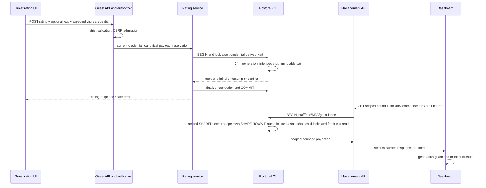
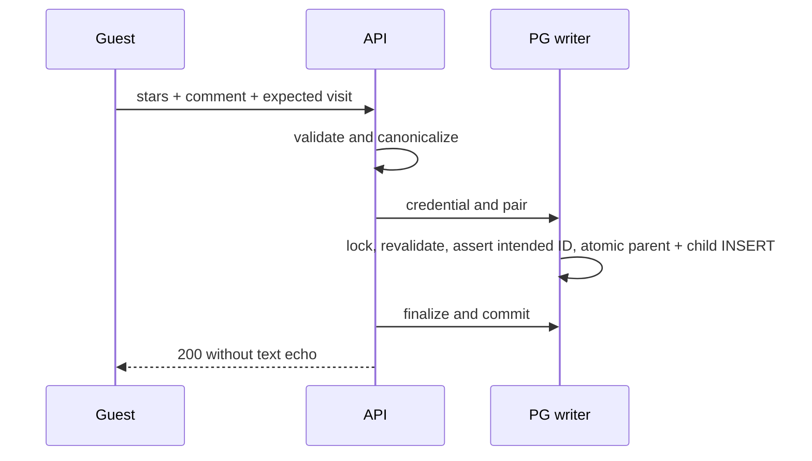
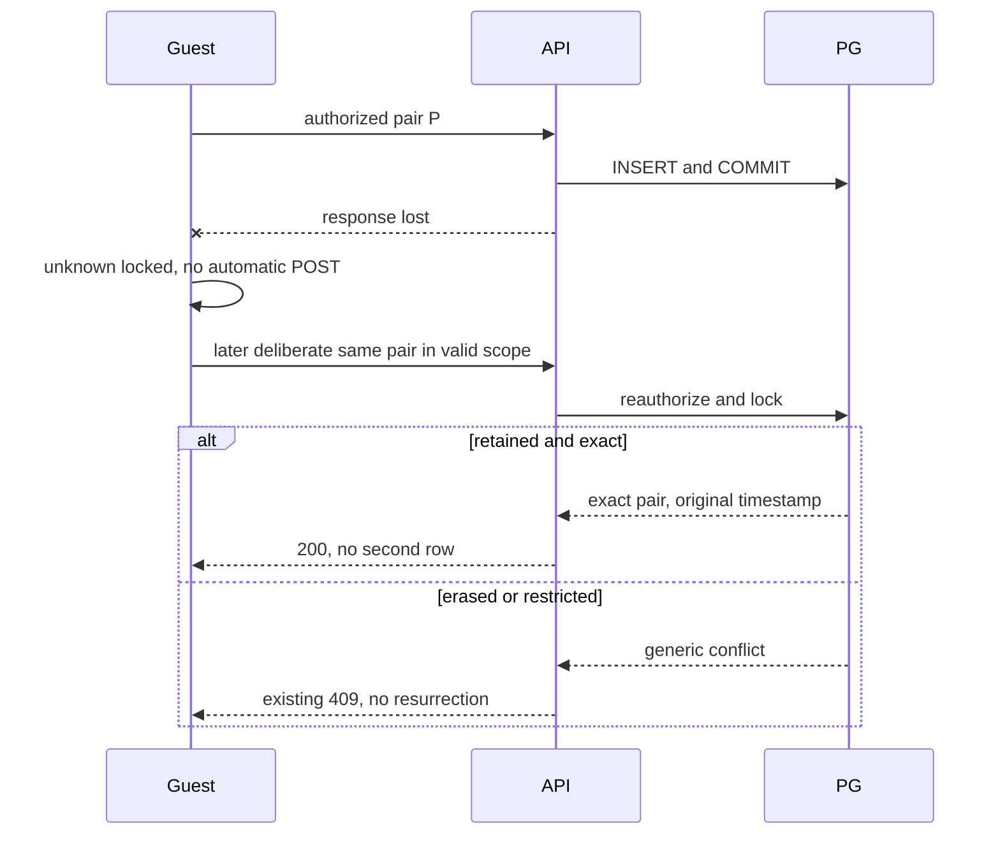
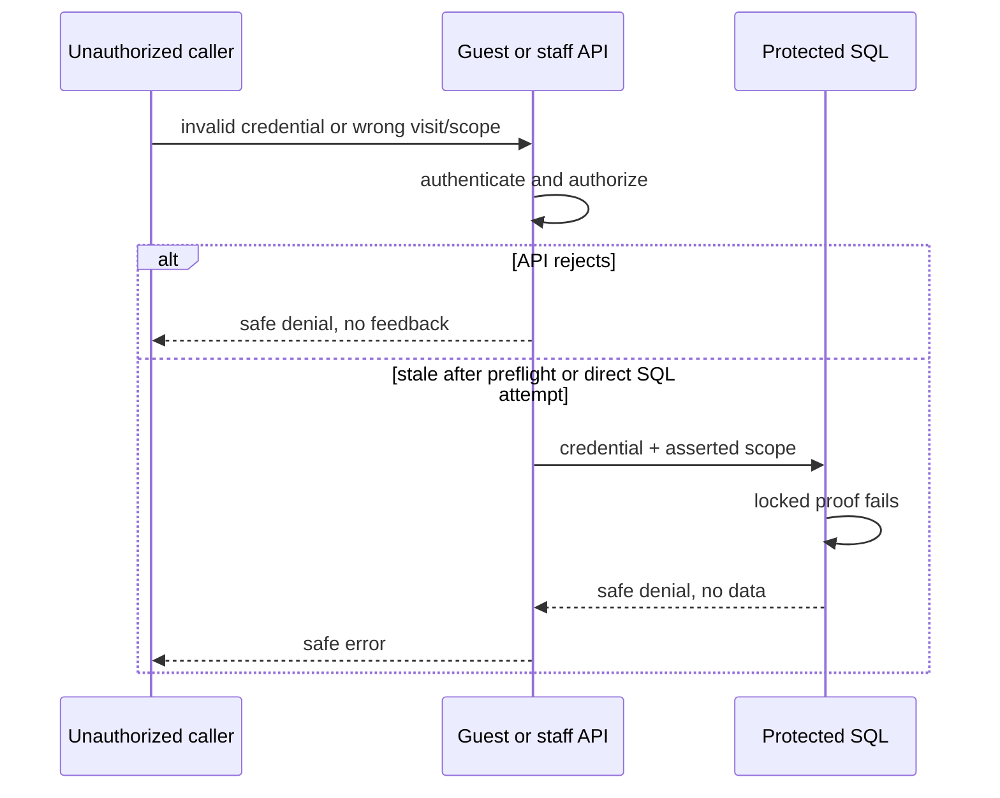
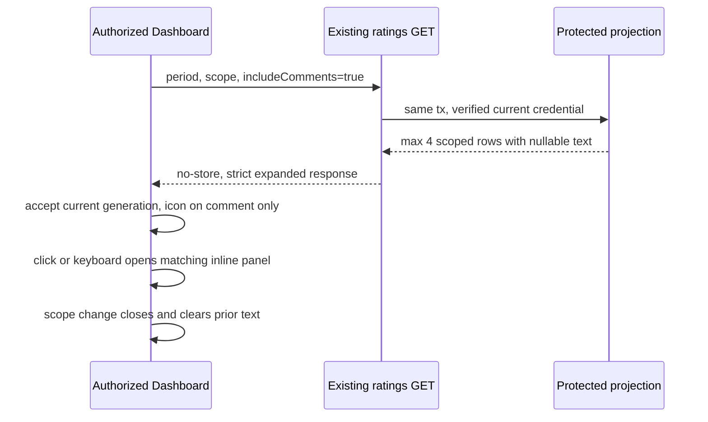
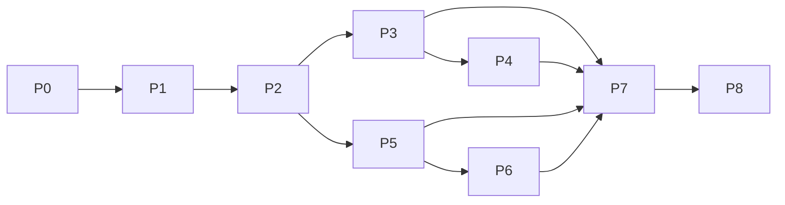

# Issue #463 — Guest Rating Comments: Full Feature Implementation Master Plan

**Version:** 1.2 (2026-11-26)

**Status:** P0 ISOLATED ARCHITECTURE PROOF — UI APPROVED / DESIGN FREEZE 100%; implementation authorization pending.
**Planning verdict:** NO-GO — EXACT REMAINING BLOCKERS (see §§17–18 and companion proof report; no implementation authorization).
**Repository:** [valet-platform](https://github.com/yamanradwan1-rgb/valet-platform) · [Issue #463](https://github.com/yamanradwan1-rgb/valet-platform/issues/463).
**Audited integrated main:** [cc507a5b25779e12934a3ead846ceb2c8ddff16b](https://github.com/yamanradwan1-rgb/valet-platform/tree/cc507a5b25779e12934a3ead846ceb2c8ddff16b).
**Immutable design:** [2166a6760803e1a5084c6230b15706549426d8c8](https://github.com/yamanradwan1-rgb/valet-platform/tree/2166a6760803e1a5084c6230b15706549426d8c8/docs/prototypes/issue-463), branch `prototype/issue-463-rating-comments`; original publication [comment](https://github.com/yamanradwan1-rgb/valet-platform/issues/463#issuecomment-7180149384). The Owner subsequently explicitly approved BOTH designs and froze them 100% in this planning assignment. The publication comment itself predates approval; this plan records the later Owner authority. Do not ask for UI approval again.
**Evidence legend:** CONFIRMED = pinned source/verified archive/observed planning-only result; PROPOSED = recommended implementation design, not Accepted decision or existing behavior; GATE = required future verification; OWNER = pending explicit Owner decision. No production code, migrations, workflows, security policies, application behavior, deployment or activation changed by this plan.

## 1. Executive summary and scope (v1.2 architecture proof)

Owner has explicitly approved OD-01 (1,000 scalars/4,000 UTF8 bytes), OD-02 immutable whole feedback, OD-03 current exact Management audience, OD-05 conditional existing error slot, and OD-06 compatibility direction. OD-04 operational targets and OD-07 exact protected design direction are CONDITIONALLY ACCEPTED for isolated P0 proof only; final policy/security amendment, remaining technical gates and implementation authorization remain OPEN. This document supersedes v1.0's same-row candidate, not the frozen design or any Accepted DEC. No P1–P8 production implementation authorized.

Owner-approved storage direction (final DEC amendment pending): one authorized Guest POST and one DB transaction insert existing immutable stars record plus optional one-to-one private comment record. Separate comment storage is required by the proposed selective privacy lifecycle; no ordinary edit, append, deletion of rating, staff-created feedback, public review, export, notification, new UI, new metrics, new feedback platform or general-purpose infrastructure. A single explicit OD-04 exception may be necessary for an independently durable noncontent restore/disposition ledger; no verified existing compliant store identified. Select and verify existing suitable store first, or separately approve narrow new infrastructure before implementation. No new infrastructure provisioned in P0. A strictly authorized, separately audited privacy disposition may remove text while preserving noncontent terminal receipt and immutable rating. After erasure, exact equality cannot be proved: all authorized retry variants fail with existing generic conflict, never resurrect/retain content or digest. This is a narrow proposed OD-04/DEC-091 amendment, not ordinary feedback editing.

Existing two-arg SQL signatures and three-key HTTP response remain. New strict request includes expected visit UUID assertion (never authority), optional canonical comment and stars. Existing default rating analytics SQL/HTTP remain byte-contract-compatible and comment-free. New opt-in on same two GETs uses credential-bound SQL owned by dedicated NOLOGIN reader, exact nested session-lock EXECUTE, shared-only reader fences, row SHARE NOWAIT for independent revokers, exact constant inert lock-column privileges, post-wait reauthorization and bounded projection. Existing CA API preflight/exclusive locks/activity remain; direct SQL cannot choose arbitrary scope. New privacy operator commands are not Management/Guest HTTP routes, not an audience for text. Proposed narrow feature provisioner preserves LEGACY and irreversible PROTECTED boundary.

P0 v1.2 executed actual pinned VAYLET PG17.11 history (155/155 and exact prime checksums), official LEGACY provisioning/PROTECTED cutover and replay, scoped reader/write/notice and real authority-row races. See the [P0 proof report](ISSUE_463_P0_ARCHITECTURE_PROOF.md) for results, failed attempts, synthetic diagnostics and remaining gates. No integrated production candidate, CI, production ACL, pixel/device or deployment proof. B-01/B-03 are materially advanced, not closed; B-02 has operational targets, not legal approval. See §§17–18.

## 2. Baseline, authority, concurrency and evidence

- CONFIRMED remote main and local origin/main both cc507a5b; local checked-out main eba55b76916a6892059e45622252b87483f4cb1e, 772 commits behind. Two pre-existing untracked user files VAYLET_COMPLETE_LOCAL_RUNBOOK.md and VAYLET_META_SANDBOX_HANDOFF.md preserved; no reset/stash/fast-forward. Read using pinned Git objects, not stale main files. Prototype parent is exact audited main; no integrated code delta since prototype baseline. Remote frozen branch matches 2166a676; diff from audited main contains only 14 docs/prototypes/issue-463 artifacts.
- GitHub open PR searches (global repo qualifier and repository-filtered open search) returned zero at inspection; no assertion about changes after that time. Original worktree inventory 457 entries, many historical/prunable. Relevant visible worktrees: tmp/issue-313-option1-implementation a7539b65 (historical integrated design), tmp/option-c-final-closure-20261116 cc507a5b (integrated security), tmp/prototype-463-publish 2166a676 (frozen), D:/v467-ci-plan bfb4fdcc / D:/v467-plan 3a54782f and tmp/issue467-w1-009b-nonforce a3419c57 (CI/security provisioning investigation), tmp/wa-prime 26228691 (WhatsApp), branch fix/issue-467-w2-staff-push-outage. These are observed references, not proof of active implementation/merge. Do not disturb them. Before phase 1, recheck open PRs/ref diffs for rating, auth, contract, migration/provisioning and test harness; coordinate one migration owner and rebaseline on relevant changes. No concurrent-worktree writes.
- Read #463 body and prototype publication comment; v1.1 resumes v1.0 at 4611848dde0f039f6b4bf0957691d71fb3810ff4; #312 and closure comment (auto-open, exact visit, intentional Back/dismiss, no automatic retry; #312 historical CI not awaited); #313 and all three comments (Option 1, existing cards/charts, prior nonzero-pixel waiver limited to that reviewed candidate; no permission to reuse waiver for #463). #312 and #313 are closed code deliveries; their comments do not prove deployment.
- Binding AGENTS.md authority order, docs/17_AGENT_CODE_STRUCTURE_RULES.md (300 authored lines per file; no dense bypass), docs/06_SECURITY_AND_DATA_RULES.md, docs/03_DATABASE_SCHEMA.md, docs/02_DOMAIN_MODEL.md and docs/08_DECISIONS_LOG.md. DEC-091 [accepted](https://github.com/yamanradwan1-rgb/valet-platform/blob/cc507a5b25779e12934a3ead846ceb2c8ddff16b/docs/decisions/DEC-091_GUEST_RATING_AND_RETURNING_CONTACT.md): exact completed guest scope, at most one immutable rating, exact retry, no staff writes, DEC-064 staged legacy bearer/current browser, post-completion 24h; CANCELLED never scope. DEC-095 [accepted](https://github.com/yamanradwan1-rgb/valet-platform/blob/cc507a5b25779e12934a3ead846ceb2c8ddff16b/docs/decisions/DEC-095_MANAGEMENT_KPI_SOURCE_CONTRACTS.md) §7: completed_at Location-local cohort, rated_at submission only; privacy-minimized, bounded, accurate counts. DEC-025 strict runtime/migration separation, DEC-080 Management authority, DEC-064 Browser Session, existing Option C raw bearer current-session lock and protected Writer boundary. #463 is additive scope beyond #313, not blanket permission to reinterpret these decisions. Proposed amendment to DEC-091/095 (and mirror log/schema/domain/security docs) requires Owner approval before implementation; no accepted policy rewritten during planning.
- Entities affected: GuestRating (existing immutable parent), GuestRatingComment (new optional one-to-one), GuestRatingCommentPrivacyCommand (new private ledger), GuestRatingCommentNoticeApproval (proposed private policy receipt), ValetSession (read/lock only, proposed inert lock column), GuestAccess credential/browser session (read/revalidate), authorized Management staff session/membership/location (read/revalidate), existing analytics response. No ValetSession or Task/Dispatch state transitions; no configuration-policy changes, no tenant/Location override, no feature flag system; only new privacy-controlled comment lifecycle. P0 v1.1 revalidation: remote main and frozen SHA unchanged, 458 worktree entries observed; GitHub open PR search returned no results. Concurrent observed branch refs option-c-ci-20261125-w1 b3b3c29c (CI, guest rating race harness) and native readback 9b06d17b (workflows) plus #467 workstreams are not integrated; rebaseline before production, no worktree disturbance.

### 2.1 Evidence index (all paths relative to pinned main)

| Area | Source evidence |
|---|---|
| Guest mount | apps/customer/src/app/guest-app-root.tsx, guest-post-visit-route.tsx; features/post-visit/use-guest-post-visit.ts, guest-post-visit-screen.tsx; features/rating/guest-live-rating.tsx, guest-rating-submission.ts, rating-presentation-policy.ts |
| Guest transport | apps/customer/src/lib/api/guest-api-client.ts, guest-http-transport.ts, guest-browser-context-marker.ts; guest-t5-api.test.ts; i18n/locale-provider.tsx, translations/{ar,en,guest-rating-translation-types}.ts; theme/theme-provider.tsx, lib/theme/colors.ts, app/globals.css, components/layout/{app-shell,app-header}.tsx, components/primitives/{btn,typography-primitives}.tsx |
| Guest API | apps/api/src/modules/guest-access/{guest-rating.controller,guest-rating.service,guest-rating-command,guest-credential-authorizer,guest-access.service,guest-browser-transport,guest-request-admission,guest-credential}.ts; common/http/{api-errors,api-operation-runner,guest-operation-routes}.ts; common/database/postgres-transaction.ts |
| Contracts | packages/contracts/src/{guest-rating,customer-feedback-analytics,location-analytics-common,utf16-string-max}.ts; strict schemas and exports |
| DB | packages/database/prisma/schema.prisma model GuestRating; migrations/20260917004200_mgt_be_09_guest_rating, 20261007007000_guest_browser_session_continuity, 20261022010000_issue313_rating_analytics_read; 20261116000210_option_c_staff_session_lock_function, 20261116000300_option_c_management_raw_bearer_authority, 20261118000200_option_c_management_authority_freshness (latest migration at baseline); scripts/{guest-rating-runtime-privileges,guest-browser-session-runtime-privileges,management-runtime-privileges,guest-runtime-privileges,runtime-table-privileges}.mjs; apps/api/src/common/database/runtime-database-readiness.ts |
| Management authority & read | apps/api/src/modules/management/{management-rating-analytics.controller,management-rating-analytics.service,rating-analytics-http,rating-analytics-projection-query,management-authorization}.ts; dashboard/{rating-analytics.controller,rating-analytics-query,dashboard-read-authorization,dashboard-location-authorization,analytics-period}.ts; auth/{staff-session-context,staff-session-lock,staff-session-revalidation}.ts; auth/mfa/mfa-assurance-policy.ts |
| Dashboard | apps/dashboard/src/features/intelligence/{analytics-page,intelligence-scope,use-customer-feedback-read,use-intelligence-read,intelligence-query-identity,customer-feedback-api,customer-feedback-copy,customer-feedback-section,customer-feedback-insights,customer-feedback-summary}.ts[x], customer-feedback.module.css, analytics.module.css; lib/scope/scope-generation.ts; app/globals.css |
| Existing verification | apps/api/test/{guest-rating-boundary,guest-rating-idempotency,guest-rating-concurrency,rating-analytics-location-http,rating-analytics-company-http,rating-analytics-browser-e2e,customer-auto-rating.browser}.integration.test.ts; packages/database/src/{guest-rating-migration,guest-rating-runtime-role,guest-browser-session-runtime-role,rating-analytics-runtime-role}.integration.test.ts; rating-analytics-explain-fixture.ts; customer and dashboard component tests; .github/workflows/ci.yml; security CI (unchanged) |

Historical source comments saying GuestLiveRating is unmounted are stale; actual callers establish mount. #312's manual/automatic navigation and #313's aggregate source/placement preserved. Source evidence does not certify current production DB grants, real runtime, migrations applied, deployment or external operations.

## 3. Frozen reference contract (CONFIRMED)

[README](https://github.com/yamanradwan1-rgb/valet-platform/blob/2166a6760803e1a5084c6230b15706549426d8c8/docs/prototypes/issue-463/README.md). Archives recovered via matching Git blob identities in existing prototype worktree, copied to isolated scratch, expanded read-only with respect to original; all 21 images decoded and visually inspected via contact sheets. No new prototype. Archive SHA256 (lowercase canonical):

| Package | SHA-256 | Git blob |
|---|---|---|
| [Guest](https://github.com/yamanradwan1-rgb/valet-platform/blob/2166a6760803e1a5084c6230b15706549426d8c8/docs/prototypes/issue-463/guest-prototype.zip) | cc661d944479060647064811ea0c5a194ae177a155f7fbb4a10171ddf0c88da5 | b1333fdac0e216611dd05b5dfc96402a1e224eab |
| [Dashboard](https://github.com/yamanradwan1-rgb/valet-platform/blob/2166a6760803e1a5084c6230b15706549426d8c8/docs/prototypes/issue-463/dashboard-prototype.zip) | 3c30464310194e1c636865277aaedaff758d8629d3126340c4965ac7244e280d | 4376b6e086a971685726b0ac977b8aca39b995bd |

### 3.1 Relevant internal source SHA-256

| Archive | Path | SHA256 |
|---|---|---|
| Guest | apps/customer/src/features/rating/guest-comments-rating.tsx | 9809a70b65316d1494ef6e4416ed6287685f04eb323b8d97ad1e1da6c68a1ed0 |
| Guest | entry.tsx | a5eb5862486b78853b27c1f1d19235ebf17f7f151cc4bb9fb58461fd6000960f |
| Guest | prototype.css | ff56bd87b3323a5cc5fc98eea666316efc36a64912350f49c6b085ae40b03e71 |
| Guest | bundle.js | 57550978d8e0168eb450ecef94764f8235537aaf7d3cc9d7b4199163672aa001 |
| Guest | bundle.css | 686d66ef0839177c974a36e243fcb24caaadaaf993b32ef0b492b793d7f9e458 |
| Guest | verify.cjs | c33f5fcede2cd5405b445096af7dd082444684fa0119448b633f00b4611c1703 |
| Dashboard | apps/dashboard/src/features/intelligence/customer-feedback-insights-proposed.tsx | 014fedd5aa30a61c708f526b546ca6a07a2a4b0f8376166cf03c8d816822a3ec |
| Dashboard | entry.tsx | 23f62cb7c8c3095f19549bcf7a26810eff4f3a44ecbccb7adbfaf2e7a2519e72 |
| Dashboard | prototype.css | 7c5fbc02fffffb88ff92529cb3ae5ee663fcbba13c2868edcc05cbe8afeb4d42 |
| Dashboard | bundle.js | febb7825a12060240d6c80429639bbd11ef5b97e1e7559b4c5c7d5dba9c3db46 |
| Dashboard | bundle.css | 7cfdb7765a97c07f1bc9c0d1b739da1782a495377c918b832cd74837f696b927 |
| Dashboard | verify.cjs | b9845db6243013e18c562fb9bb5c49d37579f918a3691655ee74df2552190a3a |

Both ZIPs also contain index.html, serve/build scripts, README, all screenshots, Guest logo assets; prebuilt bundle contains inherited components. Build/verify scripts have original Windows paths; source deltas not entire production tree. Do not replace ZIPs or recreate a design from them; implement against actual mounted source. README described placeholder provisional before Owner approval; it is frozen now.

### 3.2 Screenshot inventory (PNG dimensions; archives contain originals)

| Guest file | Pixel dimensions | State |
|---|---:|---|
| original-ar-light.png | 390×846 | original without field |
| proposed-ar-light.png | 390×846 | frozen AR/LTR-independent light, RTL |
| proposed-ar-dark.png | 390×846 | RTL dark |
| proposed-en-light.png | 390×846 | LTR light |
| proposed-en-dark.png | 390×846 | LTR dark |
| selected-empty.png | 390×846 | 4 stars, focused empty textarea |
| selected-multiline.png | 390×846 | 5 stars, two lines |
| success.png | 390×846 | saved locked field and existing status |
| failure.png | 390×846 | two stars, retryable status |
| width-320.png | 320×839 | AR dark, long text |
| width-390.png | 390×802 | AR dark, long text |
| width-1280.png | 1280×802 | AR dark, centered Guest frame |
| keyboard-reduced-viewport.png | 390×556 | focused reduced viewport; NOT real keyboard |

| Dashboard file | Pixel dimensions | State |
|---|---:|---|
| original-dark.png | 803×600 | original recent list |
| proposed-dark.png | 803×600 | collapsed icons on rows 1/3 only |
| expanded-dark.png | 803×600 | first comment open |
| full-en-light.png | 803×825 | full feedback section, first open keyboard focus |
| full-en-dark.png | 803×825 | same dark |
| full-ar-light.png | 803×825 | full RTL, first open |
| full-ar-dark.png | 803×825 | same dark |
| mobile-ar.png | 320×700 | RTL third comment expanded |

Captured historical scripts: Guest Chromium headless 390×844, then 320/390/1280×800, reduced 390×420, fullPage true animations disabled; waits document.fonts.ready +300ms. Dashboard Chromium headless 803×600 then 320×700; fullPage true. PNG heights may exceed viewport because of harness toolbar/page layout. Historical browser build/OS/font byte identity not recorded; README reports both scripts exit 0, but not production parity. Selected PNGs permanently linked in frozen README.

Planning-only independent archive smoke: served exact extracted bundle bytes with a temporary loopback-only read-only static harness, no API; Chromium 151.0.7922.34 / Windows / DPR 1; four locale/theme combinations each app, empty comment alone disabled submit, mock selected submission locks field and shows status, dashboard two icons, single-open and collapse, 320px overflow, zero page errors, exit 0. Request hosts only 127.0.0.1 and Google Fonts font hosts. Guest Tajawal/Plus Jakarta Sans/Space Grotesk required faces loaded in this run; unused font variants unloaded; Dashboard computed system stack, document.fonts empty. Original screenshots are not overwritten; current measurements are evidence of archive behavior, not historical pixel-equivalence or production testing. No real data, no production runtime tests, no real device keyboard.

### 3.3 Guest immutable visual & behavior spec

Inherited: AppShell max width 430, min-height 100dvh, bg frame C.bgFrame, shell bg C.bg, original logo/header menu and spacing, title SectionTitle 26px/600, line-height 1.2, letter-spacing -0.02em; EN Space Grotesk display/Plus Jakarta Sans body; AR Tajawal. Rating container flex column padding 24px 20px 32px, gap 20px, screen-enter; existing stars flex center gap 12px, five text ★ buttons font 32px, transparent border/background, C.warningSemantic selected/C.borderSemantic inactive. Existing Btn default 15px/600, 16px 20px padding, min-height 48px, radius 10px, primary brand fill/hover/focus, secondary transparent 1px border, loading spinner and disabled opacity .5. Status existing 14px C.textSecondary, no margins. Existing back control remains.
Added exactly one field between stars and existing feedback/status (if present), then submit, then Back. Label block 14px/600 C.text; exact label AR **ملاحظاتك عن الخدمة (اختياري)** / EN **Comments about the service (optional)**. Placeholder AR **شاركنا ملاحظاتك عن تجربتك...** / EN **Share your feedback about your experience...**. Textarea rows=3; width 100%, max-width 100%, margin-top 8px, padding 12px 14px, radius 10px, 1px solid C.borderSemantic, C.surface bg/C.text text, 14px inherit font, line-height 1.5, vertical resize, text-align start, display block, overflow-wrap anywhere. Placeholder C.textSecondary; disabled opacity .65; focus-visible 2px solid var(--brand-focus,var(--v-blue)), outline-offset 2px. Use scoped CSS and typed translation keys, not global design-token edits. Native label/id association, textarea keyboard and screen reader. No counter, helper, badge or extra button. Do not port mock toolbar, 45px harness min-height override, reset controls, fixture IDs, inline mock client, or duplicate route.
Tokens light/dark respectively: bg #FAFAF8/#07111F; frame #E8EDF4/#03070E; surface #FFFFFF/#0D1C2E; text #07111F/#F1F5F9; secondary #6F7C91/#94A3B8; border #DDE4EC/#1E3654; blue #176BFF/#2575FC; selected star #D89434/#FBBF24. Existing branding overrides preserved, no palette rewrite.
Observed frozen bundle geometry at 390×844 CSS px (toolbar 47px, origin top-left): AR h2 [20,150,350,31.1875], star group [20,201.1875,350,45], first star 38.65625×45, label [20,266.1875,350,21], textarea [20,295.1875,350,89], submit [20,404.1875,350,49], Back [20,473.1875,350,51]; EN h2 [20,148,350,31.1875], stars [20,199.1875,350,45], label [20,264.1875,350,18], textarea [20,290.1875,350,89], submit [20,399.1875,350,49], Back [20,468.1875,350,51]. Same per theme. EN 320×800: textarea 280×89. Coordinates not hard-coded in production; compare relative to header/content after exact harness translation. Frozen draft accepts optional text, requires star, supports edit/clear and locks field on saving/saved/unknown/conflict/unavailable. Status copy stays existing.

### 3.4 Dashboard immutable visual & behavior spec

Inherited: CustomerFeedbackInsights + CustomerFeedbackSummary and copy; insights two minmax columns, margin-top16px gap16px; stack at max-width760px; summary stacks at540px. Card 1px var(--f1-border), radius12, background --f1-surface, padding clamp(14px,1.8vw,22px); title 13px/740 with margin-bottom18; row grid minmax(0,1fr) auto, align center, gap10, padding9px 0 except first top/last bottom, 1px divider; visit ID 12px/740 ltr isolated; meta11px/1.55; star chip 12px/780, radius7, padding7px 10px, bg/text #fff4d9/#8b5b07 light, #3b2d20/#ffd583 dark. Dashboard font Inter, Segoe UI, Tahoma, Arial. Tokens light/dark: --f1-surface #ffffff/#131e3d, border #e2e8f0/#1e293b, text #0f172a/#ffffff, muted #64748b/#94a3b8, track #e9eef6/#253656, global bg #f4f7fb/#081020. Existing analytics card data and surrounding shell untouched.
Added: actions flex center gap8, flex-shrink0 (gap5 at max-width400). Only non-null canonical comment rows get icon, adjacent before rating chip in DOM and naturally mirrors RTL. Button 30×30, grid place-items center, border1px --f1-border radius7, transparent bg, --f1-muted, cursor pointer, 150ms color/background transition; hover/open --f1-track background, --f1-text color. Icon SVG 16×16, viewBox 0 0 24 24, no fill, stroke currentColor width1.7, round line joins/caps; exact paths: `M21 11.5a8.5 8.5 0 0 1-8.5 8.5H4l2-5A8.5 8.5 0 1 1 21 11.5Z` and `M9 10h7M9 14h5`. Focus-visible outline 2px --focus offset2 in archive; production global focus shadow may differ: match actual measured reference with scoped focus style (no shared CSS changes; verify no extra halo). Native type button, aria-expanded, aria-controls row-specific panel id, label EN "View comment for " + visit reference / AR "عرض تعليق " + reference, title EN "View visit comment" / AR "عرض تعليق الزيارة"; SVG aria-hidden. Only one open at a time, initially closed, click again closes; button focus retained, Enter/Space same. Panel grid-column 1/-1, 1px --f1-border, bg --bg, padding12, radius8, min-width0; title block 11px/700 muted margin-bottom6: EN "Guest comment", AR "تعليق الضيف". Paragraph margin0, 12px/1.65, --f1-text, white-space pre-wrap, overflow-wrap anywhere, text-align start, dir=auto. Hidden panels not visible or focusable; use conditional mount or hidden semantics, never aria-hidden only. Historical no comment: no icon or empty text, chip position unchanged. No modal, counter, extra controls or independent read.
Observed at 803×600 DPR1, list-only fixture (toolbar included): first row [18.453125,115.453125,766.09375,64.09375]; EN actions [706.328125,127.5,78.21875,30], toggle 30×30 at x706.328125, SVG 16×16, chip 40.21875×30 x744.328125; RTL actions x18.453125, chip x18.453125, toggle x66.671875. First expanded panel [18.453125,179.546875,766.09375,66.796875], title [31.453125,192.546875,740.09375,15], paragraph [31.453125,213.546875,740.09375,19.796875]. Same light/dark. Compare relative geometry using same widths/text; don't import archive toolbar, preview-single/preview-full wrappers, CSS globals or mock metric values. Existing chip aria-label singular for one star preserved (prototype uses plural; nonvisual correction, no design change). Production 320px, 390px and desktop widths use actual dashboard container.

### 3.5 Visual protocol (future binding gate)

Freeze immutable hash and full reference inventory. Match production original baseline, frozen bundle and candidate: same OS/browser/version, viewport/DPR (1 plus real device DPR), fonts/loaded face and font file identity, locale/theme/branding, content/timestamps/timezone, scrollbar, zoom, input/focus, animation completion, network and fixture. Use clean browser contexts; document document.fonts.ready, fonts status, actual rendered font via DevTools, screenshot dimensions, engine, CSS/DOM boxes computed styles. Capture original unchanged screen at audited baseline; capture archive exact bytes (no redesign); capture production components on actual authenticated Guest/Management paths with deterministic test data matching fixture, not mocked API for E2E. Archive toolbar is harness-only: crop exact content viewport by measured anchor (header/main or card bounds), explicitly report coordinate offset; no broad mask. For surrounding UI compare full before/after real screens after measured natural downward translation caused solely by inserted field/panel. Hash all images; raw pixel diff, count/percentage and max RGB delta; expected 0 unexplained difference. Use repeated captures to prove environmental variance; retain raw diff and causality, no threshold to hide differences. If deterministic glyph/OS difference cannot be isolated, owner decision specific evidence required; no general waiver. Compare 4 locale/theme × 320/390/768/1440 (Guest also1280, Dashboard card at803) × empty/selected/populated/focus/loading/saved/failure, existing unavailable/conflict/unknown via production reference where archive lacks captures; Dashboard closed/expanded/second opens/collapsed/no-comment, mixed bidi and long text, full section/shell and metrics. Test actual mobile keyboard open, scroll/submit/back/resize and focus at 200% zoom; original reduced viewport was simulation only. No unexplained clipping; if frozen 30px dashboard hit target conflicts with mandatory accessibility policy, document exact requirement and request narrowly scoped decision (do not silently resize). Physical keyboard/browser and device evidence pending. Final independent UI verdict and Owner release approval required. Prior #313 waiver is not transferable.

## 4. Owner decision register — v1.2

| ID | Owner status | Binding direction / remaining decision |
|---|---|---|
| OD-01 | APPROVED | Raw and canonical 1,000 Unicode scalars, max 4,000 UTF8 bytes, reject malformed, no truncation/counter/UI changes. Exact normalization §5.2 finalized as proposed technical contract and diagnostic parity established. |
| OD-02 | APPROVED | One immutable canonical (rating,comment) submission per authorized completed visit; exact retry only, conflict otherwise, no normal editing/staff modification/append/overwrite. Privacy terminal erasure/restriction exception is separately OD-04, not approval to weaken ordinary retry. |
| OD-03 | APPROVED | Existing exact Management permissions only: CA standard MFA, authorized LM exact Location. No public/other audience, export, notifications, external analytics. Free text PII-capable; no extra structured identity fields. Approved audience does not authorize arbitrary SQL reads or undefined retention. |
| OD-04 | CONDITIONAL DIRECTION ACCEPTED; FINAL GATE OPEN | Separate 1:1 child, narrow privacy-only erase and terminal retry conflict accepted; 30d active, expiry hidden, due purge 24h, approved erase 7d subject to holds/applicable law, hold review 30d, maximum residual recovery window 30d conditionally accepted. Verify legal basis, exact notice/content/version, rights/operator workflow, provider residual lifetime and independent durable restore ledger before final policy approval. No collection until approved. |
| OD-05 | APPROVED WITH CONDITION | Existing status/error area only. Existing failure copy for invalid input unless specific new copy approved. Existing generic conflict/unavailable after privacy disposition. No new visible elements or reposition; any required notice/validation change affecting frozen UI is owner-specific decision, not automatic. |
| OD-06 | APPROVED DIRECTION | Existing POST and GET paths/legacy strict contracts, atomic pair, mandatory intended-visit assertion on new variant, strict expanded opt-in; exact ABI §§5–7. No silent downgrade. |
| OD-07 | CONDITIONAL P0 DESIGN ACCEPTED; FINAL GATE OPEN | Dedicated NOLOGIN reader/privacy owners, exact non-grantable nested locker EXECUTE, inert row-lock grants, phase-specific provisioning; no broad legacy restoration or raw runtime SELECT. Actual migrated mechanisms proven in part; combined exact stage/inventory/guard/readiness/lock proof and independent acceptance plus final security amendment remain required. Production PREPARE dormant; atomic RELEASE in PROTECTED only after separate release approval. |

Owner UI approval remains final; no repeat design review requested. Current approval permits P0 only. Record approved decision amendments in focused DEC(s) and canonical log before coding (DEC-091 immutable pair and privacy exception; DEC-095 text-bearing opted-in scope; Option C/DEC-025 security inventory; privacy/retention docs). Do not assign a DEC ID until current decision sequence is checked. No accepted production decision file modified during P0. OD-04/07 conditional direction is not final policy/security amendment approval. Owner must explicitly accept remaining package and subsequently authorize implementation. All technical invariants and mandatory tests remain binding.

## 5. API and shared contracts (PROPOSED)

### 5.1 Existing POST /v1/guest/session/rating

Preserve empty query, existing credential/anti-abuse and no-store behavior, exact strict response of rating, ratedAt (existing offset datetime), valetSessionId (UUID). Extend request as strict union:
```ts
type LegacyRating = { rating: 1|2|3|4|5 };
type ScopedFeedback = {
  rating: 1|2|3|4|5;
  expectedValetSessionId: string; // UUID assertion only; never authority
  comment?: string | null;
};
type GuestRatingSubmissionRequest = LegacyRating | ScopedFeedback;
```
New client always sends expectedValetSessionId (even stars-only); comment optional. Any comment key without assertion rejected (including null). Reject extra keys and coercion. No client author, tenant, Location, timestamp. Canonicalize in shared contract, authoritative server validates raw clients and SQL independently enforces. Keep existing submitRating(rating, signal?) method for old callers; introduce explicit submitFeedback(payload, signal?) using same transport and response schema. No comment echo; old strict response parsers continue to work. Existing browser marker pre/post request and CSRF/origin/same-origin cookie checks remain. Marker check alone cannot bind credential attached after check; DB assertion closes that race for new clients. Legacy clients retain historical stars-only behavior; no claim of retroactive intended-visit protection, no new legacy text writes.

200 first/exact retry; 400 REQUEST_INVALID for invalid shape/type/UUID/bounds; 401 GUEST_ACCESS_INVALID on invalid/revoked/expired/consumed or asserted visit mismatch (no other visit ID returned); 409 GUEST_RATING_NOT_AVAILABLE for authorized incomplete scope; 409 GUEST_RATING_CONFLICT for changed canonical pair or terminal privacy restriction/erasure (OD-04 exception); existing 429, 503, transport and error envelopes preserved. DB REQUEST_INVALID result mapped safely, no raw Zod input/SQL detail. Unexpected result fails closed; success requires response visit and rating match submitted snapshot. No separate comment POST.

### 5.2 Canonicalization algorithm

OD-01 approved limits; proposed exact algorithm, identical TypeScript and PostgreSQL behavior under UTF8, golden vectors. Omitted or explicit null => null. Otherwise strict string; reject numbers, object, array, boolean, malformed UTF-16 (lone surrogates), NUL, C0 U+0000–001F except HT/LF/CR, DEL/C1 U+007F–009F, explicit bidi embedding/override/PDF U+202A–202E and isolates U+2066–2069. Allow Arabic, diacritics, emoji/ZWJ, internal line breaks, mixed scripts and literal HTML. Raw count <=1,000 Unicode scalars and <=4,000 UTF8 bytes; reject oversized input even if trim would shorten it. No coercion/truncation.

Convert CRLF and lone CR to LF. Strip only the following at both ends: HT, LF, ASCII space, NBSP U+00A0, U+1680, U+2000..200A, U+2028/2029, U+202F, U+205F, U+3000. Empty => null. Preserve internal whitespace, case, combining marks, punctuation and bytes otherwise. No NFC/NFKC or HTML transformation; combining/precomposed distinct by policy. Use fixed codepoint sets, not language-dependent trim or regex approximations. Canonical bounds same as raw. PG char_length (UTF8 codepoints) and octet_length, explicit control-code validation; TS well-formed check then scalar iteration and UTF8 count; do not use utf16StringMax for scalar policy. DB equality compares convert_to(comment,'UTF8') IS NOT DISTINCT FROM convert_to(canonical,'UTF8') to avoid collation ambiguity. PG explicit pg_catalog."C" collation where needed, fixed codepoint iteration ascii(substr(...)), char_length=0 for emptiness. TS checks lone surrogates before scalar iteration and UTF8 byte count (Buffer.byteLength server or TextEncoder browser). 1000 valid scalars implies <=4000 bytes; both limits independently enforced. Existing JSON body parser/transport bounds must be verified. Pinned apps/api/src/main.ts has rawBody:true; only new scoped rating variant validates actual captured JSON Buffer with fatal TextDecoder UTF8 (explicit JSON UTF8 content-type, reject missing buffer/unsupported charset), before accepting parsed body. Existing malformed legacy behavior not widened; no global parser change. Malformed typed PostgreSQL text is rejected by encoding layer before function (e.g. 22021), safe 400/no reflection at HTTP boundary; valid UTF8 prohibited codepoints return REQUEST_INVALID. Real raw-byte adapter tests required (guest-rating-test-context.ts currently lacks rawBody:true), use literal HTTP Buffer not JSON.stringify. Preserve genuine U+FFFD. No raw text in diagnostic or validation metadata. UI prevalidates on submit and uses OD-05, no extra counter or silent maxLength truncation.

### 5.3 Management read contract

Existing endpoints:
- GET /v1/staff/dashboard/locations/:locationId/analytics/ratings?from=YYYY-MM-DD&to=YYYY-MM-DD
- GET /v1/staff/management/organizations/:organizationId/analytics/ratings?from=...&to=...

Keep legacy exact strict response and query when no opt-in. Add only exact query literal includeComments=true to these two routes, validated via rating-specific shared schema (not global analytics query changes), reject duplicates, arrays, false, unknown keys. Same inclusive max 31 calendar days. Separate strict expanded response schema, all existing fields unchanged except each recentRatings row requires comment: string|null; max four rows, no new author/identity keys or raw UUID. Historical/stars-only/held/erased/expired rows null, no icon; no disposition metadata returned. New Dashboard uses opt-in and expanded parser (missing field is error, not fabricated no-comment). Old default SQL and HTTP never return text. No new endpoint, N+1, pagination/filter/sort change.

| Mixed version | Result |
|---|---|
| Old Guest -> new API/DB | Existing rating-only, NULL comment; unchanged response, exact NULL pair retry only |
| Old API -> new DB | Legacy two-arg functions still callable in dormant and RELEASE states, null pair semantics, conflict if stored comment differs or is erased/restricted; legacy analytics exact shape |
| New Guest -> old API | Strict old parser rejects new selector/comment; fail safely, never strip fields/retry; prevent by API-first deploy |
| New API -> old DB | Readiness fails closed; PROTECTED phase, schema and provisioned grants first |
| Old Dashboard -> new API | Default query/response unchanged, no text |
| New Dashboard -> old API | Reject unknown opt-in; existing error state, no fake no-comments; prevent by sequencing |
| New Dashboard -> new API | Opt-in expanded bounded response after credential verification |

## 6. PostgreSQL, writer, transaction and immutable retries

### 6.1 Confirmed existing mechanics and selected storage alternative

GuestRatingController strict parse -> ApiOperationRunner -> GuestCredentialAuthorizer (CSRF/origin, class C admission) -> GuestRatingService inPostgresTransaction -> resolveAndLockCredentialInTransaction(postVisit=true) -> submitGuestRating -> anti-abuse finalize -> commit then response. Invalid access COUNTED, valid conflict/unavailable IGNORED, unexpected errors roll back, finalize failure rolls back. Existing SQL in migration 20261007007000: legacy token hash + unconsumed/unrevoked/expiry, session FOR UPDATE; browser guest_browser_resolve(token,true) session then browser lock, generation/scope/time, POST_VISIT; 24h and COMPLETED only. Both currently compare stars. 20260917004200 creates parent PK(valet_session_id), composite visit FK, CHECK 1..5, UPDATE/DELETE-rejecting trigger. Parent stays exactly immutable.

| Criterion | A: nullable text on guest_ratings | B: selected one-to-one comment child |
|---|---|---|
| Atomic write/retry | Single insert, pair equality; simplest | One transaction, parent then child, same locked visit; full canonical pair while text retained |
| Independent erasure | Existing immutable trigger forbids UPDATE/DELETE; weakening it or retaining text unacceptable if rights require selective erase | One-way child disposition only; parent rating/timestamp/metrics untouched; no revival |
| Tenant/integrity | Existing composite FK | PK child visit + FK parent and exact composite visit FK (transitive same org/location); no redundant parent unique index required |
| Historical/legacy | NULL historical | No child historical/stars-only; old ABI unchanged except conflicts for originally commented/erased |
| Minimization/backup | Comment mixed into permanent immutable rating | Separate content/metadata lifecycle, bounded retention and suppression; WAL/backups still require independent restore controls |
| Query cost | Bounded join from latest row | One indexed PK join after LIMIT4, no N+1; small retention index justified |
| Authorization/audit | Requires privileged parent exception | Separate narrow privacy writer, no text output, auditable terminal receipt; ordinary runtime no DML |
| Complexity/recovery | Less DDL, hard/impossible erase without changing core | Additional table + scoped disposition/approval, forward migration and restore ledger; worth cost to preserve immutable parent and rights |

Recommend B even if owner ultimately selects a different lawful duration, to avoid baking indefinite text into immutable history. Conditional OD-04; no destructive parent rollback or trigger bypass.

### 6.2 Proposed schema and immutable state

New public.guest_rating_comments (table protected by ACL, not public data): valet_session_id UUID PK FK guest_ratings(valet_session_id) RESTRICT; organization_id, location_id UUID NOT NULL; composite FK (organization_id,location_id,valet_session_id) -> valet_sessions(organization_id,location_id,id) RESTRICT. Parent itself references same exact visit triple, so child cannot spoof tenant/location. comment_text TEXT NULL, state controlled enum guest_rating_comment_state (PRESENT, HELD, ERASED), retention_expires_at TIMESTAMPTZ(3) NOT NULL assigned from parent rated_at plus accepted policy, erased_at TIMESTAMPTZ(3) nullable, hold_case_id UUID nullable, erase_pending BOOLEAN NOT NULL DEFAULT false, rating_feedback_lock_guard BIGINT NOT NULL DEFAULT 0 CHECK (=0). No child for N (historical/never submitted comment); child includes immutable notice version linked to exact approved publication as specified in §17.3; PRESENT/HELD require nonempty canonical text, ERASED requires null text, nonnull erased_at, no hold/pending. PRESENT no hold/erase_pending; HELD requires active hold case; pending only HELD. Canonical CHECK uses private IMMUTABLE safe predicate and byte equality, convalidated before new writes. Validate exact deadline from parent on insert (constant approved policy at submission; no arbitrary client-supplied expiry). Existing parent schema unchanged except Prisma inverse relation; no raw text, hash, length or derived digest in receipt. Index PK for join and partial (retention_expires_at,valet_session_id) WHERE state='PRESENT' for due purge; no text index. Add one inert constant lock column to valet_sessions for privacy owner and six authority tables for reader (§7.3), no business state changes; migration/lock cost measured. New privacy command ledger §17.3. No content duplicate or audit copy.

Child guard must reject F direct UPDATE even inert SET 0 (row locks do not trigger mutation); on approved P changes never compare/return raw OLD value outside trigger. Guard child INSERT only from existing writer function owner, state PRESENT, valid parent/tuple/deadline; no UPDATE/DELETE/TRUNCATE by ordinary runtime or guest writer. Trigger permits only narrowly defined privacy owner transitions PRESENT->HELD, HELD->HELD (mark erase pending), HELD->PRESENT (release when not due/pending), PRESENT/HELD->ERASED (approved erase/eligible retention/release, clear text and hold), no identity/deadline/text replacement, never ERASED->anything. Require effective current_user privacy owner (trigger runs invoker, no SECURITY DEFINER identity substitution), verified command transaction and transition constraints, no-op exact replay receipt; all other UPDATE/DELETE rejected. Guard cannot replace privileged owner/catalog audit; migration owner is trusted maintenance boundary, no app SET access. No physical removal claim from MVCC/WAL/backup merely by NULL update. §17.3 defines authorized privacy procedures and audit.

### 6.3 Exact write ABI and lock contract

Keep existing public.guest_rating_submit(text,integer), public.guest_browser_rating_submit(text,integer). New public overloads guest_rating_submit(text,integer,text,uuid), guest_browser_rating_submit(text,integer,text,uuid), no defaults. All return exactly TABLE(result_code text,valet_session_id uuid,rating integer,rated_at timestamptz). Existing owner/ABI retained (actual owner must be attested in new environment; pinned DDL runs migration principal). Private public.guest_rating_submit_core(text,integer,text,uuid,boolean) and guest_browser_rating_submit_core(same args), SECURITY DEFINER or invoker within existing definer owner, fully qualified search_path pg_catalog (public helpers explicitly qualified). Legacy wrappers hardcode (NULL comment,NULL expected,true); new wrappers (supplied text,required UUID,false); private cores reject inconsistent mode; no EXECUTE for runtime/PUBLIC or other writers. Shared private guest_rating_persist_locked(uuid,uuid,uuid,integer,text) only under credential-bound core same owner (no generic runtime entry, explicit owner-only EXECUTE). If actual old function owners differ, stop and review exact owner-to-owner helper ACL, no migration-superuser fallback. Keep legacy function metadata required by existing scripts (search_path=pg_catalog, public); new signatures verified exact inventory. New routines/guard/normalizer denied PUBLIC in creation transaction.

New four-arg wrappers require phase helper true before credential lookup (no new text in LEGACY even if accidental EXECUTE); two-arg legacy wrappers remain callable in LEGACY with NULL only and no phase check. Both paths require READ COMMITTED for fresh post-lock semantics (legacy API already uses default; direct non-RC fail closed, no false success). Validate input before expensive work; canonicalize again in SQL, raw limit and fixed rules §5.2. Resolve credentials and lock canonical session row using existing exact bearer/browser rules, session->browser (never reverse). Recheck unconsumed/unrevoked/expiry, current generation and COMPLETED + 24h after waits; expected UUID compare before any rating lookup/return, INVALID_ACCESS null fields on mismatch. Existing API also locked credential and verifies exact returned ID/stars; invalid asserted visit counted. Existing private helper must not accept client scope as authority. Single visit row lock serializes old/new/bearer/browser/approved privacy command, through anti-abuse finalize and commit.

Under visit lock inspect existing parent then exact child. No parent: if C first enforce approved current notice gate (§17.3), then INSERT rating returning original timestamp; if C insert child PRESENT in same tx; if N no child. Any failure rolls both back. Missing approved notice for new C yields internal FEEDBACK_UNAVAILABLE mapped to existing generic GUEST_RATING_NOT_AVAILABLE status (current visible status only; if existing message is misleading, stop for OD-05 explicit copy decision). Existing parent no child = originally N; return OK only equal rating and canonical N. PRESENT: compare stars and canonical text bytes, OK exact original rated_at; else CONFLICT. HELD/restricted/expired: recommended terminal-conflict for any request during restriction (OD-04 explicit privacy exception, no text comparison if restricted; if owner requires exact replay while merely held and lawful, decide before code). ERASED: CONFLICT for EVERY authorized retry (including original text, NULL/old2arg same stars), do not read/retain digest, return null rating/timestamp and existing non-disclosing conflict status; no new state in response. Invalid/revoked/expired credential takes precedence before feedback lookup; no disclosure to unauthorized caller. Ordinary writers never INSERT child if parent already exists, even when child absent. Lock row then fresh child read; no read before session lock. No explicit mutation auto-retry on ambiguous commit. Safe result/error mapping §5.

### 6.4 Migration and compatibility

P2 migration: child + command/notice approval ledgers + privacy lock column on valet_sessions, F owner + exact phase capability helper/limited private schema/column SELECT and P owner, private helpers/guard, four-arg writers, CREATE OR REPLACE old two-arg bodies in one transactional forward migration; owner-only creation/ACL denies PUBLIC immediately. No historical update/backfill, no changes to parent trigger. P5 separate reader migration: six authority inert columns, second F-owned protected routine, ACL amendment/provisioner as §17.2. Both after latest pinned 20261118000200; actual timestamp allocated after rebaseline/one owner. DDL constant defaults avoid physical rewrite on PG17, but ACCESS EXCLUSIVE catalog locks can block; inspect table sizes/lock windows, bounded lock_timeout; validate constraints before new readiness (convalidated=true). Legacy writer wrappers remain after rollback; erase tombstones prevent resurrection. Update actual migration inventory/harness without blindly extending historical frozen manifest (§13). No old migration edits, no down migration/dropping table, forward repairs only.

### 6.5 Behavior table (R01–R23)

N=canonical NULL, C=canonical nonempty, D=different. Current authorized exact completed visit unless noted.

| ID | Attempt | Result |
|---|---|---|
| R01 | First 4/N | parent only, 200 |
| R02 | First 4/C | parent+PRESENT child atomically, 200 |
| R03 | 4/N then 4/N | 200 original ratedAt |
| R04 | PRESENT 4/C then 4/C | 200 original ratedAt |
| R05 | 4/C then 4/D | 409 |
| R06 | 4/C then 5/C | 409 |
| R07 | 4/C then 5/D | 409 |
| R08 | 4/N then 4/C or reverse | 409, including old2arg |
| R09 | omitted/null/empty/fixed whitespace | same canonical N |
| R10 | CRLF/LF or boundary trim equivalent | exact bytes replay; no NFC equivalence |
| R11 | concurrent identical across both credential modes and legacy/new null | one parent, at most one child; both OK same timestamp if still authorized |
| R12 | concurrent differing pairs | first committed authorized winner, other conflict |
| R13 | disconnect before commit | unknown; if rollback later exact authorized pair inserts |
| R14 | lost response after commit | exact authorized retry original timestamp while retained/available |
| R15 | retry expired/revoked/consumed/generation changed | deny before lookup |
| R16 | wrong expected ID/cookie changed | deny before lookup/write |
| R17 | incomplete/cancelled | existing unavailable/invalid-access |
| R18 | invalid raw/type/length/control | HTTP 400; valid PG text prohibited content => REQUEST_INVALID, malformed PG encoding rejected before routine, no row |
| R19 | manual reentry changed pair after unknown | if commit conflict, if absent valid insert; never auto resend |
| R20 | ERASED child, same stars + original comment | 409, equality unknowable; no retained content/digest |
| R21 | ERASED child, same stars + NULL/legacy or changed pair | 409; never revive |
| R22 | HELD/restricted/expired content | proposed OD-04 privacy exception conflict without comparing text; if still held cannot purge until release |
| R23 | concurrent privacy command and Guest replay/initial insert | same visit lock; submit-first commit then erase; erase-first existing child terminal prevents reinsert; if no rating/child, privacy command returns generic NO_RECORD and verified request must be reconciled before closure; no phantom resurrection |

R23: an approved erasure request for an existing visit but not-yet-submitted feedback must not be reported fulfilled solely on NO_RECORD; verify request scope, either wait for completed 24h submission window or explicitly block collection for that visit through an approved suppression design. Recommended rights workflow rechecks after window and before closure; no new UI. If immediate pre-submission suppression is required, OD-04 requires exact policy/schema revision before P2 (no silent new state). Unknown UI stays locked per #312, no automatic POST/durable comment draft. Legacy stars-only selector race is existing residual, new comment path always binds assertion. No privacy command ever changes parent.

## 7. Management authorization, protected read and privacy fence (PROPOSED)

### 7.1 Alternatives and selection

| Alternative | Signature, owner and effective authority | Costs/failure and verdict |
|---|---|---|
| A — selected | New public.management_rating_feedback_projection(uuid,uuid,text,timestamptz,uuid,uuid,uuid,date,date) RETURNS jsonb, dedicated vaylet_rating_feedback_reader_owner, exact nested EXECUTE on existing staff_auth_lock_current_session(uuid,uuid,text,timestamptz,text); column-only source SELECT and inert lock UPDATE below | One additional owner, reviewed ACL amendment and stage-specific provisioning; reuses exact bearer verifier without access to verifier hash; strongest bounded isolation |
| B — independent credential proof | Same new projection signature/isolated owner, no nested EXECUTE; would require SELECT current_access_token_hash plus session/user expiry, generation, MFA and lock privileges, reimplement exact raw bearer verification and session fences | Preserves old function allowlist but duplicates security-critical verifier, exposes verifier to wider definer, risks drift; requires separate protected provisioning anyway; reject |
| C — reuse existing staff-lock owner | Same new projection signature owned by vaylet_staff_session_lock_owner, additional source and locking grants | Breaks exact-one-function invariant and expands credential owner's access to comments and analytics; reject |
| D — existing numeric function or app-only fence | management_rating_analytics_projection(uuid,uuid,date,date) existing migration owner and runtime EXECUTE, caller-controlled org/loc | Direct SQL runtime can select foreign numeric cohort by design; adding text or caller-set GUC/RLS context would create unrestricted raw-text oracle; reject. Single MVCC snapshot alone also fails explicit revocation ordering. |

New function is VOLATILE SECURITY DEFINER SET search_path=pg_catalog; qualify every noncatalog object; no dynamic SQL, temp object, private generic projection or arbitrary SQL parameter. Inputs in order session UUID, user UUID, raw bearer text, session created_at, membership UUID, organization UUID, nullable Location UUID, from/to dates. All required inputs nonnull except Location. Exact API-bound context is not authorization; independently resolve bearer and persistently verify tuple. Period inclusive <=31 days, validate before reading. Return strict legacy numeric shape plus comment:string|null per latest row, no raw IDs/credentials/extra author fields. Use existing numeric cohort query source semantics (not invoking arbitrary-scope public numeric routine to retrieve text); no changes to legacy routine. Company aggregation preserves historical locations; targeted Location must be active. Location Manager cannot request company scope. CA company/Location uses existing standard MFA semantics; no new MFA for LM, no sensitive-write MFA elevation or activity touch by SQL reader.

### 7.2 Exact effective privilege proposal

R = configured ordinary runtime role, M = attested migration principal, S = existing vaylet_staff_session_lock_owner, F = new vaylet_rating_feedback_reader_owner, P = new vaylet_rating_feedback_privacy_owner, A/E = controlled privacy approver/executor logins defined in §17.3. Existing guest writer function owner G = actual migration-owned definer principal(s), verify identical safe ownership and private helper calls before approval; do not change existing owner or grant broad owner role to runtime. F/P fixed NOLOGIN NOINHERIT NOSUPERUSER NOCREATEDB NOCREATEROLE NOREPLICATION NOBYPASSRLS. No TEMP/CREATE/database ownership, public CREATE or unrelated ownership; M has exact SET-only membership plus separately attested creator ADMIN-only bootstrap edge if required by existing PG17 pattern (no effective INHERIT; neither edge combines SET and ADMIN); no surplus edges. Neither R nor any application writer/maintenance login, A/E or PUBLIC may SET ROLE F/P/S, inherit or administer them. F owns exactly two named routines: protected projection and phase capability rating_feedback_is_protected(); P owns exactly five controlled routines (three disposition and two notice approval/revoke); M owns new relations/types/guard and canonical trigger/helper functions, not application-accessible. No change to existing S exactly-one-function inventory. If G=M, G has implicit owner rights on child/ledger (not a restricted effective ACL); trust is fixed, reviewed guest definer bodies and invoker trigger, not a claim that migration owner lacks DML. If G differs from M, grant only child SELECT/INSERT and exact helper EXECUTE; verify actual existing ownership before code. No ordinary application caller inherits M/G. F cannot call P or guest write helpers; P cannot call protected projection or staff locker; only exact F phase helper EXECUTE. Exact grants are non-grantable; no default PUBLIC EXECUTE/USAGE on private objects; existing public-schema USAGE as required only. Grant owner rights only to named principals; no table-level SELECT/UPDATE added to F/P.

| Object/operation | R | S | F | P | A/E / other runtime writer / PUBLIC |
|---|---|---|---|---|---|
| existing staff locker exact signature | existing EXECUTE | owner | EXECUTE only after approved final release in PROTECTED | deny | deny |
| new feedback projection exact signature | EXECUTE only after approved final release in PROTECTED | deny | owner | deny | deny |
| public.rating_feedback_is_protected() RETURNS boolean | EXECUTE only after approved final release in PROTECTED | deny | owner | EXECUTE for guarded privacy routines | other application principals/PUBLIC deny |
| auth_proof_private.option_c_launch_boundary | deny | unchanged | schema USAGE and SELECT(singleton,phase) only; no other private relation privileges | deny | deny |
| legacy numeric analytics and old guest 2arg routines | existing EXECUTE | unchanged | deny | deny | existing grants unchanged, no new |
| new guest 4arg routines | EXECUTE only after approved final release in PROTECTED | deny | deny | deny | deny |
| private canonical/guest helpers and child mutation guard | deny | deny | deny | only guard invocation through controlled DML | deny |
| comment child table | deny SELECT/INSERT/UPDATE/DELETE/TRUNCATE | deny | exact SELECT + UPDATE inert guard only | metadata SELECT + restricted lifecycle UPDATE, never SELECT text | deny |
| privacy command/notice approval ledgers | deny all | deny | deny | exact metadata SELECT/INSERT/UPDATE completion/revocation | no direct grants |
| privacy approve/apply/expire and notice approve/revoke routines | deny | deny | deny | owner | A approve case/notice/revoke notice only; E apply/expire only; others deny |

G retains existing credential/visit/rating access, child SELECT/INSERT only in fixed guest definer bodies; no child UPDATE/DELETE/TRUNCATE or privacy command in any callable guest body. G=M trusted owner exception above; actual effective owner privileges explicitly attested rather than pretending REVOKE strips ownership. G receives explicit non-grantable phase helper EXECUTE (F owns it, G is not its owner), no new raw phase table access. M remains privileged DDL/control principal, not a runtime login or privacy operator. Existing S owns exactly one function; its SELECT staff_auth_sessions(id,user_id,created_at,current_access_token_hash,revoked_at,access_expires_at,absolute_expires_at,mfa_authenticated_at,mfa_factor_id,last_admin_activity_at), users(id,status), UPDATE(runtime_lock_version) on users and staff_auth_sessions unchanged. Only named extra nested F EXECUTE added to S's exact allowlist, not a general wildcard or grant option. F gets no user/session verifier SELECT. F alone receives minimal private schema USAGE and boundary SELECT(singleton,phase), no UPDATE, lock or other private table privileges. Exact phase helper is VOLATILE SECURITY DEFINER SET search_path=pg_catalog, no parameters; returns true only when exactly one singleton row has phase PROTECTED, else false/fail closed. No boundary content or proof material returned. Add signature and phase SELECT to explicit Option C audit inventory; S/proof owner invariants stay unchanged.

| F source table | Exact SELECT columns | Exact added UPDATE column |
|---|---|---|
| organization_memberships | id,user_id,organization_id,role,status | rating_feedback_lock_guard |
| organizations | id,status | rating_feedback_lock_guard |
| organization_subscriptions | organization_id,dashboard_access_enabled | rating_feedback_lock_guard |
| locations | id,organization_id,status,name,timezone | rating_feedback_lock_guard |
| membership_location_access | organization_id,membership_id,location_id | rating_feedback_lock_guard |
| user_mfa_totp_factors | id,user_id,state | rating_feedback_lock_guard |
| valet_sessions | id,organization_id,location_id,state,completed_at | none |
| guest_ratings | organization_id,location_id,valet_session_id,rating,rated_at | none |
| guest_rating_comments | organization_id,location_id,valet_session_id,comment_text,state,retention_expires_at | rating_feedback_lock_guard |

No INSERT/DELETE/TRUNCATE/REFERENCES/TRIGGER/MAINTAIN, raw credential/customer data, other source columns or business-state UPDATE; effective grants checked including inherited memberships, PUBLIC and table/column ACL. Catalog exact owners and procedure signatures/security definer/search path, check convalidated and non-grantability, role attributes/object counts, denial SET ROLE and runtime direct SQL. Constant guard columns bigint NOT NULL DEFAULT 0 CHECK (=0) grant only necessary PostgreSQL FOR SHARE privilege (not KEY SHARE); same-value SET 0 remains a narrow theoretical mutation/trigger/MVCC capability of NOLOGIN owner, not literally read-only permission. Verify no business/audit trigger effects and no callable DML path; if existing triggers react, use dedicated guard-aware design or stop. Source pin confirms this mechanism is already used for existing staff lock's runtime_lock_version. Actual exact role inventory must be tested on real migrated disposable PG17; source/toy evidence is not that proof.

### 7.3 Exact authorization and transaction ordering

Require rating_feedback_is_protected() true and READ COMMITTED in function (current_setting exact check); reject unexpected isolation before text read. Existing API transaction/authority preflight remains, including CA's EXCLUSIVE staff-session and org lock plus activity touch, LM's existing session EXCLUSIVE and org SHARED; new SQL always requests SHARED only, same transaction/backend, reentrant weaker acquisition. Direct runtime SQL cannot touch activity or upgrade. New reader:
1. Validate typed context, scope and period. Call nested locker SHARED with raw bearer and exact session/user/created_at; deny no row, invalid/revoked/expired. It takes staff-user-security advisory SHARED, users/session FOR SHARE and returns verified context. No app-supplied derived identity alone.
2. Take SHARED staff-management-org advisory hashtextextended('staff-management-org:'||org::text,0). Both roles same mode; no role-based hint/upgrade. Existing canonical writers use exclusive org fence. Apply bounded lock wait (proposed transaction-local lock_timeout <=2s for opt-in path; verify prior tighter budgets preserved), no unbounded waits.
3. Lock exact membership -> organization -> subscription -> target Location (if specified) -> LM grant (LM only) -> CA active MFA factor (CA only) using separate SELECT FOR SHARE NOWAIT, exact row predicates. Validate persisted active org/member, user exact, CA/LM only, dashboard flag, target active same org, LM exact grant and nonnull Location. For CA all locations do not filter historical cohort by current active Location; same as legacy. If any required row absent/invalid deny; no waiting additional row locks (prevents new cycles with existing lifecycle/org/membership ordering). Never lock all tenant rows. Inert column grants enable locks, no mutations issued.
4. Reinvoke same nested locker SHARED in same XID after lock waits; verify bearer, current checked_at/expiry and returned assurance values. CA requires active locked factor matches current session factor, existing standard age >=0 and <8h and idle >=0 and <30min; if factor changed/expired deny, no upgrade. LM unchanged. New direct reader does not touch last activity. Existing API CA touch remains in transaction with original EXCLUSIVE fence; rollback on failure. No production bypass (test with real MFA).
5. Single numeric snapshot: run existing completed_at/cohort logic once, capture all numeric totals and latest four internal visit triples (existing ordering/pseudoref). No raw text in this scan. Lock only existing selected child rows in deterministic visit UUID order FOR SHARE OF child NOWAIT, matching exact internal org/location/visit, not pseudoref. Then execute fresh READ COMMITTED statement selecting text from those locked child IDs only; PRESENT and retention_expires_at > clock_timestamp(), never HELD/ERASED. No child for historical/stars-only; parent+child atomic and no append means absence cannot later gain text. If erase won before child lock, fresh read sees new disposition; if erase is in flight NOWAIT fails closed; if read won, privacy writer waits or fails and retries. Assemble same snapshot numeric data + current bounded comment projection, no raw ID in output. Preserve ordering, no N+1 HTTP/DB round trips (one function call, bounded statements). Final bearer/assurance time check and expiry suppression before return; no data on failure. Reject ambiguous duplicated pseudorefs rather than misassociate. Row/advisory locks held through API commit; no text response before successful commit. Direct SQL statement itself is the authorized read, already returned bytes cannot be retracted.
6. Lock contention SQLSTATE 55P03, deadlock 40P01, cancellation 57014, timeout, unexpected state, rollback: fail closed with existing safe unavailable/error envelope; no partial payload/default fake null, no unbounded automatic retries. Explicit retry starts fresh transaction and full authority checks. Never expose DB detail/text. Do not use FOR KEY SHARE for mutable nonkey status fields.

### 7.4 Lock coverage matrix (pinned source and proposed extension)

| Authority mutation | Existing transaction/lock evidence | New reader/guest fence and behavior |
|---|---|---|
| staff session revoke/logout/rotation | auth/staff-auth-refresh-command.ts (user advisory EXCLUSIVE, user/session/refresh FOR UPDATE); staff-auth-logout.ts (refresh/session UPDATE); staff lock migration 20261116000210 | nested user/session SHARE blocks actual row mutation; post-wait exact raw bearer/expiry; revoker-first deny |
| session expires by time | current lock checks clock_timestamp and API revalidation | recheck after all waits and before final text; no lock can freeze time |
| user disabled/activation | user UPDATE; 20261001005300 staff activation user security EXCLUSIVE, org EXCLUSIVE | users SHARE in nested locker, revalidate ACTIVE |
| org status | location/management operations may lock org; direct admin UPDATE possible | org SHARE NOWAIT (no assumption all writers take advisory); inactive/missing deny |
| membership role/status | 20260916003700, 20261001005000, 20261001005300 org EXCLUSIVE then member FOR UPDATE | same org SHARED plus exact membership SHARE NOWAIT; role read under row lock, no upgrade |
| Location active/status | 20260917004000 location-lifecycle EXCLUSIVE then org/member/location UPDATE | targeted Location SHARE NOWAIT; avoid acquiring lifecycle advisory after org; contention deny; company cohort unchanged |
| Location grant removed | above membership migrations delete grant under org EXCLUSIVE/target membership UPDATE | org SHARED and exact grant SHARE NOWAIT protects even direct DELETE |
| subscription entitlement removed | management-commercial-access-policy.ts reads dashboard flag; no production subscription writer found; privileged tests directly UPDATE | subscription SHARE NOWAIT prevents nonkey flag UPDATE/DELETE; missing or false deny |
| MFA factor removed/rotated | auth/mfa/mfa-{session,factor}-repository.ts, enrollment/recovery/step-up services user/session EXCLUSIVE, mfa-user advisory, factor FOR UPDATE | nested user/session SHARE plus exact CA factor SHARE NOWAIT covers direct factor update; recheck identity/time |
| MFA assurance/activity | above services update staff session; management-rating-analytics.service.ts + mfa-protected-admin-touch.ts existing EXCLUSIVE reentry | session SHARE + final clock; API retains prior EXCLUSIVE, direct reader no touch |
| guest credential/browser revoke/switch | guest_browser_resolve migration 20261007007000 locks visit then browser, generation and scope; legacy locks visit | both writer cores exact locked visit then browser, recheck expiry/generation/24h; intended assertion before lookup |
| visit completion/cancellation | existing visit state writer and row lock | same visit FOR UPDATE, completed only; no new lifecycle transition |
| comment privacy disposition | proposed privacy command takes visit FOR UPDATE then child UPDATE; expiry same | selected child SHARE NOWAIT then fresh read; held/erased/expired hidden; no child→visit lock in reader |

For each mutator: reader-first holds conflicting row until commit (revoker waits or NOWAIT/fails); revoker-first commits before reader lock (fresh check denies or comment omitted); in-flight revoker holding required row => reader fails closed, no stale snapshot. Two readers use SHARED only; concurrent role change does not upgrade. If API preflight blocked, nested read never bypasses it. Confirm actual statement snapshots, exact lock order/privilege, post-wait clock and CA activity through real role integration tests. Unknown production operator writer paths not inferred; ordinary DML row lock covers authority rows, but DDL/trusted role tampering is outside runtime trust and controlled via provisioning. No broader UPDATE grants. Existing read-lock guard column side effects must be verified per table.

### 7.5 Bounded preload vs lazy and privacy

Select bounded preload with existing includeComments=true request because existing row disclosure has no loading state; four texts max 16KB UTF8, safe rendering and no extra network calls. Comment text held in scoped ephemeral component memory only, cleared on scope/session/permission/period/requestKey reset, no-store response, no browser persistence. Lazy credential-bound read could reduce exposure on unopened rows but needs new API contract or request selector, per-open lock reauthorization, stable identity and a loading/error experience absent from frozen prototype; reserve only if OD-04 requires per-disclosure minimization, with explicit UI exception if needed. No background refresh or new visible state. Both alternatives must deny unrestricted runtime raw text. Current authorized CA/LM audience already approved; bounded preload still requires OD-04 explicit privacy policy. Erasure/revocation cannot recall plaintext already delivered, only prevent fresh read and clear on existing scope invalidation; no misleading instant remote wipe guarantee. No public/export/notification/AI/metrics/telemetry text.

## 8. Guest production integration and states

Actual mounted page -> GuestAuthProvider -> GuestSessionProvider -> GuestAppRoot -> useGuestPostVisit -> GuestPostVisitRoute -> GuestPostVisitScreen (fresh exact visit COMPLETED read) -> GuestLiveRating -> GuestRatingSubmission -> GuestApiClient. Stale source comment about unmounted UI is not authority. canRemain requires bootstrap/current client, no switching/conflict/ambiguous/expired/network error, COMPLETED; canEnter additionally fresh. Existing policy auto-opens once and manual Back/dismiss/reentry per browser context+visit, stores only presentation state (not authority). Preserve route, shell, branding, header/menu, existing stars and Btn. Integrate exact textarea and scoped CSS/typed translations §3, no mock or global CSS. Draft and outcome bound to exact client object+visit+browser generation; key/remount or render-time scoped state prevents old text even before effect cleanup. Capture canonical pair and expected ID synchronously before dispatch, one in-flight per exact scope; do not read mutable draft later. Invalidate on navigation/context change; late callbacks cannot set state or alter presentation policy for another generation; abort not proof of rollback. Existing transport 12s mutation deadline and no auto retry; check response ID AND rating, status. No raw comment storage outside memory.

| State/event | Required behavior and existing visual state |
|---|---|
| No scope/loading/ineligible | existing parent loading/unavailable/Back; no draft |
| Initial authorized | empty draft, no stars; textarea enabled, submit disabled |
| Select/change stars | existing highlight; submit enabled |
| Input/clear comment | update memory only; stars required; exact field |
| Definite invalid | existing failed status (OD-05), edit enabled, no request |
| Pending | immutable snapshot, single-flight, lock stars/field/submit, existing spinner, Back remains |
| 200 exact | saved, locked, original feedback/Back |
| Definite 400/429 | failed, edit/retry explicit; existing status |
| timeout/network/408/5xx/invalid success | unknown locked, no automatic resend |
| conflict | existing conflict locked; never saved |
| expired/revoked | unavailable/parent removes scope |
| Back during pending | dismiss, invalidate generation; do not claim cancellation |
| visit/client/credential change | immediately blank prior draft/outcome; new authorized scope only |
| manual reentry after lost response | deliberate exact replay supported server-side while retained and available; erased/restricted returns existing conflict; no added UI/durable draft |
| marker changes during/after fetch | scope invalidation; do not retry into new cookie visit; if commit ambiguous use existing unknown/dismiss |

Preserve existing translations/error states, no new visual state without owner exception. Verify cross-tab cookie switch between precheck and network attachment, stale handlers and A→B→A. Existing presentation policy uses sessionStorage with non-authoritative key; no comment in it.

## 9. Dashboard integration

AnalyticsPage -> useCustomerFeedbackRead -> useIntelligenceRead -> existing API routes; protected context, intelligenceScope role mapping; request key includes endpoint family, scope, period, selection/session/identity generations and retry. Abort/ScopeGenerationGuard drop stale responses; no-store. Extend only typed rating read/descriptor (explicitly include expanded representation in request key, no unrelated query change), no new polling/cache/requests. Preserve loading/error/empty/retry and refresh behavior, chart/KPI/summary/cohort, 4 rows. Scope/identity/period/request-generation changes immediately discard prior data and disclosure state; key disclosure child by requestKey and use render-time scoped selection; no stale display. Locale/theme change within unchanged scope preserves disclosure. Existing unauthorized response clears text; no persisted cache. No comment history beyond four current recent entries. Held/erased/expired rows return null; after committed fresh reload hide icon and clear disclosure, no retroactive recall of text already delivered to a previously authorized browser.

Real CustomerFeedbackInsights component: typed canonical non-null field renders exact approved button and SVG/inline panel from §3, no icon for null. Stable row association; one open, click/Enter/Space toggles, focus retained, unique aria-controls, hidden not accessible. Preserve original chip singular/plural label. React plain text interpolation, dir=auto, pre-wrap/anywhere; no raw HTML, no dynamic IDs from comment. Existing layout/metrics unchanged. No mock route/data/global CSS. Scope changes, long Arabic/English/mixed text, malicious literal HTML, old/no-comment rows, keyboard and 320/390/desktop tested.

## 10. Sequence diagrams (proposed; pinned authority/transaction path)


```mermaid
sequenceDiagram
 participant G as Guest
 participant A as API
 participant P as PG writer
 G->>A: rating only, legacy or new expected ID
 A->>P: authorized locked completed visit
 P->>P: insert immutable parent only; no child
 P-->>A: timestamp after commit
 A-->>G: 200 original response
```


```mermaid
sequenceDiagram
 participant A as Request A
 participant B as Request B
 participant P as Same visit row lock
 A->>P: pair X; lock
 B->>P: conflicting pair Y; waits
 P-->>A: insert X and commit
 P->>P: recheck B and compare Y
 P-->>B: conflict if authorized; no overwrite
```



```mermaid
sequenceDiagram
 participant E as Controlled privacy executor
 participant P as Privacy definer
 participant C as Comment child
 participant R as Protected reader
 E->>P: apply approved case
 P->>P: phase + approval lock + visit UPDATE
 P->>C: lock and one-way clear / hold transition
 alt privacy first
 C-->>P: commit noncontent receipt
 R->>C: SHARE NOWAIT then fresh read
 C-->>R: null if held/erased/expired
 else reader first
 R->>C: SHARE NOWAIT + authorized text
 P->>C: waits or safe fails
 R->>R: commit; prior delivery not retractable
 P->>C: recheck and disposition
 end
```

## 11. Performance, compatibility and observability

Proposed budget: 1,000 scalars / 4,000 UTF8 bytes per comment. JSON escape expansion can reach 12,000 bytes for 1,000 astral characters; four recent comments therefore add at most 16KB raw or 48KB escaped plus JSON envelope. Verify existing parser/gateway limits. No extra request per disclosure, polling, text indexes, N+1 or unbounded list. New child table avoids parent text rewrite; constant-default inert columns use PG17 fast defaults subject to lock and trigger review, measure actual tuple/TOAST/WAL/backup overhead in staging, no production-size assumptions. Capture numeric snapshot, lock child IDs after LIMIT4 then fresh bounded text read. Compare EXPLAIN (ANALYZE, BUFFERS) using rating-analytics-explain-fixture on equivalent disposable PG17 cohorts, cold/warm latency, scanned rows, buffers, response bytes, lock timing and browser rendering. Same snapshot legacy metrics exactly unchanged; material regression blocks phase, no invented SLA.
Existing operation/status/latency/count/error-category telemetry only. Synthetic sensitive sentinel must be absent from application and DB parameter logs, traces, errors, audit, external telemetry, browser persistent caches, URLs and exports. No raw text or text-derived high-cardinality labels. Verify actual configuration, not merely source statements.

## 12. Functional, security and visual verification matrix

All cases below are future mandatory acceptance tests, not planning PASS results. Use real runtime role/PG17/API/production browser where specified; mocks supplement but never replace integration proof.

| ID | Layer | Acceptance |
|---|---|---|
| CT-01 | Contract | Legacy 1–5 strict request, response exact three keys and old parser compatibility |
| CT-02 | Contract | New expected UUID; omitted/null/empty/whitespace=>null; comment without assertion rejected |
| CT-03 | Contract | Arabic/English, mixed scripts, emoji/ZWJ, multiline, literal markup preserved |
| CT-04 | Contract | Every fixed trim character, CRLF/CR, interior whitespace, no NFC/casefold |
| CT-05 | Contract | 999/1000/1001 ASCII and astral scalars, 4000 byte cap; reject oversized raw spaces |
| CT-06 | Contract | Invalid stars, UUID, extra keys, wrong types, arrays/coercion rejected |
| CT-07 | Contract | Malformed surrogate, NUL, forbidden controls/bidi rejected; valid Unicode intact |
| CT-08 | HTTP | Raw malformed UTF8/JSON and body size; adapter decoding proven; safe error/no echo |
| CT-09 | Contract | Default strict analytics unchanged; expanded required nullable comment, max4, rejects invalid shape |
| CT-10 | Contract | Exact includeComments=true; reject duplicate/array/false/extra; unrelated queries unchanged |
| DB-01 | Migration | Fresh and populated upgrade; historical rows/rated_at unchanged, absent child, no destructive DDL |
| DB-02 | PG | Validated canonical CHECK and original stars/PK/FK enforce invariants, direct invalid input rejected |
| DB-03 | PG | Atomic parent+child insert; rollback after either insert/finalize leaves neither |
| DB-04 | PG | R01–R10/R18 all paths; original timestamp, no append/edit |
| DB-05 | PG race | Concurrent identical browser-4arg/browser-4arg and bearer-4arg/browser-4arg NONNULL comment; legacy-2arg/new-4arg NULL pair; one row, same timestamp |
| DB-06 | PG race | Conflicting stars/comment, both credential modes, one committed winner, other conflict |
| DB-07 | PG race | Expiry/revoke/generation both orders, post-lock clock recheck |
| DB-08 | PG | Parent trigger prevents UPDATE/DELETE; child guard permits only approved lifecycle; runtime direct table/column SELECT/DML/TRUNCATE denied |
| DB-09 | PG | Exact 2/4-arg ACL/owner/search_path, PUBLIC/private helper denied, no grant option |
| DB-10 | PG | Old API readiness/writers work after migration; new readiness fails if required functions/grants missing |
| DB-11 | PG | Lost response before/after commit and finalize failure rollback; exact replay stable |
| DB-12 | PG | Wrong or null expected ID on new overload cannot read/write other visit |
| DB-13 | PG | Shared TS/SQL golden vectors, byte equality, nondefault collation |
| DB-14 | Migration | Lock contention and failed transaction recovery; no data loss |
| GA-01 | HTTP/PG | Authorized completed Guest with both current browser/legacy bearer, scoped stars and comment |
| GA-02 | HTTP/PG | Incomplete/cancelled/expired/revoked/consumed, exact 24h boundary, deny |
| GA-03 | HTTP/PG | Wrong visit/tenant/location selector never authority; safe denial |
| GA-04 | HTTP race | Switch cookie after marker check before fetch; old intended ID cannot write new visit |
| GA-05 | HTTP | Origin, CSRF, duplicate auth, admission/429/503, no-store, unchanged safe errors |
| GA-06 | HTTP/PG | Exact/conflicting retries R03–R23, no stripping text |
| GA-07 | HTTP race | Concurrent browser/legacy and anti-abuse finalize rollback |
| GA-08 | HTTP/PG | Real lost response postcommit, same tuple retry before expiry and denial after expiry |
| MA-01 | HTTP/PG | CA current standard MFA+entitlement, company and authorized location max4 |
| MA-02 | HTTP/PG | LM granted active Location only; same-org other Location/all-org denied |
| MA-03 | HTTP/PG | Other org, supervisor/employee, inactive user/org/location/membership/subscription denied |
| MA-04 | HTTP/PG | Missing/rotated/revoked/expired bearer, invalid MFA factor/idle/age denied |
| MA-05 | Direct runtime PG | Forged user/session/member/scope, missing/wrong bearer, valid foreign-scope bearer denied |
| MA-06 | Direct runtime PG | Legacy arbitrary-selector numeric projection never returns text; private core/column denied |
| MA-07 | PG race | Reader-first/revoker-first incl grant/role/subscription/MFA/session; non-READ-COMMITTED denied and expiry after wait; no stale snapshot or lock upgrade; two-reader role switch deadlock test |
| MA-08 | HTTP/PG | Same snapshot v2 minus comment equals legacy; completed_at cohort, late rated_at, timezone/DST, zero denominator |
| MA-09 | HTTP/PG | Stable latest4 sort/ties and correct row, pseudoref collisions fail closed, no extra identity, historical null |
| MA-10 | HTTP | Strict response/header/query, no-store, inclusive 31 days, reject overlong period |
| MA-11 | PG | EXPLAIN bounded read after LIMIT4, no N+1; payload and lock budget |
| MA-12 | PG | New owner-to-owner ACL, direct runtime negative, readiness and protected Writer unaffected |
| GU-01 | Guest UI | Actual mounted reauthorized screen, exact field placement, stars mandatory |
| GU-02 | Guest UI | Edit/clear/multiline, snapshot intended ID/stars/text, comment alone disabled |
| GU-03 | Guest UI | Double-click single POST, lock edits while saving, success and Back |
| GU-04 | Guest UI | Definite invalid/429 failure editable, approved status, no added element |
| GU-05 | Guest UI | Unknown 408/5xx/network/malformed 200 locked/no auto retry; conflict/unavailable |
| GU-06 | Guest UI | Stale response, pending navigation, A→B→A/credential change; immediate draft clearing/no durable storage |
| GU-07 | Guest transport | Legacy call unchanged; new typed payload, response ID/rating, marker and CSRF |
| GU-08 | Guest UI | Existing auto-open/dismiss/manual return, other screens unchanged |
| DU-01 | Dashboard UI | Parser-valid typed data, icon on text only; historical null no icon |
| DU-02 | Dashboard UI | Exact panel, one open, click again closes, no extra request |
| DU-03 | Dashboard UI | Enter/Space, focus-visible, unique aria-expanded/controls, hidden inaccessible |
| DU-04 | Dashboard UI | Mixed AR/EN, newline, long unbroken text, literal HTML/script inert |
| DU-05 | Dashboard UI | Identity/scope/period/generation change and stale A→B→A response; clear data/open |
| DU-06 | Dashboard UI | Same-scope theme/locale preserves disclosure; retry resets; existing empty/error/loading |
| DU-07 | Dashboard UI | Existing metrics, filters, period, placement and neighbors unchanged |
| SEC-01 | Security | Sentinel absent all telemetry/errors/audit/exports/storage/URL/DB parameter logs |
| SEC-02 | Security | Bound SQL parameters, literal escaped markup, bidi controls rejected, no external requests |
| SEC-03 | Privacy | Approved retention/access/rights/backup handling and operational proof; no normal edit/delete |
| SEC-04 | Security | Role separation, no runtime DDL/admin credentials, exact grants, existing Security CI |
| VR-01 | Visual | Guest original/frozen/candidate AR/EN × light/dark 390×844 and relative geometry |
| VR-02 | Visual | Guest 320/390/1280/1440, empty/multiline/focus/loading/saved/failure; raw diff, no overflow |
| VR-03 | Visual | Existing unknown/conflict/unavailable + frozen field; no new elements |
| VR-04 | Visual | Dashboard 803 card and full actual page, 4 language/themes, collapsed/expanded/null |
| VR-05 | Visual | Dashboard 320/390/768/1440, long mixed text, exact toggle/panel and unchanged neighbors |
| VR-06 | Visual | Browser/OS/DPR/font identity, repeat capture, raw pixel diff and independent verdict |
| VR-07 | Device | Real mobile keyboard, touch/scroll/zoom/focus, submit accessible; no silent exception |
| E2E-01 | Real browser/API/PG | Completed authorized visit -> real Guest rating UI -> stars+text -> actual POST -> SQL row -> real manager login -> existing Analytics -> icon -> exact text |
| E2E-02 | Real browser/API/PG | Stars-only from real UI; historical row no icon, same KPIs; both credential modes across suite |
| E2E-03 | Real browser/API/PG | Authorized company/location and denied foreign scopes direct API, stale UI cannot leak |
| E2E-04 | Real browser/API/PG | Proxy forwards real body then drops committed response, no auto resend, one row |
| E2E-05 | Mixed version | Old clients/new DB+API; new clients/old API fail safely; rollback/reconnect, data preserved |
| REL-01 | Gates | Exact PR HEAD official lint/typecheck/build/architecture/unit/all PG projects and Security CI |
| REL-02 | Recovery | Disposable restore/mixed-version deployment rehearsal, migration retry, no down migration |
| REL-03 | Review | Independent security/DB/API/UI/E2E evidence, owner decisions and release approval |

| PR-01 | PG | Child triple FK/PK and no append after parent; atomic commit/rollback of both rows; parent immutable |
| PR-02 | PG | Approved erase clears text and all retries R20–23 fail conflict; no retained digest/length/content; unauthorized/expired credential wins |
| PR-03 | PG | HOLD, pending erase, matching release, due and not due, idempotent approval/expiry, no resurrection |
| PR-04 | ACL | Approver vs executor exact routine grants, distinct login identity, expired/replayed/wrong case/scope; P no raw SELECT, no direct ordinary writes |
| PR-05 | Race | Writer-first/erase-first, reader-first/erase-first, child NOWAIT and fresh post-lock statement; no false erasure closure on NO_RECORD |
| PR-06 | HTTP/UI | Held/erased/expired null, numeric parity and fresh disclosure cleared, previously delivered bytes not retractable |
| PR-07 | Ops | Approved retention/notice/rights workflow, expiry target, noncontent ledger/audit, hold and operator separation |
| PR-08 | Recovery | Restore pre-erase backup in disposable DB, replay independent write-ahead disposition/holds, unresolved intent/missing ledger blocks traffic; verify actual backup/WAL expiry |
| PR-09 | Privacy | Exact approved notice version and both languages before first C; republish/revoke/missing case deny, race lock and no silent stars-only downgrade; legacy unchanged |
| OC-01 | ACL | Exact F/P owners, phase helper, F nested locker EXECUTE, no inherited/SET/grant options, effective table/column catalog |
| OC-02 | Provision | LEGACY PREPARE dormant even accidental 4arg grant (phase denial); original APIs work; no new writer grants from broad legacy |
| OC-03 | Provision | PROTECTED disposable P2_TEST/P5_TEST grants; production PREPARE has no new R/A/E grant (direct SQL denied before final RELEASE); atomic final grants, replay twice, interrupted tx rollback, no retired authority restoration |
| OC-04 | Race | Both orderings concurrent cutover/migration/provision, boundary monotonic, stale tool cannot enable or silently restore retired grants |
| OC-05 | Readiness | Missing phase/grant/owner/check/privileged attestation fails new startup; old API unaffected; old tool rejected/no repair |
| LK-01 | PG | Actual nested SHARED on same XID CA/LM preheld locks, CA activity touch and direct SQL no activity; no role upgrade |
| LK-02 | PG | Session/user revoke/rotation/time expiry before/after waits; raw bearer recheck; wrong selector denied |
| LK-03 | PG | Org/member/role/grant/target Location/subscription/factor direct UPDATE/DELETE revoker-first and reader-first, NOWAIT fail closed |
| LK-04 | PG | Two shared readers and concurrent role promotion; lifecycle org/member/location order, no new wait cycle |
| LK-05 | ACL | Every inert guard exact constant CHECK, no business UPDATE/table-level grants; same-value trigger/audit/MVCC effects inspected |
| LK-06 | PG | Unexpected isolation, lock timeout, deadlock/cancel -> rollback safe response, no partial data |
| LK-07 | PG | Numeric snapshot + latest triples, child locks sorted and fresh read, concurrent new rating/erase/hold; no pseudoref join |
| LK-08 | PG | Final clock/MFA/session and expiry check, no text after fresh revocation or expiry; bounded query and no lock leak |

### 12.1 Concrete verification harness

Extend packages/contracts/src/{guest-rating,customer-feedback-analytics}.test.ts; apps/api/test/guest-rating-{boundary,idempotency,concurrency}.integration.test.ts, guest-rating-command.test.ts, guest-rating-service.test.ts; guest-rating-test-context.ts; packages/database/src/{guest-rating-migration,guest-rating-runtime-role,guest-browser-session-runtime-role,rating-analytics-runtime-role}.integration.test.ts; apps/api/test/rating-analytics-{company,location}-http.integration.test.ts; Guest guest-rating-submission.test.ts, guest-t5-api.test.ts, guest-auto-rating.mounted.test.tsx, guest-post-visit.mounted.test.tsx; Dashboard customer-feedback-api.test.ts and customer-feedback-section.test.tsx. Existing invalid extra comment test remains negative without selector; add valid variant. Use parser-valid fixtures (some current Dashboard fixtures not valid contract examples). Respect authored-code ceiling, add focused files as necessary.
Official PG17 harness scripts/test-harness/run-postgres-projects.mjs, vitest-postgres-global.mjs, test-classification.mjs, apps/api/vitest.config.mjs; attested disposable cluster, invocation/cluster lease, bounded budget, own cleanup. Recheck current classification and CI #467 overlap; no bypass of preflight or bare Vitest as official proof. .github/workflows/ci.yml static-build/unit/PG matrix (standard/compound/race/database etc.)/employee-e2e/quality gate, security-ci.yml Gitleaks/Semgrep/Trivy/OSV/CodeQL/security-gate unchanged.
Existing customer-auto-rating.browser.integration.test.ts opt-in CUSTOMER_RATING_BROWSER_QA=1 uses a proxy that does not forward POST body; rating-analytics-browser-e2e.integration.test.ts opt-in ISSUE313_BROWSER_E2E=1 seeds via API rather than Guest UI. Neither proves this integrated feature. Add focused apps/api/test/issue463-rating-comments.browser.integration.test.ts and fixture/proxy helper as needed: real production builds, isolated API/PG, valid Guest cookie+CSRF and staff login, forward actual bodies/status, no mock API. Required explicit execution/evidence gate on exact candidate; if existing CI cannot run integrated browser stage, run required documented isolated gate with artifacts and independent reviewer, or seek owner approval for narrowly scoped CI test addition. No unrelated CI work. Record exact SHA, command, PG attestation, actual executed/skipped tests, exit and sanitized screenshots/traces. No skipped mandatory cases.

## 13. Proposed file inventory and boundaries (v1.2)

| Area | Expected files (all relative to repo) |
|---|---|
| Decisions | New focused DEC(s) after approval; docs/08_DECISIONS_LOG.md, docs/03_DATABASE_SCHEMA.md, docs/02_DOMAIN_MODEL.md, docs/06_SECURITY_AND_DATA_RULES.md for approved changes |
| Contracts | packages/contracts/src/{guest-rating,customer-feedback-analytics}.ts and .test.ts, index.ts if required; new focused guest-rating-comment.ts/test; rating-only opt-in query contract |
| DB | packages/database/prisma/schema.prisma, new forward migration(s) after latest integrated timestamp, packages/database/src/migration-manifest.ts (inspect historical manifest purpose; extend actual migration loader/inventory only where required), guest-rating-migration.integration.test.ts, guest-rating-runtime-role.integration.test.ts, guest-browser-session-runtime-role.integration.test.ts, rating-analytics-runtime-role.integration.test.ts, focused race/ACL/canonical tests; private child/command/notice receipts, state/terminal and notice guards, phase helper, inert visit/authority/notice columns and exact owner inventories in P2/P5 |
| ACL/provisioning | packages/database/scripts/{guest-rating-runtime-privileges,guest-browser-session-runtime-privileges,management-runtime-privileges,guest-runtime-privileges,runtime-feature-privilege-verification,verify-runtime-table-privileges}.mjs as needed; apps/api/src/common/database/runtime-database-readiness.ts; Option C exact contract files §17.2 subject to OD-07, not general permission expansion; new provision-rating-feedback-role.mjs, exact privacy roles and ledger/guard tests |
| Guest API | apps/api/src/modules/guest-access/{guest-rating.controller,guest-rating.service,guest-rating-command}.ts; existing safe error mapping + scoped rawBody UTF8 guard, actual adapter test fixture; tests §12 |
| Guest Web | apps/customer/src/features/rating/{guest-live-rating.tsx,guest-rating-submission.ts}, proposed scoped guest-rating-comment.module.css, lib/api/guest-api-client.ts, i18n/translations/{ar,en,guest-rating-translation-types}.ts; focused mount/scope tests; parent key only if needed |
| Management API | apps/api/src/modules/management/{management-rating-analytics.controller,management-rating-analytics.service,rating-analytics-http,rating-analytics-projection-query}.ts, dashboard/{rating-analytics.controller,rating-analytics-query}.ts, focused protected query helper and tests |
| Dashboard | apps/dashboard/src/features/intelligence/{customer-feedback-api,use-customer-feedback-read,customer-feedback-copy,customer-feedback-insights,customer-feedback-section,analytics-page}.ts[x], customer-feedback.module.css, focused disclosure component if needed and tests |
| QA | new isolated real integrated browser test/helpers, test classification only where required; visual test/evidence in isolated fixture workspace |

Unchanged: frozen artifacts, historical migrations, lifecycle/payment/custody/handoff/dispatch, current credentials/24h policy, unrelated routes and schemas, shared/global design tokens, unrelated analytics/filters and unrelated CI/security baselines. Existing infrastructure unchanged in P0; the independent noncontent recovery ledger is an explicit proposed OD-04 exception only if no compliant existing store is verified. Exact Option C/notice/privacy ACL and provisioning changes limited to this feature, pending OD-04/07. Verify scoped AGENTS.md and exact source sizes; extract focused helpers only to comply with 300 authored-line ceiling.

## 14. Dependency-aware implementation roadmap — 9 phases, 45 tasks

All production phases require explicit Owner approval; P0 is planning/rebaseline only. Each phase has independent reviewer, exact SHA evidence and GO/NO-GO. Any failed acceptance blocks dependent phases; revert only code in isolated branch or fix forward, never modify applied migrations. See §13 file inventory and §12 tests. One migration owner, no simultaneous high-contention edits.

### P0 — Baseline and frozen design contract
Dependencies: none. Objective: confirm authority/evidence and settle design/architecture gates.
- P0-T01 Recheck remote main, active PRs/worktrees, relevant diffs, migration owner, official test/provisioning baseline.
- P0-T02 Verify frozen ZIP hashes/21 images, original mounted baseline capture, exact reference environment.
- P0-T03 Reconcile DEC-091/095, privacy, Option C owner and ACL contract (§17.2); prototype no new UI.
- P0-T04 Record already-approved OD-01/02/03, OD-05 condition and OD-06 direction; record v1.2 conditional OD-04/07 direction and actual proof, settle remaining integrated technical and legal/operational gates, obtain explicit final decisions and record Accepted decision(s) before code.
- P0-T05 Freeze file inventory, test mapping, implementation baseline, phase author/reviewer assignments.
Files: plan/decisions and isolated evidence only; no production changes. Gate: all policy and architecture prerequisites settled; W7 + W1/W2 review. Risk source drift; rebaseline and re-review. See companion P0 proof report for observed actual migrated results and exact residual gates. This does not certify production parity.

### P1 — Contracts and behavioral specification
Depends P0. Objective exact canonical pair, strict compatible request and read.
- P1-T01 Shared scalar/byte/controls normalizer + golden vectors.
- P1-T02 Strict legacy/new Guest union with intended UUID, exact original response.
- P1-T03 Rating-only opt-in query and distinct expanded strict response, legacy shape untouched.
- P1-T04 Safe error and canonical R01–R23 outcomes; raw UTF8 validation strategy and adapter proof.
- P1-T05 CT-01–10 and pinned legacy parser tests, independent contract review.
Files: contracts and approved docs in §13 only; DB/UI unchanged. Gate: accepted policy, strict compatibility and validation proof, W3/W7. Risk coercion/strict client break; correct/revert contract pre-integration.

### P2 — PostgreSQL persistence and writer foundation
Depends P1, single migration owner and OD-07 approved.
- P2-T01 Add one-to-one child, privacy/notice ledgers, terminal guard, inert visit guard, canonical CHECK, Prisma/migration inventory/docs; fresh/populated lock plan.
- P2-T02 Implement exact private canonical/core, 4-arg write overloads and full-pair legacy null wrappers; locked visit assertion; controlled privacy/notice command routines.
- P2-T03 Provision/readiness exact both signatures and phase helper/private/helper/owner ACL; PROTECTED-safe path §17.2, no legacy re-grant.
- P2-T04 DB-01–14 + PR-01–05/09 DB cases and OC-01–05 applicable stage tests real PG17 incl constraint, both credential modes, races, rollback, legacy compatibility.
- P2-T05 Verify DDL lock, upgrade/provision/replay and recovery; notice/backup/rights operational design and isolated rehearsals; independent W4/W5.
Files DB/migrations/scripts/readiness §13; old migrations and parent trigger unchanged; privacy lifecycle only. Gate atomic immutable pair, validated constraint, runtime direct writes denied, legacy healthy. Risk lock/grant regression; rollback transaction precommit, forward repair after commit.

### P3 — Guest API
Depends P2. Objective real protected write through existing endpoint.
- P3-T01 Parse strict union and canonicalize; keep existing credential/admission.
- P3-T02 Dispatch exact write overload and verify intended visit/rating result, preserve transaction/finalization.
- P3-T03 Safe error/status and exact response, no raw logs.
- P3-T04 GA-01–08 real HTTP/PG, lost response and both-path races.
- P3-T05 Review raw transport bounds, legacy compatibility and no-text telemetry.
Files Guest API/tests §13; unrelated auth/lifecycle/errors unchanged. Reviewer W3/W5. Gate real write/negative auth, stable retry. Risk wrong visit/unknown commit; stop/revert API compatible with schema, never strip comment.

### P4 — Guest Web
Depends P3 (isolated UI preparation after P1 possible, no acceptance before real API).
- P4-T01 Exact frozen field/labels/CSS in mounted GuestLiveRating with original primitives.
- P4-T02 Scoped draft reset and generation, preserve parent navigation/presentation.
- P4-T03 Immutable typed snapshot, single-flight and same response/unknown behavior.
- P4-T04 GU-01–08 incl stale context, old stars-only and navigation.
- P4-T05 VR-01–03 initial comparison and real keyboard test preparation.
Files Guest rating/client/translation/scoped CSS/tests §13; shell/stars/global tokens unchanged. Reviewer W1/W6. Gate real submit and no unexplained visual delta; risk stale text/design drift, revert focused UI/client only.

### P5 — Management protected projection
Depends P1/P2 and approved OD-07 exact role/provision contract. Separate forward migration after P2 for read functions/owner; do not edit P2 applied migration.
- P5-T01 Implement isolated protected bearer-bound read per §7/17.2, six authority inert columns, legacy text-free; deterministic SHARED and NOWAIT sequence.
- P5-T02 Exact owner-to-owner EXECUTE, phase helper, column permissions, direct runtime denial and PROTECTED-safe provisioning/readiness (MA-05/06/12).
- P5-T03 Wire existing company/location routes with opt-in and same authorized transaction, no global auth rewrite.
- P5-T04 MA-01–12 + LK-01–08/OC-01–05 incl actual revocation races, 4 rows, cohort and all metrics parity.
- P5-T05 EXPLAIN/payload/lock performance and security review, no unnecessary grants.
Files new migration, approved ACL/provisioning and Management API/tests; existing numeric default/roles/metrics unchanged. W4/W5/W3 review. Gate no raw text arbitrary-scope read, all ACL proofs; stop exposure or revert v2 caller on failure, keep numeric default/data.

### P6 — Dashboard
Depends P5 (disjoint UI preparation after P1 allowed).
- P6-T01 Existing read opt-in typed schema and request key, no extra request.
- P6-T02 Exact approved icon/SVG/inline panel, real recent rows/translation/module CSS, null on held/erased/expired.
- P6-T03 Reset disclosure on request generation/scope, safe plain text, preserve locale/theme.
- P6-T04 DU-01–07 + PR-06, historical/hostile text, keyboard, unchanged metrics.
- P6-T05 VR-04/05 initial comparison in real Analytics page and full section.
Files Dashboard read/UI/tests §13; no global tokens, cards/filters/nav changes. Reviewer W2/W6. Gate real typed read and exact UI, no stale text. Risk wrong row, revert focused component/read opt-in.

### P7 — Integrated security and verification
Depends P3/P4/P5/P6.
- P7-T01 Attested disposable PG17, actual API and both production builds, authorized fixture visits and users.
- P7-T02 E2E-01–05 real Guest→API→DB→Dashboard, both credential modes, stars-only, denied scopes, lost response/mixed versions.
- P7-T03 Complete CT/DB/GA/MA/GU/DU, PR/OC/LK and SEC-01–04; verify negative races/ACL/telemetry.
- P7-T04 Official CI and Security CI and mandatory integrated browser evidence, no skipped mandatory cases.
- P7-T05 Independent W7/W5/W6 review exact candidate/evidence and resolve blockers.
Files focused QA/evidence, approved targeted fixes only; no mock production data. Gate real integrated proof, all required tests and review; if mocked/skipped, rerun genuine harness. No partial release.

### P8 — Final visual acceptance/release readiness
Depends P7.
- P8-T01 Full §3.5 VR-01–07 raw pixel diff, original/frozen/candidate, exact measured states.
- P8-T02 Real mobile keyboard/scroll/touch/zoom/accessibility, no unapproved visual exception.
- P8-T03 REL-01–03 + PR-07/08 exact final commit, upgrade/rollback/grants/retention/restore rehearsal.
- P8-T04 Independent W7/W1/W2/W6 final review, no unexplained pixel differences or policy gap.
- P8-T05 Separate Owner release approval and exact deployment/recovery runbook; production RELEASE grants only after that approval.
Files release evidence/docs and narrowly approved fixes with regression rerun; no rollout in planning. Gate all tests, device and visual proof plus separate release approval. Risk environment/partial release; stop and reproduce/rollback compatible version.



## 15. Deployment and recovery

No new flag infrastructure. Production migrations may prepare dormant objects only after implementation approval; no new R/A/E callable feature until separately approved final RELEASE grant commit. Recheck existing release mechanism, service worker/CDN/client caching, deployed version and actual Option C boundary; no assumptions about production. Proposed order: (1) staging backup/restore and controlled migration TLS/role preflight; (2) writer and reader migration(s), validated CHECK and exact LEGACY/PROTECTED-safe provisioning; LEGACY and PROTECTED PREPARE remain dormant; after P7/P8 acceptance and separate release approval, PROTECTED-only atomic RELEASE grants and verify legacy/new grants/readiness; (3) deploy backward-compatible API across all replicas, verify default legacy and expanded opt-in and intended-visit write, never serve v2 before DB ready; (4) deploy both UI bundles after all API replicas compatible, coordinated rollout preferred; (5) existing release/pilot mechanism and safe monitoring. If actual delivery cannot guarantee API-first across replicas/cached clients, stop and seek specific capability-gate decision, no silent downgrade. No live production PII for testing.
Failure before migration commit: rollback transaction, inspect migration history/locks, controlled Prisma recovery, no blind resolve. After commit: forward fix schema/grants, old API signatures and default read intact; do not drop child/ledger/guard schema or mutate historical rating. API rollback: revert/purge new assets where possible first, retain compatible API preferred; old cached new clients may fail closed until refresh, never silently resubmit without text/expected ID; already stored text remains private. Old Dashboard hides comments but does not erase data. If security incident stop expanded exposure using existing deployment controls or compatible server rollback, follow approved incident/retention handling, no raw telemetry or unauthorized data deletion. No restore as routine schema rollback; approved disaster recovery only with RPO/RTO, integrity check and independently durable disposition/hold ledger replay before any traffic. See §17.3; fail closed if missing/inconsistent. Retain approved purge/hold controls across application rollback; never resurrect erased text. REL-02/E2E-05 require actual rehearsal. No deployment, activation, merge or production migration in planning.


## 16. Risk register and failure analysis

C = critical blocker of affected phase; H = significant. Each row records source/proposal evidence, impact, prevention/detection/test and recovery. No risk accepted by this plan alone.

| ID | Severity | Evidence and impact | Prevention / detection and test | Recovery |
|---|---|---|---|---|
| RK-01 | C | Cookie switch after marker check targets wrong visit | New asserted ID under SQL lock, GA-03/04, DB-12, GU-06 | stop writer, investigate, no unauthorized edit |
| RK-02 | C | Legacy arbitrary-selector SQL exposes foreign text if widened | Separate actual-bearer reader, legacy text-free, MA-03/05/06 | stop expanded exposure; incident process |
| RK-03 | C | Cross-location/revoked grant | exact LM scope, fence/recheck MA-02/07 | deny, clear stale UI, reauthorize |
| RK-04 | C | Duplicate feedback concurrent write | PK, shared visit lock, DB-05/06 | preserve winner, fix forward |
| RK-05 | H | Same stars different comment falsely accepted | canonical pair incl legacy wrappers DB-04/13 | conflict, keep original |
| RK-06 | H | Lost response after commit, unsafe resend | unknown lock/no auto retry, GA-08/E2E-04 | deliberate authorized exact retry |
| RK-07 | C | Silent append/overwrite/removal | immutable parent trigger + privacy-only child guard, DB-04/08/PR-01–09 | stop writer; investigate and preserve |
| RK-08 | H | DDL lock/upgrade failure | new table/constant defaults, lock budget, DB-01/14 | precommit rollback or forward repair |
| RK-09 | C | PUBLIC EXECUTE/direct column grants | exact effective ACL and owner, DB-08/09/MA-12 | block startup; controlled grant repair |
| RK-10 | C | Option C owner/PROTECTED provisioning contradiction | OD-07 and §17.2, catalog/replay/negative tests | do not deploy; no legacy re-grant |
| RK-11 | C | Stored XSS/SQL injection | bound params and React plain text, SEC-02/DU-04 | stop exposure; renderer fix |
| RK-12 | H | Oversized/abusive input | raw scalar/byte cap, admission, CT-05/08/GA-05 | reject, existing rate limit |
| RK-13 | C | PII collection/retention/erasure conflict | concrete OD-03/04 and notice/rights/backup policy, SEC-03 | stop collection/read; approved privacy process |
| RK-14 | H | Text carried through unbounded analytics cohort | join after LIMIT4, EXPLAIN MA-11 | focused query fix or v2 revert |
| RK-15 | H | Metrics/order/cohort changed | v2 minus comment exact equality MA-08/09 | revert projection |
| RK-16 | H | Historical rows or old clients fail | absent child and legacy default, DB-01/CT-09 | forward repair, legacy read |
| RK-17 | H | Stale cached text on scope/identity switch | generation-keyed disclosure, no-store DU-05/E2E-03 | clear and deny/reload |
| RK-18 | H | Overflow/keyboard obstructs submit | wrapping + real device VR-02/05/07 | fix within freeze or specific exception |
| RK-19 | H | Visual drift from toolbar/theme differences | immutable reference and raw diff VR-01–07 | revert visual delta |
| RK-20 | H | Shared UI regressions | no global CSS/primitive changes, baseline comparisons | focused revert |
| RK-21 | H | Partial deploy strict schema break | API first, legacy wrappers/default, E2E-05 | compatible rollback, refresh; never strip |
| RK-22 | H | CI/security regression or skipped browser E2E | full gates + mandatory real browser evidence REL-01 | block merge, rerun exact candidate |
| RK-23 | C | SQL auth lock upgrade/deadlock/stale MVCC | explicit isolation assertion, deterministic same-mode locks, MA-07 | fail closed, correct lock contract |
| RK-24 | H | TS/PG Unicode canonical mismatch | exact fixed sets and bytes CT-03/04/07 DB-13 | reject; fix before activation |
| RK-25 | H | Pseudoref collision misassociates text | exact internal triple join, stable identity MA-09 | reject ambiguous projection |
| RK-26 | H | Raw text in telemetry/storage | sentinel/config audit SEC-01 | restrict exposure; incident response |
| RK-27 | H | Old stars-only clients still lack intended ID | no new text path in legacy, documented baseline residual | later retirement separate decision |
| RK-28 | H | Font/OS mismatch mistaken for parity | matched environment and repeat capture VR-06 | reproduce; evidence-specific owner decision |

| RK-29 | C | Erasure resurrected by retry, restore or lifecycle | terminal child receipt + independent ledger replay PR-02/05/08 | stop collection/read; verify controlled reconciliation |
| RK-30 | C | Wrong operator or hold release erases/retains content | approval/executor separation, exact case, PR-03/04/07 | deny, preserve audit, legal review |
| RK-31 | C | Inert lock UPDATE or trigger causes business mutation | exact constant guard and trigger review LK-05 | stop grants, narrower redesign |
| RK-32 | C | LEGACY cutover/stale provisioner grants or retires feature access | dormant stage, phase helper, boundary transaction OC-02–05 | fail closed, approved tooling/forward repair |
| RK-33 | H | Physical bytes persist after logical erase | bounded backup/WAL/residency policy and verified restore PR-08 | restrict access, track expiry, legal review |

## 17. P0 architecture closure, decision packages and independent review

### 17.1 Evidence and diagnostic boundaries

P0 resumed the seven prior worker contexts (W1 role/owner, W2 provisioning, W3 contracts/write, W4 privacy, W5 authorization locks, W6 UI/verification, W7 adversarial). All findings were independently source-traced against pinned main; the prime reconciled conflicts and selected the narrower shared-only read-lock mode, separate disposition-capable storage and PROTECTED-only activation. Neither workers nor prime modified production sources, migrations, policies or deployed DB. Frozen archives unchanged; v1.0 §3 verified 14/14 blobs and 21 screenshots, mock interaction only. W3 confirmed rawBody:true in main.ts, focused integration fixture lacks it, exact scalar/canonical byte algorithm and old/new ABI; W5 independently confirmed all-shared nested locking compatible with pre-held API exclusive locks, subscription/direct DML needs row locks, and constant inert UPDATE grants are necessary but have residual same-value UPDATE capability. W4 identified independent erasure conflict with immutable parent; W2 found legacy guard and verification-only protected cutover; W1 confirmed ownership and exact nested EXECUTE conflict; W6 reviewed frozen no-loading interaction and compatibility; W7 independently challenged architecture before integration. Final review status recorded below, not inferred from worker consensus.

Planning diagnostics: three fresh independently named/labelled Docker PostgreSQL 17.11 containers, image inspected/pinned, network none, no published ports or mounts to existing data, tmpfs fresh database, unique credentials/identity attested before SQL, container ownership label/ID verified before removal, all removed and absence verified. No existing DB/harness preflight bypass. Historical v1.1 synthetic schema only, not VAYLET migrations/real role catalog. First probe id 192acf0f32bb960f581ad9b52f4f4f98c5a1e84a87ad5947f588295df140b169, owner label 6655229cd9104e9f9d6d6ccdd007eee4: nested EXECUTE denied before exact grant, allowed after; wrong token/foreign selector, direct raw SELECT and business DML denied; constant guard CHECK, non-RC denied; revoker-first NOWAIT failure and reader-first writer lock timeout, erased read absent. Canonical probes: 195 SQL/JS parity cases including boundary/Unicode/control/whitespace and byte equality, 5 JS-only malformed surrogate/NUL cases, PG rejects malformed wire UTF8/NUL; final rerun with explicit C collation and char_length empty check container c853382b8cf729ee347879622274c4210cdbc97e4024c063cf0dd71e3fe9906d label 463ffa8d48974f18a8e5eefb63e39ae7. Node fatal TextDecoder rejects 5 malformed byte sequences and preserves real U+FFFD. These demonstrate isolated mechanisms and algorithm, not correctness of actual migrated Option C, Nest HTTP parser or complete projection. No P1–P8 or CI execution. v1.2 subsequently executed actual migrated VAYLET mechanisms, as documented in the [proof companion](ISSUE_463_P0_ARCHITECTURE_PROOF.md). The remaining integrated feature-stage and end-to-end tests remain mandatory; no source-only or toy diagnostic substituted.

### 17.2 B-01: precise Option C security/provisioning amendment (OD-07 conditional, final OPEN)

Root cause: option-c-staff-session-lock-verification.mjs assertFunctionAcl exact runtime+owner allowlist and assertOwnerObjects exactly one function; option-c-staff-session-lock-acl.mjs retirement revokes unexpected executors. SECURITY DEFINER effective caller is F, not R. Existing migration owner/superuser shortcut rejected. Alternative evaluation §7.1, effective privileges §7.2; synthetic probe confirms mechanism, not actual migration acceptance. Existing option-c-runtime-provision-guard.mjs takes boundary FOR SHARE and forbids broad provision-runtime-role.mjs once PROTECTED. provision-option-c-protected-cutover.mjs uses option-c-protected-cutover-transaction.mjs, lockOptionCBoundary FOR UPDATE under vap1_proof_owner, same transaction/backend/XID assertion; PROTECTED rerun verifies only, not repair.

Proposed security contract:
- Actual clean PG17 bootstrap requires the trusted non-superuser migration role to own the database; distinct DB owner fails historical migration #149 creator ADMIN predicate. Let official provisioner create runtime, or preflight and attest exact permitted creator ADMIN-only edge. Never edit/resolve historical migration to skip this check. Migration-side SQL must explicitly BEGIN; SET LOCAL ROLE vap1_proof_owner; SELECT singleton/phase FOR UPDATE; RESET ROLE; prove same backend/XID and identity; then perform DDL/privilege changes and validate before COMMIT. Existing JS lockOptionCBoundary is not implicitly executed inside Prisma SQL. Grant owner temporary public CREATE only for exact function installation, revoke CREATE and PUBLIC EXECUTE in same transaction. Verify creator ADMIN-only and separate SET-only PG17 edges, no INHERIT. Actual G=M observed, so no speculative extra notice row guard grant needed for G on that topology. If G differs, both notice rows require exact inert UPDATE and SELECT or preflight must reject.
- Preserve exact existing S owner/one-function inventory/column grants; add F to exact non-grantable EXECUTE allowlist ONLY for staff_auth_lock_current_session(uuid,uuid,text,timestamptz,text) after feature activation. New F/P no-login, object inventories, column restrictions, runtime denials in §§7.2,17.3. No broad grant/revoke or role inheritance. M controlled SET-only edge per existing owner pattern. Verify exact creator grantor identity and PG17 membership options. No application-held migration creds. No additional current actor privileges or restoration of retired authority.
- New packages/database/scripts/provision-rating-feedback-role.mjs + focused unit/integration tests, narrow explicit stages PREPARE/P2_TEST/P5_TEST/RELEASE, not a general repair operation or feature flag. P2_TEST/P5_TEST only on independently attested disposable PG17; reject other targets. RELEASE only after separate final owner release approval, not planning or implementation approval. Existing migration TLS/credential separation, same target attestation and strict runtime role name; BEGIN, take existing Option C boundary exclusive with reviewed lockOptionCBoundary helper and prove same backend/XID/current_user/session_user, inspect exact stage migration identity, phase, catalog and old protected state before any feature grant. All migration-side new role/object/ACL DDL takes same boundary lock in transaction before privileged changes; no boundary promotion/demotion. Recheck before COMMIT. Reject unknown phase, partial migration, unexpected roles/ownership/grants, no automatic broad repair.
- LEGACY: PREPARE both migrations, PUBLIC denied at object creation, four-arg and expanded reader runtime EXECUTE absent, F nested locker EXECUTE absent, phase helper exists but returns false, runtime phase helper EXECUTE absent, no privacy operator access/collection, old 2arg and numeric ABI continue. Do not activate v2 in LEGACY (recommended OD-07 decision); existing legacy broad provisioning remains legacy-only, must not grant new signatures. New stage-aware verification recognizes exact dormant objects and denied new privileges. Existing cutover retirement stays unchanged for unrelated grants; for S only exact allowlist stage-aware. After boundary becomes PROTECTED, require upgraded tooling and full attestation. This avoids old LEGACY cutover racing to revoke F grant; dormant stage has no such grant. Old operator tooling retired before activation; old PROTECTED cutover verification-only may reject new inventory, never use it as repair.
- PROTECTED: existing cutover remains verification-only, monotonic. PREPARE may create dormant schema/private owners with no new R or A/E EXECUTE even in PROTECTED. P2_TEST grants exact new four-arg/phase helper, controlled A/E and private ACL only on fresh attested disposable PG17; P5_TEST adds reader there. Production RELEASE occurs only after both migrations, full P5 and integrated P7/P8 acceptance, approved notice/retention operations and separate final owner release authorization. Under one boundary transaction verify PREPARE state, exact F/P/private ACLs, nested locker EXECUTE, then grant R all four-arg/phase/projection and A/E exact controlled routine EXECUTE atomically. The grant commit is the earliest authorized SQL-level collection/exposure time, before new API/UI deployment; approve actual notice legal content and operational controls before RELEASE; after grant, A creates exact version approval receipts before new Guest UI delivery, and non-null new submission remains denied until matching receipt. no production P2/P5 incremental grant. Prior to RELEASE, ordinary R direct four-arg/read is denied even if PROTECTED. No new feature flag; authority is exact grant plus phase + notice gate. No broad provisioning even if missing old grants; fail and approved incident/repair route. Activation must be coordinated with all APIs and notice/retention operational readiness; production no collection before approved release. All grants transactional and replay idempotent; interrupted tx rolls back; migration committed before grant leaves new ABI dormant and old API compatible. Preflight verifies actual old grants, validated checks, role attributes, owner counts; final verify effective ACL and stage; catalog mismatch => no startup.
- Update option-c-staff-session-lock-contract.mjs, option-c-staff-session-lock-verification.mjs, option-c-staff-session-lock-acl.mjs, option-c-protected-cutover-executor-revocation.mjs (specific signature exception only), option-c-protected-cutover-acl-verification.mjs/readiness.mjs, option-c-effective-privilege-policy.mjs/catalog.mjs and role inventory tests; exact guest-rating-runtime-privileges.mjs and guest-browser-session-runtime-privileges.mjs stage-aware assertions, runtime-database-readiness.ts + tests. Never add new function grants to legacy broad provisioner. New API requires PROTECTED, exact P2/P5 grants (including nested ACL), role/constraint checks before new UI; old API's original startup requirements unchanged. Avoid broad catalog introspection privileges in runtime; verify privileged attestation by migration tool and minimal runtime probes/readiness for exact callable inventory and phase via narrowly scoped existing mechanism or reviewed new readiness proof. Runtime readiness exact additive probe: SELECT public.rating_feedback_is_protected() AS protected_ready plus to_regprocedure/has_function_privilege for all four guest signatures and projection, has_function_privilege(F, existing staff locker, EXECUTE), no raw child/ledger SELECT/DML, convalidated checks and owner/signature/role catalog predicates. Probe exact one row and all true; missing function/grant/error fails unavailable within existing deadline; do not use a SELECT on private table as runtime. Privileged provisioner still verifies full effective ACL (not replace with readiness). Phase helper exists at P2 with G/P EXECUTE, R only in disposable P2_TEST/P5_TEST or approved production RELEASE in PROTECTED; F owns one function at PREPARE/P2, two after P5. Verify grant of schema USAGE + column SELECT by proof owner under SET ROLE and preserve its existing object count. No broad private-schema grants.
- Test fresh/upgrade both phases, old operator and application compatibility, both concurrent cutover orders, grant replay twice, killed transaction, malicious/inherited role grant, no new grants in LEGACY, PROTECTED no legacy restoration, direct runtime foreign scope, 2arg and 4arg read/write identity, absence of grant options, check convalidated and owner counts. Confirm actual migration tooling can take boundary lock before DDL; no blind Prisma migration-manifest extension or applied migration edits.

Disposition B-01: MATERIALLY ADVANCED — FINAL OWNER/TECHNICAL GATE. Official 155/155 migration/checksum, LEGACY provisioning, PROTECTED cutover/replay, broad legacy provision denial and actual nested ACL/LM reader probes pass. Combined feature-stage provisioning and exact effective ACL/readiness, complete F/P inventories and independent candidate acceptance remain required. OD-07 conditional P0 direction is not final amendment.

### 17.3 B-02: privacy, retention and erasure decision package (OD-04 conditional, final OPEN)

Pinned evidence: docs/06_SECURITY_AND_DATA_RULES.md requires privacy/minimization and retention/residency by legal/business requirements, no universal legal duration. docs/15_BLUEPRINT_V1_REBASELINE.md leaves country/customer periods open; docs/16_PRODUCTION_DATABASE_DEPLOYMENT_CHECKLIST.md requires encrypted backups and restore drill, no expiry or erasure-ledger guarantee. DEC-091 immutable rating and DEC-095 bounded analytics lack comment erasure. DEC-075 legal/operational holds apply only to Staff Push (not ratings); DEC-077 rejects durable free-text drafts; DEC-104 photo hold design is not a general comment policy. Issue #316 docs/03_DATABASE_SCHEMA.md + migration 20261022010100_issue316_guest_information_contracts provides immutable per-Location EN/AR published privacy text initially empty, existing apps/customer/src/features/deferred/{overlay-guest-information-sheet,guest-information-content}.tsx and apps/api/src/modules/guest-access/{guest-information.controller,guest-information.service}.ts render it or privacyUnavailable. No evidence existing published notice covers comments or actual retention/rights compliance. Conditional legal review for Jordan deployment: Ministry of Digital Economy and Entrepreneurship official FAQs https://www.modee.gov.jo/EN/Pages/FAQs and law/regulation list https://www.modee.gov.jo/EN/List/The_law_regulations_and_instructions; determine applicability with counsel, not a claim that these proposed durations satisfy any law.

Purpose: optional service feedback for authorized Management quality improvement in exact org/location only, no new structured identity, public rating, exports, analytics processing of text, marketing, notifications or employee surveillance. Free text may contain PII. Existing per-Location published EN/AR notice must explain purpose, recipients, retention, rights/request contact, any applicable transfer/backup/hold conditions and approved legal basis before collection; record notice version/activation evidence outside raw comment. Use existing notice surface; no assumption consent already collected. Proposed enforceable collection gate: private append-only guest_rating_comment_notice_approvals(organization_id UUID,location_id UUID,published_version integer,approval_case_id UUID,approved_at timestamptz,approver_ref text, PRIMARY KEY(org,location,version), composite FK to guest_privacy_publications) with terminal revoked_at, revocation_case_id and revoked_by_ref receipt fields if authorization is withdrawn (immutable approval; one terminal transition, no delete/reactivation). Exact A-only P-owned approve/revoke routine signatures public.approve_guest_rating_comment_notice(uuid,uuid,integer,uuid) and public.revoke_guest_rating_comment_notice(uuid,uuid,integer,uuid), return status only; controlled legal approval case attests actual EN/AR content/basis, mere text presence insufficient. No runtime table access, P SELECT/INSERT metadata and UPDATE(revoked_at,revocation_case_id,revoked_by_ref) only, G column SELECT exact scope/version/revoked_at and existing publication fields. For first non-null submission, under visit lock acquire guest_location_privacy and exact matching approval row FOR SHARE NOWAIT, verify current published_version equals unrevoked approved version and both languages have approved immutable published text or independently archived exact URL content/version. Mere mutable URL is insufficient. No gate on stars-only legacy or already committed exact pair. Missing/revoked/changed notice => existing generic definite failure state, no pair persisted, never silently strip comment or falsely label a completed visit incomplete. Exact HTTP/error mapping still requires integrated proof. Add guest_location_privacy.rating_feedback_notice_lock_guard BIGINT NOT NULL DEFAULT 0 CHECK (=0); P receives UPDATE solely on that inert column and SELECT(org,location,published_version). P approval row lock uses existing permitted terminal receipt UPDATE columns, never mutates them outside revoke. If G differs from M, grant G only exact lock-column UPDATE on both guest_location_privacy and notice approval rows (add a constant inert approval guard) plus exact column SELECT, or fail preflight. No business UPDATE. Validate no guard-trigger effects. G=M owner rights explicitly attested. Approval/revoke and publication operations lock privacy row then approval row, no visit locks; no new wait cycle, NOWAIT denial. Record version on child insert (FK exact notice version; metadata only, not content), immutable thereafter. New publication or revocation automatically disables new text until explicitly approved. This is a legal-policy receipt, not general feature flag, and must be accepted/proven in OD-04/07; if owner rejects it propose equivalent enforceable notice gate before collection. If counsel requires just-in-time notice/consent beyond frozen screen, stop that decision and request specific owner exception before implementation; no new UI now.

Conditionally accepted operational targets (not legal requirements): 30 days (720h UTC from server rated_at) for active comment text, automatically hide at expiry, due purge target <=24h using approved controlled operational schedule (no new general worker infrastructure). 90 days alternative for documented longer service review, 180 days only demonstrated necessity/legal requirement; recommend 30 days because analytics period max31 days and minimized exposure. Numeric rating/aggregate and permanent noncontent tombstone follow separately governed existing history retention; do not infer indefinite personal metadata retention. Verified approved erasure target within 7 days where no lawful hold; immediately execute logical erasure as approved, no claim if pending, 30-day review of open holds. Backups/WAL/PITR/replicas maximum residual 30 days proposed, encrypted restricted access, no routine restore to service without disposition replay. Exact measurable target: latest time any recoverable copy survives must be no later than T_logical_erase_commit + 30*24h UTC, including snapshots, WAL, PITR, replicas, provider copies and exports; copying/restoring never resets T. Maximum backup age alone is insufficient. Verify actual provider inventory/TTL/erasure and restore evidence. Jordan PDPL No.24/2023 and 2025 Security Technical and Organizational Measures Instructions (Art.2/7(C), official indexed text; see proof document) address copies including backups, so no assumption 30d is legally permissible. If stricter applicable obligations cannot be met, do not collect. All actual provider expiry, legal deadlines, RPO/RTO and holds must be confirmed. If statutory/contractual erasure demands immediate destruction of backup copies, architecture may need independent per-record encryption/key destruction and separate reviewed design; no unproven physical removal promise. Source documents do not establish such capability.

Rights: verify claimant's authority and exact visit through tenant/controller-approved case workflow, not expired guest bearer or arbitrary staff selector; avoid identity evidence in app comment table. Separate named privacy approver/executor controlled logins, both NOINHERIT, no Management UI/Guest endpoint, no direct SELECT text/DML/role inheritance; distinct individual authenticated operator identities recorded (no shared account, approval and execution separation). No new audience allowed to view text; legal access requests use separately authorized controller process, not unscoped SQL projection. Human/tenant identity verification is an operational trust boundary; A/E are controlled cross-tenant service operators only for exact approved case, not unrestricted Management staff. No claim that a UUID alone proves a lawful request. Concrete operator role identities, case authorization and audit controls require OD-04/07 approval before P2. Audit uses exact case/approval, org/location/visit, action, actor ref/time/result only, no raw text, digest, length, ciphertext, snapshot or free-form reason. Controller/processor, jurisdiction/residency, lawful basis, verification, rights/appeals, age/sensitive data, legal holds, backups and third-party copies require owner/legal decision.

Exact proposed privacy lifecycle (scope OD-04 + OD-07, not currently granted):
- One private ledger guest_rating_comment_privacy_commands: approval_id UUID PK, exact org/location/visit triple FK, case_id UUID, action controlled enum HOLD/RELEASE/ERASE, approved_at/valid_until timestamptz, approver_ref (controlled individual login identity), completed_at nullable, executor_ref nullable, outcome controlled result. No content or free-form reason. Guard immutable approval fields, completion exactly once, no deletes. External independent noncontent disposition ledger/outcome replay log required for restoration (§15), not duplicate text. Durable independent write-ahead approved intent for case-specific hold/release/erase before applying DB disposition; reconcile completion receipt after DB commit. If durable intent cannot be recorded, do not execute or certify disposition. Restore cannot rely solely on in-DB ledger that rolls back with backup; pending/missing/out-of-order receipts suppress affected text and block traffic until verified. System expiry instead deterministically derives from immutable retention_expires_at, with noncontent DB receipt and due sweep before restore traffic; no need to export IDs from bounded expiry count routine. Precise operational durable store, integrity/signing, identity and retention remain OD-04 proof gate. No compliant existing independent store verified; same DB AuditEvent and local HOLD-only diagnostics are insufficient, photo-store contract is not approved ledger. Preferred narrow reuse: provider-attested independent immutable metadata-only object ledger with separate IAM/recovery domain, conditional append, signed monotonic checkpoint and reconciliation; otherwise explicitly approved independent managed append-only ledger. Never use photo bucket credentials. Owner must select/verify an existing approved channel or specifically approve minimal new noncontent ledger infrastructure. See companion for alternatives, cost assumptions and restore protocol. Until then backup/restore anti-resurrection guarantee is unproved; no implied general infrastructure authorization.
- P-owned SECURITY DEFINER routines SET search_path=pg_catalog, fully qualified no dynamic SQL, phase helper must return true and isolation READ COMMITTED before any disposition: public.approve_guest_rating_comment_disposition(uuid,uuid,uuid,uuid,text,uuid,timestamptz) returns controlled status (approval,org,loc,visit,action,case,valid_until); A-only EXECUTE, strict typed allowlist, case and exact tenant/visit, record session_user approved identity; public.apply_guest_rating_comment_disposition(uuid) returns controlled status only, E-only EXECUTE, exact approval row lock, distinct executor identity and unexpired approval, lock exact visit FOR UPDATE then child FOR UPDATE, fresh check after wait, apply valid transition and ledger completion in one transaction; public.expire_guest_rating_comments(integer) returns bounded aggregate counts, E-only EXECUTE, 1..100 limit, due PRESENT candidates sorted by visit UUID, lock exact visit NOWAIT then child, recheck expiry/state, purge idempotently, record noncontent expiry disposition. No arbitrary text read or return, no general-purpose SQL. Each exact apply replay reads completed receipt, no content. Expire operates on server clock and due policy only, not operator selector. Record deterministic per-visit expiry case ID/outcome in noncontent ledger; no synthetic human approval masquerade. Separate controlled system-expiry ledger action with actor/system identity, narrow INSERT only by expire path. Approval can be cancelled/revoked by authorized process before execution; if needed specify explicit controlled cancellation action (otherwise short-lived one-use approvals and operational halt). Owner must settle actual identity/approval/hold governance.
- P gets valet_sessions SELECT(id,organization_id,location_id,state), UPDATE(rating_feedback_privacy_lock_guard) constant 0; guest_ratings SELECT(organization_id,location_id,valet_session_id,rated_at); child SELECT(organization_id,location_id,valet_session_id,state,retention_expires_at,hold_case_id,erase_pending,erased_at), UPDATE(state,comment_text,hold_case_id,erase_pending,erased_at) only, never SELECT comment_text, no INSERT/DELETE; ledger SELECT metadata fields, INSERT exact approved/expiry receipt fields, UPDATE(completed_at,executor_ref,outcome) only. Guard enforces clear-to-NULL only on erasure, text cannot be replaced, no resurrection even by P. P receives exact notice approval table SELECT/INSERT metadata, UPDATE(revoked_at,revocation_case_id,revoked_by_ref); SELECT on guest_location_privacy(organization_id,location_id,published_version) and UPDATE only rating_feedback_notice_lock_guard; SELECT guest_privacy_publications(organization_id,location_id,version,en_text,en_url,ar_text,ar_url) to validate both languages (no Guest comment text); no business-field UPDATE. P receives EXECUTE only on exact phase helper and private pure canonical-check helper if required by CHECK evaluation; no raw lookup capability. No other table privileges. A/E have only exact routine EXECUTE, non-grantable. P routines only controlled outcomes (APPLIED, ALREADY_APPLIED, HELD_PENDING, NO_RECORD, DENIED etc), never original payload. No role may use A/E membership to bypass separation; operator entitlement/provisioning/rotation audited outside app and exact names/identity mapping verified.
- HOLD from PRESENT with authorized case -> HELD, suppressed from Management immediately; single consolidated case, legal owner tracks multiple grounds before releasing. ERASE while HELD marks erase_pending, returns HELD_PENDING (not erased); RELEASE requires matching approved case, if due/pending clears text and transitions ERASED otherwise PRESENT. ERASE without hold clears immediately, state ERASED, timestamp; exact replay receipt, no content proof. Post-erasure old/new feedback retries always conflict after credential check (§6 R20–R23), never reintroduce text. No independent ordinary deletion/append. Expiry hides text before physical cleanup. No record within original submission window => verify again after window before closing case, do not certify erasure prematurely.
- Restore to isolated attested DB; before API start, reconcile latest independent durable noncontent disposition/hold ledger against restored rows, reapply terminal erasure/hold/expiry with exact identity and controlled operator, validate no resurrection (including backups predating erase); if ledger absent/inconsistent, fail closed, no traffic. Verify backup expiry/WAL retention and replicas separately. SQL NULL/DELETE alone leaves potential historical bytes (MVCC/WAL/backup); no absolute erasure claim. If pre-erasure backup or audit copies contain content, track residual and expiry, no re-use. Audit and backups do not keep content merely for retry equality.

Disposition B-02: FINAL OWNER/LEGAL/OPERATIONS GATE. Separate storage/terminal erase conflict and operational targets accepted conditionally. Actual migrated bilingual exact notice/version/replay/revocation passes, not legal notice/consent proof. Synthetic old snapshot resurrected erased text; local reconciliation suppressed it, not independent restore proof. Require actual lawful purpose/controller/processor/notice/rights/holds, provider residual erasure evidence, independent durable ledger and restore rehearsal, operator authority and final narrow DEC amendment.

### 17.4 B-03: lock architecture and proof gate

Root cause: current authority preflight cannot prove concurrent direct DML changes to subscription/org/grants/factor are serialized by advisory locks. PostgreSQL FOR SHARE requires UPDATE privilege; same-value guard column UPDATE is deliberately narrow residual authority, not business-state mutation permission. §7.3–7.4 specifies same-mode nested shared locks, exact scope row NOWAIT locks, fresh snapshot after child locks, post-wait clock checks; no shared-to-exclusive upgrade. W5 independently traced source and concurred with shared-only reader. Historical toy PG17 confirmed primitives. v1.2 actual migrated authority rows and nested session locker verified both orderings of six direct mutation categories, user disability, two shared readers and narrow guard trigger behavior in isolated experiments. See companion for exact scope and remaining tests; this is not full integrated API/reader/erase proof. Required: full migrated disposable PG17 direct runtime/auth role tests for both revocation orders, exact all six authority rows, CA activity in same XID, expiry during wait, two readers/role change, location lifecycle conflicts, guard same-value trigger effects, exact child lock/read/erase snapshots, non-RC denial, timeout/deadlock rollback. No assumed subscription writer, no broad UPDATE. Disposition MATERIALLY ADVANCED — INTEGRATED TECHNICAL PROOF REQUIRED; exact candidate grant/lock matrix, bounded projection, CA activity in same XID, actual guest/child lifecycle interactions and independent integrated review remain gates. Retain OD-07 exact inert grant approval.

### 17.5 Decision-stage independent verdict

Seven source reviews plus W7 final integrated v1.1 adversarial review (815/816-line draft) completed, verdict NO-GO / coherent decision-stage candidate only. W7 independently found (1) premature direct runtime SQL collection from production P2 grant, (2) independent durable disposition ledger contradicting no-infrastructure assumption, (3) P exact object-count and stage inventory missing new notice routines/approval table, (4) P2 tasks/inventory missing notice gates. Prime disposition: (1) production PREPARE stays denied and atomic RELEASE grants only after separate final owner release approval; P2_TEST/P5_TEST disposable only and pre-release direct-R negative OC-03; (2) explicit OD-04 exception/selection and proof gate, no existing compliant store claim; (3) P exactly five functions, F stage-specific owner counts, exact receipt table and lock/column ACL; (4) P2 tasks and §13 include notice objects and PR-09. Final W7 report also highlighted R23 pre-submission erase NO_RECORD; the case remains unresolved until rechecked after 24h window, or owner separately approves durable pre-submission suppression. No premature erasure certification. v1.2 actual migrated PG proofs are reported separately; integrated and operational proof remains pending. W7 did not execute PG or validate a production implementation; W7 independently reread corrected v1.1 and confirmed all four original objections materially disposed at plan-contract level; final verdict remains NO-GO (OD-04/07 and real migrated PG proof). Final editorial notes preserve those dispositions. Independent acceptance of approved implementation candidate remains required. No production migration, deployment, code, security policy or frozen artifact changes in this P0.

W7 v1.2 independent decision-stage review confirmed the actual prime/W1–W5 mechanism evidence and 29/29 initially declared SHA256 artifact matches, corrected W2 stage SET membership finding, and retained NO-GO because the exact combined candidate, full projection/lock/lifecycle and HTTP proof, final policy/security approvals and independent operational restore evidence remain missing. See companion §§6–9 for precise executed/not-run boundaries and remaining acceptance evidence.
## 18. Final P0 verdict and owner approval

**NO-GO — EXACT REMAINING BLOCKERS.** UI APPROVED / DESIGN FREEZE 100%. The owner accepted the storage/terminal conflict direction, conditional operational targets, and exact protected P0 proof direction. Actual migrated evidence substantially advances B-01/B-03 and notice/write semantics, but does not certify an integrated implementation. B-01 final stage-aware provisioner/catalog/readiness proof and exact security amendment; B-02 approved legal basis, notice/rights/controller/processor, actual residual recovery window and independently durable disposition ledger with real restore rehearsal; B-03 complete integrated scoped projection, locks and privacy lifecycle concurrency with exact roles and independent review. The [P0 proof report](ISSUE_463_P0_ARCHITECTURE_PROOF.md) records observed outcomes and unresolved evidence rather than treating worker prototypes as one implementation.

Owner decisions: approve the exact final OD-04 operational/legal policy and independently verified ledger (or narrowly scoped infrastructure exception), and OD-07 stage-specific ACL/ownership/lock/security amendment once technical gates are satisfied. Accept narrow DEC-091 exception only for authorized terminal erasure and safe conflict on subsequent retries; DEC-095 optional protected text projection with unchanged default numeric metrics. Do not change Accepted decisions during P0. No P1–P8 until final explicit implementation authorization. Production RELEASE needs separate approval after integrated acceptance. No production migration, role grant, code, merge, deployment, CI or prototype edits.
