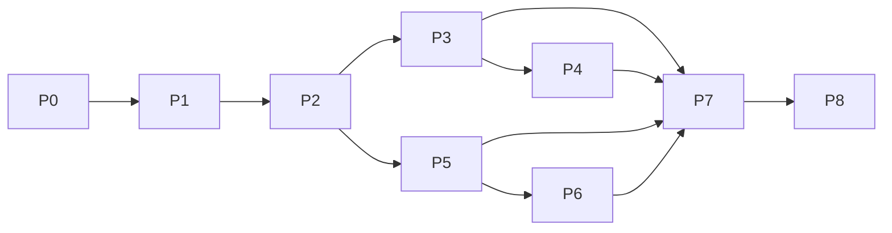

# Issue #463 - implementation execution handoff

# Issue #463 — Prime mandatory reading receipt

**MANDATORY READING GATE — PASS (Prime, before source edits; pinned authority).**

Master Plan v1.3: commit 435c9d753918dc75df74833f0d63e96b643c95aa; blob 7b807d7381b462d2fbbc1d84b77084d98b81d83a; 847/847 lines personally inspected in sequential ranges 1–120,121–240,241–350,351–470,471–570,571–680,681–770,771–847. P0 proof: same commit; blob f052b702a9b07f3a9e4e66269d64df0f4aef4180; 359/359 lines, ranges 1–100,101–200,201–280,281–359. §18 and proof §10 control; prior conditional NO-GO superseded only by explicit new owner direction and remaining task-specific legal dependencies.

Repository authority reviewed at cc507a5b25779e12934a3ead846ceb2c8ddff16b: AGENTS.md (sole tracked AGENTS at that SHA), code structure, engineering, collaboration, deployment checklist, blueprint, relevant security/data/schema/domain and canonical decision-log sections; DEC-025/064/078/080/088/091/092/095/108; Option C protected-writer and S04 contracts. Current-main delta and any additional task-specific source/authority reads remain prerequisite to affected edits. No ValetSession/Task/Dispatch transition, pricing or general auth redesign.

GitHub #463 open, body and six comments read (7180149384,7180480622,7180779460,7181072365,7181429344,7181429791); #312 and #313 bodies and closure/design comments read. Prior #313 scoped pixel waiver does not transfer.

Frozen 2166a6760803e1a5084c6230b15706549426d8c8. Guest ZIP SHA256 cc661d944479060647064811ea0c5a194ae177a155f7fbb4a10171ddf0c88da5; dashboard 3c30464310194e1c636865277aaedaff758d8629d3126340c4965ac7244e280d. Both Git blobs and actual ZIP hashes verified; extracted 25 Guest and 18 Dashboard files byte-identical to ZIP entries. Personally inspected unbundled source, CSS, entrypoints, build/serve/verification scripts, README, and all 13+8 reference screenshots via existing contact sheets. Source/bundle/verification hashes matched plan §3. No new reference rendering. Mock prototypes do not prove transport or live UI; real mobile keyboard and pixel parity remain mandatory.

No production-source edits made. This receipt is Prime's reading evidence, not a substitute for each worker's reading, current baseline comparison, legal decision, implementation or Gate B/C acceptance.

## Current authority and baseline

Owner directive 2026-11-27 explicitly authorizes controlled implementation of independent P1-P8 tasks, but no merge/deploy/production migration/RELEASE/collection or infrastructure provisioning. OD-01/02/03/05(condition)/06(direction) preserved. OD-07 precise Option C and narrow DEC amendments approved; OD-04 product targets and independent metadata-only ledger architecture approved. No new UI exception. Historical plan and proof below remain immutable snapshots. Gate A policy/architecture direction accepted; task-specific legal architecture decision remains OPEN; Gate B not accepted; Gate C NO-GO.

Remote main fetched and ls-remote match audited cc507a5b25779e12934a3ead846ceb2c8ddff16b; no delta, 155 migrations, last 20261118000200_option_c_management_authority_freshness. Frozen and docs remote refs unchanged. Open PR search via search_prs returned zero; unrelated local worktrees include #416/#467, not modified. Root main is behind 772 and has two untracked runbooks; untouched except remote fetch. Exact commit historical PR workflow query: CI 45725392883 cancelled; Security CI 45725392928 success (not current candidate validation). 29/29 v1.3 indexed proof artifacts independently rehashed in this turn; no rerun. Single migration author designated W2; no migration until affected legal prerequisites resolved. Recheck remote/delta at integration.

## Non-deferrable task-specific legal architecture questions

No factual market/jurisdiction/controller allocation or legal sign-off supplied. Need owner/counsel determination whether applicable law requires (1) just-in-time affirmative notice or consent incompatible with frozen screen, (2) physical/cryptographic erasure sooner than proposed post-erasure residual window and hence key/storage architecture, (3) hold/rights/verification model materially different from exact approved case contract, e.g. pre-submission suppression or multiple independent holds. Do not presume existing More > Privacy is sufficient. Block affected schema/privacy/notice and activated transport/projection wiring until resolved; continue pure canonicalization, strict compatibility contracts and provider-independent metadata-only protocol, plus non-mutating source/visual preparation. Actual named operators, provider qualification, notice content, restore rehearsal and production release remain Gate C, not independent P1 blockers.

Known mandatory Gate B fixes: expiry diagnostic predictable UUID preclaim collision (disjoint namespace or generated system UUID plus unique visit/action); full negative regression incl busy-row progress; nine guard probes, seven tuple rewrites and two 42501; v3 core RACES_EXIT1 retained, separate supplemental TAIL_EXIT0; full mounted HTTP, UI, actual migrations and ACL/races, independent ledger and real E2E remain unproved. No claims of physical erasure or already-disclosed text retraction.

## All 45 original tasks - execution checklist

Each row references immutable plan section 14 exact phase and sections 12/13/17/18; objective copied verbatim. Phase-level acceptance, files and dependencies reproduced below. Verification mapping is additive to the original requirements, never a substitute. No worker reading/assignment completion or test pass asserted until receipt. P0 source evidence is partial where new capture or independent review is pending. All downstream dependent tasks stay pending until prerequisites are met.

| ID / objective (verbatim) | Author(s) / reviewer | Expected files/evidence | Verification IDs | Prerequisites / invariants (in addition to exact plan) | Status / evidence / verdict |
|---|---|---|---|---|---|
| P0-T01 - Recheck remote main, active PRs/worktrees, relevant diffs, migration owner, official test/provisioning baseline. | Prime/W1 / W7 | refs/worktree evidence | REL-01,OC-04 | none (reading gate for changes); DEC-091/095, frozen design, unchanged source authority | PARTIAL / pinned refs, 155 migrations, PR search, workflow and worktree evidence / migration owner designated; review pending |
| P0-T02 - Verify frozen ZIP hashes/21 images, original mounted baseline capture, exact reference environment. | Prime/W6 / W7 | frozen archives/real screenshots | VR-01-07 | none (reading gate for changes); DEC-091/095, frozen design, unchanged source authority | PARTIAL / receipt, verified ZIPs and 21 screenshots / original mounted capture and exact environment still pending |
| P0-T03 - Reconcile DEC-091/095, privacy, Option C owner and ACL contract (§17.2); prototype no new UI. | Prime/W1/W4 / W7 | DEC-091/095 + decision log; security/schema/domain docs | PR-01-09,OC-01-05,LK-01-08 | none (reading gate for changes); DEC-091/095, frozen design, unchanged source authority | PARTIAL / owner directive; legal architecture questions open / affected tasks blocked |
| P0-T04 - Record already-approved OD-01/02/03, OD-05 condition and OD-06 direction; record v1.3 combined evidence and settle only Gate A architecture/policy choices before code. Actual implementation and operational acceptance belong to Gate B/C respectively. | Prime / W7 | execution handoff/decision records | SEC-03,REL-03 | none (reading gate for changes); DEC-091/095, frozen design, unchanged source authority | PARTIAL / owner directive; legal architecture questions open / affected tasks blocked |
| P0-T05 - Freeze file inventory, test mapping, implementation baseline, phase author/reviewer assignments. | Prime / W7 | section 13 inventory and this handoff | all 100 | none (reading gate for changes); DEC-091/095, frozen design, unchanged source authority | MAPPED / this checklist / independent review pending |
| P1-T01 - Shared scalar/byte/controls normalizer + golden vectors. | W3 / W7 | contracts/src/guest-rating-comment.ts + tests | CT-03-07,DB-13 | P0 applicable owner decisions + Prime gate; legal-independent pure contracts only; DEC-091/095, OD-01/02/03/05/06; strict raw/canonical compatibility; no text logging | ASSIGNED W3 / no executed test evidence yet / not accepted |
| P1-T02 - Strict legacy/new Guest union with intended UUID, exact original response. | W3 / W7 | contracts/src/guest-rating.ts + tests | CT-01/02/06 | P0 applicable owner decisions + Prime gate; legal-independent pure contracts only; DEC-091/095, OD-01/02/03/05/06; strict raw/canonical compatibility; no text logging | ASSIGNED W3 / no executed test evidence yet / not accepted |
| P1-T03 - Rating-only opt-in query and distinct expanded strict response, legacy shape untouched. | W3 / W7 | contracts/src/customer-feedback-analytics.ts + tests; rating query contracts | CT-09/10 | P0 applicable owner decisions + Prime gate; legal-independent pure contracts only; DEC-091/095, OD-01/02/03/05/06; strict raw/canonical compatibility; no text logging | ASSIGNED W3 / no executed test evidence yet / not accepted |
| P1-T04 - Safe error and canonical R01–R23 outcomes; raw UTF8 validation strategy and adapter proof. | W3 / W7 | contracts/docs; existing error/HTTP contract strategy | CT-08,GA-05/06/08,DB-04/11/12 | P0 applicable owner decisions + Prime gate; legal-independent pure contracts only; DEC-091/095, OD-01/02/03/05/06; strict raw/canonical compatibility; no text logging | ASSIGNED W3 / no executed test evidence yet / not accepted |
| P1-T05 - CT-01–10 and pinned legacy parser tests, independent contract review. | W3 / W7 | contracts tests and index.ts as needed | CT-01-10 | P0 applicable owner decisions + Prime gate; legal-independent pure contracts only; DEC-091/095, OD-01/02/03/05/06; strict raw/canonical compatibility; no text logging | ASSIGNED W3 / no executed test evidence yet / not accepted |
| P2-T01 - Add one-to-one child, privacy/notice ledgers, terminal guard, inert visit guard, canonical CHECK, Prisma/migration inventory/docs; fresh/populated lock plan. | W2 / W1/W7 | database/prisma/schema.prisma + new migration; manifest/docs | DB-01/02/08/14,PR-01/09 | P1 acceptance + affected legal architecture decisions + W2 single migration owner; DEC-091/025/064, OD-04/07, exact tenant FK/atomicity/terminal erase/no broad grant/dormant PREPARE | BLOCKED affected implementation / legal prerequisites or dependent phases / not accepted |
| P2-T02 - Implement exact private canonical/core, 4-arg write overloads and full-pair legacy null wrappers; locked visit assertion; controlled privacy/notice command routines. | W2/W4 / W5/W7 | new migration private helpers/overloads/privacy/notice | DB-03-07/11-13,PR-01-05/09 | P1 acceptance + affected legal architecture decisions + W2 single migration owner; DEC-091/025/064, OD-04/07, exact tenant FK/atomicity/terminal erase/no broad grant/dormant PREPARE | BLOCKED affected implementation / legal prerequisites or dependent phases / not accepted |
| P2-T03 - Provision/readiness exact both signatures and phase helper/private/helper/owner ACL; PROTECTED-safe path §17.2, no legacy re-grant. | W1 / W2/W7 | database/scripts exact ACL/provision + api runtime-database-readiness.ts | DB-09/10,OC-01-05 | P1 acceptance + affected legal architecture decisions + W2 single migration owner; DEC-091/025/064, OD-04/07, exact tenant FK/atomicity/terminal erase/no broad grant/dormant PREPARE | PENDING / none / not accepted |
| P2-T04 - DB-01–14 + PR-01–05/09 DB cases and OC-01–05 applicable stage tests real PG17 incl constraint, both credential modes, races, rollback, legacy compatibility. | W2 / W1/W7 | database/src focused integration tests | DB-01-14,PR-01-05/09,OC-01-05 | P1 acceptance + affected legal architecture decisions + W2 single migration owner; DEC-091/025/064, OD-04/07, exact tenant FK/atomicity/terminal erase/no broad grant/dormant PREPARE | PENDING / none / not accepted |
| P2-T05 - Verify DDL lock, upgrade/provision/replay and recovery; notice/backup/rights operational design and isolated rehearsals; independent W4/W5. | W2/W4 / W5/W7 | disposable DB harness evidence and recovery docs | DB-01/14,REL-02,PR-07/08 | P1 acceptance + affected legal architecture decisions + W2 single migration owner; DEC-091/025/064, OD-04/07, exact tenant FK/atomicity/terminal erase/no broad grant/dormant PREPARE | BLOCKED affected implementation / legal prerequisites or dependent phases / not accepted |
| P3-T01 - Parse strict union and canonicalize; keep existing credential/admission. | W3 / W5 | api guest-rating.controller/service/command.ts | CT-01-08,GA-01-05 | P2 exact writer/provisioning; P1 contracts; affected notice decision; DEC-091/064/024, current Guest authority, exact intended visit, safe retry and no text echo | BLOCKED affected implementation / legal prerequisites or dependent phases / not accepted |
| P3-T02 - Dispatch exact write overload and verify intended visit/rating result, preserve transaction/finalization. | W3 / W5 | api guest-rating.service/command.ts | GA-01-04/06-08,DB-03/11/12 | P2 exact writer/provisioning; P1 contracts; affected notice decision; DEC-091/064/024, current Guest authority, exact intended visit, safe retry and no text echo | BLOCKED affected implementation / legal prerequisites or dependent phases / not accepted |
| P3-T03 - Safe error/status and exact response, no raw logs. | W3 / W7 | api scoped safe error/transport mapping | CT-08,GA-05/06,SEC-01 | P2 exact writer/provisioning; P1 contracts; affected notice decision; DEC-091/064/024, current Guest authority, exact intended visit, safe retry and no text echo | PENDING / none / not accepted |
| P3-T04 - GA-01–08 real HTTP/PG, lost response and both-path races. | W3 / W5 | api guest-rating integration tests | GA-01-08 | P2 exact writer/provisioning; P1 contracts; affected notice decision; DEC-091/064/024, current Guest authority, exact intended visit, safe retry and no text echo | PENDING / none / not accepted |
| P3-T05 - Review raw transport bounds, legacy compatibility and no-text telemetry. | W3 / W7 | api HTTP/telemetry/compatibility tests | CT-08,GA-05,SEC-01/02,E2E-05 | P2 exact writer/provisioning; P1 contracts; affected notice decision; DEC-091/064/024, current Guest authority, exact intended visit, safe retry and no text echo | PENDING / none / not accepted |
| P4-T01 - Exact frozen field/labels/CSS in mounted GuestLiveRating with original primitives. | W6 / W1 | customer guest-live-rating.tsx, scoped CSS/i18n | GU-01/02,VR-01/02 | P3 actual mounted API; P1 isolated UI prep only; affected notice decision; DEC-091/064, exact frozen Guest UI and context scope, no durable draft | BLOCKED affected implementation / legal prerequisites or dependent phases / not accepted |
| P4-T02 - Scoped draft reset and generation, preserve parent navigation/presentation. | W6 / W1 | customer rating and parent route scope tests | GU-06/08 | P3 actual mounted API; P1 isolated UI prep only; affected notice decision; DEC-091/064, exact frozen Guest UI and context scope, no durable draft | PENDING / none / not accepted |
| P4-T03 - Immutable typed snapshot, single-flight and same response/unknown behavior. | W6 / W1 | customer guest-rating-submission.ts, guest-api-client.ts | GU-02/03/05/07 | P3 actual mounted API; P1 isolated UI prep only; affected notice decision; DEC-091/064, exact frozen Guest UI and context scope, no durable draft | PENDING / none / not accepted |
| P4-T04 - GU-01–08 incl stale context, old stars-only and navigation. | W6 / W1 | customer mount/submission/transport tests | GU-01-08 | P3 actual mounted API; P1 isolated UI prep only; affected notice decision; DEC-091/064, exact frozen Guest UI and context scope, no durable draft | PENDING / none / not accepted |
| P4-T05 - VR-01–03 initial comparison and real keyboard test preparation. | W6 / W7 | isolated Guest visual/device evidence | VR-01-03/07 | P3 actual mounted API; P1 isolated UI prep only; affected notice decision; DEC-091/064, exact frozen Guest UI and context scope, no durable draft | PENDING / none / not accepted |
| P5-T01 - Implement isolated protected bearer-bound read per §7/17.2, six authority inert columns, legacy text-free; deterministic SHARED and NOWAIT sequence. | W2/W5 / W4/W7 | database new forward migration reader and guards | MA-01-09,LK-01-08 | P1/P2 accepted; exact OD-07; affected privacy schema/rights decisions; DEC-095/078/080/088/092/108, OD-07, exact current bearer/role/tenant/lock/4 rows | BLOCKED affected implementation / legal prerequisites or dependent phases / not accepted |
| P5-T02 - Exact owner-to-owner EXECUTE, phase helper, column permissions, direct runtime denial and PROTECTED-safe provisioning/readiness (MA-05/06/12). | W1 / W2/W7 | database/scripts exact provisioning/ACL and runtime readiness | MA-05/06/12,OC-01-05,LK-05 | P1/P2 accepted; exact OD-07; affected privacy schema/rights decisions; DEC-095/078/080/088/092/108, OD-07, exact current bearer/role/tenant/lock/4 rows | PENDING / none / not accepted |
| P5-T03 - Wire existing company/location routes with opt-in and same authorized transaction, no global auth rewrite. | W5 / W3/W7 | api management/dashboard rating controllers/services/queries | MA-01-04/10,LK-01 | P1/P2 accepted; exact OD-07; affected privacy schema/rights decisions; DEC-095/078/080/088/092/108, OD-07, exact current bearer/role/tenant/lock/4 rows | BLOCKED affected implementation / legal prerequisites or dependent phases / not accepted |
| P5-T04 - MA-01–12 + LK-01–08/OC-01–05 incl actual revocation races, 4 rows, cohort and all metrics parity. | W5 / W4/W7 | api/database rating analytics integration/race tests | MA-01-12,LK-01-08,OC-01-05 | P1/P2 accepted; exact OD-07; affected privacy schema/rights decisions; DEC-095/078/080/088/092/108, OD-07, exact current bearer/role/tenant/lock/4 rows | PENDING / none / not accepted |
| P5-T05 - EXPLAIN/payload/lock performance and security review, no unnecessary grants. | W5 / W4/W7 | query/lock/perf evidence | MA-11,LK-04/06/08 | P1/P2 accepted; exact OD-07; affected privacy schema/rights decisions; DEC-095/078/080/088/092/108, OD-07, exact current bearer/role/tenant/lock/4 rows | PENDING / none / not accepted |
| P6-T01 - Existing read opt-in typed schema and request key, no extra request. | W6 / W2 | dashboard customer-feedback-api/use-customer-feedback-read.ts | DU-01/05/07,CT-09/10 | P5 actual protected API; P1 disjoint prep only; DEC-095/108, frozen dashboard, exact scope/no text on stale generation, no N+1 | BLOCKED affected implementation / legal prerequisites or dependent phases / not accepted |
| P6-T02 - Exact approved icon/SVG/inline panel, real recent rows/translation/module CSS, null on held/erased/expired. | W6 / W2 | dashboard insights/copy/module CSS | DU-01-04/07,PR-06 | P5 actual protected API; P1 disjoint prep only; DEC-095/108, frozen dashboard, exact scope/no text on stale generation, no N+1 | PENDING / none / not accepted |
| P6-T03 - Reset disclosure on request generation/scope, safe plain text, preserve locale/theme. | W6 / W2 | dashboard read hook/section scope tests | DU-04-06,PR-06 | P5 actual protected API; P1 disjoint prep only; DEC-095/108, frozen dashboard, exact scope/no text on stale generation, no N+1 | PENDING / none / not accepted |
| P6-T04 - DU-01–07 + PR-06, historical/hostile text, keyboard, unchanged metrics. | W6 / W2 | dashboard feedback component/API tests | DU-01-07,PR-06 | P5 actual protected API; P1 disjoint prep only; DEC-095/108, frozen dashboard, exact scope/no text on stale generation, no N+1 | PENDING / none / not accepted |
| P6-T05 - VR-04/05 initial comparison in real Analytics page and full section. | W6 / W7 | isolated Dashboard visual evidence | VR-04/05 | P5 actual protected API; P1 disjoint prep only; DEC-095/108, frozen dashboard, exact scope/no text on stale generation, no N+1 | PENDING / none / not accepted |
| P7-T01 - Attested disposable PG17, actual API and both production builds, authorized fixture visits and users. | Prime / W7 | isolated real API/PG/browser harness | E2E-01-05 | P3/P4/P5/P6 accepted; All relevant accepted invariants; real isolated test evidence, not mocked or skipped | PENDING / none / not accepted |
| P7-T02 - E2E-01–05 real Guest→API→DB→Dashboard, both credential modes, stars-only, denied scopes, lost response/mixed versions. | Prime/W6 / W7 | api issue463-rating-comments.browser.integration.test.ts + helpers | E2E-01-05 | P3/P4/P5/P6 accepted; All relevant accepted invariants; real isolated test evidence, not mocked or skipped | PENDING / none / not accepted |
| P7-T03 - Complete CT/DB/GA/MA/GU/DU, PR/OC/LK and SEC-01–04; verify negative races/ACL/telemetry. | Prime/all / W7 | all section 12 test inventory | CT/DB/GA/MA/GU/DU/PR/OC/LK/SEC (all) | P3/P4/P5/P6 accepted; All relevant accepted invariants; real isolated test evidence, not mocked or skipped | PENDING / none / not accepted |
| P7-T04 - Official CI and Security CI and mandatory integrated browser evidence, no skipped mandatory cases. | Prime / W7 | CI/Security CI exact candidate evidence | REL-01,SEC-04,E2E-01-05 | P3/P4/P5/P6 accepted; All relevant accepted invariants; real isolated test evidence, not mocked or skipped | PENDING / none / not accepted |
| P7-T05 - Independent W7/W5/W6 review exact candidate/evidence and resolve blockers. | W7 / W1/W5/W6 | independent review evidence | REL-03 | P3/P4/P5/P6 accepted; All relevant accepted invariants; real isolated test evidence, not mocked or skipped | PENDING / none / not accepted |
| P8-T01 - Full §3.5 VR-01–07 raw pixel diff, original/frozen/candidate, exact measured states. | W6 / W7 | raw visual comparisons | VR-01-07 | P7 complete; release-only prerequisites remain Gate C; Frozen visual and real device proof; separate approval/restore qualification, no activation | PENDING / none / not accepted |
| P8-T02 - Real mobile keyboard/scroll/touch/zoom/accessibility, no unapproved visual exception. | W6 / W7 | physical device evidence | VR-07 | P7 complete; release-only prerequisites remain Gate C; Frozen visual and real device proof; separate approval/restore qualification, no activation | PENDING / none / not accepted |
| P8-T03 - REL-01–03 + PR-07/08 exact final commit, upgrade/rollback/grants/retention/restore rehearsal. | Prime/W4 / W7 | release/recovery docs and evidence | REL-01-03,PR-07/08 | P7 complete; release-only prerequisites remain Gate C; Frozen visual and real device proof; separate approval/restore qualification, no activation | PENDING / none / not accepted |
| P8-T04 - Independent W7/W1/W2/W6 final review, no unexplained pixel differences or policy gap. | W7 / W1/W2/W6 | independent final review | REL-03,VR-06 | P7 complete; release-only prerequisites remain Gate C; Frozen visual and real device proof; separate approval/restore qualification, no activation | PENDING / none / not accepted |
| P8-T05 - Separate Owner release approval and exact deployment/recovery runbook; production RELEASE grants only after that approval. | Owner/Prime / Owner | separate release approval and runbook (no activation) | Gate C only; REL-03/PR-07/08 | P7 complete; release-only prerequisites remain Gate C; Frozen visual and real device proof; separate approval/restore qualification, no activation | PENDING / none / not accepted |

## Phase prerequisites, invariants, acceptance and decision mapping

### P0 - exact section 14 scope
Dependencies: none. Objective: confirm authority/evidence and settle design/architecture gates.
- P0-T01 Recheck remote main, active PRs/worktrees, relevant diffs, migration owner, official test/provisioning baseline.
- P0-T02 Verify frozen ZIP hashes/21 images, original mounted baseline capture, exact reference environment.
- P0-T03 Reconcile DEC-091/095, privacy, Option C owner and ACL contract (§17.2); prototype no new UI.
- P0-T04 Record already-approved OD-01/02/03, OD-05 condition and OD-06 direction; record v1.3 combined evidence and settle only Gate A architecture/policy choices before code. Actual implementation and operational acceptance belong to Gate B/C respectively.
- P0-T05 Freeze file inventory, test mapping, implementation baseline, phase author/reviewer assignments.
Files: plan/decisions and isolated evidence only; no production changes. Gate: all policy and architecture prerequisites settled; W7 + W1/W2 review. Risk source drift; rebaseline and re-review. See companion P0 proof report for observed actual migrated results and exact residual gates. This does not certify production parity.

### P1 - exact section 14 scope
Depends P0. Objective exact canonical pair, strict compatible request and read.
- P1-T01 Shared scalar/byte/controls normalizer + golden vectors.
- P1-T02 Strict legacy/new Guest union with intended UUID, exact original response.
- P1-T03 Rating-only opt-in query and distinct expanded strict response, legacy shape untouched.
- P1-T04 Safe error and canonical R01–R23 outcomes; raw UTF8 validation strategy and adapter proof.
- P1-T05 CT-01–10 and pinned legacy parser tests, independent contract review.
Files: contracts and approved docs in §13 only; DB/UI unchanged. Gate: accepted policy, strict compatibility and validation proof, W3/W7. Risk coercion/strict client break; correct/revert contract pre-integration.

### P2 - exact section 14 scope
Depends P1, single migration owner and OD-07 approved.
- P2-T01 Add one-to-one child, privacy/notice ledgers, terminal guard, inert visit guard, canonical CHECK, Prisma/migration inventory/docs; fresh/populated lock plan.
- P2-T02 Implement exact private canonical/core, 4-arg write overloads and full-pair legacy null wrappers; locked visit assertion; controlled privacy/notice command routines.
- P2-T03 Provision/readiness exact both signatures and phase helper/private/helper/owner ACL; PROTECTED-safe path §17.2, no legacy re-grant.
- P2-T04 DB-01–14 + PR-01–05/09 DB cases and OC-01–05 applicable stage tests real PG17 incl constraint, both credential modes, races, rollback, legacy compatibility.
- P2-T05 Verify DDL lock, upgrade/provision/replay and recovery; notice/backup/rights operational design and isolated rehearsals; independent W4/W5.
Files DB/migrations/scripts/readiness §13; old migrations and parent trigger unchanged; privacy lifecycle only. Gate atomic immutable pair, validated constraint, runtime direct writes denied, legacy healthy. Risk lock/grant regression; rollback transaction precommit, forward repair after commit.

### P3 - exact section 14 scope
Depends P2. Objective real protected write through existing endpoint.
- P3-T01 Parse strict union and canonicalize; keep existing credential/admission.
- P3-T02 Dispatch exact write overload and verify intended visit/rating result, preserve transaction/finalization.
- P3-T03 Safe error/status and exact response, no raw logs.
- P3-T04 GA-01–08 real HTTP/PG, lost response and both-path races.
- P3-T05 Review raw transport bounds, legacy compatibility and no-text telemetry.
Files Guest API/tests §13; unrelated auth/lifecycle/errors unchanged. Reviewer W3/W5. Gate real write/negative auth, stable retry. Risk wrong visit/unknown commit; stop/revert API compatible with schema, never strip comment.

### P4 - exact section 14 scope
Depends P3 (isolated UI preparation after P1 possible, no acceptance before real API).
- P4-T01 Exact frozen field/labels/CSS in mounted GuestLiveRating with original primitives.
- P4-T02 Scoped draft reset and generation, preserve parent navigation/presentation.
- P4-T03 Immutable typed snapshot, single-flight and same response/unknown behavior.
- P4-T04 GU-01–08 incl stale context, old stars-only and navigation.
- P4-T05 VR-01–03 initial comparison and real keyboard test preparation.
Files Guest rating/client/translation/scoped CSS/tests §13; shell/stars/global tokens unchanged. Reviewer W1/W6. Gate real submit and no unexplained visual delta; risk stale text/design drift, revert focused UI/client only.

### P5 - exact section 14 scope
Depends P1/P2 and approved OD-07 exact role/provision contract. Separate forward migration after P2 for read functions/owner; do not edit P2 applied migration.
- P5-T01 Implement isolated protected bearer-bound read per §7/17.2, six authority inert columns, legacy text-free; deterministic SHARED and NOWAIT sequence.
- P5-T02 Exact owner-to-owner EXECUTE, phase helper, column permissions, direct runtime denial and PROTECTED-safe provisioning/readiness (MA-05/06/12).
- P5-T03 Wire existing company/location routes with opt-in and same authorized transaction, no global auth rewrite.
- P5-T04 MA-01–12 + LK-01–08/OC-01–05 incl actual revocation races, 4 rows, cohort and all metrics parity.
- P5-T05 EXPLAIN/payload/lock performance and security review, no unnecessary grants.
Files new migration, approved ACL/provisioning and Management API/tests; existing numeric default/roles/metrics unchanged. W4/W5/W3 review. Gate no raw text arbitrary-scope read, all ACL proofs; stop exposure or revert v2 caller on failure, keep numeric default/data.

### P6 - exact section 14 scope
Depends P5 (disjoint UI preparation after P1 allowed).
- P6-T01 Existing read opt-in typed schema and request key, no extra request.
- P6-T02 Exact approved icon/SVG/inline panel, real recent rows/translation/module CSS, null on held/erased/expired.
- P6-T03 Reset disclosure on request generation/scope, safe plain text, preserve locale/theme.
- P6-T04 DU-01–07 + PR-06, historical/hostile text, keyboard, unchanged metrics.
- P6-T05 VR-04/05 initial comparison in real Analytics page and full section.
Files Dashboard read/UI/tests §13; no global tokens, cards/filters/nav changes. Reviewer W2/W6. Gate real typed read and exact UI, no stale text. Risk wrong row, revert focused component/read opt-in.

### P7 - exact section 14 scope
Depends P3/P4/P5/P6.
- P7-T01 Attested disposable PG17, actual API and both production builds, authorized fixture visits and users.
- P7-T02 E2E-01–05 real Guest→API→DB→Dashboard, both credential modes, stars-only, denied scopes, lost response/mixed versions.
- P7-T03 Complete CT/DB/GA/MA/GU/DU, PR/OC/LK and SEC-01–04; verify negative races/ACL/telemetry.
- P7-T04 Official CI and Security CI and mandatory integrated browser evidence, no skipped mandatory cases.
- P7-T05 Independent W7/W5/W6 review exact candidate/evidence and resolve blockers.
Files focused QA/evidence, approved targeted fixes only; no mock production data. Gate real integrated proof, all required tests and review; if mocked/skipped, rerun genuine harness. No partial release.

### P8 - exact section 14 scope
Depends P7.
- P8-T01 Full §3.5 VR-01–07 raw pixel diff, original/frozen/candidate, exact measured states.
- P8-T02 Real mobile keyboard/scroll/touch/zoom/accessibility, no unapproved visual exception.
- P8-T03 REL-01–03 + PR-07/08 exact final commit, upgrade/rollback/grants/retention/restore rehearsal.
- P8-T04 Independent W7/W1/W2/W6 final review, no unexplained pixel differences or policy gap.
- P8-T05 Separate Owner release approval and exact deployment/recovery runbook; production RELEASE grants only after that approval.
Files release evidence/docs and narrowly approved fixes with regression rerun; no rollout in planning. Gate all tests, device and visual proof plus separate release approval. Risk environment/partial release; stop and reproduce/rollback compatible version.

## Verification ledger - all 100 original IDs

| ID | Layer | Required acceptance (verbatim section 12) | Status | Evidence | Verdict |
|---|---|---|---|---|---|
| CT-01 | Contract | Legacy 1–5 strict request, response exact three keys and old parser compatibility | PENDING | - | NOT ACCEPTED |
| CT-02 | Contract | New expected UUID; omitted/null/empty/whitespace=>null; comment without assertion rejected | PENDING | - | NOT ACCEPTED |
| CT-03 | Contract | Arabic/English, mixed scripts, emoji/ZWJ, multiline, literal markup preserved | PENDING | - | NOT ACCEPTED |
| CT-04 | Contract | Every fixed trim character, CRLF/CR, interior whitespace, no NFC/casefold | PENDING | - | NOT ACCEPTED |
| CT-05 | Contract | 999/1000/1001 ASCII and astral scalars, 4000 byte cap; reject oversized raw spaces | PENDING | - | NOT ACCEPTED |
| CT-06 | Contract | Invalid stars, UUID, extra keys, wrong types, arrays/coercion rejected | PENDING | - | NOT ACCEPTED |
| CT-07 | Contract | Malformed surrogate, NUL, forbidden controls/bidi rejected; valid Unicode intact | PENDING | - | NOT ACCEPTED |
| CT-08 | HTTP | Raw malformed UTF8/JSON and body size; adapter decoding proven; safe error/no echo | PENDING | - | NOT ACCEPTED |
| CT-09 | Contract | Default strict analytics unchanged; expanded required nullable comment, max4, rejects invalid shape | PENDING | - | NOT ACCEPTED |
| CT-10 | Contract | Exact includeComments=true; reject duplicate/array/false/extra; unrelated queries unchanged | PENDING | - | NOT ACCEPTED |
| DB-01 | Migration | Fresh and populated upgrade; historical rows/rated_at unchanged, absent child, no destructive DDL | PENDING | - | NOT ACCEPTED |
| DB-02 | PG | Validated canonical CHECK and original stars/PK/FK enforce invariants, direct invalid input rejected | PENDING | - | NOT ACCEPTED |
| DB-03 | PG | Atomic parent+child insert; rollback after either insert/finalize leaves neither | PENDING | - | NOT ACCEPTED |
| DB-04 | PG | R01–R10/R18 all paths; original timestamp, no append/edit | PENDING | - | NOT ACCEPTED |
| DB-05 | PG race | Concurrent identical browser-4arg/browser-4arg and bearer-4arg/browser-4arg NONNULL comment; legacy-2arg/new-4arg NULL pair; one row, same timestamp | PENDING | - | NOT ACCEPTED |
| DB-06 | PG race | Conflicting stars/comment, both credential modes, one committed winner, other conflict | PENDING | - | NOT ACCEPTED |
| DB-07 | PG race | Expiry/revoke/generation both orders, post-lock clock recheck | PENDING | - | NOT ACCEPTED |
| DB-08 | PG | Parent trigger prevents UPDATE/DELETE; child guard permits only approved lifecycle; runtime direct table/column SELECT/DML/TRUNCATE denied | PENDING | - | NOT ACCEPTED |
| DB-09 | PG | Exact 2/4-arg ACL/owner/search_path, PUBLIC/private helper denied, no grant option | PENDING | - | NOT ACCEPTED |
| DB-10 | PG | Old API readiness/writers work after migration; new readiness fails if required functions/grants missing | PENDING | - | NOT ACCEPTED |
| DB-11 | PG | Lost response before/after commit and finalize failure rollback; exact replay stable | PENDING | - | NOT ACCEPTED |
| DB-12 | PG | Wrong or null expected ID on new overload cannot read/write other visit | PENDING | - | NOT ACCEPTED |
| DB-13 | PG | Shared TS/SQL golden vectors, byte equality, nondefault collation | PENDING | - | NOT ACCEPTED |
| DB-14 | Migration | Lock contention and failed transaction recovery; no data loss | PENDING | - | NOT ACCEPTED |
| GA-01 | HTTP/PG | Authorized completed Guest with both current browser/legacy bearer, scoped stars and comment | PENDING | - | NOT ACCEPTED |
| GA-02 | HTTP/PG | Incomplete/cancelled/expired/revoked/consumed, exact 24h boundary, deny | PENDING | - | NOT ACCEPTED |
| GA-03 | HTTP/PG | Wrong visit/tenant/location selector never authority; safe denial | PENDING | - | NOT ACCEPTED |
| GA-04 | HTTP race | Switch cookie after marker check before fetch; old intended ID cannot write new visit | PENDING | - | NOT ACCEPTED |
| GA-05 | HTTP | Origin, CSRF, duplicate auth, admission/429/503, no-store, unchanged safe errors | PENDING | - | NOT ACCEPTED |
| GA-06 | HTTP/PG | Exact/conflicting retries R03–R23, no stripping text | PENDING | - | NOT ACCEPTED |
| GA-07 | HTTP race | Concurrent browser/legacy and anti-abuse finalize rollback | PENDING | - | NOT ACCEPTED |
| GA-08 | HTTP/PG | Real lost response postcommit, same tuple retry before expiry and denial after expiry | PENDING | - | NOT ACCEPTED |
| MA-01 | HTTP/PG | CA current standard MFA+entitlement, company and authorized location max4 | PENDING | - | NOT ACCEPTED |
| MA-02 | HTTP/PG | LM granted active Location only; same-org other Location/all-org denied | PENDING | - | NOT ACCEPTED |
| MA-03 | HTTP/PG | Other org, supervisor/employee, inactive user/org/location/membership/subscription denied | PENDING | - | NOT ACCEPTED |
| MA-04 | HTTP/PG | Missing/rotated/revoked/expired bearer, invalid MFA factor/idle/age denied | PENDING | - | NOT ACCEPTED |
| MA-05 | Direct runtime PG | Forged user/session/member/scope, missing/wrong bearer, valid foreign-scope bearer denied | PENDING | - | NOT ACCEPTED |
| MA-06 | Direct runtime PG | Legacy arbitrary-selector numeric projection never returns text; private core/column denied | PENDING | - | NOT ACCEPTED |
| MA-07 | PG race | Reader-first/revoker-first incl grant/role/subscription/MFA/session; non-READ-COMMITTED denied and expiry after wait; no stale snapshot or lock upgrade; two-reader role switch deadlock test | PENDING | - | NOT ACCEPTED |
| MA-08 | HTTP/PG | Same snapshot v2 minus comment equals legacy; completed_at cohort, late rated_at, timezone/DST, zero denominator | PENDING | - | NOT ACCEPTED |
| MA-09 | HTTP/PG | Stable latest4 sort/ties and correct row, pseudoref collisions fail closed, no extra identity, historical null | PENDING | - | NOT ACCEPTED |
| MA-10 | HTTP | Strict response/header/query, no-store, inclusive 31 days, reject overlong period | PENDING | - | NOT ACCEPTED |
| MA-11 | PG | EXPLAIN bounded read after LIMIT4, no N+1; payload and lock budget | PENDING | - | NOT ACCEPTED |
| MA-12 | PG | New owner-to-owner ACL, direct runtime negative, readiness and protected Writer unaffected | PENDING | - | NOT ACCEPTED |
| GU-01 | Guest UI | Actual mounted reauthorized screen, exact field placement, stars mandatory | PENDING | - | NOT ACCEPTED |
| GU-02 | Guest UI | Edit/clear/multiline, snapshot intended ID/stars/text, comment alone disabled | PENDING | - | NOT ACCEPTED |
| GU-03 | Guest UI | Double-click single POST, lock edits while saving, success and Back | PENDING | - | NOT ACCEPTED |
| GU-04 | Guest UI | Definite invalid/429 failure editable, approved status, no added element | PENDING | - | NOT ACCEPTED |
| GU-05 | Guest UI | Unknown 408/5xx/network/malformed 200 locked/no auto retry; conflict/unavailable | PENDING | - | NOT ACCEPTED |
| GU-06 | Guest UI | Stale response, pending navigation, A→B→A/credential change; immediate draft clearing/no durable storage | PENDING | - | NOT ACCEPTED |
| GU-07 | Guest transport | Legacy call unchanged; new typed payload, response ID/rating, marker and CSRF | PENDING | - | NOT ACCEPTED |
| GU-08 | Guest UI | Existing auto-open/dismiss/manual return, other screens unchanged | PENDING | - | NOT ACCEPTED |
| DU-01 | Dashboard UI | Parser-valid typed data, icon on text only; historical null no icon | PENDING | - | NOT ACCEPTED |
| DU-02 | Dashboard UI | Exact panel, one open, click again closes, no extra request | PENDING | - | NOT ACCEPTED |
| DU-03 | Dashboard UI | Enter/Space, focus-visible, unique aria-expanded/controls, hidden inaccessible | PENDING | - | NOT ACCEPTED |
| DU-04 | Dashboard UI | Mixed AR/EN, newline, long unbroken text, literal HTML/script inert | PENDING | - | NOT ACCEPTED |
| DU-05 | Dashboard UI | Identity/scope/period/generation change and stale A→B→A response; clear data/open | PENDING | - | NOT ACCEPTED |
| DU-06 | Dashboard UI | Same-scope theme/locale preserves disclosure; retry resets; existing empty/error/loading | PENDING | - | NOT ACCEPTED |
| DU-07 | Dashboard UI | Existing metrics, filters, period, placement and neighbors unchanged | PENDING | - | NOT ACCEPTED |
| SEC-01 | Security | Sentinel absent all telemetry/errors/audit/exports/storage/URL/DB parameter logs | PENDING | - | NOT ACCEPTED |
| SEC-02 | Security | Bound SQL parameters, literal escaped markup, bidi controls rejected, no external requests | PENDING | - | NOT ACCEPTED |
| SEC-03 | Privacy | Approved retention/access/rights/backup handling and operational proof; no normal edit/delete | PENDING | - | NOT ACCEPTED |
| SEC-04 | Security | Role separation, no runtime DDL/admin credentials, exact grants, existing Security CI | PENDING | - | NOT ACCEPTED |
| VR-01 | Visual | Guest original/frozen/candidate AR/EN × light/dark 390×844 and relative geometry | PENDING | - | NOT ACCEPTED |
| VR-02 | Visual | Guest 320/390/1280/1440, empty/multiline/focus/loading/saved/failure; raw diff, no overflow | PENDING | - | NOT ACCEPTED |
| VR-03 | Visual | Existing unknown/conflict/unavailable + frozen field; no new elements | PENDING | - | NOT ACCEPTED |
| VR-04 | Visual | Dashboard 803 card and full actual page, 4 language/themes, collapsed/expanded/null | PENDING | - | NOT ACCEPTED |
| VR-05 | Visual | Dashboard 320/390/768/1440, long mixed text, exact toggle/panel and unchanged neighbors | PENDING | - | NOT ACCEPTED |
| VR-06 | Visual | Browser/OS/DPR/font identity, repeat capture, raw pixel diff and independent verdict | PENDING | - | NOT ACCEPTED |
| VR-07 | Device | Real mobile keyboard, touch/scroll/zoom/focus, submit accessible; no silent exception | PENDING | - | NOT ACCEPTED |
| E2E-01 | Real browser/API/PG | Completed authorized visit -> real Guest rating UI -> stars+text -> actual POST -> SQL row -> real manager login -> existing Analytics -> icon -> exact text | PENDING | - | NOT ACCEPTED |
| E2E-02 | Real browser/API/PG | Stars-only from real UI; historical row no icon, same KPIs; both credential modes across suite | PENDING | - | NOT ACCEPTED |
| E2E-03 | Real browser/API/PG | Authorized company/location and denied foreign scopes direct API, stale UI cannot leak | PENDING | - | NOT ACCEPTED |
| E2E-04 | Real browser/API/PG | Proxy forwards real body then drops committed response, no auto resend, one row | PENDING | - | NOT ACCEPTED |
| E2E-05 | Mixed version | Old clients/new DB+API; new clients/old API fail safely; rollback/reconnect, data preserved | PENDING | - | NOT ACCEPTED |
| REL-01 | Gates | Exact PR HEAD official lint/typecheck/build/architecture/unit/all PG projects and Security CI | PENDING | - | NOT ACCEPTED |
| REL-02 | Recovery | Disposable restore/mixed-version deployment rehearsal, migration retry, no down migration | PENDING | - | NOT ACCEPTED |
| REL-03 | Review | Independent security/DB/API/UI/E2E evidence, owner decisions and release approval | PENDING | - | NOT ACCEPTED |
| PR-01 | PG | Child triple FK/PK and no append after parent; atomic commit/rollback of both rows; parent immutable | PENDING | - | NOT ACCEPTED |
| PR-02 | PG | Approved erase clears text and all retries R20–23 fail conflict; no retained digest/length/content; unauthorized/expired credential wins | PENDING | - | NOT ACCEPTED |
| PR-03 | PG | HOLD, pending erase, matching release, due and not due, idempotent approval/expiry, no resurrection | PENDING | - | NOT ACCEPTED |
| PR-04 | ACL | Approver vs executor exact routine grants, distinct login identity, expired/replayed/wrong case/scope; P no raw SELECT, no direct ordinary writes | PENDING | - | NOT ACCEPTED |
| PR-05 | Race | Writer-first/erase-first, reader-first/erase-first, child NOWAIT and fresh post-lock statement; no false erasure closure on NO_RECORD | PENDING | - | NOT ACCEPTED |
| PR-06 | HTTP/UI | Held/erased/expired null, numeric parity and fresh disclosure cleared, previously delivered bytes not retractable | PENDING | - | NOT ACCEPTED |
| PR-07 | Ops | Approved retention/notice/rights workflow, expiry target, noncontent ledger/audit, hold and operator separation | PENDING | - | NOT ACCEPTED |
| PR-08 | Recovery | Restore pre-erase backup in disposable DB, replay independent write-ahead disposition/holds, unresolved intent/missing ledger blocks traffic; verify actual backup/WAL expiry | PENDING | - | NOT ACCEPTED |
| PR-09 | Privacy | Exact approved notice version and both languages before first C; republish/revoke/missing case deny, race lock and no silent stars-only downgrade; legacy unchanged | PENDING | - | NOT ACCEPTED |
| OC-01 | ACL | Exact F/P owners, phase helper, F nested locker EXECUTE, no inherited/SET/grant options, effective table/column catalog | PENDING | - | NOT ACCEPTED |
| OC-02 | Provision | LEGACY PREPARE dormant even accidental 4arg grant (phase denial); original APIs work; no new writer grants from broad legacy | PENDING | - | NOT ACCEPTED |
| OC-03 | Provision | PROTECTED disposable P2_TEST/P5_TEST grants; production PREPARE has no new R/A/E grant (direct SQL denied before final RELEASE); atomic final grants, replay twice, interrupted tx rollback, no retired authority restoration | PENDING | - | NOT ACCEPTED |
| OC-04 | Race | Both orderings concurrent cutover/migration/provision, boundary monotonic, stale tool cannot enable or silently restore retired grants | PENDING | - | NOT ACCEPTED |
| OC-05 | Readiness | Missing phase/grant/owner/check/privileged attestation fails new startup; old API unaffected; old tool rejected/no repair | PENDING | - | NOT ACCEPTED |
| LK-01 | PG | Actual nested SHARED on same XID CA/LM preheld locks, CA activity touch and direct SQL no activity; no role upgrade | PENDING | - | NOT ACCEPTED |
| LK-02 | PG | Session/user revoke/rotation/time expiry before/after waits; raw bearer recheck; wrong selector denied | PENDING | - | NOT ACCEPTED |
| LK-03 | PG | Org/member/role/grant/target Location/subscription/factor direct UPDATE/DELETE revoker-first and reader-first, NOWAIT fail closed | PENDING | - | NOT ACCEPTED |
| LK-04 | PG | Two shared readers and concurrent role promotion; lifecycle org/member/location order, no new wait cycle | PENDING | - | NOT ACCEPTED |
| LK-05 | ACL | Every inert guard exact constant CHECK, no business UPDATE/table-level grants; same-value trigger/audit/MVCC effects inspected | PENDING | - | NOT ACCEPTED |
| LK-06 | PG | Unexpected isolation, lock timeout, deadlock/cancel -> rollback safe response, no partial data | PENDING | - | NOT ACCEPTED |
| LK-07 | PG | Numeric snapshot + latest triples, child locks sorted and fresh read, concurrent new rating/erase/hold; no pseudoref join | PENDING | - | NOT ACCEPTED |
| LK-08 | PG | Final clock/MFA/session and expiry check, no text after fresh revocation or expiry; bounded query and no lock leak | PENDING | - | NOT ACCEPTED |

## Evidence and worker ownership

Prime owns integrated worktree/decisions/checklist; W3 contracts/API; W2 sole migration author, W1 exact ACL/provisioner/readiness; W4 privacy/ledger protocol; W5 protected reader and SQL review (coordinate with W2); W6 UI/visual; W7 independent reviewer. Separate isolated worktrees/branches before authoring, no overlapping edits; no activation. Workers must personally read complete plan and proof + relevant authority and frozen artifacts before source edits. Assigned W1-W6 (COS worker-1 through worker-6, resumed) and independent W7 (COS worker-8, new). W3 owns separate feat/issue463-w3-contracts worktree; W4 owns feat/issue463-w4-ledger worktree. W1/W2/W5/W6 read-only prep pending dependent prerequisites. All personally read relevant exact references before work; receipts/results not yet received. Prime alone integrates. No source implementation evidence yet.

Branch feat/issue-463-rating-comments; parent cc507a5b25779e12934a3ead846ceb2c8ddff16b; candidate SHA pending. No source changes or migration yet. Pending independent verification, official CI and Draft PR. Historical evidence preserved in exact v1.3 snapshots; current local evidence tmp/issue463-execution-evidence/READING_GATE.md.
