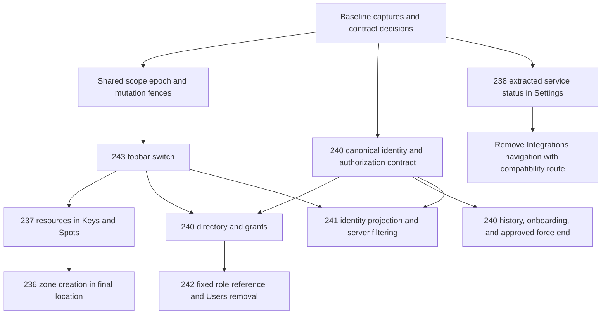

# Dashboard issues #236–#243 implementation execution plan

Planning audit: 30 September 2026. This document is the only authorized repository change in this planning task. It contains no implementation-completion claim.

## 1. Current repository baseline

| Item | Audited value |
| --- | --- |
| Repository | `veletpro0-lgtm/valet-platform` |
| Local path | `C:/Users/LP/Desktop/valet-app/valet-platform` |
| Branch | `main` |
| HEAD | `eff1de2c895283b4c5d6fa397f9c9430885cd104` |
| Fetched `origin/main` | `eff1de2c895283b4c5d6fa397f9c9430885cd104` |
| Equality | HEAD matches fetched origin/main |
| Latest commit | `fix(dashboard): integrate account security workspace` |
| Audit boundary | Source, SQL, contracts, documentation, scripts, tests, full current issue bodies and comments; no application/database mutation |

`git fetch origin` completed successfully after the sandbox initially denied writing `.git/FETCH_HEAD`. The supplied Linux path is not this checkout. Use the Windows path above. Before implementation, fetch again and reconcile any delta from this SHA; do not blindly transplant this plan onto a newer baseline.

### Repository facts and evidence limits

Evidence in this document is **source-inspected**, not runtime-verified. No unit, database, browser, screenshot or production-build run was performed during the read-only audit. Existing tests establish intended contracts, not a claim that those tests currently pass. Baseline screenshots must be captured by the implementation agent before changing UI. No production readiness or production authorization claim follows from source inspection.

Primary binding sources: `AGENTS.md`; `docs/00_SOURCE_OF_TRUTH.md`; product/domain/schema/state-machine/security/engineering documents; `docs/13_COLLABORATION_WORKFLOW.md`; `docs/15_BLUEPRINT_V1_REBASELINE.md`; `docs/17_AGENT_CODE_STRUCTURE_RULES.md`; focused Accepted DEC-032, DEC-035/036/037, DEC-052, DEC-078, DEC-081, DEC-096 and the management decision summaries. DEC-029's canonical log contract is operator-only create provisioning. DEC-087 establishes read-only integration status. Read the task-relevant full decision contracts again before implementation; this plan is not an authority above them.

**Classification:** LOCKED = explicit issue/owner or Accepted decision requirement; DERIVED = implementation choice supported by the current architecture; UNRESOLVED = material missing contract requiring a decision; CONTRADICTED = a proposition disproved by the inspected code. Every proposed file or API below is explicitly future work, not a claim that it exists.

**Overall verdict: DECISION REQUIRED only for the remaining U-01/U-02 portions of #240.** The owner has now approved the invite-delivery direction, Location Manager MFA reuse, Force End operational/cash semantics, and #241 active-Task assignee semantics. Independent work described below can proceed on an owned branch; the accepted decisions below must not be weakened or replaced.

## 2. Current git/worktree state

Before writing this document, `git status --short`, unstaged/staged diff statistics and `git ls-files --others --exclude-standard` were empty. There were no tracked modifications or untracked files to classify as related/unrelated. The intended final delta of this task is this plan file only.

Other worktrees were listed, not modified:

| Worktree | State |
| --- | --- |
| `valet-platform` | `main`, `eff1de2` |
| `valet-platform-md01` | `feat/md-01-dashboard-foundation-authorized-entry`, `bdc98cd` |
| `valet-platform-vui003a1-base-review` | detached `cdd69c2` |
| `valet-platform-vui003a1-final-review` | detached `3bcd73d` |

The single-file planning exception permits this document on the present checkout; it does not authorize implementation on `main`. The implementation agent must use the invoking contributor's assigned branch/task, inspect its worktree status and coordinate migration ownership. Do not edit another listed worktree or use it as a visual baseline without proving its relevance. Do not run two editing agents in the same worktree. No commit, push, PR, issue edit or merge was performed.

## 3. Current GitHub issue snapshot

Full bodies and paginated comments were fetched through the GitHub connector. All seven issues were OPEN; each comment result was empty. Times below are UTC (`Z`); local timezone is Asia/Amman.

| Issue | Current title | Updated |
| --- | --- | --- |
| [#236](https://github.com/veletpro0-lgtm/valet-platform/issues/236) | Dashboard: add Parking Zone creation flow before Parking Spot creation | 2026-09-30T14:15:10Z |
| [#237](https://github.com/veletpro0-lgtm/valet-platform/issues/237) | Dashboard: move Key Slot & Parking Spot management to Keys & Spots with exact UI parity | 2026-09-30T14:23:02Z |
| [#238](https://github.com/veletpro0-lgtm/valet-platform/issues/238) | Dashboard: remove standalone Integrations nav and relocate read-only service status | 2026-09-30T14:27:09Z |
| [#240](https://github.com/veletpro0-lgtm/valet-platform/issues/240) | Dashboard: complete Employees & Shifts with secure onboarding, real identity, Location assignment and full shift management | 2026-09-30T14:50:19Z |
| [#241](https://github.com/veletpro0-lgtm/valet-platform/issues/241) | Dashboard: make Live Operations manager-facing with real assignees, vehicle/resource identity and authoritative filtering | 2026-09-30T15:58:22Z |
| [#242](https://github.com/veletpro0-lgtm/valet-platform/issues/242) | Dashboard: make Roles & Permissions a truthful fixed-role reference and remove duplicate Users tab | 2026-09-30T16:01:45Z |
| [#243](https://github.com/veletpro0-lgtm/valet-platform/issues/243) | Dashboard shell: make topbar Location selector switch scope in-place without workspace-page navigation | 2026-09-30T16:10:50Z |

Re-fetch bodies/comments when execution begins. Later issue instructions can supersede this snapshot; record material reconciliations in the decision log rather than silently changing this plan's policy.

## 4. Issue-body vs current-code drift

| Issue | Current evidence | Planning consequence |
| --- | --- | --- |
| #236 | `parking_zones` and paginated zone reads exist. Only key-slot/parking-spot create commands exist. Spot dialog reads one zone page with limit 100. | Extend the existing resource boundary, not a new inventory subsystem. Fix selector pagination; do not assume the first 100 zones are the universe. |
| #237 | `PhysicalResourcesPanel` is mounted in Locations detail. `/keys` is an operational occupancy view. | Relocate the same configuration component, retain occupancy separately, and remove its old mount. |
| #238 | Integrations already has a real read-only API and card UI. Backend configuration projection often returns UNKNOWN/UNAVAILABLE. | Reuse it in Settings; do not delete it, imply live provider health, or add configuration. |
| #240 | Email-only CA directory; page-local filters; single-location UI actions over a backend array contract; active-shift overview only. Existing SQL already protects last usable admin, handover and desired-state retries. | Extend, do not replace or weaken these protections. Staff files are under `features/administration/staff`, not an invented employees folder. |
| #240 | No invite/password-reset implementation was found in the searched API/database/contracts source. `users.password_hash` is required, and no built-in invite email/SMS delivery is required by the owner. | VAYLET must generate the secure activation link/token only and expose it for explicit copy; the admin distributes it outside VAYLET. Remaining U-01 work is the canonical identity/invite lifecycle contract, not a third-party delivery provider. Existing staff access/refresh credentials are not invite tokens. |
| #240 | Force End does not exist. Self-end includes immutable cash reconciliation; MFA enrollment eligibility currently requires Company Admin. | OWNER-APPROVED: Location Manager uses the existing MFA system for permitted sensitive operations; Force End is a distinct administrative closure requiring fresh MFA, explicit confirmation, required reason and dedicated audit, with no fabricated reported cash and an unreconciled/pending reconciliation state. It must not auto-cancel/reassign Tasks or mutate Sessions. |
| #241 | Sessions project legacy session assignee; dispatch and parking/retrieval commands own assignment on Task and do not synchronize that field. | OWNER-APPROVED: Live Operations `Assigned To` uses the current active operational Task assignee. If there is no active Task assignee, or only terminal Task ownership remains, show `Unassigned`. Keep the legacy session assignee untouched and do not synchronize it. |
| #242 | Fixed four roles already exist, but a duplicate Users tab fetches the staff directory and permissions are largely descriptive. | Keep the fixed-role surface, ground descriptions in authorization, remove the duplicate only after #240 replaces its purpose. |
| #243 | Topbar and Organization controls both currently call `clearScope`. Selection revision exists, but protected page scope keys omit it. | Replace only the Location action; carry revision to every affected data owner and preserve sidebar Organization behavior. |

## 5. Shared architecture findings

### Scope, routes and generation ownership

Existing files: `apps/dashboard/src/components/foundation/selected-scope-provider.tsx`, `selected-scope-state.ts`, `protected-dashboard-context.tsx`, `management-foundation-app.tsx`, `use-selected-scope-revalidation.ts`, `revalidate-selected-scope.ts`, `use-navigation-authority.ts`; `components/scope/scope-entry-types.ts`, `use-scope-entry-controller.ts`, `scope-entry-route-policy.ts`, `dashboard-feature-target.ts`.

`SelectedDashboardScope` distinguishes COMPANY_ADMIN, COMPANY_ADMIN_SUBSCRIPTION, LOCATION_MANAGER, LOCATION_MANAGER_GRANT_SET and SUPERVISOR. A null location is not interchangeable among these variants. Company Admin All Locations is not a Location Manager grant-set scope. Supervisor's map authority is not general management authority.

`SelectedScopeProvider` stores identity generation, selection revision and selected scope. `selectScope` and `clearScope` advance the revision, even for reselecting the same scope. The foundation uses revision for authorization work, but does not currently expose it through the protected-page context. `administrationScopeKey` and `operationsScopeKey` contain identity/session, authority, organization and location, but omit revision. Fix the missing dimension once, rather than inventing page-local location authority.

`management-foundation-app.tsx` currently replaces the shell with a foundation loading state during authorization checking. Normal in-place switching must preserve shell geometry while hiding old protected content and showing an existing in-shell loading state. Initial unauthenticated entry and genuine recovery still use the workspace entry flow.

Route access comes from `lib/navigation/dashboard-navigation.ts`, navigation registry/landing/authority metadata and feature-specific navigation. Operations (`live`, vehicles, tasks, keys, incidents) require exact active location for CA/LM; maps has distinct CA/LM/Supervisor authority. Administration has organization-oriented pages; Roles and Integrations are CA only. Visit Contacts, audit, intelligence and subscription have specialized scope rules. `allowsCompanyAdminAllLocations` alone is insufficient: its current maps exclusion must be combined with the target route's scope requirement and feature authorization. Do not allow All Locations merely because a route belongs to DASHBOARD.

### Reads and mutations

`useAuthoritativeRead` fences by request key/revision, effect generation and AbortController. It rejects disposed successes and failures. A different base key hides old data; same-key refresh can retain it while loading. `useOperationsRead` and cursor helpers must inherit the complete scope epoch. Aborting a request is not evidence that a POST rolled back.

Define a DERIVED UI ticket, using existing values rather than new authority: `(identityGeneration, sessionGeneration, selectionRevision, authority, organizationId, locationId-or-scope-kind, feature)`. A read also includes normalized filter identity, cursor, request sequence and, for detail, entity ID. A mutation adds entity ID, expected version/update timestamp if that command has one, and its logical operation ID if applicable. Compare the captured ticket before *every* success, error, finally/loading reset, toast, reconciliation, dialog-open/close or refresh callback. A→B→A must differ by revision even if IDs match.

`DashboardApiClient` fences identity/session, uses no-store and credentials, and permits one GET refresh retry. POST authentication failure may refresh credentials but produces explicit retry-required behavior; it must not replay the mutation. `StaffAuthClient` advances generations on login/logout/refresh/session replacement. Its non-secret logout-unconfirmed marker is not permission to persist protected data.

`useSensitiveMutation` has a busy guard and explicit post-MFA retry, but its callbacks need a scope ticket/mount guard. Add this narrowly to the existing mechanism; do not introduce a second mutation framework. Preserve each backend command's own retry model:

| Existing model | Meaning |
| --- | --- |
| Staff role/status/grants | `expectedVersion`; authorized already-desired state returns success before stale-version rejection; changed state increments membership version once |
| Physical create | Stable `operationId` + normalized payload fingerprint; database serialization and original-result replay |
| Other existing settings/lifecycle commands | Preserve their specific `expectedUpdatedAt`/version semantics; no bulk rewrite in this task |
| New onboarding/Force End | Onboarding remains partially gated by U-01/U-02; Force End follows the accepted administrative-closure + fresh-MFA decision. Both require reviewed logical-operation identity and fresh authorization on retry, not a generic retry wrapper |

### Database, authorization and audit ownership

API is Nest modular monolith. Dashboard controllers use staff authentication, single-value input parsing, strict shared Zod schemas, no-store responses and the request runner. `DashboardModule` owns physical resource/overview flows; `ManagementModule` owns directory/settings/integrations. Mutations use the existing PostgreSQL transaction boundary. Raw SQL errors are SQLSTATE/domain-error mappings; Prisma `P2002` is not this command path.

`management-authorization.ts` / `authorizeCompanyAdminManagement` is a Company Admin helper: capability check, MFA assurance, organization lock, persisted active membership/user/location checks and commercial policy. It cannot be reused unchanged for LM staff management. `dashboard-location-authorization.ts` proves LM exact active location grant for reads; its read query alone is not a lock protecting a later write. `physical-resource-authorization.ts` intentionally admits CA and LM, with CA sensitive assurance on CREATE and standard on reads; the SQL actor helper keeps write eligibility locked.

`20260916003700_mgt_be_04_staff_roles_access/migration.sql` owns staff desired-state functions and an organization advisory lock. `staff_management_has_blockers` already includes active shifts, assigned/accepted/in-progress tasks, incomplete intake/custody cases and live reserved incident-recovery intents. Preserve all predicates, not just the two named in #240. Last usable admin means active user + active membership + usable MFA factor, not merely role count. Existing account disable and tenant membership deactivation are different concepts.

`20260929004600_mgt_232_physical_resource_creation/migration.sql` owns resource security-definer commands, actor proof, idempotent replay, audit append and an audit fabrication guard. It whitelists two create events in multiple places. Zone creation must extend all relevant whitelists together. Runtime provisioning has separate entrypoint grants and private-helper revocations in `packages/database/scripts/physical-resource-runtime-privileges.mjs`; `runtime-table-privileges.mjs` and `verify-runtime-table-privileges.mjs` restrict direct writes. Runtime currently cannot insert users or arbitrarily update password/status. Never grant runtime the migration credential.

Audit goes through the existing organization/session audit boundaries with persisted actor/target scope and safe metadata. `staff-management-audit.ts` delegates to `appendOrganizationAuditEvent`. New events require typed allowlists and audit-reader/copy compatibility. No raw password, invite token, access/refresh credential, TOTP, recovery code or arbitrary request body belongs in audit or logs. Protected write and audit append commit atomically; failure of audit rolls back the write.

### Existing UI primitives and extraction boundaries

Reuse `components/shell/topbar.tsx` and current shell CSS; `components/presentation/button.tsx`, `panel.tsx`, `focus-dialog.tsx`; `administration-ui.tsx` (`AdministrationPage`, `ReadState`, `StatusBadge`, styles), `reference-administration-page.tsx`, `reference-administration.module.css`; `sensitive-mfa-dialog.tsx`; `staff-reference.module.css`, `StaffDetailDrawer`, `StaffShiftDrawer`, `StaffCursorControls`; `operations-ui.tsx`, `reference-list.module.css`, `reference-cursor-controls.tsx`, `OperationsDrawer` and existing fact rows. Preserve the resource panel/table/create/label components and `physical-resources.module.css`, including QR print/PNG behavior.

No reusable general dropdown/popover was found by the scoped menu search. Do not invent one as an existing primitive. A small topbar-owned accessible popover can reuse current button/control tokens and focus behavior; it must not replace the shell design system.

`management-foundation-app.tsx`, scope-entry controller and Live Operations page are already near the 300-line boundary. Extract the switch controller, employee/history subviews, identity formatter and filter model before adding substantial logic. Recount actual files at implementation time; no new authored code file over 300 physical lines, no growth of an already oversized file, no compressed formatting workaround. Documentation and migration SQL follow their own structural rules.

### Falsification record

| Proposition | Classification | Evidence and attempted falsifier |
| --- | --- | --- |
| Resource create should extend the present commands | DERIVED | Read both command implementations, SQL helpers and runtime grants; found no zone-write endpoint to reuse |
| One topbar scope should serve relocated resources | LOCKED | #237/#243; inspected provider, scope controller and both page keys; found no need for separate authority |
| A staff email is a complete human identity | CONTRADICTED | Shared identity schema contains only email; searched schema for names; first/last names absent |
| LM can already complete a fresh-MFA ceremony | CONTRADICTED as a general claim | `mfa-session-repository.ts` requires Company Admin eligibility; no LM-only enrollment path established |
| Session assignee is canonical Task assignment | CONTRADICTED | DEC-035/036/037 and parking/retrieval mutation SQL; Task changes do not update session assignee |
| Deactivating membership should revoke all user sessions | CONTRADICTED | Existing deactivation integration test explicitly preserves another tenant's membership/session/push behavior |
| Provider configuration status proves provider availability | CONTRADICTED | `management-integrations.service.ts` returns configuration-derived UNKNOWN/UNAVAILABLE states, not health checks |
| Ended shifts need no new persistence investigation | CONTRADICTED | Self-end records cash expectation/report/variance; generic Force End cannot truthfully fabricate those values |

## 6. Cross-issue reconciliation

1. **LOCKED:** #237 determines the final home of #236. Move resources once to `/keys`; add Zone creation there. Locations retains location lifecycle/settings only.
2. **LOCKED:** #243 owns selected location. Keys & Spots may display that location but cannot independently choose a browser-authoritative location. Sidebar Organization behavior is unchanged.
3. **LOCKED:** #240 owns canonical identity. #241 consumes one shared projection/formatter; #242 has no second directory. Names do not derive from email local parts.
4. **DERIVED:** Put service status in a CA-only Settings tab. Current Settings is organization/location configuration; current Overview is operational intelligence with its own request/metric contracts. Reusing the status cards in Settings avoids contaminating Overview counts or adding unconditional health reads.
5. **LOCKED:** No task/session state transition follows merely from moving UI, adding a zone, changing filters or changing staff identity. Force End affects Shift only unless a separately accepted work-handover policy says otherwise.
6. **DERIVED:** Adopt identity contracts before #241 changes. Built-in invite delivery is explicitly out of scope: VAYLET generates a secure activation link and the admin distributes it externally. Remove Roles' Users tab only when staff-directory parity is demonstrated.
7. **UNRESOLVED U-02:** #240's LM management requirement expands DEC-081's present CA-only base-role contract. The requirement itself is not reopened; the target/mixed-grant policy and documented amendment need acceptance before implementing the expansion.

## 7. Dependency graph

Dependency arrows are landing constraints, not authorization for parallel agents. Separate-worktree read-only investigation or isolated implementation is possible for #238 and approved #240 backend work while #243 proceeds. Never concurrently edit shared contracts exports, navigation/copy, database schema/migrations/provisioning, foundation context or the same test fixtures without coordination. Prefer one migration owner. #236/#237 share resource components; #240/#241 share identity; #243 touches all scope consumers. Land those interfaces serially.

## 8. Recommended execution order

1. Revalidate baseline; capture frozen UI and network baselines; record the accepted owner decisions from this plan and resolve only the remaining U-01/U-02 items in focused docs and the decision log. A missing remaining decision blocks only its dependent behavior.
2. Extend protected context with selection revision and fence existing page reads/mutations; add race tests before changing switching UX.
3. Land #243 with the existing Organization control unchanged. It supplies the exact scope used by all following UI work.
4. Land #237 relocation with unchanged resource internals and preserved occupancy. Then land #236 zone command/dialog within that final home. Backend zone work may be prepared earlier, but no temporary Locations create flow ships.
5. Land the approved #240 identity schema/contracts, then directory/filter/grants/history. Secure onboarding remains subject to the remaining U-01/U-02 details; Force End may proceed using the accepted administrative-closure + existing-MFA direction. Keep migrations and runtime privileges reviewed together.
6. Land #241 server projection and filter work using #240 identity. Its independent vehicle/filter changes can proceed without invite delivery; `Assigned To` must use the owner-approved current active operational Task assignee rule.
7. Land #242's accurate fixed-role reference and remove Users only after #240 directory coverage.
8. #238 may land after shared shell work, independently of onboarding. Create destination first, then remove nav; retain compatibility behavior in the same change.
9. Run integrated authorization/race/budget/visual gates, production build and CI. Obtain cross-review; do not self-merge based on local evidence.

## 9. Shared changes to implement once

| Shared change | Owner and exact boundary | Consumers |
| --- | --- | --- |
| Complete UI scope ticket | Foundation protected context and administration/operations scope keys; no new authority store | All location-bound pages, dialogs, menus |
| Scope-safe callbacks | Existing `useSensitiveMutation` and narrow resource callback guards | Staff, resources, Force End after approval |
| Canonical staff identity | Shared contracts and one server projection; proposed membership-owned names under U-01 | Directory, shifts, sessions/tasks/retrieval display |
| Identity presentation | One small shared dashboard formatter accepting structured identity | #240 and #241; no directory fetch from each row |
| Directory query/cursor identity | Existing staff cursor boundary, extended with normalized filters and authorized scope | Staff list, optional paged selector; never Roles preload |
| Topbar location discovery | Current scope API adapters, current organization and authority only | #243 and passive page labels |
| Shared race fixture support | Existing dashboard API fixture plus issue-specific delayed response helpers | A→B→A, filters, old mutation and MFA callbacks |
| Shared visual captures | Frozen baseline shell, resource panel, admin/operations table/drawer primitives | All seven issues |

Changes to product/schema/security/decision docs are future implementation work; this planning task writes only this file. Configuration First impact: none of these issues authorizes a generic settings JSON or a new company/location policy override. Existing entitlement and location-status policies remain in force. All work remains dashboard sellable-MVP scope; no custom-role engine, manual dispatch, mass directory preload, new microservice, hardware integration or provider administration.

## 10. #236 implementation plan

### A. Current implementation

Existing `ParkingZone` has organization/location composite FK, UUID, code, label, ACTIVE/INACTIVE status and timestamps; unique `(location_id, code)`. Spots refer to scoped zones. Zone selector reads exist; creation does not. Existing create commands cover only key slots and parking spots.

### B. Exact gap

Create an ACTIVE zone with Code and Label in Keys & Spots, then make it selectable for spot creation without a reload or another location choice. Duplicate codes need a typed conflict; same logical operation needs original-result replay.

### C. Current files/modules involved

`apps/api/src/modules/dashboard/physical-resource-{command,authorization,policy,errors,query}.ts`, `physical-resource-write.controller.ts`, `physical-resource-write.service.ts`, `physical-resource-read.service.ts`; `packages/contracts/src/physical-resource-configuration.ts`; resource SQL migration 046; runtime privilege files; dashboard `features/administration/physical-resources/*`.

### D. Proposed files/modules changed

Extend the existing write service/controller and contract exports. Extract a focused proposed `parking-zone-command.ts` if extending command code would exceed its responsibility/line budget. Add proposed `parking-zone-create-dialog.tsx` beside the current create dialog and reuse its controls; do not widen the key/spot QR union to include zones. Update copy/API/operation identity support and migration/provision verification.

### E. Data model impact

Reuse `parking_zones`; no new resource table. DERIVED validation: trim leading/trailing whitespace only, code 1–100, label 1–160, preserve case/punctuation. These are new command bounds based on existing resource code/spot label conventions; do not retroactively truncate legacy rows. Scoped unique code includes inactive zones, so an inactive code cannot be silently recreated. Status is server-owned ACTIVE.

### F. Migration impact

Append a new migration after current main (allocate timestamp at implementation, never rewrite 046). Add a narrowly granted zone-create security-definer entrypoint following existing safe search-path/revoke conventions. Extend replay lookup, partial audit uniqueness predicate, audit append resource-kind mapping and fabrication guard for the proposed zone-created event together. Do not let the helper's current key-else-spot branch misclassify zones. Keep runtime direct zone INSERT denied. Add migration-preservation and provision/rerun tests.

### G. Contract impact

Proposed `CreateParkingZoneRequest`: `{operationId: uuid, code: trimmed1..100, label: trimmed1..160}` strict object. Response uses existing `ParkingZoneSelector` shape (`parkingZoneId`, code, label, status), avoiding invented QR identity. Extend exports and schema tests. Keep spot's mandatory `parkingZoneId` and existing key/spot contracts unchanged.

### H. API impact

Proposed `POST /v1/staff/dashboard/locations/:locationId/physical-resources/parking-zones`, matching existing sibling routes. Authenticate, parse UUID/strict body, no-store, request runner; transaction resolves persisted location/org, proves current actor, serializes logical operation, checks replay, inserts, appends audit, reads scoped response, commits. Use existing `RESOURCE_CODE_CONFLICT`, `IDEMPOTENCY_CONFLICT` and validation/error mapping where semantics match. Catch the intended zone unique constraint, not every unique failure as duplicate code. Existing paginated zone GET remains.

### I. Authorization impact

DERIVED: use current physical-resource CA/LM intent from DEC-096 and `authorizePhysicalResourceManagement`, extended explicitly to zones in the task's decision/doc update. CA active tenant + active target location + sensitive assurance; LM active tenant/membership/user + explicit active location grant. Supervisor/Employee denied. Foreign/missing targets concealed. Repeat these checks before replay returns a result; UUID and remembered operation ID confer no authority. No browser-supplied organization ownership accepted.

### J. Frontend implementation

In relocated Parking Spots configuration, add the minimum existing-style “Add parking zone” action and dialog. Successful same-ticket create can select the returned zone for the pending spot draft and invalidate the current zone read. If spot creation is not open, next opening reads fresh zones. Empty zones state offers creation to authorized users. A duplicate shows a field-level conflict without erasing input. Keep nested-modal focus predictable: close the zone dialog and return to the spot trigger; do not stack two active focus traps.

### K. Existing UI primitives to reuse

`FocusDialog`, Button/form controls, `physical-resources.module.css`, current create error/MFA presentation, `PhysicalResourcesPanel` and `physical-resource-table.tsx`. No zone QR/download flow is requested.

### L. State/concurrency handling

Capture complete ticket plus location and operation ID. Scope/logout/session replacement closes or invalidates old dialogs and suppresses old success/error/reconcile. A→B→A cannot resurrect A's old result. Operation identity is not UI epoch: preserve the same logical operation through explicit uncertain-outcome retry without accepting stale UI callbacks.

### M. Pagination/filter semantics

Zone reads are currently limit100 first-page-only in the dialog. Add explicit bounded next/previous/load-more behavior using the existing cursor, not an automatic loop. A created zone returned by the server can remain the selected option even if not on the current sorted page; it must not replace authoritative page contents. Reset cursor on scope change; never offer inactive zone for a new spot.

### N. Mutation/retry semantics

Extend current in-memory operation-ID map's resource family to zone. Fingerprint normalized code/label/location/kind. Disable duplicate submit while pending. First request creates once; identical retry returns original; concurrent identical requests serialize; same key/different payload conflicts; new key/same code conflicts. Transport loss shows unknown outcome and explicit retry with same key. Authorization is re-proven before replay. No automatic POST after refresh/MFA and no browser persistence.

### O. MFA implications

CA CREATE uses current sensitive freshness. LM follows the present resource-management policy; do not silently make resource create depend on the new Force End MFA extension. MFA dialog completion returns control for explicit retry only.

### P. Audit implications

DERIVED proposed event `PARKING_ZONE_CREATED`, entity ParkingZone, organization/location/actor/operation correlation and safe normalized resource metadata. Add typed reader/copy support as needed. Audit and zone insert are atomic; replay emits no duplicate event. Amend the 046 helper whitelists in the new migration, never in the applied file.

### Q. Privacy implications

No tokens or actor credentials in fingerprint/audit/browser storage. Do not return another tenant's conflicting zone. Labels are escaped text, not HTML.

### R. Request-budget impact

One zone page per dialog open or explicit page action; one POST per explicit submit; at most one same-scope reconciliation GET. No location fan-out, background full zone preload or retry loop.

### S. Tests to add/change

Extend `packages/contracts/src/physical-resource-configuration.test.ts`, API `dashboard-physical-resources.integration.test.ts` / authority tests, database `physical-resource-runtime-role.integration.test.ts`, dashboard `issue232-physical-resources.spec.ts` and race/closure suites. Add focused zone tests for normalization, inactive code conflict, scoped FK, replay fingerprint, audit failure rollback, runtime direct INSERT denial and two competing operation IDs.

### T. Visual freeze instructions

Before: current Locations physical panel, Add Spot empty/nonempty zone selector, Add Key Slot, label dialog. After: same components in Keys & Spots plus Zone dialog. Compare inner-panel crops at equal dimensions; outer placement is the only relocation allowance. New dialog must match existing forms in EN/light desktop and AR/dark narrow. Changed row density, colors, QR dimensions or button geometry fails.

### U. Validation commands

Run section 25 contract, API/database PostgreSQL and dashboard focused commands, then architecture/typecheck/lint/build. Execute runtime provision tests on an isolated database; merely seeing a SQL function in migration text is insufficient.

### V. Dependencies

#237 final mount and #243 ticket propagation; coordinated migration owner and task-specific resource decision/doc extension.

### W. Exact completion evidence

Empty location → create zone → create spot in that zone using only Dashboard; persisted scoped rows and exactly one audit per logical create; double/unknown-outcome retry evidence; CA/LM/denied-role matrix; no Locations create mount; visual comparison and bounded network trace.

### X. Edge cases / risks

Inactive location or zone between list and submit, grant loss, case-sensitive legacy codes, Unicode/RTL input, 101+ zones, repeated dialog opening, audit whitelist omissions, runtime grants omitted from provisioning, and committed POST with suppressed old-scope UI response.

## 11. #237 implementation plan

### A. Current implementation

`features/operations/keys/keys-page.tsx` shows operational occupancy/held session details. Locations detail mounts `PhysicalResourcesPanel`, with key/spot tabs, create dialogs and authorized label downloads.

### B. Exact gap

One final Keys & Spots destination must expose configuration and preserve operational keys, with exact inner UI parity and no resource-management duplicate under Locations.

### C. Current files/modules involved

`features/operations/keys/keys-page.tsx`, `key-presentation.ts`, `operations-navigation.ts`, `operations-copy.ts`; `features/administration/locations/locations-page.tsx`; all current physical-resource UI; `lib/i18n/dictionaries.ts`, navigation ordering, `components/foundation/help-copy.ts` and route `app/keys/page.tsx`.

### D. Proposed files/modules changed

Extract current occupancy body into a small adjacent component if needed; compose it and the imported original resource panel from Keys page. Remove the Locations detail mount/import only. Change EN label to Keys & Spots and appropriate AR equivalent in existing dictionaries/copy/help; keep `/keys`. No copy-pasted resource implementation or generic inventory page.

### E. Data model impact

None from relocation. Occupancy and configuration are different projections over existing records, not rival resource identities. Zone creation is owned by #236.

### F. Migration impact

None from relocation itself. Do not claim the combined #236/#237 release requires no migration.

### G. Contract impact

Keep existing occupancy, key/spot configuration, cursor and label response schemas. Pass selection revision through the shared context, not a new API location field.

### H. API impact

Keep current overview keys and physical-resource routes. Do not replace label authorization with cached QR generation. Existing print/PNG helpers remain.

### I. Authorization impact

Exact selected location is mandatory. CA and granted LM see authorized resource features; Supervisor/Employee cannot gain management via route relocation. Preserve the distinction that CA resource LIST supports inactive locations while creation/label and operational keys need active location. Expose inactive CA configuration as read-only with the existing inactive treatment; do not fetch active-only occupancy there. Validate route metadata and page gate together so relocation does not silently remove an existing authorized read. LM inactive remains denied by current policy.

### J. Frontend implementation

Use existing tabs/section composition to distinguish operational Keys from resource configuration; mount the existing panel unchanged inside the configuration area. Preserve its Key Slots/Parking Spots tabs. Default operational tab preserves current `/keys` behavior; navigation to configuration is an explicit user action. Topbar owns location; the page's location label is passive. Do not add an in-page selector. Locations' resource controls disappear in the same landing change.

### K. Existing UI primitives to reuse

`OperationsPage`, current reference header/list/cursor controls, `OperationsDrawer`, original `PhysicalResourcesPanel`, resource table/create/label dialog and CSS. Preserve operational table and drawer component markup when extracting.

### L. State/concurrency handling

Key page content by full scope epoch. Clear occupancy/config cursors, selected row, label, draft and reconciliation state on scope change. Guard delayed POST callbacks and PNG/label result callbacks; old A success cannot open A's label on B or a revisited A epoch.

### M. Pagination/filter semantics

Separate cursor history per operational/config list and current tab, reset on epoch change. Lazy-fetch active tab only. Do not merge independent APIs by matching display labels or code; UUID remains identity.

### N. Mutation/retry semantics

Preserve current resource operationId behavior and explicit retries. Relocation must not change fingerprint, scope or conflict semantics. Opening a label remains a fresh authorized GET.

### O. MFA implications

No authority relaxation. Reuse existing resource CREATE step-up and explicit retry. Scope change invalidates pending MFA intent.

### P. Audit implications

Relocation emits no new business event. Existing resource events continue; no audit for a tab click.

### Q. Privacy implications

No protected page/QR state in browser persistence; revoke temporary object URLs and clear label data on close/scope loss according to current behavior. Downloads are explicitly requested artifacts, not an application cache.

### R. Request-budget impact

One occupancy OR active configuration list request per tab entry, not all three on page load. Label fetch only on explicit action; no extra location discovery in the page.

### S. Tests to add/change

Update issue232 physical-resource, visual, race and closure specs to final route; retain their invariants. Extend operations navigation and scope tests, administration-locations specs, help-copy expectations. Test old route no longer has controls, retained occupancy and inactive CA configuration.

### T. Visual freeze instructions

Capture old Locations panel and old `/keys` table/drawer before. After, compare panel interior directly and occupancy unchanged, including labels/print/download. Capture EN/light desktop and AR/dark narrow, plus tab keyboard traversal. A new visual hierarchy inside the moved panel is a regression.

### U. Validation commands

Section 25 dashboard unit/E2E, contract/API regressions for unchanged behavior, architecture/typecheck/lint/production build.

### V. Dependencies

#243 and shared epoch fences first; #236 follows in this final mount. No parallel editing of resource panel or copy.

### W. Exact completion evidence

Only one resource-management mount, under `/keys`; operational keys still work; same resource/QR results and auth errors; bounded lazy reads; crop-based parity proof; EN/AR navigation/help updated.

### X. Edge cases / risks

Inactive CA read support, stale location status, selected resource removed/inactivated, delayed labels, A→B→A, navigation during unknown POST outcome and duplicate imports accidentally keeping Locations controls alive.

## 12. #238 implementation plan

### A. Current implementation

`features/administration/commercial/integrations-page.tsx` renders three status cards (Plate OCR, Staff Push, Digital Payment) with search/chips and refresh. `commercial-api.ts::readIntegrations` calls the existing organization integrations GET. `management-integrations.service.ts` projects configuration/readiness, not live health.

### B. Exact gap

Remove standalone main navigation while preserving a discoverable CA-only read-only destination and the backend contract.

### C. Current files/modules involved

Integrations page/API/copy; `features/administration/settings/settings-page.tsx`, settings copy; administration navigation, product navigation ordering, route `app/integrations/page.tsx`, help copy, integration shared contracts/backend service.

### D. Proposed files/modules changed

Extract the current card/filter body into proposed `commercial/service-status-panel.tsx`; import it into Settings. Keep API/backend unchanged. Update navigation/help and add compatibility navigation from `/integrations` to the Settings destination using existing routing mechanisms.

### E. Data model impact

None. Do not add provider credentials, delivery services or health history.

### F. Migration impact

None for this issue.

### G. Contract impact

Preserve `managementIntegrationsResponseSchema`. A UI tab selector is navigation state, not server authority. Unknown status stays unknown.

### H. API impact

Preserve `GET /v1/staff/management/organizations/:organizationId/integrations`. No provider configuration POST or health-poll endpoint. No deletion of backend status logic.

### I. Authorization impact

CA only, same Company Admin organization authority/assurance and entitlement policy as today. LM Settings access must not imply Service Status access. Hidden tab plus server denial; do not probe status to discover permission.

### J. Frontend implementation

DERIVED destination: Policies & Settings, CA-only “Service status” tab. Reuse current Settings tab language and the extracted exact card body. Select via a non-sensitive tab query/route state if needed for `/integrations` compatibility; validate unknown tab values. Destination ready before navigation removal. Use replace-style redirect so Back does not loop. Direct LM link must not render/fetch CA status; retain normal authorized Settings fallback/denial.

### K. Existing UI primitives to reuse

`ReferenceAdministrationPage`, existing administration tabs, status cards/StatusBadge/chips/search, current icons and refresh control; keep extracted markup/styles.

### L. State/concurrency handling

Key status reads by complete organization/identity/session/revision ticket. Lazy enable only when authorized status tab is active. Discard old organization success and failure; changing tabs cancels pending display work.

### M. Pagination/filter semantics

The fixed three-service projection does not need pagination. Existing local search over that complete response remains truthful; do not generalize it into staff/session page filtering.

### N. Mutation/retry semantics

Read-only; explicit refresh uses the existing GET mechanism. No provider mutation or automatic polling.

### O. MFA implications

Preserve standard Company Admin read assurance; this move is not a sensitive operation.

### P. Audit implications

Preserve existing management read/activity behavior; no invented provider-change event.

### Q. Privacy implications

Do not expose credentials/config internals. Keep no-store and no browser persistence. No email-service inference from these unrelated integration cards.

### R. Request-budget impact

Zero integrations requests on ordinary Settings company/location tabs; one on Service Status entry and one per explicit refresh. No duplicate old page request during redirect.

### S. Tests to add/change

Administration navigation/authority tests, Settings behavior and visual-freeze specs; test compatibility URL, CA-only tab, LM no request, UNKNOWN display, organization race and status API regression.

### T. Visual freeze instructions

Before: sidebar, Integrations cards, Settings tabs. After: sidebar with one removed nav item and status cards in Settings. No unrelated sidebar width/icon/spacing change. Compare extracted cards at the same width; verify AR/dark narrow wrapping.

### U. Validation commands

Section 25 dashboard unit/E2E and existing management contract/API tests; typecheck/lint/production build.

### V. Dependencies

Shared scope ticket; destination and compatibility in same change. Independent of staff onboarding.

### W. Exact completion evidence

No standalone nav item, old URL reaches authorized destination, status API retained, three truthful statuses, LM denial/no fetch, lazy request trace and visual parity.

### X. Edge cases / risks

Query tab surviving role loss, organization switch, old bookmark, redirect loops, accidentally fetching status on every Settings visit or presenting configuration as operational health.

## 13. #240 implementation plan

### A. Current implementation

`User` owns globally unique email, a required password verifier and ACTIVE/DISABLED account status. `OrganizationMembership` owns organization, role, ACTIVE/INACTIVE status and version. `(organization_id, user_id)` is unique. `membership_location_access` enforces tenant-scoped grants. No first/last name fields exist. A user may have memberships in several organizations; membership mutation must not mutate that user's other organizations.

`staff-directory.service.ts` is CA-only, paginated by `(created_at,id)` ascending. `staff-management-projection.ts` returns email and at most 100 grants with a truncation indicator. The directory UI requests 50 records then filters only that page. `staff-management-mutation.service.ts` and the 037 database functions already implement role/status/grant changes, optimistic membership version, desired-state retries, last usable admin and handover blockers. The UI sends one location although the shared grant/revoke contract already accepts 1–50 distinct IDs.

The Shifts tab reads exact-location active shifts only. Shift persistence already contains ended records and cash reconciliation fields. `end-shift-command.ts` is a self-owned employee/supervisor command: it checks ownership, locks the shift, refuses outstanding task work, computes expected cash, stores reported cash and variance, and appends the existing end audit. The one-active-shift constraint is per membership, not globally per user.

### B. Exact gap

Provide real names/email, secure employee onboarding, server-side searchable/paginated directory, complete location assignment, the locked restricted LM management capability, full shift history and live duration, and fresh-MFA/reasoned/audited Force End. Preserve all current blocker and cross-tenant behavior. Do not add Force Start, custom roles or automatic work reassignment.

Remaining unresolved contracts are U-01 canonical identity/onboarding lifecycle details and U-02 LM target authority. OWNER-APPROVED decisions now lock these formerly open points: VAYLET generates/copies the invite link only (no built-in email/SMS delivery); Location Manager reuses the existing MFA system for permitted sensitive operations; Force End is a distinct administrative closure with required reason, fresh MFA, dedicated audit and unreconciled/pending cash state; and Live Operations `Assigned To` uses the current active operational Task assignee. Sections below must implement those accepted decisions without reopening them.

### C. Current files/modules involved

`packages/database/prisma/schema.prisma`; migrations 037 (staff management), 027 (shift cash reconciliation), base shift constraints; runtime privilege/provision scripts. Shared `packages/contracts/src/staff-management.ts`, `location-overview.ts` and existing auth/shift contracts. API `modules/management/staff-directory.service.ts`, `staff-management-{controller,projection,cursor,mutation.service,mutation-repository,errors,audit,http}.ts`; `modules/auth` session, password and MFA paths; `modules/shifts/{end-shift-command,shift-operational-eligibility,shift-authorization,shift-audit-event-writer}.ts`; `modules/dashboard/overview-shifts-keys-incidents-query.ts`.

Dashboard `features/administration/staff/{staff-page,staff-detail-drawer,staff-shift-drawer,staff-api,staff-presentation,staff-labels,staff-cursor-controls}.tsx/ts`, staff reference CSS, administration copy, existing sensitive mutation/MFA/read primitives. Preserve actual extensions when editing; the brace list denotes existing responsibilities, not newly invented files.

### D. Proposed files/modules changed

Split Staff page into focused employee-list/filter and shift-history bodies before adding forms. Proposed adjacent UI files: `staff-create-dialog.tsx`, `staff-location-assignment-dialog.tsx`, `staff-history-query.ts`, `staff-force-end-dialog.tsx`. Proposed API responsibilities: separate staff onboarding controller/service, bounded shift-history query/controller, and a management Force End executor that calls shared shift domain helpers only where semantics truly match. Do not turn the self-end command into an impersonation endpoint.

Public schemas remain under `packages/contracts/src`, with a single identity schema exported from the package. A proposed `staff-identity.ts` extraction can be imported by `staff-management.ts` and overview contracts without circular imports. Proposed onboarding schema files remain conditional on remaining U-01/U-02 decisions; history and Force End schema work follows the accepted product decisions. Update module registration, runtime grants, database docs, security docs and focused decisions in the implementation task. No module-local public schema fork.

### E. Data model impact

**Conditional on U-01:** recommend first/last names on OrganizationMembership, because tenant admins manage an organization's employee identity and must not overwrite global identity for other tenants. Email remains on User and is returned through the same canonical identity projection. Existing records need nullable names during expansion; render a truthful email fallback, never manufactured names. New onboarding requires both names. Name changes later must use an explicit authorized command; this task does not implicitly permit email/account takeover.

Canonical response identity should expose `firstName`, `lastName`, `email`, and a consistently derived display name (either a shared formatter or a server field, not independently divergent derivations). Use one representation throughout directory/shift/operations. Preserve structured names and render with `bdi` as needed; do not infer ethnicity/order from strings. Bounds/normalization are an explicit contract decision under U-01; recommend trimming only and rejecting blank required new names, without ASCII-only restrictions.

**Conditional onboarding persistence:** recommend a purpose-scoped invitation record tied to organization/membership, hashed random verifier, generation, expiry, consumed/revoked timestamps and actor/operation correlation. Store no plaintext token. OWNER-APPROVED delivery model: after successful issuance, VAYLET exposes the one-time activation link/token for explicit copy and does not send email/SMS; the admin is responsible for external delivery. Pending onboarding must be distinct from ACTIVE staff authority and from global account disable. Since `users.password_hash` is required today, do not invent a fake usable password or reuse DISABLED as pending without a reviewed lifecycle/schema change. Existing-user attachment must require proof of account ownership and must never reset the existing user's password. Duplicate email handling must not reveal memberships in other tenants.

History uses existing Shift rows; no history-copy table. Existing status/time/cash fields must remain intact. OWNER-APPROVED Force End requires a distinct administrative closure kind, required reason, manager actor, dedicated audit and an unreconciled/pending cash reconciliation state; do not overload a self-reported cash column to mean manager-forced closure or fabricate reported cash. No Session or Task state field changes are authorized by this issue.

### F. Migration impact

Use additive migrations in section 17: identity expansion; approved invite lifecycle/privileged entrypoints; approved LM staff authorization function changes; approved force-end persistence and narrow grants. Add tenant-composite foreign keys, unique logical-operation constraints, token-hash uniqueness, expiry/consumption consistency and useful directory/history indexes. Never rewrite 037 or weaken its blockers. Backfill only from trusted existing data; email-derived names are forbidden. Keep old rows readable during deployment.

Evaluate directory indexes against actual SQL and EXPLAIN on representative isolated data: organization + created_at + id baseline; filters on role/status/location membership; history organization/location + started_at + id and membership + started_at + id. Do not add speculative indexes for every field. Substring search is bounded but may not use a btree; prove acceptable performance before proposing a trigram extension. No invite email/SMS outbox or provider integration is in scope: issuance returns the secure activation link for explicit copy. Do not add delivery infrastructure or an untyped JSON blob.

### G. Contract impact

Extend `staffManagementIdentitySchema` once after U-01, `staffDirectoryQuerySchema` with normalized text/role/status/location filters, and `staffManagementLocationAccessSchema` with the existing location code. Preserve membership ID, role, status and version. Add bounded cursor access to grants so a >100-grant target is manageable without silently dropping grants.

Recommended directory query: `search`, `role`, `status`, optional `locationId`, `cursor`, `limit` (existing default50/max100). Exact accepted names and bounds are DERIVED proposals to settle in the contract change. Apply predicates before LIMIT. Cursor binds version/domain, organization, authorized actor scope/grant-set identity, normalized filters and sort tuple. Do not encode raw search text/PII in a readable cursor when a fingerprint suffices. Invalid/mismatched cursor gets a typed validation error, not a silently reused page.

Conditional history query: employee membership, authorized location, ACTIVE/ENDED/all status, start-time interval and cursor/limit. Recommend `[from,to)` UTC instants on `started_at`, explicit UI timezone labels, and deterministic `(started_at,id)` descending order. Clearly label this as shifts started in the selected period; overlap-of-period semantics would need a different predicate. Return shift ID, employee identity/role snapshot availability, location name/code, status, startedAt, endedAt and authorized reconciliation summary. Do not claim historical role snapshot if only current membership role exists.

Create/invite/resend/activate contracts remain conditional on the remaining U-01/U-02 details. Force End request/response follows the accepted administrative-closure decision. Require strict input, expected target revision where meaningful, stable logical-operation identity for retryable commands, typed pending/issuance outcomes, and no returned credential in ordinary staff-detail responses.

### H. API impact

Keep existing `/v1/staff/management/organizations/:organizationId/staff` GET/detail and POST `/:membershipId/role`, `/activate`, `/deactivate`, `/location-access/grant`, `/location-access/revoke`. Extend their current services/functions, not a parallel legacy/new directory. Existing commands use `expectedVersion`; maintain existing HTTP/error semantics.

Proposed conditional routes, **not existing endpoints**: staff-root POST for approved create/onboard; `/:membershipId/invitations` for approved issue/resend; an auth-owned public activation endpoint for scoped token redemption; organization-scoped `shifts` GET and `shifts/:shiftId` GET; `shifts/:shiftId/force-end` POST using the accepted Force End contract. Final names must be recorded in the accepted contract before coding. A public activation route needs anti-abuse and origin/transport treatment based on current auth conventions; it is not a management authenticated route with a token in a query log.

For every protected write: authenticate through current staff principal resolution; resolve persisted tenant/target first; prove exact actor/target/grants and MFA; acquire transaction protections preserving that proof; perform write; append audit; commit; reauthorize retry/result read. Never update a guessed UUID first and use RETURNING as an ownership probe. Invite issuance returns the one-time activation link only after durable command commit. There is no built-in email/SMS delivery step or provider status to claim; retry/reconcile must not create a second identity or second authoritative invite generation.

### I. Authorization impact

CA retains organization-wide staff authority subject to current sensitive assurance and last-admin protections. LM's locked scope is Employee/Supervisor management inside granted locations, never creation/promotion/edit of Company Admin or Location Manager. U-02 must settle visibility and mutations for mixed-location targets and zero-grant targets. Lowest-risk mutation rule: actor's currently authorized active grants cover every affected grant and the target's whole management scope; otherwise deny without leaking hidden grant identities. A partial visible detail must never authorize a global role/status change.

Use a distinct operation-specific LM authority branch; do not globally relax `authorizeCompanyAdminManagement` or remove MFA from CA commands. Recheck and hold actor membership/grants, target membership and relevant location lifecycle protection through commit. Inactive membership, disabled user, lost entitlement or lost grant cannot replay an old successful command to reveal protected detail. Section 20 covers all role pairs. Existing self-shift cleanup after lost grant remains its own accepted contract, not a management privilege loophole.

### J. Frontend implementation

Keep Employees & Shifts page/table density. Add existing-style Create Employee dialog, structured names/email/allowed role controls, bounded location selector and truthful invite outcome. Administrators never enter, see or generate a staff password. Render a truthful `Invite link generated`/copy-link outcome only. Do not render `email sent`, `SMS sent`, or any delivery-success claim because VAYLET is not responsible for delivery in this scope.

Directory filters issue debounced, abortable server queries (recommend 300 ms, explicit clear immediate), reset cursor/selection on effective filter change, and preserve filters across next/previous pages. Detail opens with one bounded read. Grant/revoke dialog uses existing array commands, explicit selection and a reviewed summary; never use current page contents as “all locations.” Above 50 changes, require explicit bounded operations with refreshed versions, not an invisible partial batch loop.

Shifts tab displays active and ended history with employee/location/status/date filters and a detail drawer. Live duration is a local clock calculation from startedAt; ended duration is fixed from endedAt. Refresh/re-entry reads authoritative status; no duration polling. Force End uses existing dialog language, explicit reason and confirmation, fresh MFA, then explicit submit. Pending/unknown/conflict states remain visible in the same components. No Force Start button.

### K. Existing UI primitives to reuse

Staff table/reference CSS, `StaffDetailDrawer`, `StaffShiftDrawer`, `StaffCursorControls`, `ReadState`, existing form controls and badges, `FocusDialog`, `SensitiveMfaDialog`, current administration filters/tabs. Extract responsibilities without changing their visual geometry.

### L. State/concurrency handling

Compose full scope ticket + normalized employee/history filters + cursor + selected membership/shift + expectedVersion. Invalidate list, drawer, assignment/create/force-end dialogs and MFA intent on identity/session/scope change. Filter changes clear selection and pagination before the next fetch. A late detail/error cannot repopulate a closed or different drawer. A stale finally callback cannot clear a newer request's busy state.

Server-side: use 037 organization serialization and target CAS for staff mutations; coordinate new LM grant locks with grant revoke/role/deactivate paths. Invite issue/resend/consume must serialize on invitation generation and membership/account identity. Force End must serialize with self-end and operational eligibility consumers, not merely check tasks in an earlier transaction. Section 21 specifies required competing transactions.

### M. Pagination/filter semantics

Directory predicates run before keyset LIMIT, preserving deterministic createdAt/id order. Text search covers canonical names and email with parameterized SQL; `%`/`_` semantics must be explicit and tested. Role/status exact enums, location filter tenant-authorized. No loaded-page-only filtering or filter reset on Next.

Shift history uses bounded server pages; current page may change as shifts end, so status filter/cursor generation resets on explicit reconciliation. No promise of a frozen multi-page snapshot unless implemented. Date boundaries, timezone conversion, empty period, reversed interval and invalid cursor are tested. Grant selector and detail grant listing must each expose real next-page controls, not silently truncate.

### N. Mutation/retry semantics

Retain desired-state semantics for existing role/status/grants, including authorized no-op success before stale expectedVersion rejection. First changed command updates version and audit once. Concurrent conflicting commands use version conflict. On conflict, refresh authorized detail and require user review before another submit; never substitute the refreshed version into an automatic POST.

Conditional onboarding: same logical operation + same normalized payload returns original pending/result state after fresh authority; changed payload conflicts. Resend rotates/invalidate previous token generation under lock; concurrent resend behavior remains part of U-01. Unknown issuance/transport outcome reconciles by operation status, not repeated account creation. No provider-delivery retry exists in this scope. Activation consumes token once in the same transaction as approved credential/membership changes. Password hashing uses current Argon2id profile and must not hold broad tenant locks during an expensive hash.

Force End: lock and reauthorize already-ended target before returning any retry result. Same operation can return its original closure; a different closure must not be overwritten. Unknown outcome requires authoritative reconciliation and explicit retry. An aborted browser fetch is not cancellation of the command. The accepted result is a distinct administrative closure with required reason, dedicated audit and unreconciled/pending cash reconciliation; it must not fabricate employee-reported cash or auto-cancel/reassign Tasks/Sessions.

### O. MFA implications

CA staff mutations retain current sensitive assurance. Force End requires fresh MFA for both CA and LM, locked by #240. Current `mfa-session-repository.ts` requires CA eligibility, so an LM-only user cannot enroll/verify today. OWNER-APPROVED: extend the same existing MFA enrollment/verification/recovery/account-security mechanism to Location Managers only as needed for sensitive operations they are already authorized to perform; do not introduce a second MFA model or grant Company Admin authority. Reuse `mfa-assurance-policy.ts` and its server clock/session lock; do not add a client boolean or a second MFA store. A local development bypass is not acceptance evidence.

Existing assurance limits are maximum8h, idle30min and sensitive freshness5min with current boundary comparisons. Refresh does not renew verification time. Reauth/MFA success does not automatically replay create/role/Force End. If the user changes target/scope while MFA is open, discard the original intent.

### P. Audit implications

Keep existing role/status/grant audit behavior. New onboarding events record actor, tenant, membership, operation and safe outcome/generation metadata; never names/email/password/token bodies gratuitously. Invite redemption needs a reviewed actor model for unauthenticated token-holder proof. Exact onboarding event names/details remain conditional on U-01; Force End event semantics are owner-approved but the concrete enum/name should follow existing audit conventions rather than be invented here.

Force End has a dedicated event distinguishable from normal self-end, with reason, persisted manager actor, target shift/member/location and approved closure facts, atomic with closure. Reason is sensitive free text: bound length, trim/reject blank, escape display, restrict audit visibility, exclude from general logs/telemetry and document retention. Do not record a fabricated employee-reported amount.

### Q. Privacy implications

Canonical names are tenant-bound; directory joins enforce tenant IDs. No full-directory browser persistence/preload. Invitation secrets never enter localStorage/sessionStorage/IndexedDB/CacheStorage or audit; no token in ordinary analytics, error messages or referrer propagation. For the approved activation-link flow, immediately remove its secret from visible navigation state after safe capture and apply explicit referrer/log redaction. The delivery model is fixed: VAYLET generates/copies the link only; no built-in email/SMS transport is part of U-01.

Do not use `revokeStaffSessionAndDisablePush` across all user sessions for tenant deactivation: current sessions are user-level and current tests preserve other organizations. Optional revocation can only ship with a proven tenant-safe session capability; otherwise preserve existing immediate membership authorization checks.

### R. Request-budget impact

One directory page per effective query change; one detail read per selected employee; one grants page per explicit action; one history page per filter/page action; one detail per shift. Names/resources are server joins, not per-row fetches. Duration uses no API requests. One POST per explicit command, at most bounded affected-list/detail reconciliation in the same ticket. No all-location history loop.

### S. Tests to add/change

Extend API `staff-management-transitions`, `deactivation`, `directory-pagination`, `last-admin`, `handover-blockers`, `shift-races`, `task-races`, `cas`, `deactivation-refresh-race`, `custody-race`, `incident-recovery-races`, `entitlement` integration suites. Extend shift-end/cash-reconciliation and MFA eligibility/assurance/session-race suites only for accepted new behavior. Extend database staff-management migration/preservation/runtime privilege tests. Add focused onboarding/activation/resend/history/force-end suites after the U-ID contract is accepted. Dashboard staff, r05 employee/cursor generation, mutation, MFA and authority-budget specs must cover every new path.

### T. Visual freeze instructions

Before capture employee table/filter/drawer, existing grants, shifts table/drawer and MFA. After capture the same plus create, multi-location assignment, history, Force End confirmation/reason/unknown outcome. Keep tables, controls, drawer widths and status badges. Use EN/light desktop, AR/dark desktop and selected EN/dark or AR/light narrow proofs from section24; test long mixed-direction names without widening the shell.

### U. Validation commands

Section25 contracts, focused staff/shift/MFA/database tests, dashboard unit/E2E, isolated migration/runtime validation, architecture/typecheck/lint and production build. Run real API/DB evidence for onboarding and Force End; mocked browser responses alone cannot prove authority, atomicity, token consumption or cash correctness.

### V. Dependencies

Remaining U-01/U-02 decisions and corresponding accepted documentation precede their dependent onboarding/LM-staff schema/API work. The accepted MFA/Force End decisions should be recorded before implementation but are no longer product-decision blockers. Shared epoch/#243 precede final UI. #241 consumes identity and #242 waits for directory parity. Only one migration owner.

### W. Exact completion evidence

Directory finds records beyond first page; names persist in approved canonical owner; granted LM/denied mixed/outside cases proven; role matrix and last-admin protections pass; deactivation blocks all existing work; secure token consumption/replay/redaction and copy-link issuance evidence exists; full history includes ended records and stable duration; Force End proves fresh MFA, reason, actor/audit atomicity and approved cash/work semantics; no Force Start; bounded request and visual evidence. Unresolved U-01/U-02 items mean the affected onboarding/LM-management portions of this issue are not complete; accepted MFA/Force End decisions must be implemented exactly as recorded.

### X. Edge cases / risks

Existing global email, existing membership, multi-tenant user, zero-grant target, mixed grants, dormant CA grants, last usable MFA-enabled admin, actor self-change, concurrent grant loss, resend/activation races, lost copied link after issuance, clock boundary, ended legacy shift without cash snapshot, force/self-end race, new task assignment during close, and unknown commit outcome. No one of these is solved by hiding a UI button.

## 14. #241 implementation plan

### A. Current implementation

`overview-sessions-query.ts` returns non-completed sessions ordered newest first and projects legacy session assignee plus limited vehicle identity. `overview-retrieval-tasks-query.ts` projects requests and a latest retrieval task. `live-operations-page.tsx` filters the loaded page with `live-operations-presentation.ts`; pagination resets filter. `live-operations-table.tsx` shows generic Assigned/IDs. Task command code changes Task ownership, not legacy session ownership.

### B. Exact gap

Manager-facing names, vehicle make/model/color, parking/key labels and authoritative server filtering, without N+1 lookups or false ownership/time labels. OWNER-APPROVED assignment semantics: the column describes the current active operational Task assignee; identity comes from #240.

### C. Current files/modules involved

API `overview-sessions-query.ts`, `overview-retrieval-tasks-query.ts`, `overview-cursor.ts`, `overview.controller.ts`; shared `location-overview.ts` and pagination schemas; dashboard `features/operations/live-operations/*`, `operations-api.ts`, `operations-presentation.ts` and read/cursor hooks. The inspected live files include `live-operations-page.tsx`, `live-operations-table.tsx` and `live-operations-presentation.ts`.

### D. Proposed files/modules changed

Extend scoped overview SQL/projection and shared schemas. Extract a focused shared overview-identity SQL/projection helper only if genuinely reused; do not add a generic repository layer. Extract filter mapping/cursor identity from the near-limit page. Import #240's identity presentation helper instead of another employee formatter.

### E. Data model impact

Vehicle already has nullable make, model and color. Parking zone/spot and key-slot code/labels already exist. Join these persisted fields; do not derive model from plate or invent detection. No session-assignee backfill/synchronization. No assignment history rewrite. Index changes only if actual filtered query plans justify them.

### F. Migration impact

Identity migration belongs to #240. No independent assignee-column migration is authorized. Add a separate measured query index migration only if needed; do not assert the combined release is migration-free.

### G. Contract impact

Extend session/retrieval entries with structured nullable identity and vehicle/resource projections. Preserve IDs as stable secondary technical identifiers. Strict schemas require coordinated API/dashboard deployment or a versioned compatible expansion; old strict clients reject unknown fields. Add an explicit assignment-source distinction for the owner-approved active-Task ownership model; do not silently change the semantic meaning of legacy `currentAssigneeMembershipId`.

Add an enum filter to session-list query. Preserve the inspected tab mapping: ALL = all current non-COMPLETED states; CHECK_IN = CHECKING_IN + AWAITING_PARKING; PARKED = PARKED; REQUESTED = REQUESTED; IN_TRANSIT = PARKING + RETRIEVING; READY_HANDOFF = READY + HANDOFF_PENDING. These are the actual current state names. Empty state uses the selected filter, not page-local absence.

### H. API impact

Extend existing overview GET handlers, not a new employee lookup route. Resolve location authority first, apply organization/location and state predicates before keyset LIMIT, then project tenant-scoped joins in the same read transaction. Resource joins include organization/location/id; membership joins include organization/id. Optional/missing identities use LEFT JOIN so legacy data does not disappear.

Counts/KPIs remain explicit whole-authorized-location metrics unless separately labeled as filtered. Do not silently make a KPI depend on the currently loaded page. Retrieval queue continues its own request lifecycle and cursor. Its lateral task selection must follow the owner-approved active/terminal rule: only a current active operational Task assignee may populate `Assigned To`; terminal-only or absent ownership renders `Unassigned`.

### I. Authorization impact

Retain CA/LM exact active location management reads and commercial checks. No Supervisor/Employee management access or directory capability requirement just to view allowed operational identity. Return only identity needed for this authorized location; never join by bare user ID across tenants.

### J. Frontend implementation

Keep table columns/geometry and current tabs. Replace placeholder Assigned with structured name, with email or truthful unassigned/unavailable fallback; annotate the exact owner-approved active-Task source. Vehicle cell uses existing stacked text pattern, plate primary and available make/model/color secondary. Resource codes/labels replace raw UUID as primary display; UUID may remain secondary detail. Drawer and Retrieval Queue use the same formatters. Do not add manual dispatch controls or a fabricated duration calculated from generic updatedAt.

### K. Existing UI primitives to reuse

Current Live table, `OperationsDrawer`, `FactList`/`Fact`, StatusBadge, reference cursor controls, operations CSS and tab controls. Render missing optional attributes without new cards or a wider row.

### L. State/concurrency handling

Read key includes complete epoch, active tab/filter and cursor. Filter A→B→A creates a new request generation. Reset pagination and drawer synchronously on filter change; stale rows, errors and counts cannot paint a newer query. Use independent stable keys for whole-scope KPI reads to avoid refetching counts on every page unless deliberately refreshed.

### M. Pagination/filter semantics

Existing cursor codec is not bound to location/filter. Add a versioned session-list cursor carrying domain, scoped/filter fingerprint and `(created_at,id)` tuple; reject wrong location/filter/version. Avoid breaking unrelated overview domains by changing their shared codec unconditionally. Staff names are not sort keys unless explicitly specified; stable createdAt/id order prevents renames from invalidating every cursor. Filtering applies to the entire query, not the loaded page.

### N. Mutation/retry semantics

Read-only issue. Existing GET refresh policy applies. No new task/session mutation, reassignment, implicit “fix assignee” write or retryable POST.

### O. MFA implications

Preserve existing read assurance. Do not make names depend on sensitive staff-management MFA or weaken Company Admin read assurance.

### P. Audit implications

No new business event for projection/filter changes; preserve current authorized read/activity behavior. Do not log names, raw search terms or payloads just to debug joins.

### Q. Privacy implications

Minimal tenant/location-scoped identity; no full staff directory preload, no external plate enrichment, no browser persistence. Fallbacks must not disclose hidden cross-tenant matches.

### R. Request-budget impact

Live default: one session page plus one counts/KPI read as current architecture requires. Retrieval tab: one queue page; do not also fetch a directory or all resources. Page/filter actions issue only the necessary list read. Identity/resource SQL joins add no HTTP calls.

### S. Tests to add/change

Extend dashboard overview API/authz/domains tests, shared overview schema tests, `live-operations-presentation.test.ts` and relevant operational E2E. Add >page-size filter fixtures, missing vehicle fields, same UUID-like labels across tenants, null/terminal/latest-task cases, cursor mismatch, A→B→A filter and delayed page2. Test counts remain whole scope and network has zero identity/resource per-row requests.

### T. Visual freeze instructions

Before/after Live table, assigned/vehicle cells, detail drawer and Retrieval Queue at matching data density. Approve content changes only; row height/column width/shell spacing remains. Include long Arabic name, Latin plate in RTL, missing fields and narrow horizontal behavior.

### U. Validation commands

Section25 contracts/API overview tests, dashboard unit/operations E2E, query-plan check on isolated fixture data, architecture/typecheck/lint/production build.

### V. Dependencies

#240 canonical identity contract; owner-approved active operational Task assignee semantics; shared ticket/#243. Server filtering/vehicle projection may proceed separately without claiming the assignee requirement complete.

### W. Exact completion evidence

Cross-page filtering returns all matching states; cursor rejected under wrong scope/filter; names/resources come from bounded scoped SQL; assignment-source test proves the accepted active operational Task assignee semantics; no extra HTTP lookup; truthful fallback and frozen visual proof.

### X. Edge cases / risks

Legacy session assignee null/stale, task reopened/reassigned/terminal, departed membership still referenced historically, absent resources, duplicate display names, archived vehicle metadata, filter race and old strict clients during deploy.

## 15. #242 implementation plan

### A. Current implementation

`features/administration/roles/roles-page.tsx` has the four fixed roles, reference-style presentation and a Users tab with a separate directory request. It is CA-only; current labels do not constitute a complete permission engine.

### B. Exact gap

Truthful fixed-role capability reference, no duplicate Users directory and no unsupported role editor. Reflect actual backend boundaries, including management versus field work and exact-location restrictions.

### C. Current files/modules involved

Roles page/tests, administration copy/navigation, `staff-management.ts` role enum, `management-capabilities.ts`, Company Admin management authorization, exact-location dashboard authorization, shift/task field-role authorizers, map/audit/contact feature authorizers.

### D. Proposed files/modules changed

Remove Users tab/import/read/state after #240 parity. Extract a small proposed `role-reference.ts` mapping if page size requires it; map the four existing enum values to localized factual summaries with source references in tests/comments. No backend permission registry mutation or new role table.

### E. Data model impact

None. Preserve ORG_ADMIN, LOCATION_MANAGER, VALET_SUPERVISOR, VALET_EMPLOYEE. Customer and platform Super Admin are not tenant membership roles.

### F. Migration impact

None for reference cleanup. #240's accepted authority expansion must land before descriptions claim it exists.

### G. Contract impact

Reuse existing role enum; no custom-role or capability-edit schema. Do not turn explanatory text into browser-enforced authorization.

### H. API impact

Remove Roles' directory call. No per-role permission probes and no new endpoint required for static fixed-role reference. Server remains authoritative for all actions.

### I. Authorization impact

CA-only page stays CA-only. Reference explains CA company management, LM granted-location management, Supervisor field supervision/accepted features, Employee own allowed field tasks. No implied inheritance: CA/LM are not automatically field operators, and Supervisor maps access is not full Dashboard access.

### J. Frontend implementation

Keep current reference table/page and four rows. Replace ambiguous/empty permission text with concise, localized capabilities and scope/conditions. Remove Users control without adding another layout or edit affordance. If #240 gated behavior has not shipped, descriptions must reflect shipped backend, not future plans.

### K. Existing UI primitives to reuse

Current `ReferenceAdministrationPage`, table styles, badges and text hierarchy. No new permission-grid design system or interactive checkbox matrix.

### L. State/concurrency handling

No directory/cursor/selected-user state remains here. Normal foundation authorization and epoch handling still applies; role loss must remove protected page access.

### M. Pagination/filter semantics

Exactly four fixed role rows; no pagination, search, preloaded users or server directory cursor.

### N. Mutation/retry semantics

None. No edit, save, create role or assign-user action on this page.

### O. MFA implications

Preserve existing CA read entry requirements. Reference must mention fresh MFA only where actual commands enforce it, not imply every role action shares one policy.

### P. Audit implications

No new mutation event. Keep existing read/activity behavior.

### Q. Privacy implications

No user identities fetched/rendered here. Removing duplicate Users must also remove fixtures/network work that leaks directory data to an otherwise static page.

### R. Request-budget impact

Zero directory or permission-probe calls. Only shared shell/authority work needed for page access.

### S. Tests to add/change

Update `roles-page.test.ts`, administration Roles E2E and `administration-roles-cursor.spec.ts` (remove obsolete pagination expectations, preserve useful access assertions). Assert four roles, no editing/Users tab, zero staff-directory requests, CA-only entry and localized scope-qualified descriptions.

### T. Visual freeze instructions

Capture current reference table and after with new text at same viewport. Permit removal of Users tab and content updates only. Verify AR line wrapping, dark mode and narrow overflow preserve table density and page width.

### U. Validation commands

Section25 dashboard unit/administration E2E, typecheck/lint/production build; API authority tests underpin factual statements after #240 changes.

### V. Dependencies

#240 authoritative directory replaces Users purpose; its final accepted role matrix determines final copy. Independent visual/reference preparation may precede removal.

### W. Exact completion evidence

Four truthful localized roles, every capability tied to a tested backend boundary, no edit controls, no Users directory request, CA access preserved and parity captures.

### X. Edge cases / risks

Stale descriptions after LM policy change; confusing platform/guest roles with memberships; implying role inheritance; leaving hidden Users fetch active after removing its tab.

## 16. #243 implementation plan

### A. Current implementation

`DashboardTopbar` renders the selected-location button using MapPin18/ChevronDown14 and `.location-context`. Foundation passes `onLocationSelect={clearScope}`; sidebar Organization selection also clears scope. Scope chooser supports CA/LM/special scopes; route revalidation and navigation authority already exist.

### B. Exact gap

Routine Location change must happen in a topbar menu without workspace-page navigation, retain valid route, use a safe authorized fallback when necessary, and fence all old work. Organization behavior and initial/recovery chooser remain unchanged.

### C. Current files/modules involved

`components/shell/topbar.tsx`, shell props/types/styles; `components/foundation/management-foundation-app.tsx`, selected provider/state, protected context, revalidation/navigation hooks; `components/scope/use-scope-entry-controller.ts`, scope API adapters, route policy and feature target; navigation registry/landing metadata; all page scope-key consumers.

### D. Proposed files/modules changed

Extract proposed `components/scope/use-location-switcher.ts` for current-organization discovery/pending selection and `components/shell/location-switch-menu.tsx` for presentation. Reuse existing scope API functions, not the full chooser hook that discovers organizations. Add selectionRevision to protected context and both scope-key helpers. Modify foundation loading composition narrowly to retain shell during routine switching.

### E. Data model impact

None. Selected scope remains an in-memory authorized projection, not a database or browser-persistent source of truth.

### F. Migration impact

None.

### G. Contract impact

Internal context gains revision; existing server location discovery/context contracts remain. Do not collapse specialized selected-scope union variants. If discovery pagination exists, expose explicit page controls rather than changing server response shape casually.

### H. API impact

Use existing CA `listCompanyAdminLocations` / `resolveCompanyAdminContext` and LM `listLocationManagerLocations` adapters against the current organization. Prove current authority again before committing a selected location; LM's current chooser committing a cached item is insufficient evidence for a new durable menu selection. Share base-scope revalidation/navigation work where existing shared request keys permit it. No organization discovery on menu open and no all-location fan-out.

### I. Authorization impact

CA sees authorized locations and All Locations only when destination metadata/feature permits. LM sees granted locations, never company-wide All Locations. Inactive-location availability follows the destination feature; active operations must not issue requests against inactive locations. Supervisor switching, if shown on its existing map workspace, must use supervisor-authorized choices only; otherwise keep its current supported recovery/entry behavior and do not expand management access. Membership/grant/entitlement loss is revalidated server-side, not inferred from a cached menu.

### J. Frontend implementation

Keep the exact closed topbar control dimensions/icons. Clicking opens an anchored existing-token popover. Use a consistent accessible interaction model (recommended button + listbox for single selection), keyboard arrows/Home/End, Enter/Space select, Escape dismiss, selected announcement and focus return. No modal workspace jump for routine selection. Loading/error/empty/page states use current text/buttons and reserved space.

On choice: capture actor/scope epoch, set pending selection, obtain authorized context, then commit via `selectScope` once if still current. Disable duplicate pending selection or cancel/replace it with a newer request sequence. Preserve route if new scope satisfies current route; otherwise select existing authorized landing metadata and replace route without passing through the chooser. Do not render old protected content beneath the new location label. On denied candidate, retain the previous scope only if still valid and show a safe error; if base authority is invalid, use normal recovery.

### K. Existing UI primitives to reuse

Topbar button/CSS, Button, existing control tokens, shell layout, existing read/error language and tested focus patterns. No new shell, sidebar redesign or organization selector changes.

### L. State/concurrency handling

Menu discovery has `(identity,session,selectionRevision,authority,org,menuRequestSequence,cursor)` key. Candidate authorization additionally has target location/scope kind. Commit only if all match. Committing advances revision even A→A, invalidating old page requests/dialogs. Include revision in page keys and callbacks as section5 specifies. Logout/session replacement closes menu and invalidates candidate; stale failure cannot clear a newer valid scope. Do not allow old revalidation `onDenied` to clear newly selected context.

### M. Pagination/filter semantics

Bound location list to one page per open/explicit page action. All Locations is a typed option, not an empty UUID. No automatic pagination loop or full-company preload. Preserve current organization during location choice. If search is added because needed for the existing list size, it must use an existing supported server query or be clearly limited to loaded choices; do not claim local search covers unseen pages.

### N. Mutation/retry semantics

Scope switching performs reads and local selection, not business POSTs. Pending old mutations may commit server-side; suppress their UI callbacks and reconcile only when explicitly revisiting valid scope. Never replay them because a menu choice changed credentials or context.

### O. MFA implications

Candidate context may require current CA read assurance. Use existing MFA handling without committing a stale candidate after verification. Sensitive dialog intent under old scope is invalidated, even if MFA session assurance itself remains valid.

### P. Audit implications

Preserve existing authorized context/read activity. No synthetic business audit for a local menu choice.

### Q. Privacy implications

No organization/location list persistence in browser storage. On identity change discard menu cache and draft. Show only authorized discovery results; do not leak removed grant names through old options.

### R. Request-budget impact

One bounded current-org discovery page on open; one candidate proof on selection, with shared foundation authority reads deduplicated as supported. Zero all-organization discovery or per-location requests. Target page loads only after committed valid context. Capture actual authority call counts and freeze them in tests rather than guessing a universal count across specialized routes.

### S. Tests to add/change

Extend foundation navigation-authority-generation/demand and selected-scope tests, scope-authority E2E, md04/md05/md233 scope races, issue232 resource races and administration generation/budget specs. Existing tests that clicked topbar to change Organization must use the unchanged sidebar Organization control instead; add genuine in-place Location switching tests rather than weakening expectations.

### T. Visual freeze instructions

Before/after closed topbar exact crop, menu open, exact location and permitted All Locations, EN/light desktop and AR/dark narrow. Verify shell remains mounted, no width/height jump, menu stays on-screen in RTL, focus returns and mobile navigation remains independent. Changed sidebar Organization behavior is a functional regression even if screenshots match.

### U. Validation commands

Section25 dashboard unit/E2E scope/race/budget/accessibility suites plus typecheck/lint/production build. Runtime exercise specialized routes in addition to mocked menu tests.

### V. Dependencies

Shared context ticket and callback fences first. Land before resource relocation and staff/live UI integration. No database dependency.

### W. Exact completion evidence

Location changes without chooser navigation; valid route preserved; invalid route gets authorized landing; CA/LM scope choices correct; Organization unchanged; A→B→A and All→A→All stale success/failure tests pass; no old drawers/MFA actions; bounded discovery trace and visual/focus proof.

### X. Edge cases / risks

Inactive candidate, stale grant, revoked entitlement, specialized subscription/grant-set scope, candidate auth requiring MFA, duplicate select, route change while menu proof is pending, empty list, paginated list, logout and old `onDenied` clearing new selection.

## 17. Database migration sequence

No migration is executed by this planning task. Allocate new migration IDs against the implementation branch's current latest migration; identifiers below are planning labels, not fabricated existing directories.

| Order | Proposed migration unit | Prerequisite | Required proof |
| --- | --- | --- | --- |
| M1 | Zone create function and resource audit/replay extensions | #236 documented resource policy | Upgrade from 046 retains key/spot replay and QR behavior; zone create runtime entrypoint works; direct table/helper abuse denied |
| M2 | Canonical identity additive columns/constraints | U-01 accepted | Existing users/memberships/auth still work; no invented backfill; tenant isolation; names/schema contracts agree |
| M3 | Approved invite lifecycle, uniqueness and narrow commands | U-01 delivery/account contract | Expired/consumed/rotated tokens fail; same-operation replay; existing-account ownership; rollback on audit failure; no plaintext verifier |
| M4 | LM staff authority/function changes | U-02 accepted, M2 as required | All 037 invariants preserved; mixed/outside/self/elevated targets denied; last-admin and grant races pass |
| M5 | Force End persistence/command boundary | Owner-approved LM existing-MFA + administrative Force End semantics | Self-end unchanged; cash semantics remain unreconciled/pending instead of fabricated; task eligibility race safe; exactly one closure and audit |
| M6 | Measured read indexes, if justified | Final directory/history/overview SQL | EXPLAIN evidence and bounded query performance; no redundant speculative indexes |

M1 is independent of M2–M5 but must have one migration owner. The owner-approved LM MFA extension may change eligibility only in application code or may require persistence changes; determine that from the existing MFA architecture before assigning it a migration. Do not predeclare zero schema impact.

For each unit update `docs/03_DATABASE_SCHEMA.md`, task-specific Accepted decision/log, Prisma representation where appropriate, integration fixtures and constraint tests. PostgreSQL-only checks/partial indexes/functions must be documented even if Prisma cannot represent them. Use existing composite tenant FKs and controlled enums, not free-form states. Preserve operational/audit history; no hard delete, destructive rename or rewrite of applied migration.

Runtime rollout: migration-owner deploy first; restricted runtime provision/verify next; compatible API/contracts rollout; Dashboard rollout. Keep sensitive new commands unavailable until schema and grants are ready. Test both fresh database and upgrade from pre-change schema with existing resources/staff/shifts. Re-run provisioning to prove idempotency. Direct runtime INSERT/UPDATE on users, memberships, invitations and protected resource/audit tables must remain denied except narrowly justified column grants; private security-definer helpers remain non-executable by runtime/PUBLIC. Check safe search_path and schema qualification. Do not turn the operator-only DEC-029 tool into the runtime API's privilege escape hatch.

Rollback means stop/disable new application commands and retain additive data, not delete invite/shift/audit history or roll an applied migration backward. Strict response-schema compatibility needs coordinated release or explicit versioning; a database expansion alone does not make an API response expansion safe for old strict clients.

## 18. Contract/API inventory

Prefix abbreviations below are exact existing bases: **P** = `/v1/staff/dashboard/locations/:locationId/physical-resources`; **S** = `/v1/staff/management/organizations/:organizationId/staff`; **O** = `/v1/staff/dashboard/locations/:locationId/overview`. No `/api/v1` prefix is introduced.

| API | Existing/proposed contract and result | Authority / assurance | Retry, audit, consumers |
| --- | --- | --- | --- |
| GET P/key-slots, P/parking-spots, P/parking-zones | Existing physical list query limit/cursor; configuration/selector list + nextCursor | Existing CA/LM resource LIST | Authorized GET; Keys & Spots; no create event |
| POST P/key-slots | Existing operationId/code → key configuration | Active exact resource scope; CA sensitive, LM present policy | Existing fingerprint replay + atomic create audit; preserve |
| POST P/parking-spots | Existing operationId/code/label/parkingZoneId → spot configuration | Same, plus persisted active same-scope zone | Existing replay/conflict; preserve |
| POST P/parking-zones | Proposed strict operationId/code/label → zone selector | Section10's explicit extension | Stable ID + replay/audit; new #236 dialog |
| Existing key/spot label GETs under P | Existing PhysicalResourceLabel: V2 payload, resource UUID/code/location | Fresh label authority, active resource/location | No cached authority; preserve exact current route suffixes/controller |
| GET S; GET S/:membershipId | Existing staff schemas extended identity/filters/grants | CA now; approved LM branch only after U-02 | Cursor binds filters/scope; no mutation; #240 |
| POST S/:membershipId/role | Existing expectedVersion/role → detail | CA sensitive; LM restricted only after U-02 | Desired-state no-op or CAS; atomic existing audit |
| POST S/:membershipId/activate or deactivate | Existing expectedVersion → detail | Same, plus existing last-admin/handover checks | No global user disable; authorized retries |
| POST S/:membershipId/location-access/grant or revoke | Existing expectedVersion/locationIds1..50 → detail | Same + target/location proof | Array command, version once, atomic audit; no hidden multi-batch loop |
| Proposed POST S and invitation command | U-01-gated identity/role/grants/logical operation → safe pending/result state | Approved actor/target + sensitive policy | Durable retry identity, safe audit; generated-copy-link outcome only with no external-delivery claim; exact routes accepted before coding |
| Proposed auth activation route | U-01-gated purpose-scoped token + approved credential input → safe consumed outcome | Token proof/anti-abuse, not admin authority | Single-use atomic consume; no automatic credential replay or logging |
| Proposed management shift history/detail GET | Section13 query/entry; no full-history preload | CA org or approved LM granted scope | Bound cursor and date semantics; #240 history |
| Proposed Force End POST | Accepted required reason + explicit confirmation + logical operation → authoritative administrative closure with unreconciled/pending cash state | Persisted CA/LM target scope + fresh MFA through the existing MFA system | Dedicated atomic audit; unknown outcome reconcile; no self-end impersonation; no automatic Task/Session side effects |
| GET O/sessions | Existing OverviewListQuery extended filter; structured session projection | Existing exact active CA/LM overview authority | Versioned scoped/filter cursor; #241 |
| GET O/session-state-counts | Existing whole-location counts | Same | Independent KPI scope; no page/filter-derived totals |
| GET O/retrieval-queue, O/tasks | Existing lists extended shared identity where required | Same | Preserve request/task lifecycle; no assignment mutation |
| GET O/active-shifts | Existing active-shift overview | Same | Preserve consumers while #240 adds full history |
| GET organization integrations | Existing `/v1/staff/management/organizations/:organizationId/integrations` | CA standard read | Preserved unchanged; Settings lazy tab |
| Existing scope discovery/context GETs | Existing scope APIs through current adapters | Role/organization/feature-specific | One bounded discovery/candidate proof; #243 |

All new queries/commands require strict schema exports and error mappings consistent with the nearest controller, single-value header/query rules, UUID parsing, safe error bodies and no-store. Do not map a SQL failure to an unrelated authorization domain error merely to get a concealed HTTP status. For old strict clients, identify every consumer before adding response fields; native/other dashboard consumers must either accept the new contract or receive a compatible projection. Preserve existing endpoint status codes rather than changing 201 command responses to 200 opportunistically.

## 19. Authorization matrix

Legend: **Yes** remains subject to active user/membership/organization, current entitlement, persisted scope and existing assurance. **Conditional** means implementation blocked by the indicated U-ID, not an available capability. **No** is a server denial, not just a hidden button.

| Operation | Company Admin | Location Manager | Supervisor | Employee |
| --- | --- | --- | --- | --- |
| Staff directory/detail | Yes, organization | Conditional U-02, permitted target scope only | No | No |
| Create/invite/resend | Conditional remaining U-01; generated-copy-link delivery only | Conditional U-01/U-02; Employee/Supervisor only | No | No |
| Role transition | Existing matrix section20, sensitive | Conditional U-02, Employee↔Supervisor only | No | No |
| Grant/revoke | Organization target/locations, blockers | Conditional U-02, fully authorized targets and affected grants | No | No |
| Activate/deactivate | Tenant membership; last-admin/blockers | Conditional U-02, allowed lower-role target only | No | No |
| Active/history shift management read | Existing active exact; proposed full authorized history | Existing active exact; proposed granted history | No management history | No management history |
| Own active/end shift | Not inherited from CA role | Not inherited from LM role | Existing self/field contract | Existing self/field contract |
| Force End | Owner-approved administrative closure, fresh MFA, reason and audit | CA/authorized LM in exact permitted Location, using the existing MFA system; no Company Admin authority is implied by MFA eligibility | No | No |
| Zone create | Section10, active location + sensitive MFA | Section10, exact active grant | No | No |