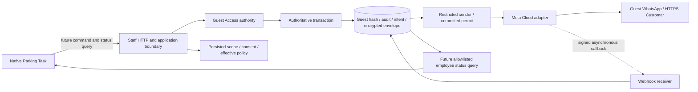
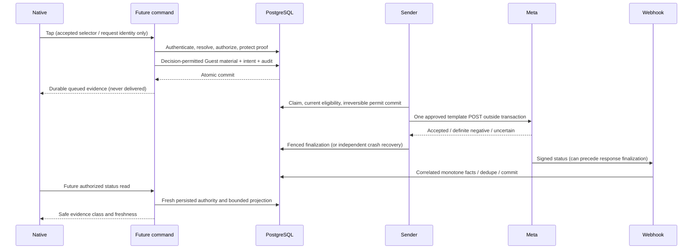

# Issue #310 — WhatsApp Guest Access master implementation plan

Date: 2026-11-13 (Asia/Amman). Planning baseline: `de338f4da187297aacd0fc7005ece9b6f041fe61`.

**Production implementation verdict: DECISION REQUIRED.** This is the complete future execution envelope, including decision gates; it is not an Accepted Decision or permission to execute its production phases. The separately authorized development-only Native prototype may proceed after this document is committed and pushed. Design approval remains PENDING OWNER. No real send, production endpoint, schema change, PR, merge or deployment is authorized in this assignment.

## Contents

- [A. Executive overview](#a-executive-overview)
- [B. Requirements and traceability](#b-requirements-and-traceability)
- [C. Exact user journey](#c-exact-user-journey)
- [D. Full architecture inventory](#d-full-architecture-inventory)
- [E. Accepted decisions and unresolved conflicts](#e-accepted-decisions-and-unresolved-conflicts)
- [F. WhatsApp button behavior specification](#f-whatsapp-button-behavior-specification)
- [G. Status-confirmation feasibility](#g-status-confirmation-feasibility)
- [H. Guest Access link lifecycle](#h-guest-access-link-lifecycle)
- [I. Authentication and tenant isolation](#i-authentication-and-tenant-isolation)
- [J. Consent and recipient correctness](#j-consent-and-recipient-correctness)
- [K. Durable messaging and concurrency](#k-durable-messaging-and-concurrency)
- [L. Backend, API and contracts](#l-backend-api-and-contracts)
- [M. Database and migration assessment](#m-database-and-migration-assessment)
- [N. Meta Cloud API integration](#n-meta-cloud-api-integration)
- [O. UX design specification](#o-ux-design-specification)
- [P. Execution phases and bounded tasks](#p-execution-phases-and-bounded-tasks)
- [Q. Full test strategy](#q-full-test-strategy)
- [R. Production readiness and rollout](#r-production-readiness-and-rollout)
- [S. Risk register](#s-risk-register)
- [T. Decision register](#t-decision-register)
- [U. Definition of Done](#u-definition-of-done)
- [Evidence index and planning review](#evidence-index-and-planning-review)

## A. Executive overview

The employee completes Check-In in the Native app and reaches the existing Parking Task screen. Guest Access stays available exactly as before. A green WhatsApp-logo control immediately below it will, after later approvals, ask VAYLET's backend to send the secure Guest entry link to the persisted Check-In contact. No phone chooser, device WhatsApp intent, client-generated credential or alternate recipient is part of this operation. The guest receives an approved transactional template and opens the Customer HTTPS application through its one-time fragment bootstrap and Guest Browser Session exchange.

The purpose is deliberate, visible employee control over Guest-link delivery without disrupting fast intake or physical custody. Messaging success does not start Parking, complete Check-In, assign a Task, verify handoff, prove identity or release a vehicle. Those commands keep their existing authority.

### Repository facts discovered

- Required existing branch: `feat/issue-310-sandbox-last-mile-authorization`, checked out clean in `tmp/issue-310-last-mile-worktree`. Original HEAD and remote HEAD are `de338f4da187297aacd0fc7005ece9b6f041fe61`.
- Fetched `origin/main`: `bfb4fdccf9d557c371313c9e357faa52e0a71014`. Merge base: `e8c747f50cead1360ed151582c767a9bec1d1014`. `git rev-list --left-right --count origin/main...HEAD` returned **444 / 8**. These are dated observations, not permanent branch facts.
- Main checkout is on a different local `main` with two unrelated untracked runbook/handoff documents. This task leaves it untouched. No replacement feature branch, reset, stash, history rewrite, merge or rebase is needed for the authorized work.
- The eight branch-only commits preserve sandbox sender wiring, isolated infrastructure/onboarding and October 24 evidence. Comparing head trees is not equivalent to identifying regressions introduced by this task.
- The target `native-check-in-parking-task-step.tsx` is byte-identical between this HEAD and fetched main. Surrounding Check-In, Customer entry, policies and worker composition have diverged.
- There is no Founder Blueprint v1.0 PDF in `docs/reference` at this baseline. `Valet_Project_Concept_Arabic.pdf` is the historical concept, not that Blueprint. Use `docs/15_BLUEPRINT_V1_REBASELINE.md`; do not invent missing PDF content.

### Existing sandbox achievement and its limits

The dated [live evidence](../../validation/whatsapp/ISSUE_310_LIVE_SANDBOX_EVIDENCE_20261024.md) reports one authenticated Intake, one logical intent/delivery/attempt, Meta `ACCEPTED`, owner-attested physical WhatsApp receipt, and zero duplicates. The envelope was purged. PG17.11/102 migrations and focused checks were reported for that isolated run. The Customer HTTPS **root** was reachable. These are historical results, not tests rerun for this plan.

That run did **not** prove signed live webhook reconciliation, intact actionable fragment/browser exchange, current full exact-SHA CI or production readiness. Temporary local token removal did not independently prove Meta-side invalidation. Both durable modes and runtime dispatch were documented OFF. This assignment changes none of those controls and does not inspect private runtime credentials or initiate another send.

Existing code has automatic initial issuance, encrypted transport, SQL-authoritative dispatch leases, one-call Meta adapter, signed webhook processing, and company settings. Missing production capabilities include a reconciled central sender contract, employee-triggered command, suitable credential resolution after Intake, production consent capture, a safe employee delivery-status query, production sender onboarding and release evidence. Sandbox code is intentionally constrained to an exact test scope.

The final production outcome requires an approved design and decisions, integration with current main, one authorized durable logical send under the selected policy, accurate same-button feedback, real Guest entry, and separately approved operational activation. Finishing the plan or prototype establishes none of those later statuses.

## B. Requirements and traceability

Classification is per proposition: **LOCKED** = authoritative requirement; **DERIVED** = inspected implementation consequence; **UNRESOLVED** = a choice remains; **CONTRADICTED** = an assertion conflicts with higher authority. Source IDs resolve in the evidence index. Future tests below are requirements, not PASS claims.

| ID / requirement | Class | Authority | Current code / gap | Phase | Test / eventual acceptance evidence |
|---|---|---|---|---|---|
| R01 Preserve historical sandbox work and existing branch | LOCKED | Owner brief; Issue #310 | E01/E12; no automatic integration | P00/P02 | SHA ancestry, named-file diff, remote parity |
| R02 Actual Native Parking Task; only new control below Guest Access | LOCKED | November 13 Issue update | E02; component unchanged from main | P01/P10 | baseline + prototype native capture and frozen-tree comparison |
| R03 Green recognizable WhatsApp logo; EN/AR, light/dark, touch access | LOCKED | Owner visual contract | E02/E03; no button yet | P01/P10 | Q01/Q02; Owner review |
| R04 Prototype states are demonstrative and production-isolated | LOCKED | Owner scope | no existing send-control preview | P01 | no provider/auth/client I/O; release-gate negative |
| R05 Explicit design approval before functional production code | LOCKED | Issue update | approval pending | P01/P03 | recorded Owner design decision |
| R06 Backend performs Cloud API send | LOCKED | Owner; historical scope | E08/E09 has sandbox sender only | P08 | restricted sender-only real sandbox proof under separate permission |
| R07 Only persisted Check-In recipient; no client phone/token | LOCKED | Owner; security docs | E04 uses Customer phone; new command absent | P04/P07 | tampered-input, stale-contact and cross-visit negatives |
| R08 Phone capture does not constitute WhatsApp opt-in | LOCKED | Issue; DEC-105/C0 | consent tables exist; ordinary Native capture has no sufficient explicit opt-in | P04 | genuine evidence, withdrawal and no-grant denial |
| R09 Company default → Location override, global gates dominate | LOCKED | AGENTS; C0 | E04/E07 pins two policy revisions | P05/P08 | inherited/null override + concurrent change tests |
| R10 Central VAYLET production sender is newer direction, not reconciled contract | UNRESOLVED | Owner conflict requirement | WA-D10, E07/E10 company ownership incompatible | P03/P05 | approved replacement DEC + schema/role review |
| R11 Deliberate manual action exists alongside old automatic design | LOCKED | Issue update | E04 new-Intake-only hook | P03/P06/P07 | approved trigger selection, no automatic/manual duplicate |
| R12 Whether auto remains configurable and what repeated sends mean | UNRESOLVED | Issue asks resolution | E10 unique visit/purpose; no manual semantics | P03/P06 | first/retry/race/after-success contract tests |
| R13 Secure issue/resolve; no silent rotation or recoverable token vault | LOCKED | DEC-064/105 | E05 cannot recover a hash; E04 initial-only | P03/P06 | generation/consumption/reissue suppression tests |
| R14 Distinguish request, queued, attempt, Meta accepted, sent/delivered/read, failed, UNKNOWN | LOCKED | Issue; E06/E08/E09 | durable facts exist; staff projection absent | P07/P09/P10 | response lost, callback-first, missing webhook tests |
| R15 UNKNOWN must not authorize blind retry | LOCKED | DEC-105/C0 | E08/E10 irreversible dispatch | P06/P08/P09 | hard death after possible acceptance; no second call |
| R16 Staff tenant/Location authorization precedes protected mutation | LOCKED | AGENTS/security | E05/E11 authorizers; new operation authority undecided | P03/P07 | two principals, revoked membership/access, no writes/audit on denial |
| R17 Signed original-byte webhook + durable correlation | LOCKED | historical Issue criteria; C0 | E09 implemented; real callback unproven | P09/P11 | real signed callback persisted; invalid/replay/cross-binding negatives |
| R18 Sender, API, webhook and migration DB identities remain separate | LOCKED | DEC-025/105; E10 | function-only sender/webhook authority | P05/P08/P12 | real PG role denial/provisioning evidence |
| R19 Exact HTTPS origin and `#guestToken=` confidentiality | LOCKED | DEC-064 | E05/E08; real Guest link unproven | P11 | actual fragment scrub/exchange; safe telemetry inspection |
| R20 Test assets/consented allowlist cannot route production | LOCKED | historical Issue | E08 sandbox checks | P08/P11 | wrong mode/database/alias/template/account/recipient denied |
| R21 No custody/Task transition from send/status/webhook | LOCKED | AGENTS; DEC-064 | notification lifecycle separate | P07/P09 | state/version/assignment unchanged |
| R22 No SMS fallback, marketing, arbitrary messaging or new broker | LOCKED | WA-D11; scope | dedicated INITIAL_GUEST_ACCESS | all | scope review and dependency diff |
| R23 Real PG17, worker crash, CI, physical Android, Guest browser gates | LOCKED | DoD; historical Issue | historical scoped evidence; exact new source not proven | P11–P14 | Q matrix evidence frozen to candidate SHA |
| R24 Production stays OFF until separate activation GO | LOCKED | Owner; DEC-105 | fail-closed config + durable control | all/P14 | settings/config/runtime/DB evidence, approval record |
| R25 Plan-only commit/push before prototype commit/push; no PR | LOCKED | Owner execution order | this document first | P00/P01 | two separate commits and normal fast-forward push |
| R26 Safe status availability after reopen; privacy/rate budgets | UNRESOLVED | Issue feasibility request | no employee status API currently exported | P03/P09/P10 | authoritative reload, scope fences, cost/query-plan evidence |

## C. Exact user journey

Every future addition below depends on §T. Existing steps are not rewritten by this plan.

| Step | Journey and owning boundary | Required result / unresolved part |
|---|---|---|
| 1 | Employee authenticates, selects current operational Location and opens Check-In | Native production workspace and existing auth/scope owners remain authoritative |
| 2 | Capture/confirm vehicle and phone | Existing check-in validation; WhatsApp canonical validation is stricter than general Intake (§J) |
| 3 | Explicit WhatsApp consent obtained | **UNRESOLVED D03** collection ceremony, provenance, scope and withdrawal; do not add a consent checkbox to frozen UI in this task |
| 4 | Existing Intake transaction creates session | `intake-session-command.ts` invokes initial hook only on fresh eligible creation; current idempotent Intake replay must stay unchanged |
| 5 | Complete condition/Check-In and show Parking Task | Existing `continuation` screen, normally `AWAITING_PARKING`; messaging does not advance it |
| 6 | Determine control visibility/eligibility | **UNRESOLVED D04/D08**; local visibility never grants backend permission |
| 7 | Employee taps WhatsApp | Future command carries only accepted resource selector/request identity; no recipient, URL, token, role or tenant authority |
| 8 | Server authenticates current staff session | Established principal resolver; ambiguous/duplicate Authorization rejected |
| 9 | Resolve persisted visit, membership, Location and recipient | Prove allowed operation, lifecycle and any chosen Shift/Task policy before issuance; re-check consent and policies |
| 10 | Resolve credential capability | **UNRESOLVED D02/D05**; hash cannot be converted to existing URL; ordinary manual issue endpoint rotates |
| 11 | Commit Guest authority if permitted, audit and one durable intent/envelope | Atomic authoritative transaction; no Meta network under locks; no success before durable commit |
| 12 | Worker schedules due delivery | Existing bounded claim/lease; send controls and shared budgets still apply |
| 13 | Restricted sender resolves exact binding/template/secret, confirms permit, calls Meta once | Production assembly awaits D01/P08; no Native WhatsApp application involved |
| 14 | Normalize provider reply | `ACCEPTED` with valid bounded `wamid`, definitive negative, or UNKNOWN; no handset inference |
| 15 | Verify real provider callback | Original bytes, signature, account/attempt/message/recipient correlation, deduplication |
| 16 | Persist independent delivery facts | Commit before acknowledgment; no custody/Task mutation |
| 17 | Same button shows safe authoritative feedback | Immediate queued if proven; later provider facts if authorized query exists; copy cannot overclaim |
| 18 | Guest receives template and taps exact HTTPS URL | Correct visit and intact fragment; receipt does not prove bootstrap acceptance |
| 19 | Customer scrubs fragment and exchanges bootstrap | DEC-064 enrollment, cookie, generation, same/different browser conflict and lost-response recovery |
| 20 | Failure and recovery | Safe refusal for missing prerequisites; status reconciliation after request timeout; no resend for UNKNOWN/accepted; explicit staff recovery stays separate |

## D. Full architecture inventory

### Existing implementation patterns

| Boundary | Concrete current owner / capability | Integration gap |
|---|---|---|
| Native entry | `src/shell/native-production-workspace.tsx` → `native-check-in-route.tsx` → `NativeCheckInWorkflow` → `NativeCompleteStep` → `NativeCheckInParkingTaskStep` | add control only after Guest card; preview injection only now |
| Existing Guest navigation | workspace `contextual.open("guest-access", "CHECK_IN", sessionId)` passed as `onOpenGuestAccess` | preserve callback and existing card byte-for-byte |
| Native manual Guest lifecycle | `src/guest-access/native-guest-access-session.ts`, screen, credential-memory, origin rules | memory-only raw URL; not an outbound recoverable credential service |
| Portable client | `packages/employee-client/src/employee-check-in-*`; public exports `src/index.ts` | no approved employee WhatsApp command/status API; later shared schemas/client extension |
| Staff HTTP | `StaffCheckInController` and `StaffGuestAccessController`: both `@Controller("v1/staff/check-in")`; settings controller `v1/staff/management/organizations/:organizationId` | conventions verified; no new route selected by this plan |
| Feature composition | `notifications.module.ts`: AuthModule, RuntimeDatabaseModule, HttpInfrastructureModule, OutboundWebhookDatabaseModule; dedicated controllers/services and RequestIdMiddleware | use current module wiring/operation runner, not a generic new repository/service stack |
| Initial issuance | `createInitialGuestIssuanceFromEnv`, `issueInitialGuestAccessInTransaction`, `persistInitialGuestOutbox` | private transaction-local hook accepts a *new disabled Intake* scope, not an authenticated arbitrary later command |
| Guest authority | `createIssueGuestAccessCommandExecutor`, `createRevokeGuestAccessCommandExecutor`, GuestAccessService and GuestCredentialAuthorizer | rotations return raw token once; no read-back from hash; must not call HTTP internally to compose a command |
| Eligibility | `createInitialGuestEligibilityResolver` + narrow SQL read functions | current Customer/policy/consent/binding checks are reusable mechanics only after contract compatibility review |
| Durable messaging | Outbound intent/delivery/attempt/envelope/event/permission/budget models and SQL 086–093 | one visit/purpose intent, initial-only AAD/generation contract; manual and central changes decision-gated |
| Sender | `OutboundDeliveryWorker`, `PostgresOutboundLeaseRepository`, `createOutboundWorkerPorts` | branch wires `sandboxSenderAssembly`; no general production resolver |
| Provider | `createMetaCloudProvider`, `resolveMetaPayload`, `sendMetaHttp`, `classifyMetaReply` | hard-coded reviewed Graph v26.0; external support/limits/template facts must be reverified at execution |
| Webhook | `MetaWhatsAppWebhookController` → `normalizeMetaStatusPayload` → `applyMetaEvents` → SQL event function | current WABA/phone lookup assumes unique company binding; incompatible with naive shared-number duplicate bindings |
| Configuration | WhatsAppSettingsService, template authority, sandbox binding/consent services, durable control | Dashboard is not a secret manager; production opt-in/onboarding absent |
| Status query | DB facts already exist; settings response has `activationReady: false` | settings is not per-visit status; no safe employee projection found in inspected controllers/contracts |
| Guest browser | Customer auth/token adapter and API enrollment/session/context services | root HTTPS reachability alone is insufficient; current main entry fixes need integration |
| Audit | custody writer for ValetSession/Vehicle; organization writer for settings; normalized immutable provider events | exact new manual-action audit catalog/entity is D07; table nullability does not broaden writer contract |

The diagram's Native command and status-query edges are **proposed**, unimplemented. Existing DB/worker/provider/webhook capability does not establish production activation.

## E. Accepted decisions and unresolved conflicts

### Binding requirements

AGENTS authority order and the latest Owner brief control this task. DEC-064 locks credential transport, hash-only Guest/Browser Session authority and staff generation changes. DEC-063 locks online authoritative Guest mutations and forbids offline credential replay. DEC-105 permits only one short-lived encrypted **initial new-Intake** transport exception; it is not a general reusable bearer vault. DEC-087's WhatsApp amendment permits only the narrow company settings/own-number exception. C0 freezes historical initial-only trigger, scope, bounds and OFF controls. The November 13 instruction authorizes the new visual placement/prototype and requires reconciliation before functional changes; it supersedes the historical no-Native-button freeze only for that addition.

### LOCKED decisions

R01–R09, R11, R13–R25 retain the exact authority/classifications in §B. Only the control's prototype placement and isolation are implementation-ready now; accepted historical backend contracts remain bounded to their existing scope.

### UNRESOLVED decisions

D01–D09 and approvals D10–D12 in §T are not selected implementation contracts. The three principal conflicts follow.

### Conflict 1 — central VAYLET WABA versus company-owned sender

**D01 — UNRESOLVED reconciliation.** The Owner's newer selected direction is one VAYLET-owned central production number/WABA, serving separately governed tenants. WA-D10, DEC-087 amendment, DEC-105 summary/C0, policy binding FKs and provider verification still express company-owned bindings. Do not treat either architecture as already reconciled.

Concrete incompatibility: SQL/Prisma have globally unique `(environment, provider, phone_number_id)` on an Organization-owned binding, while policies/intents require `(organization_id, binding_id)` FKs. Creating one binding per company with the same number fails uniqueness; weakening it without changing `outbound_resolve_meta_binding(waba,phone,environment)` makes webhook tenant resolution ambiguous. A callback WABA/phone is no longer tenant identity. Never assign it to the first company or trust a callback-supplied tenant.

The replacement Accepted Decision must define platform sender ownership plus tenant authorization edges, exact immutable attempt correlation, permitted template identity, separate test/production assets, key/secret custody, revocation, consent scope and Company/Location configuration. Recommended **proposal**: separate platform transport identity from a tenant's authorization to use it; keep each intent/attempt tenant-scoped and derive callback tenant from immutable attempt correlation. This is a design alternative, not a chosen schema or interface.

| Consequence | Required design/implementation review |
|---|---|
| Provider binding / sender identity | platform-owned verified WABA/phone vs tenant grant; no fake Organization owner; migration and FK/grant design |
| Policy | company enablement and Location overrides still separate; tenant cannot change global secret/sender; binding revisions must remain revocation fences |
| Templates / brand | approved central template languages and truthful business identity; tenant branding parameters only if separately accepted and approved by Meta |
| Tenant isolation | all command/status/intent rows retain persisted scope; shared WABA never grants cross-company read/write |
| Secret custody | platform operations owns sender secret alias and rotation; no Dashboard/Native exposure; restricted sender resolves exact tenant entitlement |
| Worker / quotas | shared number throughput and reputation require global budget + tenant fairness; current binding budget alone does not define tenant allocation |
| Billing | VAYLET pays provider; tenant allocation/reporting policy unresolved; no inferred commercial charging or new payment subsystem |
| Audit | distinguish tenant employee request, platform transport identity and external provider fact; immutable linkage with finite safe metadata |
| Revocation | company opt-out disables its future permits without disabling other tenants; central credential compromise stops all; preserve callback intake for past attempts |
| Onboarding / compliance | VAYLET business profile, support and consent identity must accurately represent the sender; legal/Meta suitability is external, not established by Owner preference |

Affected current areas: E07–E10, WhatsApp settings Dashboard transport/copy, `whatsapp-template-authority.ts`, sender assembly, webhook resolver, provision/privilege scripts and deployment runbooks. No edits there in this assignment.

### Conflict 2 — automatic versus employee-triggered issuance

**D02 — UNRESOLVED.** The new tap is deliberate; it does not answer whether automatic initial sending remains an option. The old Intake hook emits before the later Parking screen. Automatically sending and later treating every tap as another issuance duplicates the guest message and may rotate access. A new idempotency key per tap cannot solve visit-level duplication.

| Alternative | Benefit | Cost / acceptance needed |
|---|---|---|
| A: manual-only initial send | clear employee control; one logical trigger | change historical auto product option; new delayed-initial credential scope |
| B: configurable automatic/manual sharing one visit-purpose intent | preserves old option; double paths converge | decide button meaning for preexisting queued/accepted/expired/UNKNOWN; transaction and consent timing must align |
| C: initial send plus explicitly separate resend operation | deliberate recovery can exist | broader envelope/rotation/consent/idempotency/audit policy; cannot be hidden behind repeated taps |

Recommendation for Owner consideration: B with one initial logical operation and status-only convergence once accepted/uncertain, **if** auto is still desired; otherwise A. No recommendation is accepted by this document. A permissive second send, any reset of attempt budget, rotation on retry, or new initial intent after expiry requires a separate explicit contract. Under current C0/DEC-105, a manual operation on an already-created session is outside the narrow new-Intake issuance envelope.

### Conflict 3 — what “sent” can mean

**DERIVED:** a same-button label can display committed evidence; it cannot make a queue response into receipt. The persisted model separates delivery state `ACCEPTED` from `sentAt/deliveredAt/readAt/failedAt`. **D06 — UNRESOLVED** exact status projection, evidence precedence, freshness and UX copy. A transport rejection and a signed later failure fact must remain distinguishable. Positive and failed facts may coexist; do not overwrite delivery/read with a later failed label or invent an exclusive provider-state enum that loses history.

### DERIVED conclusions

1. Existing hashes cannot recover the prior raw URL; purged envelopes cannot be recreated. E04/E05 cryptographic behavior establishes this limitation.
2. The new command cannot safely be implemented by calling the ordinary `ISSUE_OR_ROTATE` endpoint on every press. That endpoint generates fresh material and advances active generations; it can invalidate the guest browser.
3. Existing visit/purpose uniqueness protects data from a second logical row but does not specify HTTP retry/replay results or permit extra remote attempts.
4. Status after relaunch is feasible from durable facts, not from remembering a green UI label. It requires a separately authorized safe query.
5. Current sandbox sender assembly is not a production central-account resolver. Turning flags on is insufficient and forbidden here.

### CONTRADICTED candidate assertions

| Assertion | Classification and reason |
|---|---|
| “Any captured phone proves consent” | CONTRADICTED by Issue, C0 and DEC-105 release fences |
| “HTTP 2xx/queued means guest received the message” | CONTRADICTED by Issue's explicit confirmation semantics |
| “Retry UNKNOWN by minting a new Guest token” | CONTRADICTED by DEC-105 purge/no-recreation and C0 uncertainty rules |
| “Managers inherit employee send permission” | CONTRADICTED as an assertion about current Guest issue: actual allowlist is employee/supervisor, not a role hierarchy; new send permission remains D04 |
| “Sandbox receipt closes real webhook and Guest browser acceptance” | CONTRADICTED by dated live evidence's explicit boundaries |

## F. WhatsApp button behavior specification

This section is a future behavioral envelope. Production eligibility, command semantics and final copy wait for D02–D08. Prototype labels always identify **Demo**; they represent no backend response.

| Condition / state | Safe permitted meaning | Future behavior still requiring approval |
|---|---|---|
| Visible/default | directly below existing Guest Access, same width/content flow | D08: hide vs disabled for ineligible sessions and where status remains visible |
| Authorized active visit | backend re-proves scope, operation and lifecycle | D04: allowed roles, Shift/current Task/assignee requirements; D05: eligible lifecycle/generation |
| Missing/invalid phone | no dispatch; no arbitrary send-time entry | exact actionable copy and whether existing correction flow may be linked without redesign |
| Missing/withdrawn/expired consent | no dispatch; no fabricated grant | D03: collection or staff referral path; button itself cannot supply consent |
| Offline | cannot request a new remote send; do not queue a token or send command locally | selected offline copy/status staleness presentation |
| Pressed | ordinary press feedback only; no semantic success | green pressed background, preserved touch area |
| Loading | request or status lookup in progress, not “sent” | distinguish an uncommitted request timeout from a durable UNKNOWN send |
| Backend queued | a committed eligible intent exists | approved status schema/identity and whether a repeated tap opens/refetches status |
| Sending | worker attempt may be in flight | do not assert network started merely from DISPATCHING marker |
| Meta accepted | validated provider acceptance stored | disable any “send again” interpretation; no delivery ticks |
| Delivered | correlated signed provider delivery fact committed | prospective until live webhook gate passes; never local timer-based |
| Failed | authoritative refusal/definite failure, safe reason | selected recovery only; “Failed” alone never authorizes replay |
| UNKNOWN/pending | outcome uncertain or status unavailable; preserve distinction | status reconciliation, no blind retry; never silently convert timeout to failure |
| Background / navigation / logout / Location change | abandon presentation work and stale results; remote committed intent may continue under chosen policy | D04/D06: request-actor revocation semantics; no client cancellation claim after server commit |
| Foreground / relaunch | refresh authoritative status for the same permitted visit | no persisted success authority; bounded reads; no implicit send |
| Repeated taps / two employees | no duplicate logical operation or blind resend | exact convergence payload/error and key binding decided D02/D07 |

Accessibility: at least 48dp touch target (proposed control 56dp minimum), readable contrast, text as well as icon/color, button role/name, busy/disabled state, polite status announcement, no external banner or focus-stealing overlay. Preserve dynamic text scaling and wrapping rather than clipping Arabic. Logo is decorative within the named button. All new feedback stays inside the control. Disabled colors must remain legible; opacity-only treatment needs contrast verification. Do not alter any existing tokens or components to style this one addition.

## G. Status-confirmation feasibility

**Yes, conditionally:** the same control can reliably report the strongest backend/provider evidence available. The current repository does not yet expose it safely to employees, and the live signed-webhook boundary is unproven. It cannot guarantee that every send will yield a delivery/read receipt or that a guest has opened the correct session.

| Stage | Authoritative evidence | Truthful employee implication | Current capability |
|---|---|---|---|
| Request received | authenticated command invocation/response | Request received; no durable send claim | future command absent |
| Intent committed | scoped intent + delivery committed with allowed credential/audit writes | Queued by VAYLET | existing automatic outbox only |
| Execution prepared | lease / committed attempt marker | Pending/sending; attempt preparation is not network proof | worker implemented |
| Meta accepted | valid bounded provider reply + persisted acceptance/correlation, or qualifying positive callback reconciliation | Accepted by WhatsApp provider | sandbox historical acceptance; production not wired |
| Sent | authenticated correlated `SENT` provider event | Provider reports sent | parser/SQL implemented; live callback not run |
| Delivered | authenticated correlated `DELIVERED` fact | Provider reports delivered | same limitation |
| Read | authenticated correlated `READ` fact where supplied | Provider reports read; not proof of guest identity/action | same limitation; optional future display, not required for operational success |
| Definitive failure | accepted finite refusal/transport result or signed failed fact | Failed/unavailable with safe recovery guidance | durable failure machinery; display contract absent |
| Timeout/ambiguous call | durable `UNKNOWN`, or command result unavailable | Outcome unknown / checking; no resend | worker uncertainty implemented; client reconciliation absent |

Existing `classifyMetaReply` explicitly documents that transport success proves acceptance, not delivery. `OutboundDeliveryFacts` uses independent monotone timestamps. `applyMetaEvents` resolves a verified binding, computes recipient HMAC, normalizes event identity, and calls the SQL persistence function inside a transaction. Invalid signature, missing correlation, payload parse success alone or an unauthenticated client report provides no delivery authority. `MetaWhatsAppWebhookController` deliberately remains able to accept late facts while sending is OFF; do not tie read/status truth to send-switch enablement.

Immediate response can prove queue commit, subject to the approved command transaction. Waiting synchronously for a worker or webhook would hold the employee workflow open and cannot produce a reliable receipt timeout. Recommendation: return the committed operation's safe evidence, then perform bounded authoritative reads while the screen is active. Exact cadence is **D06**, not a production constant here. A design candidate is a short initial interval with jitter, then increasing intervals and a hard foreground observation budget; validate API/DB cost at expected concurrent employee count. Stop on route change, background, logout/scope loss and terminal evidence; retain no timer that triggers a send. Foregrounding performs one new authorized lookup. Delayed delivery after the observation budget is “last known/pending,” never failure inferred from silence.

Polling the Meta API per employee is not selected. Staff reads should query VAYLET's durable facts through a narrow projection, using indexed exact visit/intent relationships. No raw SQL tables or general notification feed is exposed. Authorize every read, including same-ID retries and cached responses; no-store headers, bounded query/deadline/budget and safe request IDs apply. An opaque operation ID is only a selector. Do not return URL/token, phone/HMAC, ciphertext, account IDs/aliases, raw provider body/error, template payload or another tenant's status.

Reload can reconstruct status from persisted intent/generation and evidence even after the envelope is purged. It must distinguish no prior operation, denied access, stale/suppressed old generation, definitely unsent failure and UNKNOWN. D06 must choose whether old-generation evidence remains visible to current staff and how long; do not expose a visit history feed by accident. Callback-first and later FAILED+DELIVERED/READ combinations need explicit projection rules. Poll/read endpoints must never recreate missing material or run issuance as a side effect.

**Recommendation:** retain truthful queued/Meta-accepted/uncertain labels; add provider-reported delivered only after the signed-callback and correlation tests pass. Keep delivery evidence separate from successful Guest browser entry. Read receipts are optional evidence, not a release gate for every message. No 100% delivery guarantee or exactly-once external transport claim is justified.

## H. Guest Access link lifecycle

| Lifecycle case | Existing authority / required treatment |
|---|---|
| Fresh eligible Intake | E04 creates 32 random bytes, 43-character base64url, hash on exact new disabled session, generation 1; initial bootstrap expires at 24h |
| Outbound envelope | DEC-105 RSA-OAEP-SHA256, deployment public key >=3072 bits; issuer has no private key; canonical label binds Organization, Location, session, Customer, intent, generation, recipient HMAC and expiry |
| Retention | at most 30 minutes and only definitely-unsent eligible retry; purge at acceptance, UNKNOWN, terminal failure/suppression/withdrawal/revocation/completion/cancellation/expiry; check actual cleanup coverage in P11 |
| Existing active Guest hash | cannot recover the previous token; no decrypt endpoint or deterministic credential regeneration allowed |
| Existing pending envelope | even if readable by sender, reuse for a manual trigger is not automatically authorized; D02/D05 must define same logical operation and generation |
| Accepted/UNKNOWN/purged | no recreation; current envelope is gone by design; same-button status must not pretend the old link is resolvable |
| Native manual create/rotate | raw URL held in memory for QR/copy; ordinary issue can rotate active generation; revoked credential requires explicit `REISSUE_REVOKED` plus exact expected revocation time |
| Consumed bootstrap | one browser exchange consumes bearer; active Browser Session continues by visit/generation, not by 24h bootstrap TTL |
| Rotate/reissue/revoke | serialized Guest command, audit atomically, old Browser Sessions invalidated; pending outbound generation suppressed; no hidden rotation from a retry/status read |
| Completion/cancellation | no new production send without accepted lifecycle policy; active Browser Session ends/changes scope under DEC-064; COMPLETED safe post-visit reads 24h, CANCELLED none |
| HTTPS handoff | canonical clean origin only, no credentials/query/non-root path/fragment; Cloud payload expects `https://origin/#guestToken=<43 chars>`; no URL shortener/redirect/token in path |
| Customer entry | browser-only post-mount read, strict validation, successful immediate replaceState scrub before adoption, enrollment/retry-safe exchange and host-only Secure HttpOnly SameSite cookie |
| Multiple visits/devices | same-visit no-op, explicit different-visit context choice/atomic switch, no target tenant authority inherited from source; second device uses staff reissue |

D05 must define delayed first issuance, consumed/expired credential behavior and intentional resend/reissue. The simplest recommendation is never silently rotate an active/consumed/revoked generation to satisfy a WhatsApp tap. If the Owner wants that behavior, amend the full credential/outbound contract and approve its guest/browser consequences first.

No raw link in fixtures, screenshots, console, traces, analytics, exceptions, audit, storage, clipboard capture or issue comments. For later real QA inspect the fragment privately without recording its value; record only shape-valid, origin-valid and exact-session result. API must not receive the private transport key; sender must not gain session/credential write authority. Backups are not purged by deleting the live envelope: key retirement/destruction, encrypted backup lifetime and safe restore controls require independent evidence.

## I. Authentication and tenant isolation

### Current authority versus new operation

| Principal | Existing Guest issue/revoke | Existing WhatsApp settings / sandbox consent | New send / status authority |
|---|---|---|---|
| VALET_EMPLOYEE | allowed with active user/member/org/Location and explicit LocationAccess; no Shift prerequisite in current Guest command | no company-admin permission | D04, do not infer from rendering Parking screen |
| VALET_SUPERVISOR | same explicit current Guest allowlist | no company-admin permission | D04, no new override implied |
| LOCATION_MANAGER | not in current Guest issue allowlist | not granted by `authorizeCompanyAdminManagement` | D04, no inheritance from role name |
| ORG_ADMIN / Company Admin | not in current Guest issue allowlist | explicit management capability + appropriate MFA assurance; target scoped | D04, management ownership is not employee-send authority |
| Task assignee / active Shift actor | relevant to Parking command, separate model | not provider administration | D04 decides whether required; session legacy assignee is not Task authority |
| Guest / Browser Session | no staff mutation authority | none | no employee-send/status access inferred |
| Platform operator / service | narrowly controlled onboarding/kill-switch and sender functions | not an invented tenant membership | D01/D07, least-privileged exact capability only |

Never add an active Shift requirement to the old Guest command as incidental hardening. Conversely, its no-Shift contract does not settle the new messaging operation. Active authenticated User, membership, Location grant and current Task owner are different predicates. Current main's accepted DEC-108 near-query revocation behavior must be read during reconciliation; do not invent a strict last-byte response guarantee for the new query.

### Authorization-before-mutation proof

| Ordered stage | Evidence / planned obligation |
|---|---|
| 1 Authenticate | established StaffPrincipalResolver/StaffSessionContext path as appropriate; current unrevoked bearer/user; no trusted client IDs |
| 2 Resolve target | load persisted ValetSession and exact Organization/Location/Customer; missing/foreign resource concealed consistently |
| 3 Prove operation | active membership, org, Location, explicit grant, accepted role/capability and selected Shift/Task/lifecycle; recipient and consent independently authorized |
| 4 Protect proof | transaction-aware current authority and accepted lock/guard order; use comparable Guest/Intake/dispatch primitives after compatibility review; D04/D07 must settle any new check-use mechanism |
| 5 Mutate | only accepted Guest generation/intent/envelope writes; no remote HTTP; never mutate first and use RETURNING to discover ownership |
| 6 Append audit | exact approved event/entity/provenance and finite allowlisted values in same transaction; no token, URL, phone, provider payload or free-text evidence copied blindly |
| 7 Commit | all protected writes and audit together; rollback means no queued success, no external send |
| 8 Retry/re-read | fresh authority for operation and disclosed state even when idempotency already committed; no UUID-as-permission or after-success disclosure |
| 9 Dispatch | independent current visit/generation/recipient/consent/policy/account/control checks before irrevocable permit and again immediately before I/O |
| 10 Callback | signature + immutable attempt/binding/message/recipient scope; external fact does not grant a user role or issue a token |

For the proposed command the first protected write must follow stages 1–4, not just authentication. An existing initial hook trusts its caller's already-authorized transaction and is not itself an HTTP authorizer. Two-principal tests must prove unauthorized actor B cannot read/mutate actor A's tenant/Location visit; also repeat on committed retry, stale client, old role and revoked Location paths. Confirm no new intent, credential generation, audit, provider call or existence leak.

The dispatch boundary cannot recall a message already handed to Meta. Withdrawal/disable after the final serialized permit may race remote acceptance. P03 must define the allowed boundary; preserve monotone uncertainty and stop further permits rather than promise impossible remote cancellation. Similarly D04 must decide whether employee logout/access loss after queue commit cancels a system-owned intent; current send-time gates do not by themselves prove reauthorization of the original requesting actor.

## J. Consent and recipient correctness

Current Native customer input stores/captures a phone; the initial eligibility resolver requires a separate current `GRANT` revision/evidence. No inspected ordinary Check-In request has sufficient explicit WhatsApp opt-in. The sandbox consent endpoint is Company Admin/MFA and exact isolated environment/recipient scoped; it is not a production guest-consent ceremony. Do not repurpose its seven-day grant window or operator evidence reference into production policy.

**D03** must establish who requests consent, exact text and sender identity (central VAYLET/tenant), channel/purpose scope, evidence provenance/time/version, validity/withdrawal, lawful retention and support ownership. Alternatives include separately approved Check-In UI consent, a verifiable prior guest consent flow, or authorized staff attestation under an approved auditable process. None is silently selected, and this assignment cannot add another Check-In visual control. Absence/ambiguity fails closed.

Recipient resolution must follow current session → same-Organization Customer FK → canonical persisted phone, then check versioned keyed HMAC consent for that phone/purpose and chosen sender model. General Intake phone normalization accepts a broader E.164-compatible boundary than WhatsApp (`isCanonicalOutboundRecipient` / Meta normalizer require `+` plus nonzero first digit and 8–15 digits). Do not mutate historical phone data merely to make it eligible. Validate canonical current input and return safe unavailable state when not eligible.

DEC-069 returning-customer selection can reuse a Customer row; DEC-084 permits authorized Company Admin phone correction. A phone/Customer match is not human identity or consent. Current migration 092/093 suppresses pending deliveries when Customer phone changes and records monotone routing uncertainty for in-flight attempts; dispatch confirm compares current phone/digest again. D03/D05 must decide whether current corrected Customer phone or a new visit-bound contact authority satisfies “phone previously captured at Check-In.” Do not add a snapshot column without an accepted schema decision. Do not send to an old contact or silently treat new contact as inheriting old permission.

Company policy enablement, recipient GRANT, provider verified binding and template approval are independent. Resolve every nullable Location field over the Company default and pin both revisions, not just the effective values or Location row. Withdrawal and re-grant must advance immutable consent revisions; an old queued intent cannot inherit a fresh grant by digest equality. HMAC key version rotation requires a migration/revalidation plan; never replace it with enumerable plaintext SHA phone hashes.

Employee UI does not need a full recipient number, digest, provider identifiers or raw opt-in evidence. Show only approved safe reason classes. Wrong-visit prevention requires exact session/generation/recipient binding throughout the envelope, intent, permit and callback, not only correct Location. A Meta allowlist verifies test routing only; it is not VAYLET permission evidence.

## K. Durable messaging and concurrency

Data integrity and externally visible replay semantics are separate. The following preserves existing safeguards while identifying the unaccepted manual contract.

The matrix includes first execution, identical retry, concurrent identical execution, conflicting concurrent execution (consent/contact/generation/lifecycle changes), retry after success and ambiguous commit recovery. Exact manual outcomes remain decision-dependent rather than asserted by tests ahead of acceptance.

| Schedule / failure | Existing mechanism / risk | Required future result and evidence |
|---|---|---|
| First valid tap | no manual command exists | D02/D05/D07 choose transaction and one logical identity; commit before queued feedback |
| Double tap / network retry after success | visit/purpose unique intent, not HTTP replay policy | exact convergence or approved conflict; no second generation/audit/remote call; fresh authorization |
| Two simultaneous taps / two employees | competing authorized commands require serialization | real PG concurrent commit and rollback branches; approved loser result, truthful actor provenance |
| Same request identity, different material | new key contract not selected | reject/conflict per D07; key binds exact accepted request, not arbitrary recipient |
| Automatic creation races manual | initial hook runs only fresh Intake transaction | D02 shared logical identity/trigger policy; no two intents; no second rotation |
| Request disconnect before commit | transaction may roll back | no send if rollback; if ambiguous commit, status reconciliation under accepted identity before retry |
| Queue commit, worker unavailable | durable PENDING record | later eligible bounded worker claim or expiry, no client enqueue dual write |
| Worker crashes before permit | lease token + expiry | independent recovery protects healthy worker and safely reclaims eligible unsent work |
| Permit commits, crash before actual POST | irreversible DISPATCHING | conservatively UNKNOWN even if actually unsent; no recreated token or blind resend |
| Meta accepts, response/finalize lost | remote/local dual-write uncertainty | independent recovery → UNKNOWN unless signed correlated positive evidence reconciles; no exactly-once claim |
| Meta timeout / malformed/truncated/redirect/5xx | provider returns UNKNOWN | purge recoverable material, no automatic remote replay |
| Proven nonacceptance | exact bounded provider classification + SQL093 | only definitely-unsent bounded retry before deadline/budget; no reset via app relaunch |
| Phone change before dispatch / during I/O | current digest confirm; SQL093 routing-uncertain fence | suppress unsent; retain uncertainty/positive facts if possibly sent; no later negative-triggered resend |
| Consent withdrawn / policy revision changes | intent pins permission, Company and Location revisions | deny future permits; precise in-flight boundary documented; no old intent adopting re-grant |
| Binding/credential revoked mid-flight | resolver + current confirm | stop further calls; possibly accepted current call stays uncertain/accepted; cannot unsend |
| Guest rotation/revocation/consumption pending dispatch | pinned generation and current SQL predicates | suppress/purge stale envelope; race serialized and no old credential resurrection |
| Session completion/cancellation | eligibility/lifecycle rechecks and cleanup | no new send after forbidden lifecycle; existing remote delivery fact still recorded |
| Duplicate webhook | unique binding+event dedupe digest | one immutable normalized fact; idempotent acknowledgment only after commit |
| Delayed/out-of-order/callback-first | independent monotone timestamps / accepted attempt correlation | no regression or requeue; SQL093 positive evidence wins over stale negative result |
| App restart/background | presentation has no queue authority | re-read safe persisted status; never restart a send merely on mount |

Existing bounds: intent 30 minutes, lease 30 seconds, provider deadline 10 seconds, four irreversible permit ordinals, claim batch 10, two concurrent sends per replica, cleanup batch 100 (`OUTBOUND_LIMITS`). SQL093 finalizer uses a bounded exponential delay with jitter; do not substitute GuestPush retry constants. These are current initial-outbox bounds, not automatically approved resend budgets. Central shared-number global/tenant throttling and expected volume await D01/D09.

Real failure tests must kill the process after permit commit and after provider acceptance but before finalization, then restart an independent worker and inspect DB facts/attempt count/provider mock call count. Graceful cleanup is not evidence for SIGKILL/OOM. Keep tests on a new isolated PG17 target; never steal an existing worker fixture/lease or reuse the historical sandbox database. DB+queue dual write is avoided by transaction-local outbox; adding a broker or process-memory queue would lose this guarantee and is outside scope.

## L. Backend, API and contracts

No endpoint path, HTTP code, schema fields, role allowlist, audit event name or idempotency key for the new operation is frozen by this plan. **D04/D06/D07** must settle them before production code. Existing literal controllers establish a convention, not authority for a newly invented route.

Recommended minimal boundary **proposal**: one transaction-aware application command that resolves/authorizes the selected visit and either creates or converges on the accepted initial logical operation; one read-only application query projects its safe durable evidence. Native/shared client calls thin HTTP wrappers. Automatic issuance, if retained, composes the internal command capability under its own authenticated/authorized transaction rather than calling the project's own HTTP endpoint. Preserve feature ownership: Guest Access alone owns generation/credential authority; messaging owns intent/dispatch/evidence; shared contracts own public validation.

The downstream sender consumes an exact committed intent and current permit capability, never a staff-provided URL/phone. The Native status consumer receives only approved evidence and freshness for a currently authorized visit, never recoverable credentials. The reusable boundary must explicitly state which transaction protects recipient/permission/policy/generation proof and what invalidates it. A boolean precheck outside the later write transaction is insufficient.

Compare nearest patterns before implementing: `guest-access-command.ts` explicit executor, `GuestAccessService` composition, `StaffGuestAccessController` shared schemas/ApiOperationRunner/no-store, `StaffCheckInController` CheckInOperationRunner and principal helper, and NotificationsModule imports/middleware. Use one runtime pool and existing request-ID/error infrastructure; no new generic repository layer, duplicated auth parser or feature-to-common dependency inversion. `packages/contracts/src/index.ts` and `packages/employee-client/src/index.ts` are the export boundaries; verify actual exports before importing a private local validator/helper.

Transport inputs must not accept authoritative Organization, Location, membership, actor role, recipient phone, URL/token, sender account or target status. Exact selector/request identity remains D07. Errors must be finite, non-disclosing and mapped through current shared error conventions; provider error body and raw SQLSTATE/constraint/stack never reach Native. Raw PostgreSQL paths require actual SQLSTATE handling, not an invented Prisma P2002 classifier. Rate-limit/status-read budgets, cancellation, timeout, scope-generation fences and request replay must be designed together.

Compatibility acceptance: existing Intake request/response byte shape and idempotent replay remain intact, old manual QR/copy/reissue/revoke still work, Customer authority unchanged, existing workers can remain disabled during rolling deployment, and old clients never implicitly opt in. A new operation must not create a generic session/task state endpoint or mutate physical versions as a delivery marker.

## M. Database and migration assessment

**Migration requirement is UNRESOLVED.** No migrations or Prisma edits are authorized now. Current persistence supports initial-outbox transport and durable status facts, but not the unreconciled central sender/manual/resend contracts. Do not conclude “no migration required” merely because columns exist.

| Inspected persistence / SQL | Existing integrity | Decision-dependent gap |
|---|---|---|
| OutboundProviderBinding / SQL086 | Organization FK; unique environment/provider/phone; one enabled per org/purpose/environment; verified evidence protected | central platform transport identity vs tenant grant/correlation |
| OutboundMessagingPolicy / SQL086 | composite tenant binding/Location FKs; separate partial company and Location unique indexes; revisions | approved trigger mode/tenant use of central sender |
| OutboundMessagingControl | distinct test/production OFF/OFF rows | production control ownership and audited activation still operational |
| OutboundMessagingPermission + PermissionEvent | tenant+recipient-HMAC+purpose unique; immutable revisioned GRANT/WITHDRAW | sender/purpose/visit consent semantics, capture and retention |
| OutboundMessageIntent | immutable scope/generation/revisions; unique org+visit+purpose; <=30m | delayed manual first issuance/resend identity and request replay |
| Delivery / Attempt | one channel per intent; lease token; ordinal unique; immutable handle; partial provider-binding/message uniqueness; monotone status and no-requeue triggers | approved status projection / central provider correlation |
| Envelope | intent+tenant FK; encrypted bytes/AAD/key version and purge index | manual exception amendment; no general credential recovery |
| Event | binding+dedupe digest unique; normalized safe facts | shared-WABA tenant resolution and old binding compatibility |
| Binding / recipient budget | authoritative rate reservations | central shared capacity, per-tenant fairness and billing attribution |
| Customer / ValetSession / BrowserSession | scoped relationships, hash-only credential generation, browser generation uniqueness | “captured-at-Check-In” vs corrected contact policy; no arbitrary snapshot schema |

SQL086 contains partial due/lease/expiry/policy/number indexes not fully represented by Prisma. SQL087 owns sender claim/permit/confirm functions; SQL088 callback/recovery/consent functions; SQL089–093 tighten callback-first, role, crash and phone-change behavior. In particular SQL093 records `recipient_routing_uncertain` monotonically and only permits DISPATCHING → RETRY_WAIT after definitive negative evidence with no positive provider fact, message correlation or phone drift. Preserve these predicates during any new forward migration.

Before schema work, produce approved revised contracts and list exact required constraints/indexes/grants/functions, expected upgrade cohorts and old-version behavior. Update `docs/03_DATABASE_SCHEMA.md` first, then append new migrations after the **current reconciled** migration head, never reserve an obsolete next number from this branch. A migration owner must coordinate shared Prisma/schema/log files. Test empty PG17 database and representative populated upgrades, including pending/leased/dispatching/accepted/UNKNOWN, old company binding, old consumed browser generations and no fake consent/backfill. Default activation OFF.

Role acceptance: API may execute only approved writes; sender cannot SELECT arbitrary tables or mutate Customer/session/audit credentials; webhook can resolve exact attempt and append safe provider facts only; migration identity absent from all runtime containers. Test actual SQL grants and denied DML/DDL/PUBLIC execution under fresh LOGIN roles. A typecheck or `prisma db push` does not verify this.

Retention is not permission to delete operational history. Expire/purge secret transport independently from immutable intent/event/audit history. D09 defines retention/legal hold, backup key lifetime, cost records and safe query indexes. Rollback should disable functionality and remain schema-compatible; do not down-migrate by deleting audit/history or restore live send controls from an old backup.

## N. Meta Cloud API integration

External onboarding is a dependency, not something this plan or prototype performs. The newer central sender direction requires confirming Meta permits the intended business representation/consent arrangement. Owner preference alone is not provider/legal approval.

| Dependency / task | Required evidence before activation |
|---|---|
| Business Portfolio, app, WABA, number | ownership/admin control, verified display identity/support, necessary business verification, approved permission model; exact production/test isolation |
| Tokens and secret aliases | appropriate scoped server credential, expiry/rotation/revocation owner, vault access only in restricted sender; no public env/browser variables |
| API version | code pins `META_GRAPH_VERSION="v26.0"`; verify current supported lifecycle and payload/error semantics against official Meta docs at execution; no silent version upgrade |
| Templates | currently exact `BODY_ONE_URL`, `ar` and `en_US` mapping from app `ar/en`; approval status, catalog revision and WABA must match; sample URL/fragment behavior privately proven |
| Payload | backend constructs one exact Guest HTTPS URL; account/recipient/template input matches authorized attempt; opaque callback handle does not contain customer data |
| HTTP | fixed graph.facebook.com host/version/path; one POST, redirects rejected, 10s deadline, <=8192 response bytes; bounded valid wamid grammar; no SDK-internal retries |
| Rate limits | verify account/number/template capacity and current error codes, reserve durable global and approved tenant/recipient budgets; backpressure/expiry, not unbounded local queue |
| Provider failures | exact documented negative evidence may retry within current permit budget; timeout/unknown/malformed response remains uncertain; stop on revoked credentials |
| Webhooks | public HTTPS route, verify-token challenge distinct from POST HMAC signature, app subscription to correct WABA/messages, original-byte preservation and 256KiB bound |
| Correlation | immutable WABA/phone/attempt/message/recipient association; central sender D01 must prevent ambiguous tenant resolution; dedupe and callback-first tested |
| Economics | current template category/rate/market/currency and volume evidence; category approval not inferred from “utility” intent; per-tenant allocation D09; provider bills not inferred from UI acceptance |

Primary sources checked on 2026-11-13: [Meta platform overview](https://developers.facebook.com/documentation/business-messaging/whatsapp/overview), [service/template boundary and opt-in reference](https://developers.facebook.com/documentation/business-messaging/whatsapp/messages/send-messages), [Meta official Cloud API collection](https://www.postman.com/meta/whatsapp-business-platform/overview), [official status notification collection](https://www.postman.com/meta/whatsapp-business-platform/request/rgtfq23/message-status-update-notifications), [official delivered example](https://www.postman.com/meta/whatsapp-business-platform/request/u6uu1g9/status-message-delivered-user-initiated), [webhook setup](https://developers.facebook.com/docs/graph-api/webhooks/getting-started/), [business policy](https://business.whatsapp.com/policy), and [pricing](https://developers.facebook.com/documentation/business-messaging/whatsapp/pricing/). Templates and opt-in remain external gates. Pricing is changeable; this plan does not freeze a rate card.

The direct current status-reference and opt-in pages returned HTTP 429 to the research tool; their full current details were **not** independently fetched. Do not claim exhaustive current Graph-version/error/rate verification from search results or old collections. P08/P11 must recheck accessible official specifications and real approved account behavior before any live GO. No Meta request was sent by this assignment.

## O. UX design specification

Actual target: [NativeCheckInParkingTaskStep](../../../apps/valet-native/src/check-in/native-check-in-parking-task-step.tsx). Existing order is badge → VehicleCard → foreground-tracking notice → blue Open Parking → white Guest Access. Header/Location/back/title and bottom navigation belong to existing shell components. Preserve them, their styles/callbacks, theme dictionaries and scroll container. The only insertion is the new control immediately after Guest Access when that entry is present in the fixture.

Prototype design proposal: full content width; minimum 56dp height matching large employee control, existing 16dp primary corner radius, existing typography/spacing, recognizable bundled vector using already-installed `react-native-svg`, green fill with readable text, EN/AR labels and inherited direction. The precise accessible green shade is a design proposal for Owner review; WhatsApp branding does not justify white text on an untested bright green. Verify contrast mathematically and visually. No new package, shared token edit, banner, toast, modal or decorative panel.

Default, pressed, loading, queued, Meta accepted, failed, UNKNOWN/pending and prospective webhook-confirmed delivered variants live inside the new control. Every demo state includes an unmistakable Demo label, also in accessible name/hint; “delivered” is not a live claim. A deterministic development-only fixture can select states and baseline without changing production behavior. Default tap may advance local demo state only; it must never instantiate business clients, acquire credentials or mutate any session/task. Do not add the demo action to production navigation.

Before code, save baseline evidence from original source. Prefer actual Android runtime with same viewport/density/theme/locale/fonts/data/scroll. When unavailable, preserve actual source/tree baseline and honestly label it static evidence, not a native screenshot. Compare EN/AR, light/dark, small/standard/Owner-comparable viewports and large text. Outside the control and unavoidable added content/scroll height, existing elements must have unchanged geometry. Do not move bottom navigation or reduce old spacing to fit the button. The Owner reference screenshot is not available in the supplied attachment; do not invent it.

Supporting deliverables after plan push: `PROTOTYPE_VISUAL_PARITY_SPEC.md`, `PROTOTYPE_VALIDATION_EVIDENCE.md`, and only real generated captures in `qa-artifacts/`. Prototype is reviewable source/fixture, not design approval. Physical Android review and precise pixel claims require actual capture evidence.

## P. Execution phases and bounded tasks

### Proposed implementation plan

There are **16 phases / 48 bounded tasks** below (three tasks per phase). P00–P01 alone are authorized now. P02 onward requires a later explicit implementation scope; each decision-dependent task stops until its prerequisites are accepted. No schedule estimate substitutes for those gates. Each future task must publish owned paths, immutable source SHA, commands/evidence, excluded files and a reviewer; shared migration/contracts/decision logs have one coordinated writer. All authored code <=300 physical lines, with planned extraction before any near-limit modification.

| Phase / dependency | Three bounded tasks and expected areas | Validation / exit evidence |
|---|---|---|
| **P00 Plan** — current authorization | P00.1 inspect Issue/branch/docs/code; P00.2 author this full decision-dependent plan; P00.3 audit/classify/review then plan-only commit and normal push | requirement matrix, verified paths, planning audit/diff check, remote plan SHA; no code included |
| **P01 Prototype** — P00 remote confirmed | P01.1 baseline actual Native component and safe fixtures; P01.2 minimal dev-only button/route/state variants; P01.3 tests/parity spec/evidence, self-review, prototype commit/push and independent read-only review | Native typecheck/lint/focused+Check-In/full Native regressions/architecture/line counts; honest visual limits; Owner approval remains pending |
| **P02 Reconciliation** — separate Owner scope | P02.1 fetch/freeze new main/head and commit map; P02.2 semantic integration design for eight branch commits; P02.3 approved integration execution and conflict review | preserve new main Guest/Native/security fixes and sandbox fences; exact integrated SHA, no unapproved history rewrite |
| **P03 Decisions** — P00/P02, prototype review | P03.1 reconcile D01 sender/consent identity; P03.2 settle D02–D05 trigger/credentials/authority/recipient; P03.3 settle D06–D09 contracts/status/audit/budgets and update focused DECs + mirrors/docs | explicit Accepted decisions and Owner design approval; no unresolved production-critical semantics; tests specified against accepted outcomes |
| **P04 Consent/contact authority** — P03 | P04.1 approved capture/provenance and normalization contract; P04.2 withdrawal/contact-change/regrant boundary; P04.3 authorized UI/API only under separately approved carveout | genuine opt-in evidence, stale recipient/third-party/saved-number negatives, phone correction races; no accidental freeze expansion |
| **P05 Persistence/roles** — P03/P04, migration owner | P05.1 update schema doc and exact central/manual integrity design; P05.2 new forward migration(s)/typed models/functions/grants; P05.3 fresh+populated upgrade/least-privilege/rollback-compatibility proof | real PG17 migrations and restrictive roles, old attempts preserve truth; no automatic backfill/send activation |
| **P06 Guest material/outbox** — P03/P05 | P06.1 accepted delayed-first/resolve/reissue capability in Guest authority; P06.2 atomic one-logical-operation intent/envelope/audit; P06.3 replay/concurrent/uncertain-commit convergence | new vs existing/consumed/revoked/expired generation tests; no hidden rotation/vault; unchanged Intake fast path and manual Guest behavior |
| **P07 Staff command/shared client** — P03/P04/P06 | P07.1 approved shared schemas/errors/exports; P07.2 thin authenticated transport + explicit application command; P07.3 portable client with timeout/cancel/identity/Location fences | two-principal denial before first write, exact replay semantics, no recipient/token input, custody/Task unchanged |
| **P08 Production sender/Meta** — P03/P05/P06, external account | P08.1 exact central resolver/secret alias/approved template assembly; P08.2 preserve current permit/confirm/uncertainty/rate boundaries; P08.3 OFF-mode readiness/rotation/kill-switch verification | static and mock provider tests plus real restricted-role startup/failure proof; no live calls until later test-specific approval |
| **P09 Status/webhook** — P03/P05/P07/P08 | P09.1 approved safe query and projection precedence/freshness; P09.2 central correlation and original-byte callback boundary; P09.3 replay/out-of-order/callback-first/read-cost tests | no secrets/account IDs/phone, exact scope on every read, durable commit-before-ack, no resend from query |
| **P10 Native real integration** — Owner design, P07/P09 | P10.1 only approved control production wiring; P10.2 bounded foreground refresh/relaunch/offline/scope fencing; P10.3 EN/AR/theme/accessibility/visual regression review | unchanged old Guest/Open Parking/navigation/tracking; no app-side WhatsApp share; honest queued/accepted/unknown copy |
| **P11 Integrated qualification** — P04–P10 | P11.1 isolated PG17 concurrency/crash/role suite; P11.2 separately authorized one-recipient real sandbox + signed callback; P11.3 physical Android → WhatsApp → HTTPS fragment/browser acceptance and security review | exact SHA, zero unintended duplicates, actual signed status and correct Guest session; no inference from root reachability or mocks |
| **P12 Operations** — P05/P08/P09 | P12.1 deployment/secret/IAM/runbook and dashboards; P12.2 real crash/outage/backup-restore/rotation exercises; P12.3 alert/cost/privacy/support training | readiness health/log/DB evidence, no secret captures; restore never re-enables sending or requeues uncertain old attempts |
| **P13 Release candidate** — P11/P12 | P13.1 freeze source/dependency/migration/asset identity; P13.2 required root local checks, full remote CI/security and independent review; P13.3 QA/Security/operations/Owner GO matrix | no unresolved failure; human PR/merge decision only under separate authorization; exact candidate evidence |
| **P14 Controlled production** — explicit activation approval + P13 | P14.1 deploy compatible schema/code with issue/send OFF; P14.2 approved single controlled tenant/Location cohort enablement; P14.3 observed first delivery/Guest entry and rollback rehearsal | current genuine consent/account/template; monitor duplicates/UNKNOWN/latency/cost, pause on breach, no bulk/backfill |
| **P15 Steady operation** — successful P14 | P15.1 post-release reconciliation/incident response; P15.2 periodic key/template/permission/retention reviews; P15.3 KPI/cost/support evidence and explicit closure decision | sustained safe shift operation; release evidence indexed; Issue closure only separately authorized |

P02 current-main reconciliation must preserve recent Check-In continuity/color/photo/OCR fixes, Customer mounted-fragment/recovery/429/bootstrap fixes, current auth/Location revocation contracts and migration additions. Main's worker composition is still disabled and lacks this branch's sandbox resolver/attempt authorization/deadline additions. A text choice of “ours”/“theirs” could remove critical restrictions. Map all eight commits and compare owning functions; keep sandbox-only tooling separate from the newly accepted production assembly. Re-run the complete relevant lane on the integrated source. This task performs no integration.

## Q. Full test strategy

### Test matrix

All future PASS entries require an executed procedure and immutable candidate identity. Evidence levels: IMPLEMENTED → STATIC VERIFIED → LOCAL COMMAND VERIFIED → RUNTIME VERIFIED → FAILURE VERIFIED → CI VERIFIED → PRODUCTION-READY. A lower level never establishes the next. Historical PASS stays dated and source-scoped.

| Test ID / boundary | Reproducible procedure (later authorized phase unless P01) | Acceptance evidence |
|---|---|---|
| Q01 Prototype composition/isolation | actual component render tests; baseline source/tree comparison with only injected control omitted; exercise all demo states and `__DEV__=false` | original subtree/callbacks unchanged; no send/network/Guest generation imports; button follows Guest card |
| Q02 Prototype appearance/access | EN/AR × light/dark, small/standard/reference-comparable Android sizes, text scale/TalkBack; matched screenshots before/after | only new control region/content-height difference; contrast/touch/name/busy/disabled verified; missing captures explicitly SKIP |
| Q03 Shared contracts/unit | rejected unknown/body fields, invalid selectors, finite safe status/errors; imported public exports | no client tenant/recipient/token authority; schema and compatibility results |
| Q04 Staff authentication | real principal/session middleware, duplicate/missing bearer, expired/revoked session/inactive user | denied with safe request ID/no secret output |
| Q05 Object/tenant/Location auth | two real principals/resources, foreign tenant/Location, inactive member/org/Location, revoked grant, wrong role; repeat after committed operation | no protected write/audit/provider call or unauthorized status; exact denied query/mutation proof |
| Q06 Shift/Task/lifecycle | every accepted D04/D05 predicate and current-main revocation contract; race disable/end/reassign/cancel vs command | chosen eligibility boundary enforced without altering old Guest policy |
| Q07 Consent/phone | no GRANT, expired/withdrawn/mismatched revision, saved phone, phone correction, HMAC key mismatch, re-grant | no send to old/new unconsented recipient; exact version/current evidence; rollback branches |
| Q08 Policy | inherited fields, null Location override, disabled company/Location, revisions changed concurrently, missing template/binding/control | fail closed and preserve independent tenant decisions |
| Q09 First/retry/races | real PG concurrent first taps/two employees/auto+manual, same key diff material, losing transaction commit and rollback; lost HTTP response | one accepted logical identity; exact approved replay response; no hidden rotation/extra audit/send |
| Q10 Guest lifecycle | fresh marker/active hash/consumed/expired/revoked/reissued generations; pending dispatch vs rotate/revoke/browser exchange | accepted policy only; old browser/credential never resurrected; envelope purged safely |
| Q11 PG integrity/migrations | real PG17 empty+populated versioned migration deploy; scoped FK/unique/check/partial-index and role denial tests | actual migrations, no db-push substitute; no rewritten SQL/history; cleanup of owned target only |
| Q12 Provider mocks | exact AR/EN one-URL template, wrong WABA/phone/alias/mode/origin/recipient; bounded response/timeout/redirect/truncation/invalid wamid/error codes | one external call per permit; valid acceptance vs definitive negative vs UNKNOWN; no leakage |
| Q13 Worker replicas | independent processes claim same work; lease expiry/live-owner fencing; budget exhaustion; four-ordinal/deadline limits | SQL facts + call count, no duplicate active permit or limit reset |
| Q14 Hard crashes/dual write | process kill before permit, after permit, after mock remote acceptance before DB finalize; restart independent worker | safe independent recovery; UNKNOWN no resend; no cleanup reliance on dead process |
| Q15 Webhook signatures | original raw bytes, wrong/missing/duplicate signature, altered whitespace/body, malformed/oversized callback, unconfigured receiver | rejected before persisted facts; challenge verification alone never proves POST authenticity |
| Q16 Webhook correlation/order | wrong tenant/account/phone/message/recipient/handle; duplicate/delayed/out-of-order/callback-first; persistence outage | normalized durable monotone facts only; no ambiguous central sender tenant; ack only after commit |
| Q17 Status query | authorized reopen/relaunch, old generation, no prior intent, scope change during read, concurrent facts, read deadline/index EXPLAIN/cost | truthful evidence/freshness; no sensitive identifiers, history leakage or mutation |
| Q18 Native integration | tap/offline/timeouts/background/foreground/navigation/logout/Location or identity change; double tap and relaunch | no stale UI success or mount-triggered send; existing Parking/Guest/tracking/nav regressions pass |
| Q19 Real sandbox | separately approve exact test account/recipient/consent/template/origin/one-send budget; one Native command → worker → real Meta → signed callback | private correlation record, sanitized counts/times/source SHA; no unintended duplicate; controls OFF afterward |
| Q20 Guest browser | same physical phone opens delivered exact link; privately validate fragment, scrub, enroll/exchange, reload/restart, other visit/device, rotation/revocation and lock-wait expiry | correct exact visit; no token in logs/history/referrer/analytics/screenshots; root 200 insufficient |
| Q21 Operations failure | actual stack startup/health/network/roles; sender outage, DB loss, callback retry, key rotation, restore, kill-switch | process/log/DB and recovery evidence, not only compose config/image build |
| Q22 Security/CI | targeted scan and independent review; root architecture/lint/typecheck/test/build, PostgreSQL lanes and actual remote checks | exact-SHA results and real run links; failures resolved or task explicitly not complete |
| Q23 Production acceptance | explicit GO, narrowly enabled consenting cohort, observer confirms one logical send and actual Guest entry; monitor full shift | audit/metrics/support evidence; no unauthorized customer data in artifact |

Existing tests to retain/use include `whatsapp-intake-*`, `whatsapp-provider-*`, `whatsapp-worker-*`, `whatsapp-webhook-*`, settings authorization, `staff-valet-session-guest-access.integration.test.ts`, `guest-access-command.integration.test.ts`, and `guest-browser-session-*`. New manual/central semantics require new focused <=300-line tests, not changing old expectations to match an unaccepted proposal.

Prototype commands: `pnpm --filter @valet/valet-native typecheck`, `pnpm --filter @valet/valet-native lint`, focused Vitest then complete Native suite, `pnpm architecture:check`, focused Prettier and `git diff --check`. Full future root gates: `pnpm lint`, `pnpm typecheck`, `pnpm test:non-postgres`, `pnpm test:postgres`, `pnpm build`; database validation and owned PG harness per current scripts. Inspect current Vitest projects before selecting PostgreSQL lanes. Never run historical operator one-send/bootstrap scripts just to gather evidence for this prototype.

`.github/workflows/ci.yml` at this branch runs on main pushes and PRs to main. A normal feature push with no PR may not trigger that quality workflow. Observe actual remote checks; do not create a PR or modify CI triggers to obtain a green badge in this assignment. Report remote CI unrun if applicable.

## R. Production readiness and rollout

Production architecture remains the modular monolith plus its separately restricted sender/webhook identities. No microservices/Kafka/Kubernetes/generic notification platform. Existing `deploy/issue310/compose.yaml` and tagged tailnet overlay are historical isolated sandbox infrastructure, not a production deployment design or public Meta webhook ingress. Public HTTPS Customer and public signed-webhook ingress require their own reviewed reverse-proxy/network boundary.

Before release, operations supplies and verifies:

- Environment flags (`GUEST_ACCESS_AUTO_ISSUE_ENABLED`, `OUTBOUND_MESSAGING_SEND_ENABLED`, `OUTBOUND_MESSAGING_MODE`), durable per-mode issue/send controls, company/Location policies and central sender entitlement are all independent; disablement wins. Boot rejects test artifacts in production. No browser/public provider secrets.
- Production secret manager, distinct public-encryption/private-decryption/HMAC/webhook/access-token keys, aliases/versions, access audit, rotation/revocation, private-key backup and restore/destruction runbooks. Meta invalidation is checked at Meta, not inferred from local deletion.
- Separate encrypted DB/runtime/migration/sender/webhook connections and least-privilege SQL startup probes. Backups encrypted with recorded retention/access owner; restores tested with send OFF and stale permits/envelopes quarantined or expired under accepted rules.
- Worker health/readiness that reflects role/config/dependency readiness, backlog age, claim/finalize/cleanup progression and key capability without logging payloads. OFF mode cleanup/callback reconciliation remains useful and must not imply sending readiness.
- Metrics: safe aggregate queued age, acceptance/failure/UNKNOWN/suppression/expiry, lease/claim error, callback lag/unmatched/auth failures, retry/permit count, sender budget, per-tenant allowed cost allocation and Check-In latency. No raw phone, digest, token, URL, ciphertext, message body or high-cardinality secret labels.
- Alerts: rising UNKNOWN/duplicates/wrong-recipient signal, missing callbacks, stale backlog/cleanup, role/key/template mismatch, credential expiry/revocation, account quality/throttle/cost changes and end-to-end Guest entry failures. Numeric thresholds require measured baseline/SLO approval (D09); no fabricated production SLO.
- Incident procedure: durable send OFF first, pause new issue if needed, retain immutable history, restrict compromised keys, independently rotate/revoke, continue signed late-fact ingestion safely, investigate exact intent/attempt privately. Never bulk requeue UNKNOWN or mint replacement credentials automatically.
- Rollback: disable controls and tenant policy, stop new claims safely, deploy compatible prior code only if new schema/old-client paths reviewed, continue safe cleanup/status/callbacks, preserve irreversible markers/audit. Existing Meta sends cannot be rolled back; customer recovery is separately authorized and traceable.
- Operator/support training: queued ≠ provider accepted ≠ delivered ≠ opened Guest visit; safe consent/contact correction; UNKNOWN has no blind retry; manual QR/reissue remains an explicit separate authority.

GO/NO-GO table for P13/P14:

| Owner | GO evidence | NO-GO examples |
|---|---|---|
| Product Owner | approved design + all required DECs; rollout cohort and explicit activation instruction | unresolved central/manual/consent/resend semantics |
| Security reviewer | exact-source tenant/role/credential/consent/webhook/role/backup acceptance | wrong-recipient, secret leakage, unsigned/unmatched status, unsafe UNKNOWN replay |
| QA | real Native + Meta + signed callback + Customer entry, all relevant regression/CI | only mocked provider/root HTTPS evidence, missing physical required scope, unresolved failures |
| Operations | deploy/health/kill/rotation/restore/cost/alerts/support owners and exercises | shared runtime/admin credentials, unproven recovery, unbounded backlog/cost |
| Human maintainer | scoped PR/cross-review/CI and merge approval under later authorization | AI self-review alone or new PR/merge not requested |

Post-release observe first controlled sends, exact-visit Guest entry, no duplicate attempts, callback freshness, consent withdrawal/kill behavior and normal Check-In latency. Expand only with explicit cohort approval; no historical visit backfill. Success is a complete real shift with reliable guest access, not button taps or template count.

## S. Risk register

### Risks / boundary violations

| Risk | Severity / likelihood | Mitigation / evidence gate |
|---|---|---|
| Shared WABA maps callback to wrong tenant | critical / high without redesign | D01 immutable attempt correlation, scoped FKs/grants, cross-tenant callback tests |
| Wrong phone / stale saved contact / phone correction | critical / medium | D03 contact authority, current HMAC/revision fences, SQL093 race proof, real recipient review |
| Credential/URL leaks into screenshots/logs/backups | critical / medium | synthetic fixtures, no raw payload telemetry, DEC-105 key isolation/purge and backup destruction tests |
| Manual+automatic duplicates | high / high until D02 | one accepted logical identity, real concurrent command/auto races, no per-tap new send |
| Hidden rotation invalidates guest browser | high / high if old issue reused | D05 explicit lifecycle, no implicit recovery from hashes, browser generation regression |
| UNKNOWN treated as failed/retryable | high / medium | irreversible marker, independent crash tests, clear same-button unknown state |
| Consent presumed from phone/tenant policy | high / high until D03 | verifiable GRANT/withdrawal, no fabricated evidence or sandbox ceremony reuse |
| Sandbox PASS mistaken for production GO | high / high | dated evidence ladder; real webhook/Guest/device/root-CI/ops gates |
| Branch integration removes new main security/Native fixes | high / high (444-behind baseline) | P02 semantic reconciliation, no automatic merge/rebase, exact integrated regressions |
| Central credential/reputation outage affects all tenants | high / medium | platform secret isolation, global+tenant budgets, kill and rotation, monitored provider quality |
| Status query leaks data or overloads API | high / medium | bounded authorized no-store allowlist; query plan/cadence/load evidence, foreground-only reads |
| Late/contradictory callback causes false label/resend | high / medium | independent monotone facts and accepted projection precedence; callback-first tests |
| UI freeze breached / control hidden by nav | medium / medium | minimal insertion, source/tree regression and real matched captures/scroll checks |
| Claimed sender revocation stronger than actual remote boundary | high / medium | explicit pre-dispatch boundary; no unsend guarantee; record in-flight uncertainty |
| External Meta/legal/rates change | high / medium | official-spec recheck, template/account approval, cost/permission owners and expiry alerts |

## T. Decision register

IDs below are **planning identifiers**, not fabricated repository DEC numbers. None is marked Accepted. Owner approval must be recorded in focused decisions and synchronized summaries/binding docs before affected code.

| ID | Unresolved choice / evidence | Alternatives, trade-offs and recommendation | Required approval / blocked phases |
|---|---|---|---|
| D01 | Central sender direction vs WA-D10/DEC-087/C0/E10 | platform transport + scoped tenant grants (recommended proposal) vs keep company-owned model; central simplifies onboarding but widens shared failure/consent/cost/correlation obligations | Owner architecture + security/Meta/legal suitability; P03/P05/P08/P09/P12–P15 |
| D02 | Manual/automatic trigger and repeated sends, initial unique intent | manual-only vs configurable shared initial operation (recommended if auto retained) vs separate explicit resend; never infer resend from tap | Owner trigger/duplicate policy; P03/P06/P07/P10/P11 |
| D03 | Consent collection, sender/purpose/visit scope, contact changes | approved new consent UI vs verifiable prior consent vs authorized attestation; recommend explicit auditable opt-in without assuming phone possession; settle current corrected vs captured visit contact | Owner compliance/product + exact UI carveout; P04–P08/P11/P14 |
| D04 | New command/status role/Shift/Task/lifecycle and request-actor revocation | match existing Guest employee/supervisor authority vs accepted task-scoped policy; recommend minimum explicit operational permission, no inferred manager/admin hierarchy | Owner authorization + security; P07/P09/P10 and corresponding DB guards |
| D05 | Delayed initial envelope, active/consumed/expired/revoked links and reissue | initial-only delayed issuance vs explicit separate reissue/resend contract; recommend no silent rotation and preserve hash-only authority; DEC-105 amendment if manual envelope permitted | Owner credential/security decision; P05/P06/P07/P11 |
| D06 | Safe status schema, fact precedence, freshness/retention, poll budget and exact EN/AR copy | bounded foreground polling vs manual refresh vs later existing async transport if justified; recommend bounded foreground authoritative reads, no Meta polling and provider-reported delivery only | Owner UX/status contract + performance/security; P09/P10/P11 |
| D07 | Exact command/query transport, replay key/response/error, audit identity/catalog | resource-scoped empty command vs explicit stable operation identity; recommendation depends on D02/D05 uncertain-commit reconciliation; inspect current shared contract conventions | Owner accepted API/domain/audit contract; P05–P07/P09; no invented paths/events now |
| D08 | Visibility/disabled behavior, actionable consent/contact/offline UX | always visible safe unavailable state vs eligible-only plus retained status; recommend Owner compare within same control; no new banners/cards | Owner prototype/design review; P10 production presentation |
| D09 | Shared throughput/fairness, retention/legal hold, billing allocation/SLO thresholds | shared provider cap + per-tenant budgets vs approved simpler bounded pilot; recommend measured pilot controls and recorded retention/rotation owners; no invented charges/quotas | Owner commercial/ops/security + real measurements; P05/P08/P09/P12–P15 |

Additional dependencies are approvals rather than domain choices: D10 records Owner visual approval of P01; D11 records exact reconciled-source QA/security GO; D12 records explicit production deployment/activation permission. These remain pending and block their corresponding later gates even after D01–D09 are accepted. No expiration of time or successful prototype test grants approval.

## U. Definition of Done

| Status | Required proof | State at plan baseline |
|---|---|---|
| Plan complete | A–U plus sources, decision-dependent tasks/tests/release gates, audit, separate commit and remote confirmation | authored; audit/commit/push recorded by Git delivery |
| Prototype complete | actual component, isolated fixture/state variants, available checks and honest visual evidence, separate commit/push | not implemented by plan commit |
| Design approved | explicit Owner review of placement/default/all relevant variants | PENDING OWNER |
| Feature code implemented | accepted reconciled contracts, current-main integration, backend/client/sender/status and permitted Native wiring | NOT STARTED in this assignment; historical automatic/sandbox code preserved |
| Tests passed | each applicable matrix row executed against exact candidate; unresolved failures preclude completion | future; dated old results do not qualify new source |
| Integration proven | real authorized Native → Meta → signed webhook → exact Guest browser session | NOT PROVEN by old WhatsApp-only receipt |
| Production ready | independent security/QA/operations/CI and provider/key/backup/consent evidence | NOT READY |
| Production deployed | separately authorized deployment, OFF-first and approved controlled activation/post-check | NOT AUTHORIZED |

Final feature checklist for later closure:

- [ ] Owner design and all production-critical decisions accepted, focused DEC/log/doc contracts aligned.
- [ ] Reconciled current main without losing sandbox history or later Guest/Native/security fixes.
- [ ] Command/status contracts, authorization-before-first-write and every retry/re-read proven.
- [ ] Explicit consent/current persisted recipient and Company/Location/sender/template/control gates proven.
- [ ] One accepted logical operation across duplicate/manual/auto/concurrent schedules; no unauthorized second message.
- [ ] Hash-only credential/browser authority and narrowly approved encrypted transport lifetime preserved.
- [ ] UNKNOWN/possible remote success cannot be blindly requeued or reconstructed; hard-crash evidence exists.
- [ ] Signed callback and central account correlation are durable, monotone, private and tenant-safe.
- [ ] Same button labels reflect exact evidence; original Guest/Parking/navigation/tracking remain unchanged.
- [ ] EN/AR RTL/LTR, themes, small/standard Android, accessibility and physical Guest entry verified.
- [ ] Forward migrations/upgrade integrity and restricted-role deployment verified where required.
- [ ] Root local checks, full relevant PG tests, actual remote CI/security and independent review complete.
- [ ] Secrets, consent retention, backup restore, health/alerts/cost/kill/rollback/support runbooks exercised.
- [ ] Separate Owner release/activation GO, controlled production acceptance and sustained operational evidence.
- [ ] Human-authorized PR/merge/deployment/Issue closure, only when separately requested.

## Evidence index and planning review

### Concrete source index

Paths refer to original planning HEAD unless explicitly labeled `origin/main`. Read implementations, not model names alone, before changing future behavior.

| ID | Source / symbols inspected | What it proves |
|---|---|---|
| E01 | [Issue #310](https://github.com/yamanradwan1-rgb/valet-platform/issues/310), fetched body updated 2026-11-13; Git status/log/fetch/worktree/refs | latest manual prototype scope; historical criteria; exact dated branch facts |
| E02 | `apps/valet-native/src/check-in/native-check-in-{parking-task-step,workflow,panel,state-steps}.tsx`; `src/shell/native-{check-in-route,production-workspace}.tsx` | actual render path, Guest callback and unchanged placement/layout |
| E03 | `src/employee-ui/employee-{controls,tokens,typography,frame}.tsx`/`.ts`, `src/shell/native-production-navigation.tsx`, appearance context/palette; locale dictionaries and Guest copy | actual control sizes, fonts, spacing, themes/navigation; no assumed HTML recreation |
| E04 | `apps/api/src/modules/valet-sessions/{intake-session-command,initial-guest-issuance}.ts`; `notifications/issuance/initial-guest-{runtime,eligibility,crypto,outbox}.ts` | new-only hook, current Customer and permission/policy/binding checks, atomic hash+envelope/outbox |
| E05 | `valet-sessions/guest-access-{command,token,resolver}.ts`; `guest-access/{guest-access.controller,guest-access.service,guest-credential-authorizer}.ts`; DEC-063/064 | current staff allowlist/no Shift, issue/rotate/revoke and hash/browser boundaries |
| E06 | `notifications/contracts/outbound-{intent,lease,provider,envelope,events,policy}.ts` | existing purpose, status facts and bounds; internal contracts not public employee API |
| E07 | `notifications/{notifications.module,whatsapp-settings-controller,whatsapp-settings-service,whatsapp-template-authority,whatsapp-sandbox-consent-service}.ts` and sandbox input/binding files | company-admin settings, explicit sandbox opt-in authority, false activationReady, current module composition |
| E08 | `notifications/worker/outbound-{delivery-worker,postgres-repository,postgres-permit,worker-composition,sandbox-sender,transport-payload}.ts`; `outbound-message-worker-run.ts`; provider/config files | restricted test resolver, current permit/confirm, one-call adapter, bounded parser, pinned version |
| E09 | `notifications/webhooks/meta-webhook{.controller,-signature,-events,-delivery}.ts` | original-byte signature, bounded normalization, DB binding/attempt correlation and commit-before-ack |
| E10 | `packages/database/prisma/schema.prisma` Outbound*/Customer/ValetSession/GuestBrowserSession; committed migrations 086–093; role/provision/smoke scripts | scoped FKs, partial uniqueness, initial purpose, shared-number incompatibility and current guard/phone-change behavior |
| E11 | `staff/custody-staff-authorizer.ts`, `auth/staff-principal.ts`, `audit/{custody-audit-event-writer,organization-audit-writer}.ts`; staff/check-in HTTP helpers | decomposed current authority, writer compatibility and request infrastructure |
| E12 | [C0](../../validation/whatsapp/C0_CONTRACT_AND_OWNERSHIP.md), [old master plan](../AUTOMATIC_WHATSAPP_GUEST_ACCESS_MASTER_EXECUTION_PLAN.md), [handoff](../../validation/whatsapp/ISSUE_310_NEW_ISOLATED_SANDBOX_HANDOFF.md), [live evidence](../../validation/whatsapp/ISSUE_310_LIVE_SANDBOX_EVIDENCE_20261024.md), PRIME final remediation and W7 independent acceptance | historical frozen decisions and later scoped fixes/evidence; no cumulative current release GO |
| E13 | [DEC-105](../../decisions/DEC-105_AUTOMATIC_WHATSAPP_GUEST_ACCESS_ENVELOPE.md), [DEC-064](../../decisions/DEC-064_GUEST_BROWSER_ENTRY_TRANSPORT.md), [DEC-087](../../decisions/DEC-087_READ_ONLY_INTEGRATIONS.md), `docs/08_DECISIONS_LOG.md` | focused contracts, mirror and central/manual reconciliation requirements |
| E14 | original HEAD vs `origin/main` path/name/diff/log inspections, including `outbound-postgres-repository.ts`, worker assembly, Customer auth and Check-In | reconciliation inventory, not automatic approval or full audit of 444 commits |
| E15 | Native package/vitest config, parking/locale/appearance tests, `appearance-render-{tree,evidence}.ts`; root scripts and CI workflow | actual available validation mechanisms; tree renderer explicitly stubs Native hosts and is not pixel evidence |

Binding discovery covers AGENTS, `docs/00_SOURCE_OF_TRUTH.md` through `docs/18_PHASE3_OPERATIONS_EXECUTION_PLAN.md` (including schema, security, DoD, decisions, traceability, collaboration, rebaseline, deployment and code structure) and CONTRIBUTING. Large schema/security/decision inventories are navigated by relevant Guest, Intake, Notification, audit, consent, outbound and role sections plus owning code/SQL; this is not a claim of a line-by-line security audit of every unrelated product area. The missing Blueprint PDF is explicitly recorded in §A.

### Files expected to change

Authorized now: this master Markdown, later prototype spec/evidence/real screenshots, minimal development fixture/route/button/copy/logo and focused tests, with one optional guarded insertion in actual Parking Task. No production backend/client contract/schema/deploy/config/credential changes. Future decision-dependent file areas are named in §D/P; exact future path allowlists must be frozen per task after decisions. Do not treat a proposed filename as an implemented/exported symbol.

### Explicitly out of scope

Real sends, credential generation, production API or DB semantics, migrations, production activation, arbitrary recipient/marketing/SMS fallback, unrelated UI, new provider/queue framework, historical evidence rewriting, automatic main synchronization, PR/merge/deploy/Issue closure. No live runtime controls or existing customer data are changed for this plan/prototype.

### Planning completion gate

Check R01–R26 against the retained old Issue criteria and November 13 update; preserve old sandbox evidence; inspect every source path; run the available planning audit; inspect full Markdown diff and `git diff --check`; stage only plan files, commit and push normally, confirm remote SHA before P01. The Owner's A–U structure intentionally takes precedence over the skill's generic output ordering; its required discovery/locked/derived/unresolved/risks/test/files/scope/verdict content is retained here.

Strongest unresolved risk: a shared central account cannot safely be obtained by simply removing binding uniqueness. Most dangerous convenience shortcut: calling manual Guest issue on every retry. Both remain explicit decision gates. This plan selects no new production route, audit catalog, role/Shift rule, retry result or schema. An absent employee status API is a capability gap, not proof that it is forbidden.

Planning audit v1.5 was executed. Its initial seven missing-heading warnings concerned the requested A–U structure; matching skill subsection headings were added without changing that structure. The schema-synchronization warning matches an explicit prohibition in §M, not a proposed verification shortcut. Local Markdown links resolve and all A–U sections are present. Formatting and staged diff checks must be observed before commit; these checks do not approve unresolved decisions.

The subsequent heuristic audit also matched the explicit prohibitions on Prisma-only error handling, a generic repository layer and a premature no-migration conclusion. Those are rejected shortcuts in §L/M, not selected behavior. Its retry-vocabulary warning was addressed by the explicit schedule inventory in §K. These are manually reviewed heuristic matches, not a clean automated audit PASS.

### Ready-to-implement verdict

**DECISION REQUIRED** for real feature code. The already-authorized isolated visual prototype can proceed only after this plan's successful commit/push gate; it grants no production approval.
