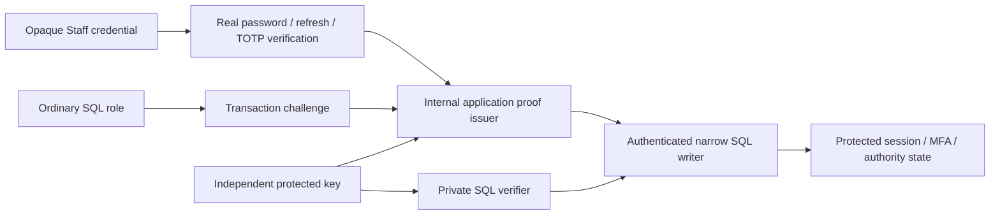

# Issue #416 Option A authentication provenance

Status: S1 byte-level design specified for independent review — **not Owner-accepted or implemented**.

## Executive verdict and baseline

OPTION A DESIGN PARTIALLY CLOSED — OWNER DECISIONS REQUIRED.

Option A is the Owner-selected direction. This package specifies a candidate
protocol and its remaining contracts; it authorizes no implementation. The
recovered cutover and lock supplements make legacy and ordering proposals
reviewable, but neither proves deployment security or production concurrency.
U1 key custody, U2 typed writer/ceremony coverage and material Owner decisions
still gate implementation. No new DEC is marked Accepted.

The design baseline is origin/main bfb4fdccf9d557c371313c9e357faa52e0a71014;
the existing feature HEAD before this recovery was
62d0a3d3f97a4186d2dd85642212efc7b4f35d42. Both original documentation
commits 2323544b (legacy) and 29cfadcb (locks) have that exact parent and were
recovered intact into the isolated integration history. Issue #416 remained open
with no comments. Existing shared contracts and audit migration 112 remain.
Applicable authority includes AGENTS.md, docs/00,06,08,13,17, canonical DEC-023/025,
and focused Accepted DEC-024/072/075/076/078/079/080/081. Source discovery and
review are distinct from executed authentication-provenance tests.

## Decision ledger

| Class | Proposition |
| --- | --- |
| LOCKED | Option A direction, design-only scope, opaque access/refresh contracts |
| LOCKED | Current role/tenant/entitlement and exact-session sensitive MFA |
| LOCKED | SQL runtime credentials or readable hashes cannot create issuer authority |
| LOCKED | DEC-025 ordinary credential and existing single application pool |
| DERIVED | All direct authority-establishing writes and weaker SQL entry points must migrate |
| PROPOSED S1 | The byte-precise per-command HMAC proof, transaction-bound one-use challenge and signer guards below; independent review and explicit Owner supersession still required |
| PROPOSED | Drained cutover with legacy-session revocation and reauthentication |
| PROPOSED L1 | Selective legacy account/factor/authority admission and mediated recovery; see cutover supplement |
| PROPOSED L2 | Drained boundary with proof-capable rollback (or explicitly approved secure outage); see cutover supplement |
| PROPOSED LOCKS | Normalized writer resource ranking, key retirement barrier and retry cases; see locks supplement |
| UNRESOLVED U1 | Actual proof-key custody, at-rest storage, provisioning and rotation ownership |
| SOURCE-INVENTORIED U2 / UNRESOLVED PROOF | Source-backed writer/SQL-signature manifest exists; strict command schemas, external Organization/entitlement writers, effective grants and races are unverified |

No custody/Task/Dispatch transitions or Company-default/Location-override changes.

## Threat model and boundary

A anonymous, B Employee/Supervisor and C Location Manager retain their current
constraints. D genuine Admin needs current authority and recent MFA. E ordinary
runtime SQL and F DB-readable session IDs/hashes cannot author accepted sessions,
MFA or command proofs. G full app-host/signing-key compromise and H DBA compromise
are outside this guarantee. SQL-only denial of service is a residual risk.



The issuer has no public signing endpoint and accepts no arbitrary user/session
claims. SQL-only access cannot invoke app internals. Genuine proof derives from
accepted credential verification against state whose establishment and updates
are protected after the coordinated cutover. This is a proposed invariant that
future implementation tests must demonstrate.

## Current writer inventory (historical overview)

Paths are relative to apps/api/src/modules unless specified. Direct DML rights
are configured in packages/database/scripts/mfa-runtime-privileges.mjs. Existing
management/onboarding functions also have runtime EXECUTE grants. This compact
overview is superseded by the source-backed [U2 writer and SQL inventory](issue-416-option-a-writer-inventory.md),
cataloging A01–A11, M01–M15, provisioning, reset R01–R03, callable SQL
signatures, trigger and cleanup dependencies. U2 does not claim closed canonical
purpose payload schemas, all deployed overloads or effective grants.

| Writer / operation | Objects | Current rights | Authentication source | Protection / migration |
| --- | --- | --- | --- | --- |
| auth/staff-auth.service.ts login | sessions, refresh, User last_login | INSERT and narrow UPDATE | Argon2 then locked exact password-hash recheck | bind verified hash version and candidate verifiers to login command |
| same refresh | refresh consume/replace, session rotate/revoke | INSERT/UPDATE | raw refresh and current lineage | protected single-use rotation; retain consumed replay-family revocation |
| auth/staff-session-context.ts, staff-session-revalidation.ts | session/User | SELECT | opaque access verifier | admit only post-cutover protected state |
| auth/staff-auth-logout.ts, staff-session-revocation.ts | session and push | UPDATE | refresh / authorized cleanup | monotone revocation command; no clearing revoked_at |
| auth/mfa/mfa-enrollment.service.ts | factor activate, recovery insert, assurance | INSERT/UPDATE | pending exact session plus TOTP | protected enrollment and atomic step/assurance |
| auth/mfa/mfa-step-up.service.ts | factor step and assurance | UPDATE | genuine TOTP/exact session | atomic monotonic step and assurance command |
| auth/mfa/mfa-recovery.service.ts | code consume, factor replace, assurance | INSERT/UPDATE | factor/set/selector/verifier | protected consume/retire/reenrollment; no revival |
| auth/mfa/mfa-factor-repository.ts | pending/retired factors | INSERT/UPDATE | caller ceremony | protected lifecycle command |
| auth/mfa/mfa-assurance-policy.ts | admin activity | UPDATE | current management request | activity command cannot refresh MFA age |
| management staff role/status/access | memberships, grants, audit | existing runtime EXECUTE | actor supplied by guarded app | authenticated replacement of all authority-changing definers |
| management onboarding create/resend | User, membership, invite | existing runtime EXECUTE | actor and identity guard | authenticated onboarding; no weaker provisioning route |
| auth activation | User password/status and invite | runtime EXECUTE | genuine invite bearer | purpose-specific admission and immutable invitation binding |
| tools/security-disable and controlled MFA recovery | User/session/factor/push/audit | controlled operator | operator workflow | separate trusted operator boundary |
| Organization/entitlement writers | Organization, subscription/entitlement | scoped definers/operator | current management | U2 exact source/signature closure required before cutover |
| staff-push registration | registration/session binding | narrow INSERT/UPDATE | current Staff session | retain API, User-security fence and parent invalidation |

Current grants alone do not establish a completed account takeover. No exploit
reproduction is performed. The future reset SQL boundary does not exist yet.

## S1 — proposed byte-precise authenticated command protocol

**Status/boundary:** a reviewable contract, not a deployed primitive, Accepted
DEC amendment, live-key provisioner or validated PostgreSQL function. Preserve
the DEC-023/072 opaque `vsa1.`/`vsr1.` formats, existing hash formats, transport,
refresh replay-family revocation and one ordinary DEC-025 runtime pool. `vap1`
is **internal**, never a staff/guest credential. It uses exactly one independent
uniformly random **32-byte HMAC-SHA-256 root per audience/key version** (two
controlled copies/uses: request-scoped trusted API signer and private SQL
verifier), never the password/MFA/recovery/anti-abuse keys or DB credentials.
This is a symmetric root, **not** a public verifier: compromise of a privileged
SQL-key holder/DBA or API signer is outside the SQL-only E/F guarantee. U1 must
approve actual custody, injection, storage/backup and accountable operators;
neither an extra Staff-session resolver nor a new external signing service
becomes a second issuer/trust root.

### Exact `vap1` canonical bytes (S1 protocol version 1)

There is **one encoding**, not a choice between JSON and binary. No signed JSON,
JCS, implicit JavaScript serialization, SQL `jsonb::text`, locale-dependent
conversion or concatenated delimited strings. All hash/MAC inputs are `bytea`
with a canonical strict TLV frame. `frame(kind,fields)` is, in this order:

```
ASCII("VAYLET/VAP1") || 0x00 || kind:u8 || 0x0001:u16be || count:u16be
|| repeated ascending (field_id:u16be || wire_type:u8 || length:u32be || value)
kind 0x01 = purpose-specific command payload
kind 0x02 = HMAC proof binding; kind 0x03 = protected-state/version snapshot
```

This binary TLV definition is the **single canonical proof encoding** in both
the S1 protocol and the reconciled
[U1 key-custody contract](issue-416-option-a-key-custody.md).
The older tentative fixed UTF-8 JSON-array signing sketch is retired; the
U1 `VAYLET_AUTH_PROOF_KEYRING_JSON` variable is only a proposed **secret
injection configuration format**, never proof serialization. Both API and SQL
implementations must MAC the same canonical binary `proofBytes` and compare
against S1 conformance vectors before any implementation acceptance.

Wire types: `0x00=NULL` (length zero; allowed only in schema-declared nullable
positions), `0x01=BOOL` (one byte `00`/`01`), `0x02=U32` (four big-endian bytes),
`0x03=U64` (eight big-endian bytes), `0x04=UTF8` (strict valid UTF-8, no BOM,
length in **bytes**), `0x05=UUID` (16 RFC-4122 network-order bytes, no text),
`0x06=BYTES` (opaque bounded bytes) and `0x07=SHA256` (exactly 32 raw bytes).
No floats, signed numbers, mixed numeric/text representations, alternate UUID
spellings, loose null/empty equivalence, implicit Unicode normalization,
unknown type/field, duplicate, reordered, missing or extra field are legal.
Every purpose/schema has a fixed ascending field-ID/type/nullability list and
strict byte-length bounds; decoders must consume **all** input, reject overflow
and non-canonical encodings, and re-encode byte-for-byte identically. No
mutable policy is inferred from an unrecognized schema version. Text fields
for key ID, audience, purpose and actor kind use restricted ASCII identifiers
with explicit registry values (not user-supplied free text); email uses the
existing DEC-023 stored normalization *without* a new Unicode mapping. U64
encoding is integer/`bigint` and never a lossy JavaScript `Number` or rounded
PostgreSQL float; **only proof issue/expiry clock fields** use DB timestamp
integer UTC **milliseconds**, using an exact integer conversion from
`clock_timestamp()`. Purpose-specific persisted `TIMESTAMPTZ` state/CAS
fields MUST retain full source precision and use U2's integer UTC
**microseconds** encoding; no implicit truncation of stored version
timestamps is permitted. Full transaction ID is the
decimal numeric value of PostgreSQL `pg_current_xact_id()` (`xid8`) encoded as
U64, not a 32-bit `xid`, backend PID, or stringified driver object.

`payloadBytes = frame(0x01, exact purpose-specific typed command fields)`;
`payloadDigest = SHA256(payloadBytes)` (32 raw bytes). The same closed schema
must cover intended operation, **all** candidate new credential hashes, target,
before-state checks, generation and accepted business/audit effects; raw
password/token/TOTP/recovery/invitation material is never a payload field.
`stateDigest = SHA256(frame(0x03, typed locked current-state facts))`, with
the per-purpose version/state schema generated **only** by the protected SQL
prepare from locked persisted authority; it binds current User/password-hash
version, session/lineage, factor/code/step, memberships/entitlements/role and
target generations as applicable. No nonexistent generic `security_version`
database column is assumed. The app's ceremony verifier must match the
specific locked facts returned as bounded, nonsecret version commitments;
an SQL-visible hash or prepared state digest is **not** proof of possession.
Exact *per-purpose* payload/state field registries are a mandatory U2 design
and two-implementation conformance gate **before release**, not runtime
extension points for arbitrary JSON.

The fixed **proof frame** has precisely the following 18 fields (all present,
null only where explicitly permitted), in this order:

| ID | Name | Type and binding |
| --- | --- | --- |
| 1 | `proofVersion` | UTF8 exact ASCII `vap1` |
| 2 | `keyId` | UTF8 registered key ID, not chosen by caller |
| 3 | `audience` | UTF8 immutable environment/deployment audience |
| 4 | `purpose` | UTF8 exact registered single command purpose |
| 5 | `operationId` | UUID exact idempotency identity |
| 6 | `challengeNonce` | BYTES exactly 32 CSPRNG bytes, DB-created |
| 7 | `backendPid` | U32 from `pg_backend_pid()` |
| 8 | `fullXid` | U64 from `pg_current_xact_id()` |
| 9 | `actorKind` | UTF8 registered `STAFF`, `ANONYMOUS` or `OPERATOR` |
| 10 | `actorUserId` | UUID/NULL; null only for approved anonymous/operator purposes |
| 11 | `actorSessionId` | UUID/NULL; required for authenticated Staff purposes |
| 12 | `organizationId` | UUID/NULL; null only for purposes with no Organization scope |
| 13 | `membershipId` | UUID/NULL; null only when schema legitimately lacks membership scope |
| 14 | `subjectUserId` | UUID/NULL; resolved target, null only when truly inapplicable |
| 15 | `stateDigest` | SHA256 protected locked versions/generations/scope |
| 16 | `payloadDigest` | SHA256 exact typed payload bytes |
| 17 | `issuedAtMs` | U64 database-clock UTC milliseconds |
| 18 | `expiresAtMs` | U64 exactly `issuedAtMs + 30000` |

The key **promotion epoch** and any other resource scope (Location, factor,
credential, invitation, reset generation) are mandatory typed fields of the
purpose-specific protected state frame and challenge row, not free-form
attributes. The key ID in the proof frame and the epoch in the state frame,
both bound in the private challenge, must equal the
committed `ACTIVE_SIGNING` selection made under rank-15 key `FOR SHARE`; an
app replica with a stale key/epoch **fails closed**. For `actorKind=OPERATOR`,
ordinary Staff credentials do not attest a controlled operator ceremony;
that separate attested source remains U2/operator review. For anonymous
redemption, no Staff/role identity is invented. Initial password Login and
invitation activation are also `ANONYMOUS` at prepare, without an established
Staff session, and bind the intended User in `subjectUserId`. Only a genuine
verified password/invitation ceremony may then establish its new authority.
Refresh binds an existing session through genuine raw-token verification,
not a client-supplied session UUID or previously selected Company.

`proofBytes = frame(0x02, fields 1..18)`;
`mac = HMAC_SHA256(keyId's **32 raw bytes**, proofBytes)`; `mac` is 32 raw bytes.
The untrusted SQL API transports only the typed command arguments, immutable
`proofBytes` and `mac` as bounded `bytea` values. Any returned descriptor is
canonical bytes plus a private challenge handle, never an authorization claim.
The signer independently **re-encodes** its locally authenticated request and
typed locked descriptor; it must never offer `HMAC(sqlReturnedBytes)` or
`HMAC(callerBytes)` as a blind helper. It checks purpose, operation, actor,
subject/tenant, genuine session or token-ceremony evidence, payload/state
commitments, issued/expiry, key ID and epoch *before* deriving the proof MAC.
SQL rebuilds all frame fields from the private locked challenge, typed current
payload and protected state; it must reject *any* supplied byte mismatch before
checking the MAC. Runtime may not select a different key, audience, epoch,
actor, target, session, version or expiry. No hash-of-a-hash shortcut replaces
canonical input matching.

**Deterministic conformance vectors (specification, not run evidence):** freeze
both independent Node and SQL implementations against fixtures with the
literal byte values below; the frames are **codec primitives**, not a complete
valid 18-field authorization proof:

```
payload primitive: kind=01, schema=0001, count=0001,
 field 0001=UTF8("LOGIN")
 expected hex = 5641594c45542f56415031000100010001000104000000054c4f47494e
proof primitive: same field 0001=UTF8("vap1"), kind=02
 expected hex = 5641594c45542f564150310002000100010001040000000476617031
HMAC primitive key = 000102030405060708090a0b0c0d0e0f
                     101112131415161718191a1b1c1d1e1f
SHA256(payload primitive) = f7461d21c52f716334a63b35ea279fb307821531c5978eba3d024aed736d159c
SHA256(proof primitive)   = bb401a644eefdf8795b6d1ee56bb2cfc2410da770b12f70547aa5113f00a140e
HMAC_SHA256(key, proof primitive) = b852ab32befc2a3781a12f0f1d5422763276e9454d839e6778313e38ef5ddc28
```

These three reference values were computed with .NET cryptographic routines
and independently matched with Python `hashlib`/`hmac`; they cover only the
primitive wire codec, **not** independent Node/PostgreSQL implementation or
deployment proof. Freeze them in both
conformance suites and also add a **full valid 18-field** fixture for fixed
UUIDs, epoch/stateDigest, `0x00` null and 30-second timestamps. Reject same
fixture after changing kind, UTF-8 bytes, field type/order, nullable vs zero,
key ID, audience, purpose, target, UUID, backend, full XID, epoch, digest or
one expiry millisecond. Never accept a primitive vector as a valid command.

**Full 18-field syntactic proof-frame vector (Python reference):** schema 1,
kind `0x02`; version=`vap1`, keyId=`k1`, audience=`test`, purpose=`LOGIN`,
operationId=`00000000-0000-0000-0000-000000000001`, nonce=32 bytes `a5`,
backend PID=1234, full XID=4294967297, actorKind=`ANONYMOUS`, fields
10–13=`NULL`, subjectUserId=`00000000-0000-0000-0000-000000000002`,
stateDigest=32 bytes `11`, payloadDigest=the full `f7461d21...` payload
primitive digest above, issuedAtMs=1700000000000, expiresAtMs=1700000030000.
The exact proof frame is **323 bytes**, and its expected values are:

```
SHA256(proof frame) = 9207707792636b1fca6f07b7ea0df1e0b39e0f04087c470701a1c0261de8fa29
HMAC_SHA256(key 00..1f, proof frame) = 2b0da4ae9b1dc22e10bedc1e1c0a31fe1f2c339273f49092116eaa26d4799fbb
```

The repeated stateDigest is only a deterministic test value, **not** a
SQL-locked state or acceptable live proof. Independent Node/PG17 encoders
must reproduce the exact 323 bytes and both results before release.

### Single-lease lifecycle and database verifier

Acquire the rank-01 operation lock and other purpose-specific locks in the
documented [rank-01..17 graph](issue-416-option-a-locks.md) on **one leased
backend and one explicit write transaction**, with no extra pool lease while
domain locks are held. Read-only discovery is never authority. Under those
locks, SQL re-derives actor/tenant/subject/complete authorization, expected
generations and canonical payload/state digests; restart with a fresh challenge
on an earlier-rank phantom or changed fact. `auth_<purpose>_prepare(typed
arguments)` is purpose-specific, cannot mutate authenticated authority or mint
an authenticated success, and creates the 32-byte private nonce only **after
ranks 01..15**, under a locked ACTIVE key, recording backend PID and **full**
`xid8`. `pg_current_xact_id()` (assigning when needed) and `pg_backend_pid()`
are SQL-authoritative. The SQL nonce generator must be an attested CSPRNG
(candidate: privileged-installed `pgcrypto.gen_random_bytes(32)`); failure or
extension absence blocks prepare, not a fallback to UUIDs, timestamps or
application-provided randomness. Challenge is one-use, transaction-local in meaning and
may not be copied into a new transaction, even on the same pooled connection.

The **trusted request-scoped API signer**, not an HTTP endpoint, background job,
SQL function, generic `sign(payload)` utility, diagnostic harness or injectable
test bypass, performs the genuine operation-specific credential/ceremony below.
It compares the actually observed credential/factor versions and scope with
the locked descriptor and signs **only that exact prepared operation**, then
invokes the matching narrow execute on that **same connection/transaction**.
If ceremony was verified before locks (Argon2 Login/activation), compare the
verified PHC/identity to the lock-protected row before signing; if verified
inside locks (TOTP/recovery), no nested pool transaction or pre-lock assertion
can replace verification. Do not sign from `StaffSessionContext` alone,
`StaffPrincipal`, arbitrary request-supplied user/role/session, a DB-readable
verifier, mutable SQL result, GUC, test fixture in production, or the local
`VAYLET_LOCAL_DISABLE_MFA` path. A signer cannot accept generic purpose or
payload bytes from runtime/controller: its callers invoke distinct typed
internal operations with explicit allowlisted effect schemas.

The `SECURITY DEFINER` execute recomputes the canonical bytes from protected
facts, validates purpose/operation identity, active-or-legitimate-in-flight
key/epoch, committed audience and exact current session/target/role/MFA rules;
locks/rechecks after all waits, rechecks DB time **immediately before** effects,
consumes the challenge with exact-once CAS and writes mutation + immutable audit
+ private nonsecret receipt in **one COMMIT**. Proposed expiry is **30,000 ms,
no grace**: SQL uses `clock_timestamp()` and accepts only
`issuedAtMs <= nowMs < expiresAtMs`; app clocks and client timestamps have no
authority. A pre-expiry effect can commit after expiry only within existing
bounded transaction/statement budgets; TTL does not extend those budgets.
Connection loss, wrong backend/full-XID, retired key, reused nonce, changed
payload, stale scope, foreign tenant or malformed fields always fail closed.

For PostgreSQL 17, a candidate private verifier uses a *reviewed and
privileged-installed* `pgcrypto` `hmac(data bytea, key bytea, 'sha256')`
function, with any `digest(...,'sha256')` calls resolved to approved fixed
schema signatures. **Extension availability, ACLs, search path and deployment
are NOT verified.** A dedicated NOLOGIN function owner owns only audited
private schema/objects; every definer fixes `search_path` to trusted schemas,
fully qualifies table/functions, and denies `PUBLIC`, runtime inherited roles,
default privileges and arbitrary execute on key lookup, generic verifier,
challenge/receipt, promotion or operator helpers. No runtime-readable signing
key, SECURITY DEFINER `sign`, verifier oracle or untrusted temporary/public
schema search resolution.

The earlier `auth_login_commit(jsonb,jsonb)`-style function-family names were
illustrative, **not** a permitted generic JSON command ABI. Login, refresh,
logout/revocation, factor begin/confirm/retire/step-up/recovery/reissue,
management activity/roles/grants, onboarding/resend, activation, push and
future reset commands each require distinct audited typed prepare/execute
signatures and a closed one-purpose payload schema. Runtime-provided `jsonb`
actor/scope/policy maps and generic `auth_command_challenge(text,uuid)` are
forbidden even when they appear schema-validated. U2 owns exact callable
signatures, transitive writers and old-function/overload denial.

**Proposed verifier MAC-comparison primitive (S1 engineering choice):** after
computing the expected 32-byte `pgcrypto.hmac(...)`, use a *private*, audited
PL/pgSQL fixed-iteration XOR/OR accumulator, **not** PostgreSQL `bytea =`,
`text =`, prefix matching or a later unspecified comparison library. The
following is **implementation pseudocode for the private verifier**, not an
installed SQL function, executable migration or proof of constant-time
execution. Both operands are `bytea`; `supplied` is the untrusted MAC and
`expected` is the privately computed MAC:

```plpgsql
-- Private verifier-local logic; DO NOT expose as a runtime-callable function.
IF expected IS NULL OR supplied IS NULL
   OR pg_catalog.octet_length(expected) <> 32
   OR pg_catalog.octet_length(supplied) <> 32 THEN
  RETURN FALSE; -- only public-format/null/length rejection, before byte work
END IF;
diff := 0; -- integer (32-bit), nonnull, local to the verifier
FOR i IN 0..31 LOOP
  diff := diff | (
    pg_catalog.get_byte(expected, i) # pg_catalog.get_byte(supplied, i)
  );
END LOOP;
RETURN diff = 0; -- sole comparison outcome; no byte-dependent early exit
```

PostgreSQL 17 specifies `get_byte(bytea, integer)` and integer bitwise XOR
`#` / OR `|` (see official [binary-string functions](https://www.postgresql.org/docs/17/functions-binarystring.html)
and [integer operators](https://www.postgresql.org/docs/17/functions-math.html)).
With valid 32-byte operands the pseudocode evaluates **all 32 positions**
regardless of which byte differs; a mismatch in the first, middle or last
byte cannot change the *specified iteration count*. Length/type rejection
may take a different path before the loop; malformed MACs receive the same
non-disclosing external error and no diagnostic differentiation.

**Crucial limit:** fixed work at the source level does **not** guarantee
constant-time at PostgreSQL executor, PL/pgSQL interpreter, memory/cache,
driver, network or hardware level. The PostgreSQL `bytea =` operator has no
verified constant-time security contract, and neither does this PL/pgSQL
routine without measurement/review. Before release, independently inspect
actual SQL definitions, function/search-path/role ACLs and all error paths;
verify 32 iterations under valid MAC inputs, 0/first/middle/last/all-byte
differences, 0/31/32/33-byte and NULL inputs, and compare timing under
controlled repeated PG17 tests without claiming formal side-channel proof.
Uniform external errors must not disclose whether MAC, actor, membership,
challenge, key or clock predicates failed. The comparator remains entirely
inside the approved `SECURITY DEFINER` verifier with **no** direct runtime,
PUBLIC or inherited-role EXECUTE access. A privileged DB/key holder can
compute MACs; the SQL-only runtime cannot. U1 must reconcile its older
"compare primitive TBD" with this specific **proposed** choice; U1 custody,
extension installation and independent timing/security acceptance remain OPEN.

### Per-ceremony non-oracle signer guards (source-grounded)

| Purpose | Required real proof in trusted API; SQL locked recheck |
| --- | --- |
| Login (`staff-auth.service.ts:64-103`) | Parse accepted PHC and run real Argon2id over **submitted password** (or dummy on invalid lookup), verify outside login transaction, then same-User/PHC equality and ACTIVE under User lock. New `vsa1.`/`vsr1.` 32-byte values originate in API; only their purpose-prefixed derived lookup hashes cross SQL. SQL must not treat a copied PHC/hash or `User.id` as password verification. |
| Refresh (`staff-auth.service.ts:179-287`) | Require genuine raw `vsr1.` supplied on the approved Web cookie/native body transport; trusted app computes correct versioned hash from that actual token and correlates locked credential/session lineage. SQL CAS consumes current generation and rotates one winner. A presented **consumed** token requires a separate strictly bounded replay-revocation outcome/purpose that proves actual raw-token possession via app-computed digest and matching locked consumed lineage, **not** a successful authentication claim; it **must COMMIT family revocation while returning authentication failure** per DEC-023. Receipt success shortcuts must not defeat it. |
| Access session / logout / management | Validate the actual raw `vsa1.` Bearer through the existing resolver, *then* bind its exact locked session/User/expiry and current Org/membership/Location/role/entitlement/factor. `StaffSessionContext` (currently a DB lookup of `current_access_token_hash`) is a discovery helper only, **never sufficient issuance evidence**; the trusted signer must attest real bearer possession in this request and a fresh protected-state recheck. For logout using refresh, validate the real `vsr1.`; authorized monotone controlled cleanup has a separate fixed-purpose route. |
| MFA enrollment/step-up (`mfa-enrollment.service.ts:60-184`, `mfa-step-up.service.ts:48-85`) | Require actual valid raw Staff access bearer and exact live session; for confirm/step-up verify user-submitted **TOTP** against app-decrypted current factor seed **inside locked transaction**, bind factor ID, pending same-session ownership, accepted step, factor/recovery generation and assurance. A SQL-visible factor row/TOTP timestamp does not authorize signing. Pending `begin` may redisclose the same seed only to the initiating current session, never a foreign session. No local MFA bypass may sign. |
| MFA recovery/reissue (`mfa-recovery.service.ts:68-131,163-233`) | Genuine raw one-time recovery code verified by the application against protected selector/verifier and current generation under row lock, or genuine TOTP for reissue; SQL consumes one code/monotone step and retires/reissues exactly once, with single-disclosure output. Stored selector/verifier cannot be supplied to signer as simulated possession. |
| Invitation activation (`staff-activation.service.ts:45-116`) | Actual raw invitation bearer received from the caller and hashed by app; SQL validates live invitation owner, expiry/consumption/generation after locks. Existing ACTIVE User also requires a genuine real Argon2id match against its current PHC. PENDING User instead must satisfy accepted new-password validation and app Argon2 creation; do not fabricate an existing password ceremony. No session silently issued. |
| Future reset and operator | `vspr1.` raw one-use bearer is genuinely possessed by redeeming caller and **never sent raw to SQL**; SQL rechecks latest generation/eligible target and atomically consumes/revokes/audits. CA issue uses the exact current Staff bearer, current membership/Organization/sole-company eligibility and *five-minute* sensitive MFA. Controlled provisioner/disable/MFA-recovery are separate independently attested operator ceremonies, not an `operatorRef` string or assumed Staff session. S1 does not implement a reset or approve a new external API. |

**Legacy trust admission is a protected signer AND SQL condition, not a
signing exception.**
Under **proposed, not approved L1**, the drained T0 boundary permanently
revokes every pre-boundary Staff session and refresh lineage; no legacy
`vsa1.`/`vsr1.` possession, copied session hash, MFA timestamp or apparently
recent assurance can yield a `vap1` proof after T0. New sessions require actual
password verification of an **independently admitted** User, then protected
issuance. Signer eligibility follows the approved admission dependency chain:
admitted identity, exact current membership/grants, Organization, relevant
commercial entitlement, and for MFA capabilities an independently admitted
factor and recovery generation. An active legacy factor is **not** admitted
by valid TOTP alone: L1 requires separately verified owner-to-factor provenance
and an immutable operator admission; PENDING enrollment tied to a revoked
legacy session is retired, not redisclosed to a new session. `HOLD` rejects
the relevant protected capability without leaking which dependency failed;
it does not delete history, silently change last-Admin counts or silently
promote a user. Real password/OTP/recovery possession **cannot** repair an
untrusted role, company boundary or entitlement. Until Owner decides L1 and
the operator/import is independently attested, S1 does not authorize a
historical-session trust shortcut or unconditional global reenrollment.

**Admission revocation/HOLD fence (PROPOSED, mandatory for S1):** a protected
`auth_proof_private.authority_admissions` registry keyed by
`(audience, object_kind, object_key_bytes)` stores `ADMIT | HOLD | RETIRE`, an
increment-only `admission_version`, independently attested source/operation
reference and immutable audit link, with no writable runtime/PUBLIC access.
`object_key_bytes` is a **collision-free typed canonical identity**, never a
SHA/truncated UUID/client-selected surrogate: singleton existing UUID rows use
`0x01 || UUID(16 bytes)`, while composite Location grants lacking a row UUID
use `0x02 || organizationUUID(16) || membershipUUID(16) || locationUUID(16)`;
SQL derives all constituent IDs from locked persisted relationships and
enforces a unique `(audience,kind,keyBytes)` row. Current source
`MembershipLocationAccess` has composite PK `(membership_id,location_id)`
with Organization ownership, so a fictitious grant UUID is forbidden.
This is a proposed future object, not existing DDL. During prepare **and
execute**, SQL must lock every required admission and material-version row
**at its parent-row rank with its lock mode elected upfront**: `FOR UPDATE`
for any object's admission/material row whose accepted version this command
will change; `FOR SHARE` only for unchanged authority dependencies. Never
upgrade SHARE→UPDATE after acquiring a lower-ranked resource. The exact
ranks are User at 09,
Organization/entitlement at 10, member/grants/Location at 11, session at 12
for post-T0 issuance lineage, factor/current recovery generation at 13 and
invitation/reset if selected at 14. Every purpose's private kind-03 locked
state TLV binds the complete required admission object identities, versions
and dispositions; no missing row means implicit ADMIT, no `HOLD` can sign or
execute and an independent password/TOTP ceremony does not override HOLD.
An ordinary genuinely authenticated typed material mutation advances its
admitted successor digest and `admission_version` under the **upfront X lock**
in the same domain+receipt+audit COMMIT, retaining ADMIT disposition; it
cannot convert HOLD to ADMIT. The protected operator disposition mutation
`ADMIT→HOLD/RETIRE`, or reviewed re-admission, takes the **same parent ranks**
and `FOR UPDATE` on admission rows, verifies
independent operator approval and exact prior version, appends immutable
security audit and commits before returning success. If operator HOLD commits
first, a late proof is denied even if the app earlier signed; if a properly
locked authenticated writer commits first, the operator waits and then HOLD
becomes effective. A newly implicated earlier-ranked dependency requires
rollback/re-discovery, not late lock acquisition. Restoration from older
backup must conservatively HOLD/revoke anything whose latest disposition or
version cannot be reconciled against an independently monotone checkpoint.
Acceptance: two-connection ADMIT→HOLD versus login, refresh, MFA, Management,
operator recovery and reset (both orders, timeout/rollback/disconnect/unknown
COMMIT); assert no new SS/assurance/member mutation once HOLD is committed.
No admission race/security behavior is currently executed or verified.

### Receipts, SQL confidentiality and v9 supersession

The rank-01 operation fence keys `(audience,purpose,operationUUID)`; every
candidate also binds the exact `payloadDigest` and preconditions. First valid
execution consumes challenge and commits protected state/audit/immutable receipt
atomically. Same operation + same fingerprint on retry requires a **fresh
genuine ceremony and authorization** and returns only an allowed nonsecret
status, never credentials, recovery codes, pending seed (except existing exact
same-session pending-enrollment contract), invitation or reset link. Changed
payload/tenant **within the same purpose and operation identity** returns a
conflict without mutation. A copied proof under a *different purpose* fails
MAC/typed-purpose verification, not an assumed cross-purpose receipt collision.
A consumed reset link remains generic invalid regardless of receipt. Infrastructure
lost-COMMIT is **UNKNOWN**, not proven rollback: preserve operation identity,
recover on a new lease from private receipt + current protected state, do not
blindly retry a mutation or redisclose secret. A deliberate consumed-refresh
replay remains a failure **with committed family revocation**, not ordinary
idempotent success. Receipts contain IDs, purpose/fingerprint, bounded status,
generations/times and nonsecret audit linkage only — no raw/digested bearer,
PHC, recovery verifier, factor seed, MAC, challenge or reconstructible secret.

| Material at API-to-SQL boundary | Proposed rule and why |
| --- | --- |
| Submitted password; raw `vsa1.`/`vsr1.`/`vspr1.`; raw invitation bearer; TOTP or raw recovery code | **NEVER** send as SQL argument, stored function input, GUC, query string, statement/trace/audit field. Verify genuine possession/ceremony **in trusted app**; SQL receives only purpose-specific non-bearer commitments and protected state. |
| Current PHC, accepted session/refresh hash, invite/reset hash, recovery selector/verifier, encrypted MFA seed | Existing **sensitive DB-stored** values required by current functionality; narrowly scoped read/locked comparison permitted. They are **not** proof of possession; avoid re-sending/logging where already in SQL, never expose as receipt or caller-visible signer claim. |
| New access/refresh hashes, new password PHC, protected MFA seed, candidate recovery verifier, token-hash for indexed lookup | Purpose-specific **derived persistence** may enter SQL over approved parameterized TLS with scoped grants; never raw input, general-purpose authority claim, or logging. New credential plaintext/one-time recovery output remains app-only and is released only after known COMMIT. |
| `proofBytes`, `mac`, private nonce/challenge, candidate state/payload digest | May pass only between signer and exact typed SQL command on one backend; treat as **sensitive transient authorization material**; disallow server/driver/proxy/audit/metrics/error/debug logging even though nonce is short-lived. No durable receipt storage of MAC/nonce. |
| Operation UUID, scoped actor/tenant/subject IDs, code outcome, public-safe metadata | SQL may use typed values after independent current-state derivation/authorization; IDs and timestamps are **never** sufficient to establish actor or signer authority. |

Issue #416 **Owner-approved v9 §A.E** allowed narrowly scoped direct
session/refresh/push DML and SQL possession checking of raw `vsa1.` on a
separately guarded confidentiality assumption, or a security-reviewed MAC
substitution if secrets could not be protected. **This S1 proposal deliberately
changes that internal mechanism:** no raw Staff/reset bearer across SQL,
authenticated narrow typed writer `EXECUTE` instead of direct authority-write
grants, and retired pre-proof SQL definer signatures/overloads. It must not
silently claim v9's narrow DML/SQL-bearer permission already superseded. Obtain
**explicit Owner S1 approval/supersession**, preserve v9 external reset
authority/eligibility, one-time/TTL/audit/HTTP behavior and Accepted DECs,
then migrate every transitive session/refresh/factor/code/onboarding/activation/
management/Org/entitlement/push/controlled-tool writer in one *drained*
release. Old provisioner/admin credentials and job runners must be fenced;
keep DEC-024 durable abuse budgets/reservations and DEC-075/076 push invariants;
after migration repeatedly reprovision and verify effective `PUBLIC`, runtime,
inherited-role, default privilege, overloaded-definer and old binary denial.
DEC-025 migration credentials never enter runtime. Do not grant direct password
write or reenable weaker raw-bearer SQL, even as an outage workaround. Audit
migration 112 is preserved; a controlled proof-capable rollback or secure
outage is required by proposed L2.

**Open gates remain:** S1 Owner internal-mechanism supersession, U1 symmetric
root custody/logs/backup/rotation and pgcrypto deployment evidence, U2 closed
typed SQL/JS schemas + executable issuer guard/privilege verification,
L1 legacy identities/factors/authority admission and L2 drained cutover/DR
are **not approved or executed** by this document. No claimed production proof.

## Key custody and confidentiality U1

The source-grounded [U1 proof-key custody contract](issue-416-option-a-key-custody.md)
details the current app/deployment/DB boundaries, symmetric HMAC signer and SQL
verifier responsibilities, provisioning, rotation, recovery and security proof
gates. A private SQL table enforces ACL separation but does not prove at-rest
encryption or safe backup. Never place reusable keys in function source,
migration literals, GUCs, runtime-readable helpers or unprotected logs.
The repository does not implement a complete protected verifier-delivery and
backup/restore mechanism; real production operators/secret storage remain
unattested, so **U1 is technically blocked pending a demonstrable viable
custody boundary and Owner selection**. An asymmetric verifier alternative
requires separately reviewed PostgreSQL verification support; `pgcrypto`
signatures must not be presumed available.

Proposed key states are ACTIVE_SIGNING, VERIFY_ONLY and RETIRED. New challenges
use the active key; verification-only overlap must cover enforced proof lifetime,
explicit clock skew and bounded in-flight completion, with no assertion that
30 seconds is an exact overlap cap.
Retirement is a serialized database COMMIT barrier: executions that obtained
the verifier-key SHARE lock before retirement can complete before it commits;
after retirement commits, no command under that key can newly commit. A key
incident must close ingress, drain/cancel and prove this barrier. No instantaneous
revocation of already committed effects is claimed. Retired IDs and receipts
remain across restore/rollback.
Outage fails closed with infrastructure errors, never fabricated bad credentials.

Proofs and candidate hashes remain sensitive until consumed/expired. No reusable
credential enters SQL. Connection/transaction binding limits proof-log replay but
is not permission to log it. PostgreSQL/driver/proxy/tracing/error/metrics and
credential-shaped request IDs require canary validation. Previous local exposure
tests do not attest deployment secrecy. Production controls remain a release gate.

## Concurrency and retry matrix

| Operation | Current lock sequence | Required closure |
| --- | --- | --- |
| Login/refresh | User-security advisory before User/session/refresh rows | exact password/lineage fences, one rotation winner |
| MFA | session/User rows before mfa-user advisory, then factor | reconcile row-first with User-security order under U2 |
| Logout | refresh/session rows, then push | reconcile with advisory-first disable/refresh |
| Controlled disable | User-security, User, sessions, push | no stale authority after committed disable |
| Push | User-security, session, sorted registration keys | no active binding after reset revocation |
| Management | API assurance locks session/User before org advisory; nested/direct SQL has its own membership/factor prefix | enumerate API and SQL-only entrypoints separately |
| Onboarding | email, sorted User-security, org, membership/User/invite | maintain identity and membership serialization |
| Reset (future) | the v9 sketch puts email/User, session/User, then org; proposed replacement ranks email/User advisory, org fences and ordered rows | preserve current authority and approved reset semantics; test the replacement ranking before accepting it |

All commands require six outcomes. First execution verifies proof/current facts,
locks, mutates/audits/receipts and commits. Identical retry uses fresh proof and
compares immutable fingerprint before CAS. Concurrent identical calls serialize
at receipt identity. Changed payload conflicts without mutation. Post-success
retry reauthorizes. Unknown commit reconciles receipt without inventing a new
operation or redisclosing secrets. Refresh retains its accepted consumed-replay
family-revocation exception. Reset issue retries remain linkless; redeem replay
remains generically invalid. Same-session pending MFA enrollment retains its accepted seed retrieval; foreign sessions cannot retrieve it. Recovery-code reissue and replacement credentials remain governed by their existing single-disclosure contracts. No receipt stores raw secrets. Issue #416's Owner-approved future HTTP/error mapping remains binding; this internal proof design adds no separate public API.

The recovered [lock and outcome contract](issue-416-option-a-locks.md) specifies
proposed ranks 01–17, source-entrypoint/nested-lock evidence, six retry outcomes
and **21 future two-connection PostgreSQL races** (the original fifteen plus
six L1 admission/HOLD fence scenarios). These are design rules for
replacement commands, not proof that current entrypoints are already safe or
that deployment has no undocumented writers. All real PostgreSQL concurrency,
timeout, rollback and unknown-COMMIT tests remain NOT RUN.

## Legacy, rollout and rollback

The recovered [legacy and cutover contract](issue-416-option-a-cutover.md)
defines separate PROPOSED Owner decisions L1 selective trust admission and L2
drained cutover/compatible rollback. It inventories active/pending factors,
recovery codes, User/password, membership/grants, Organization, entitlements,
legacy sessions/refresh, push and controlled operator recovery. Unknown origins
enter HOLD with independently verified recovery, not automatic grandfathering;
fresh password login cannot validate an untrusted existing factor or role.
Its C0–C6 cutover requires inventory, backup/restore evidence, proof-capable N/R
artifacts, draining relevant writers, irreversible legacy-session revocation,
grants/EXECUTE retirement and verified startup. No cutover has occurred.

Rollback targets the last proof-capable version with reset disabled. Never restore
unsafe grants or retired keys. If no compatible version exists, retain secure
outage and fix forward. No historical receipt/security event is deleted.

## Future reset consumer and implementation dependencies

Reset consumes the exact current session, operation/target/generation proof. SQL
rechecks ACTIVE issuer User/ORG_ADMIN, Organization, entitlement, target ownership,
sole-company eligibility and five-minute MFA under canonical locks. Redemption is
anonymous and remains atomic across password/reset/session/refresh/push/audit.
No reset APIs, SQL operations or UI are implemented in this phase.

Dependency order is U1/U2 approval -> typed proof/command contract -> private
schema/verifier -> auth writers and callers -> upstream authority closure -> ACL
cutover -> PG/application race/secrecy proof -> independent review -> reset work.
Prime owns docs/shared registrations; sole DB owner owns migrations/provisioning;
auth owner owns auth/session/MFA; management owner owns authority/onboarding;
QA owns database/API test files; UI/browser ownership is deferred. Use isolated
worktrees and <=300-line focused code. Exact new command filenames depend on U2.

## Future executable acceptance specification

All following tests are NOT RUN. Use existing PostgreSQL provision and API
projects on identity-attested disposable PG17, loopback/tmpfs and exclusive harness
leases. Do not bypass private-lane preflights. Fixture creates synthetic roles,
Users/Admin/LM/Employee, policy and isolated keys, then establishes authority
through real password/refresh/TOTP flows. Owner seeding is never ceremony proof.

| Area | Required assertion |
| --- | --- |
| SQL role and hashes | migrated direct writes/private access denied; unsupported session facts cannot establish issuer |
| MFA | exact genuine session/ceremony, monotonic TOTP/code; bypass cannot sign |
| Login/refresh | actual password fence and protected lineage, accepted replay revocation |
| Logout/disable/demotion | subsequent proof rejected, including after competing transaction commit |
| Tenant | unrelated organization or target denied without mutation/disclosure |
| Proof replay | once per transaction, foreign backend/transaction and changed payload denied |
| Rotation/legacy | retired keys/old sessions cannot revive authority; genuine approved enrollment works |
| Concurrent refresh | one accepted winner with current replay-family semantics |
| Security races | login/refresh, MFA/logout, disable/verify, role/session, push/reset with commit/rollback/unknown outcome |
| Secrecy | no reusable credential/proof/candidate verifier in SQL/app/driver/proxy/audit sinks |
| Audit | exact authoritative issuer USER and redemption ANONYMOUS, atomic rollback |
| Compatibility/rollback | Web/native contracts and push survive; old versions/provisioners cannot restore weak writes |

Proposed test files belong under packages/database/src/issue416-auth-*.integration.test.ts
and apps/api/test/issue416-auth-*.integration.test.ts, each focused and <=300 lines.
Ordinary denied writes assert unchanged state and safe errors; accepted consumed-refresh replay must commit family revocation while returning failure. Private
key/receipt/function ACL and overloaded-signature negatives are mandatory. These
are acceptance requirements, not executed proof or current implementation.

## Reviews, residual decisions and readiness

Independent reviews live in issue-416-option-a-review-auth.md,
issue-416-option-a-review-sql.md and issue-416-option-a-review-ops.md. Reviewer
findings must retain severity, evidence, correction and future acceptance tests.
U1 and U2 remain blocking contracts, even if the candidate direction is defensible.
The next implementation phase cannot begin without further architecture closure.
Owner approval must address actual custody, legacy-factor/authority admission,
the downtime/rollback tradeoff and the material difference from Issue #416's
original v9 SQL bearer/grant design. Engineering must source-close typed
writers and prove the final lock graph. Option A selection is retained.


## Repository planning gate index

### Repository facts discovered

The inventory and concurrency matrix above identify concrete source writers and
incompatible existing lock orders. Runtime proof remains unexecuted.

### Binding requirements

The decision ledger preserves Accepted credential, MFA, tenant and pool contracts.

### Existing implementation patterns

Application Argon2 verification precedes the Login transaction; TOTP and
recovery-code verification occur **inside** locked MFA transactions. Both
must bind the genuinely verified input to current protected persistence;
scoped SQL definers and runtime provisioning already exist. The proposed MAC
boundary adds new custody and cannot inherit approval from those conventions.

### Locked decisions

Option A direction and design-only authorization are Owner instructions. Existing
credential and MFA lifecycles remain binding.

### Derived conclusions

Sensitive direct writes and weaker upstream entry points require one coordinated
migration. Reprovisioning and startup checks must enforce the same final ACLs.

### Unresolved decisions

U1 documents the proposed custody and rotation contract, but deployed signer/
SQL verifier protection remains unattested. U2 inventories code writers and
function signatures, but strict per-purpose payloads, effective ACLs and
external operators are not fully proven. The locks supplement supplies a
proposed rank/retry matrix without real concurrency tests. The cutover proposal
includes L1 legacy admission/HOLD and L2 drained release, both Owner decisions.
S1 requires Owner reconciliation of Option A's internal SQL proof/grant scope
with the earlier approved v9 reset design. Operator identity, real backup/restore
and a proof-compatible rollback artifact remain unverified.

### Risks / boundary violations

A weak signer, untrusted legacy factor, old provisioner, log exposure or lock
inversion defeats the candidate design. All are blocking acceptance dependencies.

### Proposed implementation plan

Follow the dependency graph only after U1/U2 and independent review closure.

### Test matrix

The future executable acceptance specification is entirely NOT RUN.

### Files expected to change

Definitely relevant families are the inventory's auth/MFA/management sources,
provision-runtime-role.mjs, MFA/runtime privilege verification, and new additive
SQL migrations. Exact new command/payload files are conditional on U2. No source
file changes are authorized in this phase.

### Explicitly out of scope

Authentication implementation, grants, migrations, reset API/UI, PR, merge,
QA/production deployment, activation and issue closure.

### Ready-to-implement verdict

OPTION A DESIGN PARTIALLY CLOSED — OWNER DECISIONS REQUIRED. Owner approval of
the Option A direction alone does not approve U1/L1/L2/S1 or authorize a
production proof root. The implementation phase remains blocked pending final
writer/ceremony closure, independent review and actual deployment evidence.

SQL must recheck proof expiry and current authority after waits, before mutation.
Receipt and domain-lock ordering require a single reviewed graph under both
READ COMMITTED and existing REPEATABLE READ consumers. No deadlock proof is claimed.


## Review dispositions and remaining decision register

AUTH-04 is corrected above for same-session pending MFA seed retrieval and
accepted refresh failure-with-revocation. SQL expiry and receipt/domain-lock
requirements are incorporated as U2 acceptance conditions. O-01 corrects the
management row to distinguish API assurance locks from SQL-only entrypoints.
O-02 extends U2 to an explicit legacy trust inventory for User/password,
memberships/roles/grants, Organizations, entitlements, factors and recovery
sets. Each class needs an approved retained trust source, controlled validation
or replacement ceremony, and behavior when provenance is unavailable. Forced
login cannot prove prior policy or factor establishment; no history rewrite.

Remaining BLOCKER AUTH-01/U1 requires an actual secret-delivery and SQL verifier
at-rest/backup contract. An encrypted verifier store with controlled operator
custody is a candidate only if supported by a deployment capability attestation;
neither this design nor Accepted Decisions establish such a deployed service.

Remaining BLOCKER AUTH-02/U2 now has a source-backed typed writer/function
inventory, but exact payload schemas, signer guards and tested effective
grant/old-signature retirement remain open. AUTH-03's legacy
authority/factor bootstrap is specified as PROPOSED L1 in the cutover companion;
it still needs explicit Owner acceptance, including no-code recovery.
SQL-01..04 remain MAJOR verification obligations for effective ACL/provisioner
parity, upstream signatures and the proposed lock graph. Recommend selective
baseline validation/recovery of objects without trusted provenance, with Owner
authorization for user and operational impact.

The proposed 30-second proof TTL never extends current pool statement/lock/
idle/transaction budgets. The lock supplement defines a candidate key retirement
COMMIT barrier, challenge/receipt order and unknown-COMMIT recovery, none tested.
The three older `issue-416-option-a-review-{auth,sql,ops}.md` documents cover an
earlier draft. An independent aggregate review at `944ae18c`, its delta
review at `698aec06`, and the recovery baseline `eb2d0ba4` are historical
evidence only; this **new S1 encoding/signer protocol** must receive a fresh,
SHA-pinned independent review and explicit applicable Owner approvals before
implementation. Documentation inspection is not a substitute for PG17 proof.
