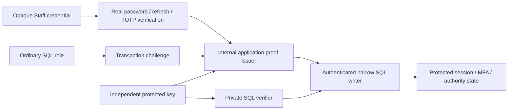

# Issue #416 Option A authentication provenance

Status: Proposed — Owner Approval Required.

## Executive verdict and baseline

OPTION A DESIGN BLOCKED — ADDITIONAL SECURITY DECISION REQUIRED.

Option A is the Owner-selected direction. This package specifies a candidate
protocol and the remaining contracts. It authorizes no implementation. U1 key
custody and U2 exhaustive typed writer/lock closure prevent implementation-ready
status. No new DEC is marked Accepted.

Main inspected is bfb4fdccf9d557c371313c9e357faa52e0a71014. Starting feature HEAD
is 350d88b090c9dbe1f8d7fa29d6390e28afa9ae19, clean at kickoff. Issue #416 remained
open with no comments. Existing shared contracts and audit migration 112 remain.
Applicable authority includes AGENTS.md, docs/00,06,08,13,17, canonical DEC-023/025,
and focused Accepted DEC-024/072/075/076/078/079/080/081. Source discovery and
review are distinct from executed authentication-provenance tests.

## Decision ledger

| Class | Proposition |
| --- | --- |
| LOCKED | Option A direction, design-only scope, opaque access/refresh contracts |
| LOCKED | Current role/tenant/entitlement and exact-session sensitive MFA |
| LOCKED | SQL runtime credentials or readable hashes cannot create issuer authority |
| LOCKED | DEC-025 ordinary credential and existing single application pool |
| DERIVED | All direct authority-establishing writes and weaker SQL entry points must migrate |
| PROPOSED | Per-command HMAC proof and transaction-bound one-use challenge |
| PROPOSED | Drained cutover with legacy-session revocation and reauthentication |
| UNRESOLVED U1 | Production proof-key custody, at-rest storage, provisioning and rotation ownership |
| UNRESOLVED U2 | Exhaustive typed command inventory, Organization/entitlement writers and lock migration |

No custody/Task/Dispatch transitions or Company-default/Location-override changes.

## Threat model and boundary

A anonymous, B Employee/Supervisor and C Location Manager retain their current
constraints. D genuine Admin needs current authority and recent MFA. E ordinary
runtime SQL and F DB-readable session IDs/hashes cannot author accepted sessions,
MFA or command proofs. G full app-host/signing-key compromise and H DBA compromise
are outside this guarantee. SQL-only denial of service is a residual risk.

The issuer has no public signing endpoint and accepts no arbitrary user/session
claims. SQL-only access cannot invoke app internals. Genuine proof derives from
accepted credential verification against state whose establishment and updates
are protected after the coordinated cutover. This is a proposed invariant that
future implementation tests must demonstrate.

## Current writer inventory

Paths are relative to apps/api/src/modules unless specified. Direct DML rights
are configured in packages/database/scripts/mfa-runtime-privileges.mjs. Existing
management/onboarding functions also have runtime EXECUTE grants.

| Writer / operation | Objects | Current rights | Authentication source | Protection / migration |
| --- | --- | --- | --- | --- |
| auth/staff-auth.service.ts login | sessions, refresh, User last_login | INSERT and narrow UPDATE | Argon2 then locked exact password-hash recheck | bind verified hash version and candidate verifiers to login command |
| same refresh | refresh consume/replace, session rotate/revoke | INSERT/UPDATE | raw refresh and current lineage | protected single-use rotation; retain consumed replay-family revocation |
| auth/staff-session-context.ts, staff-session-revalidation.ts | session/User | SELECT | opaque access verifier | admit only post-cutover protected state |
| auth/staff-auth-logout.ts, staff-session-revocation.ts | session and push | UPDATE | refresh / authorized cleanup | monotone revocation command; no clearing revoked_at |
| auth/mfa/mfa-enrollment.service.ts | factor activate, recovery insert, assurance | INSERT/UPDATE | pending exact session plus TOTP | protected enrollment and atomic step/assurance |
| auth/mfa/mfa-step-up.service.ts | factor step and assurance | UPDATE | genuine TOTP/exact session | atomic monotonic step and assurance command |
| auth/mfa/mfa-recovery.service.ts | code consume, factor replace, assurance | INSERT/UPDATE | factor/set/selector/verifier | protected consume/retire/reenrollment; no revival |
| auth/mfa/mfa-factor-repository.ts | pending/retired factors | INSERT/UPDATE | caller ceremony | protected lifecycle command |
| auth/mfa/mfa-assurance-policy.ts | admin activity | UPDATE | current management request | activity command cannot refresh MFA age |
| management staff role/status/access | memberships, grants, audit | existing runtime EXECUTE | actor supplied by guarded app | authenticated replacement of all authority-changing definers |
| management onboarding create/resend | User, membership, invite | existing runtime EXECUTE | actor and identity guard | authenticated onboarding; no weaker provisioning route |
| auth activation | User password/status and invite | runtime EXECUTE | genuine invite bearer | purpose-specific admission and immutable invitation binding |
| tools/security-disable and controlled MFA recovery | User/session/factor/push/audit | controlled operator | operator workflow | separate trusted operator boundary |
| Organization/entitlement writers | Organization, subscription/entitlement | scoped definers/operator | current management | U2 exact source/signature closure required before cutover |
| staff-push registration | registration/session binding | narrow INSERT/UPDATE | current Staff session | retain API, User-security fence and parent invalidation |

Current grants alone do not establish a completed account takeover. No exploit
reproduction is performed. The future reset SQL boundary does not exist yet.

## Proposed command protocol

Preserve opaque vsa1/vsr1 formats, accepted unkeyed verifier formats and one
ordinary pool. PROPOSED internal proof version vap1 uses an independent 256-bit
HMAC-SHA-256 key, distinct from MFA encryption/recovery keys and DB credentials.
No raw access, refresh, password or TOTP crosses the SQL boundary.

Canonical signed UTF-8 bytes are a fixed ordered JSON array with no optional
fields. Proposed fields are version, keyId, deploymentAudience, purpose,
operationId, challenge, backendPid, fullTransactionId, userId, sessionId,
organizationId, membershipId, priorSecurityVersion, payloadSha256, issuedAtMs,
expiresAtMs. Absent scope is JSON null, UUIDs lowercase canonical, times safe
integer UTC milliseconds. Closed purpose-specific payload schemas bind every
candidate verifier, target, expected version and generation. Exact payload schemas
are U2; a generic arbitrary-update envelope is prohibited.

Proposed TTL is 30 seconds with no grace, checked against database wall time.
Challenge creation binds a random 32-byte nonce to the current backend and full
transaction ID. Execute on that same connection/transaction, verify MAC and exact
payload digest, consume challenge and record private immutable operation receipt
atomically with mutation/audit. Foreign backend/transaction cannot use a leaked
proof. A copied proof cannot authorize a changed operation. Receipts contain no
bearer, verifier, MAC or reconstructible credential. Nonce cleanup is bounded;
retention and abandoned-transaction recovery remain part of U2 acceptance.

SQL owner is a dedicated NOLOGIN security owner; search_path is fixed to
pg_catalog,public. PUBLIC execution is denied. Runtime receives only specific
command EXECUTE, with no private key/receipt/verifier helper access.

| Proposed function family | Caller and effects |
| --- | --- |
| auth_command_challenge(text,uuid) returns jsonb | runtime, purpose/operation-bound current-transaction challenge |
| auth_login_commit(jsonb,jsonb) returns jsonb | proof plus strict payload, create session/first refresh and login timestamp |
| auth_refresh_rotate(jsonb,jsonb) returns jsonb | consume/rotate lineage or commit accepted replay revocation |
| auth_session_revoke(jsonb,jsonb) returns jsonb | monotone session and push terminalization |
| auth_factor_enroll / activate / retire(jsonb,jsonb) returns jsonb | separate commands, protected factor lifecycle |
| auth_mfa_step_up / recover / reissue(jsonb,jsonb) returns jsonb | separate commands, factor/code/assurance/audit atomicity |
| auth_admin_activity(jsonb,jsonb) returns jsonb | bounded activity only |
| authenticated management/onboarding/activation replacements | exact command-specific effects, signatures/payloads in U2 |
| future reset status/issue/redeem | private verification plus Issue416 exact authorized effects |

Slash names describe separate proposed functions. They are not executable SQL.
Remove direct session/refresh/factor/code INSERT/UPDATE only once all legitimate
consumers migrate. Review retained cleanup rights for monotonicity. Password writes
remain denied. Preserve operational reads, limiter and approved push behavior.
Migration/provisioning/verifiers must change together so old provisioning cannot
restore grants. Old unproved definer signatures lose EXECUTE. Audit migration112
remains intact; private reset commands append derived actors atomically later.

## Signing oracle prevention

Login signs only after real Argon2 success, binding the verified password version
that SQL rechecks under lock. Refresh signs only authenticated protected lineage;
SQL consumes it under lock. MFA signs only a verified protected factor/pending
session/step or recovery generation, then SQL atomically consumes and updates.
No MFA proof is minted through VAYLET_LOCAL_DISABLE_MFA bypass. A signed mutable
snapshot alone never establishes trust. Access verification can safely consume
existing opaque verifiers only after every weaker authority writer is closed.

Cutover must include onboarding, activation, role/status/access, factor lifecycle
and Organization/entitlement writers. Legacy session/MFA timestamps are never
accepted as evidence they did not establish. Pre-cutover factors require a
separate provenance/rotation policy under U2 if previous SQL capabilities could
have established them. A new password login alone cannot cure untrusted policy.

## Key custody and confidentiality U1

An app startup secret and private SQL verification secret are required. A private
SQL table enforces ACL separation but does not prove at-rest/backup security.
No secret may appear in function source, migration literals, GUCs or runtime-
readable helpers. The repository supplies no complete command-key delivery and
rotation contract. Recommend approved encrypted-at-rest verifier storage and
protected app-secret injection with named operator ownership. U1 must select the
actual mechanism, provisioning/backup access and retirement procedure before code.
An asymmetric verifier requires separately approved PostgreSQL support; built-in
pgcrypto signature support must not be assumed.

Proposed key states are ACTIVE_SIGNING, VERIFY_ONLY and RETIRED. New challenges
use the active key; verification overlap is at most the 30-second command TTL.
Retirement invalidates outstanding proof immediately while receipts remain.
Outage fails closed with infrastructure errors, never fabricated bad credentials.

Proofs and candidate hashes remain sensitive until consumed/expired. No reusable
credential enters SQL. Connection/transaction binding limits proof-log replay but
is not permission to log it. PostgreSQL/driver/proxy/tracing/error/metrics and
credential-shaped request IDs require canary validation. Previous local exposure
tests do not attest deployment secrecy. Production controls remain a release gate.

## Concurrency and retry matrix

| Operation | Current lock sequence | Required closure |
| --- | --- | --- |
| Login/refresh | User-security advisory before User/session/refresh rows | exact password/lineage fences, one rotation winner |
| MFA | session/User rows before mfa-user advisory, then factor | reconcile row-first with User-security order under U2 |
| Logout | refresh/session rows, then push | reconcile with advisory-first disable/refresh |
| Controlled disable | User-security, User, sessions, push | no stale authority after committed disable |
| Push | User-security, session, sorted registration keys | no active binding after reset revocation |
| Management | API assurance locks session/User before org advisory; nested/direct SQL has its own membership/factor prefix | enumerate API and SQL-only entrypoints separately |
| Onboarding | email, sorted User-security, org, membership/User/invite | maintain identity and membership serialization |
| Reset | email, sorted Users, MFA session/User, org, remaining rows | preserve Issue416 normalized order and current authority |

All commands require six outcomes. First execution verifies proof/current facts,
locks, mutates/audits/receipts and commits. Identical retry uses fresh proof and
compares immutable fingerprint before CAS. Concurrent identical calls serialize
at receipt identity. Changed payload conflicts without mutation. Post-success
retry reauthorizes. Unknown commit reconciles receipt without inventing a new
operation or redisclosing secrets. Refresh retains its accepted consumed-replay
family-revocation exception. Reset issue retries remain linkless; redeem replay
remains generically invalid. Same-session pending MFA enrollment retains its accepted seed retrieval; foreign sessions cannot retrieve it. Recovery-code reissue and replacement credentials remain governed by their existing single-disclosure contracts. No receipt stores raw secrets. No new public HTTP error contract is accepted here.

U2 must supply each transaction A/B lock graph, commit/rollback/disconnect branch
and SQLSTATE mapping for every listed pair. This matrix identifies current
inversions; it does not claim deadlock freedom.

## Legacy, rollout and rollback

PROPOSED drained coordinated cutover. Stop auth/security traffic, drain transactions,
install proof-aware code disabled, provision keys, apply additive private schema/
functions, migrate all consumers and atomically remove weaker grants/EXECUTE.
Revoke all legacy sessions and disable/clear their push endpoints. Preserve MFA
factors/codes only under the separately approved provenance policy. Genuine password
and MFA establish protected authority. Mixed old/new writers are prohibited.
Startup verifies effective ACLs/key readiness before protected traffic resumes.

Rollback targets the last proof-capable version with reset disabled. Never restore
unsafe grants or retired keys. If no compatible version exists, retain secure
outage and fix forward. No historical receipt/security event is deleted.

## Future reset consumer and implementation dependencies

Reset consumes the exact current session, operation/target/generation proof. SQL
rechecks ACTIVE issuer User/ORG_ADMIN, Organization, entitlement, target ownership,
sole-company eligibility and five-minute MFA under canonical locks. Redemption is
anonymous and remains atomic across password/reset/session/refresh/push/audit.
No reset APIs, SQL operations or UI are implemented in this phase.

Dependency order is U1/U2 approval -> typed proof/command contract -> private
schema/verifier -> auth writers and callers -> upstream authority closure -> ACL
cutover -> PG/application race/secrecy proof -> independent review -> reset work.
Prime owns docs/shared registrations; sole DB owner owns migrations/provisioning;
auth owner owns auth/session/MFA; management owner owns authority/onboarding;
QA owns database/API test files; UI/browser ownership is deferred. Use isolated
worktrees and <=300-line focused code. Exact new command filenames depend on U2.

## Future executable acceptance specification

All following tests are NOT RUN. Use existing PostgreSQL provision and API
projects on identity-attested disposable PG17, loopback/tmpfs and exclusive harness
leases. Do not bypass private-lane preflights. Fixture creates synthetic roles,
Users/Admin/LM/Employee, policy and isolated keys, then establishes authority
through real password/refresh/TOTP flows. Owner seeding is never ceremony proof.

| Area | Required assertion |
| --- | --- |
| SQL role and hashes | migrated direct writes/private access denied; unsupported session facts cannot establish issuer |
| MFA | exact genuine session/ceremony, monotonic TOTP/code; bypass cannot sign |
| Login/refresh | actual password fence and protected lineage, accepted replay revocation |
| Logout/disable/demotion | subsequent proof rejected, including after competing transaction commit |
| Tenant | unrelated organization or target denied without mutation/disclosure |
| Proof replay | once per transaction, foreign backend/transaction and changed payload denied |
| Rotation/legacy | retired keys/old sessions cannot revive authority; genuine approved enrollment works |
| Concurrent refresh | one accepted winner with current replay-family semantics |
| Security races | login/refresh, MFA/logout, disable/verify, role/session, push/reset with commit/rollback/unknown outcome |
| Secrecy | no reusable credential/proof/candidate verifier in SQL/app/driver/proxy/audit sinks |
| Audit | exact authoritative issuer USER and redemption ANONYMOUS, atomic rollback |
| Compatibility/rollback | Web/native contracts and push survive; old versions/provisioners cannot restore weak writes |

Proposed test files belong under packages/database/src/issue416-auth-*.integration.test.ts
and apps/api/test/issue416-auth-*.integration.test.ts, each focused and <=300 lines.
Ordinary denied writes assert unchanged state and safe errors; accepted consumed-refresh replay must commit family revocation while returning failure. Private
key/receipt/function ACL and overloaded-signature negatives are mandatory. These
are acceptance requirements, not executed proof or current implementation.

## Reviews, residual decisions and readiness

Independent reviews live in issue-416-option-a-review-auth.md,
issue-416-option-a-review-sql.md and issue-416-option-a-review-ops.md. Reviewer
findings must retain severity, evidence, correction and future acceptance tests.
U1 and U2 remain blocking contracts, even if the candidate direction is defensible.
The next implementation phase cannot begin without further architecture closure.
Owner approval must address concrete custody, factor provenance, payload/writer
coverage and lock/cutover details. Option A selection is retained throughout.

## Repository planning gate index

### Repository facts discovered

The inventory and concurrency matrix above identify concrete source writers and
incompatible existing lock orders. Runtime proof remains unexecuted.

### Binding requirements

The decision ledger preserves Accepted credential, MFA, tenant and pool contracts.

### Existing implementation patterns

Application Argon2/TOTP verification precedes transaction-owned persisted rechecks;
scoped SQL definers and runtime provisioning already exist. The proposed MAC
boundary adds new custody and cannot inherit approval from those conventions.

### Locked decisions

Option A direction and design-only authorization are Owner instructions. Existing
credential and MFA lifecycles remain binding.

### Derived conclusions

Sensitive direct writes and weaker upstream entry points require one coordinated
migration. Reprovisioning and startup checks must enforce the same final ACLs.

### Unresolved decisions

U1 requires an approved actual custody mechanism. U2 requires typed command and
writer closure, legacy-factor bootstrap and complete lock/retry/disclosure tables.
Recommendations are encrypted verifier custody and a drained cutover; they are
not adopted policy. A named operator and recovery procedure remain unspecified.

### Risks / boundary violations

A weak signer, untrusted legacy factor, old provisioner, log exposure or lock
inversion defeats the candidate design. All are blocking acceptance dependencies.

### Proposed implementation plan

Follow the dependency graph only after U1/U2 and independent review closure.

### Test matrix

The future executable acceptance specification is entirely NOT RUN.

### Files expected to change

Definitely relevant families are the inventory's auth/MFA/management sources,
provision-runtime-role.mjs, MFA/runtime privilege verification, and new additive
SQL migrations. Exact new command/payload files are conditional on U2. No source
file changes are authorized in this phase.

### Explicitly out of scope

Authentication implementation, grants, migrations, reset API/UI, PR, merge,
QA/production deployment, activation and issue closure.

### Ready-to-implement verdict

DECISION REQUIRED. Owner direction approval alone does not close U1/U2. The
implementation phase cannot begin without further detailed architecture closure.

SQL must recheck proof expiry and current authority after waits, before mutation.
Receipt and domain-lock ordering require a single reviewed graph under both
READ COMMITTED and existing REPEATABLE READ consumers. No deadlock proof is claimed.

## Review dispositions and remaining decision register

AUTH-04 is corrected above for same-session pending MFA seed retrieval and
accepted refresh failure-with-revocation. SQL expiry and receipt/domain-lock
requirements are incorporated as U2 acceptance conditions. O-01 corrects the
management row to distinguish API assurance locks from SQL-only entrypoints.
O-02 extends U2 to an explicit legacy trust inventory for User/password,
memberships/roles/grants, Organizations, entitlements, factors and recovery
sets. Each class needs an approved retained trust source, controlled validation
or replacement ceremony, and behavior when provenance is unavailable. Forced
login cannot prove prior policy or factor establishment; no history rewrite.

Remaining BLOCKER AUTH-01/U1 requires an actual secret-delivery and SQL verifier
at-rest/backup contract. Recommend a separately approved encrypted verifier
store with named operators and incident retirement, subject to deployment
capabilities. Current Accepted Decisions do not select that operating boundary.

Remaining BLOCKER AUTH-02/U2 and AUTH-03/U2 require exact per-command typed
ceremony/payload contracts and an approved legacy authority/factor bootstrap.
SQL-01..04 remain MAJOR closure requirements for ACL/provisioner parity, upstream
command signatures, custody and the complete lock graph. Recommend controlled
baseline validation/recovery for objects without trusted provenance, with
explicit Owner authorization for operational impact.

The 30-second proof TTL never extends current pool statement/lock/idle/transaction
budgets. Challenge cleanup, key admission versus in-flight retirement, replica
refresh and unknown-commit recovery need exact U2 linearization rules. The
direction is defensible; implementation still requires additional architecture
closure and independent review. All three reviews are source-only and do not
approve a completed cryptographic or PostgreSQL runtime boundary.
