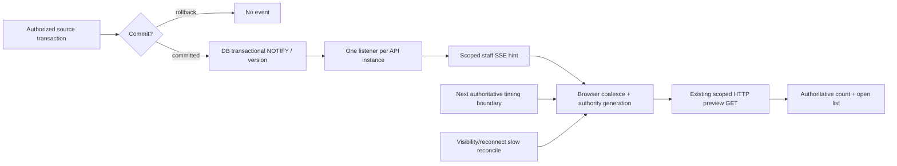
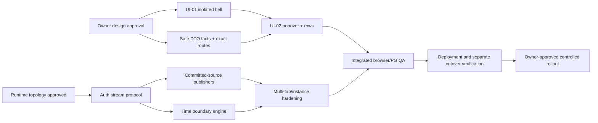

# Issue #432 — Management Alerts Master Implementation Plan

**Final native-browser zoom verification (2026-11-12, after the earlier diagnostic): PASS for the exercised Variant A / EN / Light viewport.** Chrome for Testing exposed its actual UI control `Zoom: 200%` after five native Ctrl++ presses. With fixed outer window 1296x808, the CSS viewport became 640x360, devicePixelRatio 2 and visualViewport 640x360 at scale 1; the same window at Ctrl+0 was CSS 1280x720, DPR 1. The actual alerts panel was x=102.797..518.797, y=61.5..320.5; its footer y=290.609..319.5 remained within the 640x360 viewport, with document/body scrollWidth 640 and scrollable alert feed (1173/145). Evidence: `qa-artifacts/real-dashboard/variant-a-en-light-640x360-state-actual-desktop-zoom200.png`. Worker1 and Prime verified the native Chrome zoom UI; this is **not** CDP `Emulation.setPageScaleFactor(2)`. Other locale/variant/viewport combinations, physical touch, screen readers and direct Owner-reference parity are not covered by this single check. The optional diagnostic Playwright debug run was deliberately canceled after gathering zoom evidence; the separate full four-spec passing suite is the acceptance run.

**Plan version:** design/prototype review, 2026-11-12
**Base:** `a9c1c06c6632ac9d8f61a7fc8f8f0e87ba207bca` (`origin/main` verified, not a deployed-SHA claim)
**Owner authority:** [#432](https://github.com/yamanradwan1-rgb/valet-platform/issues/432), 2026-11-06 Owner Addendum; [#414](https://github.com/yamanradwan1-rgb/valet-platform/issues/414), Accepted DEC-109/110/111; DEC-107 remains Proposed.
**State:** PROPOSED plan for explicit Owner approval; **NO PRODUCTION IMPLEMENTATION AUTHORIZED BY THIS PACKAGE**.

## 1. Executive summary and intended outcome

The Management Dashboard currently has source-backed Important/Critical alerts behind disabled Phase1/Phase23 gates, an existing 44×44 outlined `management-alert-bell`, a centered `FocusDialog` containing technical copy, and foreground 60-second polling. The integrated prototype uses the real Dashboard route and shell. The latest owner handoff requires a **prototype-only borderless UI-01 bell**, retaining the 44×44 target, 18px glyph, count treatment and original topbar slot; the production control/default path stays unchanged. UI-02's local synthetic destination is implemented: an in-memory ALT-08 fixture uses source ID `SIM-INC-1042`, target ID `SIM-TARGET-INCIDENT-1042`, a `No production record` preview and distinct available/unavailable/missing/unauthorized states. Production exact-source navigation remains a separate gap. Future production implementation must add event-driven invalidation plus authoritative timed-boundary refresh so newly eligible, changed, Seen and retired alerts update both count and open list without manual refresh.

Target outcomes: rapidly scan severity, Location and action; demonstrate the row-to-destination interaction with clearly synthetic local data; reserve real source navigation for a separately authorized exact-source implementation; explicit Seen only for eligible committed occurrences; healthy QA committed-event-to-visible-change latency **<=3 seconds where applicable**; safe denial and degraded-state behavior. No false count zero on unknown network state. Keep **Variant A and Variant B** available for comparison. The available history does not establish which variant the Owner selected, so neither is treated as selected or approved.

**Current baseline:** PR #430 Phase1 merged at `5a844f70`; #431 Phase23 merged at `ac758fff`; main verified at `a9c1c06c`. PR #431 final head `06753555...` has no Actions runs; merge CI failed at the PG `api-standard` harness pool limit and merge Security CI passed. These merges are evidence of source presence, **not** of deployed runtime, migrations, source cutovers, production flags, live stream or final acceptance.

**Non-goals:** production alert behavior, new alert categories, ALT-14, regular restricted Dashboard bell for ALT-17, #415 Live Operations refresh, browser push/audio/Email/SMS/WhatsApp, source-domain commands, speculative Redis/Kafka, unrelated shell/layout/navigation/theming or other applications. The prototype branch contains a DEV-only route/control pass-through and a production null-stub alias; the synthetic destination is a local UI demonstration only and does not implement production source navigation, Seen persistence or live alert delivery.

**Current local validation checkpoint (separate from production readiness):** Worker2 completed the final actual-route **four-spec Playwright headless 8/8 PASS (50.8s, exit 0)** and **headed/debug 8/8 PASS (7m, exit 0)** with authenticated manual bell review and Demo controls hidden in Owner-facing screenshots. Currently **56 PNGs** exist (40 Variant A including native Chrome 200% zoom evidence, 15 Variant B, 1 baseline). Prime's integrated rerun passed Dashboard typecheck, full lint, Vitest **194 files / 1246 tests**, `architecture:check` exit 0 with grandfathered warnings, configured Next16 production build using `API_ORIGIN=http://127.0.0.1:3001`, zero targeted prototype markers across the fresh static/server/standalone bundles, and `git diff --check`. The initial no-env build failed the required config check as expected. **Actual desktop Chrome 200% zoom PASSED for A/EN/light at 640x360; untested combinations remain NOT VERIFIED**; 2× page-scale is different. Owner A/B choice and direct pixel parity remain pending. **Blockers before production launch:** Owner UX/architecture approval and verified topology, source-safe DTO and exact by-ID navigation, committed-event distribution, PG17/mounted bearer/stream/real-browser scale and security evidence, deployed SHAs/grants/migrations, separately authorized post-lock cutovers and activation approval.

## 2. Authority and source-truth reconciliation

| Authority / source | Contract | Actionable state |
| --- | --- | --- |
| #432 Owner Addendum and latest handoff | UI-01 prototype-only borderless bell; UI-02 safe local synthetic destination demo; RT-01 automatically refreshed from committed truth | Reuse the real Dashboard shell and slot. Borderless treatment and synthetic destination are prototype-only; no production route/API or activation is authorized. |
| #414 | Exactly 17 selected, 16 source paths, ALT-14 disabled; no #415 expansion | Preserve current category contract |
| DEC-109 **Accepted** | Six per-user strict `>` delay policies; fold ALT02/03, source authorization before counting, CA/LM exact Location | Do not re-approve values or reinterpret timing |
| DEC-110 **Accepted** | ACTIVE vs OCCURRENCE, committed provenance, seven-day attention, explicit per-user Seen, stable sources | Never auto-Seen on open/navigation; no guess for absent event chronology |
| DEC-111 **Accepted** | Narrow finance/Shift/Staff read; no payment mutation; ALT15/17 CA-only, restricted subscription recovery | Existing real source permissions are authoritative |
| DEC-107 standalone **Proposed** | #352 accepted owner behavior exists but focused decision has proposed status | Avoid importing a proposed policy as newly accepted |
| `packages/contracts/src/management-alert-preview.ts` | Stable Phase1 strict DTO; capped count20/hasMore | Add compatible new version/optional projection after source proof |
| `management-alert-unified-preview.ts` | 16 mapped categories, disjoint ACTIVE/OCCURRENCE, strict DTO and Seen response | Descriptive safe projection and record destination contract are missing |
| `management-alert-preview.controller.ts` | Bearer Staff session, no-store, versioned Preview/Detail/Seen behind default-OFF gates | Preserve route semantics; add only separately flagged stream and DTO paths |
| `alert-poll-owner.ts`, `management-alerts-control.tsx` | 60s foreground poll, current modal, count and lease/scope protection | Replace *alert-only* UI, keep secure current-authority fencing |
| `docs/evidence/issue-414-phase1/INTEGRATION_LEDGER.md`, `issue-414-phase23/INTEGRATION_LEDGER.md` | Chronological, often older tests and explicit missing PG proof | PR #431 final head `06753555...` has no Actions runs; merge `ac758fff...` has Security CI pass and CI fail due ALT-04 PG test-harness `poolCount=2` during fixture construction. Treat the test as inconclusive and require a clean rerun on the intended final SHA |

Read [CURRENT_STATE_AND_GAP_ANALYSIS.md](CURRENT_STATE_AND_GAP_ANALYSIS.md), [EVIDENCE_AND_VALIDATION_LEDGER.md](EVIDENCE_AND_VALIDATION_LEDGER.md) and [INDEPENDENT_REVIEW_FINDINGS.md](INDEPENDENT_REVIEW_FINDINGS.md). All design/architecture recommendations in this document remain **Proposed**, even if their surrounding product requirements are Accepted.

## 3. UX specification and visual freeze

The only future production UI surfaces authorized by this design are the alert-control slot, count, dropdown/list and narrowly scoped exact-source navigation. Existing locale/theme/account controls, shell geometry, sidebar, Live Operations lists, Policies Studio, operational pages and other products remain visually frozen except approved exact-record highlighting. The prototype runs on `/policies?section=operations&prototype=alerts&variant=a|b` through the actual `ProtectedDashboardRoute → ManagementFoundationApp → SelectedManagementShell → DashboardShell/Topbar/Sidebar → PoliciesStudioPage` chain. Its optional `alertsControlOverride` falls back to the original `ManagementAlertsControl` unchanged when absent. The only intentional alert-control design exceptions in the prototype are the borderless bell and local synthetic destination view; they do not change the production control or route. The route gate activates only when `NODE_ENV !== production`; webpack/Turbopack resolve the prototype import to a null stub in production.

**Bell:** the prototype-only UI-01 treatment is borderless, with transparent resting background, a 44×44 CSS-pixel target, 18px glyph, the existing count treatment and the exact Dashboard topbar slot. Keep a visible `:focus-visible` ring, hover/active state and accessible name conveying count availability. The original outlined production bell remains the default when the prototype override is absent. Badge for 0/1/digits/20+ when source-authoritative; dash/unavailable when count unknown. Pointer-open arms one forward-Tab entry; the first Tab enters the panel once. Shift+Tab from the first panel control returns to the bell while the panel stays open; the next forward Tab exits and closes. Focus leaving both anchor and panel closes without stealing focus from the outside target; Escape/Close restore the bell.

**Panel:** non-modal popover anchored at bell's trailing edge and beneath it, mirrored RTL, viewport-edge collision handling, width bounded by ~26rem and available viewport, max-height bounded by viewport and scrollable internal list; no centered dialog/backdrop or focus trap. Label via heading, `aria-expanded` and `aria-controls` on bell; use region/list + normal buttons/links, **not role=menu**. Tab order predictable, arrow navigation optional only if implemented deliberately. At 320px and native Chrome 200% zoom (verified A/EN/light 640x360) no clipping or horizontal scroll; the A/EN/light 640x360 native Chrome case also has focused headed evidence.

**Rows:** severity and localized title, one or two **persisted-fact** description lines, safe Location/context, correct source-authoritative time or explicit unknown time. In the prototype, row activation opens a clearly labelled, in-memory synthetic destination view built only from fixture data and the fixed synthetic fragment `#SIM-TARGET-INCIDENT-1042`; source ID is `SIM-INC-1042`, target ID is `SIM-TARGET-INCIDENT-1042`, and the preview states `No production record`. Only the available state is a link; `unavailable`, `missing` and `unauthorized` are distinct status states. The fragment may restore the demo on reload/new tab/Back/Forward, but must not change the production pathname/query, call an API or claim to open a real record. Production rows require exact source selection, source re-read and independent by-ID target reauthorization; until those are proven, the production affordance remains unavailable. Keep an independent Seen button for OCCURRENCE only; Seen never navigates. Body click never marks Seen. Source missing/revoked/denied is nondisclosing with a recoverable explanation and no stale destination detail.

**List state:** ready populated/empty, loading, delayed, network error, disconnected/reconnecting, unauthorized/revoked, unknown count, 20+ overflow, resolving/withdrawn source, explicit Seen pending/succeeded/failed/unknown commit. Preserve last confirmed count with stale/unavailable indication while retrying; only the server can confirm a new zero.

**Localization:** EN/AR with natural readable copy, RTL anchoring, number/bidirectional isolation, long Arabic overflow wrap, `lang`/dir and local time presentation only where authoritative. Two **unselected prototype candidates** remain, A compact and B balanced. Comparison scorecards: fidelity, 1-second scan, severity hierarchy, Location context, touch and keyboard, Arabic readability, 320px/200%, maintenance.

Sources: [PROTOTYPE_VISUAL_SPEC.md](PROTOTYPE_VISUAL_SPEC.md), [ACCESSIBILITY_AND_INTERACTION_SPEC.md](ACCESSIBILITY_AND_INTERACTION_SPEC.md), [OWNER_DESIGN_APPROVAL_PACKET.md](OWNER_DESIGN_APPROVAL_PACKET.md). Original Owner screenshot unavailable for direct pixel comparison; cannot claim exact screenshot parity.

## 4. Minimum maintainable production component architecture

Target feature tree (names illustrative; **proposed**, adjust after current source diff review):

```text
DashboardTopbar (existing: unchanged layout)
└── ManagementAlertsControl (existing alert-owned integration)
    ├── ManagementAlertBell (new, bell + accessible count + trigger)
    ├── ManagementAlertPopover (new, anchor/viewport/focus/close)
    │   ├── ManagementAlertPanelState (new, error/loading/empty/overflow)
    │   └── ManagementAlertRow (new, direct source link + separate Seen)
    └── useManagementAlertFeed (new)
        ├── existing AlertPollOwner / readWithAlertTransportLease (reuse safeguards)
        ├── versioned Preview client (existing authoritative source)
        ├── invalidation stream adapter (new, transport-only)
        ├── timing boundary scheduler (new, authoritative refresh)
        └── source/Seen actions (existing, refine navigation only)
```

Do not duplicate authenticated API clients or staff sessions. The feature-local hook owns transient state, in-flight request generation and coalescing. The backend owns eligibility, source timestamps and Seen decisions. Use existing `--muted`, `--surface`, `--surface-soft`, `--text`, `--border`, `--accent`, `--focus`, `--danger` tokens; no cross-app CSS cascade modifications. Every new code file <=300 physical lines; split by state, presentation, source and transport concerns. No new UI framework.

## 5. Category content and exact destination contract

See the authoritative [ALERT_CATEGORY_CONTENT_MATRIX.md](ALERT_CATEGORY_CONTENT_MATRIX.md) for ALT-01 through ALT-17, severity, source key, time, Seen and retirement; and [API_DTO_AND_DEEP_LINK_PLAN.md](API_DTO_AND_DEEP_LINK_PLAN.md) for field evidence and navigation.

Mandatory taxonomy: ALT01/02/03/04/06/08/10/11/12/16/17 are **ACTIVE** (no Seen); ALT05/07/09/13/15 are **OCCURRENCE** (Seen only when committed, authorized and within seven days); ALT14 is deferred. ALT17 belongs to a CA-only authorized restricted subscription utility and **must not** appear as a normal Dashboard bell item. ALT02/03 fold into one uncovered-task case before the count. Incident ALT08 must describe only source-backed severity/open state/Location; no guessed type, vehicle, identity or timestamp.

For each source, a reviewed destination registry must map category + source kind to an existing route and **actual exact record selection contract**; UI route assembly cannot depend on unknown pages or the user's list position. If absent, scope a narrowly authorized destination and block that category's one-click acceptance until verified. Every click performs fresh source authorization; a preview is not access to the destination.

## 6. API and DTO design — versioned, privacy minimal

Retain old `GET .../preview` schema and behavior. Continue using versioned `GET .../preview-unified` for Phase23. Consider **a separately versioned additive descriptive projection** with the same proposed field names as [API_DTO_AND_DEEP_LINK_PLAN.md](API_DTO_AND_DEEP_LINK_PLAN.md): closed `titleKey`, `summaryKey` and bounded allowlisted `safeFacts`, plus optional safe selected-Location display label and source-authoritative nullable `occurredAt`. Do not invent a new `displayTime` with ambiguous semantics, arbitrary text/HTML, raw source rows, or unproven descriptions. Do not silently add unknown keys to strict current schemas or require new fields from legacy clients. Only add fields for facts demonstrably derived under existing current source authority; otherwise use a generic but truthful category/status explanation.

**Production exact-source navigation and ALT-15 normal-bell scope require distinct, separately versioned contracts.** The proposed `GET /v2/staff/dashboard/locations/:locationId/alerts/:category/:sourceId/display?episodeId=:episodeId` applies only to Location-scoped categories and remains Proposed until route conventions and implementation are approved. ALT-15 has `locationId:null` and is Organization-scoped; it cannot be routed through a selected-Location path or authorized by a selected-Location grant. Its normal preview, Seen and exact-display contracts must use Organization-scoped selectors/reads that reauthorize the current Company Admin membership and owning Organization independently of selected Location. The proposed combined normal preview may accept an optional untrusted `locationId` for Location categories, but ALT-15 authorization must not depend on it. All forms accept typed category/source/episode hints as untrusted input and return a closed `routeKey`, `targetKind`, and either a proven `targetRecordId` or narrowed `sourceContext`; otherwise return `UNAVAILABLE/NO_SAFE_EXACT_DESTINATION`. A destination selector is an opaque locator, never an access capability; the destination page must independently authorize it. The current strict unified exact response `{item,valetSessionId}` is frequently `valetSessionId:null` for Phase23, so it does not establish a Task/Incident/Payment/Event deep link by itself. Where an exact source→destination mapping or safe by-ID view does not exist, block that category's production direct-navigation claim and return a nondisclosing unavailable state. A guarded exact-display read may precede navigation; it must never automatically mark Seen.

Controller parses and validates bounded request selectors, derives User/Organization/Location from persisted Staff session, rejects unsupported categories, sets `Cache-Control: no-store`, rechecks source and entitlement. Exact source/read endpoint responds with nondisclosing 403/404-style product error according to accepted API contract; stale/deleted/revoked destination never reveals existence through timing or id error. Null source time stays null; the browser does not invent `occurredAt`. Change DTO routing only after catalog review, with compatibility tests on both Phase1 and Phase23 OFF/ON; keep episode/source IDs internal to request construction, not user-facing titles.

Seen continues only as explicit `PUT .../sources-unified/:category/:sourceId/seen` with a typed episode ID, one protected commit, idempotent retries and source reauthorization. A failed/unknown response must not optimistically remove the occurrence; reconcile with GET and retry only when exact user action is still authorized.

## 7. RT-01 — recommended bounded invalidation architecture (Proposed)

**Conditional recommendation:** authenticated **fetch-based SSE** with `Authorization` header from the existing in-memory Staff session, short lived scoped subscriptions, minimal invalidation messages, and **PostgreSQL transaction-bound NOTIFY** through one dedicated listener per API instance *if* actual deployment topology, proxy buffering/timeouts and pool budget support it. Do not use native `EventSource` if it requires bearer tokens in URLs. Do not add Redis/Kafka/managed bus by assumption. WebSockets have greater bidirectional session/lifecycle complexity with no required duplex command; retain as conditional fallback only if infrastructure makes SSE unviable. A bounded long-poll invalidation cursor is a second fallback if streaming is blocked, but 1-second/2-second per-tab SQL polling is rejected.



Only `{type: 'invalidate', scopeVersion, sequenceHint?}` with no PII, raw alert or source identifiers enters the browser transport; tokens remain in headers, never a stream URL. Source writers publish transaction-coupled invalidation only on *eligible-impacting committed changes*, including terminal retirement, explicit own-user Seen receipts and own-user timing-preference changes. A Seen receipt invalidates all active devices for the same `(Organization, User)` only; a timing-preference revision has the same owner scope. Source-condition invalidation follows its Location or Organization source scope. PostgreSQL NOTIFY has no durable replay guarantee; a gap/reconnect/focus/revocation always triggers a fresh scoped HTTP preview. If a committed source change lacks an authoritative publisher, completeness is **not achieved**: inventory every Task, Session, Incident, Shift, audit, payment, tracking, policy, Seen and preference writer before claiming RT-01 PASS. **ALT-15 CA-only Organization-level staff events must invalidate authorized Company Admin bells regardless of selected Location; ALT-17 stays in the restricted subscription utility and must not enter ordinary bell fan-out.** Ensure transaction rollback produces no delivered alert.

The client opens at most one owned stream per active foreground source scope/session; Location-scoped categories use the selected Location, while ALT-15 uses the owning Organization independently of selected Location. Already-open list and bell both derive from the same validated preview. Use cross-tab BroadcastChannel hints only as best-effort same-browser invalidation; they cannot satisfy cross-device Seen/preference convergence. Every tab/device reauthorizes its own HTTP reads and no shared data grants access. Coalesce bursts with bounded debounce/single-flight and maximum trailing refresh delay compatible with the 3s QA target; preserve a slower (e.g. existing 60s) safety reconciliation if telemetry justifies it. Streams close on logout, definitive 401/403, identity/session/scope-generation change, entitlement loss, revocation or offline; on A→B→A, monotonic epoch prevents replay into the original scope. Reconnection uses capped exponential backoff + jitter, visibility and online wakeup, and a full GET before state is treated as current.

**Time-driven no-write eligibility and retirement:** backend preview must return a safe next-boundary hint for each current authorized timing candidate or a compact earliest change clock, derived **under server authority and per-user preference revision**. Browser schedules one bounded timer; when reached it invokes scoped GET and re-arms from server result. If no candidate hint can be exposed without leaking suppressed cases, use a bounded server-side timing/invalidating scheduler with a demonstrably safe budget. Use authoritative server time/clock skew handling and strict `now > threshold` semantics for delay eligibility; test equality and missed boundaries after sleep. Sending committed-event hints alone cannot satisfy ALT01/02/03/04/06/11 becoming eligible. **ALT-12 Presence Exceptions can cease being reviewable as their persisted expiry passes with no write**, and all five OCCURRENCE families age out of the seven-day attention window; these no-write retirements also need next-boundary refresh, with exact source-defined cutoff inequalities verified in PG17.

**API infrastructure decision gate:** verify actual API scale (instance count and connection budget), ingress and proxy streaming/cache behavior, authenticated header forwarding, termination/rolling deploy strategy, pg_listen adapter lifecycle and DB role grants; benchmark before accepting NOTIFY. Assign one listener connection per API instance rather than one per browser, bound active streams per authenticated actor/tenant and enforce heartbeat, buffer/backpressure limits, server-side inactivity timeout and metrics.

See [REALTIME_ARCHITECTURE_DECISION.md](REALTIME_ARCHITECTURE_DECISION.md) for transport matrix, sequence/failure examples and implementation approval criteria.

## 8. Authorization, privacy, revocation and scope fencing

The full trust boundary on **every** Preview, Detail, Seen and stream/open/reconnect is source-scope-specific: persisted Staff identity + current session/generation; owning Organization membership; and, for Location-scoped categories, the selected active Location and exact grant; current CA/LM role and source-specific read; MFA assurance rules; effective commercial entitlement; per-user preferences revision; currently valid source/episode. **ALT-15 is Organization-scoped and CA-only; its normal-bell preview, exact read and Seen path must work independently of any selected Location and must reauthorize the active Company Admin membership and owning Organization directly.** A selected Location is never authority for ALT-15. Client-provided IDs are untrusted hints. CA reads remain MFA-neutral for non-sensitive polling (do not extend CA idle assurance); preference writes and other sensitive CA actions use approved freshness.

ALT05/07/09/13/15's source-specific permissions cannot be inferred from the Dashboard grant, and ALT15 stays CA-only under its independent Organization scope. For ALT-13, an LM needs a current exact active Location grant plus actual source-specific Shift/Location read authority; its Seen transaction must reauthorize the source, role, grant and the MFA assurance required by the existing DEC-110/111 contract. Do not invent an additional LM TOTP requirement. Location grant alone is not finance, sensitive Audit or GPS authority. ALT17 is only in the restricted CA subscription utility and must be rejected at every generic ordinary-bell schema, decoder, correlator and fan-out boundary. Count is computed only from authorized candidates, with Seen anti-join before the source LIMIT21. Scope change, logout, role edit and revocation invalidate feed state **synchronously**, abort pending network requests and fence late completions using a generation key. For A→B→A require a new generation even when location string repeats. Seen and preference invalidation must reach all active devices for the same `(Organization, User)`; BroadcastChannel is only best-effort same-browser assistance. Never send organization-wide global payloads to all subscribed clients and rely solely on client-side filtering.

Threat and mitigation register: [SECURITY_AND_AUTHORIZATION_MODEL.md](SECURITY_AND_AUTHORIZATION_MODEL.md).

## 9. PostgreSQL source and correctness invariants

Source truth distinguishes current **ACTIVE** predicates that retire on source resolution from durable committed **OCCURRENCE** with exact immutable identity. Existing query reader protects authoritative source, same-transaction authorization and per-source LIMIT21 before correlation, caps count at 20 with separate hasMore; errors remain errors rather than empty arrays. Preserve seven-day occurrence attention independent from retention/physical source deletion; Seen keyed User + Organization + category + committed occurrence in typed FK receipts; no alert GET writes. **P1 source-contract discrepancy requires a focused boundary decision and correction before implementation acceptance:** current list readers allow equality at the seven-day lower bound (`occurredAt >= DB now - 7 days`), while the Seen command uses strict `DB now < occurredAt + 7 days`. At exact equality the Preview may advertise `seenEligible:true` but the transaction denies Seen. DEC-110 does not settle equality; do not assume either inclusive or exclusive behavior. Align all readers, `seenEligible`, Seen validation, insert and retry under the same authoritative PostgreSQL clock after the boundary is explicitly resolved, then test boundary−1ms, equality and +1ms.

Preserve original immutable Dispatch stage/queue clocks and original READY episode across HANDOFF_PENDING. Same-millisecond events require real sequence provenance, not arbitrary UUID ordering. ALT01 saved SLA remains immutable; ALT04 is suppressed on same-attempt ALT01 before pagination. ALT11 UNKNOWN/REFERENCE_ATTACHED share original `dispatch_guarded_at` and remain IMPORTANT, with no speculative CRITICAL. ALT10 definitive failed payment is suppressed by any unresolved collection operation. ALT16 condition is only an *active* Location that stopped intake; never derive stop start time from unproven fields.

All existing forward-only migrations are immutable; any additive index/column has its own new migration plus `docs/03_DATABASE_SCHEMA.md` update in a **future separately approved implementation task**. Verify PostgreSQL 17 explain plans for sparse/dense tenant distributions and correct role grants before release. Phase1 dispatch and Phase23 stage cutovers are **independent** server-captured post-quiescence timestamps. No guessed, fixture, app-host or deployment timestamp is acceptable. Full runbook: [DATABASE_CUTOVER_AND_RELEASE_PLAN.md](DATABASE_CUTOVER_AND_RELEASE_PLAN.md).

## 10. Performance engineering and explicit acceptance budgets

The current source baseline is a 60-second foreground poll. The new measured workload comprises one browser connection per active scoped foreground tab (or proven safe shared transport), a limited number of dedicated PostgreSQL listener connections per API process, and bounded Preview GETs for committed invalidations, timer boundaries, focus/reconnect and slow reconciliation. Never extrapolate 25/100/200 simulated Node tasks to 200 Chromium instances.

| Metric / condition | Proposed QA gate; validate before accepting an SLO | Instrumentation / proof |
| --- | --- | --- |
| Healthy eligible committed source → visible changed bell and already open list | **<=3 seconds**, for applicable committed-event cases, measured on declared controlled QA topology | DB transaction commit marker, correlation-safe invalidation trace, browser performance marks, redacted timeline |
| Time-only eligibility or retirement changes with no source write | Following authoritative strict delay threshold or source-defined expiry/window boundary and bounded scheduling delay; 3s post-transition target on healthy active QA | Freeze/test DB clock or attested time advance; ALT01/02/03/04/06/11 eligibility, ALT12 expiry, five-family seven-day occurrence retirement, NEXT-boundary hint and browser list/count |
| Concurrent subscribers | Prove 25/100/200 actual clients/tabs **and** multiple organizations, Locations, actors | Playwright/Browsers + server active stream counter, heap, network, CPU, retries |
| Query concurrency | No unbounded fanout per invalidation, query p95 and pool/lock metrics within accepted pre/post comparison | PG `pg_stat_activity`, EXPLAIN ANALYZE BUFFERS, API tracing, pool busy/idle/wait |
| Security | Zero successful cross-tenant/Location/leaked payload, no continuing stream after definitive revocation | Network capture and authorization-negative suite |
| Reconnect | Exponential backoff/jitter capped; reconnect storm remains bounded; source resync on recovery | Proxy kill/restart tests, connection count and GET burst traces |
| Browser | No leaks through repeated mount/switch A→B→A, manageable memory at 200% zoom/mobile | Actual browser profiling, mutation/network tracing |
| Degraded mode | No false zero, no infinite spinner, no busy reconnect loops or queue growth | Offline/500/401/aborted GET scenarios, stale UI announcement |

**No unmeasured numerical budgets will be presented as verified.** Where production occupancy, proxy limits, database pool, memory and throughput are unknown, record a provisional trial target and require operations approval based on baseline + post-change measurements. Preserve the old 60s mechanism only as a justified safety reconcile (never as the only means of "live"). Worker matrix [QA_AND_PERFORMANCE_MATRIX.md](QA_AND_PERFORMANCE_MATRIX.md) lists exact fixtures/negative controls.

## 11. Test strategy — four independent kinds of proof

**Level 1 source and component:** typed DTO compatibility, closed category descriptions and localization, no unknown inferred facts, alert row click vs nested Seen stopPropagation, badge 0/1/20+/unavailable, popover toggle/click-away/Escape and focus restoration, locale/theme transitions, timer strict `>` for delays and accurate expiry inequalities for ALT12/seven-day occurrence retirement, reconnect jitter/caps, coalescing/single-flight, cross-generation discard, and feature flags OFF/ON.

**Level 2 real PostgreSQL 17 + mounted API:** migrate disposable pinned PG17 through final schema, strict isolated target/role attestation, create current CA/LM Staff bearer sessions, test source auth before pagination, 21st eligible after Seen, concurrent Seen idempotency/unknown commit, active/occurrence, all source-family commits/rollback, revoked memberships and Location grants, sensitive MFA idle neutrality, ALT01/04 suppression and ALT10/11 correlation, ALT09 date source, current-only ALT16, subscription restrictions, both independent cutovers in disposable QA. Capture SQL/EXPLAIN and fail-close negatives, cleanup attestation. Do not treat an isolated suite from an earlier SHA as final combined proof.

**Level 3 actual browser and multi-instance end to end:** automated Playwright on served built Dashboard with backend bearer+PG fixture, 320/390/768/1280/1440 width, EN/AR RTL/LTR, dark/light, native Chrome 200% zoom (verified A/EN/light 640x360), touch, screen reader spot checks and accessible keyboard. The prototype must separately prove its local synthetic destination open/return/reload/new-tab behavior using only `#SIM-TARGET-INCIDENT-1042`; only the fragment may change and no production API may be called. Production route tests must click to the exact independently authorized record only after that contract exists. Put two actual API instances behind verified proxy and verify transactional invalidation propagation, zero push on rollback, source resolution, Seen success and rollback/retry, **no-write eligibility and ALT12/seven-day expiration**, stream reconnect/revocation, 25/100/200 real concurrent browser tabs. Screenshots are actual browser artifacts with SHA and timestamp; mock-only screenshots remain explicitly "prototype."

**Level 4 release and security:** backup/recovery checkpoint, deployed API/Next SHAs, production-equivalent actual roles, migrations/cutovers, feature OFF baseline, QA pilot under on/off toggles, telemetry/rollback rehearsal, security automated gates and independent manual review. Test failed, not-run and canceled jobs independently and accurately.

Each test row must name fixture, steps, expected and negative outcome, evidence artifact and pass/fail gate. Treat full matrix as binding implementation QA specification once approved; see [QA_AND_PERFORMANCE_MATRIX.md](QA_AND_PERFORMANCE_MATRIX.md). Prototype local tests cover *only* interface demonstration, never real data correctness.

## 12. CI and security gates

Before merging an authorized future code PR: identify its exact final HEAD SHA; run repository commands from the current `package.json` and established workflow jobs (e.g. `pnpm lint`, `pnpm typecheck`, `pnpm build`, `pnpm architecture:check`, classified `pnpm test:non-postgres` and isolated authorized PG17 tests, Dashboard `pnpm --filter @valet/dashboard test:e2e` when its environment is available). Confirm commands against current package scripts at implementation time. Use existing `.github/workflows/ci.yml` and `security-ci.yml`; inspect final SHA **Semgrep, CodeQL, Gitleaks, Trivy, OSV**, security gate and mandatory CI status. Check all changed author-code file lengths under 300 physical lines, banned dependencies, no accidental prod routing or feature flags.

The test-and-release ledger must include final SHA, runner/environment, exact command, suite count, job URL, artifact, observed status, duration and deviations; no aggregate `PASS` if a required job is failed/canceled/unrun. New critical/high security findings require independently adjudicated fail-closed remediation per existing repo CI policy; no rule weakening or skip flags to manufacture green. Require separate reviewer signoff for source auth, runtime protocol and UX.

## 13. Deployment topology inventory and operational rollout

**Phase H requires a read-only inventory first**: target API and Dashboard runtime topology, proxy/TLS/idle timeout, ingress headers, number of API instances and restarts, current deployed Git SHAs, Postgres version/role/grants and migration list, old Task/Dispatch/Stage writer versions, environment injection mechanism and feature flag values (redacted). Local repository infra/systemd or Docker files are deployment intent, **not evidence** that production uses that configuration.

Before any migration or cutover, confirm operator-owned backup and recovery point; authorize new forward-only migration separately, run on approved target, confirm schema/grants. **Deploy and verify the corrected post-lock Phase1 Dispatch and Phase23 Stage writer binaries and their exact running SHAs first.** Then identify and quiesce **all old writer instances and in-flight transactions for each phase independently**; capture two target PostgreSQL server UTC millisecond timestamps *only after* verified corrected-writer deployment and respective old-writer quiescence. Record actor, DB identity, SELECT output, new and old writer replica/version inventory, transactions and deployment SHAs. Each cutoff must be separately justified; a retained fixture time or deployment timestamp is invalid.

Roll out in a QA tenant first, server/backend dependencies before public Next build/runtime flags; isolate stream rollout with default-off or independent kill switch after architecture approval, and keep old Preview fallback while transition is proven. Selectively enable Phase1 server, Phase23 server and Dashboard gates only as independently approved after DB and source validation. Monitor active stream count, event lag, stale auth/deny rate, reconnect rate, Preview p95, PG pool and locks, visible freshness and user error rates. Collect operator + security + owner signoff before expanding; production activation is a **distinct authorization event**.

## 14. Required flags and protected cutovers

| Flag | Meaning and dependency | Default/activation |
| --- | --- | --- |
| `MANAGEMENT_ALERTS_PHASE1_ENABLED` | Backend Phase1 preview, existing five categories | Default OFF; approve only after Phase1 source/deployment gates |
| `MANAGEMENT_ALERTS_PHASE23_ENABLED` | Backend unified 16-category route and explicit Seen; requires Phase1 | Default OFF; must not precede Phase1 and Phase23 gates |
| `NEXT_PUBLIC_MANAGEMENT_ALERTS_PHASE1` | Existing Dashboard feature/UI Phase1, Next public build variable | Default OFF; requires matching deployed frontend build and backend readiness |
| `NEXT_PUBLIC_MANAGEMENT_ALERTS_PHASE23` | Existing Dashboard unified UI mode; requires Phase1 public gate | Default OFF; independently verify build-time injection |
| `MANAGEMENT_ALERTS_PHASE1_DISPATCH_POST_LOCK_CUTOVER` | Dispatch-source Phase1 old writer boundary | Only authoritative target PG server clock *after* confirmed old writer and transaction quiescence |
| `MANAGEMENT_ALERTS_PHASE23_STAGE_POST_LOCK_CUTOVER` | Stage-source Phase23 old writer boundary | **Separate** target PG server clock *after* its own writer and transaction quiescence |

Additional future RT-01 transport flags/killswitches need focused naming/acceptance and operator understanding; do **not** silently reuse source-cutover timestamps as stream versions. No flags change in this planning task.

## 15. Rollback, failed source writes and incident response

**Rollback triggers:** confirmed cross-tenant/Location stream exposure; failed source authorization/MFA; incorrect Seen of ACTIVE or source mutation from read; false zero or time-only missing case under declared healthy QA; sustained reconnection storm/PG pool exhaustion, proxy buffering/transport degradation, release version mismatch, incorrect cutover, or unacceptable UI/keyboard regression. Operations can immediately disable RT-01 transport and new UI only if documented fallback and current authenticated Preview continue safe; escalate any authorization issue for full feature disablement.

Recommended recovery order: freeze rollout; record evidence and correlation IDs; flip independently authorized server flags OFF in controlled order; disable UI feature build by redeploying last approved build if public Next env is compiled; close streams; preserve readable audit and committed Seen history; verify no continued notifications or unauthorized access; restore prior known-good API/Dashboard SHAs compatible with forward-only migrations; re-evaluate PG grants and queue/pool/locks. **Never reverse an applied migration destructively as routine rollback** and never delete Seen receipts or source audit history. Replay/refresh is safe only after authorization restored. An operator must approve reactivation after RCA and retest.

Detailed procedure/ownership: [DATABASE_CUTOVER_AND_RELEASE_PLAN.md](DATABASE_CUTOVER_AND_RELEASE_PLAN.md).

## 16. Dependency-ordered Work Breakdown Structure

Implementation slicing is defined in [WORK_BREAKDOWN_AND_DEPENDENCIES.md](WORK_BREAKDOWN_AND_DEPENDENCIES.md) with per-slice affected files, entry/exit gates, reviewer/owner role, acceptance tests and rollback. It is intentionally multiple independently reviewable changes rather than a monolithic PR. The critical path is:



No step implies a production-writing authorization during this prototype/planning engagement.

## 17. Risk register

| Priority | Risk / trigger | Effect | Prevention and detection | Recovery / owner / evidence |
| --- | --- | --- | --- | --- |
| P0 | Subscriber sees wrong tenant/location after identity or A→B→A | Confidentiality breach | Per-request persisted authorization, monotonic generation, redacted hint, revocation tests | Close streams/disable; Security & backend; captured negative E2E |
| P0 | Stream carries source/PII or bearer in URL | Exposure/logging | Header auth, typed minimal hint, payload scanner | Disable and rotate as appropriate; Security; redacted capture |
| P1 | Incomplete source writer publications | Missed eligible alert | Enumerated after-commit writers, rollback negatives, slower reconcile | Restore authoritative refresh, implement missing publisher; backend; source matrix |
| P1 | Time-driven eligibility or expiry omitted | User misses actionable deadline or sees stale retired attention | Server-authoritative next-boundary contract, strict delay + ALT12/seven-day expiry tests | Bounded fallback, repair scheduler; backend; PG + browser time simulation |
| P1 | Proxy buffers SSE/replicas miss fanout | Count/list stays stale | Actual topology gate, two-instance demonstration, RTT telemetry | Disable stream/recover Preview fallback; SRE; traces |
| P1 | Source click lands on list/default item | Wrong record / misleading navigation | Exact source reauthorization and per-category route map | Hide invalid route and remediate; Dashboard; browser deep-link proof |
| P1 | Seen optimistic removal after uncertain failure | Lost user attention | Await server confirmation and reconcile unknown result | Refresh/retry single source; API/frontend; concurrency tests |
| P1 | ALT-13 LM Seen bypasses exact source/MFA authority | Sensitive Shift occurrence exposed or acknowledged by an unauthorized LM | Current exact active Location grant + source-specific Shift/Location authority; Seen reauthorizes source, role, grant and existing required MFA; no invented LM TOTP | Keep Phase23 OFF; backend/security; PG17 allow/deny and MFA evidence |
| P1 | Seven-day preview/Seen equality mismatch | Preview advertises Seen when mutation denies it | Resolve inclusive reader lower bound vs strict Seen expiry; align all paths on one PostgreSQL clock | Keep Phase23 OFF; API/database; boundary−1ms/equality/+1ms proof |
| P1 | ALT-15 or ALT-17 scope leak | Organization event lost or restricted entitlement leaked into ordinary bell | ALT-15 CA-only Organization scope independent of selected Location; ALT-17 rejected at ordinary-bell schema/decoder/correlator/fan-out and confined to subscription utility | Keep affected flags OFF; Security/backend; cross-role/scope negatives |
| P1 | ALT-12 expiry without source write | Expired presence exception remains actionable | Server-authoritative next-boundary and expiry checks for exception/challenge/operation | Keep affected flags OFF; backend; PG/browser no-write boundary proof |
| P1 | Seen/preference invalidation stops at one device | Other active devices retain stale count/list | After-commit same-User+Organization invalidation across devices; BroadcastChannel is not cross-device proof | Reconcile from authoritative Preview; API/realtime; multi-device trace |
| P1 | Wrong or unattested post-lock cutover timestamp | False/missed alerts across mixed writer versions | Deploy corrected Phase1 Dispatch and Phase23 Stage writers; attest running SHAs; inventory/quiesce all old replicas and in-flight transactions independently; capture two distinct target-PG UTC timestamps only after quiescence; no fixture/guessed/app-host/deployment time | Keep affected flags OFF; operator/backend; signed independent cutover records |
| P1 | 200 subscribers overwhelm PG pool | Tail latency/outage | One listener/replica, coalescing, pool metrics, scale benchmark | Kill stream and slow reconcile; SRE; perf report |
| P2 | RTL/mobile clipping, focus loss or unproven desktop zoom | Unusable UI | 320px/200%, actual headed browser screenshot and keyboard traversal | Fix feature-local CSS/focus; frontend; screenshot/tests |
| P2 | Residual Seen Close-only branch needs distinct assertion | Full-suite green does not necessarily prove no-next/no-previous fallback branch | Source contract: next eligible → nearest preceding eligible → Close/panel heading; failure same-row retry | Final E2E 8/8 headless and headed passed and last-row preceding-action capture exists; add separate no-previous Close-case validation if acceptance requires that branch explicitly |
| P2 | Incident copy infers private/nonexistent fields | Misleading fact / privacy | Source-bound copy catalog, DTO redaction tests | Fall back truthful generic description; backend/content; catalog |
| P2 | Public Next flag build mismatch | Hidden/partial features | Release SHA/env build verification | Rebuild approved artifact; release owner; manifest |
| P2 | Prototype visual evidence mistaken for 100% parity/production readiness | Premature design approval | Final four-spec E2E/headed/manual bell review passed; identify actual desktop 200%, direct Owner-image pixel comparison and touch/screen-reader residuals separately | If native 200% or direct pixel match is mandatory, approval remains BLOCKED; frontend/QA/Owner verification |
| P3 | Variant density preference differs | Approval delay | Owner comparison sheet with real screenshots | Select another design variant; Owner; design packet |

No P0/P1 known defect may be called resolved without source change and corresponding observed test. Any remaining defect must be marked **blocking** before a "ready for approval" claim.

## 18. Definition of Done: independent milestones

| Milestone | Evidence needed | Status in this engagement |
| --- | --- | --- |
| 1. Prototype ready for review | Runnable local TSX A/B variants, prototype-only borderless bell, synthetic local destination, authenticated browser/viewport/keyboard evidence | **PROTOTYPE READY FOR OWNER APPROVAL; native Chrome 200% PASS for A/EN/light 640x360, while broader manual accessibility and Owner design decisions remain open.** Worker2's final actual-route **four-spec headless 8/8 PASS (exit 0, 50.8s)** and **headed/debug 8/8 PASS (exit 0, 7m)** include authenticated manual bell review. Worker2's completed run recorded `.last-run.json` as `status: passed`, `failedTests: []`. Seen success next eligible→nearest preceding eligible→Close/panel heading, failure same row; Shift+Tab to bell while panel OPEN and next Tab out/close; local ALT-08 native hash and Back/Forward. Current actual-route screenshots: **56 PNGs = 40 A (including native Chrome 200% screenshot), 15 B, 1 Phase1-OFF baseline** with Demo controls hidden. Prime reran Dashboard typecheck, full lint, Vitest 194 files/1246 tests, `architecture:check` exit 0 (grandfathered warnings), configured Next16 production build, fresh zero-marker bundle scan and `git diff --check` — all PASS. Native desktop Chrome **200% zoom PASS for measured A/EN/light 640x360** (`Emulation.setPageScaleFactor(2)` is page-scale), direct Owner-image pixel fidelity, touch/screen-reader acceptance and final A/B choice remain open. No production source-navigation/stream implementation or rollout proof. |
| 2. Design approved | Explicit Owner selection/confirmation of A or B and copy/appearance | **Not approved; A/B selection unresolved in available history** |
| 3. Architecture approved | Actual ingress/API/DB topology and decision record accepted | **Not approved** |
| 4. Production implementation done | Reviewed per-slice production source/DTO/stream changes | **Not started** |
| 5. CI complete | Exact final implementation SHA all required jobs PASS | **Not applicable/not run** |
| 6. Security accepted | Independent auth/privacy review and security gates | **Not accepted** |
| 7. QA accepted | PG17, mounted bearer/browser, realtime, scale, accessibility and legacy regression | **Not run for future implementation** |
| 8. Deployment ready | Migrations, grants, old writers, SHAs, backup/cutovers and rollback proof | **Not verified** |
| 9. Feature activated | Explicit authorized flags/release | **Not activated by this task** |
| 10. Pilot accepted | Operator-signoff on real metrics and failures | **Not performed** |
| 11. Issue closure approved | Owner's explicit completion declaration and evidence | **Issue #432 remains open** |

The prototype's approval cannot be used as permission to begin production feature implementation. Master Plan approval and independent architecture approval are distinct. Any production change requires new authorization after this local review package.
