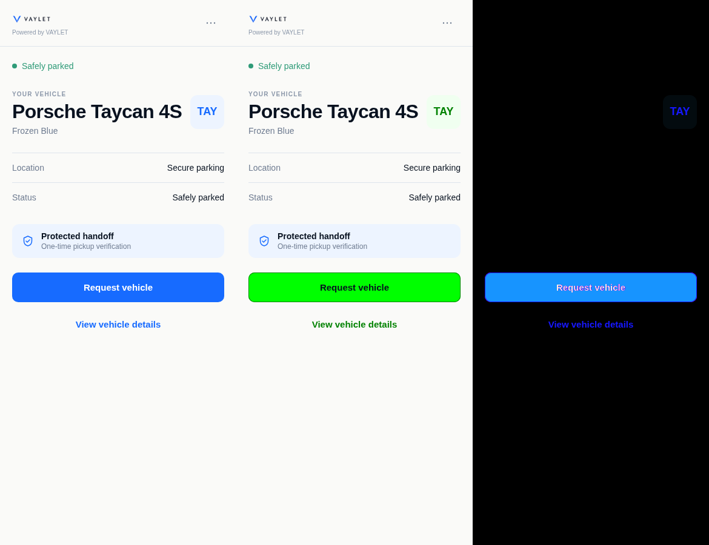
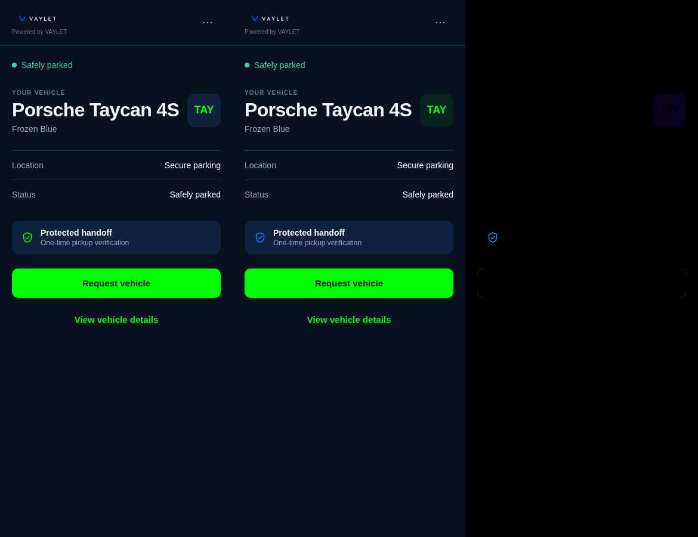
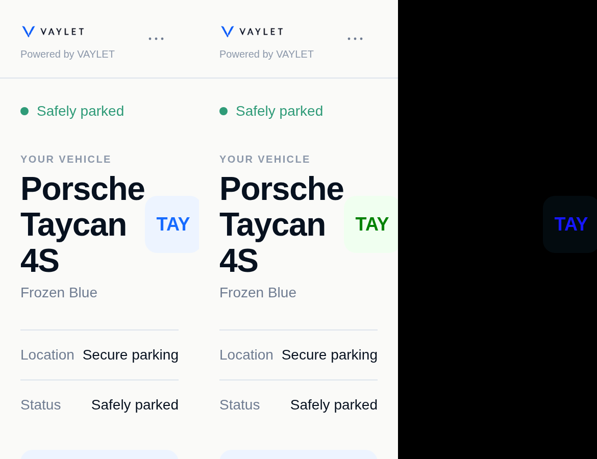

# Issue 338 — Customer primary branding, UI frozen

## Root cause and implementation

The scoped Guest Session projection was already correct. Existing server
resolvers (`guest-access-resolver.ts`, COALESCE at lines 39/95) derive display name and primary color from the persisted visit's
Location and Organization. #185/DEC-062 persistence and #239/DEC-085 consumption
remain the source of truth; there are no API, contract, DB or inheritance edits.

The previous `guest-branding.ts` used one candidate for both filled controls and
small accent text. It discarded the entire runtime palette unless the candidate
had 4.5:1 contrast against every theme surface. The Owner's `#00FF00` failed that
check in light mode and reverted to fixed blue. Colors that passed still left
fixed ice backings, identical hover/default colors, and a white selected-control
mark. The context-conflict sheet is a sibling of AppShell and could not inherit
its tokens. The previous blue alias also included security shields.

`guestBrandStyle` now validates the same canonical uppercase `#RRGGBB` contract
and produces one complete token bundle. Exact primary drives fills. A bounded
hue-preserving mix toward black/white produces readable text, small marks,
focus and boundaries; tint backs only existing brand-owned panels/selected
controls. White or dark content is selected deterministically, with black as
the mathematical contrast fallback. Hover/pressed fills maintain 4.5:1 against
the same content. Existing theme defaults remain the missing/invalid fallback.

`useGuestBrandStyle` shares the existing current-session/error/expiry selector
between AppShell and BottomSheet. No document-global token mutation, async theme
state, provider, inheritance calculation, dependency, route or workflow is added.
Existing request coordinator/client ownership rejects old responses. Mounted
regressions prove projection refresh/override/clear, session/location/Organization
switches, replacement loading, late A responses, invalid fallback, logout and
expiry against both shell and sibling sheet.

The full consumer inventory and justified exceptions are in [coverage.md](coverage.md).

## UI freeze and evidence

Authorized pixel differences are exact primary fills, contrast-safe content and
accent shades, the existing brand-owned panel/selected tint, hover/pressed fill,
keyboard focus color and the inset one-pixel contrast boundary. Security shields
use independent original theme blue; QR, status, severity, rating stars, disabled
opacity, neutral summaries and product logo remain independent of tenant primary.

No layout, header, card/button/sheet dimensions, typography, spacing, icon paths,
transitions, navigation, responsive breakpoint, RTL/LTR rule or workflow changed.
The inset boundary and focus outline do not change bounding boxes. The final
source diff was inspected file by file; generated Next type-file changes were
removed. All authored files remain within the structure policy.

The deterministic fixture exports all 22 existing demo screen renderers plus
confirmation, details, menu and context sheets and a shared-control view: 27
views in EN/LTR and AR/RTL, both themes, green/purple/fallback. It includes
live lifecycle, deferred payment/report/rating and system error presentations.
It does not activate any deferred product feature.

Browser evidence compares bounding boxes, leaf text, element order and all
computed non-color styles. Representative before/after PNGs also undergo pixel
mask comparison against actual changed-color consumer boxes. Black-background
third panels in `*-comparison.png` are absolute RGB differences; first/second
panels are before/after. Native 200% screenshots use compositor viewport capture.

## Verification commands and results

Commands use the repository-pinned pnpm 10.34.5. Logs/results are under `evidence/`.
Build uses `API_ORIGIN=http://127.0.0.1:3311` only for local verification.

| Command | Pass | Fail | Skip | Result |
|---|---:|---:|---:|---|
| `pnpm --filter @valet/customer test` | 481 | 0 | 0 | 67 files, final full Customer run |
| `pnpm --filter @valet/contracts exec vitest run src/guest-effective-branding.test.ts` | 2 | 0 | 0 | canonical Guest contract preserved |
| `pnpm --filter @valet/customer exec vitest run src/features/session/guest-branding.mounted.test.tsx src/features/session/guest-brand-palette.test.ts src/features/session/guest-branding.test.tsx --maxWorkers=2` | 36 | 0 | 0 | focused run; also covered by full suite |
| `QA338_RENDER=<before-or-after> pnpm --filter @valet/customer exec vitest run qa/issue-338/render.test.tsx` | 1/run | 0 | 0 | real-component HTML exports, 324 per phase |
| `node apps/customer/qa/issue-338/browser-compare.mjs` | 1296 | 0 | 0 | complete before/after matrix; identical geometry/non-color styles |
| `QA338_FILES='demo-payment-overview\|demo-receipt\|demo-payment-complimentary\|demo-report-issue\|menu' node apps/customer/qa/issue-338/browser-compare.mjs` | 240 | 0 | 0 | final semantic-exception/menu audit; identical geometry/non-color styles |
| `QA338_ZOOM=200 QA338_FILES='00FF00-(demo-parked\|confirm)' node apps/customer/qa/issue-338/browser-compare.mjs` | 32 | 0 | 0 | all widths/languages/themes, native zoom, identical geometry/non-color styles |
| `QA338_ZOOM=200 QA338_WIDTHS=390 QA338_FILES='en-(light\|dark)-00FF00-(demo-parked\|confirm)' node apps/customer/qa/issue-338/browser-compare.mjs` | 4 | 0 | 0 | compositor screenshot recapture; identical geometry/non-color styles |
| `node apps/customer/qa/issue-338/live-browser.mjs` | 48 | 0 | 0 | built app, 100%, four input states plus disabled and 16 expiry checks |
| `QA338_ZOOM=200 node apps/customer/qa/issue-338/live-browser.mjs` | 48 | 0 | 0 | built app, native 200%, DPR 2 in every case |
| `python3 apps/customer/qa/issue-338/pixel-compare.py` | 12 pairs | 0 | 0 | no pixels outside intended color consumers |
| `QA338_ZOOM=200 python3 apps/customer/qa/issue-338/pixel-compare.py` | 4 pairs | 0 | 0 | no pixels outside intended color consumers |
| `pnpm --filter @valet/customer lint` | N/A | 0 | N/A | exit 0, zero warnings |
| `pnpm --filter @valet/customer typecheck` | N/A | 0 | N/A | exit 0 |
| `API_ORIGIN=http://127.0.0.1:3311 pnpm --filter @valet/customer build` | N/A | 0 | N/A | optimized build and standalone-artifact validation, exit 0 |
| `pnpm architecture:check` | N/A | 0 | N/A | exit 0; 17 existing unrelated grandfather warnings |
| `git diff --check` | N/A | 0 | N/A | clean |

Contrast unit cases cover green, purple, default blue, black, white, yellow,
red, saturated blue, mid gray, threshold gray and pale blue, in both themes.
Ordinary brand text/content meets 4.5:1; accent/focus/boundary colors meet at least
4.5:1 against existing relevant surfaces, exceeding the 3:1 non-text target.
Primary hover/pressed are distinct and preserve foreground contrast.

Reruns and failed attempts: initial old #239 assertions failed (5 of 9) because
they expected valid bright/gray colors to be rejected; assertions now enforce
the new accepted behavior, with invalid input rejection retained. One new mounted
test initially failed because a Date.now spy installed after coordinator creation
did not advance its captured clock; fake time fixed the harness. Initial browser
attempts exposed the inline outline suppression (fixed in production), an invalid
font-import strip (fixed in the harness), animation/opacity sampling and a mouse
release that clicked the CTA (harness corrected). Native extension loading failed;
real X keyboard zoom replaced it. No test was disabled or broad baseline accepted.
An initial build lacked required local API_ORIGIN and failed before compilation;
the documented loopback build then passed. No unrelated historical test failures
were discovered in the executed focused checks.

## Limits and remaining risks

- These are synthetic browser/API fixtures and mounted client tests. Existing
  server inheritance/scoping implementation and integration tests were inspected;
  `apps/api/test/guest-effective-branding.integration.test.ts` was not executed, nor were other PostgreSQL/API integration suites. No DB credentials were
  configured for this task, and no production service was accessed.
- Static comparisons omit the external font-import request for deterministic
  offline rendering while preserving the original font-family declarations.
  Remote-font and physical-device rendering are not qualified. The production
  app retains its original font import. This is not full production acceptance.
- The full static matrix exercises normal screen/overlay presentation and
  existing demo loading/error/success views. Real asynchronous information and
  post-visit behavior are covered by existing Customer mounted tests; every
  asynchronous substate does not have a separate before/after PNG.
- Existing narrow-viewport/200% overflow, where present, is preserved. No
  responsive redesign or unrelated accessibility/color overhaul was attempted.

## Git delivery

Repository: `yamanradwan1-rgb/valet-platform`.
Base/current fetched main: `02fbee5512895fff2870d88f93d40d8edcefe44f`.
Dedicated branch: `fix/issue-338-customer-primary-branding-ui-frozen`.
The final chat delivery receipt records exact local/remote HEAD and push status.
The initial repository worktree was clean and remains untouched; implementation
uses an isolated worktree. Remote branch lookup found no existing #338 branch;
Issue #338 had no comments and no matching PR. Issues #239 and #185 are closed.
No PR, merge, force-push, deployment, production access or issue mutation is part
of this delivery.

## Representative screenshots

Each comparison reads before → after → absolute color difference. These use the
same original components, data, viewport and font availability in both phases.

Complete before/after confirmation/control pairs, purple cases and compact
machine results are in [evidence/](evidence/). The file-change inventory is
[file-inventory.txt](file-inventory.txt).
